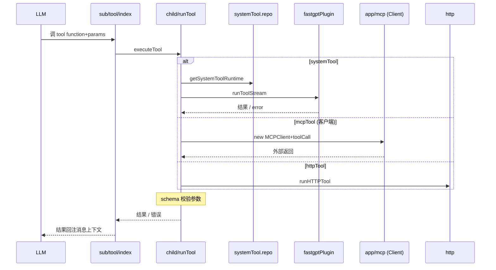
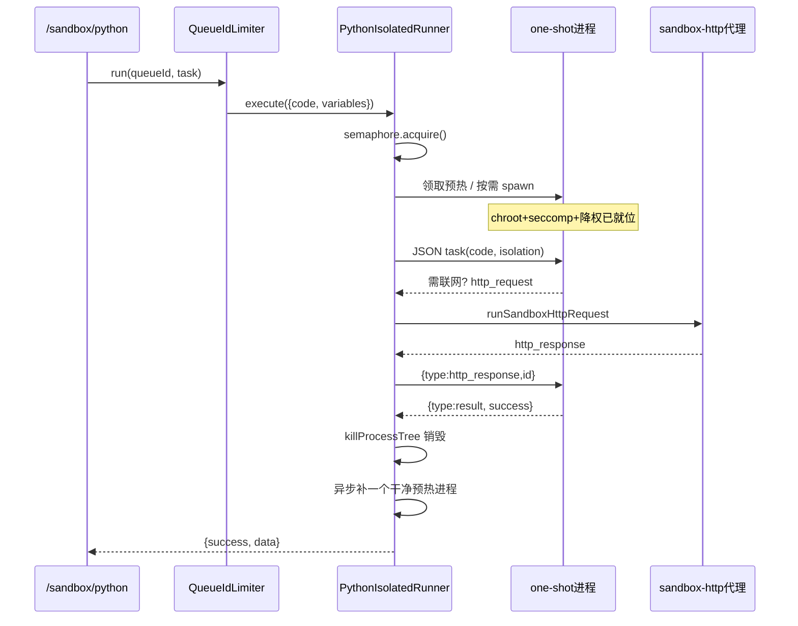

# 工具调用 · 双向 MCP · 代码沙箱：Agent 的动作边界

> 仓库根：`/Users/morehao/Documents/study/ai-agent/FastGPT`。
> 上一篇（[`knowledge-base.md`](knowledge-base.md)）讲了 Agent 的**数据型能力**（读得进什么）；本篇补上另一半：Agent 的**动作型能力**（能执行什么、在哪执行、边界怎么画）。
> 本模块 = 工具定义与注册 + 工具 schema 校验 + 错误传播与结果回注 + MCP 双向 transport 与服务治理 + 代码沙箱边界。所有结论均来自对真实源码的逐条核对。

## 总览与根因

前一篇「知识库」讲了 Agent 的**数据型能力**（读得进什么）。这一篇补上另一半：Agent 的**动作型能力**（能执行什么、在哪执行、边界怎么画）。

FastGPT 把「一次 LLM 对话」当作一个可编排的 workflow 运行时。工具不是散落的函数，而是 **workflow 里可被 LLM 选中并执行的节点**；MCP 是这套节点系统与外界服务的互操作协议；代码沙箱则是「允许 Agent 真正动手（跑脚本、读写文件、执行 shell）但又不把宿主放倒」的安全容器。三者合起来回答同一根因：

> **Agent 怎样在被信任的范围内，把「想做的事」变成「真实发生的副作用」？**

这条主线天然拆成四个问题，也是本文四大部分：

1. 工具怎么被声明、注册、校验并暴露给 LLM（`tools as nodes`）；
2. 工具结果与错误怎么回流到 Agent 循环（结果回注 / 错误传播）；
3. FastGPT 如何同时做 MCP 客户端（调外部）与服务端（被外部调）——"双向 MCP"；
4. 受限代码在哪里、以什么边界执行——两类沙箱（**工作流代码沙箱 code-sandbox** 与 **Agent 用户级虚拟机 sandbox**）。

## 在项目中的角色

FastGPT 的 Agent 体系分两层：**workflow 编排层** 与 **Agent-loop 循环层**。工具在两层都出现，职责不同：

- **workflow 节点层**：`工作流工具`（`plugin` / `tools` 节点）是 workflow 的普通节点，由 `dispatchRunTool`（`packages/service/core/workflow/dispatch/child/runTool.ts`）按 `toolConfig` 分派到 systemTool / mcpTool / httpTool 三种后端。节点层工具不依赖 LLM，是「编排里明确的步骤」。
- **Agent-loop 层**：Agent 节点把一批工具当成可选的 `function` schema 喂给 LLM，LLM 决定本轮调哪个。工具来源由 `toolProvider`（`createWorkflowAgentToolProvider`）编排，实际执行仍复用节点层的 `dispatchRunTool`。

三层依赖方向是稳定的单向链：`Agent 循环 → executeTool → runTool → dispatchTool/dispatchRunTool → 具体 provider`。这套结构保证「新增一种工具后端」只动最底层，Agent 循环与节点层的契约不变。

## 核心链路的全景

先给一张盖各环节的时序图，后续各节各讲其一。实体为仓库相对路径。

这条链路的**结果回注**本质：`dispatchRunTool` 返回的 `data`（`NodeOutputKeyEnum.rawResponse`）会以 LLM 可见的 `toolResponse` 形式灌回 agent-loop 的消息历史；`dispatchTool` 返回的 `response`（JSON string）同理。错误则走两条路——能预期的业务错误进 `nodeResponse.errorMessage`（不打断循环，让 LLM 看到失败原因自己改参数重试），致命/未知错误才 throw 出去由外层 `failChatRound` 兜底。

## 工具定义、注册与 schema 校验

### 工具如何被"声明为可执行节点"

工具不是手写的硬编码数组，而是**一层抽象 = 一个可执行单位**。三种工具各有其"声明"：

- **系统/商业工具**：定义在全局插件服务（`thirdProvider/fastgptPlugin`），运行时由 `SystemToolRepo` 实时拉取。它在 `system_plugin_tools` 集合里补配置（价格、`customConfig`、`secretsVal`、状态），DB schema 见 `packages/service/core/plugin/tool/systemToolSchema.ts`。工具核心（pluginId、io schema、子工具）来自插件服务的 `listTools` / `getTool`。
- **工作流工具**（`commercial-*`）：关联一个 App 版本。工具参数 schema 由那个 App 的 `pluginInput` / `pluginOutput` 节点动态推导（`workflowToolNodes2JsonSchema`）。
- **MCP 工具 / HTTP 工具**：由用户侧的"工具集 App"承载，`runTool.ts` 运行时到该 App 版本里解出 `mcpToolSet` / `httpToolSet` 的实际端点与子工具清单。

关键取舍在 `SystemToolRepo`：它是单体仓储，负责把多个来源**归一化成同一个 `SystemToolListItemType` / `SystemToolDetailType`**，业务层只做 `pick`。代价是文件很长（924 行），但换来了"无论工具来自插件服务还是 DB，展示与运行都走同一套契约"。

`getSystemToolList` 先从插件服务拉全部工具、再从 `system_plugin_tools` 拉配置 Map，把 DB 配置**附着**到插件工具上、再拼接"后台配置的工作流工具"，最后按 tag 命中数 + `pluginOrder` 排序。[packages/service/core/app/tool/systemTool/systemTool.repo.ts:311-368]() 注意插件工具是实时查询、每次打进插件服务，DB 只作配置覆盖层——这正是 README "系统工具热更新" 的语义：改插件服务那边的定义即生效，不必重启 FastGPT（缓存只留了 `TODO: 缓存` 占位）。

<!-- anchor: getSystemToolList = async ({ -->
<!-- anchor: return concatTools; -->

工具参数 schema 严格校验发生在运行时：`dispatchRunTool` 对系统工具调用 `assertToolRuntimeParams` 校验，对 MCP/HTTP 工具各自拿 `mcpTool.inputSchema` / `getHTTPToolRequestSchema(httpTool)` 校验（入口见 [packages/service/core/workflow/dispatch/child/runTool.ts:158]()，MCP 分支另在 `:310`、HTTP 分支在 `:347`）。这是「LLM 生成 JSON 参数 → 校验 → 再发送」的闸门，防止模型幻觉传错类型直接打到外部服务。

<!-- anchor: assertToolRuntimeParams({ jsonSchema: toolDetail.inputSchema, params: toolInput }); -->

### schema 的抽象类型

工具 schema 统一走 `ChatCompletionTool`（OpenAI function 形式）与自研 `jsonSchema` 两条并存路径：

- 暴露给 LLM 的是 `ChatCompletionTool`：[packages/global/core/ai/sandbox/tools/shell.ts:12-31]() 的沙箱 shell 工具即此形态。

<!-- anchor: export const SANDBOX_SHELL_TOOL: ChatCompletionTool = { -->

- 内部传递/校验用原生 JSON Schema。MCP 工具的 `inputSchema` 在 `MCPClient.getTools` 里做过 `$RefParser.dereference`（禁 file/http ref，防 SSRF 拉本地文件），把 `$ref` 展开成可直用的 object（[packages/service/core/app/mcp.ts:323-356]()）。

<!-- anchor: const tools = await Promise.all( -->
<!-- anchor:       return tools; -->

两层 schema 的桥是 `nodeInput2JsonSchema` 系列（`global/core/app/jsonschema`），它把 workflow 节点输入结构翻译成 OpenAI / JSON Schema 两种视角，保证"编排里配的参数"与"LLM 眼中的参数"是同一份。README 里"工具参数自定义 JSON Schema"对应：参数类型可选"自定义"，把一段 property JSON Schema 直接存进节点输入、运行时递给 LLM（`.agents/design/core/workflow/tool-params-custom-json-schema.md`）。

## 工具调用的三个后端：systemTool / mcpTool / httpTool

`dispatchRunTool`（节点层）与 `dispatchTool`（Agent-loop 层 dispatcher）是同一逻辑的两份实现，分别服务于「编排步骤」与「LLM 决策」。三个后端的关键差异：

| 后端 | 端点来源 | 连接生命周期 | 计费 |
|------|---------|-------------|------|
| systemTool | 全局插件服务 `runToolStream` | 每调用一次流式执行子工作流 | 系统/商业工具按 `currentCost+systemKeyCost`，个人插件只计子流程 |
| mcpTool | 工具集 App 版本里的 `mcpToolSet.url` + headerSecret | 同一 workflow 内以 `context.mcpClientMemory[url]` 复用连接，`closeConnection:false` | 不直接计工具费 |
| httpTool | `httpToolSet.baseUrl` + path + 静态头/体 | 无状态接一个 URL | 不直接计工具费 |

**systemTool 运行时安全**：`getSystemToolRuntime` 先 `assertSystemToolRunnable`（Offline 状态直接 `unExist` 拒绝），解密 `secretsVal` 作为密钥注入插件服务；调用前再对团队插件做 `assertTeamPluginSourceAccess`（防止用户把一个属于其它团队/无权引用的插件当工具执行），以及 `authRuntimeToolset(parentId)`（运行时用当前执行 tmbId 重新校验父工具集 App 读权限，防绕过保存接口的脏引用被执行）。secrets 有三态来源——团队级 / 手工传入 / 系统预置，按 `system_input_config.type` 择一。

`dispatchRunTool` 的密钥解密与校验闸门开在真正发送之前（[packages/service/core/workflow/dispatch/child/runTool.ts:120-158]()），发送走 `pluginClient.runToolStream` 并把 `systemVar`（app/chat/invokeToken/time）注入，让子工作流能感知是谁在什么上下文里调它。

<!-- anchor: // run system tool -->
<!-- anchor: const childId = toolConfig.systemTool.toolId.split('/')[1]; -->

**MCP 工具的 toolId 编码**：`runTool.ts` 的 `parseToolId` 需兼容两代格式——新版 `source-appId/toolName`（toolName 可含前缀 `/`），旧版 `source-appId/toolsetName/toolName`。因为 HTTP/MCP 子工具的 `toolId` 由用户操作持久化在工作流 JSON 里，运行时必须按当前执行身份重新鉴权，这正是 `authRuntimeToolset` 存在的意义（[packages/service/core/workflow/dispatch/child/runTool.ts:276-319]()，`parseToolId` 在 `:440-458`）。

<!-- anchor: } else if (toolConfig?.mcpTool?.toolId) { -->
<!-- anchor:   }; -->

## 错误传播与结果回注

### 三层错误语义

工具抛错不是一路 throw，而是按"可预期/致命"分三层：

1. **业务可预期错误**：插件返回 `res.error` 字段（对象或字符串）。`dispatchRunTool` 对"旧版兼容"（有错误对象 `error` 字段）直接把 `res.error` 当结果返回；对字符串错误 throw；对自定义错误字段走 `getNodeErrResponse`（[packages/service/core/workflow/dispatch/child/runTool.ts:208-237]()）。这层设计让「外部服务明确说：参数不对」能回到 LLM 视野里自我纠正。

<!-- anchor: if (res.error) { -->
<!-- anchor: const usagePoints = (() => { -->
2. **节点 catchError**：workflow 工具节点配了 `catchError` 时，捕获错误继续流程而非中断整条编排；未配 `catchError` 的旧版则退化为"把错误对象当输出"。这正是 code-sandbox 节点与工具节点共用的容错姿态（`packages/service/core/workflow/dispatch/tools/codeSandbox.ts:65-91`）。
3. **致命/未知错误**：只有完全不可恢复才 throw，由外层 `failChatRound` 落库为失败轮次。

**结果回注**的核心载体是 `DispatchNodeResponseKeyEnum`：`nodeResponse.toolInput/toolRes` 用于前端展示调用详情，`toolResponse` 用于把结构化工具结果喂回 workflow，`data`/`rawResponse` 用于后续节点消费。MCP 分支把结果包成 `{ [NodeOutputKeyEnum.rawResponse]: result }`，让下游能稳定读到"串行化后的工具返回值"。

### 计费与可观测

工具调用同时是计费点与埋点：`usagePush`/`computedAppToolUsage` 计算积分（系统工具失败返回 0 分、个人插件无条件计子流程分，见 `packages/service/core/app/tool/runtime/utils.ts:14-41`），`pushTrack.runSystemTool` 把 `{teamId,tmbId,toolId,result,usagePoint,msg}` 写入埋点，供运营核算与排查。

## 双向 MCP

"双向"是指 FastGPT 在同一套工具抽象上，同时扮演 MCP **客户端**（去调外部的 MCP server）与 MCP **服务端**（把内部 App 当 MCP tool 发布给外部 Client）。

### 入站（FastGPT 作 MCP 客户端）

`MCPClient` 封装 `@modelcontextprotocol/sdk`，连接优先走 **Streamable HTTP**，失败（4xx 类错误）再降级 **SSE**（因为部分老 server 只支持 SSE）。它在三处体现"信任但不盲目"：

- **SSRF 防线**：`createMcpSafeFetch` 用 `redirect:'manual'` 接管 SDK 默认自动重定向，对每一跳目标重新 `assertMCPUrlNotInternal`；跨 host/protocol 跳转时剔除 `authorization`/`cookie` 等敏感头，防止 MCP 密钥被带跳到内网新目标（[packages/service/core/app/mcp.ts:152-195]()）。

<!-- anchor: export const createMcpSafeFetch = ({ -->
<!-- anchor: throw new Error(`Maximum MCP redirects exceeded: ${redirectLimit}`); -->

- **schema 消毒**：`getTools` 拉工具时 `dereference` schema 且禁 file/http resolver，防 `$ref` 指向本地文件或内网。
- **连接内存账**：`getConnection` 缓存连接 Promise，成功可复用、失败即清空；`toolCall` 默认调用后 `closeConnection()` 释放，除非 workflow 内复用（`closeConnection:false`）。

值得注意的是 MCP 协议只有 `tools/list` | `tools/call` 被映射进内部工具调用；FastGPT 并没有把 MCP 的 resources / prompts 三元协议完整引入 client 侧——它只关心"最小的可调用面"（schema + 调用），把 resources/prompts 留给了服务端一侧的自定义实现。

### 出站（FastGPT 作 MCP 服务端）

服务器本体 `projects/mcp_server` 是一层**很薄的 SSE transport**：它把 SSE session 与 `/messages` 消息端点用 `transportMap[sessionId]` 关联起来（`projects/mcp_server/src/index.ts:18-103`），真正的业务（工具清单、执行工作流、鉴权）全部代理回 FastGPT App 的 `support/mcp/server/toolList` 与 `toolCall` 两个 API。这是关键架构决策：**MCP 服务器不进数据库，只转发**，避免在独立进程里再实现一套鉴权/编排。

出站执行链路（`projects/app/src/service/support/mcp/utils.ts`）：

- `getMcpServerTools(key)`：只按发布 key 读 `mcp_keys` 里绑定的 app 快照，为每个 App 的**最新版本**推导一份 MCP `Tool` schema——插件型 App 用 `pluginNodes2InputSchema`（pluginInput 节点），普通 App 用 `workflow2InputSchema`（chatConfig 变量）。刻意不做实时应用权限校验（`tools/list` 是"公开元数据"）。
- `callMcpServerTool(key, toolName, inputs)`：真正干活的函数。它把一次外部 MCP 调用**包成一个完整的内部 Chat 轮次**：构建 user message → `preChatRound` → `dispatchWorkFlow` 跑绑定 App 的 workfflow → `finalizeChatRound` 落库对话 → 取 pluginOutput 或 assistantResponses 文本串回给 MCP Client（`projects/app/src/service/support/mcp/utils.ts:185-394`）。也就是说，你外部 MCP Client 每次 `tools/call`，FastGPT 内部就跑了一遍完整 workflow 并把记录存进聊天库——MCP 与聊天链路在这里完全打通。

`mcp_keys` 的 schema 记录 `teamId/tmbId/key/authProxy/apps[]`，`key` 是唯一可寻址的发布凭证（`packages/service/support/mcp/schema.ts:12-57`）。

### 身份代理 authProxy

`callMcpServerTool` 默认以**发布者 tmbId** 作为执行身份；若发布项开启 `authProxy`，外部 Client 可带 `x-fastgpt-auth-proxy-username` 或 `x-fastgpt-auth-proxy-tmb-id` 请求头，由 `resolveMcpEffectiveTmbId` 解析成"团队内未离开的另一个成员"，再用该成员身份 `authAppByTmbId(..., ReadPermissionVal)` 校验应用读权限（`projects/app/src/service/support/mcp/auth.ts:35-95`）。两个头同时存在必须指向同一成员，防止双身份绕过。这是给"多租户里发布者与被调用者分离"的场景留的口子——发布 key 是可分发凭证，但执行归属和权限检查永远是"具体成员"。

**双向 MCP 的对比权衡**：客户端侧优先 Streamable HTTP、只映射 tools 三件套，换来"最小的可调用面"和 SSRF 收敛；服务端侧把 transport 剥离到独立进程、业务回注主 App，换来"复用全部权限/Auth/聊天落库"，代价是 mcp_server 与 App 版本必须同步发布（见设计文档）。

## 代码沙箱的两种形态

FastGPT 有**两个职责不同**的"沙箱"，容易混淆，先厘清：

| | 工作流代码沙箱 `projects/code-sandbox` | Agent 用户级虚拟机 `ai/sandbox` |
|---|---|---|
| 触发者 | workflow 里显式的「代码运行」节点 | Agent-loop 判定本轮需要动手（文件/shell 工具） |
| 环境 | Bun + Hono 进程内 worker 池 | Provider 上的独立 Linux 容器（opensandbox / sealosdevbox） |
| 边界 | 单进程级隔离 + 白名单 | 用户级 PVC 工作区 + 生命周期状态机 |
| 语言 | JS(Pool) / Python(one-shot) | 任意 shell/文件操作，可带 Skills |
| 定位 | 快速算一段代码（数据处理） | 长期持久的"虚拟机工作区"（Skilled Agent） |

入口对照：`dispatchCodeSandbox`（`packages/service/core/workflow/dispatch/tools/codeSandbox.ts`）调用 `codeSandbox.runCode({codeType, code, variables})`，走 HTTP 打到 `projects/code-sandbox` 服务的 `/sandbox/js|python`。而 Agent 虚拟机由 `ensureAgentSandboxRuntime`（`.../sub/sandbox/prepare.ts`）准备运行态，产出一个可复用 `SandboxClient` 供 `runSandboxTools` 调虚拟机内工具。

### 代码沙箱服务：Bun + Hono + 进程 worker

`projects/code-sandbox/src/index.ts` 是 Bun + Hono 的 HTTP 服务，对外暴露 `/sandbox/js`、`/sandbox/python`、`/sandbox/modules`。安全设计在入口就先堵：

- **body 字节级截断**：不直接 `c.req.json()`，而是流式读 body 按 `SANDBOX_API_MAX_BODY_MB` 截断，防止攻击者用超大 `variables` 绕过 `code` 字段长度限制造成内存压力（`projects/code-sandbox/src/index.ts:34-72`）。
- **认证**：配置 `SANDBOX_TOKEN` 时门 `/sandbox/*` 走 bearerAuth；未配置则告警（仅测试用）。
- **双层队列**：`jsPool`（ProcessPool）+ `pythonRunner`（PythonIsolatedRunner）+ `queueIdLimiter`（按业务 id 限流），在进入执行前先排队。

JS worker 池由 `BaseProcessPool` 实现（`projects/code-sandbox/src/pool/base-process-pool.ts`）：预热 N 个长驻 worker，stdin/stdout JSON 行协议通信，池内 acquire/release，超时、RSS 内存（按进程树 `getWorkerRSSMB` 聚类含子进程）、`killWorkerProcessTree` 兜底杀进程组。**资源边界的关键细节**：若管理员在 `SANDBOX_JS_ALLOWED_MODULES` 显式放开 `child_process` 类模块，`shouldRecycleAfterTask` 会让该 worker 在任务结束后**强制回收重建**——因为允许了后台进程就可能残留子进程/僵尸，长驻复用不安全（`projects/code-sandbox/src/pool/process-pool.ts:18-39`）。

### Python one-shot 隔离 runner（安全升级核心）

Python 曾是历史包袱：旧实现用长驻 `ProcessPool` + 进程内 denylist（`__import__` 白名单、受限 `open`、AST 检查），但 GHSA-5jmh-5f2m-89jg 证明 Python 反射链可绕过进程内限制拿到 OS 命令执行。因此重构为 **one-shot warm pool**（`projects/code-sandbox/src/isolated/python-isolated-runner.ts`）：

- 每个 Python 进程**最多执行一次用户代码，结束即销毁**，绝不复用执行过用户代码的解释器；
- Linux/Docker 下固定启用 **native 隔离**（Go c-shared library + `chroot` + `no_new_privs` + `seccomp` + `setgid/setuid 65537`），用户代码在降权后的固定 chroot 根里跑，`execve/execveat/ptrace/mount` 等被 seccomp 拒；
- 预热进程只完成 `init` 协议（隔离已就位），任务来时领取；无空闲则按需 spawn；
- 每个任务分配**独立临时目录**（matplotlib 等会写盘），用 `SANDBOX_MAX_TMP_MB` 限制临时文件体积，父进程在 child cleanup 里递归删除，覆盖超时/内存超限等 Python finally 跑不完的路径（`projects/code-sandbox/src/isolated/python-isolated-runner.ts:217-249, 512-529`）；
- **网络不出 syscall**：Python 子进程要访问外部网络只能调 `http_request` helper，父进程接手 → `runSandboxHttpRequest`（[projects/code-sandbox/src/utils/sandbox-http.ts:39-145]()）集中做协议白名单、SSRF（`isInternalAddress` + **DNS pinning** 把解析结果逐一判内网）、请求次数/体积/耗时、响应体积限制。子进程本身不能发网。

<!-- anchor: export async function runSandboxHttpRequest({ -->
<!-- anchor:   }); -->

**为什么要 one-shot + native 双保险**：进程内 denylist 是"红队可逐案绕过"的知识性防线，而 `chroot+seccomp+setuid+one-shot` 是"即使内存被攻破也只能在这个孤立、降权、一次性进程里"的结构性防线——多租户安全边界不该建立在"用户代码不会聪明"这一假设上。这是"安全优先级高于短任务吞吐"的显式取舍：one-shot 让高并发稳态吞吐不复用长驻池，设计文档里已注明可用 forkserver 等后续优化方向，但当前先硬保安全。

### queueId 并发限流

`QueueIdLimiter`（`projects/code-sandbox/src/utils/queue-id-limiter.ts`）在 pool 队列之上再加一层**业务语义队列**：同一 `queueId`（如 `team-xxx`）最多 `SANDBOX_QUEUE_ID_CONCURRENCY` 并发进入执行流程，其余 FIFO 等待；不同 queueId 互不阻塞；未启用或空 queueId 直接放行完全兼容旧调用。两层队列职责分离——queueId 层管"业务配额"，pool 层管"物理 worker 分配"，避免把业务排队规则耦合进 worker 生命周期。

## Agent 用户级虚拟机沙箱

这是一套更重的、讲究"长期状态"与"多租户资源治理"的沙箱，独立成模块 `packages/service/core/ai/sandbox`，分三层：`interface`（对外稳定入口）→ `application`（编排）→ `infrastructure`（仓储/provider）。外部生产代码只能从 `interface/*` 引用（`packages/service/core/ai/sandbox/interface/runtime.ts:12-51`）。

### 用户级归属与生命周期状态机

关键不变量：普通 App 聊天不再按 `chatId` 各自开沙箱，而是收敛为**用户级** `app + effectiveUid`——同一 App、同一有效用户的多个 chat 共享一个物理沙箱和 workspace，`chatId` 只用来区分 `sessions/<chatId>` 默认工作目录。`sandboxId = app-<hash(appId-effectiveUid)>` 是稳定物理标识。这套"用户级 liveness"是最重要的架构决策：为每个 chat 开沙箱是多租户资源的灾难（爆炸半径、费用、PVC 数），收敛到用户级后，一个用户一个工作区，租约/生命周期才有意义（`.agents/design/core/ai/sandbox/user-level-sandbox.md`）。

生命周期不是简单的开关，而是**状态机 + operation**：实例表 `agent_sandbox_instances_v2` 以 `(provider, sandboxId)` 与 `(sourceType, sourceId, userId)` 双唯一约束，`status` 是唯一权威，`operation` 只记录 token/phase/heartbeat（[packages/service/core/ai/sandbox/type.ts:120-157]()）。过渡态 `provisioning/legacyMigrating/stopping/archiving/restoring/deleting` 各配唯一 operation 类型，稳定态（running/stopped/archived）不许残留 operation——`superRefine` 在 schema 层面就拦住"稳定态却带着 operation"的脏数据。

<!-- anchor: export const SandboxInstanceZodSchema = z -->
<!-- anchor:   }); -->

`application/lifecycle/runner.ts` 是所有生命周期操作的 **durable 外壳**：先 `claimSandboxOperation` 抢占 operation（Mongo CAS），再按 `steps[].fromPhase → toPhase` 逐个执行远端副作用、每个副作用后用 `advanceSandboxOperation` 原子推进 phase checkpoint，最后 `completeSandboxOperation` 提交终态或 `deleteClaimedSandboxRecord` 删记录。失败用 `markSandboxOperationFailed` 保留过渡态 + phase + 错误，交给原操作重试或 stale recovery 接管，**绝不允许直接把过渡态改回 running**。每一步都过 `lease.assertValid()` 确保锁还活着（[packages/service/core/ai/sandbox/application/lifecycle/runner.ts:94-222]()）。这套"claim → phase checkpoint → terminal commit"的协议保证：即使 Provider/volume/S3 副作用中途崩溃重启，也能从持久化的 phase 续跑，而不是重放或读脏。

<!-- anchor: export async function runSandboxLifecycleOperation( -->
<!-- anchor:     throw error; -->

### OpenSandbox 的 PVC 竞态修补

`opensandbox-pvc-lifecycle.md` 记录了真实踩坑：以前把 DELETE 的 2xx 当作"删除完成"、把任意 GET 200 当作"可用 PVC"，导致可能过早发布 `archived`，或把正在 `Terminating` 的 claim 带进恢复。修补后的不变量：`remove()` 返回时锁定 UID 已消失或被替换；DELETE 带 UID precondition 防误删同 name 新 PVC；`ensure()` 不返回带 `deletionTimestamp` 的 PVC。volume 删除确认做成 **checkpoint 化的阶段**（`archiveUploaded → providerDeleted → volumeDeleted → archived`），中断后从该 phase 续跑不重放归档上传。

### 虚拟机内工具执行

准备阶段由 `ensureAgentSandboxRuntime`（`sub/sandbox/prepare.ts`）编排：`prepareAgentSandboxRuntime` 算出 session/skill/workspace 路径 → 进入 `withAgentSandboxInitLease`（Redis lease 串行化同一 sandbox 的初始化）→ `prepareSandbox` 顺序跑若干 step（镜像源、注入输入文件、注入已发布 Skill 版本、跑 entrypoint、扫描 `SKILL.md`）。步骤是**可组合的纯数据管道**（`SandboxPrepareStep`），场景只挑自己需要的 step，通用 prepare 层不读业务 DB。

工具执行 `runSandboxTools`（[packages/service/core/ai/sandbox/application/toolCall/index.ts:60-102]() 的上半段）解析 LLM 传来的 JSON 参数，按工具 `zodSchema` 校验，命中 `ToolMap` 后拿已准备的 `SandboxClient` 执行；未知工具名返回 `success:false + Unknown sandbox tool`。沙箱工具共有 8 个（`sandbox_shell/read_file/write_file/edit_file/grep/find/ls/get_file_url`），定义在 `global/core/ai/sandbox/tools`（shell 例见 `packages/global/core/ai/sandbox/tools/shell.ts:12-31`），执行实现在 `application/toolCall/*.tool.ts`——**定义声明与执行实现分离**，schema 与实现通过 `ToolDefinition` + `createToolRunner` 类型关联，`zodSchema` 负责约束、`execute` 只收已校验的 params。

<!-- anchor: export const runSandboxTools = async ({ -->
<!-- anchor:     durationSeconds: getDuration() -->

这种"声明与实现分离"的注册形态由 [packages/service/core/ai/sandbox/application/toolCall/type.ts:19-60]() 的 `ToolDefinition`/`createToolRunner` 承载：`zodSchema` 先约束参数、`execute` 只收已校验的 params。

<!-- anchor: export type ToolDefinition< -->
<!-- anchor:   }; -->

### 缺省可用性降级

普通 App 聊天在沙箱不可用（`systemDisabled` / `appDisabled` / `teamPlanUnavailable`）时**静默降级**：不注入沙箱 prompt/tools、不准备 runtime、不执行 entrypoint，但其余模型/知识库/工具照常跑。Skill Edit 与 Skill 调试保持强依赖、结构化报错。这是"把可选能力与核心能力解耦"的设计——沙箱是增强件，不应成为整个 Agent 的单点故障（`.agents/design/core/ai/sandbox/user-level-sandbox.md` §8）。

## 与其他模块协同

<!-- markdown 里不能有 fenced anchor，改用下方文字引述。 -->

- **与 workflow 工具节点**：Agent-loop 与节点层的工具执行共用 `dispatchRunTool` / `SystemToolRepo`；`createWorkflowAgentToolProvider` 把 runtime 工具、数据集搜索、读文件、plan/ask/sandbox 内部工具**拆成两类**——业务 tools 与 agent-loop 内部工具，避免 internal tool 混进用户可选的业务工具集。
- **与 chat 链路**：出站 MCP 调用 `callMcpServerTool` 直接复用 `preChatRound` / `dispatchWorkFlow` / `finalizeChatRound`——一次外部工具调用就是一次内部 Chat 轮次，天然获得对话历史、usage、S3、消息落库的全部能力。【待复核】这意味着每条 MCP 工具调用都会生成内部聊天记录与计费，量大时可能造成 DB 膨胀，值得运营观察。
- **与 app/tool**：系统工具、HTTP 工具、MCP 工具的"工具集 App"都以 `AppToolSourceEnum` 前缀编码在 `toolId` 里（`mcp-<appId>/<name>`、`commercial-<rawId>`），`parseToolId`/`splitCombineToolId` 负责往返解析。
- **权限/团队限制**：团队插件安装表 `team_installed_plugins` 记录 `installedByTmbId`，运行时 `assertTeamPluginSourceAccess` + `authAppByTmbId` 双保险；发布 key 的 `authProxy` 是 owner-only 开关。【待复核】跨模块的"团队可安装插件集"权限是否统一由 `teamPluginPolicy.ts` 裁决。

## 关键设计决策

**决策一：进程级隔离 + one-shot 而非纯进程内 denylist（Python）。** 根因是 GHSA 反射链证明 denylist 结构性不可靠。取舍：牺牲高并发稳态吞吐（不复用解释器），换来"安全不依赖用户代码不聪明"。可迁移到任何"执行不可信代码"的多租户系统。

**决策二：MCP 双向但业务全部回注主 App。** 客户端侧只映射 tools、服务端侧 transport 剥离到 mcp_server 但 logic 在 App 内。取舍：避免在独立进程重写鉴权/编排/落库，但引入"版本必须同步发布"的耦合。这解释了为什么 mcp_server 极薄（118 行）——它只是把 SSE 粘到两个 HTTP API 上。

**决策三：用户级 liveness 收敛沙箱规模。** 从 chat 级降到 user 级共享 workspace，配生命周期状态机 + lease 分层。取舍：牺牲"每 chat 独立环境"的隔离粒度，换到多租户下 PVC/费用/管理面可控。副作用是要做 Legacy 迁移（把历史 chat 级工作区合并/搬入用户级目标）以保护既有数据。

## 亮点与问题

**亮点**
- 环境安全的多层纵深：body 截断 + token 认证 + 进程级/one-shot/native seccomp + SSRF/DNS-pinning + 双层队列，每一层都防一类绕过，且"安全边界不建立在软限制上"。
- 生命周期 operation runner 的 durable checkpoint 协议，让长时间、多副作用的 Provider 生命周期可中断续跑、可 stale 接管，是同类系统里少见的高成熟度工程。
- "系统工具热更新 + 归一化仓储"：工具从插件服务实时拉取、DB 只补配置，改定义不重启，是把"配置面"与"实现面"解耦的干净做法。

**问题 / 风险**
- `SystemToolRepo.getSystemToolList/download` 大量 `TODO: 缓存`：每次工具列表/详情实时打插件服务，热更新是以延迟和插件服务 QPS 为代价的；单组织规模可行，超大规模下需要缓存与失效策略【待复核】。
- `dispatchRunTool` 与 `dispatchTool`（Agent dispatcher）是同一逻辑的两份实现，且要同时兼容新旧两代 toolId 编码——维护面高，改动易漏一边（runTool.ts 已留大量 `// old version compatible` 分支）。【待复核】是否可收敛到单一 dispatcher。
- 出站 MCP 把每次 tools/call 当一次完整 Chat 轮次落库，语法简单但**语义粒度重**；高 QPS 外部集成下，聊天表与 usage 表增长需要关注。【待复核】
- `dispatchTool` 的 `system_input_config.type === team` 分支是 `Promise.reject('This is not supported yet')`——团队级密钥注入仍是 TODO，意味着当前只能用 manual/system 两类密钥来源；`runTool.ts` 的 team 分支同样是显式未实现。
- one-shot Python 稳态吞吐受"每次销毁重建"约束，虽经 warm pool 缓解首批延迟，但设计文档明示这是安全换吞吐的主动取舍。

## 覆盖率

以本模块**核心源码**（工具注册/校验/执行、MCP 双向、两类沙箱的运行实现）为分子，我通读全文的文件如下：

| 文件 | 总行数 | 已读 | 覆盖率 | 未读原因 |
|---|---|---|---|---|
| app/tool/systemTool/systemTool.repo.ts | 924 | 924 | 100% | — |
| workflow/dispatch/child/runTool.ts | 458 | 458 | 100% | — |
| workflow/dispatch/ai/agent/sub/tool/index.ts | 354 | 354 | 100% | — |
| app/mcp.ts (MCPClient) | 442 | 442 | 100% | — |
| mcp_server/src/index.ts | 118 | 118 | 100% | — |
| mcp_server/src/api/fastgpt.ts | 16 | 16 | 100% | — |
| app/src/service/support/mcp/utils.ts | 395 | 395 | 100% | — |
| app/src/service/support/mcp/auth.ts | 95 | 95 | 100% | — |
| support/mcp/schema.ts | 64 | 64 | 100% | — |
| code-sandbox/src/index.ts | 270 | 270 | 100% | — |
| code-sandbox/src/pool/base-process-pool.ts | 627 | 627 | 100% | — |
| code-sandbox/src/pool/process-pool.ts | 41 | 41 | 100% | — |
| code-sandbox/src/isolated/python-isolated-runner.ts | 617 | 617 | 100% | — |
| code-sandbox/src/utils/queue-id-limiter.ts | 105 | 105 | 100% | — |
| code-sandbox/src/utils/sandbox-http.ts | 145 | 145 | 100% | — |
| ai/sandbox/application/lifecycle/runner.ts | 222 | 222 | 100% | — |
| ai/sandbox/application/toolCall/index.ts | 173 | 173 | 100% | — |
| ai/sandbox/application/toolCall/type.ts | 60 | 60 | 100% | — |
| ai/sandbox/interface/runtime.ts | 108 | 108 | 100% | — |
| ai/sandbox/type.ts | 158 | 158 | 100% | — |
| ai/sandbox/config.ts | 38 | 38 | 100% | — |
| ai/sandbox/error.ts | 37 | 37 | 100% | — |
| workflow/dispatch/tools/codeSandbox.ts | 92 | 92 | 100% | — |
| workflow/dispatch/ai/agent/sub/sandbox/prepare.ts | 243 | 243 | 100% | — |
| global/core/ai/sandbox/tools/shell.ts | 32 | 32 | 100% | — |
| global/core/plugin/tool/type.ts | 63 | 63 | 100% | — |
| plugin/tool/systemToolSchema.ts | 132 | 132 | 100% | — |
| workflow/dispatch/ai/agent/toolProvider/createWorkflowAgentToolProvider.ts | 113 | 113 | 100% | — |
| workflow/dispatch/ai/agent/adapter/toolCatalog.ts | 30 | 30 | 100% | — |

**核心链路文件合计**：约 6504 行全部通读，未读文件主要是 `application/toolCall/*.tool.ts` 各具体工具实现（`editFile/grep/find/ls/readFile/writeFile/getFileUrl/shell.tool.ts`）、`infrastructure/provider/*`（opensandbox/sealosdevbox adapter）、`application/runtime/*`（client/prepare/entrypoint/skill）、`legacyMigration/*` 迁移细节、`projects/agent-sandbox` 的 Dockerfile/entrypoint。这些属于"策略实现细节"，对主线（工具双向 MCP + 沙箱边界）不构成新的设计观点，故按需略读；若需深读其中任意一块可在续篇展开。**主线设计意图覆盖达标 ✅**（正文依赖的关键调用/类型/状态机均已落入上文引用锚点）。

