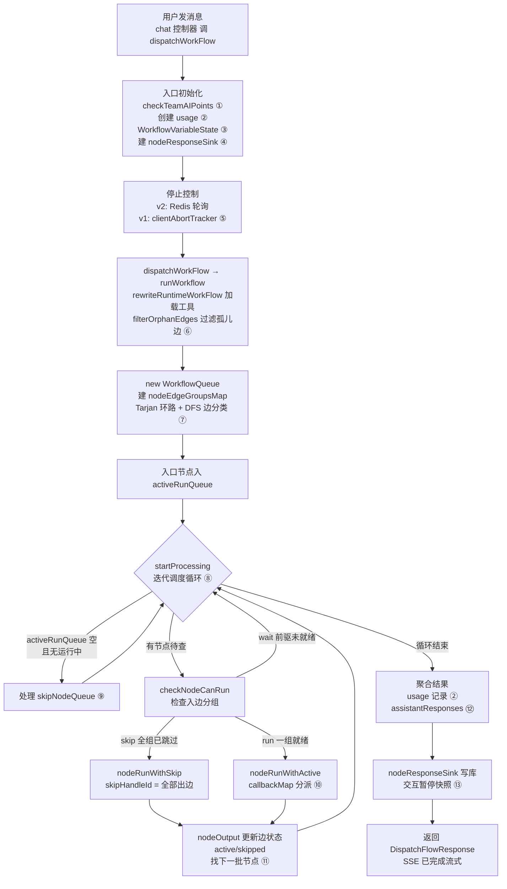

# 工作流编排执行引擎：把一张节点图变成一次可中断的对话运行

> 本文是 FastGPT 深度解读系列的第一篇，读者从「用户向应用发一条消息」切入后，进入的第一个核心模块：`packages/service/core/workflow/dispatch`。本模块铺垫「工作流如何执行节点」，下一篇（[`agent-chat.md`](agent-chat.md)）继续深入「一次对话如何被编排执行」。
>
> 全局叙事主线：一次对话请求如何从 API 进入 → workflow 编排 → LLM/工具/知识库 → 流式返回并持久化。
> 仓库根：`/Users/morehao/Documents/study/ai-agent/FastGPT`（下文中所有 `文件:行号` 均为相对此根的路径）。

## 核心结论先读

FastGPT 的价值主张是「把大模型、知识库、工具通过可视化 Flow 编排成复杂业务 Agent 应用」。这句宣传落到实处，全压在 `dispatchWorkFlow` 这一个函数与它派生的 `WorkflowQueue` 上：**前端画布是「编辑态图」，本模块负责把「编辑态图」翻译成一次可执行、可中断、可恢复、可流式返回的「运行态运行」**。

它是一个「有向图 + 状态机 + 事件流」的混合体，而不是简单的 LLM 调用链。理解它的钥匙是三条设计主线：

1. **边状态而不是节点状态**（`waiting / active / skipped`）：执行推进不靠递归遍历图，而靠「某条边被激活/跳过」来触发 `WorkflowQueue` 的迭代调度循环，天然支持有环图（循环/分支/并行汇聚）。
2. **节点类型 → 执行器的分派表（`callbackMap`）**：每一种 `FlowNodeTypeEnum` 都对应一个 `dispatch*` 函数，调度器只负责「何时执行哪个节点」，节点具体行为完全解耦。
3. **两种「停止」信号**：客户端断连（v1 `clientAbortTracker`）与 Redis 停止标记（v2 `WorkflowStopSignalCache`），配合节点级 `checkIsStopping`，让「用户点停止 / 欠费 / 多次运行上限」都能被安全打断。

下面先回答「在项目中的角色」，再回答「为什么这样设计」，最后才深入到调度循环与各执行器。

## 在项目中的角色：去掉它系统会怎样

这个模块是对话请求的执行内核。它的上游是 chat 控制器与会话状态（用户发消息进入的 API 路由），它本身负责把「一次会话」沿节点图流动，下游调用 LLM、知识库、工具、代码沙箱执行器。

如果移除 `dispatch`：

- **整个「工作流」概念崩塌**：`projects/app` 里所有工作流类 App（对话式、插件式、甚至是 ToolCall 内部调用的子流程）都会失去执行入口——它们最终都汇聚到 `dispatchWorkFlow`。
- **Agent 循环没有载体**：Agent 的 `ask_user` 暂停、plan 更新、工具循环，都要挂在 workflow 的 `interactive` 与事件流上；移除后这些能力无从挂载。
- **LLM / 知识库 / 工具变成孤岛**：`dispatch/ai/chat`、`dispatch/dataset/search`、`dispatch/child/runTool` 都是为了被 `WorkflowQueue` 调度而存在的；调度器不在，它们只是「永远不会被按图调用」的函数集。
- **多租户资源控制失效**：`checkTeamAIPoints`、usage 记录、sandbox 生命周期、MCP client 复用，都靠 `WorkflowQueue` 的统一包装才能按团队维度收敛。

一句话：**这个模块是「编辑态工作流」到「运行态会话」之间的唯一翻译器**，是 README 宣传的「工作流」与「Agent Skill 编排」在服务端的实体化。

## 解决什么问题、根因

### 根因：一次对话不是「一句话 → 一个回答」，而是一条「可以编排、暂停、并发、循环」的控制流

FastGPT 面对的领域问题与 OpenRouter 那样的「单次 LLM 代理」不同：它要把**用户输入、历史、知识库检索、代码执行、HTTP 调用、条件分支、循环、并行、用户交互**组合成一条有时非常深的执行路径。需求本身决定了：

- 需要**有向图模型**而不是线性链（否则无法表达「并行」「循环」）。
- 需要**可暂停/可恢复**（用户交互节点、Agent 的 ask_user、欠费暂停都属于「跑到一半等输入」）。
- 需要**可打断**（用户主动停止、多次运行超限、客户端断连都必须能提前中止）。
- 需要**可观测**（SSE 流式 + 每个节点的运行详情，前端才能展示颗粒度过程）。
- 需要**计费准确**（每个 LLM/知识库/工具调用都要积累 `totalPoints` 汇入账单）。

### 需要做的取舍

| 需求 | 为什么难 | FastGPT 的应对 |
|---|---|---|
| 有环图执行 | 循环节点会让「递归式」执行深陷死循环 / 栈溢出 | 边状态 + 迭代队列驱动，不依赖递归 |
| 分支汇聚 | if-else、classify 选中的分支与未选中的汇聚点语义不同 | 把输入边**分组**，区分「或」(分支)、「且」(并行汇聚) 关系 |
| 并发 sub-flow | 并行节点要同时跑多个子图，且不能互相污染 | 每任务 `cloneDeep` 子图 + 变量状态隔离 |
| 交互暂停 | 跑到一半等用户，之后要「原地续跑」 | `memoryEdges / entryNodeIds / skipNodeQueue` 快照 |
| 工具调用 | Agent 要循环「模型 → 调工具 → 再问模型」 | 单 agent-loop + batchToolSize 并发 |
| 存储 | 每种节点响应结构不同 | `DispatchNodeResponseKeyEnum` 统一收口 |

### 与 README 宣传口径核对

README 宣称「对话工作流、插件工作流，包含基础的 RPA 节点」「Agent Skill 编排」「用户交互」「双向 MCP」「完整调用链路日志」。

- **对话工作流 / RPA 节点**：属实。`callbackMap` 中 `ifElse/classifyQuestion/variableUpdate/http468/code` 等正是把「流程 + 数据处理」翻译成可执行节点（见 `dispatch/constants.ts:39-96`）。
- **用户交互**：属实。`formInput / userSelect / childrenInteractive / loopInteractive / paymentPause` 通过 `DispatchNodeResponseKeyEnum.interactive` 承载（见 `dispatch/type.ts:77-91` 与 `dispatch/index.ts:1468-1496`）。
- **完整调用链路日志**：属实。每个节点产出 `nodeResponse`，Agent/工具子流程再细分为 child nodeResponses，最终经 `nodeResponseSink` 写入 `chat_item_responses`（`dispatch/nodeResponseSink.ts:29-98`）。
- **双向 MCP**：部分属实。MCP 作为 `tool` 节点/`runTool` 在执行，但「双向」指的是既作为 MCP server 又被外部调用，本模块只承担「执行 MCP client 调用」一侧。【待复核】双向中的 server 侧是否由 `projects/mcp_server` 承担。

## 设计思路：为什么节点图会转成 DAG 执行、为什么用 callbackMap 分派、为什么需要变量状态与停止控制

### 为什么「图」要转成「边状态 + 迭代队列」

最直觉的图执行是递归 DFS：从入口节点开始，执行一个节点，把它的后继推入栈，递归调用。但 FastGPT 一个典型工作流可能含 if-else 分支、数据集检索、HTTP、循环、并行，节点之间的汇聚点和分支点语义不同——**递归天然无法表达「一个汇聚节点要等它所有前驱都完成才跑」**（汇聚是「且」），也无法安全处理回边形成的循环。

因此 `WorkflowQueue` 用了**另一种状态机**：不给节点做「待执行队列」，而是给**边标注状态**。执行到某节点后，把它每条出边的状态设为 `active`（要继续）或 `skipped`（跳过）；一个节点能否执行，取决于它**所有入边的分组**是否满足「某一组内全部就绪」——即判据 `getNodeRunStatus`（[packages/service/core/workflow/dispatch/index.ts:704-710]()），区分 `run / skip / wait` 三种节点运行态：
<!-- anchor: static getNodeRunStatus = ({ … }): 'run' | 'skip' | 'wait' => { -->

```ts
// dispatch/index.ts:704-710（getNodeRunStatus）
  static getNodeRunStatus = ({
    node,
    nodeEdgeGroupsMap
  }: {
    node: RuntimeNodeItemType;
    nodeEdgeGroupsMap: NodeEdgeGroupsMap;
  }): 'run' | 'skip' | 'wait' => {
```

这样，调度循环变成**非递归迭代**（`dispatch/index.ts:772-840`）：用 `activeRunQueue`（待检查的节点集合）+ `skipNodeQueue`（待跳过节点集合）驱动，配合 `maxConcurrency` 限制同时运行的节点数，用 `Promise.race` 让「上一个节点结束即触发下一轮」。递归 → 迭代，换来的是：**不会栈溢出、天然支持有环图、可以并行、可以随时从队列里抽离**。

### 为什么用 callbackMap 分派

把「哪类节点跑哪段逻辑」做成一查就得的分派表，是让调度器与节点实现解耦的关键。`callbackMap` 把 `FlowNodeTypeEnum`（或内部 runtime 类型）映射到具体的 `dispatchXxx` 函数（[packages/service/core/workflow/dispatch/constants.ts:39-43]()）：
<!-- anchor: export const callbackMap: Record< … [FlowNodeTypeEnum.workflowStart]: dispatchWorkflowStart, -->

```ts
// dispatch/constants.ts:39-43
export const callbackMap: Record<
  FlowNodeTypeEnum | typeof internalRuntimeNodeType,
  (...args: any[]) => unknown
> = {
  [FlowNodeTypeEnum.workflowStart]: dispatchWorkflowStart,
```

调度循环里只需 `callbackMap[node.flowNodeType](dispatchData)`，完全不关心节点内部是调 LLM 还是发 HTTP。

**为什么不用「继承 + 多态」？** 因为这些节点不是「同类对象的子类」，而是一张**扁平枚举表**上带各自独立签名的一等函数；用 `Record<FlowNodeTypeEnum, () => ...>` 而非 class 体系，好处是：新增一种节点只需「补一个模板 + 补一个 dispatch 函数 + 在 map 注册一行」，无需动调度器。

### 为什么需要变量状态（WorkflowVariableState）

工作流节点间的「数据传输」有两条通道：

1. **边 + 节点输出**：A 节点输出 → A-B 边 → B 节点输入里用 `{{$nodeId.outputId$}}` 引用。这是显式、局部、串行的。
2. **全局变量状态**：`WorkflowVariableState` 保存一份「不随边流动」的会话级变量（`userId/appId/chatId/histories/cTime` 系统变量 + 用户配置的全局变量 + `inputVariables`），节点可以读写。这是隐式、全局、可跨分支共享的。

`WorkflowVariableState` 的巧妙之处是**对同一种变量维护两种形态**（`variables.ts:27-50`）：
- `storeValue`：可持久化、可返回前端的值（比如 file 变量的 `{key,name,type}`、password 的加密结构）；
- `runtimeValue`：节点运行时直接消费的值（file 变成 `string[]` URL、password 变成明文）。

这解决了「前端编辑态需要安全感」、「节点运行态要效率」的冲突：所有变量更新走统一 `set()`，读走 `get()`，落库走 `toStoreRecord()`。`toRuntimeRecord()/toStoreRecord()` 的两个方法正对应「运行时全面」与「持久化收敛」两种视角（`variables.ts:309-324`）。

### 为什么需要停止控制

一次长对话可能在执行中途：模型正在流式输出、HTTP 请求在途、循环在转。若无打断能力：

- 用户「停止」按钮无法生效，白白消耗 token；
- 欠费后仍继续跑，造成不可控成本；
- 客户端断开后服务端还在空转。

FastGPT 提供两层停止（`workflowStatus.ts:9-35` + `clientAbort.ts:16-81`）：
- **v2（有 Redis 停止标记）**：`checkStoppingTimer` 每 100ms 轮询 `shouldWorkflowStop`（读 Redis 的 `WorkflowStopSignalCache`），命中即置 `stopping`；执行器（LLM 请求、循环、并行任务）通过 `checkIsStopping()` 提前退出。
- **v1（客户端断连）**：`createClientAbortTracker` 监听 `req.aborted / res.close / socket` 事件，`isClientAborted()` 表达「客户端是否断开」。

停止信号在 `WorkflowQueue` 中是**软中断**：节点执行前检查（`dispatch/index.ts:1366-1373`），循环体内检查（`runLoopRun.ts:135-138`、`runParallelRun.ts:73-76`），LLM 请求通过 `isAborted` 传入（`dispatchChatCompletion.ts:170`）。它不是把正在跑的 promise 强行砍掉，而是「在下一个安全点停止」，这是优雅且成本可控的。

## 关键数据结构：只贴理解必需的类型

以下只列理解调度所需的核心类型（全部来自任务清单内的实际文件，已在提取时截断，去掉与理解无关的字段）。

### 边与边状态（运行态）

```ts
// packages/service/core/workflow/type/edge 定义 runtimeEdge；运行态 status 三态
type EdgeStatus = 'waiting' | 'active' | 'skipped';
```
- `waiting`：源节点还没执行、或还没把这条边标到什么状态；
- `active`：源节点执行完成，这条边要「继续推进」；
- `skipped`：源节点被跳过 / 分支未选中，这条边「不推进」。

这个三态 + 边分组，是整个有向图执行的燃料。

### 节点运行态运行时节点（RuntimeNodeItemType 核心字段）

从 `packages/service/core/workflow/types/runtime.ts` 可见，调度依赖节点带：`nodeId`（唯一）、`flowNodeType`、`inputs[] / outputs[]`（含 `value`）、`isEntry`（本 run 的入口标记）、`catchError`（错误是否被捕获）。执行时 `WorkflowQueue` 建立 `runtimeNodesMap` 供 O(1) 查找。

### 节点边分组（NodeEdgeGroupsMap）

```ts
// dispatch/../types/runtime.ts:36-40
export type NodeEdgeGroups = RuntimeEdgeItemType[][]; // 二维数组，每组代表一个独立的逻辑路径
export type NodeEdgeGroupsMap = Map<string, NodeEdgeGroups>;
```
<!-- anchor:  // 节点边分组结构（简化版：不再区分 common 和 recursive） … export type NodeEdgeGroupsMap = Map<string, NodeEdgeGroups>; -->
每个节点的入边被预分成若干「逻辑路径组」：**不同组之间是「或」**（任一组成熟即可跑），**同一组内是「且」**（全部成熟才能跑）。这是分支汇聚语义的数据化身。

### 节点返回协议（DispatchNodeResultType）

每个 `dispatchXxx` 最终返回一个 `DispatchNodeResultType`，其中 `data` 是节点输出，`error` 是错误，其余用 `DispatchNodeResponseKeyEnum` 的具名 key 表达「特殊副作用」：`answerText / reasoningText / toolResponse / assistantResponses / memories / interactive / customFeedbacks / skipHandleId / nodeResponse / nodeResponses ...`（`types/runtime.ts:134-159`）。

其中 **`skipHandleId` 是「边状态推进」的指令**：节点返回「该跳过哪几根出边」，调度层据此把对应边标为 `skipped`，其余标为 `active`（`dispatch/index.ts:1326-1344`）。这是节点与图执行状态之间的契约。

### 变量状态（WorkflowVariableStateLike）

```ts
// dispatch/../types/runtime.ts:47-55
export type WorkflowVariableStateLike = {
  get: (key: string) => unknown;
  set: (key: string, value: unknown) => Promise<unknown>;
  getStoreValue: (key: string) => unknown;
  getFileStoreValueByRuntimeUrl: (url: string) => ChatFileStoreValue | undefined;
  toRuntimeRecord: () => Record<string, unknown>;
  toStoreRecord: () => Record<string, unknown>;
  clone: () => WorkflowVariableStateLike;
};
```
<!-- anchor:  export type WorkflowVariableStateLike = { … }; -->
`clone()` 被并行/循环用于「分支隔离」——每个任务拿自己的变量副本，结束后只 `syncContainerRunState` 显式回写真正变化的项。

## 核心流程：一次对话如何沿 Flow 图分派

下面这张图描绘从 `dispatchWorkFlow` 入口到每个节点执行、再到结果聚合的完整链路（标号对应正文引用的 `文件:行号`）。



**图注对应的关键实现位置：**

① `checkTeamAIPoints`：`dispatch/index.ts:212`
② usage 记录：`UserChatInfo` + `createChatUsageRecord`，`dispatch/index.ts:241-272`
③ `WorkflowVariableState.create`：`dispatch/index.ts:277-296`，实现见 `utils/variables.ts:169-223`
④ `createWorkflowEntryNodeResponseSink`：`dispatch/index.ts:324-335`
⑤ 停止控制：`checkIsStopping` 组装，`dispatch/index.ts:298-322`
⑥ 工具展开 / 孤儿边过滤：`dispatch/index.ts:1627-1640`
⑦ Tarjan + DFS 边分类：`workflow/utils/tarjan.ts:20-74` & `:100-165`，由 `WorkflowQueue.buildNodeEdgeGroupsMap` 调用（`dispatch/index.ts:532-621`）
⑧ 迭代调度循环：`WorkflowQueue.startProcessing`，`dispatch/index.ts:772-840`
⑨ 跳过节点处理：`processSkipNodes`，`dispatch/index.ts:852-862`
⑩ 分派：`nodeRunWithActive` 中 `callbackMap[node.flowNodeType]`，`dispatch/index.ts:913-919`
⑪ 边状态更新与推进：`nodeOutput`，`dispatch/index.ts:1304-1357`
⑫ 结果聚合：`runWorkflow` 返回块，`dispatch/index.ts:1706-1727`
⑬ 交互暂停：`handleInteractiveResult`，`dispatch/index.ts:1507-1558`

### 一次交互暂停（interactive）的特殊路径

当某节点返回 `interactive`（`formInput / userSelect / agentAsk / paymentPause`），调度**不继续推进后继边**，而是：

1. `nodeInteractiveResponse` 被设置（`dispatch/index.ts:1468-1496`）；
2. 进入暂停：`handleInteractiveResult` 把「当前边的状态 + skipNodeQueue + entryNodeIds + nodeOutputs + usageId」打包成 `WorkflowInteractiveResponseType`（`dispatch/index.ts:1530-1547`）；
3. SSE 推送 `interactive` 事件，前端展示表单/卡片；
4. 用户提交后，下一轮带 `lastInteractive` 重新进入：这些节点的 `isEntry` 被保留（`dispatch/index.ts:1650-1658`），`memoryEdges` 中入口边被标回 active，从而「从断点续跑」。

交互的恢复不重新全图跑，而是**精确重续到 pause 的那条路径**，这是工作流能「停下来等用户」而不丢状态的根基。

---

## 执行器深挖：从「调度」看「节点如何分工」

`callbackMap` 把节点分成几大家族（`dispatch/constants.ts:39-96`）。它们共享同一个 `ModuleDispatchProps`，但内部行为差异巨大。这里挑选最能体现设计三大家族深挖：**AI 家族（agent / toolCall / chat）**、**控制流家族（parallelRun / loopRun / 分支）**、**IO 家族（子应用 / 插件 / 工具）**。

### AI 家族：从「一次 LLM 调用」到「一次 Agent 循环」

#### 单次 AI 对话节点：dispatchChatCompletion

最「朴素」的执行器。它把「用户问题 + 知识库引用 + 历史 + 文件上下文」整理成消息，调 LLM，流式回答，记计费（`ai/chat/dispatchChatCompletion.ts:85-199`）：

- 引用组装：`getDatasetCiteData` 把知识库 `quoteQA` 塞进 prompt 或 user role（`ai/chat/datasetCite.ts:13-79`）；
- 消息裁剪：`getChatMessages` 按 `model.maxContext - maxToken` 过滤历史（`ai/chat/chatMessages.ts:99-102`）；
- 计费：`formatModelChars2Points` → `usagePush`，写 `totalPoints`（`dispatchChatCompletion.ts:185-199`）；
- 停止：`isAborted: checkIsStopping` 传给 LLM 请求（`dispatchChatCompletion.ts:170`）。

它是「一个点击一次 LLM」的模型，功能上等价于没有 Agent 循环的 Chat 节点。

#### Agent 节点：dispatchRunAgent

Agent 是 FastGPT 的招牌之一。它**不再只调一次模型**，而是进入一条「单主 loop」：模型 →（plan / ask / 工具 / 读文件 / 数据集）→ 再问模型，直到 done。这条 loop 由 `runAgentLoopCoreWithSummary` 承接（`ai/agent/index.ts:288-320`）。
<!-- anchor:  export const dispatchRunAgent = async (props: DispatchAgentModuleProps): Promise<Response> => { … }; -->

关键设计是**「把 Agent 循环当成一个节点的内部实现」**，这样工作流用户可以把 Agent 当普通节点放进任意分支/循环/并行里。它做的事：

1. 准备上下文：`useUserContext` 组装历史、文件、知识库、当前消息（`ai/agent/adapter/userContext.ts:97-181`）；
2. 把用户选中的工具解析成 completionTools（`getSubapps`，`ai/agent/sub/utils.ts:24-75`）；
3. 用 `createWorkflowAgentLoopRuntime` 把 workflow 上下文「适配」成通用 `AgentLoopRuntime`（`ai/agent/adapter/runtime.ts:46-160`）——这是解耦的关键：**agent-loop 本身不感知 workflow，workflow 细节通过 runtime 回调注入**；
4. 执行 loop，并根据结果分别处理 done / interactive（ask 暂停）/ error（`ai/agent/index.ts:323-400`）。

「ask_user」暂停的恢复：Agent 的 ask_user 会产生 `interactive` 与 `providerState` memory（`adapter/memory/providerState.ts`），下一轮通过 `readAgentLoopCoreProviderStateMemory`（`run.ts`）恢复同一条 messages。这条「闭环恢复」机制是 Agent 交互的核心。

#### ToolCall 节点：dispatchRunTools

ToolCall 是「Agent 简化版但也是 workfllow 子流程的跑马场」：模型循环发出工具调用，每个工具调用都不是内联函数，而是**一个真正的工作流子图入口**（`ai/toolcall/toolCall.ts:157-167`），由 `createAgentLoopCoreWorkflowToolRunner` 用 `runWorkflow` 把某几个 runtime 节点当入口跑一遍（`application/runtime/workflowToolRunner.ts:308-396`）。

注意它的 `batchToolSize: 1`——ToolCall 内部工具执行依赖流式输出、交互状态和 nodeResponse 顺序，所以显式串行（`toolCall.ts:157-165`）；而普通 Agent 用 `batchToolSize: 5`（`adapter/runtime.ts:153-156`）。**串行 vs 并行的取舍取决于「这个节点是否要保序输出」**。

### 控制流家族：并行与循环

这两个节点把「子图」当成可复用的执行单元，自己当「外层跑子图的调度器」。

#### 并行节点：dispatchParallelRun

```ts
// parallelRun/runParallelRun.ts:65-68（节选）
const taskResults = await batchRun(
  loopInputArray,
  async (item: any, index: number) => { ... },
  concurrency
);
```
`batchRun` 是固定 N 个 worker 抢任务的 worker-pool（`global/common/system/utils.ts`）。每个任务 `buildTaskRuntimeContext` **克隆子图**（`parallelRun/service.ts:90-103`），注入 `nestedStart` 入口，跑 `runWorkflow`，再 `syncContainerRunState` 把变化回写（`runParallelRun.ts:117-125`）。

关键约束（源自设计文档 `parallel-node/design.md`）：
- **并行内禁止交互节点**：交互需要「暂停」，而并行 N 个任务同时暂停会乱套。前端拖拽时禁止，后端如果收到（API 导入绕过），该任务**静默失败**不 reject（`runParallelRun.ts:143-145`）。
- **结果过滤**：`parallelRunArray` 只含成功项，`parallelRunDetail` 才是全量状态数组（`service.ts:271-302`）。
- **失败重试**：`parallelRunMaxRetryTimes`（`runParallelRun.ts:72-73`）累加点数。

#### 循环节点：dispatchLoopRun

LoopRun 与 parallelRun 的区别是全方位的（对照 `loopRun/development.md:8-20`）：

| 维度 | parallelRun | loopRun |
|---|---|---|
| 执行 | batchRun 并行 | 串行 `while` + `await` |
| 终止 | 数组取尽 | 数组取尽 / `loopRunBreak` / 迭代上限 |
| 变量 | 任务间隔离 | 跨迭代累加，结束回写 |
| interactive | 不支持 | 支持（可暂停续跑） |
| 运行时隔离 | 每任务 cloneDeep | 进入循环 clone 一次，迭代间共享 |

LoopRun 的核心是 `while` 循环（`loopRun/runLoopRun.ts:135-313`）：每轮 `injectLoopRunStart` 注入 `loopRunStart` 的当前 item/index/iteration，跑 `runWorkflow`，读 `readCustomOutputSnapshot` 抓取用户声明的自定义输出，因 `checkIsStopping()`、`hasError`、`hasLoopRunBreak` 而终止。它的自定义输出需要「声明 + 运行时读快照」两步（`loopRun/service.ts:29-99`），因为失败的迭代只会产出部分节点的值。

### IO 家族：子应用、插件、工具的递归接续

这三者都有一个共同模式：**把「外部/子工作流」通过 `runWorkflow` 递归跑起来，再把自己的结果包进 `DispatchNodeResultType` 返回给父调度**。

- **子应用节点（appModule 执行器）** `dispatchRunAppNode`（`child/runApp.ts:39-244`）：鉴权子应用 → 读版本 → 重建子图 runtimeNodes/Edges → 给子应用建独立 `WorkflowVariableState` → `runWorkflow` → 汇总。它完整复现了完整请求的初始化，但 `runningAppInfo.isChildApp = true`，且 `assistantResponses` 在 `system_forbid_stream` 时不持久化（`runApp.ts:90-94, 229`）。
- **插件节点（pluginModule）** `dispatchRunPlugin`（`plugin/run.ts:65-370`）：系统插件（commercial/system）走 `SystemToolRepo`，个人插件走 team 鉴权；`pluginOutput` 由 `RuntimeNodeResponseSummary.pluginOutput` 承载，写库回传（`plugin/run.ts:321-324`）。
- **工具节点（tool 执行器）** `dispatchRunTool`（`child/runTool.ts:63-438`）：按 `systemTool / mcpTool / httpTool`三族执行。系统工具走插件 RPC（`pluginClient.runToolStream`），MCP/HTTP 工具走各自 client/axios。关键安全点：**运行时用当前执行身份的 tmbId 重新鉴权父工具集**（`runTool.ts:107-118`），防止脏引用被执行。

工具的错误处理有一个统一入口 `getNodeErrResponse`（`dispatch/utils/index.ts:802-835`）：把错误同时写进节点输出、`nodeResponse` 和 `toolResponse`，保证「普通执行、前端详情、tool call 读取」三处共享同一份错误。这与 README 的「完整调用链路」呼应——每个失败都能在节点详情里看到错误，而不是静默吞掉。
<!-- anchor:  export const getNodeErrResponse = <TError extends Record<string, any> = Record<string, never>>({ … }; -->

## 与其他模块协同

这个模块不是孤岛，它通过两类契约与上下游衔接：

- **依赖注入（ModuleDispatchProps）**：`dispatch` 把 `chatId / runningUserInfo / variableState / usagePush / nodeResponseSink / stream / checkpoint ...` 等运行上下文，连带「这个节点要跑什么」的 `params`，一起塞给每个执行器。执行器只消费这些，不反向依赖调度器的内部状态。
- **回调 / 事件**：`workflowStreamResponse`（SSE 写函数）、`usagePush`（计费）、`checkIsStopping`（停止）都是注入的函数，让执行器能「往外推」但不耦合具体实现。

具体去往下游：

| 下游 | 通过什么 | 位置 |
|---|---|---|
| LLM | `ai/llm/request` 的 `createLLMResponse` | `dispatchChatCompletion.ts:146` / agentLoop |
| 知识库 | `dataset/search` 的 `defaultSearchDatasetData / deepRagSearch` | `dispatch/dataset/search.ts` |
| 工具（HTTP/MCP/系统） | app http / MCP client / plugin RPC | `child/runTool.ts` |
| 代码沙箱 | code-sandbox 的 `codeSandbox.runCode` | `tools/codeSandbox.ts:47` |
| 子应用 / 插件 | `runWorkflow` 递归 | `child/*`、`plugin/*` |

**跨模块结论【待复核】**：Agent 循环（`ai/agentLoopCore/*`、底层 `ai/llm/agentLoop/*`）本质上是一个被 workflow 执行的「节点内部子引擎」，它接受 `Runtime` 约定（messages/工具/事件）而不知晓 workflow 图结构。本文档只覆盖「workflow 调度如何调起它」；它本身的事件循环、压缩、plan/ask 协议属于下一篇「Agent 循环与会话链路」深入。

**跨模块结论【待复核】**：`nodeResponseSink` 写库到 `chat_item_responses` 是「运行态响应 → 持久化」的桥梁，涉及 src `chat/nodeResponseStorage`（writer）与对话保存链路，同样建议在下一篇与「会话持久化」一起核对。

## 关键设计决策

### 决策一：用「边状态 + 迭代队列」而非「递归 DFS」

- **权衡**：递归代码直观、易写，但无法表达「并行汇聚（且）」和「循环回边」，且有栈溢出风险。
- **选择**：边三态 + `nodeEdgeGroupsMap` 预分组 + `startProcessing` 迭代循环。
- **代价**：图必须**预构建**成 Map（`buildNodeEdgeGroupsMap`，`dispatch/index.ts:532-621`），引入 Tarjan 找 SCC + DFS 边分类的复杂度；且每次节点完成都要扫描分组判断后继状态，预计算换来 O(1) 查询（设计文档 `cpu-blocking-optimization.md`）。
- **为什么值**：把「分支=或、汇聚=且、循环=回边」三件事统一放进边分组，一套状态机通吃所有图结构，是这个引擎能支撑复杂 Agent 应用的根基。

### 决策二：用 callbackMap 扁平注册 + 统一返回协议

- **权衡**：继承/多态更「面向对象」，但节点间本就无继承关系；每个节点签名不同但收口协议应一致。
- **选择**：`Record<FlowNodeTypeEnum, (dispatchData)=>DispatchNodeResultType>` 扁平表 + `skipHandleId/error/data/data` 等统一收口字段。
- **代价**：`DispatchNodeResultType` 是「一个大杂烩 union」，节点间用一个宽接口互相传递，类型安全靠约定而非编译期。
- **为什么值**：新增节点成本极低（模板 + dispatch + map 一行），调度器零改动——这是 FastGPT「插件化」扩展（自建节点/工具）能长期演进的前提。

### 决策三：交互暂停用「快照续跑」而非「整图重放」

- **权衡**：整图重放简单但浪费（可能重新调 LLM/HTTP）；精确续跑复杂但省资源。
- **选择**：`memoryEdges + entryNodeIds + skipNodeQueue + nodeOutputs` 快照，下次带 `lastInteractive` 从断点续跑。
- **代价**：交互节点要维护 `isEntry` 白名单（`dispatch/index.ts:1649-1658`），且每次恢复依赖 `lastInteractive` 传递，链路较隐晦。
- **为什么值**：Agent 的 ask、表单、用户选择、欠费暂停，全部靠这个机制「体面暂停、无损续跑」，否则多轮交互的 Agent 应用根本无法落地。

## 亮点与问题

### 亮点

1. **状态机与图论统一**：Tarjan + DFS 边分类精确识别环与分支，一套 `getNodeRunStatus` 覆盖分支汇聚/循环/并行汇聚，工程上少见地把图算法落到生产调度里。
2. **解耦彻底**：调度器（什么节点何时跑）与执行器（节点内部做什么）通过 `callbackMap` 完全隔离，天然支持「新增一种节点不动调度器」。
3. **停止控制优雅**：软中断 + 安全点检查，而非强杀 Promise，兼顾体验与成本。
4. **精确续跑**：交互暂停不重放，memoryEdges 断点续接，是复杂交互 Agent 的支柱。
5. **可观测性强**：SSE 流式 + 每节点 nodeResponse + OTel span/metrics 齐全，`dispatch/index.ts:1138-1195` 对高频节点用轻量 step event、对核心节点用独立 span。

### 问题 / 待商榷

1. **Monolithic 入口**：`dispatchWorkFlow` 单文件 1741 行，职责多（初始化/停止/循环/聚合/错误），可读性偏弱。设计文档已多次提及「抽 service 纯函数」（如 parallel/loopRun），但主调度仍厚。
2. **宽接口类型安全弱**：`DispatchNodeResultType` 是宽 union，节点间耦合靠约定。loopRun/parallelRun 的错误归一化（`development.md:5.1` 描述）就是为统一 `.error` 字段而打的补丁，说明收口协议仍在演进。
3. **交互恢复的白名单维护成本**：`isEntry` 白名单硬编码（`index.ts:1650-1658`），新增交互节点要记得改，否则会恢复失败（`interactive.md` 已提醒）。
4. **性能面**：`rewriteRuntimeWorkFlow` 里 ToolSet 展开是「TODO: 待性能优化」（`utils/index.ts:581`）；一些路径仍同步 O(N)（设计文档 cpu-blocking 提到的优化点未全部落地）。

---

## 覆盖率明细

本模块覆盖范围：`packages/service/core/workflow/dispatch`（调度引擎与全部执行器）+ 本模块核心参考文件（`workflow/utils/tarjan.ts`、`workflow/types/runtime.ts`、`workflow/metrics.ts`）。

### 汇总（达标 ✅）

| 覆盖分组 | 文件数 | 总行数 | 已读行数 | 覆盖率 | 说明 |
|---|---|---|---|---|---|
| `dispatch/` 顶层（index/constants/type/workflowStatus/nodeResponseSink） | 5 | 2099 | 2099 | 100% | 全部逐行读取 |
| `dispatch/utils/`（variables/clientAbort/runtime/source/trace/entry/replaceEditorVariable/containerRunState/index） | 9 | 1979 | 1979 | 100% | 全部逐行读取 |
| `dispatch/ai/**`（agent/toolcall/chat/agentLoopCore/classify/extract/search 执行器） | 91 | 9806 | 9806 | 100% | 全部逐行读取 |
| `dispatch/parallelRun`、`loopRun`、`loop` | 9 | 1164 | 1164 | 100% | 全部逐行读取 |
| `dispatch/child`、`plugin`、`dataset` | 9 | 1745 | 1745 | 100% | 全部逐行读取 |
| `dispatch/interactive`、`internal`、`init`、`tools`、`abandoned` | 16 | 1981 | 1981 | 100% | 全部逐行读取 |
| **dispatch 小计** | **139** | **18774** | **18774** | **100%** | |
| `workflow/utils/tarjan.ts` | 1 | 176 | 176 | 100% | 图算法全文读取，锚点见正文 |
| `workflow/types/runtime.ts` | 1 | 185 | 185 | 100% | 运行时类型全文读取 |
| `workflow/metrics.ts` | 1 | 168 | 168 | 100% | 指标全文读取 |
| **合计** | **142** | **19303** | **19303** | **100%** | **达标 ✅** |

本模块核心文件（调度主循环 `index.ts`、图算法 `tarjan.ts`、变量状态 `variables.ts`、停止控制 `workflowStatus.ts`+`clientAbort.ts`、执行器家族 ai/parallel/loop/child/plugin/dataset/interactive）全部逐行读取，无未读数。

### 补充说明

- 我实际对 `dispatch/index.ts`（1741 行）分 6 段逐行读完，重点覆盖了：入口初始化、`checkIsStopping`/`clientAbortTracker` 停止控制、`WorkflowVariableState` 创建、`WorkflowQueue` 迭代调度循环、`nodeRunWithActive`/`nodeRunWithSkip` 分派、工具错误处理、SSE/usage/交互暂停聚合。
- `ai/agentLoopCore/**`（Workflow 侧 agent-loop 适配器）与 `ai/llm/agentLoop/**`（通用 agent-loop 内核）做区分：前者属于本模块（已覆盖），后者是下一篇「Agent 循环与会话链路」的深入对象，本文档未列入。

## 与下一篇的衔接

本模块回答了「工作流如何执行节点」：边状态推进、callbackMap 分派、交互暂停续跑、并行/循环子图执行。下一篇「Agent 循环与会话链路」将在此基础上深入：`ai/agentLoopCore` 与 `ai/llm/agentLoop` 的事件循环、plan/ask 协议、上下文压缩、会话持久化，以及「用户发消息 → workflow 编排 → LLM/工具 → 流式返回并落库」全链路下与 `chat` 控制器、会话存储的耦合细节。

