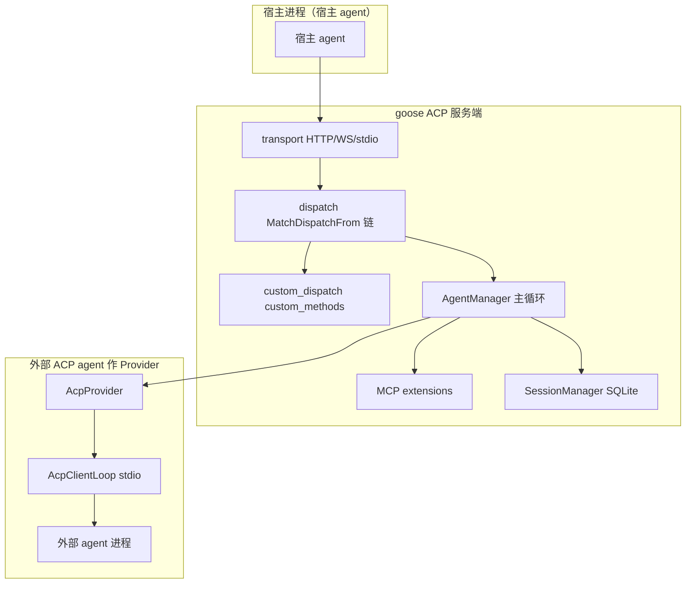
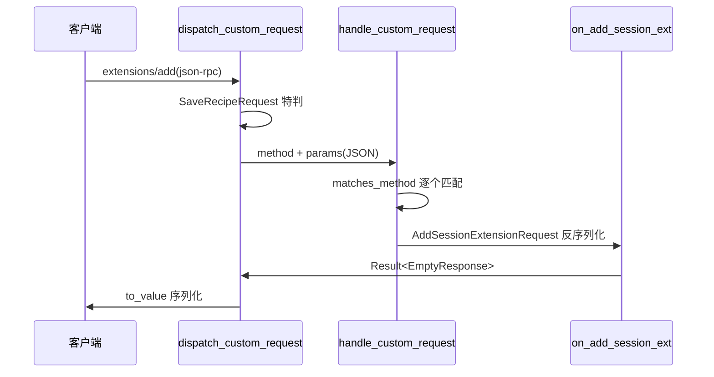

# ACP 协议与 SDK

> 本文是 goose（Linux Foundation AAIF 通用 AI Agent，Rust）「ACP 协议与 SDK」模块的深度技术解读。覆盖 `crates/goose/src/acp/`（服务端 server、客户端 provider、transport、SDK 三件套 goose-acp-macros / goose-sdk-types / goose-sdk）。每条引用统一为 `[路径:start-end]()` 形式，紧随其后的 `<!-- snippet -->` 注释从源码**逐字复制**原始片段，仅作程序重定位指纹、不进入正文展示；正文不含整段代码。

> **演进说明（main@f87c4d7）**：依据代码快照比对。会话能力新增 `delete`、`spawn_acp_process` 注入 PATH、`stream()` 同步 effort、`provider_factory` 支持 use_default_model、`goose-sdk` 更名 GDK 等；详见 [CHANGELOG.md](CHANGELOG.md)。

---

## 根因：用同一份开放标准，双向打通 agent 生态

goose 的 ACP 模块要解决的根本问题是：**如何让 goose 同时既"被别的 agent 嵌入"、又"嵌入别的 agent"，而不为两种方向各写一套私有协议。**

答案是把 [ACP（Agent Client Protocol）](https://github.com/agentclientprotocol) 作为**唯一的连接语言**同时扮演服务端与客户端：

- **ACP 服务端**（`GooseAcpAgent`）——goose 把完整的 ACP 方法集（`Initialize` / `NewSession` / `Prompt` / `SetSessionMode` / `RequestPermission` 等）实现成一个可被 CLI、JetBrains、Zed 等宿主进程调用的嵌入 API。
- **ACP 客户端**（`AcpProvider`）——goose 反过来把「Claude Code / Codex / Gemini (PI) / Copilot / AMP」这些外部 agent 当成自己的一个 LLM Provider 接入，跑在 `Provider::stream()` 里。

`provider.rs:49` 那行 `ACP_CURRENT_MODEL` 哨兵正是这把双向钥匙——它表示"模型由对方 agent 决定"，让 goose 无需硬编码外部 agent 的模型名。

[crates/goose/src/acp/provider.rs:51-52]()
<!-- snippet: /// Sentinel: resolved to the actual model name during connect().
pub const ACP_CURRENT_MODEL: &str = "current"; -->

这套设计的价值在于：**协议是双向的，但代码是单向可复用的一层**。同一个 `agent_client_protocol` crate 提供 `Agent`（服务端 trait）与 `Client`（客户端 trait），goose 分别实现，但共享同一套 JSON-RPC schema、同一套 `ConnectionTo` 异步连接抽象、同一套 `ByteStreams` 传输抽象。这让"双向互操作"的信任边界与安全策略落在传输层这一处（见「安全：origin 策略与令牌」）。

---

## 双向架构总览

---

## 链路一：作为 ACP 服务端，把通用协议变成 goose 嵌入 API

### 方法路由：一条 `MatchDispatchFrom` 链

ACP 服务端的入口是 `GooseAcpHandler` 对 `HandleDispatchFrom<Client>` trait 的实现。这里没有手写 `match method`，而是链式调用 `agent_client_protocol::util::MatchDispatchFrom`，把每个请求类型按其真实 Rust 类型逐个 `if_request(...)` 匹配。设计上有两个关键取舍：

- **初始化请求串行化**：`InitializeRequest` 就地执行，因为它会写连接级的 client capabilities（fs/terminal/mcp host 等 `OnceCell` 状态），后续 `NewSession` 等请求要读这些默认值。注释明确说 pipelined NewSession 不能抢跑在其前。

[crates/goose/src/acp/server/dispatch.rs:27-34]()
<!-- snippet: // InitializeRequest runs inline: it sets connection-scoped state
            // (client fs/terminal capabilities) that later handlers read with
            // defaults, so a pipelined NewSessionRequest must not race ahead of it.
            MatchDispatchFrom::new(message, &cx)
                .if_request(
                    |req: InitializeRequest, responder: Responder<InitializeResponse>| async {
                        responder.respond_with_result(agent.on_initialize(req).await)
                    }, -->

- **费时请求挂到连接事件循环**：`NewSession` / `LoadSession` / `Prompt` 这些可能跑很久的 handler 不直接 await，而是 `cx.spawn(...)` 挂到连接的任务上，避免阻塞后续请求的读取——这是"长会话共享一条连接"的并发模型。

- **栈溢出防御**：`Box::pin` 把巨大的异步状态机抬到堆上，注释点明生成的 match 状态机约 85KB，直接放 tokio 栈上会溢出。

[crates/goose/src/acp/server/dispatch.rs:17-18]()
<!-- snippet: // The MatchDispatchFrom chain produces an ~85KB async state machine.
        // Box::pin moves it to the heap so it doesn't overflow the tokio worker stack. -->

### `on_initialize`：一次握手武装整个连接

`GooseAcpAgent` 用一个 `sessions` map 加若干 `OnceCell` 管理会话级与连接级状态。连接级能力缓存在 `OnceCell` 里（set-once 语义天然保证"首个连接一次性写入"），后续每个 handler 只读不写：

[crates/goose/src/acp/server.rs:334-349]()
<!-- snippet: pub struct GooseAcpAgent {
    sessions: Arc<Mutex<HashMap<String, GooseAcpSession>>>,
    active_prompt_runs: Arc<Mutex<HashMap<String, ActivePromptRun>>>,
    closed_session_ids: Arc<Mutex<HashSet<String>>>,
    agent_manager: Arc<AgentManager>,
    provider_factory: AcpProviderFactory,
    builtin_selection: AcpBuiltinSelection,
    client_fs_capabilities: OnceCell<FileSystemCapabilities>,
    client_terminal: OnceCell<bool>,
    client_mcp_host_info: OnceCell<GooseMcpHostInfo>,
    client_supports_acp_elicitation: OnceCell<bool>,
    client_supports_goose_custom_notifications: OnceCell<bool>,
    client_supports_recipe_param_requests: OnceCell<bool>,
    client_requests_tool_call_label_enrichment: OnceCell<bool>,
    use_login_shell_path: OnceCell<bool>,
    client_cx: OnceCell<ConnectionTo<Client>>, -->

`on_initialize` 做的核心事有两件：(1) 从 `InitializeRequest` 解析客户端能力缓存到这些 `OnceCell`；(2) 声明 goose 自身的 ACP 能力——load/list/delete/close session、prompt 支持 image 与 embedded resource、MCP over HTTP，并把认证指引塞进 `AuthMethod::Agent` 的 `goose configure` 提示。

[crates/goose/src/acp/server.rs:1807-1825]()
<!-- snippet: let capabilities = AgentCapabilities::new()
            .load_session(true)
            .session_capabilities(
                SessionCapabilities::new()
                    .list(SessionListCapabilities::new())
                    .delete(SessionDeleteCapabilities::new())
                    .close(SessionCloseCapabilities::new()),
            )
            .prompt_capabilities(
                PromptCapabilities::new()
                    .image(true)
                    .audio(false)
                    .embedded_context(true),
            )
            .mcp_capabilities(McpCapabilities::new().http(true))
            .meta(agent_capabilities_meta());
        Ok(InitializeResponse::new(args.protocol_version)
            .agent_info(Implementation::new("goose", env!("CARGO_PKG_VERSION")))
            .agent_capabilities(capabilities) -->

自定义能力（如 goose 特有的 `local_inference`）通过能力 meta 的 `goose` 命名空间向客户端透出，避免污染标准 schema。

### `on_prompt`：把 ACP 会话拉进主 Agent 循环

`on_prompt` 是 ACP 服务端衔接 goose 主循环的咽喉。它做三件事：

1. **Active Run 记账**：每个 prompt 生成 `run_{uuid}`，写入 `active_prompt_runs`，同 id 二次并发会被拒（提示用 steer），并把 activeRunId 通过通知回给客户端。
2. **把 ACP prompt 块转成 goose `Message`**：`convert_acp_prompt_to_message` 逐块处理 text/image/resource/link，保留 annotation audience。
3. **把 `agent.reply()` 返回的事件流逐条转回 ACP 通知**：`handle_message_content` 把 goose 的 `MessageContent::Text`/`Thinking`/`ToolRequest`/`ToolResponse`/`ActionRequired` 映射成 ACP 的 `UserMessageChunk`/`AgentMessageChunk`/`AgentThoughtChunk`/`ToolCall`/`RequestPermission` 等通知与请求。

[crates/goose/src/acp/server.rs:2152-2160]()
<!-- snippet: while let Some(event) = stream.next().await {
            if cancel_token.is_cancelled() {
                was_cancelled = true;
                break;
            }

            match event {
                Ok(crate::agents::AgentEvent::Message(mut message)) => {
                    update_output_token_limit_reached(&mut output_token_limit_reached, &message); -->

这层映射是双向的**语义桥**：同一份 ACP 类型，在服务端侧把 goose 事件编码成 ACP，在客户端侧（见 `provider.rs` 的 `stream`）把 ACP 解码回 goose 事件——两条方向互为镜像，共用同一组 ACP 类型做双向序列化。

### 权限：`ActionRequired` 转 ACP 的 `RequestPermission`

goose 主循环里工具需要确认时产生 `ActionRequired(ToolConfirmation)`。服务端 handler 把它转成一个 ACP 的 `RequestPermissionRequest`（含 AllowAlways/AllowOnce/RejectOnce/RejectAlways 四个选项），通过 `cx.send_request` 发给宿主，宿主点击后经回调 `handle_confirmation` 回注主循环：

[crates/goose/src/acp/server.rs:1572-1582]()
<!-- snippet: let options = vec![
            option(PermissionOptionKind::AllowAlways),
            option(PermissionOptionKind::AllowOnce),
            option(PermissionOptionKind::RejectOnce),
            option(PermissionOptionKind::RejectAlways),
        ];

        let permission_request =
            RequestPermissionRequest::new(session_id, tool_call_update, options);

        cx.send_request(permission_request) -->

`outcome_to_confirmation` 把 ACP 选项 id 映射回 goose 的 `PermissionConfirmation`（AllowOnce→AllowOnce、Allow Always→AlwaysAllow、unknown/cancelled→Cancel）。

[crates/goose/src/acp/server.rs:1630-1635]()
<!-- snippet: fn outcome_to_confirmation(outcome: &RequestPermissionOutcome) -> PermissionConfirmation {
    PermissionConfirmation {
        principal_type: PrincipalType::Tool,
        permission: Permission::from(PermissionDecision::from(outcome)),
    }
} -->

权限决策表被收在 `common.rs` 的 `PermissionDecision`（AllowAlways…Cancel）里，`Permission <-> PermissionDecision <-> RequestPermissionOutcome` 双向转换各实现专门的 `From`，相互独立验证，避免方向 A 的 bug 波及方向 B。

---

## 链路二：作为 ACP 客户端，把外部 agent 当 LLM Provider 反接

这是本文最精巧的设计点。`AcpProvider` 实现 goose 的 `providers::base::Provider` trait，因此主循环完全无感——它只当自己多了一个"LLM 制造商"。

### 进程与线程模型：为什么必须开一条 OS 线程

`AcpProvider::start` 的核心决策：**tokio I/O 句柄不能跨 runtime 移动**，因此子进程必须在 OS 线程里 spawn。`spawn_client_loop` 为 ACP 客户端单独建一个 current-thread runtime 并 `block_on`，主循环与 ACP 客户端之间只靠 `mpsc` 通道 + `oneshot` 应答通信：

[crates/goose/src/acp/provider.rs:318-326]()
<!-- snippet: fn spawn_client_loop(fut: impl Future<Output = ()> + Send + 'static) -> JoinHandle<()> {
    std::thread::spawn(move || {
        let rt = tokio::runtime::Builder::new_current_thread()
            .enable_all()
            .build()
            .expect("failed to build ACP client runtime");
        rt.block_on(fut)
    })
} -->

子进程通过 `spawn_acp_process` 拉起，stdio 用 `ByteStreams` 兼容包装成 ACP 传输，stderr 交给 `forward_child_stderr` 逐行转发并限长（防无换行输出撑爆内存）。启动前还会把 `config.command` 的父目录 prepend 到 `PATH`——npm 适配器常以 `/usr/bin/env node` 拉起，而桌面进程的 PATH 未必包含其 bin 目录。

[crates/goose/src/acp/provider.rs:1480-1500]()
<!-- snippet: async fn spawn_acp_process(config: &AcpProviderConfig) -> Result<Child> {
    let mut cmd = Command::new(&config.command);
    cmd.args(&config.args)
        .stdin(Stdio::piped())
        .stdout(Stdio::piped())
        .stderr(Stdio::piped())
        .kill_on_drop(true);

    if let Some(command_dir) = config.command.parent() {
        // npm adapters commonly use `/usr/bin/env node`, while desktop PATH may omit their bin dir.
        let path = std::env::join_paths(
            std::iter::once(command_dir.to_path_buf()).chain(
                std::env::var_os("PATH")
                    .as_ref()
                    .map(std::env::split_paths)
                    .into_iter()
                    .flatten(),
            ),
        )?;
        cmd.env("PATH", path);
    } -->

### `Provider::stream()`：把 ACP 的 prompt/会话拉到 goose 的消息流

`stream()` 是 `AcpProvider` 实现 `Provider` 的入口，它把 goose 主循环给的一批 `Message` 编码成 ACP `PromptRequest`，再把返回流里的 `AcpUpdate` 解码成 goose 的 `Message`/usage。关键做法：

- **模型/努力度选择**：若外部 agent 用 config option 选模型（如 Claude 的 `model` 选项），`apply_model_if_changed` 先 `send_set_config_option`，且对 `ACP_CURRENT_MODEL` 哨兵为 no-op（模型由对方决定）；`apply_effort_if_changed` 再把 goose 的 thinking-effort 设置同步给对方。
- **会话上下文交接**：`claim_handoff_context` 只在首个 prompt 且确有前置会话时，把 goose 已发生的对话用 `build_handoff_context_memo` 打成一坨带说明的文本前置到当前 prompt 里，之后不再重复发送。
- **工具拒绝降级**：`Chat` 模式（`reject_all_tools`）下收到 `ToolCallStart` 会抑制后续文本并记录 rejected id，`ToolCallComplete` 时补一条"Tool call was denied"文本，保证聊天模式语义完整。

[crates/goose/src/acp/provider.rs:820-844]()
<!-- snippet: async fn stream(
        &self,
        model_config: &ModelConfig,
        _system: &str,
        messages: &[Message],
        _tools: &[Tool],
    ) -> Result<MessageStream, ProviderError> {
        let session_id = self.acp_session_id();

        self.apply_model_if_changed(&model_config.model_name)
            .await
            .map_err(|e| {
                ProviderError::RequestFailed(format!("Failed to set ACP model option: {e}"))
            })?;

        self.apply_effort_if_changed(model_config)
            .await
            .map_err(|e| {
                ProviderError::RequestFailed(format!("Failed to set ACP effort option: {e}"))
            })?;

        let current_prompt_blocks = messages_to_prompt(messages, None);
        if current_prompt_blocks.is_empty() {
            return Ok(Box::pin(futures::stream::empty()));
        }
-->

### `AcpClientLoop`：反向的事件分发中枢

`AcpClientLoop::run` 用 ACP 的 `Client` 角色：`on_receive_notification` 把对方 agent 推来的 `AgentMessageChunk`（文本）、`AgentThoughtChunk`、`ToolCall`、`ToolCallUpdate`、`UsageUpdate` 转成 `AcpUpdate` 枚举塞进 `try_send` 队列；`on_receive_request` 处理对方发来的 `RequestPermissionRequest`，用 `oneshot` 把决策传回并 `responder.respond(...)`。

工具调用是这里最讲究的地方：ACP 传来的 `raw_output`/`content` 是**增量合并**（patch 式），客户端先写进 `pending_tool_updates` 缓冲，直到收到 terminal 状态（`Completed`/`Failed`）才合并成一次完整的 `ToolCallComplete` 发射——避免把中间碎片误当完整工具结果。

[crates/goose/src/acp/provider.rs:1335-1337]()
<!-- snippet: SessionUpdate::ToolCallUpdate(update) => {
                                    let id = update.tool_call_id.0.to_string();
                                    // Merge patch-like fields; only emit on terminal status.
-->
                                    // Merge patch-like fields; only emit on terminal status.
                                    let terminal_status = update.fields.status.filter(|s| {
                                        matches!(
                                            s,
                                            ToolCallStatus::Completed | ToolCallStatus::Failed
                                        )
                                    });
                                    let accumulated = if let Ok(mut buffer) =
                                        pending_tool_updates.lock() -->

并且通过 `tool_call.title`（展示名）+ `goose.acp.kind`（稳定分类）+ `TOOL_META_EXTERNAL_DISPATCH_KEY`（标记"勿再经 loop 重派发"）携带到主循环，让下游 metrics/图标选择拿到稳定类别，同时绕开 goose 自己的鉴权/路由去重复执行已由外部 agent 执行过的工具：

[crates/goose/src/acp/provider.rs:954-967]()
<!-- snippet: // external_dispatch tells the agent loop not to redispatch this
                            // call. goose.acp.kind preserves ACP's stable categorization for
                            // downstream consumers (metrics, observability, icon selection)
                            // independent of the display title we put in `name`.
                            let tool_meta = Some(serde_json::json!({
                                TOOL_META_EXTERNAL_DISPATCH_KEY: true,
                                "goose.acp.kind": kind,
                            }));
                            let message = Message::assistant().with_tool_request_with_metadata(
                                id,
                                Ok(params),
                                None,
                                tool_meta,
                            ); -->

### 具体外部 agent 的落地：模式映射是精髓

`providers/claude_acp.rs` 展示如何把一个外部 agent 描述成 goose Provider：把 goose 的 `GooseMode`（Auto→bypassPermissions、Approve→default、SmartApprove→acceptEdits、Chat→plan）映射为外部 agent 的 mode id，并通过 `model_config_option_id: Some("model")` 把模型的 config option 透传给对方的 `set_config_option`：

[crates/goose/src/providers/claude_acp.rs:72-81]()
<!-- snippet: let mode_mapping = HashMap::from([
                // Closest to "autonomous": bypassPermissions skips confirmations.
                (GooseMode::Auto, vec!["bypassPermissions".to_string()]),
                // Claude Code's default matches "ask before risky actions".
                (GooseMode::Approve, vec!["default".to_string()]),
                // acceptEdits auto-accepts file edits but still prompts for risky ops.
                (GooseMode::SmartApprove, vec!["acceptEdits".to_string()]),
                // Plan mode disables tool execution, aligning with chat-only intent.
                (GooseMode::Chat, vec!["plan".to_string()]),
            ]); -->

`ENV_REMOVE` 里显式去掉 `CLAUDECODE` 环境变量，防止 `claude-agent-acp`（它包裹 Claude Code）在 goose 内产生嵌套 session 环检测——这是"goose 嵌入 Claude 而 Claude 又可能嵌入 goose"的防环细节，直接呼应双向信任边界。

[crates/goose/src/providers/claude_acp.rs:83-96]()
<!-- snippet: let provider_config = AcpProviderConfig {
                command: resolved_command,
                args: vec![],
                env: vec![],
                // Prevent nested-session detection in claude-agent-acp (wraps Claude Code)
                env_remove: vec!["CLAUDECODE".to_string()],
                work_dir: working_dir,
                mcp_servers: extension_configs_to_mcp_servers(&extensions),
                session_mode_id: mode_mapping[&goose_mode].first().cloned(),
                session_config_options: vec![],
                // claude-agent-acp advertises the model as a "model" select
                // config option and applies session/set_config_option for it
                // via query.setModel, so forward the picker's selection.
                model_config_option_id: Some("model".to_string()), -->

同一模式被复用于 Codex（`codex_acp.rs`）、Gemini（`pi_acp.rs`，用 config option 选模型）、Copilot（`copilot_acp.rs`）、AMP（`amp_acp.rs`），它们只关心 `AcpProviderConfig` 的 command/args/mode_mapping 差异。

---

## 双向对称：同一个协议，两种 go（`ACP_CURRENT_MODEL` 的解析闭环）

「双向对称」不是口号，而是由三处代码构成的闭环：

1. **服务端定义能力**：goose 作为 ACP 服务端在 `on_initialize` 里声明自己支持 load/list/close session、MCP over HTTP，并透出自定义能力（`server.rs:1463-1484`）。
2. **客户端协商能力**：goose 作为 ACP 客户端在 `handle_requests` 里发 `InitializeRequest`，只在对方声明支持时才用 `session_capabilities.close` 关会话、按对方 `mcp_capabilities.http` 过滤要转发的 MCP server（`provider.rs:1107-1141`）。
3. **模型名解析**：`ACP_CURRENT_MODEL` 在 `resolve_model_info` 被解析——若对方用 config option 暴露模型，就从 `NewSessionResponse.config_options` 里取 category=Model 的 select，解析出 current + available 模型列表；否则返回错误，明确"agent returned no model config_options"。

[crates/goose/src/acp/provider.rs:2153-2165]()
<!-- snippet: fn resolve_model_info(
    provider_name: &str,
    response: &NewSessionResponse,
) -> Result<(String, Vec<String>), ProviderError> {
    if let Some(opts) = &response.config_options {
        if let Some((current, available)) = extract_model_info_from_config_options(opts) {
            return Ok((current, available));
        }
    }

    Err(ProviderError::RequestFailed(format!(
        "{provider_name}: agent returned no model config_options"
    ))) -->

在服务端 `update_provider` 里，`ACP_CURRENT_MODEL` 作为"使用对方 agent 默认模型"的占位符出现在 `default_model` 计算里，与客户端侧 `current` 哨兵首尾呼应：

[crates/goose/src/acp/server.rs:2511-2525]()
<!-- snippet: let default_model = if let Some(model_name) = model_name {
            model_name.to_string()
        } else if use_default_provider {
            config
                .get_goose_model()
                .internal_err_ctx("Failed to resolve default model from config")?
        } else if is_changing_provider {
            crate::providers::get_from_registry(&resolved_provider_name)
                .await
                .ok()
                .map(|entry| entry.metadata().default_model.clone())
                .unwrap_or(ACP_CURRENT_MODEL.to_string())
        } else {
            current_model
        }; -->

主循环 `agent.rs` 也对 `current` 做特判，把默认模型解析留给对方。这样，模型名的知识被"外包"给双向的任一侧：goose 不知道也不关心 Claude Code 此刻实际跑哪个模型，它只管把 `current` 透传。这就是"external agent as provider"之所以强的关键——**模型、工具、权限的执行语义全部委托给对方 agent，goose 只做协议的搬运与编排**，因此对任意含 ACP 能力的 agent 天然可插拔。

---

## custom_methods 宏：把样板从服务端扩展点里挤出去

goose 的 ACP 服务端不只实现标准方法，还用 `_goose/unstable/*` 命名空间暴露大量自定义方法（recipe/extension/provider/config/tools/schedule/dictation/local-inference……）。如果每个方法都手写"match method → parse params → serialize response ＋ JSON Schema"，会是大堆重复样板。`goose-acp-macros` 的 `#[custom_methods]` 用属性宏把它们一次生齐。

### 提取路由信息

宏遍历 impl 块，抽取 `#[custom_method(RequestType)]` 属性，剥掉它，把请求类型、处理器函数名、参数类型、返回 `Result<T,E>` 的 Ok 类型收进 `Route`：

[crates/goose-acp-macros/src/lib.rs:48-62]()
<!-- snippet: for item in &mut impl_block.items {
        if let ImplItem::Fn(method) = item {
            let mut request_type = None;
            method.attrs.retain(|attr| {
                if attr.path().is_ident("custom_method") {
                    if let Ok(meta_list) = attr.meta.require_list() {
                        if let Ok(ty) = meta_list.parse_args::<Type>() {
                            request_type = Some(ty);
                        }
                    }
                    false // strip the attribute
                } else {
                    true // keep other attributes
                }
            }); -->

### 生成分发器 + Schema

宏注入两个方法：`handle_custom_request`（按 `JsonRpcMessage::matches_method` 逐个 if 匹配，typed params 自动反序列化，返回值序列化）和 `custom_method_schemas`（用 `schemars::SchemaGenerator::subschema_for` 生成 params/response 的 JSON Schema，并对 `serde_json::Value` 返回 `None`）：

[crates/goose-acp-macros/src/lib.rs:184-202]()
<!-- snippet: let dispatcher = quote! {
        async fn handle_custom_request(
            &self,
            method: &str,
            params: serde_json::Value,
        ) -> Result<serde_json::Value, agent_client_protocol::Error> {
            #(#arms)*
            Err(agent_client_protocol::Error::method_not_found())
        }
    };

    // Generate the custom_method_schemas method.
    let schemas_fn = quote! {
        pub fn custom_method_schemas(generator: &mut schemars::SchemaGenerator) -> Vec<crate::custom_requests::CustomMethodSchema> {
            vec![
                #(#schema_entries),*
            ]
        }
    }; -->

`custom_dispatch.rs` 是映射关系最浓缩的一处：`#[custom_methods] impl GooseAcpAgent { ... }` 下挂了约 90 个 `dispatch_*` 处理器。宏把函数名与请求类型绑定，方法名由请求类型上的 `#[request(method = "_goose/unstable/...")]` 属性在编译期给出——消除了"请求结构体"与"处理器"两处维护同一方法名的重复。

[crates/goose/src/acp/server/custom_dispatch.rs:4-30]()
<!-- snippet: #[custom_methods]
impl GooseAcpAgent {
    pub async fn dispatch_custom_request(
        &self,
        method: &str,
        params: serde_json::Value,
    ) -> Result<serde_json::Value, agent_client_protocol::Error> {
        let result = async {
            if <SaveRecipeRequest as agent_client_protocol::JsonRpcMessage>::matches_method(method)
            {
                let req = recipe::deserialize_save_recipe_request(params)?;
                let result = self.on_save_recipe(req).await?;
                return serde_json::to_value(&result).map_err(|e| {
                    agent_client_protocol::Error::internal_error().data(e.to_string())
                });
            }

            self.handle_custom_request(method, params).await
        }
        .await;

        if let Err(error) = &result {
            tracing::error!(method, error = ?error, "ACP custom request failed");
        }

        result
    } -->
    ) -> Result<EmptyResponse, agent_client_protocol::Error> {
        self.on_add_session_extension(req).await
    } -->

注意 `SaveRecipeRequest` 被特殊处理（手动 `deserialize_save_recipe_request`），说明宏针对"结构体 + serde 反序列化"的标准路径，个别需要自定义反序列化的方法可在宏外手写收尾——宏不喧宾夺主，留了逃生门。这也解释了为什么 `custom_dispatch.rs` 用两层：`dispatch_custom_request` 先做需要特判的标准方法（含 recipe），其余统一交给宏生成的 `handle_custom_request`。

### 请求类型定义：`goose-sdk-types` 与宏的契约

请求类型定义在 `crates/goose-sdk-types/src/custom_requests.rs`，每个都派生 `JsonRpcRequest` 并带 `#[request(method = "...", response = ...)]`，这就是宏读取"方法名"的源头。这些类型同时是可对外发布的协议线格式：

[crates/goose-sdk-types/src/custom_requests.rs:30-37]()
<!-- snippet: /// Add an extension to an active session.
#[derive(Debug, Default, Clone, Serialize, Deserialize, JsonSchema, JsonRpcRequest)]
#[request(method = "_goose/unstable/session/extensions/add", response = EmptyResponse)]
#[serde(rename_all = "camelCase")]
pub struct AddSessionExtensionRequest {
    pub session_id: String,
    pub extension: GooseExtension,
} -->

`CustomMethodSchema` 承载宏生成的 schema 描述（method / params_schema / response_schema 及 `$defs` 下的类型名），供客户端自动发现 `_goose/unstable/*` 方法的参数与返回结构，无需手写文档。

[crates/goose-sdk-types/src/custom_requests.rs:21-28]()
<!-- snippet: #[derive(Debug, Serialize)]
pub struct CustomMethodSchema {
    pub method: String,
    pub params_schema: Option<schemars::Schema>,
    pub params_type_name: Option<String>,
    pub response_schema: Option<schemars::Schema>,
    pub response_type_name: Option<String>,
} -->

宏 + sdk-types 这套组合的本质是**"类型即协议"**：一个带 `#[custom_method(RequestType)]` 的处理器 + 一段派生宏的请求结构体，就同时生成了路由、反序列化、序列化、JSON Schema 四样东西。代价是宏展开后生成的代码不可直接跳读、schema 对 `serde_json::Value` 悄悄退化为 `None`，但对「Rust 工程内部扩展协议」而言，消除的手写样板远超这些成本。

---

## 服务端方法集与「会话隔离 / 主循环协作」

ACP 服务端并非每次新建独立 agent，而是共享一个 `AgentManager`（execution manager）。`get_or_create_session_agent_with_results` 按 `session_id` 走 `agent_manager.get_or_create_agent_with_runtime_context`，把 ACP 会话的多项连接态（mcp host、login shell、会话命名 notifier）作为 `RuntimeContext` 注入：

[crates/goose/src/acp/server.rs:1046-1063]()
<!-- snippet: async fn get_or_create_session_agent_with_results(
        &self,
        cx: &ConnectionTo<Client>,
        session_id: String,
    ) -> Result<AgentManagerGetResult, agent_client_protocol::Error> {
        self.agent_manager
            .get_or_create_agent_with_runtime_context(
                session_id,
                RuntimeContext {
                    mcp_host_info: self.client_mcp_host_info.get().cloned(),
                    use_login_shell_path: self.use_login_shell_path.get().copied(),
                    session_name_update_tx: (!self.disable_session_naming)
                        .then(|| spawn_session_name_update_notifier(cx.clone())),
                },
            )
            .await
            .map_err(|error| agent_creation_error(error, "Failed to create agent"))
    } -->

这便是"会话隔离"的关键：goose 把「ACP 会话」与「execution manager 的 Session 行」一一对应。`GooseAcpAgent.sessions` 只缓存已激活的 `(session_id → Agent)`，`AgentManager` 负责 disk↔memory 的状态。`on_close_session` 取消 active run、从 map 移除、并 `remove_session_if_loaded` 释放内存里的 agent——因为 SQLite 已持久化，重开时再 lazy 激活：

[crates/goose/src/acp/server.rs:2576-2586]()
<!-- snippet: let mut sessions = self.sessions.lock().await;
        sessions.remove(session_id);
        drop(sessions);

        self.agent_manager
            .remove_session_if_loaded(session_id)
            .await
            .internal_err_ctx("Failed to remove in-memory agent")?;

        info!(session_id = %session_id, "ACP session closed");
        Ok(CloseSessionResponse::new()) -->

会话状态本身落在 `SessionManager`（SQLite），`session_meta`/`session_response_meta`（`response_builder.rs`）把 goose 的 `Session` 结构合成 ACP 的 meta 字段（messageCount/userSetName/recipe/workingDir 等），供宿主渲染列表。

`server_factory.rs` 的 `AcpServer` 是关键装配厂：`create_agent` 把 `provider_factory`（闭包，按 provider 名 + extensions + working_dir 创建真正 Provider；新增 `use_default_model` 标志让宿主请求默认模型，见 `server_factory.rs:72-87`）与可选 scheduler 注入 `GooseAcpAgentOptions`。scheduler 用 `OnceCell` 惰性初始化，并支持 `start_scheduler` 提前启动，让 headless `goose serve` 能跑定时任务。

[crates/goose/src/acp/server_factory.rs:93-113]()
<!-- snippet: let provider_factory: AcpProviderFactory = Arc::new(
            move |provider_name, extensions, working_dir, use_default_model| {
                Box::pin(async move {
                    if use_default_model {
                        crate::providers::create_with_default_model(&provider_name, extensions)
                            .await
                    } else {
                        match working_dir {
                            Some(working_dir) => {
                                crate::providers::create_with_working_dir(
                                    &provider_name,
                                    extensions,
                                    working_dir,
                                )
                                .await
                            }
                            None => crate::providers::create(&provider_name, extensions).await,
                        }
                    }
                })
            }); -->

---

## 安全：transport 的 origin 策略与令牌

ACP HTTP/WS 服务端把安全放在**传输层**而非协议层。`transport/mod.rs` 的 `AcpOriginPolicy` 决定哪些 origin 允许升级 WebSocket：精确白名单 `exact_origins` 或 loopback 判定（localhost/回环 IP）二选一或叠加。默认 `loopback()` 只放行本机回环，把远程网页天然挡在外面：

[crates/goose/src/acp/transport/mod.rs:67-98]()
<!-- snippet: fn origin_allowed(&self, origin: &HeaderValue) -> bool {
        if self
            .exact_origins
            .iter()
            .any(|allowed_origin| allowed_origin == origin)
        {
            return true;
        }

        if !self.allow_loopback {
            return false;
        }

        let Ok(origin) = origin.to_str() else {
            return false;
        };

        let Ok(url) = url::Url::parse(origin) else {
            return false;
        };

        if !matches!(url.scheme(), "http" | "https") {
            return false;
        }

        match url.host() {
            Some(url::Host::Domain(host)) => host.eq_ignore_ascii_case("localhost"),
            Some(url::Host::Ipv4(addr)) => addr.is_loopback(),
            Some(url::Host::Ipv6(addr)) => addr.is_loopback(),
            None => false,
        }
    } -->

可选令牌在 `auth.rs`，支持 `X-Secret-Key` 头或 `?token=` 查询参数，比较用常数时间 `ct_eq` 防时序侧信道：

[crates/goose/src/acp/transport/auth.rs:9-13]()
<!-- snippet: pub fn token_matches(candidate: Option<&str>, expected: &str) -> bool {
    candidate
        .map(|key| bool::from(key.as_bytes().ct_eq(expected.as_bytes())))
        .unwrap_or(false)
} -->

TLS（`transport/tls.rs`）为 `goose serve` 的跨机场景提供：无证书时自动生成自签名证书并**缓存到 config/tls**，把证书指纹打印成 `GOOSED_CERT_FINGERPRINT` 供客户端比对（信任首个使用）。

**安全边界小结**：ACP 本身不含认证协议，goose 在传输层叠加"loopback + origin 白名单 + 可选令牌 + 可选 TLS 指纹"。这是"拥抱开放标准、把安全交给宿主"的务实取舍——嵌入场景（Claude Code/JetBrains 同机）信任本机回环，跨机场景才升级到 TLS+令牌。信任边界的另一端在 provider 侧：goose 信任它 spawn 的外部 agent 进程（`configure_subprocess`），因为你显式选择了它。

---

## 对外 SDK：uniffi 把 Rust 核心编给 Python / Kotlin

`crates/goose-sdk`（即 GDK，Goose Development Kit）是面向外的 SDK。默认 feature 只 re-export `goose-sdk-types`，让调用方可构建一个 ACP 客户端通过 stdio 对接 `goose acp`；开启 `uniffi` feature 后编译成 `cdylib`/`staticlib`，走 [uniffi-rs](https://mozilla.github.io/uniffi-rs/) 编出 Python / Kotlin 可加载的本机 API：

[crates/goose-sdk/src/lib.rs:1-3]()
<!-- snippet: //! The goose Development Kit (GDK).
//!
//! With default features this crate re-exports the shared SDK wire types from
-->
//! With default features this crate re-exports the shared SDK wire types from
//! `goose-sdk-types` so you can build an Agent Client Protocol (ACP) client
//! that talks to `goose acp` over stdio.
//!
//! With `--features uniffi` the crate additionally compiles as a
//! `cdylib`/`staticlib` and exposes an in-process API to Python and Kotlin via
//! [uniffi-rs](https://github.com/mozilla/uniffi-rs). The current uniffi surface
//! lets callers construct declarative providers from JSON and stream provider
//! completions.

pub use goose_sdk_types::{custom_notifications, custom_requests}; -->

`bindings.rs` 是 uniffi 的实际 API 面：把 goose 的 provider 错误树（RateLimited、OutputTokenLimitExceeded、ContextLengthExceeded、Authentication、Timeout…) 折叠成一个可枚举的 `GooseError`，并各自手写 `From` 映射，让 Python/Kotlin 调用方拿到结构化的错误而非裸字符串。它与 ACP provider 是两条互补的对外通道：ACP 是"协议层面"的互操作（给别的 agent / SDK 客户端），uniffi 是"进程内"的互操作（给 Python/Kotlin 宿主直接调用 Rust 核心）。同一份 Rust 核心，双通道对外。

---

## 权衡：为什么"双向"值得，代价是什么

| 取舍 | goose 的选择 | 代价 / 不选方案的代价 |
| ---- | ------------ | --------------------- |
| 接入方式 | 拥抱 ACP 开放标准而非私有 API | 与 ACP 版本化绑定；标准未覆盖的扩展必须用 `_goose/unstable/*` 命名空间 + 能力协商，不能用私有二进制协议发挥全部性能 |
| 会话上下文 | ACP 客户端只把"当前 prompt"发给外部 agent，前置上下文用 handoff memo 一次性注入 | 若外部 agent 无持久记忆，跨 prompt 的上下文交接依赖这段文本 memo；`goose_mode == Chat` 时还额外抑制工具，牺牲部分能力换取语义干净 |
| 工具归属 | 外部 agent 的工具执行语义委托给对方（`external_dispatch`） | goose 自己对工具一无所知，只转发 title/kind/raw；无法再对工具结果做深度结构化，metrics 只能靠 `goose.acp.kind` 分类 |
| 线程模型 | 每 ACP provider 一条专用 OS 线程 + 独立 tokio runtime | 比纯异步重；换取"tokio I/O 句柄不可跨 runtime"的约束解耦，也隔离了外部进程的拖累 |
| 安全 | 本机场景信任 loopback，跨机才 TLS+令牌 | 同机任意进程可连 ACP 端口（依赖防火墙 / 端口独占）；无协议级加密 |
| 模型名 | `ACP_CURRENT_MODEL` 哨兵委托给对方 | 若对方不暴露模型 config option，goose 拿不到当前/可用模型列表，`resolve_model_info` 直接报错 |

**最本质的权衡**是"双向对称"与"双向信任"的张力。同一套协议同时服务"被嵌入"与"嵌入别人"，代码复用率极高，但也把信任边界**放大到了两端**：作为服务端，goose 相信外部宿主请求（经 origin/auth 过滤后）；作为客户端，goose 相信外部 agent 进程返回的工具结果与权限请求。这两端的安全策略必须在传输/进程层分别加固，协议本身无法替你担保。

---

## 总结：回扣根因

goose 用一份 ACP 开放标准同时完成了"被 Claude Code / JetBrains / Zed 嵌入"（ACP 服务端，`dispatch.rs` + handlers）与"把 Claude Code / Codex / Gemini / Copilot 反接成 Provider"（ACP 客户端，`AcpProvider`）两件事。支撑这套双向架构的四根支柱：

- **类型即协议**：`GooseAcpAgent` 实现 `Agent` trait、`AcpProvider` 实现 `Client` + `Provider`，共享同一套 `agent_client_protocol` schema 与 `ConnectionTo` 抽象；
- **幂等与惰性**：`AgentManager` + `SessionManager`（SQLite）把 ACP 会话与执行堆栈一一映射，closed 即释放内存、reload 即重激活；
- **样板消灭术**：`custom_methods` 宏从请求类型编译期生成 JSON-RPC 分发器与 JSON Schema，900+ 行 handler 由约 90 行属性驱动；
- **安全下沉传输层**：loopback + origin + 令牌 + TLS 指纹，把开放协议堵上可信管道。

根因的答案由此闭环：不是"再写一个协议"，而是**让 goose 成为 ACP 生态的双向公民**。

---
