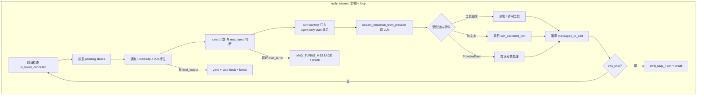
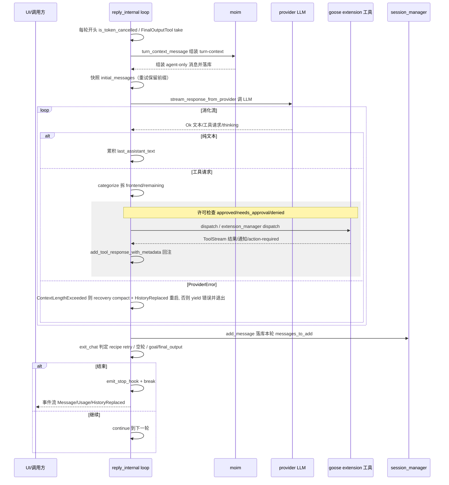

# Agent 主循环

> 本文是 goose（Linux Foundation AAIF 通用 AI Agent，Rust）「主 Agent 循环」模块的深度技术解读。覆盖 `crates/goose/src/agents/` 下 6 个核心文件。每条引用统一为 `[路径:start-end]()` 形式，紧随其后的 `<!-- snippet -->` 注释从源码**逐字复制**原始片段，仅作程序重定位指纹、不进入正文展示；正文不含整段代码。

> **演进说明（main@f87c4d7）**：依据代码快照比对。moim 重构为 turn-context 独立 agent-only 消息、`tool_stream` 移入 `tool_execution.rs`、recipe retry 接管空轮回退、`dispatch_tool_call` 前置 PreToolUse hook、provider error 分支新增 Authentication 等；详见 [CHANGELOG.md](CHANGELOG.md)。

---

## 根因：一个循环，贯通感知→推理→工具→反馈

goose 的三大形态（桌面 / CLI / API）共享同一个主 Agent 循环。它要解决的**根本问题**是：如何用一个可靠、可恢复、可观测的单循环，把「LLM 推理」「MCP 工具执行」「会话持久化」「内存/上下文管理」四件事编排成自洽闭环，同时让下层的任何一次失败——provider 断连、context 超限、工具报错、用户中途取消——都不至于打崩整轮 agent，而是以可解释的方式回注到对话本身。

这条循环的血缘全部收敛在 `reply` → `reply_impl` → `reply_internal` 三层结构里：

- `reply` 是**对外入口**：把 `reply_impl` 返回的事件流包上一层 `ensure_message_event_id`（缺失即补 `generated_id`），作为「同一逻辑消息的多个事件共享同一 id」的单一身份边界；同时 `instrument(reply_span)` 让整条流继续挂在上层 tracing span 下。

[crates/goose/src/agents/agent.rs:1978-1988]()
<!-- snippet: let events = self
            .reply_impl(user_message, session_config, cancel_token)
            .await?;

        // This is the single live-event identity boundary. Callers that intentionally stream
        // multiple events for one logical message must assign their shared ID before this point.
        Ok(Box::pin(
            events
                .map_ok(ensure_message_event_id)
                .instrument(reply_span),
        )) -->

- `reply_impl` 是**准备层**：处理 slash-command / elicitation 响应，落库用户消息，并在进入真实循环前先做一次**阈值触发的自动压缩**（auto-compact），把结果经 `reply_internal` 喂进主循环。
- `reply_internal` 才是**发动机本体**——那个真正反复执行的 `loop`。

设计上刻意把「对外契约（reply）」与「执行主体（reply_internal）」拆开，使调用方只依赖稳定契约，而压缩、moim、重试等复杂编排全部关进内部。这是「把不确定性关进一个门里」的分层取舍。

---

## 主循环结构：一次轮次（turn）的心脏

### 循环骨架与四层退出闸门

`reply_internal` 内部的 `loop` 每次迭代：取消检查 → 排空 pending steers → 读 FinalOutputTool → 轮次计数与超限判断 → turn-context 注入 → 调 LLM 流 → 消化流内事件 → 落库新消息 → 判定 exit。其中 turn-context 在 loop 之前的 `reply_internal` 入口按轮次组装成一条 **agent-only user 消息**持久化进会话（见下「moim」章节），重试时作为已发送前缀保留。

退出不是一扇门，而是**层层叠加的闸门**，按触发时机排序：

1. **取消闸门**：`is_token_cancelled(&cancel_token)` 在迭代开头与流的 `while let` 内部都检查。这是软取消——不抛异常，只是优雅 `break`，把已产出事件先 yield 出去。

[crates/goose/src/agents/agent.rs:2509-2512]()
<!-- snippet: loop {
                if is_token_cancelled(&cancel_token) {
                    break;
                } -->

2. **最大轮次闸门**：`turns_taken > max_turns`，默认 1000。这里有个关键设计：**重试轮次不计入 turns_taken**——stop-hook 拒绝和空轮重试不消耗配额，只有真正的「新一次 model 推理」才递增。

[crates/goose/src/agents/agent.rs:2589-2600]()
<!-- snippet: if retrying_after_stop_hook_denial {
                    retrying_after_stop_hook_denial = false;
                } else if retrying_after_empty_turn {
                    retrying_after_empty_turn = false;
                } else {
                    turns_taken += 1;
                }
                if turns_taken > max_turns {
                    last_assistant_text = MAX_TURNS_MESSAGE.to_string();
                    yield AgentEvent::Message(Message::assistant().with_text(last_assistant_text.clone()));
                    break;
                } -->

[crates/goose/src/agents/agent.rs:86-87]()
<!-- snippet: const DEFAULT_MAX_TURNS: u32 = 1000;
const DEFAULT_STOP_HOOK_BLOCK_CAP: u32 = 8; -->

3. **FinalOutputTool 闸门**（面向 recipe/结构化输出）：主循环每轮开头从 `final_output_tool` 槽位 `take()` 结果，检测到模型已调用该工具产出最终输出就 yield 并触发 stop-hook 后 `break`。

[crates/goose/src/agents/agent.rs:2541-2544]()
<!-- snippet: let final_output = {
                    let mut guard = self.final_output_tool.lock().await;
                    guard.as_mut().and_then(|fot| fot.final_output.take())
                }; -->

4. **exit_chat 闸门**（面向自由聊天/goal/grind）：位于工具派发后的回合收尾，在多种情形被置 true——无工具调用且无 goal 且无 retry 配置、重试达上限、FinalOutput 已就绪等。

[crates/goose/src/agents/agent.rs:3533-3541]()
<!-- snippet: if exit_chat {
                    match self
                        .emit_stop_hook_blocking(&session_config.id, &last_assistant_text, &session.working_dir.to_string_lossy())
                        .await
                    {
                        crate::hooks::HookDecision::Allow => {
                            stop_hook_handled_for_exit = true;
                            break;
                        } -->

### 为什么「停止」比「循环」更讲究

agent 最怕两件事：**空转**和**静默死亡**。goose 对「空轮次」极其敏感——模型返回既无文本、无工具、无错误时，严格 provider（如 Anthropic）会拒绝含空 assistant 回合的对话。为此每次迭代精确计算 `empty_response`（7 个布尔条件），一旦判空就把本轮 `messages_to_add` 清空，绝不把空的 assistant 回合落库。当前代码在回合终结段让 **recipe 重试逻辑优先接管**：有 `retry_config` 时由它跑 success-checks / on_failure / max_retries，只有它返回 `Skipped` 且本轮为空时才落到 `MAX_EMPTY_TURN_RETRIES = 3` 的有界空轮回退——耗尽后 yield 一条可见的 `EMPTY_TURN_MESSAGE` 再退出。

[crates/goose/src/agents/agent.rs:3316-3328]()
<!-- snippet: let empty_response = no_tools_called
                    && !exit_chat
                    && !provider_errored
                    && !did_recovery_compact_this_iteration
                    && !provider_reached_output_token_limit
                    && !provider_produced_content
                    && last_assistant_text.is_empty();

                if empty_response {
                    messages_to_add = Conversation::default();
                } else {
                    empty_turn_retries = 0;
                } -->

[crates/goose/src/agents/agent.rs:3407-3430]()
<!-- snippet: Ok(RetryResult::Skipped) if empty_response => {
                                    // No recipe retry configured, and this empty
                                    // turn would otherwise fall through to a
                                    // silent exit. Retry a bounded number of
                                    // times, then surface a visible message so
                                    // the user is never left with no response.
                                    if empty_turn_retries < MAX_EMPTY_TURN_RETRIES {
                                        empty_turn_retries += 1;
                                        retrying_after_empty_turn = true;
                                        warn!(
                                            "Provider returned an empty response; retrying ({}/{})",
                                            empty_turn_retries, MAX_EMPTY_TURN_RETRIES
                                        );
                                    } else {
                                        warn!("Provider returned an empty response after retries; ending turn");
                                        last_assistant_text = EMPTY_TURN_MESSAGE.to_string();
                                        let message = push_message_with_id(
                                            &mut messages_to_add,
                                            Message::assistant().with_text(EMPTY_TURN_MESSAGE),
                                        );
                                        yield AgentEvent::Message(message);
                                        exit_chat = true;
                                    }
                                } -->

[crates/goose/src/agents/agent.rs:89-91]()
<!-- snippet: const MAX_EMPTY_TURN_RETRIES: u32 = 3;
const EMPTY_TURN_MESSAGE: &str =
    "The model returned an empty response. Please resend your message to continue."; -->

这套「空轮不落库 + 有界重试 + 可见退出」是整循环可靠性哲学的缩影——**宁可打扰用户，也绝不让 agent 无声失败**。

---

## 工具派发：special 分支、许可检查、结果回注

LLM 响应里的工具请求先被 `categorize_tools` 拆成 `frontend_requests`（前端执行）与 `remaining_requests`（本地执行），随后走三条不同路径。当前签名多收一个 `toolshim_tools` 参数——本地推理的 toolshim 伪装工具与常规工具分开分类，避免模型对它们重复兜底。

[crates/goose/src/agents/agent.rs:2710-2721]()
<!-- snippet: let ToolCategorizeResult {
                                    frontend_requests,
                                    remaining_requests,
                                    filtered_response,
                                } = self
                                    .categorize_tools(
                                        &response,
                                        &tools,
                                        &toolshim_tools,
                                        surfaced_thinking_in_turn,
                                    )
                                    .await; -->

### 路径 A：前端工具（frontend）

前端工具在 `dispatch_tool_call` 里被识别后不实执行，返回「Frontend tool execution required」的 ErrorData，由 `handle_frontend_tool_request` 把请求 yield 给 UI，再通过 `tool_result_rx` 通道阻塞等待前端结果，回注进行响应。这是**跨进程/task 的握手**：主循环抛球出去，UI 完成后经 channel 递回，模型看到的只是「工具正常返回」。

[crates/goose/src/agents/agent.rs:1300-1306]()
<!-- snippet: let result: ToolCallResult = if self.is_frontend_tool(&tool_call.name).await {
            ToolCallResult::from(Err(ErrorData::new(
                ErrorCode::INTERNAL_ERROR,
                "Frontend tool execution required".to_string(),
                None,
            )))
        } else { -->

[crates/goose/src/agents/tool_execution.rs:256-262]()
<!-- snippet: if let Some((id, result)) = self.tool_result_rx.lock().await.recv().await {
                            message_tool_response.add_tool_response_with_metadata(
                                id,
                                result,
                                tool_request.metadata.as_ref(),
                            );
                        } -->

### 路径 B：本地扩展工具（默认）

绝大多数 MCP 工具走 `extension_manager.dispatch_tool_call`，返回 `ToolCallResult`——它把执行 Future、可选通知流、可选 action-required 流打包成一个结构，再被 `tool_stream` 折叠成单一 `ToolStream`。派发上下文现在由 `ToolCallContext` 显式承载（session id / working_dir / request_id），从源头给 `dispatch_tool_call` 提供会话定位能力。

[crates/goose/src/agents/agent.rs:1307-1322]()
<!-- snippet: let result = self
                .extension_manager
                .dispatch_tool_call(
                    &ctx,
                    tool_call.clone(),
                    cancellation_token.unwrap_or_default(),
                )
                .await;
            result.unwrap_or_else(|error_data| {
                #[cfg(feature = "telemetry")]
                crate::posthog::emit_error(
                    "tool_execution_failed",
                    &format!("{}: {}", tool_call.name, error_data),
                );
                ToolCallResult::from(Err(error_data))
            }) -->

[crates/goose/src/agents/tool_execution.rs:77-81]()
<!-- snippet: pub struct ToolCallResult {
    pub result: Box<dyn Future<Output = ToolResult<rmcp::model::CallToolResult>> + Send + Unpin>,
    pub notification_stream: Option<Box<dyn Stream<Item = ServerNotification> + Send + Unpin>>,
    pub action_required_stream: Option<Box<dyn Stream<Item = Message> + Send + Unpin>>,
} -->

### 路径 C：special 内置工具

`FINAL_OUTPUT_TOOL_NAME` 和 `PLATFORM_MANAGE_SCHEDULE_TOOL_NAME` 在派发入口被拦截走内联分支，不经过扩展管理器。此外，`dispatch_tool_call` 现在是 PreToolUse hook 的前置闸门：先跑 hook 链，返回 denial 就直接以 ErrorData 拒绝，不进入任何工具执行——「工具权限策略」在 agent 主循环层面多了一道硬性拦截。

[crates/goose/src/agents/agent.rs:1267-1272]()
<!-- snippet: if tool_call.name == FINAL_OUTPUT_TOOL_NAME {
            return if let Some(final_output_tool) = self.final_output_tool.lock().await.as_mut() {
                let result = final_output_tool.execute_tool_call(tool_call.clone()).await;
                let result = self.with_post_tool_hook(result, &tool_call, session, &request_id);
                (request_id, Ok(result))
            } else { -->

### 许可与安全检查的插入点

真正的安全闸门在派发之前：非 Chat 模式，`remaining_requests` 先过 `tool_inspection_manager` 检查，产出 `approved` / `needs_approval` / `denied` 三组。`approved` 直接派发，`denied` 立即回填 `DECLINED_RESPONSE` 错误文本，`needs_approval` 经 `handle_approval_tool_requests` 向用户发 ActionRequired 事件等待确认。许可选择本身会持久化：`AlwaysAllow`/`AlwaysDeny` 写回权限管理器。

[crates/goose/src/agents/agent.rs:2805-2827]()
<!-- snippet: let inspection_results = self.tool_inspection_manager
                                        .inspect_tools(
                                            &session_config.id,
                                            &remaining_requests,
                                            conversation.messages(),
                                            goose_mode,
                                        )
                                        .await?;

                                    let permission_check_result = self.tool_inspection_manager
                                        .process_inspection_results_with_permission_inspector(
                                            &remaining_requests,
                                            &inspection_results,
                                        )
                                        .unwrap_or_else(|| {
                                            let mut result = PermissionCheckResult {
                                                approved: vec![],
                                                needs_approval: vec![],
                                                denied: vec![],
                                            };
                                            result.needs_approval.extend(remaining_requests.iter().cloned());
                                            result
                                        }); -->

[crates/goose/src/agents/tool_execution.rs:171-180]()
<!-- snippet: let confirmation_rx = self.tool_confirmation_router.register(request.id.clone()).await;

                let action_required_msg = Message::assistant()
                    .with_action_required(
                        request.id.clone(),
                        tool_call.name.to_string().clone(),
                        tool_call.arguments.clone().unwrap_or_default(),
                        security_message,
                    )
                    .user_only(); -->

[crates/goose/src/agents/agent.rs:988-1003]()
<!-- snippet: fn handle_denied_tools(
        permission_check_result: &PermissionCheckResult,
        request_to_response_map: &mut HashMap<String, Message>,
    ) {
        for request in &permission_check_result.denied {
            if let Some(response) = request_to_response_map.get_mut(&request.id) {
                response.add_tool_response_with_metadata(
                    request.id.clone(),
                    Ok(CallToolResult::error(vec![
                        rmcp::model::ContentBlock::text(DECLINED_RESPONSE),
                    ])),
                    request.metadata.as_ref(),
                );
            }
        }
    } -->

### 结果回注：tool_result 通道的核心

所有工具结果最终都回到 `request_to_response_map`——主循环进入派发前就用占位 `Message::user()` 为每个 request 建好映射，工具结果到达后通过 `add_tool_response_with_metadata` 挂进对应占位消息。这就是「工具结果回注」的本质：**先把骨架（request→placeholder）就位，结果异步到位后填进骨架**，凑成 model 下轮可见的完整 tool_call↔tool_result 对。

[crates/goose/src/agents/agent.rs:2769-2772]()
<!-- snippet: for request in frontend_requests.iter().chain(remaining_requests.iter()) {
                                    request_to_response_map.insert(request.id.clone(), Message::user().with_generated_id());
                                    request_metadata.insert(request.id.clone(), request.metadata.clone());
                                } -->

[crates/goose/src/agents/agent.rs:2913-2916]()
<!-- snippet: if let Some(response) = request_to_response_map.get_mut(&request_id) {
                                    let metadata = request_metadata.get(&request_id).and_then(|m| m.as_ref());
                                    response.add_tool_response_with_metadata(request_id, output, metadata);
                                } -->

`tool_stream`（已移至 `tool_execution.rs`）用 `tokio::select!` 把 action-required 流、通知流、执行 Future 三个源合并成 `ToolStreamItem`（ActionRequired / Message / Result）单一流，主循环再用 `stream::select_all` 并行归并所有工具流，配 100ms 心跳 `tokio::select!` 保证循环能定期检查取消。

[crates/goose/src/agents/tool_execution.rs:107-133]()
<!-- snippet: pub(super) fn tool_stream<S, A, F>(rx: S, action_required_rx: A, done: F) -> ToolStream
where
    S: Stream<Item = ServerNotification> + Send + Unpin + 'static,
    A: Stream<Item = Message> + Send + Unpin + 'static,
    F: Future<Output = ToolResult<CallToolResult>> + Send + 'static,
{
    Box::pin(async_stream::stream! {
        tokio::pin!(done);
        let mut rx = rx;
        let mut action_required_rx = action_required_rx;

        loop {
            tokio::select! {
                Some(msg) = action_required_rx.next() => {
                    yield ToolStreamItem::ActionRequired(msg);
                }
                Some(msg) = rx.next() => {
                    yield ToolStreamItem::Message(msg);
                }
                r = &mut done => {
                    yield ToolStreamItem::Result(r);
                    break;
                }
            }
        }
    })
} -->

[crates/goose/src/agents/agent.rs:2868-2877]()
<!-- snippet: let mut combined = stream::select_all(with_id);
                                    let mut all_install_successful = true;

                                    loop {
                                        if is_token_cancelled(&cancel_token) {
                                            break;
                                        }

                                        tokio::select! {
                                            biased; -->

---

## 错误处理哲学：错误不中断，回注当响应

这是模块最有标识度的设计决策。

### provider 层的错误，封装成流内的 Err item

`stream_response_from_provider` 创建流时若失败（如 LLM 首次连接就断），**不 panic 也不返回错误**，而是返回一个「一产出就 yield Err」的流。注释点破动机：把建流失败与流中途失败统一成同一条错误通道，rest 层只用处理一种形态。

[crates/goose/src/agents/reply_parts.rs:372-401]()
<!-- snippet: // Capture errors during stream creation and return them as part of the stream
        // so they can be handled by the existing error handling logic in the agent
        let model_config =
            model_config.with_default_thinking_effort(Config::global().get_goose_thinking_effort());
        let request_started = std::time::Instant::now();
        debug!("WAITING_LLM_STREAM_START");
        let stream_result = crate::session_context::with_session_id(
            Some(session_id.clone()),
            provider.stream(
                &model_config,
                system_prompt.as_str(),
                messages_for_provider.messages(),
                &tools,
            ),
        )
        .await;
        debug!("WAITING_LLM_STREAM_END");

        // If there was an error creating the stream, return a stream that yields that error
        let mut stream = match stream_result {
            Ok(s) => s,
            Err(e) => {
                let enhanced_error = enhance_model_error(e, &provider, config.toolshim).await;
                // Return a stream that immediately yields the error
                // This allows the error to be caught by existing error handling in agent.rs
                return Ok(Box::pin(try_stream! {
                    yield Err(enhanced_error)?;
                }));
            }
        }; -->

### agent 层的错误，分类后变成用户可见的 assistant 消息

agent 主循环消化流内 `Err` 时按 `ProviderError` 变体分类处理：

| ProviderError 变体 | 处理 | 是否打断循环 |
|---|---|---|
| `ContextLengthExceeded` | 触发**恢复式压缩**（recovery compact），压缩成功后 `yield HistoryReplaced` 并 `break` 出消化循环，随后经回合收尾重启轮次 | 不打断，压缩后续跑 |
| `CreditsExhausted` | yield `SystemNotificationType::CreditsExhausted`（含 top-up 链接数据），`break` | 打断（终态） |
| `Refusal` | yield 拒绝说明，`exit_chat = true; break` | 打断（终态，注释明确此重发必再拒绝，并跳过 goal/grind 与 recipe retry） |
| `Authentication` | 通过 `Message::from_provider_error` 落库用户可见错误消息，`exit_chat = true; break` | 打断（终态） |
| `NetworkError` / 其它 | yield 提示重试，`break` | 打断 |

[crates/goose/src/agents/agent.rs:3149-3164]()
<!-- snippet: Err(ref provider_err @ ProviderError::ContextLengthExceeded(_)) => {
                            provider_errored = true;
                            #[cfg(feature = "telemetry")]
                            crate::posthog::emit_error(provider_err.telemetry_type(), &provider_err.to_string());
                            compaction_attempts += 1;

                            if compaction_attempts >= 2 {
                                error!("Context limit exceeded after compaction - prompt too large");
                                yield AgentEvent::Message(
                                    Message::assistant().with_system_notification(
                                        SystemNotificationType::InlineMessage,
                                        "Unable to continue: Context limit still exceeded after compaction. Try using a shorter message, a model with a larger context window, or start a new session."
                                    )
                                );
                                break;
                            } -->

[crates/goose/src/agents/agent.rs:3234-3249]()
<!-- snippet: Err(ref provider_err @ ProviderError::Refusal { ref details, ref category }) => {
                            provider_errored = true;
                            #[cfg(feature = "telemetry")]
                            crate::posthog::emit_error(provider_err.telemetry_type(), &provider_err.to_string());
                            error!("Error: {}", provider_err);

                            let category = category.as_deref().map(|c| format!("\n\nCategory: {c}")).unwrap_or_default();
                            yield AgentEvent::Message(Message::assistant().with_text(format!(
                                "The provider refused this request.\n\n{details}{category}\n\nPlease start a new session to continue — resending this conversation is likely to be refused again."
                            )));
                            // A refusal is terminal: skip goal/grind nudges and
                            // recipe retry_config, which would resend the same
                            // refused conversation.
                            exit_chat = true;
                            break;
                        } -->

这里体现了「**把错误当作对话的一部分**」的本质：除 ContextLengthExceeded 自我修复继续跑，其余错误都翻译成 `AgentEvent::Message`，让 UI 层像展示普通 assistant 回复一样展示「出错了」——调用 `reply` 的接口层永远不需要感知 provider 的怪癖。

### 工具层的错误，回注当 tool response

工具报错走另一条更隐蔽的通道：`dispatch_tool_call` 把工具执行错误转成 `ErrorData`（见上），而工具结果本身通常作为 `Ok(CallToolResult)` 直接回填 `request_to_response_map`（见上 2913-2916）。即**工具失败不表现为流的 Err，而是表现为 tool_response 里带错误文本的正常结果**——模型下一轮会看到「你调的工具返回了这个错误」，从而有修正机会。这是 agent 循环和 CRUD 后端最本质的区别：**错误不是要去掉的东西，而是喂给模型继续推理的输入**。

---

## moim：把「当前状况」动态灌进每一轮

moim（turn-context 块）是循环与「上下文意识」的挂钩点。它现在**不再是就地注入现有对话的文本块**，而是在每个 turn 开始时被组装成一条**独立的 agent-only user 消息**持久化进会话——注释点破这条契约：`composed once per turn, persisted as an agent-only user message, never moved or edited afterwards`。

[crates/goose/src/agents/agent.rs:2488-2505]()
<!-- snippet: if let Some(turn_context) = super::moim::turn_context_message(
                &session_config.id,
                &self.extension_manager,
                turns_taken,
                max_turns,
                turn_start,
                turn_start_compaction_info,
            )
            .await
            {
                persist_and_push_message_with_id(
                    &session_manager,
                    &session_config.id,
                    &mut conversation,
                    turn_context,
                )
                .await?;
            } -->

主循环在进入 `loop` 之前调用 `turn_context_message` 生成这块内容并落库；紧跟着就做 `initial_messages` 快照（agent.rs:2506-2507），**保证重试时已发送的 turn-context 前缀被保留**——这是它与「每次注入」最本质的分工差异：moim 变成对话的一部分，而不是每轮临时拼进去的可变文本。

### 组装：独立消息而非就地注入

`turn_context_message`（moim.rs:74-120）内部取当前 session 的 model_config 解析出 context limit，把 `parts`（extension 贡献 + compaction 剩余 + turn budget）交给 `turn_context_event`，生成一条 `Message::user().with_metadata(MessageMetadata::agent_only().with_turn_context())`——**agent 可见、用户不可见、且带 turn_context 标记**。state-machine 变体 `turn_context_event`（moim.rs:124-139）把「组装」与「持久化」解耦：操作方贡献 parts，调用方落库，同一 turn 内后续请求复用相同 bytes（有测试专门断言 turn 内 byte-identical）。

[crates/goose/src/agents/moim.rs:74-84]()
<!-- snippet: pub async fn turn_context_message(
    session_id: &str,
    extension_manager: &ExtensionManager,
    turns_taken: u32,
    max_turns: u32,
    turn_start: chrono::DateTime<chrono::Local>,
    compaction_info: Option<String>,
) -> Option<Message> {
    if SKIP.with(|f| f.get()) {
        return None;
    } -->

这个标记在别处被当作「易变区块」排除：recipe 历史在渲染时会过滤掉 `is_turn_context()` 消息（agent.rs:4197），避免把「当前状态」当成任务内容喂给子代理/配方。

### 内容来源与 compaction 阈值挂钩

`compose_moim`（moim.rs:145-166）组装：当前时间、工作目录、调用方传入的 `parts`（extension 自定义上下文、compaction 剩余、turn budget）。其中 compaction 阈值挂钩是关键——`compute_compaction_info` 读取 `GOOSE_AUTO_COMPACT_THRESHOLD`，把「当前 token 距 compaction 阈值还剩多少」折算成 `~Xk tokens remaining`。**模型因此在逼近 context 上限前主动收敛工具调用长度**——不是等压缩系统硬性介入，而是带着「预算还剩多少」的意识去决策。

[crates/goose/src/agents/moim.rs:145-166]()
<!-- snippet: fn compose_moim(
    working_dir: &Path,
    parts: Vec<String>,
    turn_start: chrono::DateTime<chrono::Local>,
) -> String {
    let timestamp = turn_start.format("%Y-%m-%d %H:%M:00 %:z");
    let mut lines = vec![
        open_tag(TURN_CONTEXT_TAG),
        tag(CURRENT_TIME_TAG, &timestamp.to_string()),
        tag(WORKING_DIRECTORY_TAG, &working_dir.display().to_string()),
    ];

    for part in parts {
        if !part.trim().is_empty() {
            lines.push(String::new());
            lines.push(part);
        }
    }

    lines.push(close_tag(TURN_CONTEXT_TAG));
    lines.join("\n")
} -->

[crates/goose/src/agents/moim.rs:187-208]()
<!-- snippet: fn compaction_remaining_line(
    total_tokens: Option<i32>,
    context_limit: Option<usize>,
    threshold: f64,
) -> Option<String> {
    let total_tokens = total_tokens?;
    let context_limit = context_limit?;

    if total_tokens <= 0 || context_limit == 0 || threshold <= 0.0 || threshold >= 1.0 {
        return None;
    }

    let compaction_at = (context_limit as f64 * threshold) as i32;
    if compaction_at <= 0 || (total_tokens as f64 / compaction_at as f64) < 0.5 {
        return None;
    }

    Some(format!(
        "~{}k tokens remaining",
        compaction_at.saturating_sub(total_tokens) / 1000
    ))
} -->

[crates/goose/src/agents/moim.rs:210-219]()
<!-- snippet: fn turn_budget_part(turns_taken: u32, max_turns: u32) -> Option<String> {
    if max_turns == 0 || turns_taken.saturating_mul(2) < max_turns {
        return None;
    }

    Some(tag(
        "turn-budget",
        &format!("{turns_taken}/{max_turns} used"),
    ))
} -->

`turn_budget_part` 同理：当 `2*turns_taken >= max_turns`（已过半）才输出 `<turn-budget>` 标签，让模型在轮次资源见底前自动变直接、减少探索。

### 与 prompt cache 的耦合（隐藏约束）

`SYSTEM_PROMPT_BLOCK_TEMPLATE`（moim.rs:8-23）说明这个 turn-context 块是易变数据，不应进入 Anthropic 的 cache 前缀。它通过 `system_prompt_block()`（moim.rs:29-35）注入系统提示；moim.rs 的测试专门守护「goose 产出的 turn-context 块必须被 goose-providers 里的 `is_turn_context_text` 识别」这一隐性契约——否则易变块会被错误缓存成前缀。这是**跨 crate 纯靠字符串形状耦合、无编译期检查**的脆弱点，测试是被当作这个脆弱契约的守护者。

[crates/goose/src/agents/moim.rs:29-35]()
<!-- snippet: pub fn system_prompt_block() -> Option<String> {
    if SKIP.with(|f| f.get()) {
        None
    } else {
        Some(SYSTEM_PROMPT_BLOCK_TEMPLATE.replace("{turn_context_tag}", TURN_CONTEXT_TAG))
    }
} -->

### SKIP 开关与短 context 逃生门

`thread_local! SKIP`（moim.rs:25-27）提供按线程全局关闭 moim 的逃生门；`should_skip_moim`（moim.rs:141-143）在 context limit 小于 32K（`MIN_CONTEXT_FOR_MOIM`，moim.rs:6）时跳过，避免给短 context 模型喂冗余块。

<!-- snippet: const MIN_CONTEXT_FOR_MOIM: usize = 32_000; -->
[crates/goose/src/agents/moim.rs:6]()
[crates/goose/src/agents/moim.rs:25-27, 141-143]()

---

## 子代理：主 Agent 的一个普通工具

「子代理」在 goose 里不是主循环内部的子任务机制，而是**被重构成一个通过 extension 暴露给主循环的普通 MCP 工具**——这是它对「agent 生态互通」哲学的落地：子代理调用走的就是与上节完全相同的 `dispatch_tool_call` → extension_manager → 工具的链路，主循环无感。

`run_subagent_task` 是子代理的执行入口。它内部再递归地构造一个独立的 `Agent`（用 task_config 更新其 provider/model、加载扩展、渲染专属系统提示），然后单独调用 `agent.reply(...)`——即**子代理运行一个嵌套的完整主循环**，而它的输出作为 `CallToolResult::text` 返回给主 agent。

[crates/goose/src/agents/subagent_handler.rs:47-62]()
<!-- snippet: pub async fn run_subagent_task(params: SubagentRunParams) -> Result<String, anyhow::Error> {
    let return_last_only = params.return_last_only;
    let (messages, final_output) = get_agent_messages(params).await.map_err(|e| {
        ErrorData::new(
            ErrorCode::INTERNAL_ERROR,
            format!("Failed to execute task: {}", e),
            None,
        )
    })?;

    if let Some(output) = final_output {
        return Ok(output);
    }

    Ok(extract_response_text(&messages, return_last_only))
} -->

[crates/goose/src/agents/subagent_handler.rs:140-168]()
<!-- snippet: let agent = Arc::new(Agent::with_config(config));

        agent
            .update_provider(
                task_config.provider.clone(),
                task_config.model_config.clone(),
                &session_id,
            )
            .await
            .map_err(|e| anyhow!("Failed to set provider on sub agent: {}", e))?;

        for extension in &task_config.extensions {
            if let Err(e) = agent.add_extension(extension.clone(), &session_id).await {
                debug!(
                    "Failed to add extension '{}' to subagent: {}",
                    extension.name(),
                    e
                );
            }
        }

        let has_response_schema = recipe.response.is_some();
        agent
            .apply_recipe_components(recipe.response.clone(), true)
            .await?;

        let subagent_prompt =
            build_subagent_prompt(&agent, &task_config, &session_id, system_instructions).await?;
        agent.override_system_prompt(subagent_prompt).await; -->

主循环触发子代理的落点：`run_subagent_task` 在 `summon` 扩展的工具执行分支里被调用（[platform_extensions/summon.rs:1395-1411]），并创建独立 session、把子代理结果（含 `subagent_session_id` 的 meta）作为工具返回值回注（[platform_extensions/summon.rs:1413-1417]）。

关键分界：子代理的 `max_turns` 由 `task_config.max_turns` 单独限定，不消耗主 agent 的 1000 轮配额；子代理若配了 `response` schema，会用 `FinalOutputTool` 收集结构化结果。`extract_response_text` 有两档：`return_last_only` 只取末条文本（适合汇总型 delegate），否则把所有文本含工具结果拼串返回。

[crates/goose/src/agents/subagent_handler.rs:186-200]()
<!-- snippet: let session_config = SessionConfig {
            id: session_id.clone(),
            schedule_id: None,
            max_turns: task_config.max_turns.map(|v| v as u32),
            retry_config: recipe.retry,
        };

        let mut stream =
            crate::session_context::with_session_id(Some(session_id.to_string()), async {
                agent
                    .reply(user_message, session_config, cancellation_token)
                    .await
            })
            .await
            .map_err(|e| anyhow!("Failed to get reply from agent: {}", e))?; -->

[crates/goose/src/agents/subagent_handler.rs:272-283]()
<!-- snippet: async fn get_final_output(agent: &Agent, has_response_schema: bool) -> Option<String> {
    if has_response_schema {
        agent
            .final_output_tool
            .lock()
            .await
            .as_ref()
            .and_then(|tool| tool.final_output.clone())
    } else {
        None
    }
} -->

这一拆分的设计权衡：**把「并行自治执行」与「对话式编排」彻底解耦**。子代理有独立的会话、模型、工具集与上下文预算，主循环只需把委托当一次工具调用等待结果。代价是子代理与主 agent 之间没有共享上下文，只能靠 `instructions` 显式传参，无法深度记忆共享——这是「隔离自治」优于「紧密耦合」的明确取舍，尤其契合 ACP 打通 agent 生态的目标（agent 之间天然就是按工具契约协作的）。

---

## 重试与「成功判定」：recipe 驱动的回合终结者

主循环的回合终结段把控制权交给 `handle_retry_logic`（先经 agent.rs:836-851 薄包装转给 `retry_manager`）——但前提是 session 带 `retry_config`（recipe 声明的可重复执行语义）。

[crates/goose/src/agents/agent.rs:836-851]()
<!-- snippet: async fn handle_retry_logic(
        &self,
        messages: &mut Conversation,
        session_config: &SessionConfig,
        initial_messages: &[Message],
    ) -> Result<RetryResult> {
        let result = self
            .retry_manager
            .handle_retry_logic(messages, session_config, initial_messages)
            .await?;
        if matches!(result, RetryResult::Retried) {
            if let Some(tool) = self.final_output_tool.lock().await.as_mut() {
                tool.final_output = None;
            }
        }
        Ok(result) -->

`handle_retry_logic`（retry.rs）的逻辑是：有 retry_config 才进入，否则 `Skipped` → 先跑 `execute_success_checks` 判成败 → 成功则 `SuccessChecksPassed`（不再重试）→ 失败且未达 `max_retries` 就执行 `on_failure` 命令、把对话重置回初始状态、递增尝试次数，返回 `Retried`。`RetryResult` 四态承载不同结局。FinalOutputTool 的清理不再由 retry 层顺带完成，而是由 agent.rs 的薄包装在 `Retried` 时显式清空（也是 `tokio::sync::Mutex` 不可重入的锁竞争规避）。

[crates/goose/src/agents/retry.rs:23-33]()
<!-- snippet: pub enum RetryResult {
    /// No retry configuration or session available, retry logic skipped
    Skipped,
    /// Maximum retry attempts reached, cannot retry further. Carries the
    /// user-facing failure message so the caller can yield and persist it.
    MaxAttemptsReached(Message),
    /// Success checks passed, no retry needed
    SuccessChecksPassed,
    /// Retry is needed and will be performed
    Retried,
} -->

[crates/goose/src/agents/retry.rs:113-140]()
<!-- snippet: let Some(retry_config) = &session_config.retry_config else {
            return Ok(RetryResult::Skipped);
        };

        let success = execute_success_checks(&retry_config.checks, retry_config).await?;

        if success {
            info!("All success checks passed, no retry needed");
            return Ok(RetryResult::SuccessChecksPassed);
        }

        let current_attempts = self.get_attempts().await;
        if current_attempts >= retry_config.max_retries {
            let error_msg = Message::assistant().with_text(format!(
                "Maximum retry attempts ({}) exceeded. Unable to complete the task successfully.",
                retry_config.max_retries
            ));
            warn!(
                "Maximum retry attempts ({}) exceeded",
                retry_config.max_retries
            );
            #[cfg(feature = "telemetry")]
            crate::posthog::emit_error(
                "retry_max_exceeded",
                &format!("Max retries ({}) exceeded", retry_config.max_retries),
            );
            return Ok(RetryResult::MaxAttemptsReached(error_msg));
        } -->

主循环收到 `Retried` 时把 `conversation` 替换成重置后的版本、清空 messages_to_add、yield `HistoryReplaced`，然后继续循环让模型从初始消息重新推理（[agent.rs:3401-3406]）；收到 `MaxAttemptsReached` 则把失败消息落库并 `exit_chat = true`（[agent.rs:3431-3439]）。整个「重试」循环是**嵌入主循环内部、由 recipe 语义驱动的第二层循环**，与主循环共享一次 reply 的边界——且在有 retry_config 时优先于空轮回退（见上「空轮不落库」）。

`execute_shell_command` 执行 command 时强制 timeout（默认与 env 可配）并 `kill_on_drop`，防止 recipe 的检查命令挂死拖住整个循环——对「循环不能因单条 command 饿死」的防御。stdout 直连 /dev/null、stderr 管道后仅保留尾部 8KB（`MAX_COMMAND_STDERR_BYTES`）再取，避免大输出撑爆会话内存。

[crates/goose/src/agents/retry.rs:248-258]()
<!-- snippet: let mut child = cmd
            .stdout(Stdio::null())
            .stderr(Stdio::piped())
            .stdin(Stdio::null())
            .kill_on_drop(true)
            .spawn()?;
        let stderr = child
            .stderr
            .take()
            .expect("stderr was configured to be piped");
        let (status, stderr) = tokio::try_join!(child.wait(), capture_tail(stderr))?; -->

---

## 核心链路：一轮 感知→推理→工具→反馈 的完整时序

---

## 关键设计决策的权衡与代价

1. **三层 reply 分层（reply / reply_impl / reply_internal）**
   - 收益：对外契约稳定；压缩、moim、重试这些复杂编排全隔离在内部。
   - 代价：调用链较长，调试需在三个函数间跳转；`reply_impl` 里 command 处理、elicitation、auto-compact 多处 `return` 使单函数职责偏重。

2. **错误不中断、回注当响应**
   - 收益：接口层永远只处理一种「消息流」，UI 无需感知 provider 故障类型；工具错误直接成为模型推理输入，自我修正闭环（见上文 3149-3164、3234-3249、2913-2916）。
   - 代价：错误信息会**混入会话历史**（`add_message` 落库），污染后续成本与缓存；`Refusal` 等终态错误仍需显式 `exit_chat` 才能中断，易让初读代码者误以为所有错误皆可恢复。

3. **空轮不落库 + 有界重试**
   - 收益：避免 strict provider 因空 assistant 回合拒收，避免用户被静默晾着。
   - 代价：空轮重试也调用一次 LLM 消耗 token；`empty_response` 的 7 布尔精确判定维护成本高。

4. **子代理 = 扩展工具（嵌套完整循环）**
   - 收益：与 ACP agent 生态模型一致；子代理有独立会话/配额/上下文，天然隔离。
   - 代价：父子 agent 无共享记忆，只能显式传参；嵌套 `reply` 使一次 delegate 的成本近似「又一次独立 agent 会话」。

5. **turn-context 独立消息 + 字符串耦合的 cache 守护**
   - 收益：把上下文意识显式交给模型（compaction 剩余、轮次预算），比服务端硬性截断更平滑；turn-context 作为持久化 agent-only 消息，重试与多轮共享同一份字节，提示缓存收益大。
   - 代价：goose 与 goose-providers 之间靠字符串形状耦合、无类型检查，一旦漂移会**静默破坏** prompt cache 前缀——全凭测试（moim.rs tests 模块，moim.rs:222-318）守护，是脆弱的隐性跨 crate 契约；每轮多落一条 agent-only 消息也略微增加会话体积。

6. **max_turns 默认 1000 + 重试不计配额**
   - 收益：默认配额充裕又有限界；stop-hook 拒绝/空轮重试不耗尽配额，用户能追到目标。
   - 代价：1000 轮对多数任务过慷慨，长时间自治运行可能消耗大量 token 才触发终止。

---
