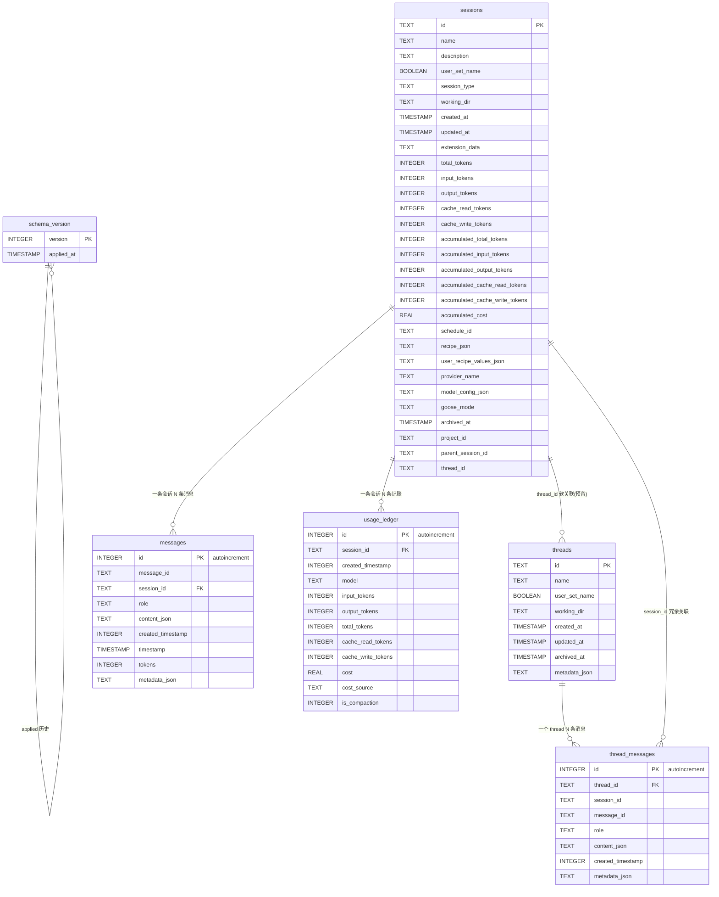
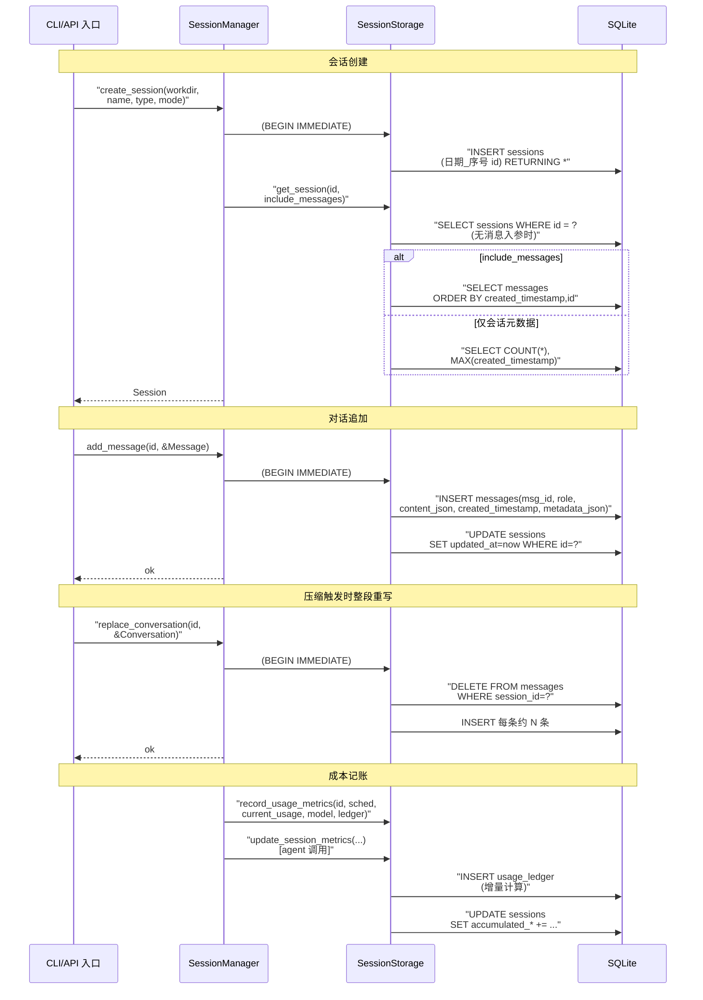

# 数据模型

> schema 定义与迁移均在 `crates/goose/src/session/session_manager.rs`。

> **演进说明（main@f87c4d7）**：依据代码快照比对。`CURRENT_SCHEMA_VERSION` 升到 **v16**（新增 `idx_messages_session_created` 复合索引）；详见 [CHANGELOG.md](CHANGELOG.md)。

## 根因

会话数据模型的根本问题：**一句话、一条消息、一次 token 消耗，怎么组织成一组相互关联、可演进、可查询的表，支撑"恢复对话、跨会话召回、成本核算、上下文压缩"四件事**。goose 的答案是：一个 `sessions.db`（SQLite），核心四张用户表 + 一张版本表，外加一张由 provider inventory 建的表；schema 通过版本表 + 逐版迁移持续推进到 v16。

## 数据模型主动探测命中

本关注面判定依据程序化扫描信号：本项目存在明确的 `CREATE TABLE` 建表逻辑（`sessions` / `messages` / `usage_ledger` / `threads` / `thread_messages` / `schema_version`），且是**库本身自带的会话/元数据存储**（非第三方业务应用），命中「数据模型」关注面判据，产出本文档。

## 存储选型与理由：SQLite 作为内嵌事实库

goose 对会话数据选了 SQLite + sqlx，而非 MongoDB / 纯 JSONL / 纯内存，权衡如下：

| 候选 | 否决/采用原因 |
|------|--------------|
| SQLite | **采用**。本机单用户、零运维、事务内建，天然匹配"App 本地持久化"。WAL 支持并发读写、`busy_timeout` 防锁死。一个文件即整个库，备份 = 拷文件 |
| MongoDB 等外置 DB | 否决。goose 是可分发到本机的桌面/CLI 工具，引入服务端违背零运维哲学，也增加分发与连接失败面 |
| 纯 JSONL（老方案） | **历史前身**。migration v1 之前 goose 用 `.jsonl` 每会话一个文件存消息，后来迁到单库。`legacy.rs` 提供首启把旧 JSONL 会话批量导入 SQLite 的兼容通道（见演进策略） |
| 纯内存（不持久） | 否决。主循环依赖"crash 后可续 + 重启后可恢复"，必须落盘 |

选型代价：放弃跨进程/跨机器共享与多客户端并发编辑（同库多个 goose 进程由 `BEGIN IMMEDIATE` + SQLite 文件锁串行化）。

## 实体关系总览（ER Diagram）



> 说明：`sessions.thread_id` 无强外键，`threads/thread_messages` 表由 migration v10 预建但当前无写入代码（见演进策略的"预建表"讨论）；`schema_version` 用自身 PK 记录历史版本（v1-v16 各一行）。

## 核心表设计（字段表，作为 ER 图之外的结构化补充）

### schema_version

职责：记录 schema 当前与历史版本。`create_schema` 只写一行的现值（`CURRENT_SCHEMA_VERSION=16`），迁移循环会追加每一版。（`[crates/goose/src/session/session_manager.rs:968-980]()`）

| 字段 | 类型 | 约束 | 说明 |
|------|------|------|------|
| version | INTEGER | PK | 迁移版本号，逐版追加一行 |
| applied_at | TIMESTAMP | 默认 CURRENT_TIMESTAMP | 本版应用时间 |

### sessions

职责：会话主表，一对多挂 messages / usage_ledger。字段分四组：**身份**（name/session_type/working_dir/goose_mode），**计费快照**（usage + accumulated_*，冗余自 usage_ledger 以支持列表免 join 快速展示），**业务关联**（schedule_id/recipe/project_id/parent_session_id），**可见性/归档**（archived_at）。`name` 与 `description` 双列并存，读取时优先 name。（`[crates/goose/src/session/session_manager.rs:984-1015]()`）

| 字段 | 类型 | 约束 | 说明 |
|------|------|------|------|
| id | TEXT | PK | 形如 `日期_序号`，`create_session` 用 SQL 自增生成 |
| name | TEXT | NOT NULL 默认 '' | 主标题（含用户/系统生成） |
| description | TEXT | NOT NULL 默认 '' | 旧字段，读取兜底 |
| user_set_name | BOOLEAN | 默认 FALSE | 用户手改过则不覆盖 |
| session_type | TEXT | NOT NULL 默认 'user' | 见 `SessionType` |
| working_dir | TEXT | NOT NULL | 会话工作区 |
| created_at / updated_at | TIMESTAMP | 默认 CURRENT_TIMESTAMP | 时间戳 |
| extension_data | TEXT | 默认 '{}' | JSON blob，扩展透传 |
| total_tokens..cache_write_tokens | INTEGER | 可空 | 单次 usage 快照 |
| accumulated_* | INTEGER | 可空 | 累加 usage（列表展示免 join） |
| accumulated_cost | REAL | 可空 | 累计成本 |
| schedule_id | TEXT | 可空 | 定时任务关联 |
| recipe_json / user_recipe_values_json | TEXT | 可空 | Recipe 相关 JSON |
| provider_name / model_config_json | TEXT | 可空 | 模型与 provider 配置 |
| goose_mode | TEXT | NOT NULL 默认 'auto' | config 模式 |
| archived_at | TIMESTAMP | 可空 | 归档时间 |
| project_id | TEXT | 可空 | 项目关联 |
| parent_session_id | TEXT | 可空 | 父子会话（v15，成本递归汇总用） |
| thread_id | TEXT | 可空 | 预留（v10，无 FK） |

**成本递归**：`parent_session_id` 让子会话成本能经 `WITH RECURSIVE` 向上汇总（`get_session_usage_totals` 查询 2246-2260）。

### messages

职责：消息明细表。内容存 `content_json`（JSON 数组，包容 Text/ToolRequest/ToolResponse/Image 等异构 block），元数据存 `metadata_json`（含 audience/agentVisible 驱动双可见性）。`created_timestamp` 是排序键，读取用 `ORDER BY created_timestamp, id`。（`[crates/goose/src/session/session_manager.rs:1022-1033]()`）

| 字段 | 类型 | 约束 | 说明 |
|------|------|------|------|
| id | INTEGER | PK AUTOINCREMENT | 物理行号，只用于排序打破同秒 |
| message_id | TEXT | 可空，有索引 | 逻辑消息 ID（v7 加入，`msg_{session}_{n}`） |
| session_id | TEXT | NOT NULL 引用 sessions(id) | 外键 |
| role | TEXT | NOT NULL | 'user' / 'assistant' |
| content_json | TEXT | NOT NULL | 消息内容 JSON 数组 |
| created_timestamp | INTEGER | NOT NULL | 逻辑时间（秒） |
| timestamp | TIMESTAMP | 默认 CURRENT_TIMESTAMP | 落库时间 |
| tokens | INTEGER | 可空 | 单条 token（预留） |
| metadata_json | TEXT | 可空 | audience/agentVisible 等元数据 |

索引：`idx_messages_session`、`idx_messages_timestamp`、`idx_messages_message_id`（`[crates/goose/src/session/session_manager.rs:1059-1067]()`）。

### usage_ledger

职责：**独立记账流水表**。与 `sessions.accumulated_*` 快照不同，这是不可覆盖、可对账的明细。每次 turn 会话成一条，`is_compaction` 标记该条是压缩调用。（`[crates/goose/src/session/session_manager.rs:1040-1054]()`）

| 字段 | 类型 | 约束 | 说明 |
|------|------|------|------|
| id | INTEGER | PK AUTOINCREMENT | 流水号 |
| session_id | TEXT | NOT NULL 引用 sessions(id) ON DELETE CASCADE | 外键，删除主表级联清账 |
| created_timestamp | INTEGER | NOT NULL | 记录时间 |
| model | TEXT | 可空 | 使用的模型 |
| input/output/total_tokens | INTEGER | 可空 | token |
| cache_read/cache_write_tokens | INTEGER | 可空 | 缓存 token |
| cost | REAL | 可空 | 该笔成本 |
| cost_source | TEXT | 可空 | 'provider_reported'/'estimated'/'carried_forward' |
| is_compaction | INTEGER | 默认 0 | 1 = 此笔是 compaction 调用 |

为什么单独成表而不只依赖 sessions 快照：快照是"当前状态"，会随 compaction 重写重置；流水是"累计账本"。`record_usage_metrics` 一次事务里用 `INSERT ... SELECT` 计算"上次累计到现在的增量"写 ledger，再对 sessions 累加，保证两表一致（`[crates/goose/src/session/session_manager.rs:2147-2220]()`）。

### threads / thread_messages

职责：**为 thread 化产品形态预留**的消息分组表，与 messages 并存。（`[crates/goose/src/session/session_manager.rs:1406-1438]()`）

threads 字段：`id(PK) / name / user_set_name / working_dir / created_at / updated_at / archived_at / metadata_json`；thread_messages 字段：`id(PK) / thread_id(FK) / session_id / message_id / role / content_json / created_timestamp / metadata_json`。索引 `idx_thread_messages_thread`、`idx_thread_messages_message_id`。

> **关键观察**：这两张表仅由 migration v10 建出，当前源码**没有任何写读它们的调用**，`sessions.thread_id` 也无代码赋值。它们是"预建的占位表"——为不让 schema 演进重复建表，提前把列/表定好，等 thread 功能落地时直接复用。这是典型的"schema 先行 + 代码后行"的演进手法，代价是现阶段存在死表。

## 演进策略：版本表 + 逐版迁移循环

goose 不引入外部 migration 工具，用自研的最小机制：

1. `pool()` 初始化时先查 `schema_version` 表是否存在于 sqlite_master（`[crates/goose/src/session/session_manager.rs:930-935]()`）。
2. 不存在 → `create_schema` 全新建库 + `import_legacy` 导入旧 JSONL。
3. 存在 → `run_migrations`：读当前 MAX(version)，若 `< 16`，在 `BEGIN IMMEDIATE` 里对 `(current_version+1)..=16` 逐个 `apply_migration` 并在每版后 `update_schema_version` 追加一行（`[crates/goose/src/session/session_manager.rs:1204-1227]()`）。

```rust
for version in (current_version + 1)..=CURRENT_SCHEMA_VERSION {
    info!("  Applying migration v{}...", version);
    Self::apply_migration(&mut tx, version).await?;
    Self::update_schema_version(&mut tx, version).await?;
    info!("  ✓ Migration v{} complete", version);
}
```
<!-- snippet: [crates/goose/src/session/session_manager.rs:1215-1220] for version in (current_version + 1)..=CURRENT_SCHEMA_VERSION { info!("  Applying migration v{}...", version); Self::apply_migration(&mut tx, version).await?; Self::update_schema_version(&mut tx, version).await?; info!("  ✓ Migration v{} complete", version); } -->

**演进手法有两条主线**：

- **加列为主**：migration v2-v15 绝大多数是 `ALTER TABLE ADD COLUMN`（`user_recipe_values_json`、`metadata_json`、`message_id`、`goose_mode`、`archived_at`、`project_id`、`accumulated_cost`、cache 四列、`parent_session_id`）。这是 SQLite 对新手最友好的演进——`ALTER TABLE ADD COLUMN` 幂等且不动既有数据。
- **索引先行**：v16 不再加列，而是补 `idx_messages_session_created`（`messages(session_id, created_timestamp, id)` 复合索引）——会话列表与消息分页的高频查询由此走索引而非全表扫（`[crates/goose/src/session/session_manager.rs:1586-1592]()`）。至此演进从"扩展结构"转入"优化访问路径"。
- **数据批量回填/重分类**：v7 给历史行补 `message_id`（`UPDATE messages SET message_id = 'msg_' || session_id || '_' || id`，`[crates/goose/src/session/session_manager.rs:1352-1359]()`）；**v9 把历史 user 会话里名为 `ACP Session` 的整批重分类成 `Acp`**（`[crates/goose/src/session/session_manager.rs:1374-1386]()`）——这是 session_type 靠枚举值演进、用 SQL 一次性迁移存量数据的范例。
- **防重复建表守卫**：每次 `ADD COLUMN` 前都先 `PRAGMA table_info` 判列是否存在，`CREATE TABLE IF NOT EXISTS` 全加 `IF NOT EXISTS`——因为新建库（`create_schema`）与旧库迁移（`apply_migration`）路径不同，须幂等。

```sql
UPDATE sessions
SET session_type = 'acp'
WHERE session_type = 'user'
  AND name = 'ACP Session'
  AND user_set_name = FALSE
```
<!-- snippet: [crates/goose/src/session/session_manager.rs:1376-1382] UPDATE sessions SET session_type = 'acp' WHERE session_type = 'user' AND name = 'ACP Session' AND user_set_name = FALSE -->

旧 JSONL 首启导入是"一次迁移"的另一半：`import_legacy` 扫描 `sessions/` 目录下 `*.jsonl`（受限 50MB/文件），逐个 `legacy::load_session` 反序列化后 `insert_legacy_session`，成功不删原文件、失败只告警不中断（`[crates/goose/src/session/session_manager.rs:1092-1134]()`）。这样老用户升级不丢历史。

## 读写路径：一次对话从写入到读取（含 compaction 重写）

下面 sequenceDiagram 覆盖核心写读链路 + 触发 compaction 时的重写。



**关键语义**：正常对话用 `add_message` 增量写；compaction / clear / import / copy 用 `replace_conversation` 物理 DELETE+INSERT 全量覆盖（见会话篇）。读取恒走"会话表 + 消息表（按 created_timestamp,id 排序重建 Conversation）"。

## token / usage 的设计取舍

- **快照（sessions.usage / accumulated_usage）与流水（usage_ledger）双轨**：快照供列表/当前展示 O(1) 读取，流水供对账/成本明细。`record_usage_metrics` 把两份写入放进同一事务保持强一致。
- **compaction 独立计费**：`MessageUsage.is_compaction` 标记压缩调用（`from_provider_usage(..., is_compaction=true)`），且 `post_compaction_context_tokens`（= `retained_context_tokens`）把会话 context 基线重置为压缩后尺寸——这让"压缩本身也记账"（成本拉满），但"当前上下文占用"回落，模型能继续跑（`[crates/goose/src/agents/reply_parts.rs:643-681]()`）。`get_session_usage_totals` 用 `MAX(acc, ledger)` 取二者较大值，避免快照与流水因时序不同步产生负值。
- **`carried_forward`**：`record_usage_metrics` 第一次只 update 快照不插 ledger，后续用 `INSERT..SELECT` 算增量写 ledger 并标 `cost_source='carried_forward'`，保证 ledger 是"真实增量"而非重复计。

## 全局关联

数据模型不是孤立的表清单，它支撑的是 goose 主循环的四个关切：
- **恢复对话** → `sessions + messages`，compaction 重写也落在 messages。
- **跨会话召回** → `chat_history_search.rs` 直接对 messages 做 `json_extract` + `LIKE` 全文（无 FTS，见会话篇风险）。
- **成本核算 / insights** → `usage_ledger + accumulated_*`，`get_insights` 对 `[User,Scheduled]` 求和。
- **上下文压缩** → 需要"能安全物理覆盖历史"的 replace_conversation，数据模型提供 DELETE+INSERT 事务支撑就是这个耦合点。

## 设计亮点

- **JSON blob + 提升列渐进演进**：content_json/metadata_json/extension_data/model_config_json 用 JSON 承载多态与扩展，瓶颈处（session_type、name、token 计数）才提升为列。这是"不一次性引入 30 列"的克制。
- **预建表（threads）**：为未来形态提前铺 schema，`IF NOT EXISTS` 幂等，避免反复迁移。
- **session_type 用 SQL 回填重分类**：把"数据迁移"与"枚举演进"解耦，一条 UPDATE 完成历史数据归一。
- **schema_version 表 + 逐版迁移循环**：零依赖、可审计（每版一行）、可回滚方向明确（虽然当前只前向）。

## 不足 / 风险

- `messages` 无 FTS/倒排索引，跨会话全文召回靠 `LIKE '%kw%'`，会话多时是线性扫描（已有 `idx_messages_*`，但按文本内容无法索引）。
- `threads/thread_messages` 与 `sessions.thread_id` 当前零消费，属死表/死列，阅读若不标注会造成"以为已实现"的误导。
- `sessions` 上冗余 token 快照与 `usage_ledger` 需 `MAX(acc, ledger)` 调和，异常时序下仍可能短暂不一致（无外键约束保证两表严格一致）。
