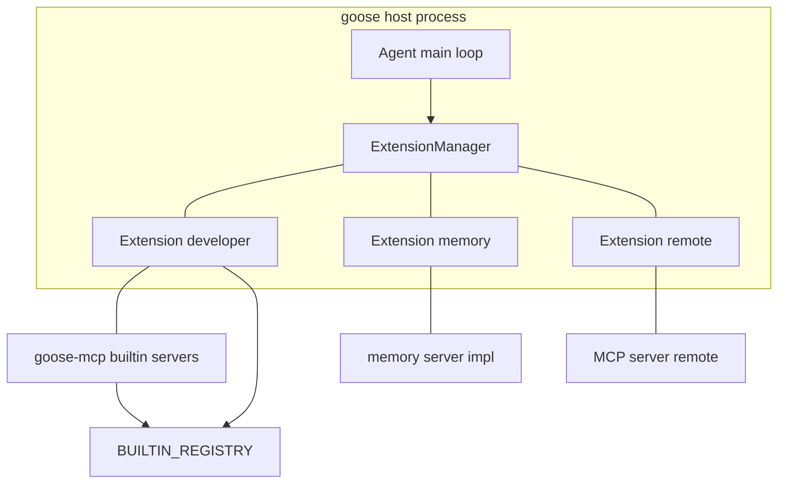
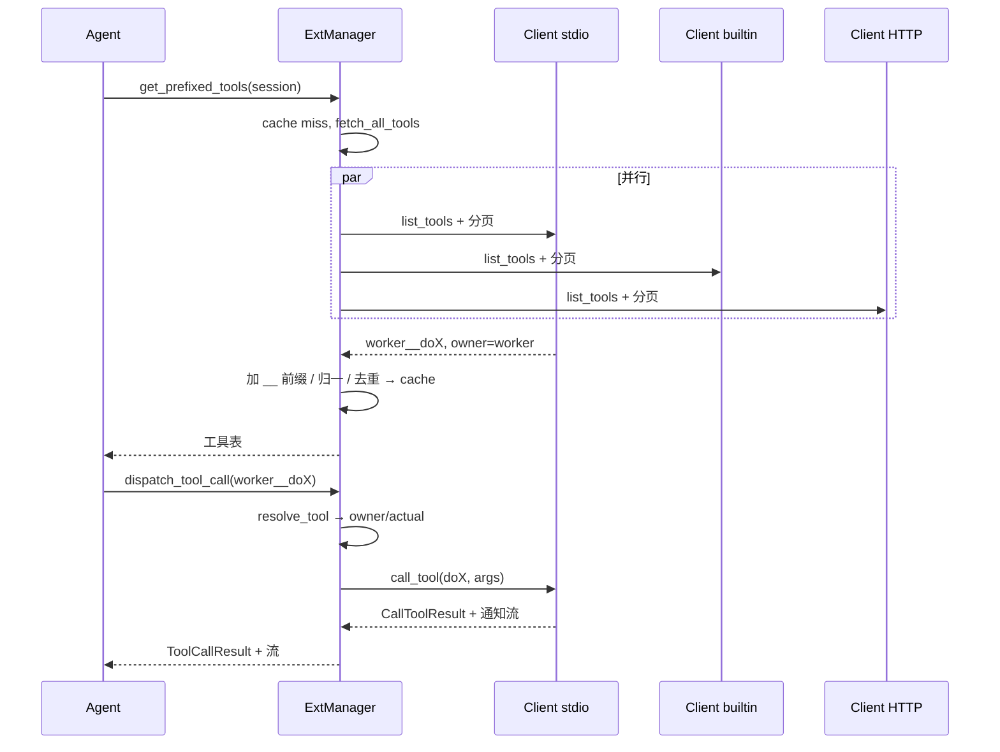

# MCP 接入层

> 本解读是 goose（Linux Foundation AAIF 下以 Rust 实现的通用 Agent）关于「MCP 接入层」的深读，聚焦它如何以 MCP 客户端身份连入 70+ 外部扩展、把工具并入 Agent 的工具表、并在宿主内自研对内 MCP Server。讨论基于源码根 `crates/goose/` 与 `crates/goose-mcp/`。

> **演进说明（main@f87c4d7）**：依据代码快照比对。`child_process_client` 改用 `spawn_long_lived_mcp_subprocess` + stderr 异步读；sampling `create_message` 修复（reasoning-first，text/image 提取）。本篇多数引用为无指纹弱校验（WEAK）存量，未改动；详见 [CHANGELOG.md](CHANGELOG.md)。

## 根因：用开放协议承载「能力即插即用」

goose 的主循环是「LLM ↔ 工具」闭环：LLM 生成工具调用，主循环执行、回流结果。若所有能力的接入方式都自造一份接口，新增一个外部能力就要改一遍主循环与前端协议。goose 的选择是**把能力边界收敛到单一开放协议 MCP（Model Context Protocol）**：每个外部扩展都被封装成「MCP Server」（进程、HTTP 端点或进程内同库实现），goose 主循环只作为**统一 MCP 客户端**消费这些 server 暴露的 tools/resources/prompts。于是「接入一个新扩展」被压成了「写一个 ExtensionConfig + 起一个 MCP connection」，主循环的 Agent 逻辑、工具分发、权限、记忆渲染一律不受扩展数量影响。

这一章拆解四件事：MCP 客户端怎么封装并按需换 transport（stdio/HTTP/UDS）、扩展怎么管理（ExtensionManager 汇总工具表与派发）、工具 Schema 为何要被归一化、以及 goose 自己作为 MCP Server 的那一面（内置扩展 + MCP Apps）。

## 总览与架构图

核心参与方：

- `McpClient` / `GooseClient`：RMCP `RoleClient` 封装，负责出站（call_tool 等）与入站（sampling/elicitation/roots）双向会话。
- `ExtensionManager`：持有 `HashMap<extension_key, Extension>`，每个 `Extension` 包着一个 `McpClientBox`；负责收集全部 tools、按 `__` 前缀命名、缓存与派发。
- `ExtensionConfig`：七种扩展形态的配置描述（stdio / streamable_http / builtin / platform / frontend / inline_python / sse）。
- `builtin_extension.rs` + `goose-mcp` crate：宿主**进程内**直接 spawn 的 MCP Server 集合与注册表。
- `plugins/`：Open Plugins 规范的外部 MCP server 发现与解析。
- `goose_apps/`：以 `ui://` MCP resource 承载的 HTML 打包 UI 应用（MCP Apps）。

要点：无论是外部进程、远端 HTTP 还是进程内内置 server，在 `ExtensionManager` 眼里**都是同一个 `Box<dyn McpClientTrait>`**。这是「把差异压平到一个抽象后面」的关键——上层只认工具名与方法，完全不关心底层 transport。

## MCP 客户端封装：双向角色与 transport 切换

### 角色划分：`RoleClient` 与 `ClientHandler`

goose 基于 RMCP（Rust MCP 实现）构造客户端。`McpClient` 内部持有一个 `RunningService<RoleClient, GooseClient>`，其中 `RoleClient` 表明本端在 MCP 会话里是客户端角色，`GooseClient` 是这端实际的消息处理实现。

> [crates/goose/src/agents/mcp_client.rs:639-642]()
> <!-- snippet: pub struct McpClient {
>     client: Mutex<RunningService<RoleClient, GooseClient>>,
>     notification_subscribers: Arc<Mutex<Vec<mpsc::Sender<ServerNotification>>>>,
>     server_info: Option<InitializeResult> -->

`McpClient` 只负责「出站请求」这一侧（把 list_tools / call_tool 等翻译成协议消息、等待响应），而 `GooseClient` 实现 `ClientHandler`，处理「server → 本端」的入站回调。MCP 不是单向拉取，server 可以在会话里反向请求客户端做事，这四类入站能力最能体现 goose 的设计取舍：

- `create_message`（sampling）：外部 server 可以在一次工具执行里反向请 goose 用「自己的 provider + 当前会话上下文」补一次 LLM 生成，再把结果送回调用方。goose 用 `resolve_session_id` 优先取请求显式上下文、否则回落活跃请求作用域，复用 `resolve_sampling_model_config` 取全局 provider/model，把 server 传来的采样消息转成本地 `Message` 后走 `provider.complete`（非流式补全），结果优先取文本、否则取首张可见 image（[crates/goose/src/agents/mcp_client.rs:433-524]()）。这意味着 server 不需要自带模型，能力的推理成本仍由宿主统一承担。
- `create_elicitation`（elicitation）：server 需要向用户要表单/确认/授权时，通过 `ActionRequiredManager` 把请求转给前端的「需要用户动作」通道，并等待至多 300 秒（[crates/goose/src/agents/mcp_client.rs:489-551]()）。它需要一个 `tool_call_request_id` 才能把 elicitation 对应到正在进行的某次工具调用上——这引出了后面的「会话关联」机制。
- `list_roots`：向 server 暴露宿主当前工作目录，作为 `file://` root（[crates/goose/src/agents/mcp_client.rs:347-353]()）。
- `on_tool_list_changed`：收到 server 的「工具表变了」通知后，向 `ExtensionManager` 请求失效工具缓存（[crates/goose/src/agents/mcp_client.rs:380-382]()）。这是缓存正确性的关键，见后文。

### 出站请求与「会话关联」元数据注入

出站不是裸发消息，而是把调用上下文作为 `Extensions._meta` 塞进请求头（session_id / working_dir / tool_call_request_id），这样 server 端回环调用（elicitation 回到本端）时能认出「这是哪次会话、哪次工具调用」。

> [crates/goose/src/agents/mcp_client.rs:1117-1122]()
> <!-- snippet: fn inject_session_context_into_request(
>     request: ClientRequest,
>     session_id: Option<&str>,
>     working_dir: Option<&str>,
>     tool_call_request_id: Option<&str>,
> ) -> ClientRequest { -->

`inject_session_context_into_request` 对六类请求逐一打进去，`CallToolRequest` 额外带上 `tool_call_request_id`（[crates/goose/src/agents/mcp_client.rs:997-1005]()）。

`send_request_with_context`（[crates/goose/src/agents/mcp_client.rs:671-705]()）里有个刻意为之的锁纪律：内层锁只在 send 时持有，真正的响应等待发生在锁外，让同一连接上的并发工具调用可重叠。

> [crates/goose/src/agents/mcp_client.rs:774-778]()
> <!-- snippet:        // happens outside the lock so concurrent calls can overlap. The guard
>        // unregisters the active tool call on drop, covering cancellation and
>        // dropped reply streams as well as normal completion.
>        let (handle, _active_tool_call_guard) = {
>            let client = self.client.lock().await; -->

为什么不在持锁时等响应？因为那会串行化所有跨扩展的工具调用——一次慢调用会阻塞住整个 Agent 的所有并行工具。真正等待响应发生在释放锁之后，而 `ActiveToolCallGuard` 负责在被 drop（含取消、返回流被丢弃）时从活跃调用表里注销该 `tool_call_request_id`（[crates/goose/src/agents/mcp_client.rs:161-182]()）。这个「活跃调用登记」为前面的 elicitation 关联服务：server 回灌 elicitation 时若没回声 request id，就在活跃调用里去查（[crates/goose/src/agents/mcp_client.rs:283-310]()）。**权衡**：让同一连接上的并发工具调用可重叠，代价是需要维护一份「session → 活跃 tool_call_request_id 列表」的协调状态，且多个并发调用且 server 不回显 id 时只能报错而非瞎猜。

### 响应等待：超时与取消的三种出口

`await_response`（[crates/goose/src/agents/mcp_client.rs:708-729]()）用 `tokio::select!` 给出三个出口：

- 收到响应 → 返回结果；
- 超过 `self.timeout` → 向对端发 `CancelledNotificationParam`（带 reason "timed out"）再返回 `Timeout` 错误；
- 调用方传入的 `CancellationToken` 已取消 → 同样先发取消通知再返回 `Cancelled`。

关键点是**超时/取消时主动向对端广播 cancel 通知**，而不是静默丢下悬空的请求。因为 MCP 调用可能已在对端开始产生副作用，主动通知能早停。`send_cancel_message` 是这三条路径共用的小通道（[crates/goose/src/agents/mcp_client.rs:731-740]()）。

### transport 的三种起法

客户端 `connect` 接受任意满足 `IntoTransport<RoleClient, …>` 的 transport（[crates/goose/src/agents/mcp_client.rs:585-609]()），transport 的选择完全由上层决定，客户端本身不知道底层是什么：

- **stdio（独立进程）**：`child_process_client` 用 `spawn_long_lived_mcp_subprocess` 拉起子进程，把 `stderr` 单独拉出交给 `tokio::spawn` 后台读满，stdio 作为 transport。有个细节——**初始化失败时把 stderr 内容拼进错误**（`ProcessExit::new(stderr_content, error)`），让「why it failed to start」可读。

> [crates/goose/src/agents/extension_manager.rs:454-457]()
> <!-- snippet:    let (transport, mut stderr) = spawn_long_lived_mcp_subprocess(command).await?;
>        let mut stderr = stderr.take().ok_or_else(|| {
>            ExtensionError::SetupError("failed to attach child process stderr".to_owned())
>        })?; -->

它还用 `SearchPaths` 做 PATH 解析（含 npx/uvx 可执行定位）并注入工作目录。

- **streamable HTTP**：`create_streamable_http_client` 用 `StreamableHttpClientTransport`，带默认 headers（注入 `goose/<version>` UA），并且**自带 OAuth 处理**——先尝试用已存凭据刷新直连；401 时回退到浏览器授权流 `oauth_flow`，成功后用 `AuthorizationManager` 重连（[crates/goose/src/agents/extension_manager.rs:668-819]()）。这个「proactive refresh → 401 fallback」是对「每次新会话都走一次浏览器授权」的优化。
- **HTTP over Unix domain socket**：把本地服务当 HTTP 端点，但经 UDS 走，并对 UDS 明确「不支持 OAuth」（[crates/goose/src/agents/extension_manager.rs:823-883]()）。

协议映射到出站：`McpClientTrait` 的 `list_tools`/`call_tool`/`read_resource`/`list_prompts` 各把参数包成对应 `ClientRequest`，经 `send_request_with_context` 带上三重上下文，再 match 对应的 `ServerResult`（[crates/goose/src/agents/mcp_client.rs:748-902]()）。以 `call_tool` 为例，它就是包 `CallToolRequest(name, args)` 再派发（[crates/goose/src/agents/mcp_client.rs:820-847]()）。

## ExtensionManager：工具收集、命名归属与派发

`ExtensionManager` 把「一堆形态各异的扩展」折叠成「一张扁平的工具表 + 一次派发」，是整层的枢纽（[crates/goose/src/agents/extension_manager.rs:188-197]()）。

### 七种扩展形态 → 一个 McpClientBox

`ExtensionConfig` 是七变体枚举（[crates/goose/src/agents/extension.rs:160-295]()）：`Sse`（仅兼容保留，实际拒绝）、`Stdio`、`Builtin`、`Platform`、`StreamableHttp`、`Frontend`、`InlinePython`。`add_extension` 是最大的 match，按形态各起各的连接——HTTP/stdio 走前面讲的两种 transport，Builtin 走内存 duplex 进程内 server，InlinePython 用 `uvx` 临时起一个 python 子进程（[crates/goose/src/agents/extension_manager.rs:949-1216]()）。

值得注意的「**进程内内置 server**」的建立方式：Builtin 分支若不在 `PLATFORM_EXTENSIONS` 里，就从注册表 `get_builtin_extension` 取一个 `SpawnServerFn`。

> [crates/goose/src/agents/extension_manager.rs:1590-1596]()
> <!-- snippet:        let (server_read, client_write) = tokio::io::duplex(65536);
>        let (client_read, server_write) = tokio::io::duplex(65536);
>        extension_fn(server_read, server_write);
>
>        Box::new(
>            McpClient::connect(
>                (client_read, client_write), -->

这里用一对内存里的 `duplex` 管道把「宿主客户端」和「进程内 server」接起来，**语义上与 stdio 子进程完全一致**，只是不 fork 进程、序列化开销更低。若在 Docker 容器内跑，就改为 `docker exec -i <container> goose mcp <name>` 走子进程（[crates/goose/src/agents/extension_manager.rs:1049-1077]()）。这正是「差异压平」的体现：内置扩展有时用进程内、有时用 docker exec，但 `Extension` 存的全是同一个 trait object。

`add_extension` 还有一层幂等保护：对已存在的扩展，只有在「未解析配置」和「已解析（含 keyring 替换后的）配置」都相同时才跳过重启；否则重启以应用 secret 轮换（[crates/goose/src/agents/extension_manager.rs:956-972]()）。它同时比较两层，是为了既捕捉「结构变化」也捕捉「只换密钥」两种变更。

### 工具命名：`__` 前缀归属

每个 server 的 `list_tools` 返回的原始工具名，在进入公共工具表前会被改写。

> [crates/goose/src/agents/extension_manager.rs:1986-1990]()
> <!-- snippet:                            let public_name = if expose_unprefixed {
>                                tool.name.to_string()
>                            } else {
>                                format!("{}__{}", name, tool.name)
>                            }; -->

于是「developer 扩展的 shell 工具」对外叫 `developer__shell`，`__` 左侧就是归属扩展。为什么需要前缀？因为 70+ 扩展的工具名必然碰撞（比如两个扩展都叫 `read_file`），不隔离开就无法在 LLM 的工具选择空间里消歧。**例外**是 `is_unprefixed_extension`：一部分被标记 `unprefixed_tools` 的一等平台扩展（如 developer）不改名，让它们对外暴露「裸工具名」（[crates/goose/src/agents/extension_manager.rs:373-390]()）。这是刻意的第一等公民待遇——平台扩展是主循环的固定部分，不该和第三方扩展一个命名待遇。

收集工具时还把 `goose_extension` 元数据打进 tool.meta（`TOOL_EXTENSION_META_KEY`），这样即使工具名被改，事后仍能用 meta 找回归属（[crates/goose/src/agents/extension_manager.rs:1459-1465]()），`get_tool_owner` 就是读它（[crates/goose/src/agents/extension_manager.rs:273-279]()）。它还做**可用性过滤**（`is_tool_available`，[crates/goose/src/agents/extension.rs:417-444]()）：config 里显式写了 `available_tools` 的只留列出的；空列表=全部可用。

### 工具表缓存：一次性 fetch + 失效

`get_all_tools_cached` 是关键缓存点（[crates/goose/src/agents/extension_manager.rs:1347-1367]()）：首次调用经 `fetch_all_tools` 到各扩展拉全量工具，写入 `tools_cache`（`Arc<Vec<Tool>>`），后续直接命中缓存。真正拉取在 `fetch_all_tools`（[crates/goose/src/agents/extension_manager.rs:1417-1519]()），用 `future::join_all` **并发**对所有扩展发 `list_tools`，还处理分页 `next_cursor`，最后用一个 `seen_names` 集合去重（撞名就跳过并告警）。

这里有个**并发正确性细节**：`get_all_tools_cached` 在读缓存判断、写缓存之间，允许「版本号发生变更时放弃覆盖自己的结果」——用 `tools_cache_version`（[crates/goose/src/agents/extension_manager.rs:1355-1364]()）。因为工具表是并发场景，一个 fetch 在途时若 `on_tool_list_changed` 触发了失效，正在进行的旧 fetch 结果不能污染新缓存。`invalidate_tools_cache_and_bump_version`（[crates/goose/src/agents/extension_manager.rs:1412-1415]()）原子地 `fetch_add` 版本号并清空缓存。由此 `McpClient::on_tool_list_changed` 只是转发到这个失效方法，形成「server 主动通知 → 缓存作废 → 下次 fetch 重建」的自愈闭环。

`get_prefixed_tools(session_id, extension_name)` 在缓存之上再做一层过滤（[crates/goose/src/agents/extension_manager.rs:1297-1304]()），可按扩展名挑，或 `get_prefixed_tools_excluding` 排除某扩展。agent 主循环即用这些拿到应渲染给 LLM 的工具表。

### dispatch_tool_call：把调用路由到对的扩展

工具派发不是全局广播，而是精确定位到归属扩展（[crates/goose/src/agents/extension_manager.rs:1817-1956]()）。第一步 `resolve_tool`（[crates/goose/src/agents/extension_manager.rs:1726-1815]()）在做归一化：

1. 在缓存工具表里精确按改名后的名字找；
2. 找不到就尝试 `__` 拆分：把 `prefix__tool` 的 `prefix` 当扩展 key，直接路由（容错路径——即使工具不进缓存也能派发）；
3. 再不行，尝试 `recover_mangled_tool_name`：LLM 常会输出 `functions.shell` 或 `shell.tool` 这类「被 mangled 的名字」，把它还原回 `shell__tool`（[crates/goose/src/agents/extension_manager.rs:281-309]()）；
4. 全失败则回可诊断错误，列出可用工具。

归属确定后（从 tool.meta 优先，其次 `__` 前缀），`resolve_tool` 返回 `ResolvedTool{ owner, actual_tool_name, client, tool_meta, resource_uri }`，抹掉了公共名和 server 私有名之间的换算（[crates/goose/src/agents/extension_manager.rs:398-405]()）。

`dispatch_tool_call` 随后做几件事：

- 再核对一次 `available_tools` 是否放行该实际工具名（[crates/goose/src/agents/extension_manager.rs:1826-1841]()）；
- 用 `client.call_tool` 实际派发，并把响应并入一条**通知流**（`notification_stream`）与「需用户动作流」（`action_required_stream`）一起抛给主循环，供流式消费 progress/logging（[crates/goose/src/agents/extension_manager.rs:1897-1955]()）；
- 对启用 MCP Apps 的宿主，在工具返回后「追补水合」MCP App 附件（见后文「MCP Apps」）。

派发时还区分了「请求作用域内的通知」与「客户端级通知」两条流，用 `stream::select` 合并（[crates/goose/src/agents/extension_manager.rs:1879-1904]()），保证 server 推送的按连接范围通知能针对单次调用对齐。

## 内置 MCP Server 与外部 Server：注册表 vs 插件发现

goose 的扩展来源分两大类，都汇入同一个 `ExtensionManager`：

- **内置（bundled）**：随 goose 发行、进程内同进程对跑，`goose-mcp` crate 定义。`BUILTIN_EXTENSIONS` 是一个 `Lazy<HashMap<&str, SpawnServerFn>>`，用宏把一个实现了 `ServerHandler` 的 server 及其名字装进去（[crates/goose-mcp/src/lib.rs:48-64]()）：autovisualiser / computercontroller / memory / tutorial。每个 `SpawnServerFn` 吃一对 duplex 并 spawn 起来 serving（[crates/goose-mcp/src/lib.rs:31-46]()），`spawn_and_serve` 里挂一个 `running.waiting()` 保持存活。宿主侧对应的注册表是 `builtin_extension.rs` 的 `BUILTIN_REGISTRY`（[crates/goose/src/builtin_extension.rs:7-28]()），`register_builtin_extension`/`get_builtin_extension` 供 `add_extension` 查表。两个注册表名称一致、一内一外，靠名字对齐。
- **内置 server 的实现样本**：`MemoryServer`（[crates/goose-mcp/src/memory/mod.rs:76-135]()）用 `#[tool_router]` 宏把 impl 里的方法变成 MCP tool，并通过 `ServerHandler::get_info` 把「分类化存储说明 + 当前全局记忆内容」拼进 instructions 返回给客户端。

> [crates/goose-mcp/src/memory/mod.rs:511-513]()
> <!-- snippet: impl ServerHandler for MemoryServer {
>     fn get_info(&self) -> ServerInfo {
>         InitializeResult::new(ServerCapabilities::builder().enable_tools().build()) -->

instructions 会随当前记忆**动态**烘焙，这正是为什么客户端 trait 里 `get_instructions` 被设计成可从 `get_info` 读取的动态方法（[crates/goose/src/agents/mcp_client.rs:107-109]()、[crates/goose/src/agents/extension_manager.rs:157-159]()）。

- **外部（插件发现的 npx/uvx 服务器）**：走 Open Plugins 规范的 `plugins/` 子系统。`discover_enabled_plugins` 在三个作用域（项目 `.agents/plugins/`、用户安装目录 + settings.json）扫描已启用插件，并按 `config.yaml` 的 `plugins` map 过滤，新发现的自动写回 enabled（[crates/goose/src/plugins/discovery.rs:52-147]()）。然后 `mcp_servers.rs` 把插件清单里的 `mcpServers` 段解析成 `ExtensionConfig::Stdio`，支持一份 `.mcp.json`、inline server 或路径引用，且 `command/args/env` 里的 `${PLUGIN_ROOT}` 被展开成插件根（[crates/goose/src/plugins/mcp_servers.rs:32-165]()）。最终这些 Stdio config（通常是 `npx`/`uvx` 起远端包）回到 `ExtensionManager::add_extension`，与内置扩展走完全相同的 stdio 子进程路径。

**设计差异总结**：内置扩展是「goose 自带、代码在仓库里、进程内对跑」；插件扩展是「外部生态、按需 npx/uvx 拉起、stdio 子进程」。二者性能/信任/分发来源完全不同，但在抽象层统一成一个 `Extension`。这就是「内置 vs 外置」的分界：前者保功能基线、后者扩生态。

### 启动编排

`add_extension` 被逐个 config 调用，每个调用同步地把 client 建起来（连上/拉起）、把 metadata 存进 map、并失效工具缓存（[crates/goose/src/agents/extension_manager.rs:1199-1215]()）。工具缓存的失效保证「新扩展加入后，下一次工具表重建会带上它的工具」。插件的启动顺序由 `enabled_plugin_mcp_servers` 返回顺序 + 各 config 的调起共同决定，工具真正暴露给 LLM 要等首次 `get_prefixed_tools` 触发缓存填充。

## tool_schema_normalize：为何不同 provider 需要不同形状

工具要喂给 LLM，其 `input_schema` 是 JSON Schema。但**不同 provider 的 schema 校验/解析容忍度差异巨大**，goose 在 `fetch_all_tools` 里对每个工具做一次 `normalize_input_schema`（[crates/goose/src/agents/extension_manager.rs:1467-1472]()），核心实现是 `collapse_const_unions`（[crates/goose/src/agents/tool_schema_normalize.rs:26-35]()）。

动机写在注释里：Rust 端 `schemars` 生成「带文档的 unit enum」时，会展开成 `$ref → $defs → oneOf(若干 {type,const})` 的结构，**比等价的 `enum` 大 9 倍，且被严格的校验器直接拒收（点名 Moonshot）**。

> [crates/goose/src/agents/tool_schema_normalize.rs:19-21]()
> <!-- snippet: /// schemars emits documented unit enums as `$ref -> $defs -> oneOf` of consts:
> /// ~9x larger than an equivalent `enum` and rejected outright by strict
> /// validators (notably Moonshot's). Anything not provably equivalent is left -->

于是把它折叠回 `{type: "string", enum: [...]}`。这是个「宁缺毋滥」的保守转换，处处是安全边界：

- 只有每个分支都是裸 `{type:string, const:X, description?}` 才折（`try_collapse_union`，[crates/goose/src/agents/tool_schema_normalize.rs:143-186]()）；
- **oneOf 里出现重复 const 就放弃**——oneOf 严格禁止多分支匹配，`enum` 又表达不了重复，宁可不动（[crates/goose/src/agents/tool_schema_normalize.rs:167-175]()）；
- **dialect 早于 const 的（draft-04 及更早）一律不折**，因为那时 `const:X` 语义只是 `type:string`，折叠会改义（[crates/goose/src/agents/tool_schema_normalize.rs:37-46]()）；
- **draft-06/07 下 `$ref` 兄弟关键字被忽略**，故只在裸 ref 时才内联 defs，避免激活死关键字（[crates/goose/src/agents/tool_schema_normalize.rs:296-315]()）；
- 内联 `$defs` 前会排除带锚点/identity 关键字的 def（复制会改变 anchor 解析）与内嵌资源里的指针（改名后不解析）（[crates/goose/src/agents/tool_schema_normalize.rs:290-315]()）；
- 遍历时不下沉进实例数据（`default`/`examples`/`const` 值），防止把「长得像 schema 的数据」当 schema 改（`for_each_subschema_mut`，[crates/goose/src/agents/tool_schema_normalize.rs:97-136]()）。

`collect_used_defs` 只保留仍被引用（含被活 def 传递引用）的 def，其余剪掉，保证删除 `$defs` 不悬空（[crates/goose/src/agents/tool_schema_normalize.rs:378-458]()）。

一句话设计取向：goose 不假设 provider 挑剔程度，而是**把 schema 归一化到最小、最保守的等价形态**，让它在最严的 provider 上也通过，同时绝不改变语义边界之外的任何东西。代价是转换严格，超出「可证明等价」范畴的一律原样保留。

## MCP Apps：用 `ui://` resource 把 HTML 装进 Agent

goose 有一种别致的扩展形态——MCP Apps：把一张完整 HTML 页面作为 MCP resource 暴露，宿主把它渲染成嵌入式 UI。资源 URI 用 `ui://` scheme，mime 是 `text/html;profile=mcp-app`。

类型层面：`McpAppResource`（[crates/goose/src/goose_apps/resource.rs:75-145]()）是携带 UI 元数据（CSP 域名白名单、iframe Permission Policy 权限、偏好窗口属性）的 HTML 资源；`GooseApp` 在其上叠了 `mcpServers`、`window_props`、`prd`（产品需求描述）字段，并能在 HTML 里读写 JSON-LD 元数据块（[crates/goose/src/goose_apps/app.rs:39-209]()）。宿主怎么拿到它们？

1. `ExtensionManager::get_ui_resources` 对所有扩展 `list_resources`，只挑 `uri.starts_with("ui://")` 的（[crates/goose/src/agents/extension_manager.rs:1589-1622]()）。
2. `fetch_mcp_apps` 对每个 `ui://` resource `read_resource`，把 HTML 取回并包成 `GooseApp`，`mcpServers` 指向资源归属的扩展（[crates/goose/src/goose_apps/app.rs:212-313]()）。**一个 MCP App 页面通常对应一个后端 MCP server**，页面内 JS 通过该 server 的工具与宿主/世界交互。

模型如何「渲染」它？goose 不把 HTML 塞给 LLM，而是分两层消费：

- **工具端**：工具若带 `ui` meta（`resourceUri`），`resolve_tool` 会提取 `resource_uri`；调用该工具后，宿主若支持 MCP Apps 就**追读一遍对应 resource**，生成 `GooseMcpAppToolAttachment`（含工具名、归属、resource uri、读出的 resource 结果或读错误），并作为受信 meta 写回工具结果（[crates/goose/src/agents/extension_manager.rs:1379-1410]()、1927-1938）。这样前端拿到的是一个「工具返回 + 对应 UI 数据」的完整包。
- **信任边界**：从 server 返回的任意 meta 是不可信的，`remove_untrusted_mcp_app_meta` 会剥离；只有宿主自己构造的附件才用 `TRUSTED_TOOL_UPDATE_META_KEY` 打上可信标记（[crates/goose/src/agents/extension_manager.rs:325-371]()）。

MCP Apps 的启用受宿主能力控制：`host_supports_mcp_apps` 检查宿主是否显式声明了 `io.modelcontextprotocol/ui` extension（桌面形态 true，CLI 默认 false）（[crates/goose/src/agents/extension_manager.rs:1369-1377]()），并与 `mcp_client.rs` 里 `default_mcp_apps_ui_extensions` 对 server 宣告的 `ClientCapabilities` 对齐（[crates/goose/src/agents/mcp_client.rs:60-83]()）。这解释了为什么要按平台区分 capability——CLI 没渲染器，就不该对 server 宣告能收 MCP App。

## 错误与时序治理

整层关于错误的处理与超时/串流/重连的取舍已散见各节，汇总如下：

- **超时三出口**（`await_response`，[crates/goose/src/agents/mcp_client.rs:708-729]()）——主动广播 cancel，见「出站请求」节。
- **取消**：调用方通过 `CancellationToken` 贯穿 `list_tools`/`call_tool`/`read_resource`，`McpClientTrait` 每个入站方法都收它，保证前端/Agent 中断能传播到协议层。
- **串行化避免**：响应等待在锁外，`ActiveToolCallGuard` 生命周期即调用生命周期（含取消/流被丢弃），见「出站请求」节。
- **OAuth 的三段式**：proactive refresh → 401 检测 → browser fallback → 拒绝后清凭据（[crates/goose/src/agents/extension_manager.rs:472-530]()、737-818）。其中 `clear_credentials_on_post_refresh_auth_failure` 在刷新后仍被拒时清空旧凭据，避免死循环用坏 token。
- **并发工具收集**：`fetch_all_tools` 的 `join_all` 让 N 个扩展并行出工具表，单扩展失败只告警不拖垮整体（[crates/goose/src/agents/extension_manager.rs:1417-1519]()）。
- **内置 server 与子进程生命周期**：用 `running.waiting()` 保持 server 存活；子进程 stderr 单独采集并在启动失败时拼入错误（[crates/goose-mcp/src/lib.rs:38-46]()、[crates/goose/src/agents/extension_manager.rs:441-467]()）。

## 关键设计决策与替代代价

| 决策 | Why | 替代方案 | 替代代价 |
|------|-----|---------|---------|
| 用 RMCP `RoleClient` 而非自研协议栈 | 复用 MCP 标准实现，聚焦业务 | 自实现 MCP 编解码 | 大量样板、易偏离标准、缺双向能力 |
| 客户端抽象统一为 `Box<dyn McpClientTrait>` | 让 stdio/HTTP/内置/docker 差异全部被压平 | 按 transport 分类型处理 | 上层每接一种 transport 都要改分发/缓存逻辑 |
| 进程内内置 server（duplex 直连） | 内置扩展零进程开销、语义等同 stdio | 内置扩展也起子进程 | 每次启动开销 + 外部序列化，性能差、难调试 |
| 工具加 `__` 前缀并写入 meta owner | 70+ 扩展工具名去冲突，且归还可追溯 | 靠全局限定名解决 | 名字膨胀、LLM 犯前缀错误需 mangled 容错 |
| 全量 fetch + 版本号失效缓存 | 避免每轮 LLM 都跨 N 进程拉工具表 | 每次实时拉取 | 严重延迟（N 次 RTT/LLM 迭代） |
| 用 meta 注入会话三元组 | 让 server 回环调用可关联回正确会话 | 无上下文传递 | elicitation 无法对应到正确调用 |
| schema 保守归一化 | 满足最严 provider 且不改语义 | 直接透传 | 某些 provider 收不了 schemars 展开式 |
| 响应等待在锁外 + 活跃调用登记 | 支持跨扩展并行调用 | 序列化等待 | 需维护活跃调用协调状态 |
| provider 反向承载 sampling | server 复用宿主的 LLM 推理 | 每个 server 自带模型 | 成本/模型治理失控，违背「能力集中」哲学 |

## 全局关联：一条主线收束

整层像一个漏斗：**上层只认识 `ExtensionManager` 与 `__` 前缀工具名，下层是千差万别的 MCP server**。goose 通过三层抽象把差异关进盒子里——`ExtensionConfig` 描述形态、`ExtensionManager::add_extension` 把它变成统一连接、`McpClientTrait` 提供统一出站语言，`tool_schema_normalize` 再把 server 给的 schema 洗成中立形态，最终所有工具以一致性扁平表交给 Agent 主循环。内置扩展与插件只是这条管线的两个货源；MCP Apps 则是这条管线的「资源侧」出口，让 UI 也成为 MCP 能力。这套「协议化物理隔离 + 进程内性能回退 + 保守 schema 归一 + 双向能力授权」的组合，正是 goose 能把外部能力「插拔式」并入主循环的根本原因：它把不可控的第三方世界，收敛成了主循环接口里面一张可控的工具表。
