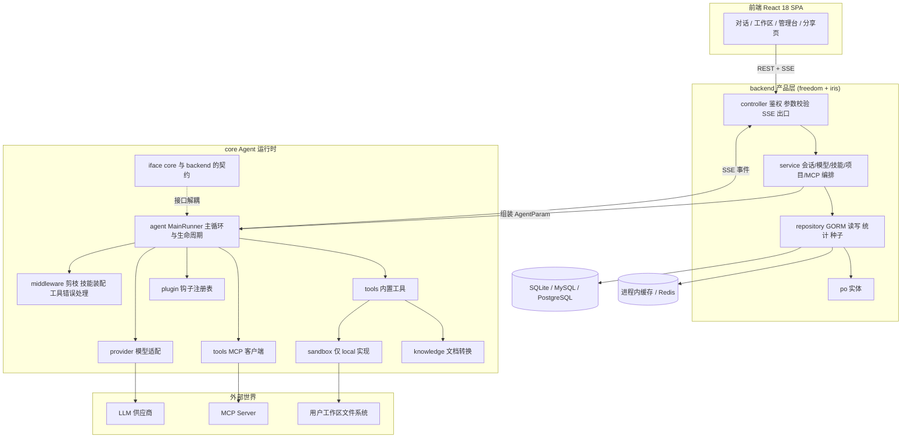
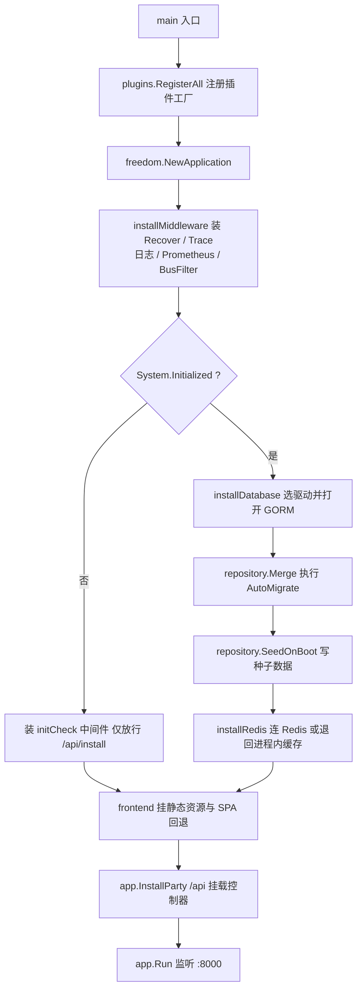
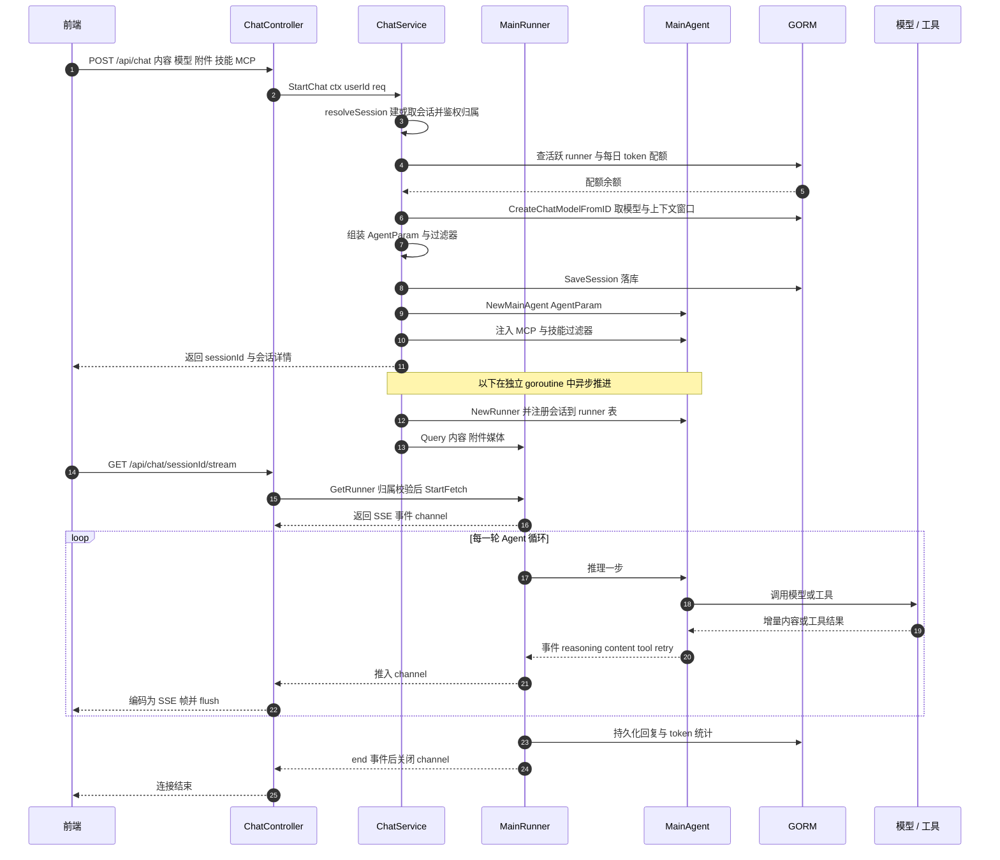

# GoRaven 深度解读

> 本解读按 **ai-agent** 类规格产出（主类型 ai-agent ⊗ 副类型 framework / web-application）。正文所有 `文件:行号` 引用均为 **GoRaven 仓库相对路径**（如 [core/agent/main_runner.go:120-120]()），点开即可核对；其中 `README.md` / `README_CN.md` / `llms.txt` 指 GoRaven 仓库根下的同名文件。
<!-- anchor: runner.stop = true -->

`解读基线：v0.5.4（032c8b7）`

## 子文档索引

- [`agent-runtime.md`](agent-runtime.md) — Agent 主循环、Runner 生命周期、SSE 事件流与多 Agent 委派
- [`context-management.md`](context-management.md) — 上下文压缩（compress）与中间件剪枝（pruning）两套机制的协作与权衡
- [`tools-and-sandbox.md`](tools-and-sandbox.md) — 内置工具抽象、沙箱与路径隔离、Shell 执行与命令安全校验
- [`skill-system.md`](skill-system.md) — Skill 的定义、发现与渐进披露取回，以及把平台自身写成 8 个 skill 的自描述设计
- [`plugin-system.md`](plugin-system.md) — 插件注册、四类生命周期钩子与工具中间件
- [`mcp.md`](mcp.md) — MCP 客户端接入、schema 映射与 stdio 进程治理
- [`knowledge-rag.md`](knowledge-rag.md) — 文档转换/解析管线，以及"为什么不做向量检索"的答案
- [`multi-tenancy.md`](multi-tenancy.md) — 认证、授权收口点、工作区隔离、共享机制与模型配额
- [`data-model.md`](data-model.md) — 27 个实体、ER 图、消息表设计张力与 AutoMigrate 演进策略

## 根因：模型有知识却没有手；给了手，又没有护栏

LLM 有语言理解与推理，但**没有眼睛也没有手**——只有把文件读写、Shell 执行、外部 API 调用真正接进执行环境，Agent 才可能"交付结果"而不是"给一段建议"。GoRaven 的 README 把这一条写成了设计哲学 **OS First**：Agent 本质是一个 Agent OS，运行时与依赖集成是第一优先级（[README.md:151-155]()）。
<!-- anchor: **Observability First**: Collaboration isn't about delegating tasks — it's about … **Engineering First**: Agents are too flexible — tool combinations explode fast, -->

但装上手脚会同时引入三个新问题，这才是 GoRaven 整套架构的真正驱动力：

1. **执行过程看不见**。人机协作比人人协作更脆弱——你看不到它在想什么，它猜不到你要什么。"过程可观测"必须在产品层解决，于是有了独立的 SSE 事件流与两段式请求模型（哲学原文见 [README.md:151-151]()）。
<!-- anchor: **Observability First**: Collaboration isn't about delegating tasks — it's about -->
2. **能力组合爆炸**。工具 × Skill × MCP × 模型 provider 的组合数增长极快，改一条剪枝规则就可能让整条执行链跑偏。这是 **Engineering First** 的由来（[README.md:155-155]()）。
<!-- anchor: **Engineering First**: Agents are too flexible — tool combinations explode fast, -->
3. **执行越界与成本失控**。多用户共用一套执行环境，必须回答"谁能读谁的文件""谁能跑什么命令""谁能烧多少 token"。

由此推出 GoRaven 的整体解法：**核心只保留确定性执行引擎（循环 / 工具 / 沙箱 / 压缩），把一切会变化的都外置成可插拔资产（模型 provider、内置与 MCP 工具、Skill、插件），再用一层 Web 后端把"一人一工作区"的隔离与配额做成产品能力。** 值得注意的反直觉之处：作者明确写了 **不做"记忆与进化"**——"不能蒸馏成通用规则或实时检索增强的都是噪音"（[README.md:147-147]()）。在一众给 Agent 加记忆分层的项目里，这是一个刻意的减法，也是理解其上下文策略的前提。
<!-- anchor: We don't do "memory and evolution" — if it can't be distilled into generalizable -->

## 项目概览

### 是什么

GoRaven 是 **开源自托管、面向团队的 AI Agent 工作台**：给团队里每个人一个独立的 Agent 工作区（工位，而非聊天框）。Agent 在其中读写文件、执行命令、调 MCP 工具链、检索知识、生成报告与图表；团队成员共享项目与 Skill 库，管理员控制模型配额、工具权限与数据访问边界。

它**不是**：不是聊天机器人前端，不是可视化 Agent 编排平台（没有 Dify/Coze 式的工作流画布），也不是单机 CLI 编码 Agent。

### 核心能力清单

| 能力 | 一句话说明 | 源码落点 |
|------|-----------|---------|
| 独立工作区 | 每人一个文件根系，团队项目可共享；同一项目同时只允许一个 Agent 操作（加锁） | `core/sandbox/`、`backend/service/chat.go` |
| 真执行工具 | 文件系统、Shell、WebFetch、文档解析、可视化、时间、自动化任务等内置工具 | `core/tools/` |
| MCP 工具链 | 用户/管理员配置外部 MCP Server，工具并入统一清单 | `core/tools/mcp.go`、`backend/service/mcp.go` |
| Skill 体系 | Skill 作为可复用任务知识注入上下文；含 8 个"平台自描述"Skill | `backend/service/skill.go`、`backend/repository/seed/skill_goraven_*.go` |
| 插件钩子 | 轮次前后、工具调用前后、SSE 事件四类钩子，不改核心即可定制 | `core/plugin/`、`plugins/builtin/audit/` |
| 多模型接入 | 自研 provider 适配层覆盖 OpenAI/Claude/Gemini/Qwen/GLM/DeepSeek/Ollama 等 | `core/provider/` |
| 上下文自管理 | 自动压缩 + 中间件剪枝，长会话可持续 | `core/agent/compress.go`、`core/middleware/pruning/` |
| 过程可观测 | 结构化 SSE 事件流（reasoning/content/tool/retry/end 等） | `core/agent/sse.go`、`backend/controller/chat.go` |
| 多租户治理 | 登录鉴权、模型按成员授权、每日 token 配额、工具日统计 | `backend/infra/auth.go`、`backend/service/chat.go` |
| 自托管交付 | 单二进制 + 内嵌前端静态资源，官方 Docker 镜像，安装向导自举 | `main.go`、`backend/service/install.go` |

### 技术栈一览

| 层 | 选型 |
|----|------|
| 语言 / 运行时 | Go 1.25.5 |
| Web 框架 | `8treenet/freedom` 1.10.1（作者自研的六边形架构 / DDD 框架）+ `8treenet/iris` v12（Iris fork） |
| Agent 编排底座 | `cloudwego/eino` 0.9.12 + `eino-ext`（模型、MCP 组件） |
| 模型接入 | 自研 `core/provider/` 适配层（OpenAI 兼容 + 各厂商 SDK） |
| MCP | `mark3labs/mcp-go` 0.54 与 `eino-ext/components/tool/mcp` 两套并存 |
| 存储 | GORM 1.31：SQLite（默认）/ MySQL / PostgreSQL |
| 缓存 | 进程内 `patrickmn/go-cache`（默认）或 Redis |
| 前端 | React 18.3 + TypeScript 6 + Vite 8 + Tailwind 4 + zustand + TanStack Query + streamdown + recharts |
| 流式协议 | SSE（后端手写事件编码，前端用 `@microsoft/fetch-event-source`） |
| 文档处理 | docling（外部服务）+ `html-to-markdown/v2` |
| 可观测 | Iris Recover/Trace/日志中间件 + Prometheus 中间件 + 自研 SSE 事件流 |

> 一个容易被忽略的事实：`freedom`、`iris` fork 与 GoRaven 出自同一作者（8treenet）。这解释了项目里 `BindController(...)`、`ServiceLocator()`、`Worker.DeferRecycle()`、`InstallParty("/api")` 这些非主流写法——它们不是 Go 社区通用范式，而是 freedom 的领域模型约定（六边形架构 + 依赖注入）。阅读源码时先接受这层框架语义，否则 `backend/controller/*.go` 的 `init()` 注册与 service/repository 的自动装配会显得突兀。

### 项目规模

| 指标 | 数值 |
|------|------|
| Go 源码 | 294 个 `.go` 文件，约 51.4k 行（含测试与种子）；剔除测试与 seed 后约 35.6k 行 |
| 前端 | `frontend/src` 约 148 个文件 |
| 顶层模块 | `backend/`（33.4k 行）、`core/`（15.6k 行）、`util/`、`plugins/`、`config/` |
| 数据实体 | `backend/po/` 27 个实体 |
| 内置 Skill 种子 | `backend/repository/seed/skills_hub/` 7 个磁盘 Skill（含 excel-xlsx、pptx、word-docx 等） |
| 协议 / 社区 | Apache-2.0；GitHub 约 708 stars / 21 forks（2026-09 抓取），2026-06 建仓并高速迭代 |

## 架构总览

### 分层与职责

GoRaven 是**单体分层架构**（不是微服务），但分层边界比典型 Go Web 项目更硬——因为它要同时装下"Web 产品"和"Agent 运行时"两个世界：

三条设计约束在这张图上直接可见：

- **依赖方向单向**：`backend` 依赖 `core`，`core` 只通过 `core/iface/` 认识产品层（`core/iface/iface.go` 仅 24 行，是刻意做薄的契约层）。这让 Agent 运行时可以被独立测试与复用。
- **Agent 运行时不知道 HTTP**：runner 只往 channel 里推事件（[backend/controller/chat.go:146-151]() 的 `SSEChan <-chan *agent.SSEEvent`），由 controller 负责编码成 SSE。可观测性是"事件流"这一层抽象带来的，而不是在 HTTP handler 里打日志。
<!-- anchor: // sseResponse SSE 流式响应，实现 freedom.Result（即 hero.Result） … Runner    *agent.MainRunner      // 运行器，用于客户端断开时停止 fetch -->
- **所有外部能力都走接口**：模型、工具、沙箱、插件、Skill 各自有抽象，运行时只认接口。这是"核心稳定、能力可插拔"的工程兑现。

### 与同类项目的定位差异

| 项目 | 形态 | 与 GoRaven 的关键差异 |
|------|------|---------------------|
| **Coze Studio** | Go + 字节 Eino，DDD 微服务风格单体 | 架构最接近的兄弟（同用 eino）。但 Coze 的核心是"搭 Agent 的平台"（workflow 画布 + 插件市场 + 发布为 bot）；GoRaven 的核心是"给人用的 Agent 工位"，重运行时、无编排画布 |
| **RAGFlow** | Go + Python，RAG 引擎 + Agent | RAGFlow 以深度文档理解与混合检索为护城河；GoRaven 反过来放弃向量检索，靠"工作区文件 + 平台自描述 Skill"让 Agent 自己找（见 [`knowledge-rag.md`](knowledge-rag.md)） |
| **OpenHands / Goose / Codeg** | 桌面 / CLI 编码 Agent | 单机单用户、以本地开发者为用户；GoRaven 是 Web 多租户团队版，把隔离、配额、共享做成一等能力 |
| **Multica / Lework / OpenBee** | Go 团队级 Agent 平台 | 同属"团队级"赛道。Multica 明确不自己跑 LLM、把 agent CLI 外包给用户机器 daemon；GoRaven 自己持有主循环与执行环境，因此必须自己解决沙箱与配额 |
| **FastGPT** | TS，可视化编排 + 知识库 | FastGPT 强在 flow 可视化与 RAG 管道；GoRaven 无可视化编排，把复杂度收进"运行时 + 系统提示词 + Skill" |

## 启动流程：未初始化时只放行安装接口，装完重启自己

启动逻辑集中在 [main.go:35-49]()：先注册插件工厂，再建 freedom 应用、装中间件，然后**只有**在"系统已初始化"时才连数据库与缓存——否则整个进程只提供安装接口。
<!-- anchor: func main() { … app.Run(runner, config.Get().App) -->

关键点与设计意图：

- **驱动选择是运行期分支**，不是编译期 tag：`mysql` / `pg` / 其它走 SQLite 默认（[main.go:114-122]()）。这让同一个二进制能在三种数据库上跑，安装向导据此写回配置。
<!-- anchor: var dialector gorm.Dialector … dialector = sqlite.Open(dbConfAddr) -->
- **缓存可以不存在**：`System.CacheType` 不为 `redis` 时直接返回进程内缓存包装（[main.go:156-176]()），无需外部依赖即可单机跑起来——自托管体验优先的取舍。
<!-- anchor: if config.Get().System.CacheType == "redis" { … return infra.NewCacheWrapper(5*time.Minute, 10*time.Minute) -->
- **安装向导会取代自己**：初始化时写入 `system.initialized=true`，然后延时 1 秒用 `syscall.Exec` 用同一份二进制、同一份参数重启进程（[backend/service/install.go:161-171]()、[backend/service/install.go:243-246]()）。这是"免运维单二进制"的实现手法：不需要外层进程管理器，但代价是**安装路径上没有优雅重启语义**（`syscall.Exec` 直接替换进程镜像，不经过任何 shutdown 钩子）。
<!-- anchor: cfg.ModifyConfig("system", "initialized", "true") … service.restartSelf() -->
<!-- anchor: func (service *InstallService) restartSelf() { … syscall.Exec(self, os.Args, os.Environ()) -->
- **SPA 回退与分享页 SSG**：`frontend()` 把 `index.html` 作为 404 回退，并为 `/share/{shareId}` 做了服务端标题/OG 标签注入（[main.go:180-204]()、[main.go:234-264]()）——分享链接要能被社交平台抓取，只能服务端渲染。
<!-- anchor: func frontend(app freedom.Application) { … ctx.ServeFile(filepath.Join(config.Get().Paths.FrontendDir, "favicon.svg"), fals -->
<!-- anchor: func serveSharePage(ctx iris.Context) { … _, _ = ctx.WriteString(page) -->

## 核心请求链路：POST 建会话 + GET 订阅流的两段式

GoRaven 的对话不是一次 HTTP 请求包办，而是**"提交"与"观察"解耦**的两个端点：`POST /api/chat` 只负责建会话、起 runner、立刻返回 `sessionId`；`GET /api/chat/{sessionId}/stream` 才建立 SSE 连接接收事件。

这条链路里有三处值得学习的设计决策：

**决策一：把"提交"和"观察"拆成两次请求。** `StartChat` 在启动 goroutine 后立即返回（[backend/service/chat.go:227-330]()），SSE 订阅是另一次调用（[backend/controller/chat.go:78-103]()）。
<!-- anchor: go func() { … return rsp, nil -->
<!-- anchor: func (controller *ChatController) Stream(sessionId string) freedom.Result { … Runner:    runner, -->
收益是：客户端可以在任务开跑之后再连上（甚至断线重连后再连上）而不丢任务；响应体里可以直接带上"生成中"状态与完整会话详情，前端无需二次查询（[backend/service/chat.go:292-321]()）。代价是引入了 runner 注册表这一份**进程内状态**：`GET /stream` 必须在 runner 仍存活时到达，否则只能拿到 `ErrChatRunnerNotFound`。项目为此加了一道 `runnerHold` 握手——`StartChat` 在起 goroutine 前先占位，`GetRunner` 最多等 30 秒等它释放，正常路径下订阅请求会阻塞到 runner 就绪（[core/agent/main_runner.go:62-92]()）。这也意味着**多副本部署下 SSE 订阅必须粘性路由到同一进程**，项目没有为这一约束提供跨节点方案。
<!-- anchor: // 构建会话详情随响应返回，直接使用 resolveSession 和 CreateChatModelFromID 已查到的数据，无需重复查询 … rsp.Session.ContextLimit = aiModel.ContextLenInTokens() -->
<!-- anchor: func RegisterRunner(sessionId string, runner *MainRunner) { … activeRunners.Delete(sessionId) -->

**决策二：配额与并发检查放在进入 Agent 之前。** `StartChat` 先查会话是否已有活跃 runner（`session.Status == 1` 与进程内 runner 表双查），再做每日 token 配额预检，额度不足**直接拒绝，不进入 Agent**（[backend/service/chat.go:100-112]()）。把成本闸门放在最外层，避免"跑到一半才发现超额"；双查则同时覆盖了"持久化状态说在跑"和"内存里真有 runner"两种不一致场景。
<!-- anchor: // 2. 检查是否有活跃运行器 … return nil, errs.ErrDailyTokenLimitExceeded -->

**决策三：共享项目用锁保护，而不是靠提示词自律。** 团队项目同一时刻只允许一个 Agent 操作，`lockTeamProject` 加锁后用 `defer` 兜住失败路径（[backend/service/chat.go:159-170]()），成功路径则由 `OnComplete` 回调释放（[backend/service/chat.go:265-275]()）。这是"工程约束优先于模型自律"的一个具体例子。
<!-- anchor: // 团队项目加锁：同一时刻只能有一个 Agent 操作该项目 … service.SharedProjectRepo.UnlockTeamProject(spId) -->
<!-- anchor: runner.OnComplete(func(event *agent.RunnerCompleteEvent) { … service.generateAndSaveTitle(titler, event.Reply, session.SessionId, userId, req -->

**SSE 出口保持极薄**：controller 只做四件事——写 `text/event-stream` 头、先发一个 `connected` 事件、`select` 监听客户端断开与 channel、逐帧 `Flush`，遇到 `end` 事件即收工（[backend/controller/chat.go:178-216]()）。事件类型与语义全在 `core/agent/sse.go` 里定义，协议演进不影响 HTTP 层。
<!-- anchor: func (sse *sseResponse) Dispatch(ctx iris.Context) { … return -->

## 核心模块导读

| 模块 | 关注的问题 | 深读 |
|------|-----------|------|
| Agent 运行时 | 主循环怎么转、谁在跑、如何停止、事件如何冒泡、子 Agent 如何委派 | [`agent-runtime.md`](agent-runtime.md) |
| 上下文管理 | 撞上上下文窗口时压缩与剪枝如何分工，代价是什么 | [`context-management.md`](context-management.md) |
| 工具与沙箱 | 工具体系怎么抽象、Shell 怎么安全地跑、路径隔离为何只有单层 | [`tools-and-sandbox.md`](tools-and-sandbox.md) |
| Skill 体系 | Skill 如何被发现、正文何时进入上下文，为什么平台把自己写成 8 个 Skill | [`skill-system.md`](skill-system.md) |
| 插件钩子 | 四类钩子的执行语义、错误传播与能力边界 | [`plugin-system.md`](plugin-system.md) |
| MCP 接入 | transport 选型、schema 映射、stdio 子进程治理与安全边界 | [`mcp.md`](mcp.md) |
| 知识库 | 文档转换与解析管线，"不做向量检索"的理由与短板 | [`knowledge-rag.md`](knowledge-rag.md) |
| 多租户与权限 | 鉴权收口点在哪、隔离靠什么强制、哪一格是空的、配额与预览模式风险 | [`multi-tenancy.md`](multi-tenancy.md) |
| 数据模型 | 27 个实体、消息表的设计张力、AutoMigrate 的局限 | [`data-model.md`](data-model.md) |

## 设计亮点

### 亮点一：可观测性做成了一条独立的事件流

多数项目的"过程可见"是在 handler 里打日志。GoRaven 把它抽象成 runner → channel → SSE 的单向事件流，controller 只做编码（[backend/controller/chat.go:146-151]()、[backend/controller/chat.go:178-216]()）。收益有三：Agent 运行时完全不感知 HTTP；插件可以在事件出口处拦改过滤；前端拿到的是稳定的事件协议而非日志文本（`plugins/README.md` 把 `OnSSEEvent` 列为正式钩子）。这正是其"Observability First"哲学在代码结构上的落点——**先有事件模型，再有展示**。
<!-- anchor: // sseResponse SSE 流式响应，实现 freedom.Result（即 hero.Result） … Runner    *agent.MainRunner      // 运行器，用于客户端断开时停止 fetch -->
<!-- anchor: func (sse *sseResponse) Dispatch(ctx iris.Context) { … return -->

### 亮点二：把成本闸门放在 Agent 之外

每日 token 配额在 `StartChat` 入口处预检并直接拒绝（[backend/service/chat.go:100-112]()），而不是等 Agent 自己发现超额。配合按用户/按工具/按天的统计表（`backend/po/user_daily_stats.go`、`backend/po/tool_daily_stats.go`），工程上形成了一个可运营的成本面。多租户产品里，"谁在烧钱"和"能不能烧"必须是产品层能力，不能寄希望于运行时自省。
<!-- anchor: // 2. 检查是否有活跃运行器 … return nil, errs.ErrDailyTokenLimitExceeded -->

### 亮点三：用平台自描述 Skill 替代硬编码知识

GoRaven 把自己"有哪些功能、有哪些页面、运行时约束是什么"写成了 8 个 Skill 存在数据库种子里（`backend/repository/seed/skill_goraven_guide.go` 等），由 `llms.txt` 作为索引入口。机制上是**渐进披露**而非"整段注入"：常驻上下文的只有 `skill` 工具说明里那份"名称 + 描述"清单，正文要等模型调用 `skill` 工具后才作为工具结果回注——后端契约正好切成 `List`（目录）与 `Get`（正文）两段（[core/middleware/combined_skill_backend.go:80-108]()、[core/middleware/combined_skill_backend.go:111-124]()）。相比把这些整段塞进系统提示词，Skill 形态可检索、可版本化、可由用户覆盖，且正文不占用固定 token——**这是"上下文预算有限的 Agent 如何自我描述"的一个巧妙解法**（详见 [`skill-system.md`](skill-system.md)）。
<!-- anchor: func (cb *CombinedBackend) List(ctx context.Context) ([]skill.FrontMatter, error … return result, nil -->
<!-- anchor: func (cb *CombinedBackend) Get(ctx context.Context, name string) (skill.Skill, e … return cb.userBackend.Get(ctx, name) -->

### 亮点四：删除与压缩都有明确的失败兜底

上线类的操作普遍带 `defer` 兜底：团队项目锁在失败路径立即释放、在成功路径由回调释放（[backend/service/chat.go:159-170]()、[backend/service/chat.go:265-275]()）。
<!-- anchor: // 团队项目加锁：同一时刻只能有一个 Agent 操作该项目 … service.SharedProjectRepo.UnlockTeamProject(spId) -->
<!-- anchor: runner.OnComplete(func(event *agent.RunnerCompleteEvent) { … service.generateAndSaveTitle(titler, event.Reply, session.SessionId, userId, req -->
runner goroutine 用 `recover` 兜住 panic 后同样解锁（[backend/service/chat.go:227-230]()）。
<!-- anchor: go func() { … freedom.Logger().Errorf("StartChat panic: %v\n%s", r, debug.Stack()) -->

Agent 系统里"半途失败"是常态而非异常，这类补偿逻辑的密度反映工程成熟度。

## 不足与风险

- **进程内状态限制横向扩展**：runner 注册表（`agent.RegisterRunner` / `agent.GetRunner`）与会话锁都在单进程内存里，多副本部署需要粘性会话，项目未提供跨节点协调方案。
- **`AutoMigrate` 不是迁移系统**：建表靠 GORM 自动迁移（[backend/repository/merge.go:11-11]()），无法安全地删列/改类型、无版本与回滚语义，且要同时兼容 SQLite/MySQL/PG 三种方言（详见 [`data-model.md`](data-model.md)）。
<!-- anchor: if err := db.AutoMigrate( -->
- **插件只能编译期注册**：`plugins.RegisterAll()` 在 `main()` 里静态调用（[main.go:36-36]()），第三方插件必须重新编译——"不改核心代码"成立，但"不重新构建"不成立。
<!-- anchor: plugins.RegisterAll() -->
- **无跨会话记忆是主动取舍，但也是能力缺口**：作者明确拒绝记忆分层（[README.md:147-147]()），代价是跨会话的偏好/事实无法沉淀，只能靠工作区文件与 Skill 承载（详见 [`context-management.md`](context-management.md)）。
<!-- anchor: We don't do "memory and evolution" — if it can't be distilled into generalizable -->
- **知识库能力与 README 宣传存在落差**：`config.yaml` 里保留了 `chroma_dir` 配置项（[config/config.yaml:3-3]()、[config/config.go:207-208]()），但仓内没有对应的向量检索实现；"Knowledge in the loop" 的实际兑现方式需要重新评估（详见 [`knowledge-rag.md`](knowledge-rag.md)）。
<!-- anchor: chroma_dir: "./data/chroma" -->
<!-- anchor: func (conf *Configuration) GetChromaPath(datasetID int) string { … path := fmt.Sprintf("%s/%d.db", conf.Paths.ChromaDIR, datasetID) -->
- **授权没有统一收口点，对象级鉴权靠"记不记得传 userId"**：全仓库唯一的角色门是挂在 `/admin` 路由前缀上的那个中间件（[backend/controller/admin.go:18-30]()），其余控制器只认证不授权；团队项目的文件操作链路里 `validateProject(id)` 的签名甚至没有 `userId` 参数（[backend/service/team_project.go:302-312]()），整数 id 可枚举。同一根因还让"模型按成员授权"只在列表端生效。这是本解读发现的最严重的一类问题（详见 [`multi-tenancy.md`](multi-tenancy.md)）。
<!-- anchor: initiator.BindController("/admin", &AdminController{}, infra.NewAuth(true), func … ctx.JSON(infra.ResBodyObject{Code: infra.Access_Denied, Msg: "Permission denied" -->
<!-- anchor: func (service *TeamProjectService) validateProject(id int) (*po.TeamProject, str … return project, projectDir, nil -->
- **沙箱只有一层，且并非所有工具都走它**：`NewSandbox` 无条件返回 local 实现，`core/sandbox/docker/` 全文只有一行 `package sandbox`（[core/sandbox/sandbox.go:20-22]()）——"本地 / Docker 双沙箱"在 v0.5.4 只是接口预留。路径强制靠 `Clean` + 字符串前缀且不解析符号链接，而 `check_file_exists`、`visual_understand` 两个工具根本不做该校验（详见 [`tools-and-sandbox.md`](tools-and-sandbox.md)）。
<!-- anchor: // NewSandbox 创建沙盒 … return local.NewLocalSandbox(userName), nil -->
- **发布二进制默认零插件**：`plugins.RegisterAll()` 的函数体只有一行注释、内置 audit 被注释掉（[plugins/plugins.go:6-8]()）。"Plugin Hooks" 是已实现的能力，但不是开箱即用的功能（详见 [`plugin-system.md`](plugin-system.md)）。
<!-- anchor: func RegisterAll() { … //audit.Register() -->
- **MCP stdio 是绕过安全校验的任意代码执行**：43 条命令黑名单只挂在流式 Shell 上，MCP 启动路径与之无交集，子进程继承完整环境变量与服务进程权限，而配置权在管理员——与多租户隔离模型存在结构性冲突（详见 [`mcp.md`](mcp.md)）。
- **runner 注册存在"先删后注册"竞态**：`Query` 在内层 goroutine 的 defer 里 `DeleteRunner`（[core/agent/main_runner.go:343-343]()），而 `RegisterRunner` 要等 `Query` 返回之后才执行（[backend/service/chat.go:288-289]()）；极快结束的一轮会把已停止的 runner 留在表里，而 `StartChat` 只判存在、不判是否已停止，会话可能被判为永久 busy。
<!-- anchor: DeleteRunner(runner.mainAgent.param.SessionId()) -->
<!-- anchor: // 10. 注册运行器（StartFetch 由 Stream 控制器触发，Runner 结束时自清理） … agent.RegisterRunner(session.SessionId, runner) -->
- **Skill 注入防线仍是约定而非闸门**：用户技能清单超过 60 条会被静默截断（[core/middleware/combined_skill_backend.go:101-103]()），`description` 无内容校验，唯一的内容审查技能在整个 Go 代码库零引用（详见 [`skill-system.md`](skill-system.md)）。
<!-- anchor: if len(selectUserSkills) >= 60 { … if len(selectUserSkills) >= 60 { -->
- **绑定作者自研框架**：`freedom` + `iris` fork 的生态与社区规模远小于 Gin/Echo 体系，新人上手与长期维护存在隐性成本。
- **预览模式是免登录后门，且角色被硬编码为管理员**：`preview_user` 一旦设置即跳过登录并以该用户身份运行，角色固定为 admin，只拦非 GET 请求（[config/config.yaml:32-33]()、[main.go:69-91]()）——意味着管理端用户列表、全站用量、全部团队项目文件都在放行范围内，且无启动期警告（详见 [`multi-tenancy.md`](multi-tenancy.md)）。
<!-- anchor: # preview_user: when set to a valid user ID, skips login and runs as that user ( … preview_user: "" -->
<!-- anchor: if !config.Get().System.Initialized { … }.Dispatch(ctx) -->

## 可借鉴的设计

1. **提交/观察两段式的 Agent 任务接口**：`POST` 起任务返回 id、`GET` 订阅事件流。相比"一次请求一路 SSE 到底"，它天然支持断线重连、后加入观察与多观察者，代价是引入 runner 注册表并要求粘性路由——做 Agent 产品时这是比"日志推送"更值得抄的接口形态。
2. **把平台自身写成可检索的 Skill，并做成渐进披露**：不把"我怎么用"整段塞进系统提示词，而是作为 Skill 存入知识层：常驻的只有"名称 + 描述"目录，正文等模型主动调用再回注。任何需要给 Agent 注入大量产品知识的系统都能复用这个模式，它把"固定 token 成本"换成了"按需取回"。
3. **接口做薄、契约集中在 `iface`**：`core/iface/` 只有 126 行，却承担了 Agent 运行时与产品层的全部契约。运行时不知道 HTTP、不知道数据库实现，才可能被独立演进与测试。
4. **成本闸门前置 + 双查一致性**：额度与并发检查放在最外层并同时查持久化状态与内存状态，避免"半路失败"和"状态不一致"两类问题——任何按用量计费的 Agent 系统都适用。

## 总结

回到根因：GoRaven 要解决的不是"模型不够聪明"，而是"模型没有手、有了手又没有护栏"。它的答案是把自己建成一个**多租户 Agent OS**——用 `core/` 承载确定性的执行引擎（主循环、工具、沙箱、压缩、钩子），用 `backend/` 承载产品化的隔离与治理（工作区、配额、共享、审计），中间用一份极薄的 `iface` 契约连接。

它最值得学的地方不在于用了 eino 或用了 SSE，而在于**每一处"让 Agent 自主"的地方都试图补一条工程约束**：自主执行 → 命令安全校验与沙箱；自主使用上下文 → 压缩与剪枝；自主选用能力 → Skill 过滤与 MCP 白名单；自主消耗成本 → 前置配额。这些约束的强度并不一致（沙箱只落了一层、命令校验是黑名单、MCP 路径完全在护栏之外），但"先有约束、再放自主"的次序本身是对的。它最明显的短板同样来自这个取向：进程内状态、AutoMigrate、编译期插件，都是为了"单机自托管跑得起来"而牺牲了分布式与演进弹性——这是一次目标明确的取舍，不是疏忽。

而这套设计哲学的另一面值得单独记住：作者公开拒绝"记忆与进化"，认为 Agent 只是工具，该做的是确定性工作流、精确工具调用与稳健执行。这是一条与主流"给 Agent 加记忆、让它自我进化"相反的路线，也是本项目最值得对照思考的一个判断。
