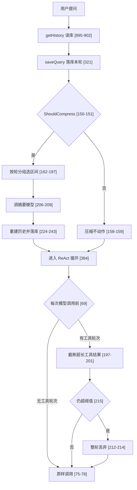
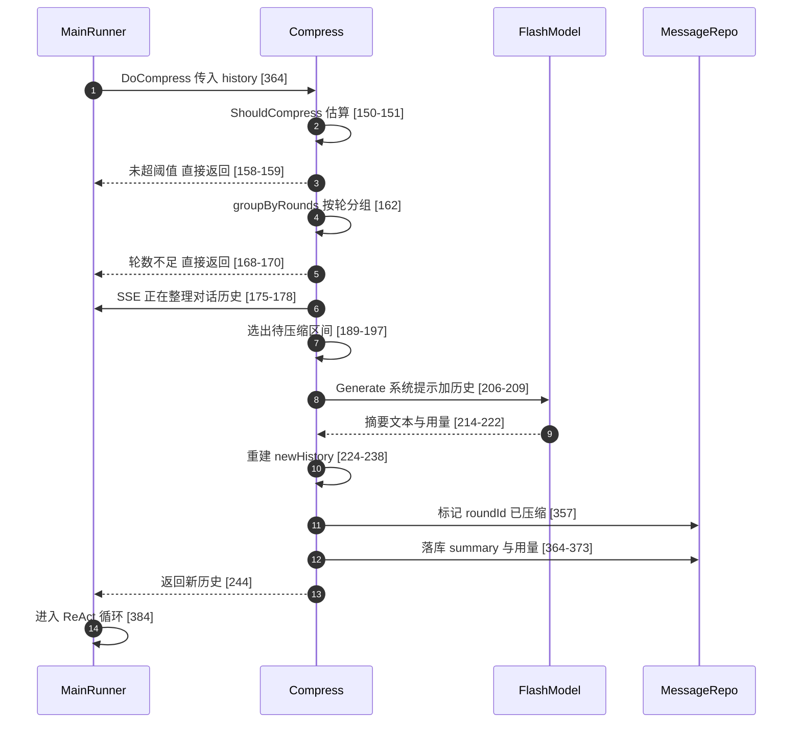

# GoRaven 上下文管理解读：模型摘要压缩与规则剪枝的分工、阈值口径与不做记忆的边界

> 本解读按 **ai-agent 类规格** 产出，解读基线为 GoRaven `v0.5.4`（`032c8b7`）。正文所有 `文件:行号` 引用均为 **GoRaven 仓库相对路径**，点开即可核对。

## 这一层在做什么

长会话必然撞上下文窗口。GoRaven 把「上下文」当成一种需要经营的有限资源，用**两套完全不同的机制**分别经营它的两个正交变量：**轮数**（语义历史有多长）与**体积**（喂进模型的内容有多大）。

- `core/agent/compress.go`（423 行）——**压缩**：按对话轮聚合，调用一次模型生成摘要，用一条摘要消息替换掉最旧的若干轮，并把原文从今后送给模型的集合里摘掉。
- `core/middleware/pruning/pruning.go`（350 行）——**剪枝**：挂在 eino ADK 的 `BeforeModelRewriteState` 钩子上，**每次模型调用前**按工具轮为整体做截断与丢弃，规则式、无模型参与、不落库。

去掉 compress，长会话在若干轮之后直接被模型的上下文窗口拒收，用户只能手动开新会话；去掉 pruning，一次「读 20 个文件 + 跑 3 条长输出命令」的探查就能把窗口撑爆——哪怕对话本身只有 3 轮。两者不是同一件事的两种实现，而是**两个不同故障模式的两套对策**。

## 根本问题：窗口是硬约束，而 Agent 的上下文有两个独立的膨胀源

对话类应用通常只面对一个膨胀源：聊天记录越来越长。Agent 面对两个：

1. **跨轮的语义历史**——用户问过什么、做过什么决定、改过哪些文件。它需要被「理解后压缩」，不能简单丢弃，丢了就会重问、重做。
2. **工具调用的体量**——一次 `execute` 返回几千行日志、一次批量读文件返回几十万字符。它不需要被理解，只需要保留「头尾 + 我这里截断了」这个事实。

这两类内容的**最优处理方式互斥**：语义历史要用 LLM 摘要（贵、慢、不可复现，但能保住决策与路径）；工具结果要用确定性规则截断（便宜、可复现、可单测，但会丢细节）。如果只保留一套机制：

- 只做摘要——每轮都要对把窗口撑爆的工具结果跑一次模型，成本高且摘要会进一步丢细节；更致命的是摘要**不可单测**，而作者的设计哲学里工程约束是第一优先级。
- 只做截断——用户的关键决定、文件路径、失败原因会被无差别砍掉，Agent 开始重复劳动。

所以 GoRaven 选择了「分层 + 分工」：**压缩管跨轮语义，剪枝管工具体量**。这不是冗余，而是把两种损失性质不同的操作分开，各自可观测、各自可退化。

## 一个回合内两条路线的触发点

两条路线在**不同层级**被安放：compress 在 agent 层、由 `MainRunner.Query` 在进入 ReAct 循环**之前**显式调用一次（[core/agent/main_runner.go:363-369]()）；
<!-- anchor: if runner.mainAgent.compress != nil { … runner.history = compressedHistory -->
pruning 在 middleware 层、由 eino ADK 在**每次模型调用前**回调（[core/middleware/pruning/pruning.go:69-116]()）。
<!-- anchor: func (p *pruningMiddleware) BeforeModelRewriteState(ctx context.Context, state * … return ctx, state, nil -->

这个位置差异决定了它们的性格：compress 一回合最多跑一次、看的是**已落库的历史**；pruning 一回合可能跑几十次（每轮工具调用一次模型调用）、看的是**内存里正在生长的消息数组**。前者慢而贵、后者快而频。

## 压缩：按对话轮粒度、调用模型、会落库

### 触发阈值是「比例派生的绝对 token 数」

配置面给运维看到的是**百分比**，判定面落下来是**绝对值**。构造函数把 `contextLen * percent / 100` 算成一个 int 存进 `threshold`（[core/agent/compress.go:39-48]()）。
<!-- anchor: percent := sysCfg.CompressThresholdPercent … threshold := contextLen * percent / 100 -->

这里有两道硬编码下限值得注意。`percent <= 50` 时被静默抬到 50（[core/agent/compress.go:40-42]()）；
<!-- anchor: if percent <= 50 { … percent = 50 -->
`ContextLength() <= 128*1024` 时被抬到 128K（[core/agent/compress.go:44-47]()）。
<!-- anchor: contextLen := chatModel.ContextLength() … contextLen = 128 * 1024 -->

注意第一道下限与后台配置界面**不一致**：`agent.compress_threshold_percent` 的 slider 允许 40 起（[backend/service/system_setting.go:94-94]()），
<!-- anchor: inputType: "slider", min: util.PtrFloat64(40), max: util.PtrFloat64(80), display -->
但管理员设成 40 或 50 时，代码一律按 50 处理。默认值 80（[backend/repository/system_setting.go:54-60]()），
<!-- anchor: CompressThresholdPercent:   getInt(m, "agent.compress_threshold_percent", 80), … PruningTailTruncateLength:  getInt(m, "agent.pruning_tail_truncate_length", 1000 -->
于是默认阈值就是 `max(模型真实窗口, 128K) × 80%`：窗口小于 128K 的模型一律按 104857 触发，窗口大于 128K 的模型按真实窗口的 80% 触发。

**更值得追问的是 `contextLen` 取自哪个模型。** `NewCompress` 收到的是 `chatModel`，而调用点传的是 `main.flashModel`（[core/agent/main_agent.go:239-239]()），
<!-- anchor: main.compress = NewCompress(main.flashModel, main.msgRepo, main.param.DailyStats -->
flash 模型由 `GetFlashChatModel` 选出（全局唯一的 `is_flash=1`，其次会话模型，最后默认模型——[backend/service/chat.go:237-243]()）。
<!-- anchor: // 设置 Flash 模型（优先 isFlash=1 > 会话模型 > 默认模型，reasoning=false） … mainAgent.SetFlashModel(flashModel) -->

这意味着：**阈值来自摘要模型的窗口，而要被保护的却是对话模型的窗口**。会话模型窗口小于 flash 模型时（例如会话跑 128K 模型、flash 配了 200K 模型），阈值会被算到 160K，主模型在 128K 就先爆了——压缩还没触发。反过来则是过早压缩、白花钱。真正稳妥的口径应是 `min(主模型窗口, flash 窗口)`。这是本篇发现的第一处实质设计缺口。

### token 估算不是 tokenizer，是中英分流的字符启发式

`estimateTokens` 累加 `Content + ReasoningContent + 文本类多模态部件 + toolCallName/Arguments + ToolName`，然后按「字节数是否大于 rune 数的两倍」分流：多字节主导按 `runeLen * 3 / 2`（约 1 汉字 = 1.5 token），ASCII 主导按 `(byteLen + 3) / 4`（[core/agent/compress.go:118-147]()）。
<!-- anchor: func (c *Compress) estimateTokens(messages []*schema.Message) int { … return total -->

判定只有一行：`estimateTokens(history) > threshold`，**严格大于**（[core/agent/compress.go:150-151]()）。
<!-- anchor: func (c *Compress) ShouldCompress(history []*schema.Message) bool { … return c.estimateTokens(history) > c.threshold -->

这个启发式的已知盲区值得逐条列出，因为它们都直接决定「什么时候该压却压不动」：

- **图片/视频/音频部件按 0 token 计**。`UserInputMultiContent` 里只有 `part.Type == ChatMessagePartTypeText` 才被累加（同上），而多模态消息的媒体部件是 URL 形式（[core/agent/messages.go:45-59]()）。一个塞满图片的会话在估算器眼里极轻。
<!-- anchor: func BuildUserMessage(content string, media []MediaItem) adk.Message { … return &schema.Message{Role: schema.User, UserInputMultiContent: parts} -->
- **工具定义完全不计数**。压缩只看历史消息，不看 tool schema；剪枝的计数器虽然接了个 `tools` 参数，但默认实现直接忽略它（[core/middleware/pruning/pruning.go:322-349]()）。
<!-- anchor: func defaultTokenCounter(_ context.Context, msgs []adk.Message, _ []*schema.Tool … return tokens, nil -->
- **同一套公式被抄了两份**——`compress.estimateTokens` 与 `pruning.estimateStrTokens` 的分流逻辑逐字相同（[core/middleware/pruning/pruning.go:299-305]()）。
<!-- anchor: func estimateStrTokens(s string) int64 { … return int64((byteLen + 3) / 4) -->
两份实现之间没有任何共享常量或测试约束，阈值语义的一致性靠人肉维持。

### 选择压缩区间：以 roundId 为单位，保留旧摘要

`groupByRounds` 把历史消息按 `Extra["roundId"]` 聚成轮；**没有 roundId 的消息被归入一个 `isSummary: true` 的特殊组并固定排在列表最前**（[core/agent/compress.go:84-90]()）。
<!-- anchor: roundId, _ := msg.Extra["roundId"].(string) … noRoundGroup.messages = append(noRoundGroup.messages, msg) -->
`System` 角色的消息在分组阶段就被跳过（[core/agent/compress.go:74-115]()），
<!-- anchor: func (c *Compress) groupByRounds(history []*schema.Message) []*roundGroup { … return rounds -->
所以系统提示词既不会被压缩，也不占用轮数。

区间选择是「**丢最旧的、留最近的 N 轮**」：`compressCount = roundCount - keepRounds`，从 `startIdx`（有旧摘要时为 1）连续取 `compressCount` 轮（[core/agent/compress.go:181-195]()）。
<!-- anchor: startIdx := 0 … lastCompressedMsgTs = rounds[i].maxTs -->
`keepRounds` 默认取配置，非法时兜底 3（[core/agent/compress.go:51-53]()）。
<!-- anchor: keepRounds := sysCfg.CompressKeepRounds … keepRounds = 3 -->
这里同样有默认值分叉：结构体注释与新默认配置写 3（[backend/repository/system_config.go:37-44]()），
<!-- anchor: CompressThresholdPercent:   80, … PruningTailTruncateLength:  1000, -->
而运行时真正走的 `LoadConfig` 与 seed 数据写 4（[backend/repository/system_setting.go:54-60]()）。
<!-- anchor: CompressThresholdPercent:   getInt(m, "agent.compress_threshold_percent", 80), … PruningTailTruncateLength:  getInt(m, "agent.pruning_tail_truncate_length", 1000 -->
生产路径用的是 4，注释与 `NewDefaultSystemConfig` 的 3 属于陈旧信息。

### 压缩是有条件的：轮数不够宁可不动

`roundCount <= keepRounds` 时直接返回原历史并标记 `Compressed=false`（[core/agent/compress.go:162-170]()）。
<!-- anchor: rounds := c.groupByRounds(history) … return history, nil -->
这个分支保证了一件事：**压缩永远净减少上下文，不会出现「为压缩 1 轮而多花一次模型调用」的荒谬局面**。反过来也说明，一旦超过阈值且轮数富余，**每轮对话都会触发一次额外的摘要调用**，因为 `ShouldCompress` 只看 token、不记录「上次压过没有」。

### 摘要如何替代原消息：插入一条新的用户消息

压缩不是原地改写，而是**插入 + 剔除**：把被压缩的轮移出，插一条 `Role=User` 的摘要消息（内容前缀 `[对话摘要]\n`），带上 `Extra["isSummary"]=true`，再把保留轮拼回去（[core/agent/compress.go:224-238]()）。
<!-- anchor: var keptMessages []*schema.Message … c.result.History = newHistory -->

摘要消息的构造只有两行（[core/agent/compress.go:229-231]()），
<!-- anchor: newSummaryMsg := schema.UserMessage(getCompressI18n().summaryPrefix + resp.Conte … newSummaryMsg.Extra = map[string]any{"isSummary": true} -->
它在语义上伪装成一条 user 消息——因为 eino 的消息角色里没有「摘要」这一种，而 `RoleTypeSummary` 是 GoRaven 自己在持久层引入的角色（[backend/po/message.go:11-11]()）：
<!-- anchor: const RoleTypeSummary = "summary" -->
重建历史时又被映射回 `schema.UserMessage`（[core/agent/messages.go:105-114]()）。
<!-- anchor: case po.RoleTypeSummary: … msg.Extra["isSummary"] = true -->
这个「持久层有 summary 角色、模型层只能伪装成 user」的落差，是理解整套设计的钥匙。

**连锁压缩只加不减。** 第二次压缩时旧摘要保留、新摘要追加在它后面，被压缩的只是旧摘要之后的新增轮次（[core/agent/compress.go:233-237]()）。
<!-- anchor: if rounds[0].isSummary { … newHistory = append(newHistory, keptMessages...) -->

### 原文去哪了：软删除，不是物理删除

摘要落库时会做四件事（[core/agent/compress.go:352-357]()、[core/agent/compress.go:359-375]()）：
<!-- anchor: func (c *Compress) saveSummary(roundIds []string, lastCompressedMsgTs int64) { … c.msgRepo.MarkSessionCompressed(c.sessionId, roundIds) -->
<!-- anchor: summaryTs := lastCompressedMsgTs + 1 … c.msgRepo.SetContextTokens(c.sessionId, 0) -->
把被压缩的 roundId 标为已压缩、写一条 `RoleTypeSummary` 的新消息、累加本次摘要调用的 token 用量、并把会话的「当前上下文长度」重置为 0。

「标为已压缩」的实现是**把 `context_state` 更新为 1**（[backend/repository/msg_session.go:95-103]()），
<!-- anchor: // MarkSessionCompressed 标记session中指定roundIds的消息为已压缩 … Update("context_state", 1).Error -->
字段语义在模型里有明确定义：`0=发送给LLM, 1=跳过上下文(仅展示给用户)`（[backend/po/message.go:39-39]()）。
<!-- anchor: ContextState            uint8     `gorm:"column:context_state"`                  -->
于是：**读给模型的查询过滤 `context_state = 0`**（[backend/repository/msg_session.go:89-92]()），
<!-- anchor: func (repo *MsgSessionRepository) GetChatMessages(sessionId string) ([]*po.Messa … return messages, err -->
**用户侧的查询不滤 `context_state`、却排除了 `summary` 角色**（[backend/repository/msg_session.go:145-150]()）。
<!-- anchor: // GetAllMessages 获取会话消息（用户端展示，不包含压缩摘要） … return messages, err -->

结论很清晰：原文**一条都没删**，永久留在库里、并且用户端照常看得到完整对话；被摘掉的只是「模型今后还能不能读到」。摘要本身则落了库但**不进用户视图**。至于模型能否把原文查回来——**没有任何取回路径**：没有反压缩 API，也没有任何工具能从已压缩的轮次里检索原文（`context_state` 只有置 1 的写入点，全仓没有置 0 的写入点）。这是 GoRaven 与「把完整内容卸载到文件、再给模型一个读回工具」的做法之间最本质的差别。

### 失败与降级：模型报错就退回不压缩

摘要调用失败时直接返回 error（[core/agent/compress.go:206-211]()），
<!-- anchor: resp, err := c.chatModel.Generate(ctx, []*schema.Message{ … return nil, err -->
调用方只在 Debug 级日志里记一笔，随后**沿用未压缩的历史继续本回合**（[core/agent/main_runner.go:363-369]()）。
<!-- anchor: if runner.mainAgent.compress != nil { … runner.history = compressedHistory -->
降级行为是「退回到没有压缩的世界」——不阻塞对话，但也意味着这一轮可能直接顶到模型硬上限。真正兜底的是剪枝（它还在循环里），可见分层在这里是有回报的。

不过**空摘要没有任何守卫**。`resp.Content` 为空时依然标记 `Compressed=true` 并落库（[core/agent/compress.go:214-216]()），
<!-- anchor: c.result = &CompressResult{ … SummaryContent: resp.Content, -->
重建后的历史里那条摘要就是光秃秃的 `[对话摘要]\n`，而被压缩的轮次**已经被标记为不再送模型**。模型视角下这段历史等于被静默清空（用户视角还有原文，但没有回滚接口）。同行做法的关键差别在于**丢弃与摘要到达是绑定的**：Anthropic 的 compaction 是「先生成 summary、写入 `compaction` block，API 随后才丢弃该 block 之前的全部内容块」——没有摘要就没有可丢弃的锚点；GoRaven 则先标记 `context_state=1`，摘要内容是空是满都照记。缺的是一个 `if resp.Content == "" { 不标记、不落库 }`。

### 压缩执行时序

第 6 步那个 SSE 事件（`SSEEventTypeReasoning`，文案「正在整理对话历史...」）是**唯一一处用户在流里能感知到「正在压缩」的信号**（[core/agent/compress.go:176-177]()）。
<!-- anchor: Type:    SSEEventTypeReasoning, … Content: getCompressI18n().reasoningMsg, -->
文案本身来自压缩模块自己的 i18n 表，中英各一份（[core/agent/compress.go:400-410]()）。
<!-- anchor: func getCompressI18n() compressI18n { … reasoningMsg:   "正在整理对话历史...\n\n", -->

顺带一个副作用：`sendSSEEvent` 对 reasoning 类型会顺带累加到 `saveReasoningContent`（[core/agent/main_runner.go:132-139]()），
<!-- anchor: func (runner *MainRunner) sendSSEEvent(event *SSEEvent) { … runner.dispatchSSE(event) -->
而这份累计值最终**作为本回合回复的 `reasoning_content` 落库**。所以「正在整理对话历史...」会出现在这条回复的思考内容里。考虑作者 Observability First 的立场，这更像是刻意留下的痕迹而非 bug——但它确实是这套机制里唯一持久化的「压缩发生过」的证据。

## 剪枝：按工具轮粒度、纯规则、只活在内存里

### 单位是「工具轮」，不是单条消息

剪枝的最小单位是 `toolRound`：**一个含 `ToolCalls` 的 assistant 消息 + 它所有配对的 tool 响应**（[core/middleware/pruning/pruning.go:119-128]()），
<!-- anchor: // toolRound 代表一轮工具调用：一个 assistant 消息（含 N 个 tool call） … timestamp   int64 -->
聚合由 `extractToolRounds` 完成，按 `ToolCallID` 把后续的 tool 消息归入对应轮，遇到下一个含 toolCalls 的 assistant 就截断（[core/middleware/pruning/pruning.go:133-169]()）。
<!-- anchor: func extractToolRounds(messages []adk.Message) []*toolRound { … return rounds -->
注意它在并行 tool calling 下把 N 个 call 聚成**一个** round（同轮多工具结果要么全留要么全丢），这是为了避免出现「有 toolCall 没有响应」的非法消息序列——测试里专门有一条端到端断言守护这个不变量（[core/middleware/pruning/pruning_test.go:250-263]()）。
<!-- anchor: for i, msg := range newState.Messages { … assert.True(t, matched, fmt.Sprintf("toolCall %s 必须有对应的 tool 响应", tc.ID)) -->

### 保护边界：系统词、用户消息、纯文本回复、最新一轮

重建消息时，保留条件是「在保留集合里，**或者**既不是 tool 消息也不是含 toolCalls 的 assistant」（[core/middleware/pruning/pruning.go:243-269]()、[core/middleware/pruning/pruning.go:262-266]()）。
<!-- anchor: // reconstructMessages 按原顺序重建消息： … return result -->
<!-- anchor: isToolMsg := msg.Role == schema.Tool … result = append(result, msg) -->

于是被**绝对保护**的有四类：系统提示词、所有 user 消息、所有不含 toolCalls 的 assistant 回复、以及**最后一轮工具调用**（循环上界是 `len(rounds)-1`，最后一轮既不截断也不丢弃——[core/middleware/pruning/pruning.go:186-215]()）。
<!-- anchor: // 从旧到新逐轮处理，始终保留至少1轮。 … if baseTokens+totalTokens <= p.config.TokenThreshold { -->
**系统提示词计入 `baseTokens`**（它由 ADK 前置进 `state.Messages`，因此会进 `nonRoundMsgs`——[core/middleware/pruning/pruning.go:87-93]()，该前置行为属依赖内部实现，【存疑待核实】），但它永远不可能被删除。
<!-- anchor: nonRoundMsgs := make([]adk.Message, 0, len(state.Messages)) … baseTokens, err := p.config.TokenCounter(ctx, nonRoundMsgs, mc.Tools) -->

### 丢弃依据是「位置最旧」，不是 LRU、不是重要性、也不是收益排序

`pruneRounds` 先做整体判断：`baseTokens + 轮次 token <= 阈值` 就直接原样返回（[core/middleware/pruning/pruning.go:172-183]()），
<!-- anchor: func (p *pruningMiddleware) pruneRounds(rounds []*toolRound, baseTokens int64) [ … return rounds -->
否则按索引 `i` 从 0（最旧）开始线性推进。每轮走「两阶段」：

1. **先截断**——工具结果 rune 数超过 `MaxToolResultLength` 就保留头 `HeadLength` + 尾 `TailLength`（[core/middleware/pruning/pruning.go:197-201]()）。
<!-- anchor: if utf8.RuneCountInString(toolMsg.Content) > p.config.MaxToolResultLength { … p.config.TailLength, -->
中间部分替换为一句「因超出上下文限制，中间 N 个字符已被剪枝隐藏」（[core/middleware/pruning/pruning.go:230-240]()）。
<!-- anchor: func truncateContent(content string, headLen, tailLen int) string { … return fmt.Sprintf("%s\n\n[System: 因超出上下文限制，中间 %d 个字符已被剪枝隐藏]\n\n... %s", head, m -->
2. **仍超阈值才丢弃整轮**（[core/middleware/pruning/pruning.go:213-215]()）。
<!-- anchor: totalTokens -= newTokens … if baseTokens+totalTokens <= p.config.TokenThreshold { -->

**没有任何重要性、时间窗、访问频率参与排序。** `toolRound.timestamp` 字段从消息 `Extra["timestamp"]` 读出来后赋给结构体，然后**全仓没有任何读取点**（[core/middleware/pruning/pruning.go:272-279]()）——典型的 write-only 字段。
<!-- anchor: func getTimestamp(msg *schema.Message) int64 { … return 0 -->

两阶段顺序有个反直觉的后果，作者用测试把它钉住了：**截断可能让 token 变多**。当原文只比阈值略长时，插入的中文提示语会让截断后的文本比原文更长——测试 `TestPruneRounds_TruncationIncreasesTokens_DropsRound` 断言的正是这种「截完反而更胖，于是直接丢掉」的情形（[core/middleware/pruning/pruning_test.go:515-516]()）。
<!-- anchor: assert.Len(t, pruned, 1, "截断后token反而增加，应丢弃该轮") … assert.Equal(t, "call_2", pruned[0].assistantMsg.ToolCalls[0].ID) -->

### 边界条件：从 pruning_test.go 反推作者的不变量

测试文件（606 行，14 组用例）实际充当了这份中间件的规格说明，作者的硬性主张可以逐条读出来：

- **阈值恰好相等不剪枝**：比较用的是 `<=`，只有严格超出才动手（[core/middleware/pruning/pruning_test.go:538-539]()）。
<!-- anchor: pruned := mw.pruneRounds(rounds, 0) … assert.Len(t, pruned, 2, "恰好等于阈值不应剪枝") -->
- **截断够用就不丢轮次**：省下来的 token 达标即停（[core/middleware/pruning/pruning_test.go:101-103]()）。
<!-- anchor: assert.Len(t, pruned, 2, "截断后满足阈值，两轮都应保留") … assert.Equal(t, "short", pruned[1].toolMsgs[0].Content, "短内容保留原文") -->
- **至少保留 1 轮**，且极端阈值下保留的是最后 1 轮（[core/middleware/pruning/pruning_test.go:157-158]()）。
<!-- anchor: assert.Len(t, pruned, 1, "应保留至少1轮") … assert.Equal(t, "call_3", pruned[0].assistantMsg.ToolCalls[0].ID) -->
- **单轮的轮次内容不被修改**——只有 1 轮时连截断都不做（[core/middleware/pruning/pruning_test.go:481-482]()）。
<!-- anchor: assert.Len(t, pruned, 1, "单轮始终保留") … assert.Equal(t, "very long result", pruned[0].toolMsgs[0].Content, "单轮内容不被修改") -->
- **零轮次和空输入都要安全返回**（[core/middleware/pruning/pruning_test.go:553-554]()）。
<!-- anchor: pruned := mw.pruneRounds(nil, 0) … assert.Len(t, pruned, 0) -->
- **baseTokens 非零时仍能正确丢弃**——这一条把「基数 + 轮次」的账算清楚了（[core/middleware/pruning/pruning_test.go:302-306]()）。
<!-- anchor: round2Tokens := estimateRoundTokens(rounds[1]) … pruned := mw.pruneRounds(rounds, baseTokens) -->
- **估算公式被当成契约钉死**：`"ab"→1`、`"hello"→2`、`"hello world"→3`、`"你好世界"→6`（[core/middleware/pruning/pruning_test.go:406-409]()）。
<!-- anchor: assert.Equal(t, int64(1), estimateStrTokens("ab")) … assert.Equal(t, int64(6), estimateStrTokens("你好世界")) // 4 runes * 3 / 2 -->

### README 自述与源码逐条核对

`core/middleware/pruning/README.md` 显然停留在某个更早的版本上——它描述的 API 与当前源码**对不上**。逐条核对如下（这是本篇要求如实指出的不一致处）：

| README 自述 | 源码事实 | 判定 |
|---|---|---|
| 默认值与阈值语义、保留轮次、时间窗、构造签名、计数器实现 | 逐条见下方清单 | 5 处不一致、2 处部分不一致、3 处一致 |

逐条核对（每条给出 README 原文与源码事实两侧的证据锚点）：

**不一致一：阈值默认值与单位。** README 写 `TokenThreshold` 默认 `160000`（[core/middleware/pruning/README.md:52-64]()）；
<!-- anchor: ### TokenThreshold … - 默认值：`5 * time.Minute` -->
源码实际由 `sysCfg.PruningTokenThreshold * 1024` 得来，并有 `50*1024` 的硬下限（[core/middleware/pruning/pruning.go:54-61]()）。
<!-- anchor: TokenThreshold:      int64(sysCfg.PruningTokenThreshold * 1024), … cfg.TokenThreshold = 50 * 1024 -->
后台配置面的默认值是 128（=131072），最小值 64（[backend/service/system_setting.go:101-104]()）。
<!-- anchor: {key: "agent.pruning_token_threshold", valueType: po.ValueTypeInt, defaultValue: … inputType: "number", min: util.PtrFloat64(64), max: util.PtrFloat64(1000), displ -->

**不一致二：`KeepRecentToolRounds` 这个配置项已经不存在。** README 说「只保留最近 N 轮工具消息」；
但 `Config` 结构体里只有 `TokenThreshold`／`TokenCounter`／`MaxToolResultLength`／`HeadLength`／`TailLength` 五个字段（[core/middleware/pruning/pruning.go:20-41]()）。
<!-- anchor: type Config struct { … TailLength int -->
源码只保证**最后 1 轮**永不丢弃，其余轮次全看阈值——「保留最近 N 轮」是效果而非配置。

**不一致三：`RecentTimeWindow` 是已废弃的设计。** README 给出 `5 * time.Minute` 的时间窗（[core/middleware/pruning/README.md:62-64]()）。
<!-- anchor: ### RecentTimeWindow … - 默认值：`5 * time.Minute` -->
源码里时间窗逻辑已彻底移除，`toolRound.timestamp` 采而不读。README 的用法示例还在传 `KeepRecentToolRounds` 与 `RecentTimeWindow`（[core/middleware/pruning/README.md:27-29]()）。
<!-- anchor: config := &pruning.Config{ … KeepRecentToolRounds: 3,             // 保留最近3轮工具消息 -->

**不一致四：构造函数签名。** README 写 `pruning.New(ctx, config)`（[core/middleware/pruning/README.md:37-39]()）；
<!-- anchor: mw, err := pruning.New(ctx, config) … panic(err) -->
实际签名是 `New(sysCfg *repository.SystemConfig, conf ...*Config)`，系统配置是第一个必填参数（[core/middleware/pruning/pruning.go:52-66]()）。
<!-- anchor: func New(sysCfg *repository.SystemConfig, conf ...*Config) (adk.ChatModelAgentMi … return &pruningMiddleware{config: cfg}, nil -->

**部分不一致五：TokenCounter 的默认实现。** README 说「字符数除以 4」（[core/middleware/pruning/README.md:84-85]()）；
<!-- anchor: - 默认值：字符数除以4的简单估算 … - 说明：自定义token计数函数 -->
实际默认实现是中英分流自适应（ASCII 走 bytes/4、多字节走 runes*3/2），且**忽略 `tools` 参数**（[core/middleware/pruning/pruning.go:322-349]()）。
<!-- anchor: func defaultTokenCounter(_ context.Context, msgs []adk.Message, _ []*schema.Tool … return tokens, nil -->

**部分不一致六：截断策略的三个子规则。** README 的「智能长度截断」声明了三条子规则（[core/middleware/pruning/README.md:9-9]()）；
<!-- anchor: 3. **智能长度截断**： -->
其中只有「超长截断头尾」在源码里成立（[core/middleware/pruning/pruning.go:197-201]()），
<!-- anchor: if utf8.RuneCountInString(toolMsg.Content) > p.config.MaxToolResultLength { … p.config.TailLength, -->
「最近时间窗口内且长度合适则原样保留」不存在，「最近一轮原样保留」是循环上界 `len(rounds)-1` 的副产品而非显式规则。

**一致一：从旧到新删除工具消息对。** README 的这条描述（[core/middleware/pruning/README.md:7-8]()）与源码的线性推进一致。
<!-- anchor: 1. **Token阈值剪枝**：当总token数超过阈值时，从旧到新删除工具消息对 … 2. **保留最近轮次**：只保留最近N轮工具消息 -->

**一致二：以消息对为单位保证格式合法。** README 的这条（[core/middleware/pruning/README.md:103-106]()）与 `reconstructMessages` 的保留谓词一致，且有端到端测试守护。
<!-- anchor: - 工具调用（assistant消息，包含tool_calls） … 删除或截断时，总是以消息对为单位进行操作，保证LLM不会因为消息格式错误而报错。 -->

**一致三：只处理工具消息。** README 的这条（[core/middleware/pruning/README.md:132-133]()）与源码一致——非 tool、非含 toolCalls 的消息一律放行。
<!-- anchor: 1. 只处理工具类型的消息，普通对话消息不受影响 … 2. 工具消息的时间戳从消息的Extra字段中读取（key为"timestamp"） -->
（顺带指出：这一条的后半句虽然属实——源码确实从 `Extra["timestamp"]` 取值——但取到的值从未被使用，属于「读了不用」。）

**还有一个传参陷阱 README 也没写：** `conf` 一旦传入就**整体替换**整个配置对象（[core/middleware/pruning/pruning.go:63-64]()）。
<!-- anchor: if len(conf) > 0 { … cfg = conf[0] -->
调用方若只填 `TokenThreshold`，其余字段（含 `TokenCounter`）会变成零值——`TokenCounter` 为 nil 会在 `BeforeModelRewriteState` 里直接 panic。测试自己也绕开了这一点（[core/middleware/pruning/pruning_test.go:32-36]() 手工补齐 `TokenCounter`）。
<!-- anchor: func newTestMiddleware(cfg *Config) adk.ChatModelAgentMiddleware { … return &pruningMiddleware{config: cfg} -->

另外有两组**死代码**：`msgPrunedFlag` 常量与 `getMsgPrunedFlag`／`setMsgPrunedFlag` 三个符号全仓无调用者（[core/middleware/pruning/pruning.go:282-294]()），
<!-- anchor: func getMsgPrunedFlag(msg *schema.Message) bool { … msg.Extra[msgPrunedFlag] = true -->
它们看起来是「已处理标记」的残留——本意大概是给剪枝做幂等/跳过标记，但从未接线。同时 `pruning_test.go` 与 `example_test.go` 带着 CloudWeGo 的 Apache-2.0 版权头（[core/middleware/pruning/pruning_test.go:2-2]()），
<!-- anchor: * Copyright 2026 CloudWeGo Authors -->
而 `pruning.go` 自身没有（[core/middleware/pruning/pruning.go:1-1]()），
<!-- anchor: package pruning -->
且该目录在基线仓库里只被一个提交碰过（`e65ab3b Add automation support.`）。合起来看，这更像是「从上游 eino 中间件样例 fork 下来本地改写过、文档与遗留符号没跟上」，而不是从零设计。

## 两套机制怎么协作：分层，不互斥

**谁先谁后是确定的：** 同一回合内 compress 先跑（回合前、一次），pruning 后跑（循环内、每次模型调用）。compress 的产出（摘要 + 保留轮）就是 pruning 的输入。两者都挂在主 agent 上（[core/agent/main_agent.go:226-231]()、[core/agent/main_agent.go:239-239]()）。
<!-- anchor: //tools剪枝工具 … main.AddChatModelAgentMiddleware(pmid) -->
<!-- anchor: main.compress = NewCompress(main.flashModel, main.msgRepo, main.param.DailyStats -->
一个不对称值得记录：**剪枝也被装到了子 agent 上**（[core/agent/main_agent.go:287-291]()），
<!-- anchor: pmid, err := pruning.New(main.param.SysCfg) … subAgent.AddChatModelAgentMiddleware(pmid) -->
**压缩没有**——子 agent 是一次性的、没有跨轮历史需要压缩，它的上下文控制靠「主代理把重活委派出去、只收结论」这条提示词策略（[core/agent/prompt.go:99-99]()）。
<!-- anchor: - 子代理运行在更经济的模型上，适合会产生大量中间内容但最终结论精简的任务——大量 token 留在子代理上下文，仅精炼结论回流主代理，兼顾成本与上下文整洁 -->

**它们不会互相打架**，因为作用域根本不同：compress 改的是**持久层**（`context_state` 标记 + 新 summary 行），pruning 改的是**内存态**（`state.Messages` 切片）。pruning 的丢弃不写库，下一回合 `getHistory` 从库里重读（[core/agent/main_runner.go:895-902]()）时被丢的轮次会原样回来，只有 compress 的软删除是跨回合生效的。
<!-- anchor: func (runner *MainRunner) getHistory() (result []adk.Message, e error) { … return BuildHistoryFromMessages(list), nil -->

有一处**微妙的共享指针副作用**：截断是就地改写消息内容（`toolMsg.Content = truncateContent(...)`），而这些 `*schema.Message` 指针与 `runner.history` 共享。影响面被限制住了——落库走的是从事件里拷出来的字符串（`collectedMsg.content`），因此**截断后的内容不会被持久化**；但同一回合内后续若再读到这份内存历史，看到的就是截断后的版本。这属于「能跑但值得知道」的耦合。

**合并后的效果没有测试覆盖。** 我逐文件确认过：`core/agent/compress_test.go` 只测 compress、`core/middleware/pruning/pruning_test.go` 只测 pruning，两个包之间**没有任何一个用例同时压过两套机制**（[core/agent/compress_test.go:111-166]() 是压缩侧最完整的端到端用例，但它不挂 middleware）。
<!-- anchor-base64:ZnVuYyBUZXN0Q29tcHJlc3NfQmFzaWModCAqdGVzdGluZy5UKSB7IOKApiBpZiBsZW4ocmVwby5zYXZlZE1lc3NhZ2VzKSAhPSAxIHx8IHJlcG8uc2F2ZWRNZXNzYWdlc1swXS5Sb2xlVHlwZSAhPSBwby5Sb2xlVHlwZQ== -->
跨模块的协同效果目前只能靠人读代码确认——这是本关注面最实的一个工程缺口：两条路线的**阈值口径还不一样**（compress 的估算含系统消息之外的全部历史、不含工具定义；pruning 的估算含系统提示词、不含工具定义、且换了一套 role 前缀拼装），却都在往同一个窗口里挤。

## 与 Skill 上下文的关系：剪枝碰不到 Skill，但 Skill 也不进预算

`combined_skill_backend.go` **不直接参与上下文装配**，它只提供技能清单与技能正文：`List` 把系统技能全量 + 用户技能（受 `skillFilter` 勾选限制、**最多 60 条**）合并返回（[core/middleware/combined_skill_backend.go:95-106]()），
<!-- anchor: var selectUserSkills []skill.FrontMatter … result = append(result, selectUserSkills...) -->
`Get` 按「系统优先、用户兜底」查找并顺手记一次技能使用统计。

这份清单的最终去处是 eino skill 中间件的 **tool description**——GoRaven 只是把 backend 塞给 `skill.NewMiddleware`（[core/agent/base_agent.go:371-378]()），
<!-- anchor: skillmid, e := skill.NewMiddleware(context.Background(), &skill.Config{ … base.conf.Handlers = append(base.conf.Handlers, skillmid) -->
用户技能目录固定在 `<workspace>/skills`（[core/agent/base_agent.go:347-350]()）。
<!-- anchor: var userSkillCfg *middleware.SkillBackendConfig … BaseDir: base.sandbox.GetWorkspace() + "/skills", -->

由此得到两个结论：

1. **剪枝不可能误伤 Skill 注入**——Skill 的说明文本不在 `state.Messages` 里，而在 `mc.Tools` 的 tool schema 里；剪枝只重写 `state.Messages`，重建逻辑对非 tool、非 toolCalls 的消息一律放行。系统提示词同理受绝对保护。
2. **但 Skill 与工具定义也不占剪枝的预算**——`defaultTokenCounter` 显式忽略 `tools` 参数，`baseTokens` 只统计消息。技能装得越多，真实 prompt 越贵，而两套阈值都看不见这部分开销。`List` 里那个「用户技能最多 60 条」的硬上限，实际上是在**没有度量**的前提下凭经验设的护栏。

所以可靠性上的答案是：**不会误伤，但也管不到**。这是本关注面里最容易在生产环境里被低估的一角——一个装了上限 60 个技能、外加若干 MCP 工具的团队，可能还没开始对话就消耗掉了相当一部分窗口，而 compress 与 pruning 都不会因此提前动作。

## 关键设计决策

### 决策一：压缩放在 agent 层而不是 middleware 层

`core/agent/compress.go` 没有实现 `adk.ChatModelAgentMiddleware`，它是 agent 包里的一个普通对象，由 `MainRunner.Query` 手动调用。这个选择是**被持久化需求逼出来的**：它要按 `roundId` 分组（这依赖持久层写入时打的标记）、要把摘要写成一条数据库记录、要更新 `context_state`、要把摘要调用的用量计进会话与每日统计、还要复用 SSH 式的「一次性运行」上下文（每次压缩用新 UUID 覆盖 conversation header，见 [core/agent/compress.go:249-251]()）。
<!-- anchor: func (c *Compress) ForceCompress(ctx context.Context, history []*schema.Message) … ctx = util.WithConversationHeader(ctx, c.chatModel.GetConversationHeaderKey(), u -->

**放弃的替代方案**是直接用 eino 自带的 `summarization` 中间件（同版本 eino 里就有）。它支持 trigger 条件、自定义 token 计数器、`GenModelInput`、`Finalize` 与 failover 模型，能力上完全够用——但它活在单次 run 的内存里，拿不到 `msgRepo`，做不到「摘要落库 + 原文标记为不再送模型」。GoRaven 需要的是**跨请求的上下文状态**，middleware 钩子给不了。代价是这套压缩逻辑与 ADK 的循环彻底解耦，也因此**没有中间件级别的统一 token 账本**。

### 决策二：剪枝不做 offload，被截断的内容不可取回

同版本 eino 的 `reduction` 中间件解决的正是同一个问题，但它的做法是**先卸载再截断**：超长工具输出先落盘到 Backend，消息里替换成带路径的截断提示，并配一个 `ReadFileToolName`（默认 `read_file`）供模型按需读回全文；还提供 `TruncExcludeTools`／`ClearExcludeTools`（排除某些工具永不裁剪）、`ClearRetentionSuffixLimit`（保留最近 N 条）、`ClearAtLeastTokens`（避免为省一点 token 破坏 prompt cache）。

GoRaven 的剪枝把这些都省了：硬截断、整轮丢弃、无排除名单、无保留条数、无最小收益门槛、无取回路径。**放弃这些换来的是极简与可测**——350 行、纯函数式拆分（`extractToolRounds`／`pruneRounds`／`truncateContent`／`reconstructMessages` 全部可独立单测），而 reduction 的 offload 需要 fs backend、路径生成策略与工具联动。代价是**不可恢复的信息损失**：中间那段内容在本次会话里永久消失，模型再想看只能重新跑一次工具（可能代价更高，甚至不可重复——比如一次性查询、有时效的接口）。

以 GoRaven「Engineering First」的立场看，这个取舍是自洽的：宁可损失可恢复性，也不引入一套需要长期维护的卸载/取回协议。但它应该被写进文档——README 里那句「截断中间部分，保留头尾」没有告诉读者**被截掉的部分找不回来了**。

### 决策三：摘要是「追加」而非「折叠」

第二次压缩保留旧摘要、把新摘要插在它后面（[core/agent/compress.go:233-237]()），而不是把旧摘要一并喂给模型生成一份新的总摘要。这与绝大多数同类实现（把全部历史折叠成一份、位置不变地替换）取向相反。
<!-- anchor: if rounds[0].isSummary { … newHistory = append(newHistory, keptMessages...) -->

好处是**免费获得了分层保真**：越早的信息被压缩得越"粗"但从未被二次摘要（二次摘要才是真正的信息杀手），最近的压缩则保留了细节。代价是摘要链只增不减、且新摘要对旧摘要一无所知（它没被喂进 prompt），于是**摘要之间不可能相互纠正**——如果第 1 次压缩漏掉了某个文件路径，第 2 次压缩不会把它补回来。

**唯一会「折叠」的是手动压缩**：`ForceCompress` 跳过所有 `isSummary` 消息、把其余全部压成一份摘要，返回只含摘要的历史（[core/agent/compress.go:307-310]()），
<!-- anchor: newSummaryMsg := schema.UserMessage(getCompressI18n().summaryPrefix + resp.Conte … c.result.History = newHistory -->
并由后台异步任务执行、用 Redis 记任务状态供前端轮询（[backend/service/chat.go:400-423]()）。
<!-- anchor: compress := agent.NewCompress(flashModel, service.MsgSessionRepo, service.DailyS … _ = service.MsgSessionRepo.UpdateSessionStatus(sessionId, 0) -->
所以「摘要链会不会无限长」这个问题，实际由用户点不点那个「压缩对话上下文，释放 Token 空间」的按钮决定。这个「阈值自动 + 手动按需」的双入口，与 Anthropic compaction 的「阈值触发 + `compact on demand`」两种模式在形态上是一致的（见 [Claude compaction 文档](https://platform.claude.com/docs/en/build-with-claude/compaction)）；差别在于 Claude 的按需模式由 API 在后台生成、客户端只做替换，GoRaven 的按需模式是自己起一个异步任务 + Redis 记状态 + 前端轮询。

## 反直觉点核实：摘要落库了，但那不是记忆

项目立场写得很直白：`We don't do "memory and evolution" — if it can't be distilled into generalizable rules or real-time retrieval augmentation, it's just noise.`（[README.md:147-147]()），
<!-- anchor: We don't do "memory and evolution" — if it can't be distilled into generalizable -->
中文版对应「不做记忆与进化」，「不能蒸馏成通用规则或实时检索增强的东西都是噪音」。

**核实结论：摘要确实持久化了，但它不是记忆，只是会话内的续命手段。** 证据链：

1. 摘要写入的是**会话内的消息表**，带 `SessionId`、`Timestamp`、`RoleType=summary`，与普通消息同表同生命周期（[core/agent/compress.go:364-373]()）。
<!-- anchor: summaryMsg := &po.Message{ … c.msgRepo.SaveChatMessage(c.sessionId, summaryMsg) -->
字段里**没有**任何嵌入向量、标签、项目维度、跨会话可见性标记。
2. 读取路径是**按 sessionId 且只取 `context_state=0`**（[backend/repository/msg_session.go:89-92]()），
<!-- anchor: func (repo *MsgSessionRepository) GetChatMessages(sessionId string) ([]*po.Messa … return messages, err -->
即摘要只回流给**同一个会话**；没有任何跨会话召回、检索、相似度匹配的消费者。
3. 全文检索**没有**「按语义取回历史摘要」的工具或插件；`context_state` 也没有反向写入点。
4. 佐证「记忆能力是预留而非实现」的痕迹：`core/agent/prompt.go` 里还留着记忆代理的描述文案与取值函数（[core/agent/prompt.go:53-59]()、[core/agent/prompt.go:74-75]()），
<!-- anchor: var memoryAgentDescriptionText = localizedPromptText{ … then matches them with the user's current query to provide context for the LLM.` -->
<!-- anchor: func getMemoryAgentDescription() string { … return memoryAgentDescriptionText.String() -->
但全仓**没有任何调用点**，也没有对应的 agent 实现；压缩提示词里甚至还在要求摘要"保留所有 goraven 标签"包括 `<goraven-memory>`（[core/agent/prompt.go:312-331]()）。
<!-- anchor: func getCompressSystemPrompt() string { … 
` -->
这组残迹说明记忆曾出现在设计蓝图上，但按作者宣言被砍掉了——剩下的是没清干净的字符串。

所以「不做记忆」的执行是**彻底的**：压缩产生的摘要只在会话生命周期内、只对同一个模型调用序列有效，会话一删就随消息表一起消失。它没有越界成"跨会话学习"，也没有被当成可检索的知识。

## 权衡与代价对比

| 维度 | GoRaven compress | GoRaven pruning | eino `reduction`（同版本内置） | eino `summarization`（同版本内置） | LangGraph `trim_messages` | OpenHands `LLMSummarizingCondenser` | Claude compaction |
|---|---|---|---|---|---|---|---|
| 触发口径 | 模型窗口的百分比（默认 80%，派生绝对 token） | 绝对 token（默认 128K）+ 单条结果长度 | `MaxTokensForClear` 绝对 token | trigger 条件（默认 >160k） | `max_tokens` 绝对 | 对话历史 size 超上限 | 配置的 token 阈值，另支持按需触发 |
| 处理单位 | 对话轮 roundId | 工具轮 toolCall+响应 | 工具调用对 | 消息序列 | 单条消息 | 对话事件序列 | summary block 之前的全部内容块 |
| 手段 | LLM 摘要 | 规则截断/丢弃 | 卸载到文件 + 占位符 | LLM 摘要 | 直接裁剪 | LLM 摘要 | LLM 摘要（API 侧） |
| 原文可否取回 | 库里有、模型无路径 | **不可取回** | 可（read_file 读回） | 依赖 `TranscriptFilePath` | 不可 | 摘要替换旧事件，事件仍在 store | 内容块被丢弃 |
| 持久化 | **落库 + 软删除原文** | 无，纯内存 | 落盘（临时目录） | 无 | 无 | 无 | API 层 |
| 可观测性 | SSE 一条「正在整理」+ 回复 reasoning 留痕 | 仅 Debug 日志 | 事件/回调 | `EmitInternalEvents` | 无 | `Condensation` 事件显式记录 | `compaction` block + `usage.iterations` |
| 是否可单测 | 可（mock 模型） | **可（14 组边界用例）** | 可 | 可 | 可 | 可 | 不适用 |

外部做法的信息来自各自官方文档：[LangChain `trim_messages`](https://reference.langchain.com/python/langchain-core/messages/utils/trim_messages)、[OpenHands Condenser](https://docs.openhands.dev/sdk/arch/condenser)、[Anthropic compaction](https://platform.claude.com/docs/en/build-with-claude/compaction)；eino 的两套中间件是我在本机依赖源码里直接读的（同版本 `eino@v0.9.2`）。

几个值得记下的对比结论：

- **可恢复性上，GoRaven 是这一组里最"硬"的**：既不像 eino reduction 那样卸载可读回，也不像 Claude compaction 那样由 API 侧保留完整上下文管理语义。剪枝丢掉的中间内容真的没了。它换来的是这套机制能被 14 组测试钉死。
- **可观测性上，GoRaven 反而比多数同类更弱**。`context_state` 这个字段从后端一路透传到前端 store（[backend/service/session.go:145-145]() 一带把 `ContextState` 塞进 `MessageItem`），
<!-- anchor: ContextState:     m.ContextState, -->
但在前端组件层**没有任何渲染点**（在 `frontend/src/features`、`frontend/src/components` 下检索 `contextState` 无命中）。也就是说：**压缩这件事在 UI 上是不可见的**——用户看到的是完整原文（因为 `GetAllMessages` 不滤 `context_state`），模型看到的却已经是摘要 + 最近几轮，两者之间的落差没有任何界面提示。这跟 Observability First 的宣言有落差，是最值得补的一处产品缺口。
- **失败语义差异很大**：compress 失败降级为「不压缩」（继续跑），pruning 的计数器返回 error 则会让 `BeforeModelRewriteState` 直接失败、**中断本次模型调用**（[core/middleware/pruning/pruning.go:93-95]()）。
<!-- anchor: baseTokens, err := p.config.TokenCounter(ctx, nonRoundMsgs, mc.Tools) … return ctx, state, err -->
默认计数器永不返回 error，所以现网不会触发；但一旦有人接自定义 tokenizer（`Config.TokenCounter` 是公开字段），这个失败模式就会变成「会话被上下文管理中间件打断」——一个很难归因的故障。

## 亮点与不足

### 亮点

- **两套机制的分工边界划得干净**：压缩只碰 `roundId` 分组后的对话轮与 summary 记录，剪枝只碰含 toolCalls 的轮次与 tool 响应，二者的作用对象几乎不相交。这直接换来剪枝的**高可测性**——350 行源码配 606 行测试，把阈值边界、配对完整性、并行 tool calling、截断反增 token 这些细节全部钉住。
- **原文软删除而非物理删除**：`context_state` 的设计让「给模型看的上下文」与「给人看的记录」彻底解耦。用户永远能看到完整对话，这在 Agent 类产品里是很重要的信任基础——用户不会因为一次自动压缩而发现自己的历史"消失了"。
- **压缩失败不阻塞对话**，且退回原历史后仍有剪枝这层兜底。
- **摘要的 token 用量被完整计账**：摘要调用的 prompt/completion/cached token 都会累进会话与每日统计（[core/agent/compress.go:374-377]()），压缩不是"免费操作"这件事在数据上是可见的。
<!-- anchor: c.msgRepo.AddSessionTokens(c.sessionId, c.result.PromptTokens, c.result.Completi … c.dailyStatsRepo.AddDailyStats(c.userId, c.result.PromptTokens, c.result.Complet -->

### 不足（均带证据）

- **阈值取自摘要模型的窗口，而受保护的是对话模型的窗口**：`NewCompress(main.flashModel, ...)` + `chatModel.ContextLength()`，两者不一致时会出现「主模型先爆」或「过早压缩」。
- **空摘要无守卫**：`resp.Content == ""` 时仍然标记原文已压缩并落库，等于把这段历史从模型视角静默清空，且没有回滚路径。
- **本回合新提问不在压缩范围内**：`getHistory` 在 `saveQuery` 之前执行（[core/agent/main_runner.go:316-321]()），
<!-- anchor: runner.history, err = runner.getHistory() … err = runner.saveQuery(content, media) -->
所以用户这一次粘贴进来的超长内容既不会被压缩（不在 history 里），也不会被剪枝（不是工具轮、且是 user 消息受保护），只能直接顶到模型上限。
- **两套阈值口径不一致且无共享实现**：估算公式抄了两份，统计范围也不同（一个含系统提示词、一个不含），却都在往同一个窗口挤。
- **工具定义与 Skill 清单不计入任何预算**，只有「最多 60 条用户技能」这个无度量的硬上限。
- **没有跨机制测试**：压缩与剪枝的合并效果无任何自动化验证。
- **前端不展示压缩态**：`context_state` 透传到 store 但无渲染点。
- **README 文档与源码严重脱节**（三个已不存在的配置项、错误的构造函数签名、错误的默认值），并残留 `msgPrunedFlag` 一组死代码与 `toolRound.timestamp` 死字段。

## 存疑待核实的跨篇结论

- 一个回合内「压缩先于剪枝」的时序结论来自 `MainRunner.Query` 的调用顺序；主循环调度与 ADK 循环边界属另一篇，本文按 `runner.loop` 调用点（[core/agent/main_runner.go:384-384]()）做接口级判断。
<!-- anchor: collectedMsgs, promptTokens, completionTokens, promptCachedTokens, lastPromptTok -->
- 系统提示词由 eino ADK 在 `genModelInput` 阶段前置进 `state.Messages` 这一依赖内部行为，未在本仓库源码内取证，仅从 `pruning.go` 的 `baseTokens` 统计口径反推。
- 前端「`contextState` 无渲染点」的结论来自源码检索（`frontend/src/features`、`frontend/src/components` 无命中），未做运行时验证。

> **验证状态**：本篇 102 条 `文件:行号` 引用全部由 `verify-references.mjs` 与仓库真实源码逐条双向校验通过（OK=102 / WEAK=0 / MISMATCH=0 / UNVERIFIED=0），2 幅 Mermaid 图均通过 `check-mermaid.mjs` 的语法与渲染检查（ERROR=0 / WARN=0）。
