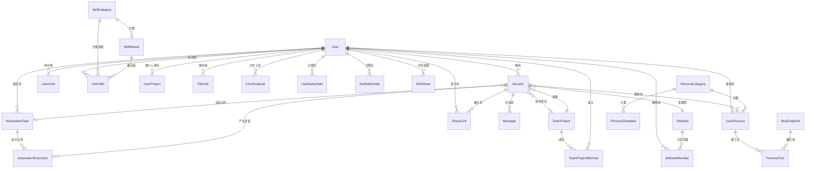
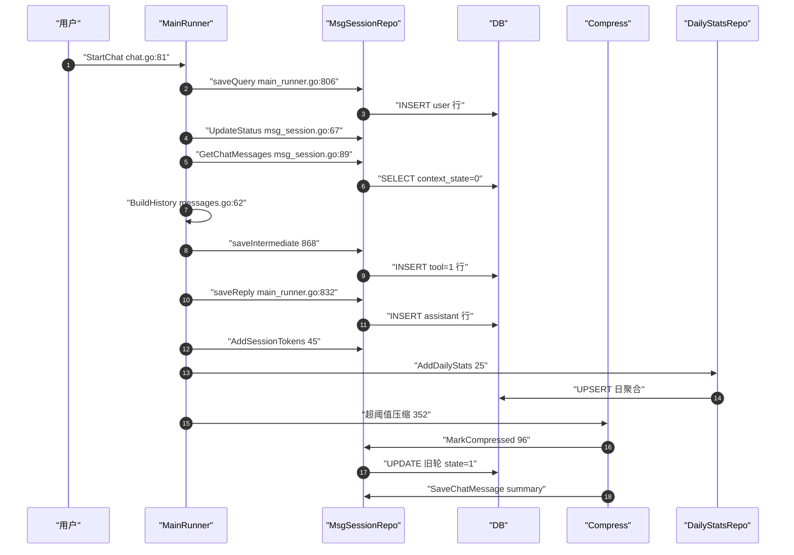

# GoRaven 数据模型解读：27 张表、三驱动一缓存与 AutoMigrate 的边界

> 本解读按 **ai-agent 类规格** 产出，解读基线为 GoRaven `v0.5.4`（`032c8b7`）。正文所有 `文件:行号` 引用均为 **GoRaven 仓库相对路径**，点开即可核对。

数据模型这一层在 GoRaven 里承担的角色比"存东西"更重：它同时是**上下文重建的唯一真源**、**多租户隔离的最后一道闸门**，以及**没有迁移工具时唯一的结构演进通道**。

去掉它会怎样？GoRaven 的 Agent 没有自己的会话内存——`MainRunner` 每次启动都从 `message` 表全量读回本轮之前的对话，再交给 cloudwego/eino 拼成 LLM 请求。也就是说，`message` 表既是"聊天记录"又是"Agent 的工作内存"。而这张表用的是**一块内容一行**而不是"一轮一行"的建模方式，这正是本篇要深挖的那处设计张力。

---

## 存储选型：三个 GORM 驱动加一个可替换缓存后端

### 驱动不是运行时探测出来的，是配置项

GoRaven 同时 import 了 `mysql` / `postgres` / `sqlite` 三个 GORM 官方驱动（[main.go:29-31]()）。
<!-- anchor: "gorm.io/driver/mysql" … "gorm.io/driver/sqlite" -->
选择逻辑集中在 `installDatabase` 的 switch 里：`system.db_type` 为 `mysql` 走 MySQL，为 `pg` 走 PostgreSQL，**其余一切值（包括空）都落到 SQLite**（[main.go:115-122]()）。
<!-- anchor: switch dbType { … dialector = sqlite.Open(dbConfAddr) -->

注意 `default` 分支的写法：它同时是"未初始化的兜底"和"SQLite 的正式分支"（[main.go:108-150]()）。
<!-- anchor: func installDatabase(app freedom.Application) { … return db -->
这是一个刻意的取舍——单机体验版不需要任何配置就能跑起来，代价是**配置错误（例如把 `db_type` 写成 `postgres` 而不是 `pg`）会静默降级成 SQLite**，产生一个空的本地库而不是报错。

真正决定这个值的是 Web 安装向导。`InstallService.Init` 会先按用户填的类型试连一次数据库，然后把这几个键写回 `config.yaml` 并**用 `syscall.Exec` 重启进程**（[backend/service/install.go:101-114]()）：
<!-- anchor: // 写入 config.yaml … config.Get().System.DBType = req.DBType -->

因此"切换数据库"这件事在架构上被拆成两层：**安装期**（写配置，`openDB` 按 `db_type` 选 dialector，支持 `sqlite/mysql/pg` 三值且非法值直接报错，[backend/service/install.go:181-199]()）
<!-- anchor: func (service *InstallService) openDB(dbType, addr string, port int, user, pass, … return db, nil -->
与**启动期**（读配置，`default` 兜底 SQLite）。安装期的 DSN 拼接也是三套手写模板（[backend/service/install.go:203-216]()）。
<!-- anchor: func (service *InstallService) buildDSN(dbType, addr string, port int, user, pas … return addr -->

### 三驱动的定位与真实代价

`config.yaml` 的默认值已经把定位写在注释里：`db_type: "sqlite"`、`paths.sqlite_db: "./data/goraven.db"`，而 `db.addr` 一栏同时给出了 MySQL 与 PostgreSQL 的 DSN 样例（[config/config.yaml:61-79]()）。
<!-- anchor: # SQLite: addr = "/goraven/data/goraven.db" … cache_type: "local" -->

| 维度 | SQLite | MySQL | PostgreSQL |
|------|--------|-------|------------|
| 默认/定位 | 默认值，单机自托管"体验版"，零外部依赖 | 团队部署常见选择，运维生态成熟 | 团队部署，作者在 `dashboard.go` 专门为它写了保留字规避 |
| 选型入口 | `db_type` 留空或任意非 mysql/pg 值 | `db_type: mysql` | `db_type: pg` |
| 连接池 | 同样受 `max_open_conns: 4` 约束（无 SQLite 专用调优） | 4/2 偏保守 | 4/2 偏保守 |
| 已付出的一次性成本 | — | `quoteUser()` 反引号分支 | `quoteUser()` 双引号分支 + `dateExpr()` 的 `TO_TIMESTAMP` 分支 |
| 未付出的成本 | 没有设置 `journal_mode` / `busy_timeout` | 未做读写分离 | 未做分区 |

**多驱动的代价是可见的**：凡是 AutoMigrate 生成的等值查询，GORM 会自己处理方言；但一旦作者手写聚合 SQL，就必须按驱动分叉。`DashboardRepository` 里两处最典型——`user` 是 PostgreSQL 保留字，所以要按驱动选反引号还是双引号（[backend/repository/dashboard.go:33-39]()）；
<!-- anchor: // quoteUser 返回当前数据库正确引号包裹的 user 表名 … return `"user"` -->
`message.timestamp` 存的是 Unix 毫秒，从时间戳抽取日期在三个驱动下是三套函数（[backend/repository/dashboard.go:43-50]()）。
<!-- anchor: func (repo *DashboardRepository) dateExpr() string { … return "date(timestamp/1000, 'unixepoch')" -->

**这笔成本还有一个更隐蔽的复利**：任何新的手写 SQL 都要乘三。`GetActiveUserTrend` 里甚至要处理"同一条 SQL 在 SQLite 返回纯文本日期、在 MySQL/PG 被驱动扫成 time.Time"的差异，只能用 `r.Date[:10]` 截断对齐（[backend/repository/dashboard.go:371-376]()）
<!-- anchor: for _, r := range rows { … dateMap[r.Date[:10]] = r.Count -->
——这是同一段逻辑被迫兼容三种返回值类型。

还有一个值得记录的点：**没有配置 SQLite 的 WAL 与 `busy_timeout`**（全仓无 `PRAGMA` / `journal_mode` / `busy_timeout`），却把连接池开到 4 条写连接。SQLite 单写者模型下，多连接并发写会撞 `SQLITE_BUSY`。对单用户体验版够用，但这解释了为什么 `db.addr` 的注释默认推荐 MySQL/PG 用于团队场景。

### Redis 承担什么：不是会话热数据，而是短状态与锁

一个容易误判的地方：GoRaven 的 Redis **不缓存会话与消息**。`GetChatMessages` 每次都直查 `message` 表（[backend/repository/msg_session.go:89-92]()），
<!-- anchor: func (repo *MsgSessionRepository) GetChatMessages(sessionId string) ([]*po.Messa … return messages, err -->
缓存里没有任何 `session:*` / `message:*` 键。把全部 `Redis().Get/Set/Del` 调用点枚举出来，职责是这样的：

| 用途 | 键 | TTL / 生命周期 | 一致性策略 |
|------|----|---------------|-----------|
| 鉴权令牌缓存 | `auth:token:*` | 30 分钟 | 显式失效：改角色走 `InvalidateUserCache`，登出/改密走 `DeleteToken`/`DeleteUserTokens` 时同步 `Del` |
| 验证码答案 | `auth:captcha:*` | 5 分钟，一次性 | 校验时 `Get` 后立刻 `Del`（弹出式） |
| 登录失败计数 | `auth:login_fail` | 5 分钟窗口 | 读-改-写（非原子，见后文"不足"） |
| 仪表盘聚合结果 | `dashboard:*` | 10 分钟 | 时间过期 + 模型增删改时 `DelByPattern` 批量失效 |
| 系统配置快照 | `system_info` 缓存键 | 有 TTL | 配置更新时显式 `Del` |
| ClawHub 技能市场响应 | clawhub 缓存键 | 24 小时 | 时间过期 |
| 团队项目/自动化任务锁 | `team_project_lock:*`、`automation_task_lock:*` | 30 分钟 / 有 TTL | `SetNX` 抢占 + 显式 `Del` 释放 |
| 临时访问凭证 | `hfs` 临时 key | `TempAkTTL` | 显式 `Del` |
| 压缩任务状态 | `chat:compress:*` | 10 分钟 | 时间过期 |

Dashboard 的 10 分钟缓存与失效是这套策略里最完整的一例：读取 miss 就回源，写入时 JSON 序列化后带 TTL 存（[backend/repository/dashboard.go:688-709]()），
<!-- anchor: const dashboardCacheTTL = 10 * time.Minute … repo.Redis().Set(context.Background(), key, b, dashboardCacheTTL) -->
而失效要跨"本地 go-cache"与"真 Redis"两种后端分别处理——前者返回 `infra.PatternDeleter` 走内存遍历，后者用 `SCAN` 游标分批 `DEL` 以免 `KEYS` 阻塞（[backend/repository/dashboard.go:712-723]()）。
<!-- anchor: // InvalidateAllDashboardCache 失效所有仪表盘相关缓存（管理员 + 所有用户） … invalidateRedisByPattern(ctx, client, pattern) -->

`cache_type: local` 时用的是 `infra.CacheWrapper`——它**内嵌 `*redis.Client` 但重写了 `Get/Set/SetNX/Del` 四个方法**，把语义落到进程内的 `go-cache` 上（[backend/infra/cache_wrapper.go:12-26]()）。
<!-- anchor: type CacheWrapper struct { … cache:  cache.New(defaultExpiration, cleanupInterval), -->

这个设计的工程价值很高：上层代码（含 `DelByPattern`）只依赖 `redis.Cmdable` 接口，本地模式与 Redis 模式可以零改动切换。但代价必须讲清楚——**`cache_type: local` 下所有 `SetNX` 锁只在单进程内有效**。团队项目锁（[backend/repository/team_project.go:158-166]()）
<!-- anchor: // LockTeamProject 对团队项目加锁（SetNX），同一时刻只能有一个 Agent 操作该项目 … return ok, nil -->
与自动化任务锁都建在它之上；一旦水平扩容到两个实例而仍用 local 缓存，"同一时刻只有一个 Agent 操作该项目"的保证就失效了。这不是实现缺陷，而是把"多实例必须配 Redis"变成了隐式运维约束，配置项本身没有任何提示。

---

## 实体全景与 ER 图

### 建表清单只有一个入口

所有表由**一次 `AutoMigrate` 调用**创建，清单与顺序都硬编码在 `Merge` 里（[backend/repository/merge.go:10-43]()），
<!-- anchor: func Merge(db *gorm.DB) error { … return nil -->
共 27 个实体。我用一个只 import `po` 的探针程序复现了这次调用（`repository` 包会拖入全部 provider 依赖，无法在沙箱内编译），程序输出确认：**实际建出 27 张表，与 `po` 包中的 27 个实体一一对应，无遗漏也无多余**。

这里有一个反直觉的事实：`backend/po/po.go` 只有 2 行，**整个包只有一条 `package po` 声明，没有任何基类**（[backend/po/po.go:1-2]()）。
<!-- anchor: //Package po generated by 'freedom new-project goraven' … package po -->

也就是说 GoRaven 没有 `BaseModel{ID, CreatedAt, UpdatedAt, DeletedAt}` 这样的公共字段结构体。每张表把 `Created` / `Updated` 以及 `BeforeCreate` / `BeforeSave` 两个钩子**各写一遍**。这是理解后面"多租户隔离"与"软删除"两个问题的前提。

### ER 图（关系基数为程序确认的真实基数）



图外必须补三句说明，否则会误读：

1. **这些关系只有基数是真的，没有一个落成数据库外键。** 探针对 27 张表逐一查 `PRAGMA foreign_key_list`，结果全是 0。所有 `session.user_id`、`message.session_id` 之类都是**逻辑外键**，引用完整性完全由应用层负责。
2. `Session }o--o{ McpEndpoint`、`Session }o--o{ UserSkill` 这两条多对多在库里是 `session.mcp_ids` / `session.skill_ids` 两个 **JSON 数组文本列**，不是中间表；只有当会话绑定角色时，工具与技能才改从 `persona_tool` 读（见 `session.go` 字段注释）。
3. `SkillShare`、`SkillMarket`、`SystemSkill` 是**三类不同的"技能"**，不是一张表的三种状态：`system_skill` 是管理员维护的全局提示词，`skill_market` 是管理员维护的市场货架，`user_skill` 是用户安装记录，`skill_share` 是用户之间共享的技能快照。下面字段表会把三者的**宿主字段**（`skill_name` vs 自增 `skill_id`）差异指出来。

### 表清单按域分组

| 域 | 表 | 隔离键 |
|----|----|--------|
| 身份 | `user`、`user_auth` | `user_id` |
| 会话 | `session`、`message`、`share_link` | `user_id`（`session`）/ `session_id`（`message`） |
| 模型 | `ai_model`、`ai_model_member` | 全局表 + 白名单 |
| 角色 | `user_persona`、`persona_tool`、`persona_template`、`persona_category` | `user_id` / `persona_id` |
| 技能 | `system_skill`、`skill_market`、`skill_category`、`user_skill`、`skill_share` | 全局表 + `user_id` |
| 工具 | `mcp_endpoint` | 全局表 |
| 项目 | `user_project`、`team_project`、`team_project_member` | `user_id` / `creator_id` + 成员表 |
| 自动化 | `automation_task`、`automation_execution` | `user_id` |
| 文件 | `file_link`、`chunk_upload` | `user_id` |
| 统计 | `user_daily_stats`、`tool_daily_stats` | `user_id` |
| 配置 | `system_setting` | 全局 KV |

---

## 核心表设计

下面每张表给一个字段表。所有字段名、类型、约束都是从 `gorm` tag 里逐字提取的，索引名则用探针程序对真实建表结果查出（GORM 的命名策略会把 `primaryKey:column:X` 之外的 `index` 自动展开成 `idx_<表>_<列>`）。

### user：主键就是业务 ID，软删除自己实现

`user` 是唯一被手写 SQL 单独引用的表（PostgreSQL 保留字问题），也是"自定义软删除"的样板（[backend/po/user.go:30-43]()）。
<!-- anchor: type User struct { … Updated    time.Time `gorm:"not null;column:updated"` -->

| 字段 | 类型 | 约束/索引 | 语义 |
|------|------|-----------|------|
| `user_id` | varchar(64) | **PK** | 主键即业务 ID，注释明确要求"与 session.userId 保持一致"——即会话表存的是这个字符串，不是自增号 |
| `username` | varchar(64) | **UNIQUE**(`idx_user_username`) + not null | 登录账号 |
| `password` | varchar(256) | not null | 存 MD5 哈希（`util.MD5`），注释强调"禁止明文" |
| `email` | varchar(128) | — | 无唯一约束 |
| `role` | uint8 | default 0 | 0 普通用户 / 1 管理员（`UserRoleUser`/`UserRoleAdmin`） |
| `super_admin` | uint8 | default 0 | 与 `role` 是两个维度：超管全局唯一，只在安装时创建 |
| `status` | uint8 | default **1** | 0 禁用 / 1 启用；默认启用而非默认禁用 |
| `nickname` / `avatar` | varchar(128) / varchar(512) | — | 允许为空，前端 fallback 到 `username` 首字母 |
| `daily_token_limit` | int | default 0 | 单位 M，0 表示不限——它是配额判断的唯一来源 |
| `deleted` | uint8 | default 0 | **自定义软删除**，不是 `gorm.DeletedAt` |
| `created` / `updated` | time | not null | 由 `BeforeCreate`/`BeforeSave` 钩子维护，无 `autoUpdateTime` |

两个设计点值得单独说：**用 MD5 存密码**（无盐）在 2026 年的自托管团队工具里是明确的安全短板；`daily_token_limit` 与 `deleted` 都是裸 int/uint8 而非枚举类型，配合下面"没有全局 scope"的结论，意味着漏写 `deleted = 0` 就会读到已删除用户。

### session：一张表承担会话列表、上下文水位与项目绑定

`session` 有 20 列，是本次解读里"字段最密"的表（[backend/po/session.go:9-29]()）。
<!-- anchor: type Session struct { … Updated               time.Time `gorm:"not null;column:updated"` -->

| 字段 | 类型 | 约束/索引 | 语义 |
|------|------|-----------|------|
| `session_id` | varchar(64) | **PK** | UUID |
| `user_id` | varchar | `idx_session_user_id`（单列）+ `idx_user_del_arch`(1) | 侧边栏列表的过滤主键 |
| `title` | varchar(255) | — | 无索引；标题由模型生成后写入 |
| `is_archived` | int | `idx_user_del_arch`(3) | 0/1，归档会话移出主列表 |
| `deleted` | uint8 | `idx_user_del_arch`(2) + `idx_del_created`(1) | 自定义软删除 |
| `created` | time | `idx_del_created`(2) + not null | 与 `deleted` 组成复合索引 |
| `prompt_tokens_count` / `completion_tokens_count` | int | — | **会话级累计**，由 `AddSessionTokens` 按轮次累加 |
| `prompt_cached_tokens` | int | default 0 | 缓存命中 token；注释特别声明"与 message 表 `prompt_cached_tokens_count` 为同一指标，命名不同但勿改列名" |
| `context_tokens` | int | — | 当前上下文长度水位，由 `SetContextTokens` 写入 |
| `status` | uint8 | — | 0 正常 / 1 进行中；列表排序把 1 置顶 |
| `ai_model_id` | int | `idx_session_ai_model_id` | 逻辑外键到 `ai_model` |
| `last_chat_time` | time | not null | 列表排序键 |
| `persona_id` | int | `idx_session_persona_id` | 0 = 未选角色 |
| `mcp_ids` / `skill_ids` | text | — | JSON 数组文本；**只有无角色时才有值**，有角色时读 `persona_tool` |
| `project` | varchar(255) | default '' | 项目目录名；共享项目时存 owner 的真实目录名 |
| `shared_project_id` | int | `idx_session_shared_project_id` | 0 = 个人项目 |
| `automation_task_id` | int | `idx_session_automation_task_id` | 非 0 表示自动化派生会话，侧边栏列表显式排除 |
| `updated` | time | not null | — |

会话列表的复合索引 `idx_user_del_arch(user_id, deleted, is_archived)` 与查询完全对齐（[backend/repository/msg_session.go:117-135]()）：
<!-- anchor: func (repo *MsgSessionRepository) ListSessions(userId string, req *vo.SessionLis … return sessions, pageResult, nil -->

但 `ORDER BY status DESC, last_chat_time DESC` 里**没有一列在这个索引里**，所以每次翻页都要在过滤后的行集上做一次 filesort。20 列宽表 + 无覆盖索引，这是"会话量上千之后列表会变慢"的直接原因。

### message：一块内容一行，一张表装下四类语义

这是全篇最重要的一张表。19 列，没有任何 JSON 之外的子表（[backend/po/message.go:34-53]()）。
<!-- anchor: type Message struct { … Updated                 time.Time `gorm:"not null;column:updated"` -->

| 字段 | 类型 | 约束/索引 | 语义 |
|------|------|-----------|------|
| `msg_id` | varchar(64) | **PK** | UUID |
| `session_id` | varchar(64) | `idx_message_session_id` + `idx_session_round`(1) | 会话聚合键 |
| `round_id` | varchar(64) | `idx_session_round`(2) | **一轮对话共享同一个 round_id**（问题、回复、工具消息同轮） |
| `timestamp` | int64 | `idx_message_timestamp` | Unix 毫秒，**正序排列的唯一依据** |
| `context_state` | uint8 | — | 0 = 发给 LLM；1 = 跳过上下文（仅展示给用户） |
| `content` | text | — | 正文 |
| `reasoning_content` | text | — | 思考内容（thinking），与 `content` 同列不同字段 |
| `role_type` | varchar(32) | — | `user` / `assistant` / `tool` / `summary` 四值 |
| `tool` | uint8 | — | 0 = 正常对话消息，1 = 工具链消息（**与 `role_type` 正交**） |
| `prompt_tokens_count` / `completion_tokens_count` / `prompt_cached_tokens_count` | int | — | 仅"每轮最后一条 assistant（或压缩产生的 summary）"记录，值是**整轮所有 LLM 调用的累计** |
| `duration` | int | — | 毫秒 |
| `asst_error` | text | — | 助手回复失败原因；非空的消息被上下文重建显式排除 |
| `ext` | text | — | 严格按角色分派：assistant 存 `AssistantExt`，tool 存 `ToolExt` |
| `media` | text | — | 多模态部件 JSON（`agent.MediaItem` 数组），仅 user 消息写入 |
| `tool_calls_info` | text | — | 工具调用的**展示态** JSON，供前端还原"正在执行 X" |
| `created` / `updated` | time | not null | — |

`ext` 的多态是靠四个小结构体在同一文件里"手写约定"的（[backend/po/message.go:14-17]()）：
<!-- anchor: type ToolCallData struct { … Arguments string `json:"arguments"` -->
`ToolCallData{ID,Name,Arguments}`、`AssistantExt{ToolCalls}`、`ToolExt{ToolCallID,ToolName}`、`ToolInfo`。**同一列在不同 `role_type` 下反序列化成不同类型**，没有任何列级类型标记——这是文档中的一个真实缺口：反序列化失败是静默的（见下文 `BuildHistoryFromMessages`）。

### ai_model 与 ai_model_member：全局模型 + 白名单可见性

`ai_model` 是全局配置表，用 `access` 一列把"可见性"变成模型自身的属性（[backend/po/ai_model.go:16-37]()）。
<!-- anchor: type AIModel struct { … Updated               time.Time `gorm:"not null;column:updated"` -->

| 字段 | 类型 | 约束/索引 | 语义 |
|------|------|-----------|------|
| `ai_model_id` | int | **PK** autoIncrement | 自增（会话表只存这个 int） |
| `provider_display_name` / `display_name` | varchar(128) | — | 供应商名与模型展示名 |
| `provider_id` | varchar(64) | `idx_ai_model_provider_id` | 11 个枚举值：deepseek/bailian/glm/minimax/open_router/ollama/openai/claude/gemini/openai_compatible/claude_compatible |
| `model_name` | varchar(128) | — | 传给供应商的真实模型名 |
| `api_key` | text | — | 明文存储；ollama 可为空 |
| `base_url` | varchar(256) | — | ollama 与两类 compatible provider 必填 |
| `extra_fields` | text | — | JSON，例如 `{"thinking":{"type":"enabled"}}` |
| `proxy_url` | varchar(256) | — | 出网代理 |
| `conversation_header_key` | varchar(128) | — | 会话归并 header 名，空则不注入 |
| `context_len` | int | default 200 | **单位 KB**，内部使用需 `*1024`（`ContextLenInTokens()`）；`BeforeCreate`/`BeforeSave` 会把 ≤0 纠正为 200 |
| `is_default` | uint8 | default 0 | 可多个组成"默认池"，对话时**随机选取** |
| `is_flash` | int | default 0 | 全局唯一，用于历史压缩与子 agent |
| `is_visual` | int | default 0 | 可多个组成多模态池，识别时随机选取 |
| `status` / `access` / `deleted` | uint8 | default 1 / 0 / 0 | 启用状态 / 0 全员开放 1 仅成员可见 / 软删除 |
| `remark` / `created` / `updated` | varchar(512) / time | — | — |

`access = 1` 时的白名单落在 `ai_model_member`，用**联合唯一索引**保证同一用户同一模型不会重复授权（[backend/po/ai_model_member.go:12-17]()）：
<!-- anchor: type AIModelMember struct { … Updated   time.Time `gorm:"not null;column:updated"` -->
`uk_model_user(ai_model_id, user_id)`。

注意 `ai_model_member` **没有 `deleted` 列**——取消授权就是物理删除。这是全项目两种删除语义并存的一个缩影。

### system_skill / skill_market / user_skill：技能的三层货架

`system_skill` 是管理员维护的全局提示词，`name` 必须 `goraven-` 前缀，**并且带一个 `version` 列**（[backend/po/system_skill.go:17-26]()）：
<!-- anchor: type SystemSkill struct { … Updated     time.Time `gorm:"not null;column:updated"` -->

| 字段 | 类型 | 约束/索引 | 语义 |
|------|------|-----------|------|
| `skill_id` | int | **PK** autoIncrement | — |
| `name` | varchar(64) | **UNIQUE**(`idx_system_skill_name`) + not null | 必须是 `goraven-` 开头（`SystemSkillNamePrefix`） |
| `description` | varchar(512) | — | 由 `seed.ParseSkillDescription(content)` 从正文解析 |
| `content` | text | not null | 提示词正文 |
| `version` | varchar(32) | — | **内容版本号，等于 `config.Version`**；版本升级时自动更新内容 |
| `status` | uint8 | default 0 | 注意：**此表 0 = 启用、1 = 禁用**，与 `skill_market`（1 = 启用）和 `user`（1 = 启用）全部相反 |
| `deleted` / `created` / `updated` | uint8 / time | default 0 / not null | — |

`status` 的 0/1 语义在有 27 张表的项目里出现反向定义，是一个真实的认知陷阱——`SystemSkillStatusDisabled = 1`、`SystemSkillStatusEnabled = 0`。

`skill_market` 是市场货架（[backend/po/skill_market.go:23-39]()）：
<!-- anchor: type SkillMarket struct { … Updated        time.Time `gorm:"not null;column:updated"` -->

| 字段 | 类型 | 约束/索引 | 语义 |
|------|------|-----------|------|
| `skill_id` | int | **PK** autoIncrement | 与 `system_skill.skill_id` 同名不同表，无外键关联 |
| `name` | varchar(64) | **UNIQUE**(`idx_skill_market_name`) | 唯一标识名，**同时是磁盘目录名** |
| `description` / `icon` | varchar(800) / varchar(256) | — | icon 是 Lucide 图标名或 URL |
| `source` | varchar(16) | — | `clawhub` / `custom_upload`（常量还有 `system`） |
| `source_url` | varchar(512) | — | clawhub 仓库地址或上传文件名 |
| `category_id` | int | `idx_skill_market_category_id` | 逻辑外键 |
| `status` | uint8 | default **1** | 0 禁用（下架）/ 1 启用（上架） |
| `sort_order` / `installed_count` | int | default 0 | 排序号 / 冗余安装计数（`UpdateColumn` 原子 +1） |
| `remark` / `deleted` / `created` / `updated` | — | — | 管理员备注 + 自定义软删除 |

`user_skill` 是安装记录，用 `idx_user_skill(user_id, skill_name)` 保证幂等安装（[backend/po/user_skill.go:18-32]()）。
<!-- anchor: type UserSkill struct { … Created time.Time `gorm:"not null;column:created"` -->
它的关键设计是**快照**：`description` / `icon` / `category_id` 都在安装时从 `skill_market` 复制一份，之后市场改名不影响已安装用户；`install_status`（0 未装 / 1 安装中 / 2 已装 / 3 失败）与 `install_error` 让"装技能"这个跨进程动作有了可恢复的状态机。`market_skill_id` 在 `source = custom` 时为 0——**用 0 当"无关联"的哨兵值**，这个模式在 `session.persona_id`、`session.shared_project_id`、`session.automation_task_id`、`user_persona.ai_model_id` 上反复出现。

### automation_task：把"会话配置"暂存一份，触发时复制过去

自动化任务表的特殊之处是它**同时是调度表和会话模板**（[backend/po/automation_task.go:26-46]()）。
<!-- anchor: type AutomationTask struct { … Updated         time.Time  `gorm:"not null;column:updated"` -->

| 字段 | 类型 | 约束/索引 | 语义 |
|------|------|-----------|------|
| `id` | int | **PK** autoIncrement | — |
| `title` / `requirement` | varchar(255) / text | not null / — | 任务标题与需求描述（需求即发给 Agent 的 prompt） |
| `user_id` | varchar(64) | `idx_automation_task_user_id` + not null | 所属用户 |
| `exec_type` | uint8 | not null | 1 单次 / 2 按间隔 / 3 每天 / 4 每周 |
| `run_at` | *time.Time | — | 可空，仅 `exec_type=1` 使用 |
| `interval_minutes` | int | default 0 | 最小 5 分钟（注释约束，无 CHECK 强制） |
| `fixed_time` | varchar(5) | default '' | `HH:MM` 文本，仅 3/4 使用 |
| `weekday` | uint8 | default 0 | 0=周日 |
| `next_run_at` | time | `idx_automation_task_next_run_at` + not null | **调度器唯一扫描依据**：`status=1 AND deleted=0 AND next_run_at <= now ORDER BY next_run_at ASC` |
| `status` | uint8 | default 0 + not null | 0 停用 / 1 启用 / 2 已完成（单次任务跑完） |
| `mcp_ids` / `skill_ids` / `project` / `shared_project_id` / `ai_model_id` / `persona_id` | text / varchar / int | 三个 int 各有单列索引 | **暂存**：触发时复制进新建的 session |
| `deleted` / `created` / `updated` | — | default 0 / not null | — |

"暂存 + 触发时复制"是一个有意为之的**反规范化**：代价是任务改了配置，历史会话仍保留旧配置（这正是想要的）；收益是会话表不必回查任务表就能自解释。执行结果落在 `automation_execution`（`automation_task_id` + `session_id` 各有索引），并且**只在执行成功后才写**——注释明确说"失败原因无需存储，session 与聊天记录中自然可见"。这是"把日志职责推给会话表"的省事做法，也意味着失败任务在 `automation_execution` 里没有痕迹，要看失败必须去翻会话。

---

## 消息表的设计张力：一轮一行，还是一块内容一行

### 结论：一块内容一行，用 `role_type` + `tool` 两个正交维度打标

GoRaven 选了**一块内容一行**：模型的每一次输出、每一个工具调用、每一条工具结果，都是 `message` 里独立的一行，靠 `round_id` 归到同一轮。一次落库的代码路径给出了最直接的三条证据——

1. 用户提问写一行，`role_type = "user"`，`tool = 0`（[core/agent/main_runner.go:806-829]()）：
<!-- anchor: func (runner *MainRunner) saveQuery(content string, media []MediaItem) error { … return err -->

2. 中间的工具链消息**批量循环写入**，每行 `tool = 1`，`role_type` 可能是 `assistant`（工具调用）也可能是 `tool`（工具结果），各自的 JSON 塞进 `ext`（[core/agent/main_runner.go:868-890]()）：
<!-- anchor: func (runner *MainRunner) saveIntermediateMessages(timestamp *int64, msgs []coll … freedom.Logger().Errorf("SaveChatMessage intermediate %v", err) -->

3. 最终回复单独一行，`tool = 0`，**并且它才是 token 计数的承载者**——`prompt_tokens_count` 等三个字段写在这行上，随后调用 `AddSessionTokens` 累加到会话级（[core/agent/main_runner.go:832-865]()）：
<!-- anchor: func (runner *MainRunner) saveReply(timestamp *int64, replyErrContent string, re … runner.mainAgent.msgRepo.SetContextTokens(runner.mainAgent.param.SessionId(), co -->

被终止的一轮有个精巧处理：`terminated` 为真时把 `context_state` 置 1（[core/agent/main_runner.go:832-865]()），
<!-- anchor: func (runner *MainRunner) saveReply(timestamp *int64, replyErrContent string, re … runner.mainAgent.msgRepo.SetContextTokens(runner.mainAgent.param.SessionId(), co -->
于是那半截回复**对用户可见、对模型不可见**。`asst_error` 非空的消息也在读取时被排除。**同一个"要不要进上下文"的语义，被拆到了 `context_state` + `asst_error` 两个字段上**：前者是主动标记，后者是隐式约定。

`role_type` 与 `tool` 的正交性是这个设计的核心。看两个读取路径就会明白它为什么值得：

- **上下文重建**（喂给 LLM）不筛 `tool`，只筛 `context_state = 0 AND asst_error = ''`，所以工具调用与工具结果全部回到历史里（[backend/repository/msg_session.go:89-92]()）：
<!-- anchor: func (repo *MsgSessionRepository) GetChatMessages(sessionId string) ([]*po.Messa … return messages, err -->
- **用户界面展示**反过来，只取 `role_type IN ('user','assistant') AND tool = 0`，工具链消息一律不展示，理由由注释写明（[backend/repository/msg_session.go:147-150]()）：
<!-- anchor: func (repo *MsgSessionRepository) GetAllMessages(sessionId string) ([]po.Message … return messages, err -->

这样一来，**"工具海"不会污染用户的阅读视图，"思考过程"也不会从 LLM 上下文里丢失**。对比 Claude Code 系常见的做法（工具调用作为独立的 content block 数组嵌在单条消息里），GoRaven 的方案代价是行数膨胀——一次带 20 次工具调用的回合会产生 40+ 行记录——收益是每行都能独立打索引、独立标记状态、独立分页，且**不需要解析嵌套 JSON 就能按轮裁剪**。

### 大内容没有外置到文件，而是靠"引用 + 截断"

这是本篇最需要如实指出的一处设计张力。`message.content` / `reasoning_content` / `ext` 全是 `text` 类型，**工具结果无论多大都整段落库**。项目没有做"大内容落文件、库里只存指针"的处理。与文件相关的两张表 `file_link` / `chunk_upload` 解决的是**另外两件事**：

- `file_link` 只服务于"把沙盒里的文件变成可公网访问的 URL"（[backend/service/hfs.go:83-98]()），
<!-- anchor: linkId := util.UUID() … return service.buildURL(linkId, filePath, sysconf.GeneralDomain), nil -->
TTL 由 `system_setting` 里的 `sharing.file_expires_hours`（默认 72 小时）决定（[backend/repository/system_setting.go:62-62]()）。
<!-- anchor: FileLinkExpiresHours:       getInt(m, "sharing.file_expires_hours", 72), -->
它被多模态消息引用——`MediaItem.URL` 里存的就是这个外链，注释明确"重建历史时直接复用，不重新签发"。**所以多模态大对象走外置，文本大对象不外置。**
- `chunk_upload` 只记录分片上传任务（`upload_id`、`chunk_size`、`total_chunks`、`temp_dir`、状态机 0/1/2/3），是**上传过程**的状态，与消息内容无关。

真正控制大内容的是**运行时截断参数**，而不是存储层：`agent.pruning_max_tool_result_length`（默认 2000）、`agent.pruning_head_truncate_length` / `pruning_tail_truncate_length`（各 1000），以及 `agent.pruning_token_threshold`（默认 128）。换句话说，"工具结果太大"是在**写库之前**被截断的，落库的已是截断后的版本。这让存储层简单，但也意味着**完整的工具输出永久丢失**——对于"Observability First"这条产品哲学来说是一个明显缺口：可观测性在截断点之后就没有了。

外链型媒体还有一个隐含的数据依赖：`media` 列里存的是 72 小时有效的 URL。**超过 72 小时后重建历史，URL 已经失效**，但库里没有重新签发逻辑（注释明确写"不重新签发"）。这是"把易失 URL 持久化进不可变历史"的经典不一致，代价是旧会话里的图片会变成死链。

### 一次对话的落库与回读时序



回读侧的关键实现在 `BuildHistoryFromMessages`（[core/agent/messages.go:62-103]()）。
<!-- anchor: func BuildHistoryFromMessages(list []*po.Message) (result []adk.Message) { … msg = schema.ToolMessage(v.Content, toolCallID, schema.WithToolName(toolName)) -->
它逐行把库里的行翻回 eino 的消息类型：

- `user` → `schema.UserMessage`；若 `media` 非空且能解析，则改走多模态部件；
- `assistant` → 解析 `ext` 里的 `AssistantExt.ToolCalls`，还原成 `schema.ToolCall` 列表；
- `tool` → 从 `ToolExt` 取 `ToolCallID` / `ToolName`，还原成 `schema.ToolMessage`；
- `summary` → **降级成 `schema.UserMessage`**，并在 `Extra` 里打 `isSummary` 标记。

注意所有 JSON 解析都写成 `if json.Unmarshal(...) == nil` 的形式，**解析失败就静默跳过**（工具调用丢失、`toolCallID` 变空串），没有任何日志或告警。在"LLM 上下文靠这张表重建"的前提下，静默降级会把数据损坏放大成模型行为异常，且现场无痕迹。这是一个可低成本加固的点。

压缩路径是这套模型的**写入型读**：`MarkSessionCompressed` 把被压缩轮的 `context_state` 批量刷成 1（[backend/repository/msg_session.go:96-102]()），
<!-- anchor: func (repo *MsgSessionRepository) MarkSessionCompressed(sessionId string, roundI … Update("context_state", 1).Error -->
再插入一行 `role_type = summary` 的新消息，其 `timestamp` 取"最后一条被压缩消息的 ts + 1"以保证正序排列正确（[core/agent/compress.go:352-377]()）。
<!-- anchor: func (c *Compress) saveSummary(roundIds []string, lastCompressedMsgTs int64) { … c.dailyStatsRepo.AddDailyStats(c.userId, c.result.PromptTokens, c.result.Complet -->

**压缩是"标记而非删除"**：原始行永久保留、只被打上 `context_state = 1`。这个取舍很清楚——UI 仍能完整回放历史（`GetAllMessages` 不看 `context_state`），LLM 只看到摘要。代价是 `message` 表**只增不减**，且压缩后历史同时存在"原始行 + 摘要行"两份语义重叠的数据。对比 LangGraph 系常用"checkpoint + 消息裁剪"的做法，GoRaven 把裁剪状态做成了行上的一个 bit，好处是幂等、可回溯，坏处是表体积无法回收。

`SaveChatMessage` 的写入口也很朴素：`MsgId == ""` 就 `Create`，否则 `Save`（[backend/repository/msg_session.go:79-85]()）。
<!-- anchor: func (repo *MsgSessionRepository) SaveChatMessage(sessionId string, msg *po.Mess … return repo.db().Save(msg).Error -->

`Save` 是**全字段更新**，在并发写同一行时会覆盖他人修改；对"每行只由一轮独占写入"的消息语义来说风险低，但这也意味着**消息表没有任何乐观锁/版本列**（对比 mock 数据里甚至有一句建议"核心表增加 version 乐观锁字段"——那是 mock 里 Agent 给出的建议，不是本项目实现）。

---

## 多租户隔离在数据层怎么表达

### 结论：全部靠 service / repository 层手拼 `where`，没有任何全局 scope

判定依据有三条，都很硬：

**第一，没有基类可挂 scope。** `backend/po/po.go` 只有包声明（[backend/po/po.go:1-2]()），
<!-- anchor: //Package po generated by 'freedom new-project goraven' … package po -->
不存在被所有实体嵌入的公共结构体，因此不可能像 GORM 官方多租户插件那样在基类上注册回调。

**第二，没有用 GORM 的软删除机制。** 全项目没有一个 `gorm.DeletedAt`，`deleted` 是各表自己声明的 `uint8`（例如 [backend/po/user.go:30-43]()）。
<!-- anchor: type User struct { … Updated    time.Time `gorm:"not null;column:updated"` -->
GORM 的 `DeletedAt` 会自动给所有查询追加 `deleted_at IS NULL`；换成裸 `uint8` 之后，**这个自动过滤彻底消失，每次查询都必须记得写 `deleted = 0`**。

**第三，userId 是显式参数，不是隐式上下文。** 鉴权中间件把 userId 写进 freedom 的 `worker.Store()`（[backend/infra/auth.go:217-222]()），
<!-- anchor: ca := &cachedAuth{UserId: user.UserId, Role: user.Role, UserName: user.Username} … return true -->
`Request.GetUserId()` 再把它读出来（[backend/infra/request.go:96-105]()），
<!-- anchor: // GetUserId . … return "" -->
然后一路作为函数参数传到 repository。**repository 完全不知道当前请求是谁**，也就无法自动加条件。

于是隔离强度的分布是这样的（同一份代码里三种强度并存）：

| 写法 | 代表 | 强度 |
|------|------|------|
| `where user_id = ? AND ...` | `GetUserSession`、`UpdateSession`、`PaginateUserSkills` | 强：越权查询返回空 |
| `where id = ?` 后**在 service 里比对 owner** | `TeamProjectService.DeleteProject` 比对 `CreatorId` | 中：能查出来但会被拒，属"先取后判" |
| `where id = ?` 后**不比对** | `TeamProjectRepository.GetByID`、`UserProjectRepository.GetByID` | 弱：隔离依赖调用方自觉 |

具体分布：`session`、`message`（经 session 校验）、`user_skill`、`user_persona`、`skill_share`、`file_link`、`chunk_upload`、`automation_task`、`share_link`、两张统计表都在查询里带 `user_id`，这类是可靠的。真正值得警惕的是下面两处。

### 风险一：团队项目的"仅成员可见"在读路径上没有被强制

`team_project.access` 定义了 `0 全员开放 / 1 仅成员可见`（[backend/po/team_project.go:10-12]()），
<!-- anchor: const ( … TeamProjectAccessMember = 1 // 仅成员可见 -->
成员关系落在 `team_project_member`，用 `uk_project_user(project_id, user_id)` 保证唯一（[backend/po/team_project_member.go:12-17]()）。
<!-- anchor: type TeamProjectMember struct { … Updated   time.Time `gorm:"not null;column:updated"` -->
列表查询确实把权限考虑进去了——`ListByUser` 用 `access = 0 OR creator_id = ? OR id IN (子查询成员表)`（[backend/repository/team_project.go:196-207]()）：
<!-- anchor: // ListByUser 查询用户可见的团队项目（全员开放 OR 创建者 OR 成员），按更新时间倒序 … return projects, err -->

但**详情接口只查 ID，不校验权限**。`TeamProjectService.Get` 取到项目后只做一件事：把 `IsCreator` 标出来（[backend/service/team_project.go:92-105]()）。
<!-- anchor: // Get 查询单个团队项目详情 … IsCreator:   project.CreatorId == userId, -->

同一文件里，写操作是**有**权限校验的：`DeleteProject` 显式比对 `project.CreatorId != userId` 并返回 `ErrTeamProjectPermission`（[backend/service/team_project.go:146-153]()）。
<!-- anchor: // DeleteProject 删除团队项目（仅创建者，删目录 + 删DB + 删成员） … return errs.ErrTeamProjectPermission -->

`ListMembers` 同样只查 ID 后直接返回成员名单（[backend/service/team_project.go:469-488]()）。
<!-- anchor: // ListMembers 查询项目成员列表 … }, nil -->
把 `TeamProjectAccessMember` 常量的全部引用点搜一遍，结果比预想更彻底：**全仓只出现在它自己的定义处**（[backend/po/team_project.go:12-12]()），列表查询用的是另一个常量 `TeamProjectAccessAll`（[backend/repository/team_project.go:196-207]()）。
<!-- anchor: TeamProjectAccessMember = 1 // 仅成员可见 -->
<!-- anchor: // ListByUser 查询用户可见的团队项目（全员开放 OR 创建者 OR 成员），按更新时间倒序 … return projects, err -->
`IsMember()` 全项目也只被 `UpdateMembers` 用一次、且只用于去重（[backend/service/team_project.go:506-510]()）。
<!-- anchor: isMember, _ := service.TPRepo.IsMember(projectId, uid) … if err := service.TPRepo.AddMember(projectId, uid); err != nil { -->
也就是说，"仅成员可见"这个访问级别的常量从未被任何查询使用过——列表过滤恰好对两种取值都成立，所以没有暴露成 bug，但**详情与成员列表两个读接口上确实不生效**：任何登录用户只要知道自增 `id`，就能读取一个非公开项目的名称、简介、创建者与全部成员 ID。路由注册也印证了这一点——`GET /{id:int}` 与 `GET /{id:int}/members` 上没有任何成员校验中间件（[backend/controller/team_project.go:26-49]()）。
<!-- anchor: func (controller *TeamProjectController) BeforeActivation(b freedom.BeforeActiva … b.Handle("PUT", "/{id:int}/access", "UpdateAccess") -->
这是一个典型的越权读取（IDOR），依赖"id 不好猜"来兜底——而 `id` 是连续自增的。

这一段必须如实标注边界：我读了 service/repository/controller 三层，未发现其它拦截点（[backend/controller/team_project.go:62-63]()）。
<!-- anchor: func (controller *TeamProjectController) Get(id int) freedom.Result { … rsp, err := controller.TPSev.Get(controller.Request.GetUserId(), id) -->
controller 层不做任何权限判断，`GetUserId()` 与 `id` 被原样透传给 service。但**是否为其它模块（如会话创建时的 `shared_project_id` 校验）补齐了成员校验，我没有逐一读完 `chat.go` 的全部 1146 行，标【存疑待核实】**。

### 风险二：`team_project_member` 如何"突破"用户隔离

这是任务问的"共享表如何突破用户隔离"，答案是**用子查询把成员表当成可见性谓词**，而不是靠给业务表加共享标记：

```sql
access = 0 OR creator_id = ? OR id IN (
  SELECT project_id FROM team_project_member WHERE user_id = ?
)
```

这一句同时表达了三种可见性来源（公开、自建、被邀请），是 `team_project_member` 唯一的业务用途。**代价是它只在列表查询里成立**——因为谓词写在 SQL 里而不是策略层，任何一个新写的"按 ID 取项目"调用都会绕过它。这正是风险一的根因：权限被建模成了"某条查询的 where 子句"，而不是"资源上的一道门"。要做对，通常需要把成员校验下沉到 repository 的统一取数入口，或在 service 里强制 `Get` 走 `IsMember` 判定。

会话侧的共享是另一套机制：`session.shared_project_id > 0` 时，`session.project` 存 owner 的真实目录名（[backend/po/session.go:24-25]()），
<!-- anchor: Project               string    `gorm:"column:project;type:varchar(255);default: … SharedProjectId       int       `gorm:"column:shared_project_id;index;default:0" -->
协作会话直接共享一个物理目录，并用 Redis 锁串行化写操作。这意味着**隔离的边界从"用户的目录"变成了"项目的目录"**，是另一种租户粒度。

### 一个容易被忽略的隔离面：软删除漏写

因为软删除全靠手写，漏写的后果是"已删除数据继续可见"。可举两处：`SkillRepository.UpdateUserSkill` 按 `user_skill_id` 更新（不带 `user_id`）而 `user_skill` 表本身没有 `deleted` 列（[backend/repository/skill.go:380-383]()），
<!-- anchor: // UpdateUserSkill 更新用户技能指定字段 … return repo.db().Model(&po.UserSkill{}).Where("user_skill_id = ?", userSkillId). -->
越权更新的防线只有 service 层；`CountUserSkillsByCategoryId` 统计时既不过滤用户也不过滤状态（[backend/repository/skill.go:281-285]()）。
<!-- anchor: // CountUserSkillsByCategoryId 统计分类下用户安装记录数量 … return int(count), err -->
这些都属"靠调用方约定"的同一类问题——**没有一个地方能集中回答"这张表的数据归谁"**。

---

## 索引与约束实况（程序探测）

下面这份清单不是我读 tag 猜出来的：探针程序调用与 `merge.go` 完全相同的 27 个实体（顺序一致）在内存 SQLite 上跑 `AutoMigrate`，再用 `pragma_index_list` / `pragma_index_info` / `pragma_foreign_key_list` 读出真实结果。

**三条全局结论：**

1. **27 张表，0 个外键约束，0 个 CHECK 约束。** 上表所有"逻辑外键到 X"都只是注释与命名约定。
2. **显式二级索引共 48 个：唯一索引 16 个、普通索引 32 个。** 这个数字用两种独立方式得到且逐表一致——静态清点 27 张表的 `gorm` tag（无名 `index` 展开为 `idx_<表>_<列>`、无名 `uniqueIndex` 同名展开、显式命名的原样保留），与探针读出的 `pragma_index_list` 对照。也正是因为命名来源有两套，同一份代码里 `idx_` 与 `uk_` 两种前缀并存（`idx_user_del_arch` 来自显式命名，`uk_project_user` 也是，而 `idx_user_username` 来自无名 `uniqueIndex` 的自动展开）。
3. **`persona_category`、`persona_template`、`skill_category` 三张表完全没有二级索引**（除主键外），而它们的列表查询都带 `WHERE deleted = 0` 与 `ORDER BY`——小表可以接受，但这三张表都会随管理员维护而增长。

关键表的真实索引（节选）：

| 表 | 索引 | 类型 | 覆盖查询 |
|----|------|------|---------|
| `message` | `idx_message_session_id` | 普通 | 按会话取消息 |
| | `idx_session_round(session_id, round_id)` | 普通复合 | 按轮取同轮思考内容 |
| | `idx_message_timestamp` | 普通 | 正序读历史（**注意：与 session_id 不是一个联合索引**） |
| `session` | `idx_user_del_arch(user_id, deleted, is_archived)` | 普通复合 | 侧边栏列表过滤 |
| | `idx_del_created(deleted, created)` | 普通复合 | 管理端按删除态 + 时间统计 |
| | 另有 4 个单列索引 | | `ai_model_id` / `persona_id` / `shared_project_id` / `automation_task_id` |
| `user` | `idx_user_username` | **UNIQUE** | 登录 |
| `user_daily_stats` | `idx_user_date(user_id, stat_date)` | **UNIQUE** | upsert 冲突目标 |
| | `idx_user_daily_stats_stat_date` | 普通 | 全站按日聚合 |
| `tool_daily_stats` | `idx_user_date_type_name(user_id, tool_type, tool_name, stat_date)` | **UNIQUE** | upsert 冲突目标 |
| | `idx_type_date_name(tool_type, stat_date, tool_name)` | 普通复合 | 排行榜（类型 + 日期 → 名称） |
| `persona_tool` | `idx_persona_type_tool(persona_id, tool_type, tool_id)` | **UNIQUE** | 角色工具去重 |
| | `idx_user_type_tool(user_id, tool_type, tool_id)` | 普通复合 | 按用户级联查询/删除 |
| `team_project_member` | `uk_project_user(project_id, user_id)` | **UNIQUE** | 成员去重 |
| `ai_model_member` | `uk_model_user(ai_model_id, user_id)` | **UNIQUE** | 授权去重 |

这里能读出作者对**规模的分级假设**，而且分级是自洽的：

- **必须索引的**：所有"每请求都按它过滤"的列（`session.user_id`、`message.session_id`、`*.user_id`、`next_run_at`）。
- **必须唯一的**：所有做 upsert 冲突目标或业务唯一键的列（`user_daily_stats(user_id, stat_date)`、两张统计表的复合唯一键、`user_skill(user_id, skill_name)`、`persona_tool`）。
- **故意不索引的**：`message.content`（无全文索引）、`session.title`、`message.created`、`team_project.description`。也就是**只做等值与范围过滤，不做搜索**——这与"不做记忆与检索增强"的产品立场完全一致：既然不打算做语义检索，就不需要为文本检索付索引成本。
- **为仪表盘专门建的**：`tool_daily_stats` 上同时存在"写路径要的联合唯一键"和"读路径要的 `(tool_type, stat_date, tool_name)`"，后者是纯粹为排行榜查询设计的覆盖前缀。

索引与软删除的冲突有一个直接后果值得单独说：`system_skill.name` 与 `skill_market.name` 是 `uniqueIndex`，而两张表又是软删除。SQLite/MySQL 的部分索引能力在这里没被使用，于是作者选择**软删除时把 name 改成 `原名-时间戳`** 来释放唯一槽位（[backend/repository/skill.go:93-105]()
<!-- anchor: // SoftDeleteSystemSkill 软删除系统技能，name 追加时间戳后缀以允许复用 … }).Error -->
与 [backend/repository/skill.go:160-172]()）：
<!-- anchor: // SoftDeleteMarketSkill 软删除市场技能，name 追加时间戳后缀以释放唯一索引 … }).Error -->

这个 workaround 有效但留下两个后遗症：一是**名字被永久污染**（管理端若按名称搜索，会搜到 `xxx-1757980000` 这种幽灵记录）；二是同一模式在 `skill_category` 上又抄了一遍（[backend/repository/skill.go:260-271]()），
<!-- anchor: func (repo *SkillRepository) SoftDeleteSkillCategory(categoryId int) error { … }).Error -->
说明它是项目级的惯例而非个例。

---

## 演进策略：AutoMigrate 的能力边界与项目的补充手段

### AutoMigrate 到底能做什么

GORM 的 `AutoMigrate` 是**单向、只增不减**的建表工具：它会创建缺失的表、添加缺失的列、创建缺失的索引；它**不会**删除多余的列、不会删除多余的索引、不会把 `varchar(64)` 改成 `varchar(128)`、也不会回滚。GoRaven 全仓没有 `migrations/` 目录、没有任何 `schema_migrations` 版本表、没有 `go:embed` 的 SQL 迁移文件——**AutoMigrate 就是全部的 schema 演进机制**。

这带来三条可预期的限制：

1. **改名/收紧类型/删列无法表达。** 想把 `session.mcp_ids` 从 `text` 改成关联表，只能"加新表 + 写数据迁移脚本 + 保留旧列"，而项目连迁移脚本的运行入口都没有。
2. **没有版本号，无法判断"这个库升到哪一版了"。** 你无法回答"用户的库是否需要补跑某段数据修复"。唯一能间接判断的是 `system_skill.version`（下面讲）。
3. **多驱动下 DDL 差异由 GORM 吸收，但不保证等价。** `type:varchar(N)` / `text` / `int` 在 MySQL、PG、SQLite 上的实际类型不同；`autoIncrement` 在 PG 生成 `serial`，在 MySQL 生成 `AUTO_INCREMENT`，在 SQLite 则依赖 `INTEGER PRIMARY KEY`。项目在实体里显式写了 `type:int;autoIncrement`，这在 SQLite 上会建出 `integer PRIMARY KEY AUTOINCREMENT`，可以工作；但**跨驱动的类型漂移没有任何一致性测试覆盖**——`repository.Merge` 在所有测试里几乎都只跑 `:memory:` SQLite。

一个**实证性的兼容缺口**值得记录：仓库里 `seed/mock/*.sql` 是为"手工导入 mock 数据"准备的（README 写明用 `sqlite3` 命令行依次执行，且全部用 SQLite 语法）。但这份 SQL 用的是 **camelCase 列名**：

```sql
INSERT OR IGNORE INTO message (msgId, sessionId, roundId, timestamp, contextState, ...) VALUES
```

而 `gorm:"column:..."` tag 决定的真实列名是 snake_case。我用探针程序在真实 `AutoMigrate` 出来的库上执行了同一条 INSERT，结果是 `table session has no column named sessionId`。探针同时确认实际列名是 `session_id / round_id / prompt_tokens_count / asst_error` 等（[backend/repository/seed/mock/04_sessions_and_messages.sql:48-49]()）。
<!-- anchor: INSERT OR IGNORE INTO message (msgId, sessionId, roundId, timestamp, contextStat … ('msg_001_01', 'sess_001', 'round_001_01', 1, 0, '我正在设计一个新的微服务项目，使用 Go 语言。帮我评估一下 -->
**因此这批 mock SQL 无法在自动建表的新库上直接导入**，只能用于"由旧版本或其它工具建出的 camelCase 库"。同一处的测试也用 camelCase 写裸 SQL 且忽略了 `Scan` 的 error（[backend/service/dashboard_test.go:108-126]()）
<!-- anchor: rawDB.Raw( … ).Scan(&aggRows) -->
——所以测试不会因此失败，问题被静默掩盖。
这是"多驱动 + 手写 SQL + 无 schema 校验"三者叠加后的必然产物。

### 项目自己补的三件套

AutoMigrate 管不了数据与演进语义，GoRaven 用三个机制填补：

**其一，`SeedOnBoot`：每次启动都跑的幂等种子。**

启动时 `installDatabase` 调完 `Merge` 紧接着调 `SeedOnBoot`（[main.go:147-148]()），
<!-- anchor: if err = repository.SeedOnBoot(db); err != nil { … freedom.Logger().Fatal(err.Error()) -->
它只做两件事：补系统设置、补系统技能（[backend/repository/seed.go:30-37]()）。
<!-- anchor: func SeedOnBoot(db *gorm.DB) error { … return nil -->

`seedSystemSettings` 的幂等实现是"先查出已存在的 key，只插入缺失的"，因此**已存在的键不会被覆盖**——用户改过的 `agent.max_iterations` 在升级后不会被重置回默认值（[backend/repository/seed.go:40-66]()）。
<!-- anchor: func seedSystemSettings(db *gorm.DB) error { … return db.Create(&toInsert).Error -->

**其二，`system_skill.version`：全项目唯一的"数据版本号"。**

技能内容由代码里的常量提供，写入时 `version = config.Version`（当前 `v0.5.4`，可被 ldflags 覆盖）。启动时对每个内置技能比对库里的 version，不一致就**原地覆盖 description/content/version**（[backend/repository/seed.go:317-322]()）：
<!-- anchor: if oldVersion != config.Version { … }).Error; err != nil { -->

这是一个**用"内容版本号"替代"schema 版本号"** 的务实设计：它只保护"系统内置提示词"这一类随代码演进的数据，粒度粗、覆盖窄，但恰好是唯一会随版本变化、且必须保持最新的数据。系统设置走的是相反策略（只补不改），因为那是用户可改的。**同一套 Seed 里两种策略并存，区分标准是"这数据归用户还是归代码"**——这是一个清晰且值得借鉴的判断准则。

**其三，`system_setting` KV 表：把可调参数从代码里挪出来。**

`system_setting` 用 `config_key` 唯一索引 + `group_name` 索引做键值存储，`value_type` 声明类型（string/int/float/bool/date/datetime），并提供 `Int()` / `Bool()` 转换方法（[backend/po/system_setting.go:20-26]()）。
<!-- anchor: type SystemSetting struct { … Updated   time.Time `gorm:"not null;column:updated"` -->
它把 20 多个运行时参数（压缩阈值、剪枝长度、超时、重试、外链 TTL、OCR 开关）变成可在线修改、无需重发布的配置。读取侧 `LoadConfig` 把它们批量加载并带缓存，缺键时用 `getInt(m, key, 默认值)` 兜底。

**KV 表是 schema 演进的降级通道**：新增一个可调项不需要改表结构，只需要在种子列表里加一行。代价是**类型不安全**（`value_type` 只是声明，没有写入校验）、**无历史**（改了就没了），以及默认值双写（种子一份、代码兜底一份）——而且这两份**已经漂移**：种子写 `agent.max_iterations = 120`（[backend/repository/seed/system_settings.go:22-22]()）
<!-- anchor: {Key: "agent.max_iterations", Value: "120", ValueType: po.ValueTypeInt, GroupNam -->
与 `agent.main_agent_timeout_minutes = 30`（[backend/repository/seed/system_settings.go:40-40]()），
<!-- anchor: {Key: "agent.main_agent_timeout_minutes", Value: "30", ValueType: po.ValueTypeIn -->
代码兜底却写成 `150` 与 `20`（[backend/repository/system_setting.go:56-69]()）。
<!-- anchor: MaxIterations:              getInt(m, "agent.max_iterations", 150), … MainAgentTimeoutMinutes:    getInt(m, "agent.main_agent_timeout_minutes", 20), -->

由于种子行总是存在（首次启动就插入、之后只补不改），实际生效的是种子值，代码里的兜底只在"行被手工删掉"时才生效——**两个数字不一致却长期无人发现，正是"默认值双写"这种结构的典型症状**。

### 一句话总结演进姿态

GoRaven 的演进策略可以概括为：**schema 靠 AutoMigrate 单向加列，数据靠"启动即播种"的幂等种子，参数靠 KV 表，行为靠软删除标记。** 没有回滚、没有版本表、没有数据迁移脚本。对"自托管团队工具、单库、可手动重建"的定位来说这是合理的成本控制；但它把两个风险推给了使用者：**升级不可逆**（一旦 AutoMigrate 加了列就回不去旧版本），以及**跨驱动 DDL 差异无人看管**。

---

## 统计表设计：为什么是日聚合而不是实时聚合

### 日聚合表承担的是"仪表盘不要碰 message 表"

两张统计表的定位写得很直白：`user_daily_stats` 注释说"每轮对话 SSE end 事件后增量更新，**避免仪表盘实时聚合 message 表**"（[backend/po/user_daily_stats.go:12-22]()）；
<!-- anchor: type UserDailyStats struct { … Updated            time.Time `gorm:"not null;column:updated"` -->
`tool_daily_stats` 说"按 (用户, 日期, 类型, 名称) 粒度预聚合工具调用次数"（[backend/po/tool_daily_stats.go:12-20]()）。
<!-- anchor: type ToolDailyStats struct { … Updated  time.Time `gorm:"not null;column:updated"` -->

这个选择的必要性可以量化：`message` 表是**只增不减**的（压缩只标记不删除），而仪表盘要回答的问题全是"按天、按模型、按用户、按工具"的多维聚合。如果实时算，`GetActiveUsersInRange` 这类查询必须 `message JOIN session` 再按毫秒时间戳做日期函数转换——`DATE(FROM_UNIXTIME(timestamp/1000))` 在 `timestamp` 列上**无法走索引**，每次都要全表扫描 + 全量函数计算（[backend/repository/dashboard.go:58-71]()）。
<!-- anchor: func (repo *DashboardRepository) GetActiveUsersInRange(startDaysAgo, endDaysAgo  … return count, err -->
日聚合把"全表扫描"换成"扫 N 天 × M 用户的小表"，是这个量级下唯一可行的做法。

| 设计点 | `user_daily_stats` | `tool_daily_stats` |
|--------|--------------------|--------------------|
| 粒度 | (用户, 日期) | (用户, 类型, 名称, 日期) |
| 唯一约束 | `idx_user_date(user_id, stat_date)` | `idx_user_date_type_name(user_id, tool_type, tool_name, stat_date)` |
| 读路径专用索引 | `idx_user_daily_stats_stat_date` | `idx_type_date_name(tool_type, stat_date, tool_name)` |
| 度量列 | prompt / prompt_cached / completion tokens、message_count、round_count | count |
| 日期存储 | **`varchar(10)` 字符串 `YYYY-MM-DD`** | 同 |

把日期存成字符串而不是 `DATE` 类型是一个**多驱动一致性**决策：三个驱动的日期类型与函数名都不同（这就是 `dateExpr()` 存在的原因），而 `varchar(10)` 让 `WHERE stat_date IN (...)` 在三个驱动上行为完全一致、索引也能用，还免掉了时区语义。代价是**失去了数据库层的日期运算能力**（做不了"最近 30 天"的区间扫描除非按字符串比较，而 `'2026-09-01' <= x <= '2026-09-30'` 恰好在定长 ISO 格式下是字典序正确的），以及**多占 10 字节**。这是一个典型的"把复杂度从数据库挪到应用层"的取舍。

### 写入时机与幂等性：靠 upsert 而不是靠"不重复调用"

写入时机是**每轮对话结束后**，不是在每条消息落库时：

- token 与轮次的累加在 `AddDailyStats`（[backend/repository/daily_stats.go:25-46]()），
<!-- anchor: func (repo *DailyStatsRepository) AddDailyStats(userId string, promptTokens, com … }).Create(stats).Error -->
由轮次收尾路径调用；
- 工具计数在工具真正被调用时触发：`sendSSEToolEvent` 里对 `tool` 类型记一次（[core/agent/main_runner.go:220-225]()），
<!-- anchor: func (runner *MainRunner) sendSSEToolEvent(name, arguments string) (eventTool st … tevent := runner.buildSSEEventTool(name, arguments) -->
MCP 工具在 `buildSSEEventTool` 里对 `mcp` 类型记一次（[core/agent/main_runner.go:918-920]()），
<!-- anchor: if mcp, ok := runner.mainAgent.GetMCPToolDisplay(name); ok { … runner.mainAgent.param.DailyStatsRepo.AddToolDailyStats(runner.mainAgent.param.U -->
技能在 chat service 里对 `skill` 类型记一次。

**幂等性是靠数据库冲突处理实现的，而不是靠"保证只调用一次"**。两个 upsert 都用 `clause.OnConflict` 指定冲突列并做 `col = col + delta` 累加（[backend/repository/daily_stats.go:51-74]()）：
<!-- anchor: func (repo *DailyStatsRepository) AddToolDailyStats(userId, toolType, toolName s … }).Create(stats).Error -->

这是**可以安全重放**的：即使同一轮因为重试被记了两次，结果也是"多算一次"而不是"插入冲突报错"或"覆盖成常量"。三驱动在这里也各有实现（MySQL `ON DUPLICATE KEY UPDATE`、PG/SQLite `ON CONFLICT DO UPDATE`），GORM 自动分派——**但前提是 PG 上必须存在匹配这些列的 UNIQUE 约束**，否则 `ON CONFLICT` 会直接报错。探针确认两个复合唯一索引都存在（`idx_user_date`、`idx_user_date_type_name`），所以这条路径在三驱动下成立。这也解释了为什么统计表的唯一索引不是"可选的优化"而是"功能正确性的前提"。

需要如实指出的三点不足：

1. **幂等 ≠ 精确。** 重试导致的重复累加会永久污染统计值，没有幂等键（比如把 `round_id` 作为去重维度）。`user_daily_stats` 的 `message_count` / `round_count` 固定按 +1 累加，不校验该轮是否已计过。
2. **`tool_daily_stats.user_id` 的注释留了一个死概念**：字段注释写"空字符串表示全局聚合"，但没有任何代码写入空 userId 行，且联合唯一索引包含 `user_id`，全局聚合行的语义从未被实现。这是设计与实现脱节的残留。
3. **配额判断是读-判-不预留（TOCTOU）**。`dailyTokenQuota` 先读限额、再读今日用量，然后放行整轮对话（[backend/service/chat.go:63-76]()）。
<!-- anchor: // dailyTokenQuota 加载用户并返回每日 Token 限额（单位 M，0=不限）与今日已用量。 … return -->
而今日用量只在**轮次结束后**才累加，所以：并发两个会话会各自通过检查并一起超额；单轮 120 次工具迭代期间用量始终是旧的。严格的日限额需要"预留额度 + 结算"或原子计数器，当前实现在超限时是**软约束**，只能保证"长期平均不会离谱地超"，不能保证"不超"。

另外要提醒一个**跨天语义**：`today` 由 `util.StartOfToday()` 用**进程本地时区**计算，而 `stat_date` 是字符串。跨天运行的会话（例如 23:50 开始、00:10 结束）会把整轮 token 记到结束那天。这是可接受的近似，但它意味着"今天的用量"在跨天瞬间会短暂失真。

---

## 数据规模与性能：索引与分页暴露的假设

### 分页工具只提供 offset 分页

`PageQuery.Normalize` 把非法值纠正为 `Page=1 / PageSize=20`；`Paginate` 做的是 `Count` + `Offset/Limit/Find` 两次查询（[backend/repository/common.go:39-51]()、
<!-- anchor: func Paginate[T any](db *gorm.DB, query *PageQuery, result *[]T) (*PageResult, e … totalPage := int(totalCount) / query.PageSize -->
[backend/repository/common.go:14-19]()）。
<!-- anchor: func (q *PageQuery) Normalize() { … q.PageSize = 20 -->

这是全项目唯一的通用分页实现（泛型函数），它决定了三件事：**第一，每个列表接口都固定付一次 `COUNT(*)`**——在有 `LIKE '%x%'` 搜索条件时，这个 count 与主查询一样要全表过滤；**第二，深翻页是 `OFFSET` 线性代价**，`page=1000&pageSize=20` 会让数据库扫过前 20000 行；**第三，没有游标分页**，因此不适合无限滚动。对"团队内部工具、每人几十到几千个会话"的规模假设来说够用，但一旦某个用户会话数上万，`ListSessions` 的 count 与 offset 都会变慢——而它恰好还带一个排序字段不在索引里的 filesort。

### message 表的增长策略：无分页 + 全量内存重建

这是全篇最值得警惕的性能点。`message` 表的**所有读取路径都没有 `LIMIT`**：

| 读取路径 | SQL 特征 | 风险 |
|---------|---------|------|
| `GetChatMessages`（喂 LLM） | `WHERE session_id=? AND context_state=0 AND asst_error='' ORDER BY timestamp` | 单会话未压缩消息全量读入内存，再全量转成 eino 消息 |
| `GetAllMessages`（UI 展示） | `WHERE session_id=? AND role_type IN (..) AND tool=0 ORDER BY timestamp` | 同上，且含全部历史（不看 context_state） |
| `GetToolReasoningContent` | `... AND round_id=? ... ORDER BY timestamp DESC LIMIT 30` | 唯一带 LIMIT 的读取 |
| `GetFirstUserMessage` | `ORDER BY timestamp ASC` + `First` | 生成标题用，OK |

一次对话的上下文重建链是 `GetChatMessages` → `BuildHistoryFromMessages`（[core/agent/messages.go:62-103]()），
<!-- anchor: func BuildHistoryFromMessages(list []*po.Message) (result []adk.Message) { … msg = schema.ToolMessage(v.Content, toolCallID, schema.WithToolName(toolName)) -->
也就是**整轮对话的每一行都要反序列化 `ext` / `media` JSON**。压缩机制把这个成本压低（把旧轮标记成 `context_state=1` 从而不再读），这是它能工作的关键；但只要压缩阈值（`agent.compress_threshold_percent`，默认 80）没触发，成本就随会话长度线性增长。

`ORDER BY timestamp` 用的是 `idx_message_timestamp`（单列索引），而不是 `(session_id, timestamp)` 联合索引。探针确认了这一点：`message` 上只有 `session_id`、`timestamp` 两个单列索引和 `(session_id, round_id)` 复合索引，**没有 `(session_id, timestamp)`**。这意味着按会话取历史时，SQLite/MySQL 会走 `idx_message_session_id` 再排序，或走 `idx_message_timestamp` 再按 session 过滤——**在一次查询里用不上"先按 session 过滤、再按 timestamp 有序"这两件事的联合优化**。加一个 `(session_id, timestamp)` 索引就能同时覆盖过滤与排序，是这个表最划算的一处优化。

### 已确认的两处 N+1

**其一，管理端用户列表。** `PaginateUsers` 分页查出用户后，在循环里为**每个用户**调用 `GetUserSessionStats`，而后者内部要跑两次查询（`COUNT(*)` + 取最新 `last_chat_time`）（[backend/repository/user.go:57-91]()、
<!-- anchor: func (repo *UserRepository) PaginateUsers(req *vo.AdminUserListReq) ([]vo.AdminU … return items, pr, nil -->
[backend/repository/user.go:95-109]()）：
<!-- anchor: func (repo *UserRepository) GetUserSessionStats(userId string) (int, *time.Time) … return int(sessionCount), lastActiveTime -->

也就是 **1 次 count + 1 次分页查询 + 2N 次单用户查询**。`pageSize` 默认 20 时是 42 条 SQL；管理端如果把 `pageSize` 调大（或者用户量增长后翻页），代价线性上升。修法是显而易见的：一条 `GROUP BY user_id` 的聚合查询即可——现有 `idx_user_del_arch(user_id, deleted, is_archived)` 的前两列已经能支撑这个分组，若要连 `last_chat_time` 一起取，再补一个 `(user_id, deleted, last_chat_time)` 索引即可。

**其二，会话消息的展示态组装。** `SessionService.GetMessages` 先取全部消息，然后在循环里对**每条消息**调用 `buildReasoningContent`，而后者在 `reasoning_content` 非空时会去查"同轮其他工具消息的思考内容"（[backend/service/session.go:128-153]()、
<!-- anchor: func (service *SessionService) GetMessages(sessionId string, userId string) ([]v … return items, nil -->
[backend/service/session.go:191-199]()）：
<!-- anchor: // buildReasoningContent 构建当前消息的完整思考内容（自己的 + 同轮其他 tool 消息的思考） … slices.Reverse(list) -->

于是"打开一个历史会话"这个动作会发出 **1 + N 条 SQL**（N = 该会话的 assistant 消息数）。这个查询本身用了 `(session_id, round_id)` 索引，但它是**逐轮**执行的——同一轮里如果有多条 assistant 消息（工具链场景很常见），就会对同一批行查多次。修法同样直接：一次查出该会话所有 `tool=1 AND reasoning_content != ''` 的行，在内存里按 `round_id` 分组。

### 其余值得记录的读取特征

- **`GetSession` 的"自愈写"**：当 `session.status = 1` 但内存里没有对应 Runner（进程重启/崩溃）时，读接口会顺手把 status 改回 0（[backend/service/session.go:81-83]()）。
<!-- anchor: if _, ok := agent.GetRunner(session.SessionId); !ok { … session.Status = 0 -->
这是把"状态修复"放进读路径——避免了前端永久等待，代价是**读接口产生写操作**，在有读副本的部署下会打到主库。
- **列表侧批量化做得不错**：`resolveSharedProjectsBatch` 把团队项目信息一次批量取回，避免了会话列表 × 团队项目的 N+1，说明作者对这类问题是敏感的——上面两处 N+1 更像是遗漏而非风格。
- **`GenDateRange` 的边界**：`GetActiveUsersInRange` 会先算出日期串列表，再用 `WHERE dateExpr(timestamp) IN (...)`。因为 `dateExpr` 是函数、列被函数包裹，**这个条件在任何驱动上都无法用索引**——这正是"实时聚合不可行、必须用日聚合表"的直接证据。
- **`automation_execution` 只在成功时写**，且查询都是 `automation_task_id` / `session_id` 的单列索引，没有 `(automation_task_id, started_at)` 复合索引；任务详情页按时间列出执行记录时会带排序。

---

## 与其他模块的协同

数据模型这一层向上接四个消费方，每一条都有明确的接口边界：

| 消费方 | 通过什么接口 | 数据模型承担的角色 |
|--------|-------------|-------------------|
| Agent 运行时（`core/agent`） | `iface.MessageRepo`（6 个方法）+ `iface.DailyStatsRepo`（2 个方法） | 上下文真源 + token 计数 + 统计上报 |
| HTTP 层（`backend/service`） | 各 `*Repository` 结构体 | 业务实体读写、分页、事务 |
| 前端仪表盘 | 聚合查询 + Redis 缓存 | 预聚合数据源 |
| 文件/外链 | `HFSRepository` → `file_link` | 多模态媒体的间接寻址 |

`core/agent` 与 `backend/po` 之间是**直接依赖**（[core/iface/message.go:6-18]()），
<!-- anchor: type MessageRepo interface { … MarkSessionCompressed(sessionId string, roundIds []string) error -->
Agent 层直接 `import goraven/backend/po` 并构造 `po.Message`（[core/agent/main_runner.go:806-829]()）。
<!-- anchor: func (runner *MainRunner) saveQuery(content string, media []MediaItem) error { … return err -->
这让"消息的持久化形状"与"Agent 的运行时形状"耦合在一起：改一个 `po.Message` 字段会同时影响 Agent 重建逻辑与建表结构。项目用 `iface.MessageRepo` 隔离了**行为**（谁去存），但没有隔离**数据结构**（存成什么形状）。

一个直接后果是：`po.Message` 里那些运输层关心的字段（`Duration`、`AsstError`、`ToolCallsInfo`）和上下文重建关心的字段（`Content`、`ReasoningContent`、`Ext`、`Media`）混在同一行上，Agent 每次重建都要跳过它不关心的列。这在当前规模下不是问题，但如果将来要做"消息表分区/归档"，会很难判断哪些列属于"热路径必需"。

`RoundId` 的生成点也值得记一笔：它由 `newMainRunner` 在构造 runner 时生成一个 UUID（[core/agent/main_runner.go:23-33]()），
<!-- anchor: func newMainRunner(main *MainAgent, runnerAgent *adk.ChatModelAgent, enableStrea … return result -->
**一整轮对话的所有行共享它**，包括中途工具调用与终止标记。

---

## 亮点与不足

### 亮点

1. **用 `role_type` + `tool` 两个正交维度，把四种语义塞进一张表，且让"给用户看"与"给模型看"两条读取路径各自干净。** 这是本篇最欣赏的一处：不需要子表、不需要嵌套 JSON 数组、不需要按 role 分表，就能同时支持"UI 只看问答"和"LLM 要看工具链"两个诉求，而且每行都能独立打状态位（`context_state` / `asst_error`）。
2. **压缩用"标记 + 摘要行"而不是删除。** `MarkSessionCompressed` 批量置位 + 插入 summary 行，使历史可完整回放、压缩可幂等重跑，且 `timestamp = 被压缩最后一条 + 1` 的细节保证了正序不变。
3. **统计表把幂等性做在数据库层。** `OnConflict` + `col = col + delta` 让统计写入可安全重放，两个复合唯一索引既是冲突目标也是查询索引，一石二鸟。
4. **`cache_type: local/redis` 的可替换缓存后端。** `CacheWrapper` 内嵌 `*redis.Client` 但重写四个方法，使上层零改动即可在"单机免依赖"与"多实例"之间切换；`DelByPattern` 还分别实现了内存遍历与 `SCAN` 游标两条路径。
5. **演进策略有清晰的"归用户还是归代码"分层**：系统设置只补不改，系统技能按 `version` 覆盖更新。两种策略在同一份 Seed 里并存，判断标准明确。
6. **索引设计与产品立场一致。** 全文检索相关索引一律不建，因为产品明确宣布不做记忆与检索增强——**不为不做的事付索引成本**。

### 不足（均带证据）

1. **"仅成员可见"在团队项目读接口上不生效（越权读取）。** `TeamProjectService.Get` 与 `ListMembers` 只查 ID 不校验 access/member；`TeamProjectAccessMember` 常量除定义处外全仓无引用，`IsMember()` 也只被 `UpdateMembers` 用于去重，路由上同样没有成员校验中间件。`team_project.id` 是连续自增，构成实际可利用的越权读取（IDOR）。（[backend/service/team_project.go:92-105]()）
<!-- anchor: // Get 查询单个团队项目详情 … IsCreator:   project.CreatorId == userId, -->
2. **多租户隔离没有统一入口。** 无基类（[backend/po/po.go:1-2]()）、
<!-- anchor: //Package po generated by 'freedom new-project goraven' … package po -->
无 GORM scope/回调、不用 `gorm.DeletedAt`，隔离强度在同一代码库里存在"强 where / 先取后判 / 只取不判"三档，安全性取决于每位贡献者是否记得写 `user_id` 与 `deleted = 0`。同样的结构性问题也表现在 `UpdateUserSkill`、`CountUserSkillsByCategoryId` 这类漏过滤的查询上。这是**架构级风险**，不是个别 bug。
3. **`seed/mock/*.sql` 与自动建表结果不一致。** camelCase 列名对不上 snake_case 真实列名，探针实测报 `table session has no column named sessionId`；`dashboard_test.go` 里同样用 camelCase 写裸 SQL 且忽略 error，使问题被测试静默掩盖。
4. **`message` 缺 `(session_id, timestamp)` 联合索引。** 每次上下文重建都要"按会话过滤 + 按时间排序"，而现有索引只能二选一。
5. **大文本工具结果不外置、且写库前已被截断。** `content` / `ext` 全是 text 整段存；真正限制体积的是 `agent.pruning_max_tool_result_length`（默认 2000）。对"Observability First"的产品主张来说，截断点之后的执行细节永久丢失，是可观测性上的实质缺口。
6. **`message.media` 把 72 小时有效的 URL 持久化进不可变历史，且明确不重新签发。** 旧会话中的图片/视频会变成死链。
7. **两处已确认的 N+1。** `PaginateUsers` 是 `1 + 1 + 2N` 条 SQL（[backend/repository/user.go:57-91]()）；
<!-- anchor: func (repo *UserRepository) PaginateUsers(req *vo.AdminUserListReq) ([]vo.AdminU … return items, pr, nil -->
`GetMessages` 是 `1 + N` 条（[backend/service/session.go:128-153]()）。
<!-- anchor: func (service *SessionService) GetMessages(sessionId string, userId string) ([]v … return items, nil -->
8. **`BuildHistoryFromMessages` 的 JSON 解析失败静默降级。** 工具调用与 `toolCallID` 会无声丢失，而这是 LLM 上下文的唯一来源，故障现场无日志。
9. **`SaveChatMessage` 用 `Save` 做全字段更新，消息行无版本列。** 与 mock 数据里"核心表增加 version 乐观锁字段"的建议形成对照——建议没被采纳。
10. **配额是软约束。** `dailyTokenQuota` 读-判-不预留，用量在轮次结束后才累加，并发与长工具链都能超额（[backend/service/chat.go:63-76]()）。
<!-- anchor: // dailyTokenQuota 加载用户并返回每日 Token 限额（单位 M，0=不限）与今日已用量。 … return -->
11. **多驱动的手写 SQL 成本按三倍复利增长。** `quoteUser` / `dateExpr` / 日期返回值截断三处已被迫分叉，且没有任何跨驱动的集成测试（测试几乎只用 `:memory:` SQLite）。
12. **无 schema 版本表、无迁移脚本、AutoMigrate 单向不可逆。** "升级不可回滚"是使用者需要知道的运维事实。
13. **`system_skill.status` 的 0/1 语义与其余全部表相反**（0 = 启用），且 `ai_model.access`、`team_project.access`、`user.deleted`、`session.deleted` 各用各的常量集合，没有统一的枚举治理。
14. **`tool_daily_stats.user_id` 注释里的"空字符串表示全局聚合"是死概念**，无代码写入、无读取分支。

---

> **验证状态**：本篇 95 条 `文件:行号` 引用全部由 `verify-references.mjs` 与仓库真实源码逐条双向校验通过（OK=95 / WEAK=0 / MISMATCH=0 / UNVERIFIED=0），2 幅 Mermaid 图均通过 `check-mermaid.mjs` 的语法与渲染检查（ERROR=0 / WARN=0）。
