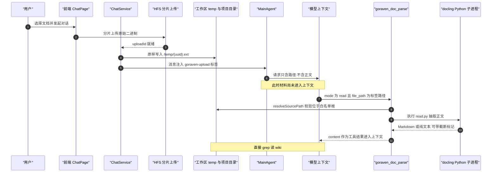
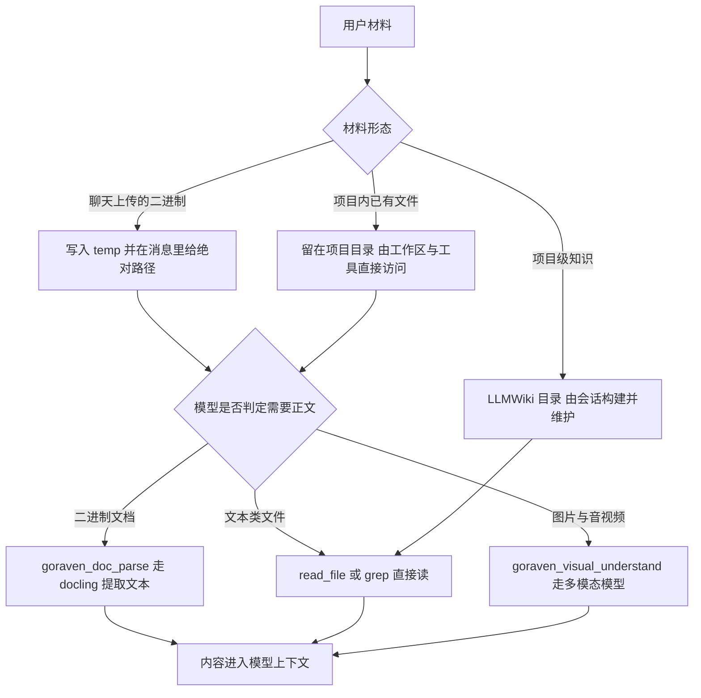

# GoRaven 知识与检索解读：没有向量 RAG 的文档管线与 LLMWiki 替代方案

> 本解读按 **ai-agent 类规格** 产出，解读基线为 GoRaven `v0.5.4`（`032c8b7`）。正文所有 `文件:行号` 引用均为 **GoRaven 仓库相对路径**，点开即可核对。

## 这个关注面在系统里干什么

`core/knowledge/` 是整个仓库里唯一以"知识"命名的 core 包，但它只做一件事：**把二进制文档（PDF/Office/HTML/CSV/LaTeX）转成文本或 Markdown**。它没有数据库、没有索引、没有检索接口，也没有任何常驻状态——一个 203 行的包，三个导出函数，全部是"输入文件路径 → 输出字符串或文件"的无状态转换。

去掉这个包，GoRaven 依然是完整的 Agent 工作台：技能系统、MCP、沙盒、团队项目、自动化任务都不依赖它。会失去的是"Agent 能读懂用户丢进来的 PDF/Word/Excel"这一条能力——也就是用户口语里"知识库"最朴素的那层含义：**让模型看得见二进制材料**。

Agent 侧的直接入口是 `goraven_doc_parse` 工具，它把 `core/knowledge` 的能力包成 eino `InvokableTool`，在 `MainAgent.NewRunner` 中注册并把团队项目目录作为额外白名单根传入（[core/agent/main_agent.go:160-169]()）。项目/工作区侧的知识组织则是纯文件系统：个人项目落在 `{userSpace}/projects/{项目名}`，团队项目落在 `{teamProjectDir}/{项目名}`，由 Agent 用 `read_file` / `grep` / `glob` 按需读取，平台不做任何预处理。
<!-- anchor: // extraWorkspace 与沙盒放行逻辑一致：团队项目目录内的文档也可解析 … main.AddTool(docTool) -->

所以本篇的核心结论先摆出来：**GoRaven v0.5.4 没有经典 RAG**——没有向量库、没有 embedding、没有 chunk 索引、没有 rerank、没有召回链路。它用"文件系统 + 结构化 Markdown 索引 + Agent 主动检索"替代了向量 RAG，而 README 关于 RAG 的宣传与实现之间存在明显距离，下文逐条给出证据。

## 根因：为什么一个 Agent 工作台会绕开向量 RAG

这个"缺省"不能只当成没做完。项目的设计立场写在 README 的设计原则里，而且异常直白：作者把"记忆与进化"整体划出项目边界，并顺手把"实时检索增强"也归入"不能泛化成通用规则"的那一类（[./README.md:147-147]()，中文版见 [./README_CN.md:168-168]()）。
<!-- anchor: We don't do "memory and evolution" — if it can't be distilled into generalizable -->
<!-- anchor: 我们不做什么“记忆与进化”——若不能转化为可泛化的规则或实时的检索增强，那只是刻舟求剑的噪音。模型的进化是模型自己的事，Agent 不该越俎代庖。 -->

这与 README 另一处的宣传**直接冲突**（下一节详述），但它是理解本关注面全部设计取舍的钥匙：GoRaven 选择让 Agent 在**确定性文件系统**上做检索，而不是在**近似向量空间**上做召回。

这个立场的工程含义有三条：

- **可观测**（对应 Observability First）：Agent 调了 `grep`、读了哪个文件、命中哪一行，全部是 SSE 事件流里可见的具体动作；而向量召回是"模型内部一次不可见的 top-k"，用户看不到它为什么取到这段。
- **可版本控制**：知识以 Markdown 存在于项目工作区，跟源码一起进 git，能 diff、能 review、能回滚；向量库是另一套需要同步的旁路状态。
- **零运行时依赖**：不需要 embedding 模型、不需要向量数据库进程、不需要 chunk 与 embedding 版本对齐——这对"一条 Docker 命令跑起来、数据不出服务器"的自部署定位是硬约束。

代价是语义召回能力，见文末「代价与不足」。

## 事实判定：没有向量库、没有 embedding、没有检索链路

先给命令级证据。以下 grep 全部在基线工作树 `v0.5.4`（commit `032c8b7`）上执行：

| 检索词 | 范围 | 命中情况 | 结论 |
|---|---|---|---|
| `embedding` | `*.go` | 0 | 无 embedding 实现 |
| `vector` | `*.go` / `*.yaml` / `*.md` | 0 | 无向量类型、无向量库依赖 |
| `rerank` | 全仓 | 2 处，均在第三方 MCP 描述文案里 | 非本项目实现 |
| `chunk` | `*.go` | 流式 `stream.Recv()` 分片 + `ChunkFile` 定义 | 该定义无调用方 |
| `retriev` | `*.go` | 仅英文注释、提示词、前端 i18n 文案 | 无检索代码 |
| 向量库 SDK | `go.mod` / `go.sum` | 0 | 无 milvus / qdrant / weaviate / pgvector / chroma 依赖 |

更值得注意的是**残留骨架**——有三处"曾经或计划要做 RAG"的痕迹，全部处于无效果状态。

第一，配置里保留着 Chroma 向量库目录类型（[config/config.go:65-65]()），并且启动时还会真的创建这个空目录（[config/config.go:150-150]()）。
<!-- anchor: ChromaDIR         string `toml:"chroma_dir" yaml:"chroma_dir"`                   -->
<!-- anchor: os.MkdirAll(result.Paths.ChromaDIR, 0755) -->
`config/config.yaml` 里也仍然是有效配置（[config/config.yaml:3-3]()）；配套还有一个 `GetChromaPath(datasetID)` 辅助函数，签名里带着 `dataset`（数据集）这个已经不复存在的概念（[config/config.go:207-209]()）。但它在整个仓库里**只有定义、没有任何调用方**：`grep -rn "GetChromaPath" --include="*.go"` 只命中定义处。一个自部署用户会看到一个永远为空的 `./data/chroma/`。
<!-- anchor: chroma_dir: "./data/chroma" -->
<!-- anchor: func (conf *Configuration) GetChromaPath(datasetID int) string { … return path -->

第二，"知识库"设置分组里只有一个 OCR 开关，而它是**完全断线的**。系统设置把它读进 `SystemConfig`（[backend/repository/system_setting.go:63-63]()），结构体里有对应字段（[backend/repository/system_config.go:22-22]()）。
<!-- anchor: KnowledgeEnableOCR:         getBool(m, "knowledge.enable_ocr", false), -->
<!-- anchor: KnowledgeEnableOCR bool // 是否启用 OCR 解析，默认 false -->
管理后台渲染出中文名"OCR 开关"和说明"是否启用 OCR 解析"（[backend/service/system_setting.go:143-145]()），种子数据里也做了落库（[backend/repository/seed/system_settings.go:47-47]()）。
<!-- anchor: {key: "knowledge.enable_ocr", valueType: po.ValueTypeBool, defaultValue: "false" … descriptionZh: "是否启用 OCR 解析", descriptionEn: "Enable OCR parsing for documents", -->
<!-- anchor: {Key: "knowledge.enable_ocr", Value: "false", ValueType: po.ValueTypeBool, Group -->
但全仓库**没有任何一处读取 `KnowledgeEnableOCR` 去做判断**，而真正决定 OCR 的这份脚本硬编码关闭（[scripts/docling/read.py:36-36]()）；另两份 `scripts/docling/convert.py` 与 `scripts/docling/chunk.py` 同样写死 `False`。管理员打开这个开关，行为零变化——这是一个**有 UI、有落库、有默认值、唯一缺的是效果**的僵尸配置项。
<!-- anchor: pipeline_opts.do_ocr = False -->

第三，`core/knowledge/docling.go` 里有一个用 docling `HybridChunker` 做分块的 `ChunkFile`，从 Go 函数到 Python 脚本都写完了，但**没有任何 Go 调用方**（[core/knowledge/docling.go:164-167]()）。`grep -rn "ChunkFile" --include="*.go"` 只命中定义本身。它连"喂给模型但不建索引"这一步都没走到——同一份包里 `ReadFile` 与 `ConvertFile` 被 `core/tools/doc_parse.go` 正常调用，只有 `ChunkFile` 悬空。
<!-- anchor: // ChunkFile 将源文档通过 docling + HybridChunker 切割为 chunks，输出到 dst（JSON Lines 格式）。 … func ChunkFile(src, dst string) error { -->

结论：**RAG 在本版本是一条被拆掉主干、只留下管道接口的路。** 真实生效的知识路径是后文的三条。

## 宣传与实现的距离（必须标注）

以下四处对外文案把"RAG 知识库"写成了已交付能力，与源码不符：

| 出处 | 原文要点 | 实现现状 |
|---|---|---|
| `./README.md` 能力区 | "Policies, docs, business materials go into RAG. Agents retrieve context in real time during execution. Answers have sources, not hallucinations." | 无 RAG 存储、无检索接口、无引用溯源机制 |
| `./README_CN.md` 能力区 | "制度、文档、业务资料进 RAG 知识库，Agent 执行时实时检索。回答有依据，不凭记忆瞎编。" | 同上；"知识库"实际指文件上传 + 工具按需读 |
| `./llms.txt` 术语表 | "**Knowledge**: Organized and indexed project, policy, or business material. Agents can retrieve relevant knowledge during execution…" | "indexed" 只在 LLMWiki 意义上成立，且需用户主动构建（[./llms.txt:16-16]()） |<!-- anchor: - **Knowledge**: Organized and indexed project, policy, or business material. Ag -->
| `./llms.txt` 目录说明 | "`core/knowledge/`: Document conversion and chunking pipeline used to prepare material for knowledge retrieval." | conversion 属实；chunking **无调用方**，未准备任何检索材料（[./llms.txt:62-62]()） |<!-- anchor: - [core/knowledge/](core/knowledge/): Document conversion and chunking pipeline  -->

英文能力区原文见 [./README.md:74-74]()，中文对应句见 [./README_CN.md:74-74]()。需要精确区分的是：**"材料进入模型上下文"这件事确实实现了**，且有完整工程链路（下一节）；**"RAG 检索"没有实现**。那句宣传里"go into RAG""retrieve""have sources"三个承诺，分别对应"上传到 temp 目录""Agent 自己调 doc_parse 读""没有任何引用回链"。这不是措辞问题，而是文档与代码的事实差。
<!-- anchor: Policies, docs, business materials go into RAG. Agents retrieve context in real  -->
<!-- anchor: 制度、文档、业务资料进 RAG 知识库，Agent 执行时实时检索。回答有依据，不凭记忆瞎编。 -->

同时必须指出项目内部的自相矛盾：`./README.md` 明确表态不做 real-time retrieval augmentation（[./README.md:147-147]()，中文版 [./README_CN.md:168-168]()）。也就是说同一份 README 的**能力宣传区**在推销实时检索增强，**设计原则区**在否定它。以源码为准，实现站在设计原则一侧。
<!-- anchor: We don't do "memory and evolution" — if it can't be distilled into generalizable -->
<!-- anchor: 我们不做什么“记忆与进化”——若不能转化为可泛化的规则或实时的检索增强，那只是刻舟求剑的噪音。模型的进化是模型自己的事，Agent 不该越俎代庖。 -->

## 文档转换管线：本地 Python 子进程，不是外部 docling 服务

一个常见误读是把 "docling" 当成一个 HTTP 服务。事实是：**它是本机拉起的一次性 Python 子进程**。Go 侧通过 `exec.CommandContext` 执行 `scripts/docling/*.py`，靠 stdout 取回内容。

脚本路径来自配置的 `paths.scripts`（本地默认 `./scripts`，Docker 镜像里是 `/goraven/scripts`），不是任何服务地址或 system_setting（[core/knowledge/docling.go:46-47]()）。解释器优先 `python3`、回退 `python`，找不到时按系统语言返回本地化错误（[core/knowledge/docling.go:32-42]()）。
<!-- anchor: func doclingScript(name string) (string, error) { … abs, err := filepath.Abs(filepath.Join(config.Get().GetScriptsDir(), "docling",  -->
<!-- anchor: func findPython() (string, error) { … return "", errors.New("python3/python not found, please install Python and retry -->
超时给到 **10 分钟**，注释说明了原因——docling 首次调用要加载模型（[core/knowledge/docling.go:17-18]()）。
<!-- anchor: // doclingTimeout docling 首次调用需加载模型，给足超时时间 … const doclingTimeout = 10 * time.Minute -->

失败处理是这个模块做得最细的部分，分三条路径：上下文取消/超时会杀掉子进程并报 `docling script interrupted`；stderr 含 `ModuleNotFoundError` 时转成**带安装命令的可操作错误**；其余情况回传 stderr 原文。注意"先判超时、再判脚本自身失败"的顺序不能反（[core/knowledge/docling.go:108-119]()）。
<!-- anchor: if err := cmd.Run(); err != nil { … return "", fmt.Errorf("docling script failed: %s", stderrText) -->
依赖缺失的错误文案把 `scripts/docling/requirements.txt` 的绝对路径直接写进提示（[core/knowledge/docling.go:80-86]()），让 Agent 可以原样转告用户执行，技能文档也把这条固化成规则（[backend/repository/seed/skill_goraven_doc_parse.go:69-69]()）。
<!-- anchor-base64:ZnVuYyBkb2NsaW5nRGVwc0Vycm9yKHN0ZGVyclRleHQgc3RyaW5nKSBlcnJvciB7IOKApiByZXR1cm4gZm10LkVycm9yZigiZG9jbGluZyBpcyBub3QgaW5zdGFsbGVkLiBSdW46IHV2IHBpcCBpbnN0YWxsIC0tbm8tY2FjaGUgLXIgJQ== -->
<!-- anchor: - 若工具报错缺少 docling 依赖，把错误信息中的安装命令转告用户执行 -->

**支持格式**由 Python 侧的 `allowed_formats` 白名单决定，Go 不做校验：PDF、DOCX、PPTX、XLSX、HTML、MD、ASCIIDOC、CSV、LaTeX，另加 JSON_DOCLING / XML_JATS / XML_USPTO / XML_XBRL / METS_GBS / IMAGE（[scripts/docling/read.py:43-59]()）。对 Agent 暴露的口径则收窄为可用子集，并明确排除图片与扫描件 PDF（[backend/repository/seed/skill_goraven_doc_parse.go:17-24]()）。
<!-- anchor: allowed = [ … InputFormat.IMAGE, -->
<!-- anchor: - PDF（仅含文字层的，扫描件/图片 PDF 无法处理） … - 扫描件 PDF（无文字层） -->

PDF 解析管线固定开启表格结构识别（TableFormer ACCURATE + cell matching），但 **OCR 恒关**（[scripts/docling/read.py:28-41]()）。这解释了"扫描件不支持"不是能力缺失而是**主动关掉的**：docling 本身能 OCR，项目选择不开，也没有把前面提到的 `knowledge.enable_ocr` 接进来。
<!-- anchor: from docling.datamodel.base_models import InputFormat … mode=TableFormerMode.ACCURATE, -->

**读取侧的两个降级设计**（[scripts/docling/read.py:102-117]()）：
<!-- anchor: # Page filtering (only meaningful for markdown with page markers) … content = "\n".join(filtered) -->

- **页码过滤**对 Markdown 文本做行扫描，靠 docling 输出的 `<!-- Page N -->` 注释切换当前页号，只保留目标页的行。这条路依赖 docling 是否真的输出页标记——页标记一旦消失，`pages` 参数会静默变成"不过滤"而不是报错。
- **截断**在超限时直接切前 N 字符并追加 `... [truncated, total N chars]`（[scripts/docling/read.py:120-120]()），Go 侧用字符串包含判断截断，把这个标记当成了一个**跨语言的隐式协议**。
<!-- anchor: content = content[:max_chars] + f"\n\n... [truncated, total {len(content)} chars -->

**不可用时如何降级**：没有降级——错误直接冒泡到 Agent，由 Agent 依据技能规则转告用户，用户装完依赖再重试。这个选择与"OS First"的定位自洽：运行时依赖被认为属于宿主环境的责任，平台不内置兜底解析路径。代价是首次使用门槛（要装 Python + docling 及其依赖）。

## 分块策略：算法写完了，但从未被执行

如果只读 `scripts/docling/chunk.py`，会得到一份相当讲究的分块规格；但如前所述，它没有任何调用方。

分块器用 docling 的 `HybridChunker`，默认参数、未指定 tokenizer 或 max_tokens（[scripts/docling/chunk.py:63-64]()）。元数据组装是**结构化**的：标题层级用 ` > ` 拼成路径串（`H1 > H2 > H3`），页码取该 chunk 内所有 doc item 的 `min(page_no)`，块类型取标签去重排序，`chunk_index` 从 1 递增，输出为 JSON Lines（[scripts/docling/chunk.py:69-92]()）。`HybridChunker` 本身是 tokenizer 感知的：按文档结构（标题、段落、表格）边界优先切分，必要时合并相邻块，语义上远好于固定窗口字符切分。
<!-- anchor: chunker = HybridChunker() … chunks = list(chunker.chunk(result.document)) -->
<!-- anchor: heading = "" … "chunk_index": idx + 1, -->

**但它的状态是：`ChunkFile` 无调用方、`scripts/docling/chunk.py` 无调用方、没有 `.jsonl` 落盘路径、没有 embedding、没有写入任何索引。** 而且 `goraven_doc_parse` 工具**刻意不暴露 chunk 模式**——`mode` 只允许 `read` / `convert`，测试里把 `chunk` 当作非法值断言（[core/tools/doc_parse_test.go:81-81]()，该用例 `wantErr: true` 表示必须被拒绝）。
<!-- anchor: req:     DocParseRequest{Mode: "chunk", FilePath: "/temp/a.pdf"}, -->

所以对"分块策略"的准确回答是：**存在一份实现完备、元数据设计合理的分块规格，处于死代码状态；当前版本的 chunk 既不建索引，也不喂模型。** 这是本关注面最明确的"未完成"信号，也直接反驳了 `./llms.txt` 对 `core/knowledge/` 的"chunking pipeline used to prepare material for knowledge retrieval"描述。

## "知识进入循环"的真实路径

README 说 "Agents retrieve context in real time during execution"，源码里兑现成了**三条互不依赖的路径**，全部以"文件系统 + Agent 主动调用工具"为底座。

### 路径一：聊天附件 → 沙盒临时目录 → doc_parse 现场解析

附件在 Agent 运行前被**原样**写入工作区 `temp/` 目录，消息里只带一个绝对路径标签，不带正文。落盘目标路径是 `/temp/{uuid}{ext}`，标签里带上文件大小（[backend/service/chat.go:677-715]()）。
<!-- anchor: dstRelPath := "/temp/" + util.UUID() + strings.ToLower(filepath.Ext(upload.FileN … "\n<goraven-upload size=\"%s\">\n  %s\n</goraven-upload>", -->
平台自描述技能把这个约定讲得很清楚（[backend/repository/seed/skill_goraven_features.go:50-50]()），Base prompt 也给了 Agent 行为规则：文档类二进制**禁止**用文件读取工具直接读，必须走 doc-parse 技能（[core/agent/prompt_base_agent.go:124-137]()）。
<!-- anchor: 用户在聊天中上传的附件，系统在对话开始前原样存入 <根路径>/temp/ 目录，路径通过 <goraven-upload> 标签出现在消息内容中（该标签由系统生 -->
<!-- anchor: 用户发送的附件会以 <goraven-upload> 标签形式出现在消息中，通过 @ 选择的文件或目录会以 <goraven-ref> 标签形式出现。 … - 文本类文件（txt/md/代码/HTML/CSV等）可以直接用文件读取工具读取内容 -->

于是"知识进入上下文"的触发点是**模型自己决定调用工具**，而不是平台在组装 prompt 时自动注入正文。

### 路径二：LLMWiki 结构化索引 → Base prompt 强制先读 quickstart

这是 GoRaven 对 RAG 的**正面替代方案**。Base prompt 里有一段硬规则：处理任何项目任务时先检查 `llmwiki/quickstart.md`，wiki 能回答的问题不再遍历源码，且在非写入模式下禁止修改 wiki（[core/agent/prompt_base_agent.go:73-79]()）。写入权限用一个很轻的开关控制：只有当**用户消息文本里包含 `goraven-llmwiki`** 时才放开只读限制（[backend/service/chat.go:185-185]()）。
<!-- anchor: - 项目目录下可能存在 llmwiki/ 子目录，内含该项目的结构化知识文档 … b.WriteString("- 不要修改 llmwiki/ 中的任何文件\n") -->
<!-- anchor: WikiWriteMode:       strings.Contains(req.Content, "goraven-llmwiki"), -->

前端那个 "Wiki" 按钮做的就是往输入框塞一句预填文本，用户确认后发出（[frontend/src/i18n/locales/zh.ts:215-215]()）——它触发的是 skill 流程，不是平台侧的索引任务。也就是说，**这里根本没有"索引服务"**：所谓"构建索引"是一次普通会话，Agent 读文件、写 Markdown，产物是工作区里的一个目录。
<!-- anchor: 'chat.buildWikiIndexPrefill': '为当前项目重建 LLMWiki 索引库，请先阅读 goraven-llmwiki 技能', -->

### 路径三：项目/工作区文件 → 内置 grep/glob/read_file 按需检索

项目和团队项目的物理目录被登记进沙盒与工具链：个人项目目录由 `validateProject` 解析并校验归属（[backend/service/my_project.go:80-92]()）。
<!-- anchor: func (service *MyProjectService) validateProject(userId string, id int) (*po.Use … projectDir := service.projectDir(userSpace, project.ProjectName) -->
团队项目目录由 `getProjectDir` 拼接（[backend/service/team_project.go:266-267]()），个人项目还会被额外设为沙盒的额外工作区根（[core/agent/main_agent.go:42-43]()）。
<!-- anchor: func getProjectDir(projectName string) string { … return filepath.Join(config.Get().GetTeamProjectDir(), projectName) -->
<!-- anchor: if param.ProjectWorkspace != "" && param.Project != "" { … box.SetExtraWorkspace(filepath.Join(param.ProjectWorkspace, param.Project)) -->

`read_file` / `glob` / `grep` 是一等公民工具（[core/agent/sse.go:217-276]() 定义了它们的中英文展示文案与图标，说明是产品级可见动作）。子 agent 的使用指引把"cross-file search and locating, document/code/log retrieval and synthesis"列为典型场景（[core/agent/prompt.go:130-130]()）——**这就是 GoRaven 语境下的"实时检索"：由 Agent 在确定性文件系统上执行关键词检索与定位，而非向量近似召回。**
<!-- anchor: "read_file": { … ActionZh: "正在搜索内容", -->
<!-- anchor: - Typical scenarios: cross-file search and locating, document/code/log retrieval -->

### 跨模块时序：从用户选定材料到内容进入模型上下文

图注：关键分界在"路径进入消息"与"正文进入上下文"之间——平台只保证前者，后者由模型主动调用工具完成（[backend/service/chat.go:677-715]()、[core/tools/doc_parse.go:226-249]()）。
<!-- anchor: dstRelPath := "/temp/" + util.UUID() + strings.ToLower(filepath.Ext(upload.FileN … "\n<goraven-upload size=\"%s\">\n  %s\n</goraven-upload>", -->
<!-- anchor: func (d *DocParse) Invoke(ctx context.Context, req *DocParseRequest) (*DocParseR … Truncated: strings.Contains(content, docParseTruncatedMarker), -->
图注续：项目场景下模型也会直接读 wiki，入口规则见 [core/agent/prompt_base_agent.go:73-79]()。
<!-- anchor: - 项目目录下可能存在 llmwiki/ 子目录，内含该项目的结构化知识文档 … b.WriteString("- 不要修改 llmwiki/ 中的任何文件\n") -->

三条路径的关系可以概括为一张分支图：

图注：GoRaven 没有"入库"这一步，只有"留在文件系统 + 按需读取"；LLMWiki 位置特殊——它是被刻意组织过的知识形态，但依然通过 `read_file` / `grep` 消费（[core/agent/prompt_base_agent.go:73-79]()）。
<!-- anchor: - 项目目录下可能存在 llmwiki/ 子目录，内含该项目的结构化知识文档 … b.WriteString("- 不要修改 llmwiki/ 中的任何文件\n") -->

## LLMWiki：作者用"运维一个结构化索引"替代向量检索

`backend/repository/seed/skill_goraven_llmwiki.go` 是本关注面最有价值的设计文本——435 行、中英双语、被 `backend/repository/seed.go` 作为系统技能播种（[backend/repository/seed.go:264-267]()）。它不是"怎么用知识库"的说明，而是一套**由 Agent 执行的文档工程规范**。
<!-- anchor: Name:        "goraven-llmwiki", … Version:     config.Version, -->

### 它定义的索引规则

**目录约定**：索引固定落在项目工作区的 `llmwiki/` 目录，唯一强制入口是 `quickstart.md`，定位为"任务路由图"而非知识载体；并要求页面必须**面向检索与问答**写作（[backend/repository/seed/skill_goraven_llmwiki.go:10-19]()）。这个"入口页 + 领域页"的两级结构本质上是在模拟**倒排索引的导航层**：`quickstart.md` 承担"把问题映射到领域页"，领域页承担内容。它同时约束信息架构必须围绕领域而非源码目录，并要求拒绝碎片化、禁止存根页（[backend/repository/seed/skill_goraven_llmwiki.go:83-89]()）。
<!-- anchor: 你是 LLMWiki——资深技术文档作者、软件架构师与产品分析专家。任务：阅读项目证据，在项目工作区的 ` + "`llmwiki/`" + ` 目录下生成与维 … - **导航即价值**：` + "`quickstart.md`" + ` 是入口导航（任务路由图），领域页才是知识载体；不要把全部内容塞进 quickstar -->
<!-- anchor: - 覆盖充足时才建层级目录；目录命名用项目自身领域术语，可参考这些惯用语义域：` + "`architecture/`" + `（总体与子系统）、` + "`c … - 不设页面数量上限，但**必须完整**：任何真实领域、独立组件、工作流都不得因篇幅被静默丢弃。一次运行写不完的，记入 ` + "`quickstart.md` -->

**Frontmatter 即检索元数据**：每个页面必须以 YAML frontmatter 开头，`type` 必填，`description` 被显式指定为检索的主抓手，`tags` 保持英文以保证跨语言稳定（[backend/repository/seed/skill_goraven_llmwiki.go:113-128]()）。注意这套设计与本项目自己的解读规范（frontmatter 服务于知识库检索）几乎同构——"description 面向检索优化"是一条跨项目的通用经验。
<!-- anchor: 每个生成的 Markdown 页面必须以 YAML Front Matter 开头： … - 语言：正文与 type/title/description 使用对话语言；代码标识符、文件路径、命令、URL 原样保留，不做翻译。 -->

**链接是带语义的关系边**：页面之间不是松散 wiki 链接，而是**有方向、有语义标签的关系边**，允许 `dispatches to` / `depends on` / `is configured through` 等语义，并要求和证据支撑下每个实质概念至少连到两个其他概念（[backend/repository/seed/skill_goraven_llmwiki.go:132-135]()）。这等于把知识图谱的边**写进自然语言句子**——不需要图数据库，`grep` 就能把关系捞出来。
<!-- anchor: - 每个概念页是一个节点；页面间的 Markdown 链接是**有方向的关系边**，放在解释该关系的句子里并写明语义（如 ` + "`dispatches to … - 有证据支撑时每个实质概念应连到**至少 2 个其他概念**；孤立页要么补上关系、并入更宽泛概念，要么说明它为何真正独立。 -->

**文档 md 化（Doc Twins）**：PDF/PPTX/DOCX/XLSX 是重要知识源但不可检索，于是要求为实质文档生成**同目录同名 `.md` twin**（[backend/repository/seed/skill_goraven_llmwiki.go:43-77]()）。保鲜规则值得单独看，因为它是**用 mtime 比较实现"增量索引"**：twin 无标记则新建；有 `generated_by: goraven-doc-convert` 标记且早于源文件则重转；有标记且不早于源文件则视为最新；**无标记（用户手写同名文档）则永不覆盖**。四条规则用文件系统时间戳和一行 frontmatter 换掉了一整个"文档版本追踪服务"，且安全边界清晰。
<!-- anchor: 项目目录中常存放业务文档（PDF/PPTX/DOCX/XLSX）。它们是 wiki 与日常问答的重要知识源，但二进制无法直接读取与检索。init/update  … - wiki 与 Backlog 中指向文档的链接一律用 twin（.md）而非原始二进制，保证 Agent 可直接读取验证。 -->

**增量更新纪律**：更新被要求是外科手术式的——只改因变更而不准确的页面，并显式给出"软差异预算"（少于约 5 个源文件变更时最多改 1-2 页）和"允许 no-op"（[backend/repository/seed/skill_goraven_llmwiki.go:162-174]()）。同时用 `.last-update.json` 记录 `commit`（`git rev-parse HEAD`）、`pages` 清单与时间，作为下次增量更新的起点；非 git 项目强制留空并说明依据局限（[backend/repository/seed/skill_goraven_llmwiki.go:152-159]()）。
<!-- anchor: ## 增量更新（update） … - 更新可以是 no-op：没有相关变化且 wiki 已准确时，明确说明 wiki 已是最新并结束，不编辑任何文件。 -->
<!-- anchor: 7. 写 ` + "`llmwiki/.last-update.json`" + `： … "pages": ["quickstart.md", "architecture/overview.md"] -->

**证据纪律（反幻觉）**：这是与向量 RAG 差异最大的一条——要求每条重要论断标注可验证来源，并要求"Materiality 测试"（若断言为假是否改变读者决策，否则删掉），写入时内联标注相对路径、可带行号（[backend/repository/seed/skill_goraven_llmwiki.go:16-19]()、[backend/repository/seed/skill_goraven_llmwiki.go:103-103]()）。**这等于把 RAG 的 citation 要求前移到了知识生产阶段**：不是检索时补引用，而是要求知识在写入时就带引用。
<!-- anchor: - **证据支撑**：每条重要论断必须有依据（源码、测试、git 历史、已有文档），并在文中标注来源。不得凭空捏造文件、模块、API、业务规则。 … - **导航即价值**：` + "`quickstart.md`" + ` 是入口导航（任务路由图），领域页才是知识载体；不要把全部内容塞进 quickstar -->
<!-- anchor: - 支撑这些论断的关键源文件（内联标注相对路径，可带行号，如 ` + "`backend/controller/chat.go:42`" + `） -->

### 为什么"运维索引"可能比"向量检索"更适合某些团队

先把话说完整：这不是普遍更优，而是**在特定约束下更优**。GoRaven 的约束是"私有化自部署 + 团队规模中小 + 要求可解释 + 不接受额外基础设施"。在这个象限里，LLMWiki 有几处向量 RAG 很难追平：

- **零推理期成本、零 embedding 依赖**：向量 RAG 每次写入要调 embedding、每次查询也要调，模型换代就要重新 embedding 全量语料；LLMWiki 的构建与消费都是普通文本读写，不需要第二套模型生命周期。
- **可审计的召回**：向量召回的 top-k 是一串相似度分数，用户无法回答"为什么这段被选进来"。LLMWiki 的召回是 `grep` 命中行 + `read_file` 读取内容，每一步都在 SSE 事件流里可见——正好落在项目"Observability First"的哲学上。
- **知识可评审**：wiki 页面能像代码一样被 review、diff、回滚，错误知识能定位到具体哪一句；embedding 无法评审，只能整块替换。
- **增量成本可控**："软差异预算"和"允许 no-op"直接约束更新开销；向量索引则需要 chunk 去重、重嵌入、删除同步等一整套一致性问题。
- **知识生产被强约束质量**：Materiality 测试 + 来源标注 + 概念关系建模，把"写知识"变成有门槛的工作，而不是把一堆原始文档倒进库里期待检索救场。

反过来说，向量 RAG 在**语料远超 Agent 上下文预算、且提问方式以模糊语义为主**时不可替代——这正是 LLMWiki 的能力边界。

### LLMWiki 与向量 RAG 的对比

| 维度 | 经典向量 RAG | GoRaven LLMWiki（本项目实际选择） |
|---|---|---|
| 存储实体 | 向量库 / 索引文件（本项目里只剩 `chroma_dir` 空目录） | 项目工作区 `llmwiki/` 下的 Markdown 文件 |
| 切分单位 | 固定或语义 chunk，带 embedding | 领域页 + `quickstart.md` 导航，无 chunk |
| 召回机制 | 相似度 top-k（近似、不可解释） | 模型主动 `grep` + `read_file`（确定性、逐步可见） |
| 语义泛化 | 强，能命中同义改写 | 弱，依赖文档关键词与模型改写检索词的能力 |
| 引用溯源 | 检索时附带 chunk 来源 | 知识在**生产时**就要求内联标源 |
| 构建成本 | 每条语料一次 embedding，模型换代需重嵌 | 一次会话生成或更新，可用 `git` diff 复用 |
| 增量同步 | chunk 去重、删除同步、重嵌入一致性 | mtime 比较 + 标记 frontmatter 四规则 |
| 版本控制 | 向量库通常不随源码进 git | 天然进 git，可 review、可回滚 |
| 基础设施 | 向量库进程或 SDK、embedding 模型 | 无（仅需 Python + docling 做文档转换） |
| 失效模式 | 静默召回偏差，难定位 | 漏召回（关键词不匹配），但失败可见 |
| 适用规模 | 大语料、模糊提问为主 | 中小项目、领域边界清晰、要求可解释 |

## doc_parse 工具：Agent 侧的统一文档入口

工具在 `MainAgent.NewRunner` 中注册并把团队项目目录作为额外白名单根传进去（[core/agent/main_agent.go:160-169]()）；子 agent 通过 `toolList` 复制自动继承（注释明确写了这一点，见 [core/agent/main_agent.go:159-159]()）。
<!-- anchor: // extraWorkspace 与沙盒放行逻辑一致：团队项目目录内的文档也可解析 … main.AddTool(docTool) -->
<!-- anchor: // 文档解析工具：读取/转换 PDF、DOCX 等格式（子 agent 通过 toolList 复制自动获得） -->

**入参设计**（[core/tools/doc_parse.go:29-36]()）刻意保持极简，并把约束交给 jsonschema：`mode` 用 `enum` 限定为 `read` / `convert`，`format` 用 `enum` 限定为 `markdown` / `text`，`file_path` 的描述里直接教模型"聊天附件用 `<goraven-upload>` 标签里的路径"，`pages` 只对 PDF 有效（[core/tools/doc_parse.go:30-35]()）。
<!-- anchor: type DocParseRequest struct { … Pages      string `json:"pages" jsonschema:"description=read mode only: page fil -->
<!-- anchor: Mode       string `json:"mode" jsonschema:"description=Operation mode: read extr … Pages      string `json:"pages" jsonschema:"description=read mode only: page fil -->

**返回什么**：`read` 把提取出的文本直接作为工具结果返回（`content` + `truncated` 标志），**不返回图片**；`convert` 返回落盘的 `.md` 路径，正文不进上下文（[core/tools/doc_parse.go:39-43]()）。这是两种上下文经济学的分工——小材料直读，大材料转成文件后按需再读。
<!-- anchor: type DocParseResponse struct { … OutputPath string `json:"output_path,omitempty" jsonschema:"description=convert  -->

**大文件处理**靠三层控制：`max_chars` 默认 50000（非法值回退默认）；`pages` 做 PDF 页码过滤；`truncated` 只做**字符串探测**，用的是与 Python 侧约定的标记常量（[core/tools/doc_parse.go:238-249]()）。技能层给 Agent 的续读策略是"用 pages 分页或增大 max_chars 后续读取"（[backend/repository/seed/skill_goraven_doc_parse.go:48-48]()）——**没有自动分页循环**，续读靠模型自己规划。
<!-- anchor: if req.Mode == DocParseModeRead { … Truncated: strings.Contains(content, docParseTruncatedMarker), -->
<!-- anchor: 返回 content 为文档文本；truncated 为 true 表示内容被截断，可用 pages 分页或增大 max_chars 后续读取。 -->

**路径安全**：`convert` 模式先把产物落到系统临时目录再拷到目标路径，并做绝对路径、`.md` 后缀、与源文件不同三重校验（[core/tools/doc_parse.go:94-117]()）。读取侧用 `withinRoot` 白名单前缀比对，只放行工作区与团队项目目录，并有"按根拼接"的兼容回退（[core/tools/doc_parse.go:151-181]()）。这是**防目录穿越的关键实现**，但它比较的是 `filepath.Clean` 之后的字符串前缀，**没有解析符号链接**——工作区内若有指向外部的 symlink，前缀检查仍会通过。这是一个值得记录的安全边界细节。
<!-- anchor: // convert 模式校验 … return &normalized, nil -->
<!-- anchor: func withinRoot(path, root string) (string, bool) { … return "", fmt.Errorf("file not found: %s", path) -->

**与 `core/tools/visual.go` 的配合**：两者是**并列而非串联**关系，共用同一套"从 `<goraven-upload>` 标签取绝对路径"的约定。`goraven_visual_understand` 负责图片/视频/音频（按扩展名分派到 `UserInputMultiContent`，图片还会先压缩再 base64），`goraven_doc_parse` 负责文档文本（[core/tools/visual.go:170-190]()）。**没有"解析后自动画图"的链路**——图表要么由 Agent 输出 `<goraven-chart>` 标签交前端渲染，要么走视觉工具做理解。两者分派依据都是文件扩展名，因此**扫描件 PDF 会落到 doc_parse 并失败**，不会被自动转交给视觉模型：这是一个真实的能力断层（图片 PDF 走 doc_parse 报错，而视觉工具并不接受 `.pdf` 扩展名）。
<!-- anchor: func (v *VisualUnderstand) Invoke(ctx context.Context, req *VisualUnderstandRequ … return nil, fmt.Errorf("unsupported file type: %s", ext) -->

## 亮点与不足

### 亮点

- **失败语义做得扎实**：超时与脚本失败分路、`ModuleNotFoundError` 专门识别并附可执行安装命令、stderr 原文回传（[core/knowledge/docling.go:108-119]()、[core/knowledge/docling.go:80-86]()）。把"Python 依赖缺失"这类最容易变成无解报错的场景，转成了 Agent 可直接转述给用户的可操作信息——这是"OS First"落到错误处理上的具体样子。
<!-- anchor: if err := cmd.Run(); err != nil { … return "", fmt.Errorf("docling script failed: %s", stderrText) -->
<!-- anchor-base64:ZnVuYyBkb2NsaW5nRGVwc0Vycm9yKHN0ZGVyclRleHQgc3RyaW5nKSBlcnJvciB7IOKApiByZXR1cm4gZm10LkVycm9yZigiZG9jbGluZyBpcyBub3QgaW5zdGFsbGVkLiBSdW46IHV2IHBpcCBpbnN0YWxsIC0tbm8tY2FjaGUgLXIgJQ== -->
- **LLMWiki 的方法论密度远高于一个技能应有的水准**：Materiality 测试、软差异预算、允许 no-op、doc twin 保鲜四规则、概念关系边语义化，都是可被别的项目直接借鉴的规则集（[backend/repository/seed/skill_goraven_llmwiki.go:10-19]()、[backend/repository/seed/skill_goraven_llmwiki.go:162-174]()）。
<!-- anchor: 你是 LLMWiki——资深技术文档作者、软件架构师与产品分析专家。任务：阅读项目证据，在项目工作区的 ` + "`llmwiki/`" + ` 目录下生成与维 … - **导航即价值**：` + "`quickstart.md`" + ` 是入口导航（任务路由图），领域页才是知识载体；不要把全部内容塞进 quickstar -->
<!-- anchor: ## 增量更新（update） … - 更新可以是 no-op：没有相关变化且 wiki 已准确时，明确说明 wiki 已是最新并结束，不编辑任何文件。 -->
- **把 citation 前移到知识生产阶段**：要求 wiki 页面在写入时就内联标源，比"检索后补引用"更能压住幻觉，因为错误在写的时候就暴露了（[backend/repository/seed/skill_goraven_llmwiki.go:16-19]()）。
<!-- anchor: - **证据支撑**：每条重要论断必须有依据（源码、测试、git 历史、已有文档），并在文中标注来源。不得凭空捏造文件、模块、API、业务规则。 … - **导航即价值**：` + "`quickstart.md`" + ` 是入口导航（任务路由图），领域页才是知识载体；不要把全部内容塞进 quickstar -->
- **附件与解析解耦**：附件原样落盘 + 消息只带路径，让平台不必理解文档格式，解析完全交给 Agent 决策。这个分层使 `ChatService` 不需要任何文档知识（[backend/service/chat.go:677-715]()）。
<!-- anchor: dstRelPath := "/temp/" + util.UUID() + strings.ToLower(filepath.Ext(upload.FileN … "\n<goraven-upload size=\"%s\">\n  %s\n</goraven-upload>", -->

### 不足（均带证据）

- **对外文档与实现不符，且内部自相矛盾**：能力区宣传 RAG 实时检索（[./README.md:74-74]()），`./llms.txt` 把 `core/knowledge/` 描述为"用于准备知识检索材料的 chunking pipeline"（[./llms.txt:62-62]()）。
<!-- anchor: Policies, docs, business materials go into RAG. Agents retrieve context in real  -->
<!-- anchor: - [core/knowledge/](core/knowledge/): Document conversion and chunking pipeline  -->
同一份 README 的设计原则区又声明不做 real-time retrieval augmentation（[./README.md:147-147]()），而 `ChunkFile` 无调用方。**用户按宣传去 `data/chroma/` 找向量数据只会找到空目录。**
<!-- anchor: We don't do "memory and evolution" — if it can't be distilled into generalizable -->
- **僵尸配置有实际运维成本**：`knowledge.enable_ocr` 有 UI、有落库、有默认值，但从未被读取，三份 Python 脚本硬编码 `do_ocr = False`（[scripts/docling/read.py:36-36]()）。管理员会据此认为扫描件可用，实际不生效且无提示。
<!-- anchor: pipeline_opts.do_ocr = False -->
- **无语义召回**：LLMWiki 的召回完全依赖关键词命中。用户用与文档不同的措辞提问（同义词、上位概念、跨文档综合）时 `grep` 会漏；`quickstart.md` 的导航质量直接决定召回上限——**知识组织质量变成了召回率的天花板**，而向量 RAG 至少能用语义相似兜底。
- **`pages` 参数脆弱**：页码过滤依赖 docling 输出的 `<!-- Page N -->` 注释做行扫描（[scripts/docling/read.py:102-117]()），注释格式一变就**静默退化为不过滤**，可能导致模型以为读到的是某几页却拿到了全文。
<!-- anchor: # Page filtering (only meaningful for markdown with page markers) … content = "\n".join(filtered) -->
- **截断标记是跨语言字符串协议**：Go 用 `strings.Contains` 匹配 Python 侧生成的字面量来判断截断（[core/tools/doc_parse.go:249-249]()、[scripts/docling/read.py:120-120]()）。任何一侧措辞调整都会静默失效（`truncated` 永远为 false），且无测试覆盖这个跨语言契约——`core/knowledge/docling_test.go` 只测参数拼装，`core/tools/doc_parse_test.go` 只测参数校验。
<!-- anchor: Truncated: strings.Contains(content, docParseTruncatedMarker), -->
<!-- anchor: content = content[:max_chars] + f"\n\n... [truncated, total {len(content)} chars -->
- **无引用回链**：聊天层没有把"这段回答来自哪个文件、哪一页"回传给用户的机制。`doc_parse` 的返回里没有来源元数据（[core/tools/doc_parse.go:39-43]()），前端也没有 citation 组件。README 那句 "Answers have sources" 在**代码里没有对应实现**。
<!-- anchor: type DocParseResponse struct { … OutputPath string `json:"output_path,omitempty" jsonschema:"description=convert  -->
- **`ChunkFile` 与 `scripts/docling/chunk.py` 是纯维护负担**：一套设计良好但无调用方、无测试、且已被对外文档错误描述为生效能力的分块实现。要么接上索引、要么删除，当前状态同时承担两边成本。
- **文档解析的激活门槛藏在技能里**：docling 的依赖安装指引只出现在运行时报错与技能文本里，README 与 `./llms.txt` 完全没提"要装 Python + docling"；README 只说 Docker 镜像捆绑了完整运行时（[./README.md:168-168]()）。从源码构建的用户会在第一次解析文档时才发现缺依赖。
<!-- anchor: For non-development needs, use the Docker image instead — it bundles the full ru -->

> **验证状态**：本篇 83 条 `文件:行号` 引用全部由 `verify-references.mjs` 与仓库真实源码逐条双向校验通过（OK=83 / WEAK=0 / MISMATCH=0 / UNVERIFIED=0），2 幅 Mermaid 图均通过 `check-mermaid.mjs` 的语法与渲染检查（ERROR=0 / WARN=0）。
