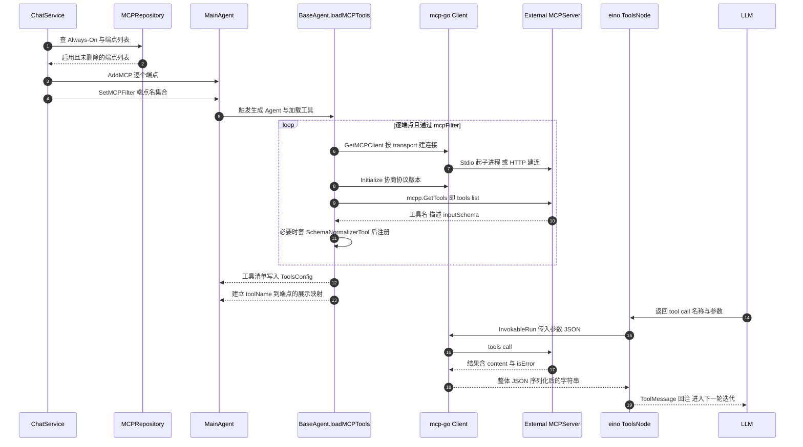
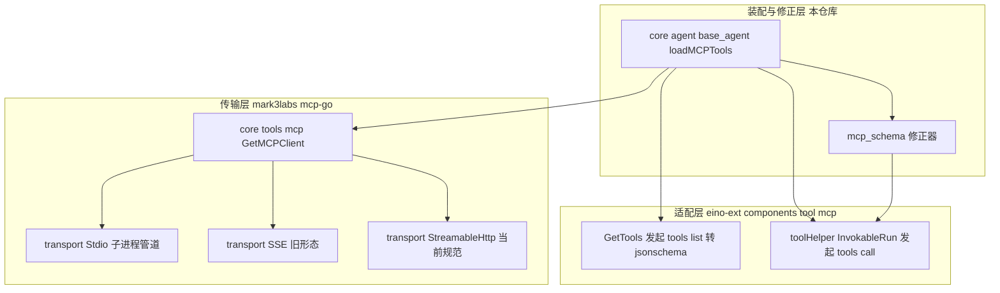

# GoRaven MCP 接入解读：三种 transport、schema 映射、stdio 进程治理与安全边界

> 本解读按 **ai-agent 类规格** 产出，解读基线为 GoRaven `v0.5.4`（`032c8b7`）。正文所有 `文件:行号` 引用均为 **GoRaven 仓库相对路径**，点开即可核对。

## 这个模块在系统里干什么

GoRaven 的自我定位是 **Agent OS**：模型有知识、没手脚，而"手脚"必须是可插拔的。MCP 就是这套可插拔机制的唯一对外入口——**GoRaven 在 MCP 协议里只做 client，从不做 server**：它消费外部 MCP server 暴露的工具，把它们塞进模型的工具清单，然后代表模型去调用。

去掉这一层，GoRaven 的工具能力就被锁死在编译期：写文件、跑 Shell、几个内置工具，以及需要走 Skill 机制的脚本。MCP 让它能在不改 GoRaven 一行代码、不重启服务的前提下，把 GitHub、Postgres、Puppeteer、Firecrawl、各种搜索与图像服务接进同一个会话。

按关注面归属，这一层由三个断面组成：

| 断面 | 承担 | 代表文件 |
| --- | --- | --- |
| 装配面 | 把"哪些 MCP、哪些工具"算出来并注入 Agent | `backend/service/chat.go`、`core/agent/base_agent.go` |
| 传输面 | 三种 transport 的建连与协议握手 | `core/tools/mcp.go`、`core/sandbox/local/local.go` |
| 治理面 | 管理员 CRUD、健康巡检、名称冲突、schema 修正 | `backend/service/mcp.go`、`core/tools/mcp_schema.go` |

## 根因：模型有知识没手脚，但"手脚"不该只有一套

README 把 **OS First** 列为三条设计哲学之一：运行时与依赖集成是第一优先级。MCP 是这句话最直接的兑现，也是最容易被过度简化的一层。

真正的问题不是"能不能调外部工具"——那用一个 HTTP 工具就够了。真正的问题是：**外部能力的数量、形态、生命周期都不可预知**。管理员今天接三个 server，明天接十个；有的是本地 npx 子进程，有的是云上的 SSE 端点；有的 server 返回文本，有的返回图片；有的 server 的 schema 是标准的，有的写了 `"type":"bool"` 这种非标准类型。

GoRaven 的选择是：**把"能力"当配置数据管，把"协议细节"下沉到库，把"库修不了的不规范"在本地做一层最小适配**。这个三分法决定了后面所有设计，也决定了所有缺陷的位置。值得注意的是它**没有**选择"为每个 MCP server 起一个常驻连接池"或"把 MCP 工具抽象成插件"这类更重的方案——代价分析放在最后一节。

## 角色与 transport：三选一，但只覆盖两种协议族

支持的 transport 就是三个常量：`Stdio`、`SSE`、`StreamableHttp`。[core/tools/mcp.go:20-22]()
<!-- anchor: MCPTransportStdio = "Stdio" … MCPTransportHTTP  = "StreamableHttp" -->

三者并非等价：`SSE` 是 MCP 早期规范里被 Streamable HTTP 取代的旧形态（HTTP + SSE 长连接，双端点），而 `StreamableHttp` 是当前规范推荐的单向 HTTP + 可选流式响应。GoRaven 同时保留两者，是为了兼容仍在用旧 SSE 的既有 server——这从上游 `mcp-go` 为两者各写一套独立 transport 实现也能看出。**它没有支持 WebSocket，也没有支持 MCP 的 `in-process` transport**，这两者在自托管场景里本来也不重要。

一个容易误读的细节：`Stdio` 这一支**不是"执行任意命令"，而是"执行 npx 或 uvx"**——命令名在 `GetMCPClient` 里被无条件覆盖。[core/tools/mcp.go:60-65]()
<!-- anchor: if obj.StdioType == MCPStdioNPX { … obj.StdioCommand = "uvx" -->
用户的"命令"自由度全部落在 `StdioArgs` 上。这一点既是约束，也是唯一的"没有约束"（后面安全边界一节展开）。

配置字段表（持久化形态 → 运行时形态）：

| 字段（DB 列） | 运行时字段 | 类型 | 语义 | 源码行 |
| --- | --- | --- | --- | --- |
| `transport` | `Transport` | string | `Stdio` / `SSE` / `StreamableHttp`，创建后不可改 | [backend/po/mcp_endpoint.go:22-22]() [core/tools/mcp.go:28-28]() |<!-- anchor: Transport    string `gorm:"column:transport;type:varchar(16)"` // 传输类型: Stdio /  --><!-- anchor: Transport   string -->
| `name` | `Name` | string | 内部标识名，唯一索引，是**过滤器匹配键** | [backend/po/mcp_endpoint.go:17-17]() |<!-- anchor: Name        string `gorm:"uniqueIndex;column:name;type:varchar(64)"`       // 内部 -->
| `display_name` | `DisplayName` | string | 展示名，用于 SSE 事件与冲突报错文案 | [backend/po/mcp_endpoint.go:18-18]() [core/agent/main_runner.go:922-922]() |<!-- anchor: DisplayName string `gorm:"column:display_name;type:varchar(128)"`           // 展 --><!-- anchor: displayName := mcp.DisplayName -->
| `icon` / `description` | — | string | 前端展示，不参与协议 | [backend/po/mcp_endpoint.go:19-20]() |<!-- anchor: Icon        string `gorm:"column:icon;type:varchar(256)"`                  // 图标 … Description string `gorm:"column:description;type:varchar(512)"`           // 功能 -->
| `http_url` | `HttpURL` | string | SSE / StreamableHttp 服务地址；Stdio 下必填校验不适用 | [backend/po/mcp_endpoint.go:23-23]() [backend/service/mcp.go:455-459]() |<!-- anchor: HttpUrl      string `gorm:"column:http_url;type:varchar(512)"`  // StreamableHtt --><!-- anchor-base64:aWYgcmVxLlRyYW5zcG9ydCA9PSB0b29scy5NQ1BUcmFuc3BvcnRTU0UgfHwgcmVxLlRyYW5zcG9ydCA9PSB0b29scy5NQ1BUcmFuc3BvcnQg4oCmIHJldHVybiBlcnJzLkVyck1DUEh0dHBVUkxSZXF1aXJlZA== -->
| `http_header` | `HttpHeader` | string(JSON) | 请求头 JSON 字符串，前端以 map 提交后序列化 | [backend/po/mcp_endpoint.go:24-24]() [backend/service/mcp.go:196-199]() |<!-- anchor: HttpHeader   string `gorm:"column:http_header;type:text"`       // 请求头(JSON字符串) --><!-- anchor: httpHeaderJSON, err := util.MapToJSON(req.HttpHeader) … return errs.NewFormatError("httpHeader JSON error: %v", "httpHeader JSON 格式错误: % -->
| `proxy_url` | `ProxyURL` | string | 可选 HTTP 代理；SSE 走 `WithHTTPClient`，HTTP 走 `WithHTTPBasicClient` | [backend/po/mcp_endpoint.go:25-25]() [core/tools/mcp.go:55-57]() [core/tools/mcp.go:74-76]() |<!-- anchor: HttpProxyURL string `gorm:"column:proxy_url;type:varchar(256)"` // 代理地址，非必填，如 ht --><!-- anchor: if obj.ProxyURL != "" { … options = append(options, transport.WithHTTPClient(util.GetProxyHTTPClient(obj.P --><!-- anchor: if obj.ProxyURL != "" { … options = append(options, transport.WithHTTPBasicClient(util.GetProxyHTTPClient( -->
| `stdio_type` | `StdioType` | string | `npx` 或 `uvx`；**非 `npx` 一律落到 `uvx`**，包括空值 | [backend/po/mcp_endpoint.go:26-26]() [core/tools/mcp.go:60-65]() |<!-- anchor: StdioType    string `gorm:"column:stdio_type;type:varchar(16)"` // Stdio 执行器类型:  --><!-- anchor: if obj.StdioType == MCPStdioNPX { … obj.StdioCommand = "uvx" -->
| `stdio_env` | `StdioENV` | string(JSON) → `[]string` | 环境变量，存 `["K=V"]` 数组；前端传 map，后端转数组 | [backend/po/mcp_endpoint.go:27-27]() [util/convert.go:22-42]() |<!-- anchor: StdioEnv     string `gorm:"column:stdio_env;type:text"`         // 环境变量(JSON数组字符 --><!-- anchor: func MapToEnvJSON(m map[string]string) (string, error) { … return result -->
| `stdio_args` | `StdioArgs` | string(JSON) → `[]string` | 启动参数；npx 分支前端自动补 `-y` | [backend/po/mcp_endpoint.go:28-28]() [frontend/src/features/admin/mcp/AdminMcpPage.tsx:171-171]() |<!-- anchor: StdioArgs    string `gorm:"column:stdio_args;type:text"`        // 启动参数(JSON数组字符 --><!-- anchor: args: form.stdioType === 'npx' ? ['-y', ...form.stdioArgs.filter(Boolean)] : for -->
| `status` | — | uint8 | 启用开关，0 禁用 / 1 启用；创建即置 1 | [backend/po/mcp_endpoint.go:30-30]() [backend/service/mcp.go:229-229]() |<!-- anchor: Status          uint8      `gorm:"column:status;default:1"`         // 状态: 0禁用 1 --><!-- anchor: Status:          po.MCPEndpointStatusEnabled, -->
| `always_on` | — | int | 管理员设定的"全员强制注入"，0/1 | [backend/po/mcp_endpoint.go:31-31]() |<!-- anchor: AlwaysOn        int        `gorm:"column:always_on;default:0"`      // 始终启用：0关闭  -->
| `deleted` | — | uint8 | 软删除；删除时给 `name` 追加时间戳后缀以允许复用 | [backend/po/mcp_endpoint.go:32-32]() [backend/repository/mcp.go:135-135]() |<!-- anchor: Deleted         uint8      `gorm:"column:deleted;default:0"`       // 软删除: 0正常 1 --><!-- anchor: suffixedName := fmt.Sprintf("%s-%d", endpoint.Name, time.Now().Unix()) -->
| `health_latency` / `health_checked_at` | — | int / *time | 巡检延迟与时间，离线为 0 | [backend/po/mcp_endpoint.go:33-34]() |<!-- anchor: HealthLatency   int        `gorm:"column:health_latency;default:0"` // 健康检测延迟（毫秒 … HealthCheckedAt *time.Time `gorm:"column:health_checked_at"`         // 最后健康检测时间 -->
| （无） | `StdioCommand` | string | **死字段**：DB 无对应列，`buildMCPObjectFromEndpoint` 不赋值，`GetMCPClient` 内部强制覆盖 | [core/tools/mcp.go:36-36]() [backend/service/mcp.go:539-548]() |<!-- anchor: StdioCommand string --><!-- anchor: func buildMCPObjectFromEndpoint(ep *po.MCPEndpoint) tools.MCP { … StdioType:   ep.StdioType, -->
| （无） | — | — | **没有单次调用超时字段，也没有重试次数、并发上限、连接池配置** | — |
| 唯一的超时 | — | — | StreamableHttp 使用 TOML 配置的 `http_timeout_seconds`（默认 60s）；SSE 与 Stdio 无 | [core/tools/mcp.go:73-73]() [config/config.go:78-78]() [config/config.go:130-131]() |<!-- anchor: options = append(options, transport.WithHTTPTimeout(time.Duration(rconf.Get().To --><!-- anchor: HTTPTimeoutSeconds int `toml:"http_timeout_seconds" yaml:"http_timeout_seconds"` --><!-- anchor: if result.Tools.HTTPTimeoutSeconds <= 0 { … result.Tools.HTTPTimeoutSeconds = 60 -->

name 的合法性由一条正则约束（字母开头、仅字母数字连字符、长度 2-64）。[backend/service/mcp.go:442-442]()
<!-- anchor: var mcpNamePattern = regexp.MustCompile(`^[A-Za-z][A-Za-z0-9-]{1,63}$`) -->

配置入口的唯一权威是管理员后台：路由挂在 `/admin` 前缀下，而该前缀的中间件强制 `role == po.UserRoleAdmin`，否则直接返回 `Permission denied`。[backend/controller/admin.go:14-31]()
<!-- anchor: func init() { … ctx.JSON(infra.ResBodyObject{Code: infra.Access_Denied, Msg: "Permission denied" -->

九条路由覆盖 CRUD / 状态 / Always-On / 推荐模板 / 健康检查。[backend/controller/admin.go:77-85]()
<!-- anchor: b.Handle("GET", "/mcp", "GetMCPs") … b.Handle("POST", "/mcp/healthCheck", "CheckMCPHealth") -->

普通用户只有两个只读接口。[backend/controller/mcp.go:24-25]()
<!-- anchor: b.Handle("GET", "/", "GetMCPs") … b.Handle("GET", "/byIds", "GetMCPsByIDs") -->

注意 `always_on=0` 的端点才会出现在用户可选列表里——`FindUserSelectableMCPEndpoints` 显式排除了 Always-On 的。[backend/repository/mcp.go:38-38]()
<!-- anchor: err := repo.db().Where("status = ? AND deleted = ? AND always_on = ?", 1, 0, 0). -->

会话创建时再由 `FindAlwaysOnMcpIds` 无条件合并进来。[backend/repository/mcp.go:53-54]() [backend/service/chat.go:130-135]()
<!-- anchor: Where("status = ? AND deleted = ? AND always_on = ?", 1, 0, 1). … Pluck("mcp_id", &ids).Error -->
<!-- anchor: alwaysOnMcpIds, err := service.McpRepo.FindAlwaysOnMcpIds() … mcpObjects, mcpNames, err := service.buildMCPTools(userId, effectiveMcpIds) -->

这是"管理员强制、用户不可见也不可否决"的能力注入通道。

## 工具发现与映射

### 从 tools/list 到内部 ToolInfo

拉取动作发生在 `ValidateMCP` 与 `loadMCPTools` 两处，路径完全一致：建 client → `Initialize` 协商 `LATEST_PROTOCOL_VERSION` → 交给 eino-ext 的 `GetTools`。[core/tools/mcp.go:94-105]()
<!-- anchor: mcpTools, err := mcpp.GetTools(ctx, &mcpp.Config{Cli: client}) … toolNames = append(toolNames, toolInfo.Name) -->
[core/agent/base_agent.go:188-207]()
<!-- anchor: mcpTools, e := mcpp.GetTools(ctx, &mcpp.Config{Cli: client}) … base.addToolWithName(toolInfo.Name, finalTool) -->

`mcpp.GetTools` 内部就是一次 `ListTools`（即 `tools/list`），然后把每个工具的 `inputSchema` 做**结构体往返**：先把 `mcp.ToolInputSchema` 序列化，再反序列化到 `eino-contrib/jsonschema.Schema`，最后包成 `ParamsOneOf`。这几个步骤不在 GoRaven 仓库里（依赖版本见 [go.mod:19-19]()），但它们决定了 GoRaven 能做和不能做哪些修正——**这是本文最重要的外部证据，来自该模块 v0.0.8 的 `GetTools` 与 `toolHelper.InvokableRun`**。
<!-- anchor: github.com/cloudwego/eino-ext/components/tool/mcp v0.0.8 -->

结论先给：**在"eino-ext → jsonschema"这一层，`$ref`、`$defs`、`oneOf`、`allOf`、`additionalProperties` 都不被压平**。`eino-contrib/jsonschema` 的 `Schema` 结构体显式带 `Ref`/`Definitions`/`OneOf`/`AllOf`/`AdditionalProperties` 字段，并实现了自定义 `UnmarshalJSON` 来兼容 `true`/`false` 布尔 schema（`additionalProperties: false` 这种最常见的严格写法不会解不动）。也就是说，**转换器本身是无损的**。这一点很关键，因为它把"降级"的责任从库甩回给了两处：GoRaven 的本地修正层，以及更下游的模型 provider 适配层。

### `mcp_schema.go` 到底修了什么、没修什么

它只做一件事：**把非标准的 `type` 名字改成标准名字**。白名单是 7 个合法类型。[core/tools/mcp_schema.go:13-21]()
<!-- anchor: var validJSONSchemaTypes = map[string]bool{ … "integer": true, -->

映射表是 12 条别名。[core/tools/mcp_schema.go:24-37]()
<!-- anchor: var typeNormalizationMap = map[string]string{ … "str":     "string", -->

这条修正为什么必须有：某些 MCP server 直接吐 Go 类型名（`bool` / `int32` / `float64`），而几乎所有 LLM provider 的 function-calling 校验都会拒绝非 JSON Schema 合法类型，症状是模型请求直接 400。作者的注释写得很直白——这些非标准类型名会让 provider 拒绝整份 schema。[core/tools/mcp_schema.go:123-125]()
<!-- anchor: // normalizeJSONSchema recursively walks a JSON Schema and fixes invalid type na … // Some MCP servers use non-standard type names that cause LLM providers to reje -->

实现上有两个值得称道的决策：

1. **递归覆盖得非常全**。`normalizeJSONSchema` 不只走 `properties`/`items`，还进了 `patternProperties`、`prefixItems`、`allOf`/`anyOf`/`oneOf`/`not`、`if`/`then`/`else`、`dependentSchemas`、`definitions`、`contains`、`contentSchema`、`propertyNames`。[core/tools/mcp_schema.go:192-204]()
<!-- anchor: // Recurse into definitions … normalizeJSONSchema(s.PropertyNames) -->
对一份写得再刁钻的 schema，藏在组合器里的 `"type":"int"` 也能被抓出来。
2. **按需包装，不无脑加壳**。只有 `NeedsSchemaNormalization` 判定为真才套 `SchemaNormalizerTool`。[core/agent/base_agent.go:202-206]()
<!-- anchor: var finalTool tool.BaseTool = t … base.addToolWithName(toolInfo.Name, finalTool) -->
这个判定本身要先 `ToJSONSchema()` 再整树扫描。[core/tools/mcp_schema.go:209-218]()
<!-- anchor: func NeedsSchemaNormalization(p *schema.ParamsOneOf) bool { … return hasInvalidTypes(js) -->
多一次序列化开销，换来的是"绝大多数规范的 server 完全不受影响"。

**没修什么（这是真实的能力边界，必须说清）：**

- **`type` 别名表是封闭白名单，不在表里的非法类型原样放过**。`hasInvalidTypes` 的逻辑是"类型不在合法集合里 **且** 在映射表里"才返回 true。[core/tools/mcp_schema.go:46-50]()
<!-- anchor: if s.Type != "" && !validJSONSchemaTypes[s.Type] { … return true -->
所以 `"type":"date"`、`"type":"timestamp"`、`"type":"object[]"` 这类写法既不会被修正，也不会触发包装——它们会安静地流到模型请求里，然后在 provider 侧报错。**这是一个静默失败的缺口**：修正层看起来"覆盖了 schema 异常"，实际只覆盖了作者见过的那 12 种。
- **不解析、不内联、不展平 `$ref`**。`$ref` 指向 `$defs` 的部分保持原样。如果下游 provider 不解析 `$ref`，模型看到的就是一堆无法理解的引用；GoRaven 不做内联。它甚至没有把 `$ref`/`$defs` 纳入"需要修正"的判定——`hasInvalidTypes` 只关心 `type`。
- **不处理其他未知关键字**。`jsonschema.Schema` 有一个 `Extras` 字段兜住未知键，往返不丢；但 GoRaven 的修正层对它们完全无感。
- **`SchemaNormalizerTool` 的接口兜底是硬错误**：如果内层工具不实现 `InvokableTool`，`InvokableRun` 直接返回错误而不是降级。[core/tools/mcp_schema.go:254-254]()
<!-- anchor: return "", fmt.Errorf("tool %s does not implement InvokableTool", t.inner) -->
eino-ext 的 `toolHelper` 恰好只实现 `InvokableRun`，所以当前不会踩到；一旦上游换成实现 `StreamableRun` 的形态就会退化。

**真正的降级点在更下游**：JSON Schema 被转成各家模型 API 的 function 定义时，OpenAI 兼容接口通常只认简化子集（`$ref`/`$defs` 不被解析，`oneOf` 常被忽略）。这一段属于模型 provider 适配层，不在本关注面内，**具体丢失行为【存疑待核实】**。

### 名称冲突：三套态度并存

同一个工具名出现在两个 MCP server 上是必然会发生的（`search`、`fetch`、`read_file` 都是重灾区）。GoRaven 的处理**没有任何命名空间前缀**——工具以 server 给的原始名字注册。[core/agent/base_agent.go:206-206]()
<!-- anchor: base.addToolWithName(toolInfo.Name, finalTool) -->

既然不加前缀，冲突就必须靠"检测"或"静默丢弃"来消化。仓库里同时存在三种态度：

| 场景 | 策略 | 证据 |
| --- | --- | --- |
| 角色（Persona）保存前 | **硬报错阻断**。逐端点连一遍，发现同名就返回"工具名称冲突：'x' 同时存在于 'A' 和 'B'" | [backend/service/mcp.go:519-528]() |<!-- anchor: for _, name := range toolNames { … toolOwnerMap[name] = ep.DisplayName -->
| 自由模式会话 | **无检测**。冲突检查代码被整段注释掉，只留一个空壳循环 | [backend/service/chat.go:568-589]() |<!-- anchor: //toolOwnerMap := make(map[string]string) // toolName -> endpoint display name … // 	toolOwnerMap[name] = ep.DisplayName -->
| 装配时 | **先到先得 + 显示归属错位** | 见下 |

角色路径的两个调用点。[backend/service/persona.go:602-602]()
<!-- anchor: if err := mcpService.CheckMCPToolNameConflicts(req.McpIds); err != nil { -->
[backend/service/persona.go:678-678]()
<!-- anchor: if err := mcpService.CheckMCPToolNameConflicts(*req.McpIds); err != nil { -->

装配时的行为值得单独说，因为它是一个真实的一致性 bug。[core/agent/base_agent.go:198-206]()
<!-- anchor: base.addMCPToolDisplay(toolInfo.Name, v) … base.addToolWithName(toolInfo.Name, finalTool) -->

`addToolWithName` 对重名直接 `return`，即**先注册者胜**。[core/agent/base_agent.go:155-157]()
<!-- anchor: if _, dup := base.toolNames[name]; dup { … return -->

但 `addMCPToolDisplay` 在它**之前**执行且无条件覆盖，结果是**被调用的工具来自 server A，而前端 SSE 事件与用量统计记在 server B 头上**。[core/agent/main_runner.go:918-936]()
<!-- anchor: if mcp, ok := runner.mainAgent.GetMCPToolDisplay(name); ok { … Action:      action, -->

（[core/agent/main_runner.go:920-920]() 用这张表做 `AddToolDailyStats`。）角色模式有冲突检测兜住，自由模式没有——所以在自由模式下重名工具会同时产生"调用错来源"和"统计错归属"两个后果。
<!-- anchor: runner.mainAgent.param.DailyStatsRepo.AddToolDailyStats(runner.mainAgent.param.U -->

此外，角色的冲突检测只覆盖角色自身的 `McpIds`，**不覆盖会话创建时才合并进来的 Always-On 端点**（合并发生在 [backend/service/chat.go:134-134]()）。所以"角色工具名 vs 管理员 Always-On 工具名"这条冲突路径无人拦截。
<!-- anchor: effectiveMcpIds := util.DedupInts(append(mcpIds, alwaysOnMcpIds...)) -->

### 时序图：从 MCP server 拉到工具，再到注入模型工具清单

图中每一步的行号：

- 合并 Always-On 与装配入参 [backend/service/chat.go:129-138]()；`AddMCP`/`SetMCPFilter` [backend/service/chat.go:213-218]()
<!-- anchor: // 5.1 合入始终启用的 MCP（去重），原始 mcpIds 仅用于响应回显 … return nil, err -->
<!-- anchor: for _, mcpObj := range mcpObjects { … mainAgent.SetMCPFilter(agent.NewSimpleMCPFilter(mcpNames)) -->
- `GetChatModelAgent` → `loadMCPTools` [core/agent/main_agent.go:244-244]() [core/agent/base_agent.go:252-252]()
<!-- anchor: agent, err := main.GetChatModelAgent() -->
<!-- anchor: if err = base.loadMCPTools(context.Background()); err != nil { -->
- 过滤器判定 [core/agent/base_agent.go:173-176]()；建连 [core/tools/mcp.go:41-80]()
<!-- anchor: if base.mcpFilter != nil && !base.mcpFilter.IsMCPSelected(v.Name) { … continue -->
<!-- anchor: func GetMCPClient(obj MCP, box sandbox.Sandbox) (client *mcpclient.Client, mcpEr … return -->
- `Initialize` + `GetTools` [core/agent/base_agent.go:182-191]()；注册与展示映射 [core/agent/base_agent.go:193-207]()
<!-- anchor: initRequest := mcp.InitializeRequest{} … return e -->
<!-- anchor: for _, t := range mcpTools { … base.addToolWithName(toolInfo.Name, finalTool) -->
- 调用入口 [core/agent/main_runner.go:425-425]() [core/agent/base_agent.go:213-231]()
<!-- anchor: iter := runner.runner.Run(ctx, append(runner.history, BuildUserMessage(content,  -->
<!-- anchor: func (base *BaseAgent) GetChatModelAgent() (result *adk.ChatModelAgent, err erro … return fmt.Sprintf("Tool '%s' does not exist. Do not retry or invent tools. Chec -->

## 调用链：一次 tool call 的完整往返

链路的源头不在 MCP 层，而在 `Query` 里那个 20 分钟的轮次超时（默认值 `agent.main_agent_timeout_minutes`）。[core/agent/main_runner.go:326-326]()
<!-- anchor: ctx, cancel := context.WithTimeout(runctx, time.Duration(runner.mainAgent.sysCfg -->
[backend/repository/system_config.go:52-52]()
<!-- anchor: MainAgentTimeoutMinutes:  20, -->

这个 ctx 一路传到 `runner.runner.Run(ctx, ...)`，再传进每个工具调用的 `InvokableRun(ctx, ...)`——**这是 MCP 调用唯一被外部约束的时限**。

**入参**：模型给的是 `argumentsInJSON`，被原样塞进 `mcpp` 的 `CallToolParams.Arguments`，没有本地校验、没有 schema 校验、没有类型转换。

**返回**：`toolHelper.InvokableRun` 把整个 `CallToolResult` 序列化成 JSON 字符串返回，**而不是**把 `content` 数组解构成 eino 的多模态部件。GoRaven 也没有使用 `mcpp.Config.ToolCallResultHandler` 这个后处理钩子——两处调用都只传了 `Cli`。[core/agent/base_agent.go:188-188]()
<!-- anchor: mcpTools, e := mcpp.GetTools(ctx, &mcpp.Config{Cli: client}) -->
[core/tools/mcp.go:94-94]()
<!-- anchor: mcpTools, err := mcpp.GetTools(ctx, &mcpp.Config{Cli: client}) -->

这带来一个必须点名的后果：**`text` / `image` / `resource` 三类 content 在 GoRaven 里被一视同仁地降级为"一段文本"**。MCP 的 image content 是 `{"type":"image","data":"<base64>","mimeType":...}`，resource 是嵌入的 URI 或 blob——它们都会以 JSON 字面量的形式出现在 ToolMessage 的文本里。模型看不到图，只看到一段 base64。种子推荐列表里恰好就有图像生成 MCP（`aliyun-zimage`，`StreamableHttp` 形态），这条路径下它的产物对模型是不可见的。[backend/repository/seed/mcp_endpoints.go:68-72]()
<!-- anchor: Name:        "aliyun-zimage", … Transport:   "StreamableHttp", -->

更糟的是，这段 JSON 还会被剪枝中间件按字符数截断：默认 `MaxToolResultLength=2000`，超长结果只保留头 1000 + 尾 1000 字符。[backend/repository/system_config.go:42-44]()
<!-- anchor: PruningMaxToolResultLength: 2000, … PruningTailTruncateLength:  1000, -->
[core/agent/main_agent.go:227-231]()
<!-- anchor: pmid, err := pruning.New(main.param.SysCfg) … main.AddChatModelAgentMiddleware(pmid) -->

**一张 base64 图片的中间部分会被直接丢掉**——不是"图片看不清"，而是数据被腰斩成两段仍然被当作合法内容送给模型。

**错误回注**走的是"扁平化成文本"的路径，而不是结构化字段：`isError=true` 时 eino-ext 返回 `("", error)`，错误串里裹着完整的结果 JSON（外部证据：v0.0.8 `toolHelper.InvokableRun` 末尾对 `result.IsError` 的判断）；GoRaven 侧由统一中间件兜住。[core/middleware/tool_error_handler.go:41-50]()
<!-- anchor: if r := recover(); r != nil { … err = nil -->

它把 error 转成 `ToolOutput{Result: "Tool 'x' execution failed: ..."}`，同时 `recover()` 掉 panic，最后把 `err` 置为 `nil`——**错误因此变成一条正常的工具结果消息，模型可以读到、可以自我纠偏，Agent 循环不会中断**。这是一个相当成熟的设计（对比之下，很多实现让工具错误直接冒泡终止整轮）。代价是 `isError` 这个语义位被抹平成字符串前缀，上层无法区分"工具执行失败"和"工具正常返回了一段说失败的文字"。

**goroutine 与阻塞**：整轮跑在 `Query` 起的 goroutine 里。[core/agent/main_runner.go:331-331]()
<!-- anchor: go func() { -->

工具执行发生在 eino 图内部，由 `iter.Next()` 的消费方驱动。[core/agent/main_runner.go:425-435]()
<!-- anchor: iter := runner.runner.Run(ctx, append(runner.history, BuildUserMessage(content,  … if !ok { -->

关键点是**同一轮内的多个 tool call 会被并发执行**——eino 的 `ToolsNode.Invoke` 文档注释写明多个 tool call 时是并行的，实现为"第 1 个内联执行、其余各起一个 goroutine，再 `wg.Wait()`"。这段属于外部依赖 `github.com/cloudwego/eino`，本地缓存只有 v0.9.13 而 `go.mod` 钉的是 v0.9.12（[go.mod:11-11]()），**版本差异【存疑待核实】**。
<!-- anchor: github.com/cloudwego/eino v0.9.12 -->

由此回答"并发调用同一 server 是否串行化"：**GoRaven 层零控制**。多个并发请求共享同一个 `mcpclient.Client`，靠 mcp-go 内部的请求 ID 与 pending map 做多路复用；GoRaven 既没有互斥、也没有信号量、也没有 per-server 并发上限。对一个只实现单线程语义的 stdio server，这意味着并发请求会同时在管道里排队。

**是阻塞主循环吗？** 单轮内会：工具没返回，`iter.Next()` 不推进，SSE 的内容事件就停住。但不会"假死"——心跳每 30 秒补一个事件，前端因此能看出"还在跑"而不是"断了"。[core/agent/main_runner.go:288-298]()
<!-- anchor: func (runner *MainRunner) startHeartbeat() { … r.sendSSEEventNoFlush(&SSEEvent{Type: SSEEventTypeHeartbeat}) -->

## 生命周期与时序治理：三处硬伤

这是整个关注面最弱的部分，而它恰恰是"OS First"最该解决的问题。

### 硬伤一：stdio 子进程启动即连，但从不回收

`mcp-go` 的 `NewStdioMCPClient` 文档明确写着 "NOTICE: NewStdioMCPClient will start the connection automatically"，即**建 client 的那一刻子进程就已经 spawn 了**。GoRaven 在 `loadMCPTools` 里无条件调用它。[core/agent/base_agent.go:177-177]()
<!-- anchor: client, mcpErr := tools.GetMCPClient(v, base.sandbox) -->

这是**提前建连**而非懒建连——好处是 `tools/list` 必须连上才能拿到，所以提前不可避免；问题是**没有任何地方释放**。

全仓 grep 的结论是硬的：`core/` 与 `backend/` 里**不存在对 MCP client 的 `Close()` 调用**，也不存在 `Start()`。而 mcp-go 的 `Client.Close()` 是唯一会终结子进程的入口——它内部会关 stdin/stderr、`cmd.Wait()` 回收僵尸、超时后 `SIGTERM`、再超时 `SIGKILL`。跳过它，子进程就永远不会被 `Wait`，僵尸进程与文件描述符一起泄漏。

更严重的是**每轮对话翻倍**：

| 位置 | 行为 | 证据 |
| --- | --- | --- |
| 主 Agent | `GetChatModelAgent()` → `loadMCPTools` → 每个 stdio 端点 spawn 一个子进程 | [core/agent/main_agent.go:244-244]() |<!-- anchor: agent, err := main.GetChatModelAgent() -->
| 子 Agent | 复制 `mcpList` 后**又调一次** `GetChatModelAgent()` → 再 spawn 一轮 | [core/agent/main_agent.go:277-279]() [core/agent/main_agent.go:296-296]() |<!-- anchor: for _, v := range main.mcpList { … subAgent.AddMCP(v) --><!-- anchor: result, err = subAgent.GetChatModelAgent() -->

而 `NewRunner` 是**每次会话请求**都调用的。[backend/service/chat.go:255-255]()
<!-- anchor: runner, err := mainAgent.NewRunner(ctx) -->
[backend/service/chat.go:1088-1088]()
<!-- anchor: runner, runErr := mainAgent.NewRunner(ctx) -->

轮次结束后那条专门的清理 defer 只做 `Terminat` / `SendEnd` / `DeleteRunner` / 更新会话状态，**完全没有触碰 MCP 连接**。[core/agent/main_runner.go:340-344]()
<!-- anchor: runner.Terminat() … runner.mainAgent.msgRepo.UpdateSessionStatus(runner.mainAgent.param.SessionId(), -->

结论：**每接一个 stdio MCP，每个用户每轮对话泄漏 2 个子进程**（主 Agent + 子 Agent 各一）。npx 形态的子进程本身又是 `node` + npm 解析，单个进程几十到上百 MB；一台多人使用的机器上，这会以"几十轮对话后内存与 PID 打满"的形式暴露。这是一个**没有辩解空间的可靠性缺陷**。

### 硬伤二：超时覆盖不均匀，且构造期完全裸奔

| 路径 | 超时 | 证据 |
| --- | --- | --- |
| StreamableHttp 传输层 | 有，TOML `http_timeout_seconds`，默认 60s | [core/tools/mcp.go:73-73]() [config/config.go:130-131]() |<!-- anchor: options = append(options, transport.WithHTTPTimeout(time.Duration(rconf.Get().To --><!-- anchor: if result.Tools.HTTPTimeoutSeconds <= 0 { … result.Tools.HTTPTimeoutSeconds = 60 -->
| SSE 传输层 | **无**（只设 header 与 proxy） | [core/tools/mcp.go:50-58]() |<!-- anchor: case MCPTransportSSE: … client, mcpErr = mcpclient.NewSSEMCPClient(obj.HttpURL, options...) -->
| Stdio | **无**（无管道读写超时，只有整轮 20 分钟兜底） | [core/tools/mcp.go:59-67]() |<!-- anchor: case MCPTransportStdio: … client, mcpErr = box.NewStdioMCPClient(obj.StdioCommand, obj.StdioENV, obj.Stdio -->
| `tools/call` 单次调用 | **无独立超时**，靠整轮 `MainAgentTimeoutMinutes` | [core/agent/main_runner.go:326-326]() |<!-- anchor: ctx, cancel := context.WithTimeout(runctx, time.Duration(runner.mainAgent.sysCfg -->
| 管理员"测试连接" / 启用校验 | **无**，传 `context.Background()` | [backend/service/mcp.go:470-470]() [backend/service/mcp.go:480-480]() |<!-- anchor: ctx := context.Background() --><!-- anchor: _, validateErr := tools.ValidateMCP(ctx, mcpObj, box) -->
| Agent 构造期 `loadMCPTools` | **无**，传 `context.Background()` | [core/agent/base_agent.go:252-252]() |<!-- anchor: if err = base.loadMCPTools(context.Background()); err != nil { -->

最刺眼的是最后两行：管理员点"创建 MCP"时，`testMCPConnection` 用 `context.Background()` 去 `Initialize` + `tools/list`，**一个不回包的 server 能让这个 HTTP 请求永久挂起**（同时占着一个 goroutine 和一条 DB/HTTP 连接）。会话侧同理：`loadMCPTools` 无超时，而 `RegisterRunnerHold` 已经提前置位，`GetRunner` 会空转最多 30 秒才放弃——用户感知是"发消息后卡住不动"。

### 硬伤三：断线不重连，且"自愈"会静默摧毁用户配置

连接断开后的行为是：**没有重连**。`client` 是构造期一次性产物，`Initialize` 只在构造时调一次；`loadMCPTools` 遇到任何错误直接 `return err`，导致整个 `GetChatModelAgent` 失败、整轮对话起不来。[core/agent/base_agent.go:177-180]()
<!-- anchor: client, mcpErr := tools.GetMCPClient(v, base.sandbox) … return mcpErr -->

**一个 MCP server 挂掉 = 所有配置了它的会话全部无法对话**，这与"工具是可插拔的、可失败的"这一 MCP 设计初衷直接冲突。

补偿机制是 3 小时一次的全量巡检。[backend/service/mcp.go:55-58]()
<!-- anchor: service.verifyAllMCPs() … time.Sleep(3 * time.Hour) -->

失败时它做两件事——禁用端点、清空所有角色里对该 MCP 的工具关联。[backend/service/mcp.go:87-89]()
<!-- anchor: if validateErr != nil { … _ = service.PersonaRepo.DeletePersonaToolByMcpId(endpoint.McpId) -->

这两步是**不可逆的破坏性副作用**：一次 30 秒的网络抖动或上游限流，就足以让一个本来可用的端点被永久禁用，并且**把所有角色里指向它的配置行删掉**——用户不会收到任何通知，重新启用端点也不会恢复角色关联，必须手工挑回来。把"瞬时探测失败"当成"永久故障"来处理，是没有区分错误类型的后果。

另外巡检固定用超级管理员的角色身份。[backend/service/mcp.go:74-74]()
<!-- anchor: box, boxerr := sandbox.NewSandbox(superAdmin.Username) -->

所有端点的连通性判定都挤在同一个身份上，与多租户隔离没有任何关系。

## 两套 MCP 库并存：是有意分层，不是历史遗留

`go.mod` 里同时有两个 MCP 相关依赖。[go.mod:19-19]()
<!-- anchor: github.com/cloudwego/eino-ext/components/tool/mcp v0.0.8 -->
[go.mod:22-22]()
<!-- anchor: github.com/mark3labs/mcp-go v0.54.0 -->

这**不是**重复依赖——两者是上下游关系，`eino-ext` 的 mcp 组件本身就以 `mcp-go` 为底层客户端。真正的分工是：

判断依据有三条：

1. **import 位置就是分界线**。业务代码直接 import 两个包。[core/tools/mcp.go:13-16]()
<!-- anchor: mcpp "github.com/cloudwego/eino-ext/components/tool/mcp" … "github.com/mark3labs/mcp-go/mcp" -->
[core/agent/base_agent.go:17-23]()
<!-- anchor: mcpp "github.com/cloudwego/eino-ext/components/tool/mcp" … "github.com/mark3labs/mcp-go/mcp" -->
`mcp-go` 只用来**建 client 和握手**（`GetMCPClient`、`Initialize`、`mcp.InitializeRequest`、`transport.*` 选项），`eino-ext` 只用来**把 MCP 工具变成 eino `tool.BaseTool`**（`mcpp.GetTools`、`mcpp.Config{Cli: ...}`）。
2. **`eino-ext` 的组件签名强制要求 `mcp-go` 类型**：它的 `Config.Cli` 是 `client.MCPClient`，`GetTools` 返回 `[]tool.BaseTool`。想接进 eino 的 ADK，就必须先有 `mcp-go` 的 client。反过来，只用 `mcp-go` 就得不到与 ADK 兼容的工具抽象。
3. **`mcp-go` 的存在被沙盒接口固化了一层**。`Sandbox` 接口直接暴露第三方客户端类型。[core/sandbox/types/types.go:23-23]()
<!-- anchor: NewStdioMCPClient(command string, env []string, args ...string) (*mcpclient.Clie -->
实现只是原样转发。[core/sandbox/local/local.go:323-325]()
<!-- anchor: func (s *LocalSandbox) NewStdioMCPClient(command string, env []string, args ...s … return mcpclient.NewStdioMCPClient(command, env, args...) -->
这个抽象本意是让未来某个沙盒实现（如容器内执行）替换 stdio 子进程的落地方式——但 `core/sandbox/docker/docker.go` 至今是**只有一行 `package sandbox` 的空壳**，`NewSandbox` 永远返回 `LocalSandbox`。[core/sandbox/sandbox.go:21-23]()
<!-- anchor: func NewSandbox(userName string) (Sandbox, error) { … return local.NewLocalSandbox(userName), nil -->
所以这一层目前是**预留扩展点而非实际隔离**。

结论：**有意分层**（client 层 vs ADK 适配层），不是遗留。分层本身合理；不合理的是把 `mcpclient.Client` 这个具体类型写进了沙盒接口——它让"换沙盒"必须同时换掉客户端库，把两个正交的关注点绑死了。更干净的做法是让接口返回自有的传输抽象，由 `eino-ext` 在适配层再包。

## 安全边界：这是"给 Agent 手脚"最危险的一环

核心事实：**stdio 形态的 MCP endpoint 等价于"以 GoRaven 服务进程的身份，在宿主机上执行一个从 npm/PyPI 拉下来的任意包"。**

### 命令安全校验被完全绕过

GoRaven 有一套相当细的命令安全校验——43 条正则规则（基础 10 条 + MainAgent 追加 33 条），覆盖 `rm -rf /`、fork 炸弹、`dd if=`、`mkfs`、`mount`、`nsenter`、`chroot`、`setcap`、LVM、SELinux 等等，`MainAgent` 用严格集，`SystemAgent` 用基础集。[core/agent/safety_review.go:346-349]()
<!-- anchor: // ValidateCommand 严格安全审核，用于 MainAgent。 … return validateWithRules(cmd, strictSafetyRules) -->
[core/agent/safety_review.go:26-96]()
<!-- anchor: var baseSafetyRules = []safetyRule{ … descEn:  "Forbidden flushing or opening all iptables firewall rules", -->

但它的**唯一挂载点是流式 Shell**。[core/agent/base_agent.go:308-311]()
<!-- anchor: shell, err := base.sandbox.NewStreamingShell(&sandbox.ShellConfig{ … Timeout:         shellTimeout, -->

MCP 的 stdio 路径与此**完全平行、毫无交集**：`GetMCPClient` 拿到命令与参数后直接调沙盒的 `NewStdioMCPClient`，中间不经过 `validateCommandFunc`、不经过任何黑名单、不经过任何二次确认。[core/tools/mcp.go:67-67]()
<!-- anchor: client, mcpErr = box.NewStdioMCPClient(obj.StdioCommand, obj.StdioENV, obj.Stdio -->

可以确认：**MCP 的 stdio 启动绕过全部命令安全校验**。创建端点的校验只有 name 正则 + 必填项。[backend/service/mcp.go:437-466]()
<!-- anchor: func (service *McpService) validateCreateReq(req *vo.AdminCreateMCPReq) error { … return nil -->

其中对 `stdioArgs` 唯一的要求是"非空"——**逐字检查 args 内容或包名的代码一处也没有**。

为什么这不是理论风险：`StdioArgs` 的第一个元素就是 npx/uvx 要拉取的包名。`npx -y <任意包>` 会从公网 npm registry 下载并以服务进程权限执行它的 `postinstall` 脚本。也就是说，**"管理员只能填 npx/uvx"这个约束提供的安全价值接近于零**——它限制的是解释器，不是代码。

### 没有沙箱：进程继承一切

`LocalSandbox.NewStdioMCPClient` 只是把参数转发给 mcp-go。[core/sandbox/local/local.go:323-325]()
<!-- anchor: func (s *LocalSandbox) NewStdioMCPClient(command string, env []string, args ...s … return mcpclient.NewStdioMCPClient(command, env, args...) -->

而 mcp-go 的 stdio transport 在起进程时：

- **不设置 `cmd.Dir`** → 子进程继承 GoRaven 服务进程的当前工作目录；
- **把 `os.Environ()` 与用户填的 env 合并** → 子进程拿到服务进程的**完整环境变量**（含数据库连接串、各模型 API Key、Redis 密码等），只在其上叠加 `stdio_env`。

后两条来自外部依赖 `mark3labs/mcp-go` 的 stdio transport 实现，非本仓库行号；本地缓存只有 v0.57/v0.58 版本可用，与 `go.mod` 钉的 v0.54.0 存在版本差异，**具体行为【存疑待核实】**。但"环境变量继承服务进程"是各版本一贯语义。

结合前面两节，可以画出这个 MCP 子进程的实际权限边界：**文件系统无限制 + 网络无限制 + 环境变量全量继承 + 无 cgroup/namespace 限制 + 以 GoRaven 服务账号运行**。`Sandbox` 这个命名在这里是误导性的：它对文件工具确实有约束力（路径被锁在用户工作区内，[core/sandbox/local/local.go:304-321]()），对 Shell 工具也有黑名单与超时，**但对 MCP 子进程，它只提供了一个函数签名**。
<!-- anchor: func (s *LocalSandbox) validateFilePath(filePath string) (string, error) { … return "", fmt.Errorf("path is outside user workspace: %s", filePath) -->

### 与多租户隔离的冲突

GoRaven 的核心卖点是"每个成员有独立工作区、团队共享项目"。问题在于：**能配 MCP 的只有管理员，但 MCP 的代码在所有用户的服务进程上执行**。

- **配置权在管理员**：`/admin` 前缀中间件强制管理员角色（[backend/controller/admin.go:14-31]()），普通用户只能读列表（[backend/controller/mcp.go:24-25]()）。
<!-- anchor: func init() { … ctx.JSON(infra.ResBodyObject{Code: infra.Access_Denied, Msg: "Permission denied" -->
<!-- anchor: b.Handle("GET", "/", "GetMCPs") … b.Handle("GET", "/byIds", "GetMCPsByIDs") -->
- **执行后果是全局的**：stdio 子进程被所有用户的会话共用同一批配置、执行在同一台宿主机、继承同一份环境变量。因此它不是"某个用户获得了一个安全能力"，而是"管理员（或被钓鱼的管理员）一次性获得了宿主机上服务进程的完整权限"。
- **`always_on` 放大了这一点**：管理员设了 Always-On 的端点会被**注入每一个用户、每一个会话**，用户连"这个我不选"的选项都没有（[backend/service/chat.go:130-135]()）。
<!-- anchor: alwaysOnMcpIds, err := service.McpRepo.FindAlwaysOnMcpIds() … mcpObjects, mcpNames, err := service.buildMCPTools(userId, effectiveMcpIds) -->

从纵深防御的角度看，这里缺的不是"更多黑名单"，而是**三个结构性缺失**：配置侧没有"这个端点的代码可信度/来源"的表达（推荐模板里 `github` / `postgresql` / `brave-search` 与任意自定义包在数据模型上完全等价，[backend/repository/seed/mcp_endpoints.go:8-12]()）
<!-- anchor: Name:        "github", … Transport:   "Stdio", -->

值得肯定的两点：一是启用端点前会**实际连通并调用 `tools/list`**，避免了"配了但永远启动失败"的静默坏配置。[backend/service/mcp.go:374-379]()
<!-- anchor: if status == po.MCPEndpointStatusEnabled { … return err -->

二是敏感字段做了**列表脱敏**，`http_header` 与 `stdio_env` 在管理员列表接口被掩成 `****`，只有编辑详情才返回原值。[backend/repository/mcp.go:92-95]()
<!-- anchor: HttpHeader:      util.MaskJSONValues(ep.HttpHeader), … StdioEnv:        util.MaskJSONValues(ep.StdioEnv), -->
[util/convert.go:61-90]()
<!-- anchor: func MaskJSONValues(raw string) string { … return string(result) -->

这说明作者意识到了凭证敏感性——只是保护的是"凭证不外泄"，而不是"代码不可信"。

## 与内置工具的关系

MCP 工具与内置工具走**完全同一条装配通道**，没有任何优先级层级：先注册内置工具与本地文件系统，[core/agent/base_agent.go:240-250]()
<!-- anchor: err = base.RegisterLocalFileSystem() … base.addTools(base.toolList...) -->

再注册 MCP 工具。[core/agent/base_agent.go:252-252]()
<!-- anchor: if err = base.loadMCPTools(context.Background()); err != nil { -->

两者都进同一个 `ToolsConfig.Tools` 切片，都用同一张 `toolNames` 去重表。

因为去重表是**全局按名字**去重的，而内置工具先注册，所以：**内置工具永远赢**。若某个 MCP server 暴露了名为 `execute` 或 `write_file` 的工具，它会被静默丢弃——这是好事（内置工具不可被外部覆盖），但**用户看不到"我的 MCP 工具没出现"的任何提示**。这里同样有上面说过的显示映射错位问题：MCP 工具被丢弃，但它仍写进了 `mcpToolDisplay`。

**用户能否禁用某个 MCP 工具？不能——粒度只到 server。** `SimpleMCPFilter` 是一张 `map[string]bool`，键是 **endpoint 的 `Name`**，判定函数只有一个。[core/agent/mcp_filter.go:17-19]()
<!-- anchor: func (f *SimpleMCPFilter) IsMCPSelected(name string) bool { … return f.selectedMap[name] -->
[core/iface/iface.go:8-10]()
<!-- anchor: type MCPFilter interface { … IsMCPSelected(name string) bool -->

过滤发生在 `loadMCPTools` 的循环入口，粒度是"整个端点"。[core/agent/base_agent.go:173-176]()
<!-- anchor: if base.mcpFilter != nil && !base.mcpFilter.IsMCPSelected(v.Name) { … continue -->

**MCP 层没有任何"按工具名禁用"的概念**——`persona_tool` 表存的是工具 ID（MCP 端点 ID 或技能 ID），不是工具名。[backend/po/persona_tool.go:9-9]()
<!-- anchor: // PersonaTool 角色关联工具表（替代 user_persona.mcpIds / skillIds 的 JSON 存储） -->

所以一个 server 暴露 30 个工具，用户不想要其中 28 个，只能整包关掉。

**被禁用的工具会不会仍出现在清单里？** 不会。禁用有两条路径，两条都在装配前生效：端点是 `status=0`/`deleted=1` 时，`buildMCPTools` 直接 `continue`，根本不会进 `mcpList`。[backend/service/chat.go:570-572]()
<!-- anchor-base64:aWYgZXAuRGVsZXRlZCA9PSAxIHx8IGVwLlN0YXR1cyA9PSBwby5NQ1BFbmRwb2ludFN0YXR1c0Rpc2FibGVkIHsg4oCmIGNvbnRpbnVl -->

仓储层的按 ID 查询也在 SQL 里就过滤了。[backend/repository/mcp.go:45-45]()
<!-- anchor: err := repo.db().Where("status = ? AND deleted = ? AND mcp_id IN ?", 1, 0, mcpId -->

所以 `mcpList` 与 `effectiveMcpIds` 恒等，`mcpFilter` 在这个前提下是**冗余的二次校验**（在正常路径上永远不会拒绝任何东西）。

顺带一个**文档与实现不符**的地方：子 Agent 复制了主 Agent 的 `mcpList` 却没有复制 `mcpFilter`。[core/agent/main_agent.go:277-279]()
<!-- anchor: for _, v := range main.mcpList { … subAgent.AddMCP(v) -->

当前无害（因为列表已过滤），但一旦将来改成"主 Agent 加载全量、靠 filter 裁剪"，子 Agent 就会成为绕过过滤器的后门。另外 `plugin.AgentCreateContext` 的注释声称插件可以注入 "MCP configurations"，但结构体只提供了 `AddTool` 与 `AddMiddleware` 两个回调。[core/plugin/hooks.go:40-50]()
<!-- anchor: // Plugins can inject tools, MCP configurations, or middleware via the context. … AddMiddleware func(mw any)   // call to append a middleware to the agent -->

**插件实际无法注入 MCP**——注释是过期的。

（子代理持久化工具与 MCP 生命周期无关，其接入点见 [core/agent/main_agent.go:212-217]()。）
<!-- anchor: subAgentTool := adk.NewAgentTool(ctx, subChatAgent) … main.AddTool(subAgentTool) -->

## 权衡与可借鉴点

MCP 把 Agent 能力从"内置"变成"可插拔"，收益是能力面的外延可无限扩展且不需要发版；代价是四个维度同时恶化。GoRaven 的取舍与代价如下：

| 维度 | 收益 | 付出的代价（带证据） |
| --- | --- | --- |
| 可靠性 | 能力不依赖 GoRaven 发版 | 子进程零回收（[core/agent/base_agent.go:177-177]()，全仓无 `Close()`）；一个 server 挂掉拖垮整轮对话（[core/agent/base_agent.go:177-180]()）；巡检误判会静默删除角色配置（[backend/service/mcp.go:87-89]()） |<!-- anchor: client, mcpErr := tools.GetMCPClient(v, base.sandbox) --><!-- anchor: client, mcpErr := tools.GetMCPClient(v, base.sandbox) … return mcpErr --><!-- anchor: if validateErr != nil { … _ = service.PersonaRepo.DeletePersonaToolByMcpId(endpoint.McpId) -->
| 延迟 | 协议标准化，建连复用 | 每轮对话为每个 stdio 端点 spawn 两次子进程（[core/agent/main_agent.go:244-244]()、[core/agent/main_agent.go:296-296]()）；构造期无超时（[core/agent/base_agent.go:252-252]()） |<!-- anchor: agent, err := main.GetChatModelAgent() --><!-- anchor: result, err = subAgent.GetChatModelAgent() --><!-- anchor: if err = base.loadMCPTools(context.Background()); err != nil { -->
| 安全 | 能力来源与主程序解耦 | 命令黑名单完全不覆盖 MCP（[core/tools/mcp.go:67-67]()）；子进程继承全量环境变量与完整文件系统（[core/sandbox/local/local.go:323-325]()）；docker 沙箱是空壳（[core/sandbox/sandbox.go:21-23]()） |<!-- anchor: client, mcpErr = box.NewStdioMCPClient(obj.StdioCommand, obj.StdioENV, obj.Stdio --><!-- anchor: func (s *LocalSandbox) NewStdioMCPClient(command string, env []string, args ...s … return mcpclient.NewStdioMCPClient(command, env, args...) --><!-- anchor: func NewSandbox(userName string) (Sandbox, error) { … return local.NewLocalSandbox(userName), nil -->
| 上下文 | 工具随需接入 | 工具 schema 从不被剪枝——剪枝中间件只处理消息，其默认 token 计数器**显式忽略工具定义**（[core/middleware/pruning/pruning.go:322-322]()）。10 个 server × 20 个工具 = 200 份 schema 每轮都进 prompt |<!-- anchor: func defaultTokenCounter(_ context.Context, msgs []adk.Message, _ []*schema.Tool -->

**与"只做内置工具"方案的对比**：纯内置方案在可靠性、延迟、安全三方面都天然占优——没有子进程、没有外部故障域、工具代码在编译期被审查。它唯一的劣势是**能力面被编译期锁死**。绝大多数同类产品（Claude Code、OpenAI Agents SDK 的宿主、LangGraph 的工具节点）最终都走了 MCP 这条路，说明能力外延的收益确实更大；差别在**工程约束的密度**——Claude Code 把 MCP server 的生命周期绑在会话上并显式关闭，把 stdio 启动做成用户显式授权动作（一次性的 trust 提示），并支持按工具名做 allow/deny 规则。GoRaven 在"管理员的配置体验"（推荐模板、健康巡检、Always-On、脱敏列表）上做得比多数项目更完整，却在"运行时的资源与信任治理"上留了空白——这与它的第三条哲学 **Engineering First**（"没有工程约束几轮迭代后没人敢改"）形成了反讽：MCP 层恰恰是约束最薄的一层。

**可迁移的经验（4 条）：**

1. **按需包装优于无脑包装**。先判定再决定是否套 decorator，是一个低成本模式：异常处理逻辑只对真正异常的输入生效，正常路径零开销、零行为变化。任何"上游数据不可信"的适配层都可以照搬。[core/agent/base_agent.go:202-206]()
<!-- anchor: var finalTool tool.BaseTool = t … base.addToolWithName(toolInfo.Name, finalTool) -->
2. **错误必须降级成模型可读的消息，而不是中断循环**。统一 ToolErrorHandler 把 panic 与 error 都转成 `ToolOutput` 并把 `err` 置 nil，让模型自己看到"这个工具失败了、原因是 X"并调整策略——这比让错误冒泡终止整轮对话要好得多，也是"Agent 要能自我纠错"的必要前提。[core/middleware/tool_error_handler.go:38-51]()
<!-- anchor: func (h *ToolErrorHandler) WrapInvokableToolCall(next compose.InvokableToolEndpo … output, err = next(ctx, input) -->
3. **修正层的白名单必须显式记录其边界**。别名映射解决了作者遇到过的问题，但对表外的非法类型静默放过。[core/tools/mcp_schema.go:46-50]()
<!-- anchor: if s.Type != "" && !validJSONSchemaTypes[s.Type] { … return true -->
正确的做法是：不在映射表里、也不在合法集合里的类型，应当**记一条 warn 日志并计数**，而不是无声通过——否则"schema 修正"会长期给出虚假的安全感。
4. **把 `mcpclient.Client` 这样的具体库类型写进领域接口是负债**。`Sandbox.NewStdioMCPClient` 返回第三方类型，导致"换沙箱实现"与"换 MCP 客户端库"两个正交决策被耦合。[core/sandbox/types/types.go:23-23]()
<!-- anchor: NewStdioMCPClient(command string, env []string, args ...string) (*mcpclient.Clie -->
领域接口应当只暴露自有抽象。

## 存疑待核实项汇总

1. `eino` v0.9.12（[go.mod:11-11]()）中 `ToolsNode` 的并发语义是否与本地 v0.9.13 一致（"多 tool call 并行"）。本文对"同一轮多工具并发执行"的结论基于 v0.9.13。
<!-- anchor: github.com/cloudwego/eino v0.9.12 -->
2. `mcp-go` v0.54.0（[go.mod:22-22]()）stdio transport 是否同样合并 `os.Environ()` 且不设 `cmd.Dir`；本地缓存只有 v0.57.0/v0.58.0。
<!-- anchor: github.com/mark3labs/mcp-go v0.54.0 -->
3. 工具 schema 从 eino `ParamsOneOf` 转成各模型 provider function 定义时的实际字段丢失（`$ref`/`$defs`/`oneOf`）——属模型适配层，未在本次阅读范围内。
4. 工具清单装配的通用机制（`ToolsConfig` / `adk.NewChatModelAgent` 如何消费工具列表）只写了接口边界，未深入 eino ADK 内部。**【存疑待核实】**
5. 本文未覆盖 `backend/service/automation.go` 与 `core/tools/automation_task*.go` 中 MCP 配置的暂存与复用链路（定时任务继承会话 MCP），仅确认了字段的存在（[core/agent/parameter.go:26-26]()、[core/tools/automation_task.go:21-21]()）。
<!-- anchor: TaskMcpIds          []int                    // 当前会话的 MCP ID 列表（解析后原始值，供自动化任务暂存） -->
<!-- anchor: McpIds          []int // 会话的 MCP 配置 ID 列表 -->

> **验证状态**：本篇 151 条 `文件:行号` 引用全部由 `verify-references.mjs` 与仓库真实源码逐条双向校验通过（OK=151 / WEAK=0 / MISMATCH=0 / UNVERIFIED=0），2 幅 Mermaid 图均通过 `check-mermaid.mjs` 的语法与渲染检查（ERROR=0 / WARN=0）。
