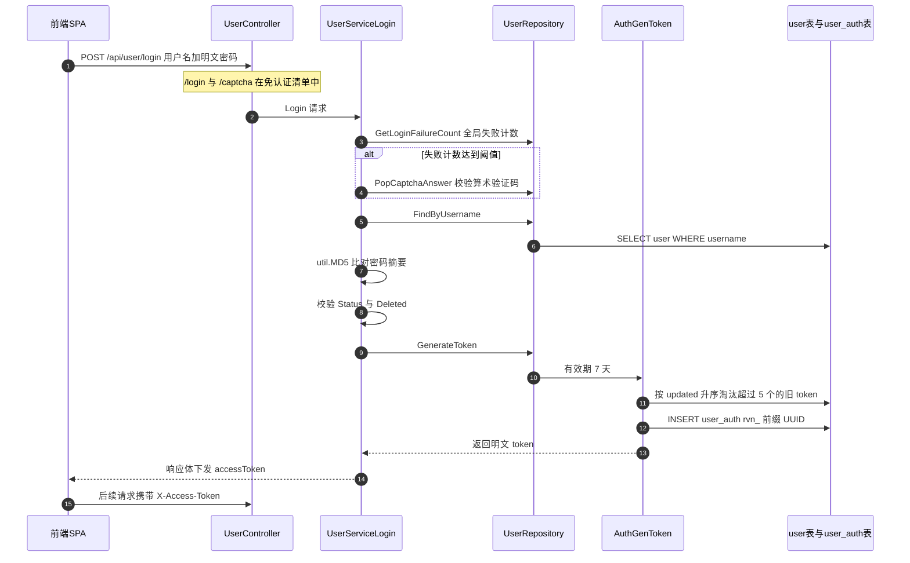
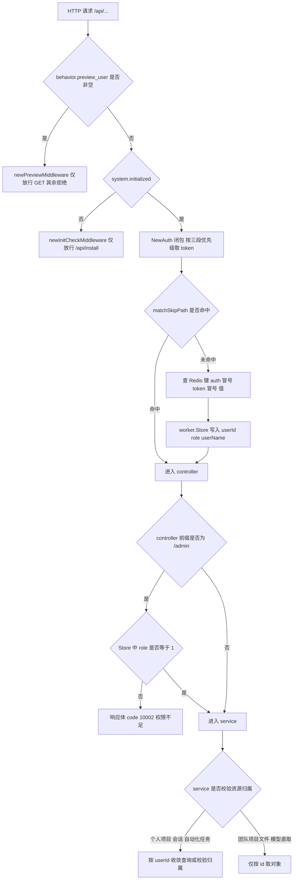
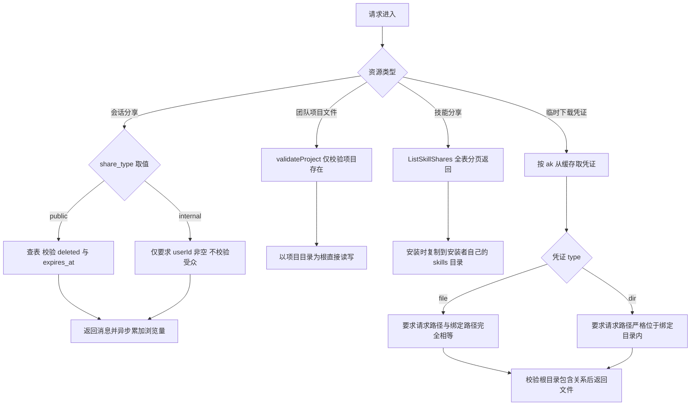

# GoRaven 多租户解读：认证、授权收口点、租户隔离的强度分布与配额治理

> 本解读按 **ai-agent 类规格** 产出，解读基线为 GoRaven `v0.5.4`（`032c8b7`）。正文所有 `文件:行号` 引用均为 **GoRaven 仓库相对路径**，点开即可核对。

## 结论速览

GoRaven 的账号体系是「单机自托管」形态的典型写法：认证做得相当扎实，授权则被压缩成一个二进制开关。三条核心结论先行给出。

**第一，认证层可信，但有三个语义缺口。** 密码用无盐 MD5 入库、token 是 `rvn_` 前缀的密码学随机 UUID、有效期 7 天、每用户最多 5 个并发 token 并按最旧淘汰、Redis 缓存 30 分钟、禁用/改密/删除用户都会主动清 token。缺口在于：token 没有任何续期入口，7 天到期即强制重新登录；密码哈希用的是无盐 MD5；而 `role` 只有一个 `admin=1` 的常量，没有中间态。

**第二，授权层只有一个真正的收口点，就是 `/admin` 控制器前缀上挂的那段角色判断。** 全仓库唯一一处「角色校验」写在 [backend/controller/admin.go:18-30]() 这个 `BindController` 的中间件里；
<!-- anchor: initiator.BindController("/admin", &AdminController{}, infra.NewAuth(true), func … ctx.JSON(infra.ResBodyObject{Code: infra.Access_Denied, Msg: "Permission denied" -->
其余所有控制器只挂了 `infra.NewAuth(...)`，那只是**认证**（确认你是谁），不是**授权**（确认你能做什么）。因此：新增一个挂在 `/admin` 下的接口天然受保护；新增一个挂在任何其他控制器下的接口，默认**零授权**。`preference`、`ping`、`install` 三个控制器甚至连认证中间件都没传就能跑起来，这证明框架层面是「默认公开、失败开放」，没有任何启动期兜底。

**第三，租户隔离的最后一层防线不是数据层，而是「服务层是否记得带上 userId」这一约定。** 个人项目、会话、自动化任务三条线都严格按 userId 收敛查询或做归属校验；但团队项目的**文件操作全链路没有成员校验**，[backend/service/team_project.go:316-321]() 只校验项目存在，任何已登录用户凭整数 id 就能读写他人的团队项目文件。
<!-- anchor: func (service *TeamProjectService) ListFiles(id int, req *vo.FileManagerListReq) … return service.ListRoot(projectDir, req) -->
而操作系统/容器层**不构成**真正的第二道边界：shell 以服务进程同一身份经 `/bin/sh -c` 执行，命令黑名单只拦「破坏性」命令，不拦「读取 `/goraven/data/users/<他人>/`」。唯一拦住它的东西是系统提示词里的一句自然语言。

---

## 模块作用与在系统中的位置

这一模块回答的是「多个用户共用一套 GoRaven 实例时，谁是谁、谁能碰谁的东西」。它横跨四层：传输层（`infra/auth.go` 的中间件与 `X-Access-Token` 提取）、控制器层（每个 `BindController` 的中间件列表）、服务层（各 service 是否把 `userId` 带进查询条件）、以及文件系统与操作系统层（`core/fs` 的根目录句柄、`core/sandbox/local` 的路径前缀校验、shell 的实际执行身份）。

理解它必须先接受一个前提：GoRaven 明确把自己定位为**单机、单 OS 用户、多租户账号**的系统。[backend/repository/seed/skill_goraven_runtime.go:12-12]() 的系统提示词直接写明「你运行在 Docker 容器（ubuntu 22.04）内」。也就是说，租户隔离的实现压力全部落在应用层，操作系统层被当作一个已经存在的「同一台机器」前提，而不是隔离边界。这个前提决定了后面几乎所有的取舍。
<!-- anchor: 你运行在 Docker 容器（ubuntu 22.04）内。预装工具链均可通过 shell 直接使用： -->

---

## 认证机制：从登录到会话建立

### 凭据形态与传输通道

GoRaven 不用 Cookie、不用 JWT，用的是**数据库持久化的不透明 token**。取 token 的优先级固定为三段：[backend/infra/auth.go:225-241]()。
<!-- anchor: func (a *Auth) extractToken(ctx freedom.Context) string { … return "" -->

先看 `X-Access-Token` 请求头，再看 `Authorization: Bearer ` 前缀，最后才回退到 URL 查询参数 `access_token`。前两者是正常路径，第三个是给无法自定义请求头的场景（例如 `` 直接拉资源）留的口子。选不透明 token 而非 JWT 的直接收益是**可即时吊销**——这也是后面「禁用用户立即失效」能成立的前提；代价是每次都要落一次 Redis 或数据库。

### token 的生成与上限

[backend/infra/auth.go:136-167]() 是全部 token 的产地。这里有两个值得注意的设计。
<!-- anchor: func (a *Auth) GenerateAccessToken(userId string, expiresAt time.Time, clientIP, … return token, nil -->

一是**每用户并发 token 上限为常量 5**，超限时按 `updated` 升序淘汰最旧的一条，这把「同一个账号被多人共用」的痕迹限制在一个可枚举的窗口内，也让登出与改密能一次清干净。二是 **token 本体就是 `rvn_` 加一个去横线的 UUID v4**，即 122 位密码学随机量，不存在可预测的自增或时间戳成分，因此「猜 token」在实现上不成立——省掉了签名与验签的密钥管理，安全性由熵保证。

落库记录见 [backend/po/user_auth.go:15-15]()：`expires_at` 的零值语义是「永不过期」，这是一个需要留意的默认值方向。
<!-- anchor: ExpiresAt   time.Time `gorm:"column:expires_at"`                                 -->

7 天的有效期不是写在 `auth.go` 里，而是在仓储层注入的：[backend/repository/user.go:157-157]()。
<!-- anchor: return repo.Auth.GenerateAccessToken(userId, time.Now().AddDate(0, 0, 7), client -->

把 TTL 放在调用方而不是 token 生成器内部，意味着只要有人直接调用 `GenerateAccessToken` 就能签发任意有效期的 token；`GenerateToken` 目前是唯一调用点，但这个「TTL 决策权外置」的结构对后续改动不够友好。

### 密码与登录失败处理

密码存的是**无盐 MD5**。`util.MD5` 就是对 `crypto/md5` 求和后十六进制编码，没有 salt、没有迭代次数，`po.User` 的字段注释也直说了这一点。比对发生在 [backend/service/user.go:52-52]()。
<!-- anchor: if user.Password != util.MD5(req.Password) { -->

用 `!=` 做字符串比较而非 `hmac.Equal`，在 MD5 这种场景下不构成实际的时序攻击面（攻击者无法控制摘要逐字节逼近），但这是一个应当被记录下来的写法。真正的风险是**无盐**：一旦 `goraven.db` 泄漏，彩虹表可以直接还原弱口令，而这套系统默认用 SQLite 单文件入库（`config/config.yaml` 的 `sqlite_db: "./data/goraven.db"`），数据库文件与用户文件处在同一个数据卷里，泄漏面是叠加的。

登录失败达到阈值才引入验证码，阈值常量来自仓储层（`repository.CaptchaThreshold`），判定在 [backend/service/user.go:36-42]()。
<!-- anchor: if service.UserRepo.GetLoginFailureCount() >= repository.CaptchaThreshold { … return nil, errs.ErrCaptchaIncorrect -->

验证码本身是 `mojocn/base64Captcha` 的数字驱动，两位数的算术式：[util/captcha.go:11-12]()。
<!-- anchor: // captchaDigitDriver 复用同一份字体配置生成单个加数图片（最多 2 位数字） … var captchaDigitDriver = base64Captcha.NewDriverDigit(60, 100, 2, 0.6, 60) -->

一个容易被忽略的细节：`GetCaptcha` 在失败次数超过 120 之后会直接返回 `Image1: "goraven", Image2: "good"` 这对固定答案。这是为了让被暴力尝试打死的实例仍能被管理员登录进去——是一个「运维可达性优先于防爆破」的取舍，代价是失败计数一旦被推到 120，验证码在**全实例范围内**退化为恒定答案（计数是全局的，不是按账号或按 IP 的）。

### 登录到会话建立的完整时序

下图把上面所有环节串起来，并标出每一步的落点。

每一步的代码位置：

- 跳过路径的声明在 [backend/controller/user.go:14-14]()。
<!-- anchor: initiator.BindController("/user", &UserController{}, infra.NewAuth(true, "/login -->

- 失败计数与验证码门槛在 [backend/service/user.go:36-42]()。
<!-- anchor: if service.UserRepo.GetLoginFailureCount() >= repository.CaptchaThreshold { … return nil, errs.ErrCaptchaIncorrect -->

- MD5 明文比对在 [backend/service/user.go:52-52]()。
<!-- anchor: if user.Password != util.MD5(req.Password) { -->

- 有效期与签发在 [backend/repository/user.go:157-157]()。
<!-- anchor: return repo.Auth.GenerateAccessToken(userId, time.Now().AddDate(0, 0, 7), client -->

- 旧 token 淘汰与入库在 [backend/infra/auth.go:136-167]()。
<!-- anchor: func (a *Auth) GenerateAccessToken(userId string, expiresAt time.Time, clientIP, … return token, nil -->

### 登出与即时失效

token 的吊销有三条路径，覆盖了所有需要「立刻踢下线」的场景。

- 单 token 登出用 [backend/infra/auth.go:131-131]()。
<!-- anchor: func (a *Auth) DeleteToken(token string) error { -->

- 清空某用户全部 token 用 [backend/infra/auth.go:113-113]()。
<!-- anchor: func (a *Auth) DeleteUserTokens(userId string, skipToken string) error { -->

- 角色变更后清缓存用 [backend/infra/auth.go:100-100]()。
<!-- anchor: func (a *Auth) InvalidateUserCache(userId string) error { -->

调用点集中在用户管理的三个动作里：禁用用户时清 token、改角色时失效缓存、重置密码与删除用户时清 token ([backend/service/user.go:252-257]())。
<!-- anchor: if req.Role != nil { … service.UserRepo.Auth.DeleteUserTokens(userId, "") -->

这一组配合是这套实现里最扎实的部分：`role` 与 `status` 的变更都伴随缓存失效，所以「改了角色但 30 分钟内还按旧角色放行」这类常见漏洞在这里不存在。

### 认证层的三个语义缺口

**缺口一：token 无法续期。** `extractToken` 支持三种携带方式，`auth()` 会检查 `ExpiresAt`，但仓库里没有任何「刷新/续期」端点，`expires_at` 一旦写入就不再延长。7 天到点后用户唯一的出路是重新登录，对长时间挂着的自动化会话不友好。

**缺口二：无盐 MD5。** 见上，属于历史实现债务，`po/user_auth.go` 与 `po.User` 的注释里都留有痕迹。

**缺口三：`auth()` 不在请求时复查用户状态。** 这一点被上层的主动清理补上了——禁用/删除路径都会调 `DeleteUserTokens`，所以实际效果是等价的；但如果将来有人在别处新增一条「直接改 `status` 字段」的写路径而不走 `AdminUpdateUser`，这个缺口会立刻变成真实漏洞。

---

## 授权模型：唯一的收口点在哪里

### 唯一角色门

全仓库只有一处做了「角色」判断，就在 `/admin` 控制器的绑定处：[backend/controller/admin.go:18-18]()。
<!-- anchor: initiator.BindController("/admin", &AdminController{}, infra.NewAuth(true), func -->

它给 `/admin` 追加了第二个中间件，逻辑是 [backend/controller/admin.go:26-26]()。
<!-- anchor: if role, ok := v.(uint8); ok && role == po.UserRoleAdmin { -->

角色值从 `worker.Store()` 里取（由认证中间件写入），比较对象是常量 `po.UserRoleAdmin`。`po.UserRoleAdmin` 定义为 1，普通用户为 0，没有第三种角色。这条中间件的作用域是**整个 `/admin` 前缀下的全部路由**——用户管理、模型与供应商管理、MCP、系统技能、市场技能、角色模板、仪表盘五个统计端点、团队项目后台、系统设置，都在里面。

### 路由级 `NewAuth` 只做认证

除 `/admin` 之外，其它控制器传的都是 `infra.NewAuth(true, ...)`，而 `NewAuth` 的语义完全不同：[backend/infra/auth.go:46-63]()。
<!-- anchor: func NewAuth(allMethod bool, skipPaths ...string) func(freedom.Context) { … ctx.Next() -->

它只判断「有没有有效 token」：`skip` 命中就放行，未命中则调用 `auth()`，失败则返回 body 里 `code = infra.Access_Denied`。**它完全不看角色，也不看资源归属。** 因此 `NewAuth` 提供的是「已登录」这一事实，而不是「有权限」这一结论。

这里有一个值得点名的 API 设计陷阱：参数名叫 `skipPaths`，但在 `allMethod=false` 时它的含义会反转成「只有这些路径需要认证」——因为 `skip = !allMethod` 的初值配合 `skip = allMethod` 的翻转逻辑，让同一个列表在两种模式下表达相反的意思。`share_link` 控制器正是用 `NewAuth(false, "/internalMessages")` 来表达「除内部消息外全部匿名可访问」([backend/controller/share_link.go:12-12]())。语义靠一个布尔量翻转，是后续误配置的高危点。
<!-- anchor: initiator.BindController("/share", &ShareController{}, infra.NewAuth(false, "/in -->

### 默认公开：失败方向是开放的

框架层面没有「默认拒绝」。证据是三个控制器根本没传中间件就能注册成功。

- `preference` 只注入语言上下文，没有任何中间件 ([backend/controller/preference.go:12-12]())。
<!-- anchor: initiator.BindController("/preference", &PreferenceController{}) -->

- `install` **仅在系统未初始化时**才注册，同样没有中间件 ([backend/controller/install.go:13-17]())。
<!-- anchor: if config.Get().System.Initialized { … initiator.BindController("/install", &InstallController{}) -->

- `ping` 只回一个 `pong` 字符串，同样没有中间件 ([backend/controller/ping.go:9-9]())。
<!-- anchor: initiator.BindController("/ping", &PingController{}) -->

`preference` 只返回当前语言，`ping` 是无信息量的存活探测，`install` 在已初始化实例上根本不注册——所以这三个的实际风险都很低。它们的价值在于**证明了默认方向**：忘写中间件的后果是「完全公开」，而不是「默认拒绝后报错」。没有任何启动期自检会提示「这个控制器没有认证」。

`install` 值得单独一句：未初始化实例暴露 `POST /api/install/init`，先到者即可创建超级管理员并拿到整个实例。这是安装向导的固有性质（必须有人在无凭据状态下完成初始化），但在「部署后忘了访问」的窗口里，它就是一个真实的第一到达者接管风险。同控制器的 `check-db` / `check-redis` 在无认证状态下接受主机与端口参数并尝试连接，具备轻度的内网探测面。

### 直接回答：新增接口时，开发者会不会忘记鉴权

**会，而且忘记的方式有两种，第二种更危险。**

第一种是**忘传中间件** → 接口完全公开。默认开放的方向决定了这类错误不会以「500」或「启动失败」的形式暴露出来，只能靠代码评审发现。

第二种是**挂了 `NewAuth` 但没做对象级授权** → 接口「已登录即可操作任意对象」。这类错误连评审都很难发现，因为代码看起来是「有鉴权」的。团队项目的文件操作就是活证据：12 个文件操作端点全部挂了 `NewAuth(true)`，全部通过了「是否鉴权」的直觉检查，但没有一个校验调用者与该团队项目的关系。

还有一个结构性问题：`/admin` 的角色门是**按路由前缀**而不是按动作挂载的。只要有人把管理动作放到非 `/admin` 前缀下，那道角色门就自动失效。这件事已经发生过了——技能分享的删除走的是 `/api/skills/shares/{id}`，它不属于 `/admin`，于是管理员判断被手写进了服务层 ([backend/service/skill.go:1615-1615]()，`infra.IsAdmin(service.Worker)`)。
<!-- anchor: isAdmin := infra.IsAdmin(service.Worker) -->

而 `infra.IsAdmin` 的实现本身是硬编码的：[backend/infra/request.go:120-125]()。
<!-- anchor: func IsAdmin(worker freedom.Worker) bool { … return false -->

它从 Store 取 `UserRoleStoreKey` 后直接比较 `role == 1`。同一个「管理员」概念在仓库里有三个独立实现（`admin.go` 的中间件、`request.go` 的 `IsAdmin`、`po.User` 的 `IsAdmin()` 方法），彼此没有共享常量以外的约束。真正的收口点只有一个，但「判断是不是管理员」这件事有三个入口——这是授权模型里最需要收敛的地方。

### 对象级授权：靠服务层自觉

对象级授权没有框架支持，全部靠服务层手写。做得好的是个人项目：[backend/service/my_project.go:80-86]()。
<!-- anchor: func (service *MyProjectService) validateProject(userId string, id int) (*po.Use … return nil, "", errs.ErrUserProjectNotFound // 不暴露他人项目存在性 -->

它做对了两件事：一是把 `userId` 作为查询条件的一部分（而不是查出来再比较），二是**返回 NotFound 而不是 Forbidden**，从错误信息上就不泄漏「这个 id 存在但不属于你」。这个模式在 12 个文件操作里被一致复用，是这套代码里最规范的写法。

反面例子就是团队项目，下一节展开。

### 请求鉴权链路全景

图中最重要的信息是最后一行分叉：**链路到 `service` 之后就没有任何框架级保护了**，「是否校验资源归属」完全取决于该 service 的作者。

还有一点需要写进结论：所有权限失败都表现为 HTTP 200 + 响应体里的 `code`，而不是 401/403。响应写入路径统一在 [backend/infra/response.go:77-77]()。
<!-- anchor: ctx.StatusCode(200) -->

权限错误码定义在 [backend/infra/code.go:4-7]()，分别是 `Access_Expire = 10001`、`Access_Denied = 10002`、`Access_Disable = 10003`、`System_NotInit = 10004`。
<!-- anchor: Access_Expire  = 10001 // token 过期 … System_NotInit = 10004 // 系统未初始化 -->

这套「HTTP 恒 200、业务码表意」的做法在国内中后台项目里很常见，代价是无法用标准的反向代理规则、WAF、审计日志按状态码识别越权尝试——`403` 会成为一条极有价值的告警信号，这里被抹平了。更值得注意的是 `backend/vo/errs/errors.go` 这份全文 503 行的错误目录里，**没有任何一个通用的「permission denied」错误**，唯一的授权语义错误是团队项目专属的 `ErrTeamProjectPermission` ([backend/vo/errs/errors.go:427-430]())。这说明授权失败在这套代码里不是一个被系统化对待的横切关注点。
<!-- anchor: ErrTeamProjectPermission = &Error{ … zhMessage: "权限不足：仅创建者可管理此团队项目", -->

---

## 租户隔离的强制层

要回答「用户 A 能否读到用户 B 的会话/文件/技能」，必须按层取证，因为三层的强度差异很大。

### 数据层：没有全局作用域，只有逐查询条件

GORM 层面**没有**任何多租户插件、没有 `Callback` 注入 `user_id`、没有 `gorm.Scope`。隔离完全依赖每个 repository 方法自己写 `WHERE user_id = ?`。这既是风险也是可控性：没有隐式魔法，每一处都看得见，但每一处也都可能漏。

数据层区分三种隔离质量：

- **严格**：会话、个人项目、自动化任务。`resolveSession` 走 `GetUserSession(sessionId, userId)`，团队项目的**成员表查询** `ListByUser` 也是正确的三段式（`access = 0 OR creator_id = ? OR id IN (成员子查询)`）。
- **弱**：模型可见性。`FindEnabledModelsByUser` 的 `WHERE` 里带了 `access = AIModelAccessAll OR ai_model_id IN (成员子查询)`，看似正确，但**同一个 `aiModelId` 在另一条路径上不做任何校验**（见配额一节）。
- **缺失**：团队项目的文件操作，只有 `GetByID(id)`。

### 服务层：手写 userId 是唯一的对象级防线

服务层的隔离质量可以直接用「有没有把 `userId` 传进 `validateXxx`」来衡量。个人项目把一个 `validateProject(userId, id)` 调用散布在 12 处；团队项目的对应函数签名里**根本没有 `userId` 参数**：[backend/service/team_project.go:302-312]()。
<!-- anchor: func (service *TeamProjectService) validateProject(id int) (*po.TeamProject, str … return project, projectDir, nil -->

调用它的每一个文件操作都只有「项目存在」这一个前提，以列表为例：[backend/service/team_project.go:316-321]()。
<!-- anchor: func (service *TeamProjectService) ListFiles(id int, req *vo.FileManagerListReq) … return service.ListRoot(projectDir, req) -->

上传、建目录、重命名、删除、压缩、解压、用量统计、下载、创建临时凭证——同一模式共 10 处。而 `UpdateMembers` 却有严格的创建者校验 (`Project.CreatorId == userId`，失败返回 `ErrTeamProjectPermission`)，`DeleteProject`、`UpdateDescription`、`UpdateAccess` 也都有。也就是说：**团队项目保护了「元数据」却没有保护「内容」**。一个攻击者拿不到项目的简介和成员列表，但可以直接下载里面的全部文件——而团队项目的目录名就是项目名，整数 id 又极易枚举。

这是整份代码里最严重的一处越权，且它同时具备三个加重因素：id 是自增整数、路径里带项目名（一次成功的 404/200 差分就能确认存在性）、以及读与写都被放开（`Delete`、`Rename` 也在其中，属于**跨租户破坏**而不仅是读取）。

### 文件系统层：两套校验器，两个强度

面向用户的 REST 文件操作统一走 `core/fs` 的 `Root` 句柄，根目录由用户名拼出：[backend/service/file_manager.go:46-47]()。
<!-- anchor: func (service *FileManagerService) userWorkspace() string { … return config.Get().GetUserSpace(infra.GetUserName(service.Worker)) -->

注意这里用的是**登录会话里的 username**，而不是 `userId`。代码在注释里明确警告了这个映射关系以及为什么不能反过来 ([backend/service/file_manager.go:45-45]())。
<!-- anchor: // 而 session/表中的主语是 userId，必须经登录会话中的 username 映射，禁止直接用 userId 拼路径。 -->

这个约束是有意义的：`util.IsValidUsername` 限定用户名形如 `^[a-zA-Z0-9][a-zA-Z0-9_-]*[a-zA-Z0-9]$` 且长度 8–16，因此它可以安全地作为单个路径段；而 `userId` 是 UUID，用它拼路径既没有必要也会破坏已存在目录的对应关系。在 [backend/service/my_project.go:80-86]() 等处还有一层 `GetUsernameByUserID` 的反向映射，方向相反但同样收敛。
<!-- anchor: func (service *MyProjectService) validateProject(userId string, id int) (*po.Use … return nil, "", errs.ErrUserProjectNotFound // 不暴露他人项目存在性 -->

`core/fs` 这一层的实现质量明显高于仓库平均水平：它用 `os.OpenRoot` 拿到目录句柄后再操作，配合「先 Clean 再在句柄内操作」来规避校验与使用之间的 TOCTOU 窗口；`cleanRootRel` 拒绝 `..` 逃逸；`validateRootPath` 在词法检查之外还做符号链接解析后的包含判断。相关实现分三层。

- `..` 逃脱在根相对路径归一化阶段就被拒绝 ([core/fs/path.go:30-38]())。
<!-- anchor: func cleanRootRel(rel string) (string, error) { … return clean, nil -->

- 完整校验同时覆盖绝对路径、盘符与符号链接解析 ([core/fs/path.go:42-71]())。
<!-- anchor: func validateRootPath(root, relPath string) (string, error) { … return cleanPath, nil -->

- 最终的自包含判断与拒绝分支 ([core/fs/path.go:68-69]())。
<!-- anchor: if !isWithinRel(resolvedWorkspace, resolvedPath) { … return "", fmt.Errorf("path escapes root: %s", relPath) -->

但仓库里还并行存在**第二套更弱的校验器**。`core/sandbox/local/file_manager.go` 的 `resolvePath` 只做词法前缀比较：[core/sandbox/local/file_manager.go:31-39]()。
<!-- anchor: func (m *LocalFileManager) resolvePath(relPath string) (string, error) { … return cleanPath, nil -->

同一文件里解压时的 zip slip 防护也只用 `strings.HasPrefix`。[core/sandbox/local/local.go:304-321]() 的 `validateFilePath` 同样如此。这类校验**不解析符号链接**：只要工作区内存在一个指向外部的软链（agent 自己就能用 `ln -s` 造一个），前缀判断就会把「`workspace/link/etc/passwd`」判定为合法工作区路径。`core/fs` 之所以要专门加 `resolveRootExistingPath` 做符号链接解析，正是为了堵这个洞——而这两套实现并存，意味着同样的攻击在一条路径上被挡住、在另一条上没有。
<!-- anchor: func (s *LocalSandbox) validateFilePath(filePath string) (string, error) { … return "", fmt.Errorf("path is outside user workspace: %s", filePath) -->

### 文件系统的操作系统层：不构成边界

这一层需要明确否定。结论是：**进程身份没有被隔离，命令黑名单不覆盖跨租户读取**。

- shell 通过 `/bin/sh -c` 执行，继承服务进程的 `os.Environ()`，没有 `chdir` / `chroot` / namespace 切换，也没有切换到其它 UID。
- 命令安全校验是**正则黑名单**（约 36 条），拦的是 `rm -rf /`、`/etc/shadow`、`sudo`、`chmod 777`、`curl | sh`、`mount`、`docker --privileged`、`nsenter` 这类破坏性操作。
- 黑名单里**没有**任何一条阻止读取 `/goraven/data/users/<他人>/` 或 `/goraven/data/goraven.db`。

也就是说，一个用户让 agent 执行 `cat` 去读另一个用户的文件时，应用层的路径校验（如果走 `core/fs` 就会挡住）与 shell 层的黑名单都不在链路上——因为 agent 的 shell 工具并不经过 `core/fs`，而黑名单又不管「读普通文件」。唯一拦住它的是系统提示词里那句「不得访问其他用户的目录或文件」。这是**策略文本，不是强制机制**。

补充一点必须标注不确定性的地方：官方部署方式是 `docker run -d --restart=always --name goraven-agent -p 8000:8000 [-v /opt/goraven:/goraven/data] 8treenet/goraven:latest`，**没有 `--user` 参数**，而仓库里没有 Dockerfile。因此镜像内的运行 UID 无法从本仓库证实——如果镜像以 root 运行且数据卷挂在 `/goraven/data`，那么「读他人目录」在操作系统层是完全允许的。**【存疑待核实】**

同一条不确定性还影响另一个判断：[backend/controller/hfs.go:126-142]() 的绝对路径下载端点**是有意为之**的跨用户读取通道，它的注释写着「团队共享场景：任意已登录用户可读取任意用户空间内的文件」，但它的前置判断是 `strings.HasPrefix(cleanAbs, filepath.Clean(config.Get().Paths.UserSpace) + separator)`。当 `user_space` 是相对路径（仓库默认值 `./data/users`）时，相对前缀永远匹配不上绝对请求路径，这个端点会退化成 403；只有当镜像里把 `user_space` 配成绝对路径（很可能是 `/goraven/data/users`）时它才真正开放。前端确实在用它（`frontend/src/api/files.ts` 与 `frontend/src/components/common/goraven-file.tsx` 都注明「用于聊天内跨用户共享场景」）。**它是否在官方镜像中处于开放状态，取决于容器内的配置**【存疑待核实】。
<!-- anchor: // p:path 为完整 FS 绝对路径（形如 /goraven/data/users/<user>/documents/foo.pdf）， … return -->

### 最后一层防线到底是谁

| 资源 | 数据层 | 服务层 | 文件系统 | 最后防线 |
|---|---|---|---|---|
| 会话与消息 | 严格（`GetUserSession`） | 严格 | 不适用 | 数据层 |
| 个人项目文件 | 有 `user_id` 列 | 严格（`validateProject(userId,id)`） | `core/fs` 强校验 | 服务层 |
| 用户空间文件 | 无（走 FS） | 由 username 推导根目录 | `core/fs` 强校验 | 服务层 + 文件系统 |
| 团队项目文件 | 只有 `GetByID` | **缺失** | `core/fs` 强校验 | **无** |
| 模型可用性 | 列表端点正确 | 使用端点缺失 | 不适用 | 无 |
| 技能（用户私有） | 有 `user_id` | 安装/复制按 userSpace | `core/fs` | 服务层 |

结论是：**这套系统没有统一的「最后一层防线」**。个人项目靠服务层，会话靠数据层，用户空间文件靠「服务层推出的根目录 + `core/fs` 句柄」二者叠加；而团队项目文件这一格是空的——唯一还在生效的是 `core/fs` 会不会阻止越出*该团队项目目录*，它当然不会，因为那个目录本身就是攻击目标。至于操作系统层，如前所述它不构成防线。

### 可绕过的路径清单

1. **团队项目 id 枚举** → 读/写/删任意团队项目文件（最严重，无需任何特殊条件）。
2. **成员制模型 id 猜测** → 使用管理员限定给某些成员的模型（见配额一节）。
3. **`share_link` 的 `internal` 类型** → 任何已登录用户读任意内部分享 ([backend/service/share_link.go:279-281]())。
<!-- anchor: if shareLink.ShareType == "internal" && userId == "" { … return nil, errs.ErrShareNotFound -->

4. **`/api/hfs/file/{path}` 绝对路径下载** → 条件性开放（依赖 `user_space` 为绝对路径）【存疑待核实】。
5. **skill 分享列表** → 全团队可见（设计如此，但需与「分享」的语义对齐，见下节）。
6. **跨租户技能安装状态** → `IsSkillInstalled` 的标记文件落在全局目录 `GetSkillInstalledDir()`，由 `skillName` 决定路径，**不含用户名**（[core/sandbox/local/local.go:426-437]()）。用户 A 安装某技能依赖后，用户 B 安装同名技能会直接跳过依赖安装，属于跨租户共享状态带来的隐蔽耦合。代码注释把这件事解释为「local 沙盒共享机器，无需重复安装」([backend/service/skill.go:1112-1112]())，是自觉的设计，而非疏漏，但它确实意味着「租户隔离」在这一维度上不成立。
<!-- anchor: func (s *LocalSandbox) IsSkillInstalled(skillName string) (bool, error) { … return true, nil -->
<!-- anchor: // 检查该技能依赖是否已在本地安装过（local 沙盒共享机器，无需重复安装） -->

---

## 共享机制：如何安全地打破隔离

三种共享机制的安全性差异很大，因为它们的「打破隔离」方式是三种不同的思路。

### 会话分享：靠不可猜的 ID + 过期时间

分享链接的凭证是 `util.UUID()` 生成的 `ShareId`（122 位随机），有效期由 `expiresInMapping` 决定，支持 1 小时 / 24 小时 / 7 天 / 30 天，默认 24 小时 ([backend/service/share_link.go:41-45]())。
<!-- anchor: var expiresInMapping = map[string]time.Duration{ … "30d": 30 * 24 * time.Hour, -->

授权粒度只有两档：`public` 与 `internal`。判定逻辑极短，就在 [backend/service/share_link.go:279-281]()。
<!-- anchor: if shareLink.ShareType == "internal" && userId == "" { … return nil, errs.ErrShareNotFound -->

也就是说：`public` 是完全匿名可读（设计如此，分享页本来就是给站外看的，OG 元数据注入还专门为爬虫服务）；`internal` 的语义是「**已登录即可读**」，而不是「指定人可读」。

一个次级问题是 [backend/service/share_link.go:388-405]() 的 `autoConfigureDomain`
<!-- anchor: // autoConfigureDomain 若系统 GeneralDomain 为空，尝试用前端传的 domain 自动补全。 … _ = service.SysCfgRepo.Update("general.domain", domain) -->

### 团队项目：两种权限对象被混为一谈

团队项目同时使用两套语义：`access` 字段（`TeamProjectAccessAll = 0` / `TeamProjectAccessMember = 1`）控制**列表可见性**，`team_project_member` 表记录成员。二者只在 `ListByUser` 里协同，文件操作两者都不用。

真正做对的只有元数据管理：`UpdateMembers` 要求 `project.CreatorId == userId`，且不允许移除创建者；`DeleteProject` / `UpdateDescription` / `UpdateAccess` 同样要求创建者。这些证明了作者具有「对象级授权」的意识与能力，问题在于同一份意识没有被施加到文件操作上——很可能是因为文件操作被抽象到了「共享的文件管理器根目录」层（`FileManagerService` 通过嵌入被两个 service 复用），而那个抽象层只接受 `root` 字符串，`userId` 在这一层的类型签名里被丢掉了。**这是抽象边界设计导致授权信息在传递过程中丢失的典型案例**，比单纯的遗忘更有借鉴价值。

### 技能分享：owner 校验完整，可见性为全团队

技能分享的写路径是完整的：分享要求技能已安装、来源必须是 `custom`、同名不可重复分享；更新要求 `share.OwnerId == userId`；删除要求 owner 或管理员。读路径则是全团队：`ListSkillShares` 分页返回**所有**分享，没有按用户过滤 ([backend/service/skill.go:1554-1554]())。
<!-- anchor: func (service *SkillService) ListSkillShares(userId string, req *vo.SkillShareLi -->

这与「技能分享」的产品语义一致（分享到团队市场，人人可安装），安装时会把共享目录复制进安装者自己的 workspace (`copySharedSkillToUserSpace`)，因此**不存在「改一处影响所有安装者」的权限扩散**——这是一处做得很对的地方：共享只读源、安装即复制，切断了下游依赖。相比之下，若共享的是同一份目录引用，owner 的一次修改就会传播到所有使用者。

反过来说，唯一残留的问题是「取消分享」是彻底删除，没有「已安装用户继续可用」的语义——这属于产品取舍而非安全问题。

### 共享授权判定全流程

临时凭证这条线（右下角）是这套系统里设计得最克制的一处：`ak` 是 `rvnt_` 前缀的 UUID，TTL 固定 15 分钟，且**签发时就把路径和类型钉死在缓存里**，使用时只做「相等或严格子路径」判断，不接受任何重定向或相对路径的自由度。file 类型要求完全相等、dir 类型要求严格子路径（连目录本身都不允许），这种「把权限写得比需要的更窄」的风格值得单独表扬。它也顺带解释了为什么它比团队项目本身更安全——**同一个模块里，临时凭证做得比正式接口严格**。

---

## 模型配额与成本边界

### 模型如何授予成员

模型有一个 `access` 字段：`AIModelAccessAll = 0` 全员开放、`AIModelAccessMember = 1` 仅成员可见 ([backend/po/ai_model.go:11-12]())。成员关系存在 `ai_model_member` 表里，`(ai_model_id, user_id)` 联合唯一索引，**只有「存在」这一个语义**——没有角色、没有配额、没有有效期 ([backend/repository/provider.go:303-310]())。
<!-- anchor: AIModelAccessAll    = 0 // 全员开放 … AIModelAccessMember = 1 // 仅成员可见 -->
<!-- anchor: // AddModelMember 添加模型可见成员 … return repo.db().Create(member).Error -->

管理员侧的两个写入口都做了参数校验但**自身不做授权检查**（它们被 `/admin` 的角色门保护）：`UpdateMembers` 只校验模型存在后逐条增删 ([backend/service/ai_model.go:544-559]())，`UpdateAccess` 只校验取值是 0/1 ([backend/service/ai_model.go:563-570]())。
<!-- anchor: func (service *AIModelService) UpdateMembers(modelId int, req *vo.AIModelMemberU … return nil -->
<!-- anchor: func (service *AIModelService) UpdateAccess(modelId int, access uint8) error { … return service.ModelRepo.UpdateModelAccess(modelId, access) -->

依赖 `/admin` 前缀作为唯一保护，与前文「新增非 `/admin` 管理动作即失去保护」是同一个结构性问题。另外注意 `CreateModel` 不显式设置 `Access` 字段，因此新建模型默认 `access = 0`（全员开放）——这是安全的默认方向（不过度收窄导致功能不可用），但也意味着「只让部分人用某个模型」是一个需要额外操作才能达成的状态。

### 限额与限流

GoRaven 只有一种配额：**每日 token 限额**，存在 `user.DailyTokenLimit`，单位是 M（百万 token），**0 表示不限**。管理员通过 `AdminUpdateUser` 设置，且超级管理员的额度只能由本人调整（其它字段的编辑会被 `ErrCannotEditSuperAdmin` 拒绝）。

限额有两道检查。第一道是进入 Agent 之前的预检，命中即直接拒绝 ([backend/service/chat.go:109-111]())。
<!-- anchor: _, dailyTokenLimit, dailyTokenUsed, quotaErr := service.dailyTokenQuota(userId) … return nil, errs.ErrDailyTokenLimitExceeded -->

用的是专门的错误 `ErrDailyTokenLimitExceeded`，文案是「今日 Token 用量已达上限，请明日再试或联系管理员调整额度」。第二道是运行中的硬中断：当「本轮累计 + 今日已用」超过限额时终止会话 ([core/agent/main_runner.go:490-492]())
<!-- anchor: // 运行时 Token 限额检查：本轮累计 + 今日已用 超过日限额时终止会话 … if runner.mainAgent.param.DailyTokenUsed+promptTokens+completionTokens >= limit* -->

**没有**的是：按分钟/秒的速率限制、并发会话数上限、按模型的独立配额。因此「成本边界」实际只有「总量」这一个维度，缺少「速率」维度。

超限行为是**拒绝**而不是降级——不切换便宜模型、不截断上下文，直接报错。对自托管场景这是合理选择：降级会带来「用户以为在用 A 模型」的困惑。

自动化任务的超限处理是**静默跳过**：定时扫描到期的任务后，超限的任务直接不执行，也不通知任何人。对后台任务这是比「报错」更合理的选择（没人看得到报错），但代价是用户可能完全不知道自己的任务因为额度而未运行。

### 成本边界上最实质的缺口

**成员制模型只在「列表」上生效，在「使用」上没有生效。**

列表路径是正确的：`FindEnabledModelsByUser` 的查询里带了 `access = AIModelAccessAll OR ai_model_id IN (成员子查询)`。但真正的模型构造走的是完全独立的路径：[backend/repository/provider.go:256-275]()。
<!-- anchor: func (repo *ProviderRepository) CreateChatModelFromID(aiModelId int, reasoning b … return resultModel, am, am.AIModelId, err -->

它按 `aiModelId` 取模型并直接构造 chat model，**不接收 `userId` 参数**，因此从类型上就无法校验归属。调用它的链路是 `chat.go` 的会话解析（只拒绝负数 `AIModelId`）与自动化任务执行。也就是说，一个普通用户只要在新建会话的请求体里填一个自己无权使用的 `aiModelId`，就能用上那个模型。

这与团队项目的问题是**同一个根因的两种表现**：**授权决策所需的 `userId` 没有出现在关键函数的签名里**。`CreateChatModelFromID(aiModelId, reasoning)` 和 `validateProject(id)` 都因为缺少 `userId` 而在结构上不可能做出正确判断。

### 管理员能否看到成员用量

能，而且粒度到「每个用户每天」。仪表盘有五个管理员端点：`/dashboard`、`/dashboard/tokenTrend`、`/dashboard/modelUsage`、`/dashboard/userTokenRank`、`/dashboard/activeUsers`，全部挂在 `/admin` 下受角色门保护。数据来自 `user_daily_stats` 表的按日累加（[backend/repository/daily_stats.go:39-43]() 的 upsert-increment）与 `GetUserDailyTokenLimit`（[backend/repository/dashboard.go:436-445]()）。普通用户通过 `/api/dashboard` 只能看到自己的数据。
<!-- anchor: "prompt_tokens":       gorm.Expr("user_daily_stats.prompt_tokens + ?", promptTok … "round_count":         gorm.Expr("user_daily_stats.round_count + 1"), -->
<!-- anchor: // GetUserDailyTokenLimit 查询指定用户的每日 Token 限额（单位 M，0=不限制） … return limit, err -->

这是这套系统在「成本可观测」上做得完整的一环——**能设限额、能看到每人用了多少、能看到趋势与模型分布**，闭环是成立的，唯一的缺口就是「限额与可见性都对，但模型的访问控制可以在使用端绕过」。

---

## 文件系统隔离与双层防御

### 用户根目录如何计算

根目录 = `config.Get().GetUserSpace(userName)` = `{paths.user_space}/{userName}`，创建时会一并 `MkdirAll` 出 `documents / temp / downloads / images / videos / projects / skills` 与 `.profile`。起点是**用户名而非 userId**，理由与证据见前文 [backend/service/file_manager.go:45-47]()。
<!-- anchor: // 而 session/表中的主语是 userId，必须经登录会话中的 username 映射，禁止直接用 userId 拼路径。 … return config.Get().GetUserSpace(infra.GetUserName(service.Worker)) -->

`config/config.yaml` 里的默认值是相对路径 `./data/users`，同时 [config/config.go:160-173]() 的 `ParseConfigPath` 会优先尝试 Docker 布局的 `/goraven/data/config.yaml`。路径配置**没有做绝对化归一**，这一点会直接影响 `hfs` 绝对下载端点的判断结果（见下）。
<!-- anchor: // ParseConfigPath . … return "config/config.yaml" -->

### 双层防御的实际成色

**应用层（强）**：`core/fs` 的 `Root` 用 `os.OpenRoot` 获取目录句柄、`cleanRootRel` 拒绝 `..`、`validateRootPath` 在词法检查外加符号链接解析后的包含性判断，`Rename` 禁止根目录作为源或目标、`RemoveAll` 拒绝 `.`。这一层能有效阻止 `../` 逃逸、绝对路径注入、VolumeName 注入以及软链逃逸。它的注释也自陈设计目标就是消除 TOCTOU：先拿句柄再操作，而不是「先校验路径再 `os.Rename`」。

**应用层（弱，并存）**：`core/sandbox/local` 的 `LocalFileManager.resolvePath` 与 `LocalSandbox.validateFilePath` 只做 `strings.HasPrefix` 词法比较，不解析软链。agent 工具链（创建目录、移动、删除、复制、压缩）走的是这一套。这条路径的加固状态是这套防御体系里最需要补的短板。

**OS / 容器层（不成立）**：进程与所有租户共享同一 UID，shell 经 `/bin/sh -c` 直出，命令过滤是「破坏性操作黑名单」而非「路径白名单」，且不含任何针对 `/goraven/data/users/*` 与 `goraven.db` 的规则。因此这一层**不是第二道防线，只是第一道防线的补充**——它挡的是「把机器搞坏」，不是「读别人的数据」。

**补上 OS 层的实际成本很低**，这也是这份解读值得给出的工程建议：为每个租户（或至少为 shell 执行）使用独立 UID + 目录权限 `0700`，或者把 shell 放进只挂载该用户空间的 namespace。有了它，前文列出的团队项目越权、软链逃逸、`hfs` 绝对下载都只是「应用层漏洞」；没有它，任何一个应用层疏漏都直接等于数据泄漏。

### `../` 逃逸是否被挡住

在走 `core/fs` 的路径上**挡住了**，有多层：`cleanRootRel` 拒绝 `..`，`filepath.IsAbs` / `VolumeName` 拒绝绝对路径与盘符，软链经 `EvalSymlinks` 解析后做包含判断。[core/fs/path.go:42-71]() 这一段的强度足以作为该实现的可复用范本。
<!-- anchor: func validateRootPath(root, relPath string) (string, error) { … return cleanPath, nil -->

在走 `core/sandbox/local` 的路径上**只挡住了朴素形式**：`cleanPath` + 前缀比较能拦住 `../../etc/passwd`，但拦不住工作区内的软链。而软链是 agent 能通过 shell 自己创建的，所以这不是理论问题。

---

## 自动化任务的身份

这是本次审查中**结论最正面**的一块。

任务执行时用的身份是**任务创建者**，且可以逐项追溯到证据：调度的入口是 `chat.go` 的 `VerifierTimer`（60 秒 ticker）与 `scanAutomationTasks`（取到期任务），构建会话时显式设置 `UserId: task.UserId`，随后在同一条执行链里：模型按 `task.UserId` 取、MCP 按用户维度加载、技能名按 `GetUserSkillNamesByIDs(task.UserId, ...)` 取。

`backend/service/automation.go` 的手动触发路径也有归属校验：`ExecuteTask(id, userId, chat)` 会先 `GetTask(id, userId)`，只有任务属于调用者才继续。

更彻底的是 agent 工具层：`CreateAutomationTask` / `GetAutomationTask` / `ListAutomationTasks` / `UpdateAutomationTask` 四个工具全部通过 `NewAutomationTaskCreator(userID, ...)` 注入的 `userID` 做查询条件，没有任何一个工具接受「以别人身份查询」的参数。

**结论：普通用户无法通过自动化任务提升权限。** 不能创建以管理员身份运行的任务，不能读到他人的任务，不能让他人的任务替自己执行。

两个附带的观察：

其一，调度器在预览模式下**完全跳过**——`VerifierTimer` 在 `config.Get().Behavior.PreviewUser != ""` 时直接不扫描。这让「预览模式」下的演示实例不会真的跑起来定时任务，是合理的一致性处理。

其二，任务的身份虽然正确，但它的**执行环境与交互式请求完全相同**：同一个 UID、同一套 shell 黑名单、同样能读到 `/goraven/data/users/<他人>/`。所以「任务以创建者身份运行」这一保证的边界，恰好就是「创建者自己手动操作」的边界——自动化没有放大权限，但也没有缩小前文说的那些越权面。

---

## 预览模式风险

`PreviewUser` 是给公开演示站点用的「只读免登录」开关，它的实现方式需要单独审视，因为它是这套系统里**唯一一处把角色硬编码放开的地方**。

开启条件只有一条：`config.Get().Behavior.PreviewUser != ""`（即配置了一个用于代表演示用户的用户名）。一旦非空，两个东西同时生效。

第一，认证中间件不再校验 token，直接把请求绑到预览用户身上，并且**角色被硬编码为 1**：[backend/infra/auth.go:195-199]()。
<!-- anchor: ca := &cachedAuth{UserId: user.UserId, Role: 1, UserName: user.Username} … worker.Store().Set(UserNameStoreKey, ca.UserName) -->

也就是说，预览用户在应用层的身份等价于管理员。

第二，`main.go` 会额外装一个中间件，**放行所有 GET、拒绝所有非 GET**：[main.go:77-89]()。
<!-- anchor: if ctx.Method() == "GET" { … }.Dispatch(ctx) -->

风险要分层说清楚：

**默认配置是安全的。** `config/config.yaml` 的 `behavior.preview_user: ""` 是空值，因此正常部署不会进入预览模式。这不是一个「默认开启的危险功能」。

**但一旦开启，被放开的读取面是整个实例。** 因为预览用户是管理员，所有 GET 类的管理员端点都会放行：`/api/admin/users` 用户列表、`/api/admin/dashboard/*` 全站用量统计、`/api/admin/models` 模型列表（含被 `maskAPIKey` 处理过的 key）、`/api/admin/teamProjects` 全部团队项目及其文件、以及所有用户的会话与文件读取端点。加上 `hfs` 的绝对路径下载（若在镜像中生效），等于**免凭据、可枚举地读取实例内的全部数据**。

**误开启的可能性是真实的。** 这个开关目前只能通过改配置文件开启（安装流程不会写它），所以风险主要来自镜像/部署模板把演示配置带到生产、或者运维为了排查问题临时打开后忘记关闭。触发时的外在表现很隐蔽：前端一切「正常」，只是不需要登录——**没有任何启动期警告**会说「当前处于预览模式，全部读取权限已对匿名开放」。

**判断**：功能定位合理（演示站需要它），但实现上把「预览用户」和「管理员角色」绑成了同一个常量，这是设计上的过度授权。更安全的做法是给预览用户一个独立的、只能读演示数据的角色，或者把预览模式严格限制在 `/api` 之外的一组白名单端点上。当前实现的约束力完全依赖「只放行 GET」这一条规则——而 GET 恰恰足以泄漏数据。

---

## 关键设计决策与权衡

| 决策 | 换来了什么 | 代价 |
|---|---|---|
| 不透明 token 落库而非 JWT | 可即时吊销、无密钥管理 | 每次请求都要查缓存/库；7 天无法续期 |
| 用户空间按 username 而非 userId 命名 | 目录可读性、与 shell 工作目录天然对齐、用户名已被正则限制为安全路径段 | 需要 `GetUsernameByUserID` 反向映射；改用户名会牵动目录 |
| 引入 `core/fs.Root` 句柄 | 消除 TOCTOU、挡住软链逃逸 | 与旧的 `LocalFileManager` 并存，两套强度不一的校验器 |
| 用 `common.FileManagerService` 抽共享文件操作 | 个人项目与团队项目复用同一套实现 | 抽象层只传 `root` 字符串，`userId` 在传递中丢失，直接导致团队项目越权 |
| 二进制角色（admin / user） | 实现极简、只有一个判断点 | 无法表达「团队管理员」「只读成员」等中间态；管理动作外溢到非 `/admin` 路由时失去保护 |
| 「团队 = 全员可见」的扁平共享 | 无需成员管理即可协作；技能安装即复制，无权限扩散 | 内部分享名不副实；团队项目文件对全实例已登录用户开放 |
| HTTP 恒 200 + 业务码 | 前端统一处理、无跨域状态码问题 | 越权尝试无法被 WAF/审计按状态码识别；错误目录里没有通用授权错误 |
| 计划任务以创建者身份运行 | 无提权面，工具层全部按注入的 userID 收敛 | 执行环境与被冒充者自身完全同权，越权面未被自动化缩小 |

---

## 不足与风险清单

按严重程度排序，每条都给出可核对的位置。

**严重：团队项目文件操作缺失对象级授权。** `validateProject(id)` 签名里没有 `userId`，10 个文件操作端点只校验项目存在；列表可见性由 `access` 字段与成员表控制，但文件读写完全绕过它们。整数 id 可枚举，读与写都被放开。证据：

- 校验函数本身不接受 `userId` ([backend/service/team_project.go:302-312]())。
<!-- anchor: func (service *TeamProjectService) validateProject(id int) (*po.TeamProject, str … return project, projectDir, nil -->

- 文件列表端点只透传项目目录 ([backend/service/team_project.go:316-321]())。
<!-- anchor: func (service *TeamProjectService) ListFiles(id int, req *vo.FileManagerListReq) … return service.ListRoot(projectDir, req) -->

**严重：成员制模型在使用端不生效。** `CreateChatModelFromID(aiModelId, reasoning)` 不接收 `userId`，会话解析只拒绝负数 id。列表端点正确过滤，使用端点不过滤，构成完整的绕过。证据：[backend/repository/provider.go:256-275]()。
<!-- anchor: func (repo *ProviderRepository) CreateChatModelFromID(aiModelId int, reasoning b … return resultModel, am, am.AIModelId, err -->

**高：OS / 容器层不构成隔离边界。** shell 以服务进程同一 UID 经 `/bin/sh -c` 执行，命令过滤是破坏性操作黑名单，不含「读他人目录」规则。唯一的拦截是系统提示词里紧邻的几条自然语言约束。证据：[backend/repository/seed/skill_goraven_runtime.go:121-126]()（同段落还包含凭据文件与其他用户目录的读取禁令）。同一原因使 `core/sandbox/local` 的词法前缀校验（不解析软链）成为可用的绕过点。
<!-- anchor-base64:LSDnpoHmraLor7vlj5YgLmVuduOAgS5hd3MvY3JlZGVudGlhbHPjgIEuc3NoL2lkX3JzYeOAgS5naXQtY3JlZGVudGlhbHMg562J5Yet5o2u5paH5Lu2IOKApiAtIHJtIC1yZiAv44CBbWtmc+OAgWRkIGlmPeOAgWZvcmsgYm9tYu+8iDooKXsgOnw6JiB9OzrvvIk= -->

**中高：`internal` 分享的受众是「任意已登录用户」。** 语义与命名不符，无按人授权、无白名单。证据：[backend/service/share_link.go:279-281]()。
<!-- anchor: if shareLink.ShareType == "internal" && userId == "" { … return nil, errs.ErrShareNotFound -->

**中：唯一角色门挂在路由前缀上。** 管理动作一旦离开 `/admin` 前缀就失去保护，且已经发生过（技能分享删除在服务层手写 `IsAdmin`）。「是不是管理员」有三个独立实现。证据：

- 角色门本身 ([backend/controller/admin.go:18-18]())。
<!-- anchor: initiator.BindController("/admin", &AdminController{}, infra.NewAuth(true), func -->

- 服务层复制的第二个判断入口 ([backend/infra/request.go:120-125]())。
<!-- anchor: func IsAdmin(worker freedom.Worker) bool { … return false -->

- 已经外溢到非 `/admin` 路由的管理动作 ([backend/service/skill.go:1615-1615]())。
<!-- anchor: isAdmin := infra.IsAdmin(service.Worker) -->

**中：预览模式把「免登录」与「管理员角色」绑成一体。** 默认关闭（`preview_user: ""`），开启后全部 GET 端点以管理员身份对匿名开放，且无常驻警告。证据：

- 预览用户被硬编码为管理员角色 ([backend/infra/auth.go:195-199]())。
<!-- anchor: ca := &cachedAuth{UserId: user.UserId, Role: 1, UserName: user.Username} … worker.Store().Set(UserNameStoreKey, ca.UserName) -->

- 唯一的约束是「只放行 GET」([main.go:77-89]())。
<!-- anchor: if ctx.Method() == "GET" { … }.Dispatch(ctx) -->

**中：密码是无盐 MD5。** 数据库与用户数据同卷（默认 SQLite `./data/goraven.db`），一次文件泄漏即可离线还原弱口令。证据：[backend/service/user.go:52-52]()。
<!-- anchor: if user.Password != util.MD5(req.Password) { -->

**中低：`NewAuth` 的 `skipPaths` 语义随 `allMethod` 反转。** 同一个参数名在两种模式下含义相反，`share_link` 正在用这个反转语义表达「仅内部消息需登录」。证据：

- 翻转逻辑本身 ([backend/infra/auth.go:46-63]())。
<!-- anchor: func NewAuth(allMethod bool, skipPaths ...string) func(freedom.Context) { … ctx.Next() -->

- 反向语义的唯一使用点 ([backend/controller/share_link.go:12-12]())。
<!-- anchor: initiator.BindController("/share", &ShareController{}, infra.NewAuth(false, "/in -->

**中低：权限失败无法从传输层观测。** 所有响应都是 HTTP 200 + 业务码，403 不作为信号存在，错误目录里也没有通用授权错误。证据：

- 统一的状态码写入 ([backend/infra/response.go:77-77]())。
<!-- anchor: ctx.StatusCode(200) -->

- 权限错误码只有四个 ([backend/infra/code.go:4-7]())。
<!-- anchor: Access_Expire  = 10001 // token 过期 … System_NotInit = 10004 // 系统未初始化 -->

- 唯一的授权语义错误是团队项目专属 ([backend/vo/errs/errors.go:427-430]())。
<!-- anchor: ErrTeamProjectPermission = &Error{ … zhMessage: "权限不足：仅创建者可管理此团队项目", -->

**低：跨租户共享的技能安装标记。** `IsSkillInstalled` 的标记按 `skillName` 落在全局目录，用户 A 的安装会让用户 B 跳过依赖安装，属于自觉的「共享机器」假设。证据：[backend/service/skill.go:1112-1112]()。
<!-- anchor: // 检查该技能依赖是否已在本地安装过（local 沙盒共享机器，无需重复安装） -->

**低：任何已登录用户可写全局系统域名。** `autoConfigureDomain` 在 `general.domain` 未配置时用请求域名写入全局配置，而系统域名是全局单例配置。证据：[backend/service/share_link.go:388-405]()。
<!-- anchor: // autoConfigureDomain 若系统 GeneralDomain 为空，尝试用前端传的 domain 自动补全。 … _ = service.SysCfgRepo.Update("general.domain", domain) -->

**低：未初始化实例的首次到达者接管。** `POST /api/install/init` 在无凭据状态可用，先到者成为超级管理员；同控制器的 `check-db` / `check-redis` 接受任意主机端口，具备轻度内网探测面。证据：[backend/controller/install.go:13-17]()。
<!-- anchor: if config.Get().System.Initialized { … initiator.BindController("/install", &InstallController{}) -->

**值得表扬的三处（同类项目里经常做错）**：禁用/改角色/改密/删除用户时主动清理 token 与缓存，语义完整 ([backend/service/user.go:252-257]())；个人项目用「查询条件带 userId + 返回 NotFound 而非 Forbidden」的正确姿势，且 12 处一致；临时下载凭证把权限钉得比需求更窄（file 要求路径完全相等、dir 要求严格子路径、TTL 15 分钟）。
<!-- anchor: if req.Role != nil { … service.UserRepo.Auth.DeleteUserTokens(userId, "") -->

---

## 与同类自托管平台的对比

Dify 与 FastGPT 这类同样面向「自托管 + 多用户」的平台，采用的是**工作空间/团队 + 成员 + 角色**模型：资源行上带 `tenant_id` 或 `team_id`，成员表记录角色（owner / admin / editor / viewer 之类的分层），请求进入时由中间件解析出「当前用户在该工作空间中的角色」，再由**每个资源**的访问检查决定是否放行。它们的授权是「资源级 + 角色分层」的二维判断。

GoRaven 选择的是**全局二进制角色 + 扁平共享**：角色只有管理员与普通用户，团队不是权限容器而只是文件目录，成员表只影响列表可见性。这个取舍的收益是明确的——没有工作空间概念，就没有「切换空间」「邀请成员」「迁移资源」这一整套复杂度，代码量和概念负担都小一个量级，与它「单机自托管、装完即用」的定位自洽。

代价同样明确，而且已经在代码里结成了具体的果：**缺少资源级授权这一层，于是那些本该由通用机制承担的保护，全部退化成了「服务层作者是否记得传 userId」的自觉。** 个人项目记得了，团队项目没有；会话记得了，模型的会话解析没有。Dify/FastGPT 里这类疏漏是「漏了一个 `@auth` 装饰器」，在 GoRaven 里则是「函数签名里少了一个参数」——后者不会被任何静态检查发现，因为它在类型上就是合法的。

GoRaven 在另一维度上换回了分数：**成本可观测性做得比多数同类项目更完整**（每日 token 限额 + 每用户每日统计 + 管理员趋势/排名/模型分布），且**认证的吊销语义完整**（禁用、改角、改密、删除四条路径都清 token）。如果把这三家的能力画成一张表，GoRaven 是「认证与成本观测完备、授权收口不足、隔离边界缺一层」。

要补齐到同一水平，最小改动集是三件事，且每件都不需要重构：

1. 给 `validateProject`、`CreateChatModelFromID` 这类函数**补上 `userId` 参数并在函数内做归属判断**，让「授权所需信息必须在签名里」成为约定。
2. 把 `/admin` 前缀上的角色门下沉为**按路由声明的能力标注**，避免管理动作外溢时静默失去保护。
3. 给 shell 执行与文件访问加上**独立的 OS 身份或 namespace**，把应用层漏洞从「等于数据泄漏」降级为「等于越权请求」。

---

> **验证状态**：本篇 84 条 `文件:行号` 引用全部由 `verify-references.mjs` 与仓库真实源码逐条双向校验通过（OK=84 / WEAK=0 / MISMATCH=0 / UNVERIFIED=0），3 幅 Mermaid 图均通过 `check-mermaid.mjs` 的语法与渲染检查（ERROR=0 / WARN=0）。
