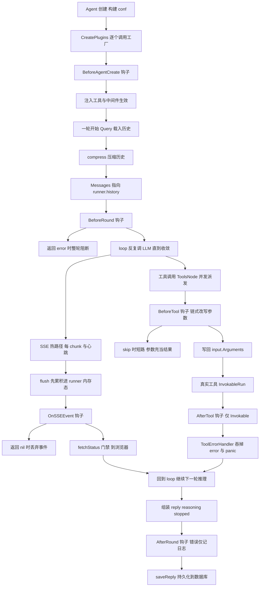
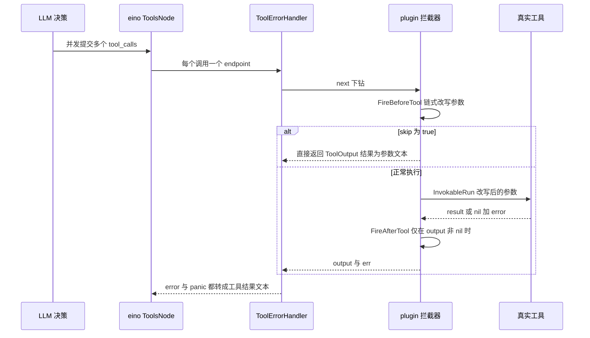

# GoRaven 插件体系解读：六个生命周期钩子、执行语义与编译期注册的取舍

> 本解读按 **ai-agent 类规格** 产出，解读基线为 GoRaven `v0.5.4`（`032c8b7`）。正文所有 `文件:行号` 引用均为 **GoRaven 仓库相对路径**，点开即可核对。

## 这个模块在系统里干什么

插件钩子体系是 GoRaven 唯一的**核心扩展点**。它不提供任何业务能力，只提供"在 Agent 一轮执行的特定时刻插入自定义代码"的位置。整个 `core/plugin/` 只有 5 个文件、357 行源码，却承担了 README 中"不用 Fork 核心代码也能深度定制"这句宣传的全部实现重量。

去掉它会怎样？答案不是"少了一个功能"，而是"任何定制都要改核心"：

- 想加本地化审计 → 必须改 `core/agent/main_runner.go` 的轮次流程；
- 想按工具名拦截危险命令 → 必须改 `core/agent/base_agent.go` 的中件线装配；
- 想对前端隐藏模型的思考链 → 必须改 `core/agent/main_runner.go` 的 SSE 派发。

在作者的第三条设计哲学 **Engineering First**（"Agent 太灵活，工具组合爆炸，没有工程约束几轮迭代后没人敢改"）语境下，插件的价值是把"可变策略"从核心流程里**抽出来**，让核心只保留"稳定骨架"。代价是扩展能力被压成一个很窄的接口面——而这个接口面到底有多宽，正是本篇要量出来的东西。

| 能力 | 实现位置 | 是否默认生效 |
|------|----------|--------------|
| 插件基础契约 | `core/plugin/plugin.go`（Name/Version） | 是 |
| 6 个钩子方法、4 个钩子接口 | `core/plugin/hooks.go` | 是（接口定义） |
| 全局注册表 + 按 Agent 实例化 | `core/plugin/registry.go` | 是 |
| 钩子扇出与短路语义 | `core/plugin/plugins.go` | 是 |
| ToolHook → eino 工具中间件适配 | `core/plugin/tool_middleware.go` | 仅当存在 ToolHook 时装配 |
| 启用入口 | `plugins/plugins.go`（`RegisterAll()`） | **否，函数体只有一行注释** |
| 内置示例插件 | `plugins/builtin/audit/audit.go` | **否，注册调用被注释掉** |

最后两行是本篇的第一个硬事实：GoRaven 发布出来的二进制里，**默认一个插件都没有加载**。`RegisterAll()` 的函数体是唯一的注册收口，而它现在长这样（[plugins/plugins.go:5-7]()）：
<!-- anchor: // RegisterAll registers every plugin factory. Call this once from main(). … //audit.Register() -->

```go
func RegisterAll() {
	//audit.Register()
}
```

`main()` 在启服务之前调用它一次（[main.go:35-38]()），调用本身是真实的、位置也正确，但被调用的函数什么都不做。
<!-- anchor: func main() { … installMiddleware(app) -->

所以"审计插件""示例插件"当前是**随仓库分发的源码样例**，不是运行时能力。系统信息页读取的插件列表因此恒为空——它走 `plugin.GetAllPluginInfo()` 按注册表工厂实例化一遍再收集名称版本（[backend/service/system_info.go:127-136]()），注册表为空则列表为空。
<!-- anchor: func (service *SystemInfoService) collectPlugins() []vo.PluginInfo { … return result -->

## 根因：为什么是钩子，而不是核心里的 if 分支

插件体系要解决的根本问题不是"可扩展"，而是**扩展点的收敛与升级安全的冲突**：

1. 定制需求是长尾的。审计、合规、内容过滤、前端事件裁剪、按工具名的权限拦截——每一种都有组织特异性，没有一种能进核心成为默认行为。
2. 长尾需求一旦以"改核心"方式实现，升级上游就变成人工 merge 冲突。GoRaven 的插件指南明确把这条写成了设计目标："所有插件注册收敛在 `plugins/plugins.go` 的 `RegisterAll()` 中，由 `main()` 显式调用。升级核心时不涉及 main.go。"（[plugins/README.md:108-108]()）
<!-- anchor: > 所有插件注册收敛在 `plugins/plugins.go` 的 `RegisterAll()` 中，由 `main()` 显式调用。升级核心时不涉及 ma -->

作者选的解法是 Go 生态里最朴素的一种：**定义接口 + 包级全局注册表 + 工厂函数**。放弃的是运行期加载（下一节展开），换来的是类型安全、零序列化、零反射、可内联调试。

## 插件模型：接口 + 工厂 + 全局注册表

### 三层结构

**第一层是基础契约**。`Plugin` 只有两个方法，`Name()` 是唯一定位符、`Version()` 是语义化版本（[core/plugin/plugin.go:6-11]()）：
<!-- anchor: // Plugin is the base interface that all plugins must implement. … Version() string -->

注意这个接口里**没有** `Init`、`Close`、`Enable`、`Priority`、`Requires`——没有生命周期回调，没有依赖声明，没有优先级，没有配置注入。插件拿不到构造参数，也拿不到关闭时机。

**第二层是能力接口**。四个接口各自声明、都嵌入 `Plugin`，按生命周期阶段切开：

- `RoundHook`：轮次前后（[core/plugin/hooks.go:11-19]()）
<!-- anchor: // RoundHook intercepts the lifecycle of a single conversation round (one user q … AfterRound(ctx *RoundContext) error -->

- `AgentLifecycleHook`：Agent 创建（[core/plugin/hooks.go:36-41]()）
<!-- anchor: // AgentLifecycleHook intercepts agent creation. … BeforeAgentCreate(ctx *AgentCreateContext) error -->

- `ToolHook`：工具调用前后（[core/plugin/hooks.go:55-63]()）
<!-- anchor: // ToolHook intercepts tool execution. … AfterTool(ctx context.Context, toolName string, args string, result string, exec -->

- `SSEHook`：SSE 事件推送（[core/plugin/hooks.go:68-74]()）
<!-- anchor: // SSEHook intercepts Server-Sent Events pushed to the frontend. … OnSSEEvent(ctx context.Context, event *SSEEventData) *SSEEventData -->

一个 struct 可以同时实现多个接口，互不耦合；框架侧不需要插件声明"我属于哪一类"。

**第三层是注册表**。它是包级全局单例，用 `sync.RWMutex` 保护一个工厂切片（[core/plugin/registry.go:5-10]()）：
<!-- anchor: type registry struct { … var global = &registry{} -->

存的是**工厂函数而不是实例**，这是这套设计里最关键的一个决定（[core/plugin/registry.go:18-23]()）：
<!-- anchor: // Register stores a factory function that creates a new plugin instance. … global.factories = append(global.factories, factory) -->

工厂的价值在 `CreatePlugins()` 里兑现：每个 Agent 都重新调用一遍所有工厂，拿到一份**独立的插件实例集合**，并按接口类型断言分进 4 个桶（[core/plugin/registry.go:43-67]()）：
<!-- anchor: // CreatePlugins instantiates a fresh set of plugin instances for a new agent. … return p -->

这解决了"有状态插件 + 多 Agent 并发"的污染问题——比全局单例插件实例安全得多。但它只保证**跨 Agent 不污染**，不保证**同一个 Agent 内并发安全**（见「执行语义」一节，这是内置 audit 插件实际踩到的坑）。

分桶之后，`Plugins` 结构把自己变成了一个按生命周期分组的多路复用器：`FireBeforeRound` 只遍历 `roundHooks`，`FireBeforeTool` 只遍历 `toolHooks`，框架代码不需要在任何调用点做类型判断。

### 实例的粒度

`FireAgentBeforeCreate` 的触发点在 `NewMainAgent` 里（[core/agent/main_agent.go:48-55]()）：
<!-- anchor: baseAgent := NewBaseAgent(mainAgentName, getMainInstructionPrompt(param), getMai … AddMiddleware: func(m any) { baseAgent.AddChatModelAgentMiddleware(m.(adk.ChatMo -->

`NewMainAgent` 由 `StartChat` 每次请求创建一次、自动化任务每次执行创建一次（`backend/service/chat.go` 第 208 行与第 1039 行两处调用）。所以插件实例的生命周期是**一次运行**，不是一次进程、也不是一次会话。README 里"插件可以持有 per-agent state"的说法成立，但这个 state 的生命周期比多数人预期的短。

另一个容易误读的点：**子 Agent 没有插件**。`getSubAgent()` 创建 sub agent 时只复制了 MCP、工具与中间件（[core/agent/main_agent.go:267-284]()），没有调用 `plugin.CreatePlugins()`：
<!-- anchor: func (main *MainAgent) getSubAgent() (result *adk.ChatModelAgent, subAgentModel  … subAgent.AddChatModelAgentMiddleware(v) -->

后果是双面的：子代理执行工具时**不经过** ToolHook（`HasToolHooks()` 对 nil `Plugins` 返回 false，装配被跳过）；但子代理的流式事件仍然经过 MainRunner 的 SSE 派发，所以 SSEHook **能看到**子代理内容。钩子覆盖率在工具维度上是有缺口的。

### 第三方插件怎么接入：编译期，且必须改仓库内文件

接入方式是纯**编译期**的。README 的四步流程里，第四步是把 import 与 `Register()` 调用写进 `plugins/plugins.go`，第五步是 `go build`（[plugins/README.md:173-177]() 的注意事项也重申了这一点）：
<!-- anchor: 1. 插件通过导出 `Register()` 函数，由 `plugins/plugins.go` 的 `RegisterAll()` 显式调用注册 … 5. 插件执行在主 goroutine 中，避免耗时阻塞 -->

我在全仓检索后确认：没有任何 `plugin.Open`、`.so` 加载、`hashicorp/go-plugin` 子进程协议或脚本引擎的痕迹；`goraven/plugins` 通过 `main.go` 的 import 进入二进制，别无第二条路。

**这意味着一个必须说清楚的限制**：所谓"第三方插件"，实际形态是"把 Go 源码放进 GoRaven 仓库的一个目录，改一行注册代码，重新编译整个 GoRaven 二进制（含 `main.go`、后端全部依赖）"。它带来的具体代价：

- 想升级 GoRaven 上游版本，你的插件目录与 `plugins/plugins.go` 处在同一个 git 仓库里，merge 冲突面并没有因为"不动 main.go"而消失；
- 插件与核心的 `Plugin` 接口版本**强耦合**：核心哪天给 `Plugin` 加一个方法，所有已编译插件当场编译失败，没有版本协商、没有兼容层（`Version()` 只被 `GetAllPluginInfo()` 读出来展示，没有任何兼容性检查）；
- 无法在运行期按租户/按配置启用或禁用某个插件：仓库里没有插件的配置项，注册即全局生效，且进程启动后不可撤销（注册表没有反注册 API）。

作者显然知道另一条路（Go 原生 `.so` 插件、或 MCP 那样的进程外协议），他选择把**运行期扩展**让给工具层（MCP 通过 `AddMCP` 接入，[core/agent/base_agent.go:96-99]()），把**生命周期定制**留给编译期钩子。这是一个纵向分工，不是能力缺失——但它决定了"不 fork 核心代码"这句话的真实含义是"不用改核心流程代码"，而不是"不用重新编译和重新部署"。
<!-- anchor: // AddMCP … base.mcpList = append(base.mcpList, mcp) -->

## 钩子清单与生命周期位置

### 六个钩子方法总表

| 钩子 | 签名要点 | 触发点 | 生命周期阶段 | 返回值语义 |
|------|----------|--------|--------------|------------|
| `BeforeAgentCreate` | `(*AgentCreateContext) error` | [core/agent/main_agent.go:51-51]() | Agent 创建 | error 被**丢弃**（见下节） |<!-- anchor: baseAgent.Plugins.FireAgentBeforeCreate(&plugin.AgentCreateContext{ -->
| `BeforeRound` | `(*RoundContext) error` | [core/agent/main_runner.go:374-374]() | 对话轮次开始（历史压缩之后、LLM 之前） | error 阻断整轮 |<!-- anchor: if err := runner.mainAgent.Plugins.FireBeforeRound(roundCtx); err != nil { -->
| `AfterRound` | `(*RoundContext) error` | [core/agent/main_runner.go:405-405]() | 对话轮次结束（LLM 返回之后、持久化之前） | error 只记日志 |<!-- anchor: if err := runner.mainAgent.Plugins.FireAfterRound(roundCtx); err != nil { -->
| `BeforeTool` | `(ctx, name, args) (string, bool)` | [core/plugin/tool_middleware.go:15-15]() 等 4 处 | 工具调用前 | 改写参数 / `skip=true` 短路 |<!-- anchor: modifiedArgs, skip := a.plugins.FireBeforeTool(ctx, input.Name, input.Arguments) -->
| `AfterTool` | `(ctx, name, args, result, err) string` | [core/plugin/tool_middleware.go:25-25]()（仅 1 处） | 工具调用后 | 改写结果字符串 |<!-- anchor: output.Result = a.plugins.FireAfterTool(ctx, input.Name, originalArgs, output.Re -->
| `OnSSEEvent` | `(ctx, *SSEEventData) *SSEEventData` | [core/agent/main_runner.go:179-179]() | 每次 SSE 推送前 | 返回 nil 丢弃该事件 |<!-- anchor: filtered := runner.mainAgent.Plugins.FireSSEHook(context.Background(), sseData) -->

钩子的上下文载体也值得单独看：`RoundContext` 把一轮对话的身份（SessionID/UserID/RoundID）、输入、历史、回复、推理链、终止标志全部装在一个结构里（[core/plugin/hooks.go:22-31]()）：
<!-- anchor: // RoundContext carries the full context of a single query round. … Stopped          bool           // whether the round was terminated -->

`AgentCreateContext` 则只给了两个身份字段和两个**注入回调**（[core/plugin/hooks.go:44-50]()），插件通过回调往 Agent 里塞工具和中间件：
<!-- anchor: // AgentCreateContext carries the context during agent creation. … AddMiddleware func(mw any)   // call to append a middleware to the agent -->

这两个回调确实生效：`AddTool` 把工具追加进 `toolList`，`AddChatModelAgentMiddleware` 把中间件追加进 `middlewares`（[core/agent/base_agent.go:92-103]()），而这两份列表在 `GetChatModelAgent()` 里才被消费（[core/agent/base_agent.go:249-250]()），时序上是安全的——`FireAgentBeforeCreate` 一定在 `NewRunner` 之前发生。附带效应：因为 `getSubAgent()` 复制的正是这两份列表，**插件注入的工具与中间件会自动传递到子 Agent**，而插件本身的钩子不会。
<!-- anchor: func (base *BaseAgent) AddTool(tool tool.BaseTool) { … base.middlewares = append(base.middlewares, middleware) -->
<!-- anchor: base.conf.Handlers = append(base.conf.Handlers, base.middlewares...) … base.addTools(base.toolList...) -->

`SSEEventData` 的负载设计得很薄，只有 Type/Content/Tool/Retry/Context 五类，注释里列出 6 种已知类型（[core/plugin/hooks.go:77-83]()）：
<!-- anchor: // SSEEventData 单个 SSE 事件的数据，前端根据 Type 读取对应的负载字段 … Context *SSEContextData   // 上下文信息（仅 "context" 类型事件使用） -->

这里有个小的事实漂移：GoRaven 实际有 7 种 SSE 事件类型（[core/agent/sse.go:12-19]() 里还有 `heartbeat`），且心跳事件同样会被送到钩子面前，但注释与文档都没有列出它。
<!-- anchor: const ( … SSEEventTypeHeartbeat = "heartbeat" -->

### 一轮执行的完整生命周期

把六个钩子挂到 Agent 一轮真实执行的骨架上，得到下图。它同时也是本篇后续所有结论的地图：注意四条泳道的时间密度完全不同——创建与轮次钩子每次运行各一次，SSE 钩子每个 token 一次。



图中每步的源码位置：创建段 [core/agent/main_agent.go:48-56]()；轮次段 [core/agent/main_runner.go:316-316]()
<!-- anchor: baseAgent := NewBaseAgent(mainAgentName, getMainInstructionPrompt(param), getMai … AddMiddleware: func(m any) { baseAgent.AddChatModelAgentMiddleware(m.(adk.ChatMo -->
<!-- anchor: runner.history, err = runner.getHistory() -->
、`364-368`、`372-381`、`400-407`、`414`；工具段 [core/plugin/tool_middleware.go:13-29]()、[core/agent/base_agent.go:216-227]()
<!-- anchor: func (a *toolInterceptorAdapter) wrapInvokable(next compose.InvokableToolEndpoin … return output, err -->
<!-- anchor: errorHandler := middleware.NewToolErrorHandler(nil) … base.Plugins.NewToolInterceptorMiddleware(), -->
；SSE 段 [core/agent/main_runner.go:132-140]()、`148-218`、`616-627`。
<!-- anchor: func (runner *MainRunner) sendSSEEvent(event *SSEEvent) { … runner.dispatchSSE(event) -->

## 执行语义：钩子到底能改什么、改不了什么

这一节是全文的核心。README 给了一张"错误处理约定"表（[plugins/README.md:162-169]()），我把它与源码逐条对齐后，发现**约定与实现并不总是一致**：
<!-- anchor-base64:fCBIb29rIHwg5Ye66ZSZ6KGM5Li6IHwg4oCmIHwgQWdlbnRMaWZlY3ljbGVIb29rIHwg6Zi75patIEFnZW50IOWIm+W7uiB8 -->

### 错误传播：四种钩子，三种命运

**BeforeRound 会真的阻断整轮**，而且阻断方式是"把错误文本变成用户看到的回复"。`FireBeforeRound` 返回 error 后，runner 设置 `beforeRoundFailed`，把 `err.Error()` 当作 content 事件推给前端，并跳过整个 `loop()`（[core/agent/main_runner.go:372-384]()）：
<!-- anchor: roundCtx.Messages = runner.history … collectedMsgs, promptTokens, completionTokens, promptCachedTokens, lastPromptTok -->

这处实现与文档一致，但语义值得注意：阻断不是"拒绝服务"，而是"用错误文本冒充 Agent 回复"。错误文本会走后续的持久化路径，所以用户会话里会留下一条看起来像 Agent 说话的报错消息。

**AfterRound 的 error 只记日志**（[core/agent/main_runner.go:405-406]()），文档一致：
<!-- anchor: if err := runner.mainAgent.Plugins.FireAfterRound(roundCtx); err != nil { … freedom.Logger().Errorf("plugin AfterRound: %v", err) -->

**AgentLifecycleHook 的 error 被静默丢弃**。这是文档与实现最明显的一处不符。[core/agent/main_agent.go:51-51]() 的调用没有接收返回值：
<!-- anchor: baseAgent.Plugins.FireAgentBeforeCreate(&plugin.AgentCreateContext{ -->

```go
baseAgent.Plugins.FireAgentBeforeCreate(&plugin.AgentCreateContext{...})
```

`FireAgentBeforeCreate` 内部会 `fmt.Errorf("plugin %s: %w", ...)` 包装错误（[core/plugin/plugins.go:22-28]()），但那个 error 没有任何人接收，所以"阻断 Agent 创建"在当前实现里**不成立**——插件返回 error 的后果是：什么都不会发生。
<!-- anchor: func (p *Plugins) FireAgentBeforeCreate(ctx *AgentCreateContext) error { … return nil -->

更麻烦的是 `AddTool`/`AddMiddleware` 的类型契约：`AgentCreateContext` 的字段类型是 `func(tool any)`，[core/agent/main_agent.go:54-55]() 里用强制类型断言 `t.(einotool.BaseTool)` 转换成具体类型。插件传错类型不会得到 error，而是**直接 panic**；这个 panic 会穿出 `NewMainAgent`（该调用点在后台 goroutine 之外），最终由框架级 `middleware.NewRecover()` 兜住（[main.go:53-53]()）变成一次请求级失败。也就是说：插件注入工具失败的表现形式是不可控的 panic，而不是可预期的错误返回。
<!-- anchor: AddTool:       func(t any) { baseAgent.AddTool(t.(einotool.BaseTool)) }, … AddMiddleware: func(m any) { baseAgent.AddChatModelAgentMiddleware(m.(adk.ChatMo -->
<!-- anchor: app.InstallMiddleware(middleware.NewRecover()) -->

**ToolHook 没有 error 通道**。`BeforeTool` 的返回值是 `(string, bool)`、`AfterTool` 是 `string`（[core/plugin/hooks.go:55-63]()），签名层面就决定了工具钩子**不可能用 error 中断任何东西**。文档表里"ToolHook.AfterTool → 仅记录日志，原返回值不变"这行是自相矛盾的：既然签名允许改结果、适配器也确实把结果写回了 `output.Result`（[core/plugin/tool_middleware.go:25-25]()），它就**不是**"原返回值不变"，而是"可以任意篡改工具结果，且无法报告失败"。
<!-- anchor: // ToolHook intercepts tool execution. … AfterTool(ctx context.Context, toolName string, args string, result string, exec -->
<!-- anchor: output.Result = a.plugins.FireAfterTool(ctx, input.Name, originalArgs, output.Re -->

**SSEHook 没有 error 通道**，用 `nil` 表示"吞掉这个事件"。接口本身只声明了"返回替换事件或 nil"（[core/plugin/hooks.go:68-74]()）：
<!-- anchor: // SSEHook intercepts Server-Sent Events pushed to the frontend. … OnSSEEvent(ctx context.Context, event *SSEEventData) *SSEEventData -->

扇出实现里对此做了短路处理——任一插件返回 nil 即终止后续插件调用（[core/plugin/plugins.go:89-97]()）：
<!-- anchor: func (p *Plugins) FireSSEHook(ctx context.Context, event *SSEEventData) *SSEEven … return current -->

### 多插件顺序：注册序，严格的短路链

`Plugins` 用 4 个切片保存分组，**没有优先级字段、没有依赖排序、没有 before/after 声明**。执行顺序就是切片顺序，即 `plugin.Register()` 的调用顺序，也就是 `plugins/plugins.go` 里的 import 与调用顺序——这一点文档写对了（[plugins/README.md:175-175]()："Hook 按注册顺序执行（import 顺序）"）。
<!-- anchor: 3. Hook 按注册顺序执行（import 顺序） -->

短路语义按钩子类型各不相同，全部在 `core/plugin/plugins.go` 里：

- `FireBeforeRound`/`FireAfterRound`/`FireAgentBeforeCreate`：**首错即断**，后续插件不再执行（`33-40`、`42-49`、`22-29`）。这意味着一个插件的返回 error 会**剥夺**排在其后插件的执行机会——审计类插件如果注册在过滤类插件之后，可能永远看不到某些轮次。
- `FireBeforeTool`：参数**链式传递**（`currentArgs = modified`），任一插件返回 `skip=true` 立即返回，后续插件不再执行（[core/plugin/plugins.go:53-62]()）：
<!-- anchor: func (p *Plugins) FireBeforeTool(ctx context.Context, toolName string, args stri … return currentArgs, false -->

- `FireAfterTool`：结果链式传递，**没有任何短路点**，所有插件都会被调用（[core/plugin/plugins.go:65-70]()），而且它遍历的是全部 `toolHooks`，与前一个钩子是否被 skip 无关：
<!-- anchor: func (p *Plugins) FireAfterTool(ctx context.Context, toolName string, args strin … return currentResult -->

- `FireSSEHook`：事件对象链式替换，任一插件返回 nil 立即终止后续插件的调用（`89-98`）。这同样是"剥夺后续插件可见性"的设计：先注册的插件可以用 nil 让后注册的插件彻底看不到这类事件。

**没有并发，全部同步串行**：所有 `Fire*` 都在调用者 goroutine 里顺序执行，框架不做任何超时、采样或异步化。文档第 5 条"插件执行在主 goroutine 中，避免耗时阻塞"（[plugins/README.md:177-177]()）方向对但表述不准确——它不是主 goroutine，而是**调用方 goroutine**，而这恰恰是问题所在（见热路径一节）。
<!-- anchor: 5. 插件执行在主 goroutine 中，避免耗时阻塞 -->

### 能改什么：三个"文档说能改、实际改不动"的地方

**① `RoundContext.Reply` 改名存实不变。** 文档把 `Reply` 标为 AfterRound 阶段"可读可改"（[plugins/README.md:141-141]()）。源码顺序是：先用 `runner.GetReplyContent()` 构造好 `adkMsg`（[core/agent/main_runner.go:388-388]()），再把 `reply := runner.GetReplyContent()` 这个**字符串副本**的地址塞进 `roundCtx.Reply`（`402`），最后才做持久化（`414`）。插件改写 `*ctx.Reply` 只动了一个局部副本，既不影响已构造的 `adkMsg`，也不影响 SSE 已经推出去的内容。**结论：AfterRound 对回复的修改没有落点**，内容过滤类插件不能靠这个字段生效。
<!-- anchor-base64:fCBgUmVwbHlgIHwg4oCUIHwg5Y+v6K+75Y+v5pS5IHwgQWdlbnQg5Zue5aSN5q2j5paHIHw= -->
<!-- anchor: adkMsg := schema.AssistantMessage(runner.GetReplyContent(), nil) -->

**② `RoundContext.Messages` 只能元素级改写，append 注入 system prompt 无效。** [core/plugin/hooks.go:15-15]() 的注释说 "Plugins can modify ctx.Messages to inject system prompts or alter history"，文档同样把 Messages 标为 BeforeRound 阶段"可读可改"。但实际喂给模型的是 `runner.history`（[core/agent/main_runner.go:423-425]()）：
<!-- anchor: // Plugins can modify ctx.Messages to inject system prompts or alter history. -->
<!-- anchor: func (runner *MainRunner) loop(ctx context.Context, content string, media []Medi … iter := runner.runner.Run(ctx, append(runner.history, BuildUserMessage(content,  -->

`roundCtx.Messages` 只是这个切片的**另一个切片头**。插件执行 `ctx.Messages[i] = x`（改元素，同一底层数组）能生效；执行 `ctx.Messages = append(ctx.Messages, sysMsg)`（改切片头）**不会**被 `loop()` 看到，而那正是"注入 system prompt"的典型写法。这个失效是静默的——没有 error，没有日志。

**③ `AfterTool` 看到的参数是修改前的参数。** 适配器保存 `originalArgs := input.Arguments`，改完 `input.Arguments` 后才执行工具，但传给 `FireAfterTool` 的却是 `originalArgs`；而且 `if output != nil` 的前置判断意味着，工具返回 error 时 eino 的 endpoint 给出 nil output，`AfterTool` **根本不会被调用**（[core/plugin/tool_middleware.go:13-27]()）：
<!-- anchor: func (a *toolInterceptorAdapter) wrapInvokable(next compose.InvokableToolEndpoin … return output, err -->

所以 `AfterTool` 的 `execErr` 形参在实践中近乎恒为 nil——内置 audit 插件里那段 `if execErr != nil` 的分支（[plugins/builtin/audit/audit.go:55-61]()）是一段难以触发的死代码：
<!-- anchor: func (p *AuditPlugin) AfterTool(ctx context.Context, toolName string, args strin … return result -->

### 能真正改动的能力边界

把上面的分析收敛成一张"实际能力表"，这才是插件在这套系统里能做到的事：

| 能力 | 是否真的可行 | 依据 |
|------|--------------|------|
| 观察轮次身份与用户输入 | ✅ | `RoundContext` 字段齐全 |
| 观察回复长度、推理链长度、是否被终止 | ✅ | AfterRound 有值 |
| 改写回复内容 / 拦截回复 | ❌ | `Reply` 是副本，改后无落点 |
| 在历史里注入新的 system prompt | ❌（append 无效） | 模型读 `runner.history` |
| 原地替换/改写历史消息 | ✅（元素级） | 同一底层数组 |
| 改写工具参数 | ✅ | 写回 `input.Arguments` |
| 短路一次工具调用 | ✅（含副作用） | `skip=true` |
| 改写工具返回结果 | ✅ 但仅 Invokable 工具 | 只有 `wrapInvokable` 调 AfterTool |
| 拿到工具执行错误 | ❌（`execErr` 恒 nil） | `output != nil` 门禁 |
| 过滤/改写推给前端的事件 | ✅ | `OnSSEEvent` |
| 阻止事件被持久化 | ❌ | flush 发生在钩子之前 |
| 新增一种前端可见的事件 | ❌ | 前端 switch 无 default 分支 |
| 注入工具与中间件 | ✅ | 时序正确 |
| 用 error 阻断 Agent 创建 | ❌ | 返回值被丢弃 |

这张表就是"深度定制"这句话的真实边界。它比宣传窄，但并非没有价值——**只读观察 + 展示层改写 + 工具参数改写与短路**这三件事，已经能覆盖审计、合规拦截、UI 降噪这三类主要场景。

### 热路径代价：每 token 一次同步调用

`FireSSEHook` 的调用点在任何门禁之前。`dispatchSSE` 一进来就构造 `plugin.SSEEventData`（含 Tool/Retry/Context 三个嵌套结构），然后无条件调用钩子（[core/agent/main_runner.go:148-181]()）：
<!-- anchor: func (runner *MainRunner) dispatchSSE(event *SSEEvent) { … event.Type = filtered.Type -->

关键在于 `sendSSEEvent`/`sendSSEEventNoFlush` 被调用的地方——**流式输出的每一个 chunk**（[core/agent/main_runner.go:616-626]()）：
<!-- anchor: // tool-call-phase content and sub-agent content use NoFlush. … runner.sendSSEEventNoFlush(&SSEEvent{Type: SSEEventTypeReasoning, Content: chunk -->

一次长回复里 reasoning 与 content 都是逐块推送，意味着 `OnSSEEvent` 会被同步调用**成千上万次**。加上三条次要放大路径：

1. **心跳也过钩子**。`startHeartbeat` 每 30 秒发一次 heartbeat 事件，走的是同一个 `dispatchSSE`（[core/agent/main_runner.go:288-298]()）：
<!-- anchor: func (runner *MainRunner) startHeartbeat() { … r.sendSSEEventNoFlush(&SSEEvent{Type: SSEEventTypeHeartbeat}) -->

2. **钩子在门禁之前**。真正决定"这个事件要不要发"的 `fetchStatus` 判断在钩子**之后**（[core/agent/main_runner.go:209-210]()）：
<!-- anchor: if runner.GetFetchStatus() != 1 && event.Type != SSEEventTypeEnd { … return -->

   自动化任务创建的静默 Agent（`SetEnableStreaming(false)`）没有 SSE 消费方，`fetchStatus` 恒为 0，所有事件都会被丢弃——但插件钩子已经为它们全部执行过一遍。插件无法从事件里知道"这一轮有没有人在看"。

3. **空插件集也要付代价**。工具中间件有 `HasToolHooks()` 做零成本门禁（[core/plugin/plugins.go:73-74]()），SSE 侧**没有对应的 `HasSSEHooks()`**：`dispatchSSE` 无条件构造 `SSEEventData` 并调用 `FireSSEHook`，即使 `sseHooks` 是空切片。所以默认零插件部署下，每个 token 仍然多付 1~3 次堆分配 + 一次函数调用——这跟工具路径"没有 ToolHook 就完全不装中间件"的取向不一致。
<!-- anchor: func (p *Plugins) HasToolHooks() bool { … return len(p.toolHooks) > 0 -->

还有两个语义细节：

- 钩子拿到的是 `context.Background()`（[core/agent/main_runner.go:179-179]()，即上面 dispatchSSE 那段），**没有请求 ctx**：没有 trace id、没有取消信号、没有租户信息，插件做外部上报时无法继承链路追踪，也无法在客户端断开时被通知;
<!-- anchor: filtered := runner.mainAgent.Plugins.FireSSEHook(context.Background(), sseData) -->
- `SSEEventData` 本身不带 SessionID/UserID，所以插件**仅凭 SSE 事件无法判断这是哪个会话的流**。

顺带一个有意思的印证：仓库自带的联调 mock 数据里，正好有一段"代码审查"对话点名了这个风险——"dispatchSSE 会触发 plugin.FireSSEHook — 该 hook 是阻塞调用，如果某个 plugin hook 实现里有慢 IO，整个 SSE 通道都会被拖慢"，并建议加超时或挪到独立 goroutine（[backend/repository/seed/mock/stream_mock.go:180-190]()）：
<!-- anchor: content3 := strings.Join([]string{ … "  · 或者把 plugin 调用移到独立 goroutine 中，把结果通过 channel 回收，", -->

需要明确标注这是**演示用的种子对话内容**（前端联调 mock，`chatUseMock` 默认 false），不是项目的设计文档或 issue 记录；它不能当权威依据，但可以说明这个性能特征在项目自身视野之内，而 core 里至今没有超时、采样或异步化任何一项。

### panic 与可靠性：四种钩子，两种命运

- **工具钩子有保护，但保护是"伪装"**。装配顺序是先 `ToolErrorHandler` 再插件拦截器（[core/agent/base_agent.go:216-225]()），eino 的 `compose` 以**逆序**包装中间件，所以先注册的 `ToolErrorHandler` 处在**最外层**。它的 `WrapInvokableToolCall` 用 `defer recover()` 把 panic 与 error 一并转成 `ToolOutput` 文本、并把 `err` 置空（[core/middleware/tool_error_handler.go:38-54]()）：
<!-- anchor: errorHandler := middleware.NewToolErrorHandler(nil) … base.Plugins.NewToolInterceptorMiddleware(), -->
<!-- anchor: func (h *ToolErrorHandler) WrapInvokableToolCall(next compose.InvokableToolEndpo … return output, err -->

  效果是：插件在 `BeforeTool`/`AfterTool` 里 panic **不会**击穿进程，但会被伪装成"工具执行失败：panic: ..."的 ToolMessage 喂给 LLM，模型可能据此编造理由继续跑。对原本就想拒绝执行的插件来说，这比静默失败更危险。

- **轮次钩子有保护，是"整轮殉葬"**。`Query` 的后台 goroutine 有一个兜底 `defer recover()`（[core/agent/main_runner.go:336-342]()）：
<!-- anchor: defer func() { … close(runner.sseChan) -->

  `BeforeRound`/`AfterRound`/以及同一 goroutine 内的 `OnSSEEvent` panic 会被它兜住，代价是**整轮对话被丢弃**（发 end 事件、关闭通道、清会话状态）。用户看到的是"流突然结束"，没有回复、没有理由。

- **心跳 goroutine 里的 SSE 钩子 panic 会击穿进程**。`startHeartbeat` 起的是一个**裸 goroutine**，内部没有任何 recover（[core/agent/main_runner.go:288-298]()）。框架的 `middleware.NewRecover()` 只覆盖 HTTP handler 链路，管不到这个 goroutine。一个在 `OnSSEEvent` 里 panic 的插件，恰好碰上一次心跳事件，就是进程级崩溃。同一份插件代码，在流式 chunk 上 panic 只是废掉一轮，在心跳上 panic 就废掉整个服务——这个差别完全由调用方 goroutine 决定，插件作者无法感知。
<!-- anchor: func (runner *MainRunner) startHeartbeat() { … r.sendSSEEventNoFlush(&SSEEvent{Type: SSEEventTypeHeartbeat}) -->

- **插件实例是并发共享的**。GoRaven 全仓没有设置 `ToolsConfig.ExecuteSequentially`，eino 的 ToolsNode 默认为每个 tool call 起独立 goroutine 执行。多个工具调用并行时，**同一个插件实例的方法会被并发调用**；SSE 侧同理（流式 goroutine 与心跳 goroutine 并发调 `OnSSEEvent`）。而内置 audit 插件用一个无锁的 `p.logs []string` 在 `BeforeTool`/`AfterTool`/`OnSSEEvent`/`BeforeAgentCreate` 里 append（[plugins/builtin/audit/audit.go:15-16]()、`50-53`、`55-62`、`66-69`、`73-76`）：
<!-- anchor: type AuditPlugin struct { … logs []string -->

  `CreatePlugins` 的"每 Agent 一份实例"保证了跨 Agent 隔离，却没有覆盖**同 Agent 内并发**这一层。这是仓库里那份"参考实现"自身的缺陷，也说明插件作者要自己承担并发责任——而框架没有任何一处文档或类型约束提示这一点。

## 工具中间件：为什么它和通用钩子不是一回事

`core/plugin/tool_middleware.go` 是 ToolHook 与 eino `compose.ToolMiddleware` 之间的适配器，只有 74 行，但它承担了两个不平凡的事：

**第一，覆盖 eino 的四种工具形态。** eino 的工具节点支持 `Invokable`、`Streamable`、`EnhancedInvokable`、`EnhancedStreamable` 四类 endpoint，适配器为每类各写一个 `wrap*` 闭包（[core/plugin/tool_middleware.go:13-29]()、`31-44`、`46-59`、`61-73`），构造一个四字段齐全的 `compose.ToolMiddleware`（[core/plugin/plugins.go:77-85]()）。这是"不在 eino 之上重造工具调用层"的务实选择，代价是**四个分支的实现并不等价**：
<!-- anchor: func (a *toolInterceptorAdapter) wrapInvokable(next compose.InvokableToolEndpoin … return output, err -->
<!-- anchor: func (p *Plugins) NewToolInterceptorMiddleware() compose.ToolMiddleware { … EnhancedStreamable: a.wrapEnhancedStreamable, -->

- 只有 `wrapInvokable` 调用了 `FireAfterTool`；
- 只有 `wrapInvokable` 在 `skip` 时把改写后的参数文本当作工具结果返回（`ToolOutput{Result: modifiedArgs}`）；另外三个分支在 skip 时返回空的 Stream/Enhanced 输出（其中 `StreamToolOutput{Result: nil}` 是一个 nil 流读取器）。

所以"每次工具执行前后触发、支持参数修改与短路"这条宣传（[plugins/README.md:147-147]()）**只对 Invokable 工具完整成立**。MCP 工具与文件系统工具走哪条分支，取决于它们实现的接口；一个依赖 `AfterTool` 改写结果做脱敏的插件，可能在某个工具上完全失效。
<!-- anchor: - `BeforeTool` → 可修改参数、可设置 skip=true 阻断执行 -->

**第二，它把"错误拦截"这件事留给了 core 中间件。** `core/middleware/tool_error_handler.go` 不是插件，也不实现任何插件接口，它是 core 无条件安装的基础设施：把工具 error 与 panic 统一转成 LLM 可读的 `ToolMessage`（[core/agent/base_agent.go:213-230]()）：
<!-- anchor: func (base *BaseAgent) GetChatModelAgent() (result *adk.ChatModelAgent, err erro … return fmt.Sprintf("Tool '%s' does not exist. Do not retry or invent tools. Chec -->

它对外暴露的形态就是一个四字段齐全的 `compose.ToolMiddleware`，与插件适配器返回的结构逐字段同构（[core/middleware/tool_error_handler.go:126-131]()）：
<!-- anchor: func (h *ToolErrorHandler) ToToolMiddleware() compose.ToolMiddleware { … EnhancedStreamable: h.WrapEnhancedStreamableToolCall, -->

两者的分工因此是清晰的三层洋葱：最外层是 core 的错误兜底，中间层是插件钩子，最内层是真实工具。



这个顺序带来两个必须点明的后果：

1. **插件拿不到真实错误**。因为 error 到最外层就被抹平了，而插件在内层——`AfterTool` 的 `execErr` 参数因此在结构上就注定是 nil；
2. **插件无法选择性放行错误**。想让某类工具错误直接中断 Agent 而不是喂给模型，插件层做不到，因为更外层已经把 error 吃掉了。这是"core 中间件在外、插件在内"的确定性代价。此外 `GetChatModelAgent()` 通过 append 修改 `base.conf`（[core/agent/base_agent.go:217-227]()），不是幂等操作；同一个 Agent 若调用两次，中间件会被安装两遍——当前调用路径（每个 Agent 一次）避开了它，但这是脆弱的。
<!-- anchor: base.conf.ToolsConfig.ToolCallMiddlewares = append( … base.Plugins.NewToolInterceptorMiddleware(), -->

## 内置 audit 插件：宣传与实现逐条对照

### 它审计什么、记录到哪

`AuditPlugin` 是仓库里唯一的示例插件，一个 struct 实现了全部四个钩子接口（[plugins/builtin/audit/audit.go:11-20]()）：
<!-- anchor: func Register() { … func (p *AuditPlugin) Version() string { return "1.0.0" } -->

它采集的信息包括：轮次身份与用户原问（[plugins/builtin/audit/audit.go:24-27]()）、回复长度与推理链长度与是否被终止（`29-46`）、工具名与参数长度、工具结果长度或错误（`50-62`）、SSE 事件类型（`66-69`）、Agent 创建的会话与用户（`73-76`）。
<!-- anchor: func (p *AuditPlugin) BeforeRound(ctx *plugin.RoundContext) error { … return nil -->

存储方式是**内存切片 + 标准输出**：全部 append 进 `p.logs`，然后在 `AfterRound` 里逐行 `log.Println("[audit]", l)` 后清空（[plugins/builtin/audit/audit.go:29-45]()）：
<!-- anchor: func (p *AuditPlugin) AfterRound(ctx *plugin.RoundContext) error { … return nil -->

这里的工程质量问题很集中：

- **落点只在 stdout**。没有结构化字段、没有落库、没有脱敏处理（用户原文 `query=%q` 被原样打印）、没有租户维度的检索接口。作为"审计"来说，它的合规价值接近于零——一个真正的审计插件需要接外部存储，而插件 API 既没有关闭钩子也没有 flush 时机保证（进程崩溃或轮次 panic 时 `logs` 全部丢失，因为清空只发生在 `AfterRound`）。
- **量级放大**。`OnSSEEvent` 每个 token 记录一条，`AfterRound` 才统一打印，等于把整轮的所有流式事件堆在内存里。长回复 + 高频 reasoning 会让这个切片膨胀到几万条。
- **并发不安全**（上一节已论证）：无锁切片在并行工具调用与心跳并发下会产生数据竞争与丢失更新。
- **默认不启用**：[plugins/plugins.go:7-7]() 的 `//audit.Register()` 被注释掉，所以以上行为在当前二进制里都不会发生。
<!-- anchor: //audit.Register() -->

### 为什么"审计"应该做成插件

从设计意图看，这个例子是恰当的：审计策略因组织而异（落库、外发、采样、脱敏、留存期），任何默认实现都会绑死一类用户；而审计天然是**只读观察**，不需要改写能力——正好避开上一节列出的所有"改不动"的坑。反过来说，这个例子也**没有验证**宣传里"深度定制"的改写能力面，因为 audit 一个字段都没改过，它把 `args` 原样返回、`result` 原样返回、`event` 原样返回。

所以"这个例子印证了不 fork 核心即可深度定制"这个结论需要打折：它印证的是**可观察性扩展**可以不 fork，而不是**行为改写**可以不 fork（后者能改的范围见能力表，且三处文档承诺的改写点实际无效）。

### README 宣传与源码实现的逐条核对

| # | README 说法（`plugins/README*.md`） | 源码事实 | 判定 |
|---|-------------------------------------|----------|------|
| 1 | 插件系统允许第三方扩展 Agent 行为，无需修改核心代码 | 需改 `plugins/plugins.go` 并重新编译整个二进制；不改 `main.go` 与核心流程 | ⚠️ 部分成立 |
| 2 | 所有注册收敛在 `RegisterAll()`，`main()` 显式调用，升级核心不涉及 main.go | [main.go:36-36]() 调用位置正确，`RegisterAll()` 当前为空实现 | ✅ 成立 |<!-- anchor: plugins.RegisterAll() -->
| 3 | Hook 按注册顺序执行（import 顺序） | 切片顺序即注册顺序，无优先级字段 | ✅ 成立 |
| 4 | 插件执行在主 goroutine 中，避免耗时阻塞 | 是调用方 goroutine；SSE 钩子在每 token 同步执行，心跳与静默任务也过钩子 | ⚠️ 表述不准 |
| 5 | BeforeTool → 可修改参数、skip 阻断 | Invokable 分支成立；另 3 个分支不调 AfterTool、skip 返回空结果 | ⚠️ 覆盖不全 |
| 6 | AfterTool → 仅记录日志，原返回值不变 | 签名允许且适配器确实把结果写回，可任意篡改 | ❌ 与实现不符 |
| 7 | RoundHook.BeforeRound 出错阻断本轮，错误文本作为回复 | 与源码一致（[core/agent/main_runner.go:374-381]()） | ✅ 成立 |<!-- anchor: if err := runner.mainAgent.Plugins.FireBeforeRound(roundCtx); err != nil { … beforeRoundFailed = true -->
| 8 | RoundHook.AfterRound 出错仅记录日志 | 与源码一致（[core/agent/main_runner.go:405-407]()） | ✅ 成立 |<!-- anchor: if err := runner.mainAgent.Plugins.FireAfterRound(roundCtx); err != nil { … freedom.Logger().Errorf("plugin AfterRound: %v", err) -->
| 9 | AgentLifecycleHook 出错「阻断 Agent 创建」 | 返回值被丢弃，无任何影响 | ❌ 与实现不符 |
| 10 | RoundContext.Reply 在 AfterRound「可读可改」 | 是局部副本，改写无落点 | ❌ 与实现不符 |
| 11 | RoundContext.Messages 在 BeforeRound「可读可改」，可注入 system prompt | 只有元素级改写生效，`append` 注入被 `loop()` 忽略 | ❌ 与实现不符 |
| 12 | SSEHook 每个 SSE 事件推送前触发，nil 可抑制 | 触发成立；但 flush 在前，抑制不影响持久化；注释漏了 heartbeat 类型 | ⚠️ 部分成立 |
| 13 | 示例：审计日志插件（RoundHook + ToolHook + SSEHook 组合） | 示例存在且默认注册被注释;系统信息页插件列表恒为空 | ⚠️ 存在但未启用 |
| 14 | 一个 struct 实现多个接口时所有钩子都会被调用 | 与 `CreatePlugins` 的类型断言分桶一致 | ✅ 成立 |

三个 `❌` 全部集中在"写回/阻断"类承诺上，这不是巧合：**这套钩子的强项是观察与展示层改写，弱项是把改动送回主流程**。文档是按"接口看起来能做什么"写的，不是按数据流实际能不能回流写的。

## 可观测性与插件的关系

README 把 **Observability First** 列为第一条设计哲学（"人机协作的瓶颈是看不到它在想什么"），插件体系在这一点上给出的答案是：

**能看到的**。SSE 钩子确实覆盖了全部的流式事件出口，因为所有事件（内容、推理、工具、重试、上下文、心跳，含子代理事件）都汇聚到唯一一个 `dispatchSSE`。插件因此可以在一个点上观察"这一轮向用户展示了什么"，粒度细到 token。对"把 Agent 的执行过程镜像到外部观测系统"这个需求，这个覆盖度是够的。

**看不到的**：
- 事件里没有会话身份（`SSEEventData` 只有 5 类负载），ctx 又是 `context.Background()`，插件无法把事件归因到会话/用户/轮次——除非它在 `BeforeRound` 里按 SessionID 自建映射，而插件实例是 per-run 的，"记住上一个会话"这件事本身不可靠；
- 拿不到工具调用的结构化结果（只有字符串长度级的信息能拿，且 `AfterTool` 在错误时不触发）；
- 拿不到模型请求本身（没有 BeforeModel/OnModelChunk 类钩子），token 用量只在 SSE 的 context 事件里以汇总形式出现。

**能不能向前端推自定义事件：不能。** 这一点值得单独说清，因为它是最容易被"SSEHook 拦截事件流"这句话误导的地方。`OnSSEEvent` 的签名只能返回一个替换用的 `*SSEEventData` 或 nil，它**没有**任何写通道、没有 emitter、没有"额外发一个事件"的返回约定（[core/plugin/hooks.go:68-74]()）。插件能做的只有两件事：把已有事件的 `Type`/`Content` 改掉，或吞掉它。而前端对事件的消费是一个**没有 default 分支的 switch**（[frontend/src/api/sse.ts:31-60]()）：
<!-- anchor: // SSEHook intercepts Server-Sent Events pushed to the frontend. … OnSSEEvent(ctx context.Context, event *SSEEventData) *SSEEventData -->
<!-- anchor: onmessage(event) { … // Keep-alive signal to prevent nginx/proxy timeout — no action needed -->

所以即便插件把 `Type` 改成一个新名字，事件能被后端原样写进流（SSE 事件名取 `event.Type`，[backend/controller/chat.go:203-216]()），前端也会静默丢弃它：
<!-- anchor: case event, ok := <-sse.SSEChan: … return -->

要让插件自定义事件真正到达用户界面，必须同时修改前端（新增 case、新增渲染、新增 i18n），也就是**又回到"改仓库源码 + 重新构建前端产物"**。这与插件体系"不动核心即可扩展"的目标构成一个明显的边界：**插件的可观测性扩展止步于后端进程，无法穿透到 UI**。

另一个容易误判的点：**过滤事件 ≠ 阻止持久化**。`sendSSEEvent` 是先把内容累积进 runner 的内存态（`flushReasoningContent`/`flushReplyContent`），再派发事件（[core/agent/main_runner.go:132-139]()）：
<!-- anchor: func (runner *MainRunner) sendSSEEvent(event *SSEEvent) { … runner.dispatchSSE(event) -->

而 `saveReply` 用的正是这份内存态。所以插件用 nil 吞掉一个 content 事件，只影响"用户当下有没有看到"，数据库里依然会写入完整回复，后续刷新页面还能看到。想做"内容过滤"，SSE 钩子是最无效的一层——而真正有效的那一层（`AfterRound` 改写 Reply）又是改不动的副本。这两个事实叠加起来，说明当前钩子集合**无法实现一个可靠的输出内容过滤**，只能实现"当下不显示"。

## 权衡与不足

### 决策一：编译期注册，用部署灵活性换类型安全

作者放弃了三条可选的运行期路线：Go 原生 `plugin.Open`（平台受限、Go 版本严格耦合、GC/依赖共享的坑）、`hashicorp/go-plugin` 式子进程协议（需要 IDL/序列化、插件不能直接传 Go 对象，`RoundContext` 里的 `[]*schema.Message` 与 `*SSEEventData` 都得先协议化）、以及嵌入式脚本（性能与安全双输）。

选源码级插件的收益是实打实的：钩子可以直接传 Go 对象（改 `input.Arguments` 是零拷贝的原地写）、不需要序列化边界、panic 与栈可直接观察、调试就是普通 Go 调试。代价也已经列清：必须重新编译部署、版本强耦合、不能按配置启停、不能隔离不可信代码。

值得注意的是，GoRaven 在**工具层**保留了完整的运行期扩展路径（MCP 通过 `AddMCP` 接入，[core/agent/base_agent.go:96-99]()），也就是说项目其实同时具备"运行期加工具"和"编译期改行为"两条路。这个分工是自洽的，但文档没有把两者的边界讲明白，"插件"这个词在 README 里被用得比它在代码里的实际含义宽。
<!-- anchor: // AddMCP … base.mcpList = append(base.mcpList, mcp) -->

### 决策二：钩子少而粗，换取核心流程的稳定

六个钩子方法覆盖四个阶段，比 eino 自身的 component callbacks（ChatModel/Tool/Retriever 各自的 OnStart/OnEnd/OnError）粗得多，也比 LangChain CallbackHandler 的事件粒度粗。即便 eino 就在依赖里，GoRaven 也没有使用它的 callback 机制（全仓检索没有 `callbacks.` 的实际调用，只有 [core/plugin/hooks.go:45-45]() 一句注释里的英文单词），而是在工具层复用了 `compose.ToolMiddleware`、在 Agent/轮次层自建了粗粒度钩子。
<!-- anchor: // Plugins can inject tools and middleware using the AddTool and AddMiddleware c -->

【存疑待核实】同类方案的具体 API 名称与语义（eino `callbacks` 的 handler 挂载方式、OpenAI Agents SDK 的 hooks 对象覆盖、LangChain CallbackHandler 的运行时注入）我没有在本仓源码中核实，以上对比只到"粒度与同进程约束"这一层结论：三者本质都是**同进程回调**，都无法安全加载不可信的第三方代码；差异在于挂载时机（构建期注入 vs 运行时 provider 注入）与事件粒度。GoRaven 选的是最粗、最稳、最不依赖上游 API 的一档，这符合 Engineering First 的取向，代价是"想做细粒度干预必须改核心"。

### 不足清单（均带证据）

1. **接口承诺与实现不符，且失效是静默的**。`Reply` 改写、`Messages` append 注入、`AgentLifecycleHook` 阻断三处承诺在源码层不成立，插件作者不会收到任何错误或警告（见能力表）。
2. **热路径无任何保护**。`OnSSEEvent` 每 token 同步执行、无超时、无采样、无异步化；零插件时也照常分配 `SSEEventData`（缺 `HasSSEHooks()` 门禁）。
3. **panic 后果按调用方 goroutine 分裂**。工具钩子被兜住但伪装成工具错误；轮次钩子击穿整轮；心跳 goroutine 击穿进程。插件无法知晓自己运行在哪种容器里。
4. **插件实例并发无保障，示例插件自身有数据竞争**（`plugins/builtin/audit/audit.go` 无锁 `logs` 切片 + eino 默认并行工具执行）。
5. **无启用/禁用配置、无优先级、无依赖排序、无接口版本协商**。`Version()` 仅用于展示；注册表无注销 API；插件必须与核心同版本编译。
6. **零测试覆盖**。`core/plugin/` 下没有任何 `*_test.go`；现有 Runner 测试传的是空的 `&plugin.Plugins{}`（[core/agent/main_runner_test.go:36-36]()、`118`），钩子行为没有任何回归保护——这也解释了为什么上述多处文档与实现的不一致能长期共存。
<!-- anchor: BaseAgent: BaseAgent{Plugins: &plugin.Plugins{}}, -->
7. **多租户隔离靠"约定"而非"机制"**。插件 API 只给 SessionID/UserID 字符串，不发放任何仓储句柄，看起来像能力限制；但插件与核心**同进程、同二进制、同权限**，可以直接 import `goraven/backend/repository` 与 `goraven/core/sandbox` 绕过租户过滤与沙盒。`Plugin` 接口只有 Name/Version，没有任何权限/能力声明字段，运维在部署前无法审计"这个插件会碰什么数据"。要让框架层真正约束插件，需要的是能力清单 + 仓储访问层收口，而不是现在的"自由函数 + 全局注册表"。【存疑待核实】插件运行点能否直接取得 freedom 的 ServiceLocator/Worker 上下文（即"确实能查库"这一步）我未实证。
8. **`GetChatModelAgent()` 不幂等**：每次调用都 append 中间件，重复调用会重复安装。

### 亮点（同样带证据）

1. **接口面极小且正交**。6 个方法、4 个可组合接口，插件按需实现，框架侧零反射、零配置、零依赖注入。
2. **工厂而非单例**。`Register(func() Plugin)` + `CreatePlugins()` 让每个 Agent 拿到独立实例（[core/plugin/registry.go:18-24]()、`43-67`），解决了"有状态插件 + 多 Agent"的污染问题，思路正确（示例插件自己没用好是另一回事）。
<!-- anchor: // Register stores a factory function that creates a new plugin instance. … global.factories = append(global.factories, factory) -->
3. **类型断言分桶代替注册分类**。插件不需要声明"我实现了哪些钩子"，`CreatePlugins` 用类型断言自动归位（[core/plugin/registry.go:54-65]()），插件端零样板代码。
<!-- anchor: if h, ok := inst.(AgentLifecycleHook); ok { … p.sseHooks = append(p.sseHooks, h) -->
4. **零成本抽象的边界意识**。`HasToolHooks()` 门禁让无插件部署的工具路径完全不受影响（[core/agent/base_agent.go:222-227]()），是这套设计里最规范的一处。
<!-- anchor: if base.Plugins != nil && base.Plugins.HasToolHooks() { … base.Plugins.NewToolInterceptorMiddleware(), -->
5. **不重造工具调用层**，直接适配 eino 的 `compose.ToolMiddleware` 四形态，把并发、流式、增强结果的复杂度留给上游。
6. **有真实的示例与开发指南**（中英双份 181 行），虽然存在上述文档漂移，但接入路径、错误约定、注意事项都写全了——这对一个 357 行的模块来说，文档投入是超配的。

> **验证状态**：本篇 89 条 `文件:行号` 引用全部由 `verify-references.mjs` 与仓库真实源码逐条双向校验通过（OK=89 / WEAK=0 / MISMATCH=0 / UNVERIFIED=0），2 幅 Mermaid 图均通过 `check-mermaid.mjs` 的语法与渲染检查（ERROR=0 / WARN=0）。
