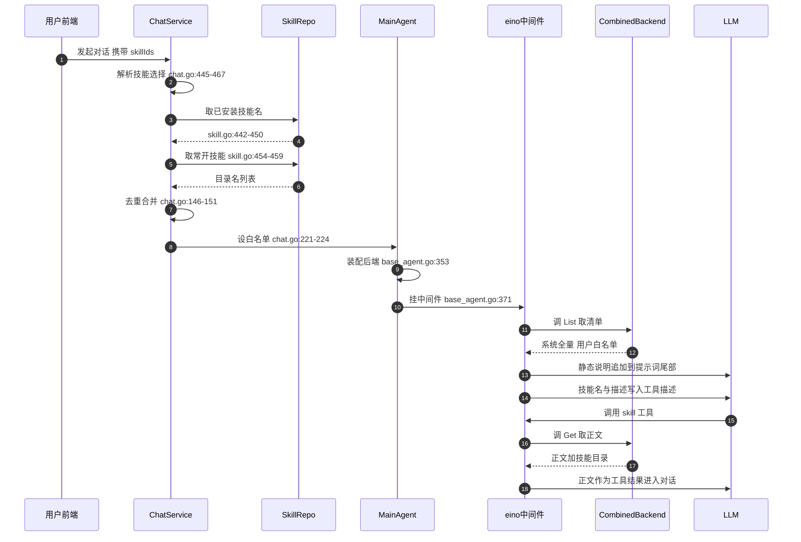
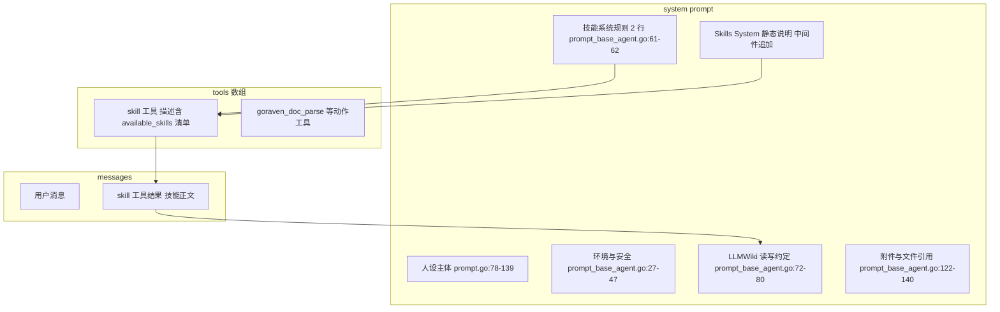

# GoRaven Skill 体系解读：渐进披露加载、三方一致约束与平台自描述

> 本解读按 **ai-agent 类规格** 产出，解读基线为 GoRaven `v0.5.4`（`032c8b7`）。正文所有 `文件:行号` 引用均为 **GoRaven 仓库相对路径**，点开即可核对。

## 这个模块在系统里干什么

GoRaven 把「技能」放在**知识与动作的分界线**上：工具（`goraven_doc_parse`、`execute`、`web_fetch`）提供手脚，Skill 提供「这件事该怎么做」的成套知识。去掉 Skill 体系，Agent 仍然能读写文件、跑 Shell，但它不会知道「团队项目里的 `llmwiki/quickstart.md` 要先去读」「二进制文档必须走 doc-parse 而不是直读」「装技能前要先看目录规范」——这些不是模型权重里的知识，而是这个平台特有的约定。llms.txt 的术语表把这条边界写成了定义级的一句话：**Tools perform actions; skills provide reusable knowledge, rules, and workflows**（[llms.txt:79-83]()）。
<!-- anchor: - **Agent** is the task execution entity; a **model** is the language capability … - **Platform self-description skills** describe GoRaven's own features, interfac -->

更关键的是，GoRaven 用一个很特别的解法处理「平台自己怎么用」：**把自己写成 10 个 Skill**。`goraven-guide` / `goraven-runtime` / `goraven-features` / `goraven-user-ui` / `goraven-admin-ui` / `goraven-automation` / `goraven-doc-parse` / `goraven-llmwiki` / `goraven-install-skill` / `goraven-chart` 全部以 `SystemSkill` 常量形式编译进二进制，启动时按 `config.Version` 版本门控播种进 `system_skill` 表（[backend/repository/seed.go:173-191]()）。
<!-- anchor: func seedSystemSkills(db *gorm.DB) error { … automationDescription := seed.ParseSkillDescription(automationContent) -->

这一节要回答的是：这些 Skill 长什么样、怎么被挑进上下文、正文落在 prompt 的哪个位置、为什么选「写成 skill」而不是「塞进系统提示词」，以及这条路线在 1739 行的 `backend/service/skill.go` 里付出了什么代价。

## Skill 的数据形态

### 三种来源、四张表、一个磁盘目录

GoRaven 的 Skill 不是单一实体，而是**按所有权和生命周期分成了三层货架**，共用同一套磁盘格式（`SKILL.md`）和同一个运行时装配入口（`CombinedBackend`）：

| 来源 | 表 | 谁维护 | 是否需用户勾选 | 运行时身份 |
|------|-----|--------|----------------|-----------|
| 系统内置 / 管理员维护 | `system_skill` | 内置常量 + 管理员 CRUD | **不需要**，全局常驻清单 | `systemSkillBackend`（DB → 内存） |
| 技能市场 | `skill_market` | 管理员（ClawHub 导入 / zip 上传） | 需要（安装后勾选） | `userBackend`（沙盒磁盘） |
| 用户自建 | 无表（只在磁盘） | 用户自己 | 需要 | `userBackend`（沙盒磁盘） |
| 团队共享 | `skill_share` + `user_skill` | 共享者 owner | 需要 | `userBackend`（沙盒磁盘） |
| 用户安装记录 | `user_skill` | 用户 | — | 书签表：安装状态 / always_on / 分类 |

`system_skill` 的字段刻意做窄：`Name`（唯一，要求 `goraven-` 前缀，[backend/po/system_skill.go:9-14]()）、`Description`、`Content`（全文提示词）、`Version`、`Status`、`Deleted`。其中 `Version` 是这套设计的关键——它存的是 `config.Version`，即二进制版本号（[backend/po/system_skill.go:17-26]()）。
<!-- anchor: const ( … const SystemSkillNamePrefix = "goraven-" -->
<!-- anchor: type SystemSkill struct { … Updated     time.Time `gorm:"not null;column:updated"` -->

`user_skill` 反而更宽：`SkillName`（目录名，与 `user_id` 组成唯一索引）、`MarketSkillId`、`Source`（`market` / `custom` / `share`）、`InstallStatus`（0 未安装 / 1 安装中 / 2 已安装 / 3 失败）、`AlwaysOn`。注意注释里那句「目录名（SkillFilter 用此字段匹配）」——它点明了这张表在运行时的真实职责：**它不存正文，只存「哪些目录名被允许进入清单」**（[backend/po/user_skill.go:19-31]()）。
<!-- anchor: UserSkillId int    `gorm:"primaryKey;column:user_skill_id;type:int;autoIncrement … AlwaysOn      int    `gorm:"column:always_on;default:0"`      // 始终启用：0关闭 1开启 -->

### SKILL.md + frontmatter 的约定

磁盘格式就是事实标准那一套：`skills/{name}/SKILL.md`，YAML frontmatter + Markdown 正文。GoRaven 侧只强校验两件事：`name` 与 `description`。

解析器在 `util/skill.go`：名称正则 `^[a-zA-Z@][a-zA-Z0-9@_-]{1,63}$`，长度上限 64 与 `varchar(64)` 列对齐，注释明确说是为了「确保目录名与 DB skillname 不会因截断而不一致」（[util/skill.go:11-13]()）。`name` 不合法时回退 `slug` 字段（[util/skill.go:52-63]()）。
<!-- anchor: // skillNamePattern 技能名称合法规则：字母或@开头，仅允许字母、数字、@、连字符、下划线（需可作为目录名） … var skillNamePattern = regexp.MustCompile(`^[a-zA-Z@][a-zA-Z0-9@_-]{1,63}$`) -->
<!-- anchor: if fm.Name == "" && fm.Slug == "" { … return fm.Name, fm.Description, nil -->

eino 侧（`github.com/cloudwego/eino@v0.9.12`，[go.mod:11-11]() 固定；本节行为已按该 tag 源码核对）的 `FrontMatter` 结构只认 5 个字段：`name`、`description`、`context`、`agent`、`model`。`context: fork` / `fork_with_context` 会触发子 Agent 执行模式，但那需要 `AgentHub`/`ModelHub`，而 GoRaven 调 `skill.NewMiddleware` 时**只传了 `Backend`**（[core/agent/base_agent.go:371-377]()）——所以 fork 类技能在本仓是死路，任何带 `context:` 的第三方技能都会以「AgentHub is not configured」失败。
<!-- anchor: github.com/cloudwego/eino v0.9.12 -->
<!-- anchor: skillmid, e := skill.NewMiddleware(context.Background(), &skill.Config{ … return -->

于是 frontmatter 的实际契约是**分层**的：`name`/`description` 是硬契约（决定能否被选中、在清单里怎么显示）；`context`/`agent`/`model` 是 eino 认但 GoRaven 没接线的一半；其余字段（`license`、`version`、`homepage`、`metadata`）是**给 LLM 看的载荷**，GoRaven 不做任何解析。`nano-pdf` 就靠这个漏洞活着：它的 `metadata` 里塞了 `requires.bins` 与 `install` 声明，而真正读它的是负责装依赖的 SystemAgent（[backend/repository/seed/skills_hub/nano-pdf/SKILL.md:1-5]()）。
<!-- anchor: name: nano-pdf … metadata: {"clawdbot":{"emoji":"📄","requires":{"bins":["nano-pdf"]},"install":[ -->

`skill-creator`（市场种子之一）把这条契约写成给 Agent 看的规范：Skill 目录 = `SKILL.md`（必需）+ `scripts/` + `references/` + `assets/`，并强调 **frontmatter 是模型判断「何时用这个技能」的唯一依据**（[backend/repository/seed/skills_hub/skill-creator/SKILL.md:49-62]()）。这个约定在 GoRaven 里被完整体现——`List()` 只返回 frontmatter，正文要等 `Get()` 才给。
<!-- anchor: Every skill consists of a required SKILL.md file and optional bundled resources: … └── assets/           - Files used in output (templates, icons, fonts, etc.) -->

### 三方一致的硬约束：目录名 = frontmatter name = DB skillname

这是这份代码里最有价值的一个「踩坑记录」。eino 的 filesystem backend 用 **frontmatter 的 `name`** 作为技能唯一标识，不是目录名；而 ClawHub 生态里大量技能的 `name` 带 `/`、`@`、`:`，不能做目录名。于是一旦不一致，运行时 `IsSkillSelected` 拿 DB 里的目录名去匹配、eino 拿 frontmatter name 过来，两边对不上，技能被静默过滤掉、模型根本看不到。

GoRaven 的解法是**以目录名为唯一真相源，落盘时重写 SKILL.md 的 name 字段**（[util/skill.go:105-134]()），并在导入 zip、刷新用户目录两条路径上都执行（[backend/service/skill.go:613-624]()
<!-- anchor-base64:dmFyIGZyb250bWF0dGVyTmFtZVJlID0gcmVnZXhwLk11c3RDb21waWxlKGAoP20pXihuYW1lOilccyouKyRgKSDigKYgcmV0dXJuICItLS1cbiIgKyBmcm9udG1hdHRlciArICJcbi0tLVxuIiArIGJvZHksIG5pbA== -->
<!-- anchor: func (service *SkillService) rewriteSkillMdName(destDir, skillName string) error … return os.WriteFile(skillMdPath, []byte(rewritten), 0644) -->
、[backend/service/skill.go:1289-1310]()）。
<!-- anchor: name, description, err := util.ParseSkillFrontmatter(result.Content) … freedom.Logger().Errorf("RefreshUserSkills RewriteSkillName error: skillName=%s, -->

这个设计值得单独拎出来说：**大多数框架在遇到「外部生态标识符 vs 本地文件系统约束」冲突时，会选择加一层映射表**；GoRaven 选择了改写内容的做法。好处是运行时零映射、匹配永远成立；代价是**导入是有损的**——技能作者写的 `name` 被永久改写，如果同一技能在别处再装一次、或用户手动更新 `SKILL.md`，需要靠 `RefreshUserSkills` 再次纠正。

### 系统技能与用户技能的存储/可见性分野

| 维度 | 系统技能 | 用户技能 |
|------|---------|---------|
| 存储 | `system_skill.content`，纯 DB | 沙盒 `{workspace}/skills/{name}/`，磁盘 |
| 装配 | `newSystemSkillBackend` 一次性读入内存（[core/agent/system_skill_adapter.go:24-31]()） | `skill.NewBackendFromFilesystem`（eino，按需 glob `*/SKILL.md`） |<!-- anchor: func (b *systemSkillBackend) List(ctx context.Context) ([]skill.FrontMatter, err … Description: s.Description, -->
| 过滤 | **不过滤、不设上限**，全部进清单 | `IsSkillSelected` 过滤 + **最多 60 个** |
| 同名优先级 | 优先命中（`Get` 先查 sysBackend） | 被系统技能遮蔽 |
| 正文内容 | 含 YAML frontmatter 原样返回 | 已剥离 frontmatter（eino 侧 `Content` 只留正文） |
| `BaseDirectory` | **始终为空**（未设置） | 真实绝对目录 |

系统的 `List` 只回 `Name`+`Description`，`Get` 回 `Content`，但**两个方法都没给 `BaseDirectory` 赋值**（[core/agent/system_skill_adapter.go:35-46]()）。而 eino 渲染工具结果时会写 `Base directory for this skill: %s`，工具描述里也明确要求模型「用 base directory 把相对路径转成绝对路径」。结果是：**系统技能里的相对路径指引天然失效**，同时正文里那段 frontmatter 也被原样喂给了模型。这是一个真实的小瑕疵，而不是抽象担忧。
<!-- anchor: func (b *systemSkillBackend) Get(ctx context.Context, name string) (skill.Skill, … }, nil -->

## 发现与加载：两段式渐进披露

### 先纠正一个直觉

一个自然的猜测是「Skill 正文被拼进 system prompt」。**在这份实现里不是。**

运行时的真实分工是三段：

1. **静态说明进 system prompt**：eino 内置一段 `# Skills System` 模板，讲「你会在上方看到技能名和描述，只在需要时才读全文」，在 `BeforeAgent` 钩子里**追加到 Instruction 末尾**。
2. **技能清单进工具描述**：`skill` 工具的 `Info()` 调 `Backend.List()`，把每个技能的 `<name>` + `<description>` 渲染成 `<available_skills>` 块，拼进**工具描述**（不是 prompt 正文）。
3. **技能正文进对话历史**：模型调用 `skill` 工具后，`Get()` 拿到的正文被包装成 `Launching skill: X` + `Base directory...` + 正文，作为**工具结果**返回。

所以「用户选技能 → 正文进 system prompt」这条链路不存在；正确表述是「**用户选技能 → 只影响清单里出现哪些名字；正文永远按需、以工具结果形式进入对话**」。llms.txt 把它压缩成一句话：Context 包含 conversation history、attachments、workspace files、**skill instructions**、retrieved knowledge（[llms.txt:13-15]()）——skill instructions 是「上下文」的一部分，但不是「系统提示词」的一部分。
<!-- anchor: - **Context**: The information available for the current task, including convers … - **Skill**: Reusable task knowledge and behavioral rules, commonly described in -->

GoRaven 的作者显然清楚这一点，`prompt_base_agent.go` 里那两句话写得很准（[core/agent/prompt_base_agent.go:61-62]()）：
<!-- anchor: - 用户选定的技能已自动注入到 skill 工具，调用 skill 即可获取技能完整指令 … - 用户选定的技能已自动注入到 skill 工具，调用 skill 即可获取技能完整指令 -->

### 选技能的三条路径

清单的构成由三股输入决定，全部在 `ChatService` 侧算完再交给 Agent：

1. **用户手动选**：前端传 `skillIds`（`user_skill_id` 列表），落进 `session.SkillIds` JSON；有角色（Persona）时改从 `persona_tool` 表按 `tool_type='skill'` 读（[backend/service/chat.go:533-548]()）。
<!-- anchor: ) (persona *po.UserPersona, mcpIds []int, skillIds []int, userRole string, err e … skillIds = append(skillIds, t.ToolId) -->
2. **会话快照恢复**：老会话没有 Persona 时直接 `parseJSONInts(session.SkillIds)` 还原。
3. **Always-On 强制合入**：用户没勾也会注入——`always_on=1` 且已安装的技能无条件并进名单（[backend/service/chat.go:146-151]()）。
<!-- anchor: // 6.1 合入始终启用的技能（去重） … skillNames = util.DedupStrings(append(skillNames, alwaysOnNames...)) -->

`GetUserSkillNamesByIDs` 里藏着最关键的过滤条件：**`install_status = 2`**（[backend/repository/skill.go:442-450]()）。安装中/失败的技能连清单都进不去——这解释了为什么前端要做轮询安装状态。
<!-- anchor: func (repo *SkillRepository) GetUserSkillNamesByIDs(userId string, skillIds []in … return names, err -->

最终这些名字被塞进 `SimpleSkillAccessor` 的 `selectedMap`，成为一个**纯白名单**（[core/agent/skill_accessor.go:9-13]()）；同一个 accessor 还兼任埋点回调——`Get()` 被调用时记一次 `AddToolDailyStats`，用来回答「这个技能到底被用过几次」（[core/middleware/combined_skill_backend.go:111-124]()）。
<!-- anchor: func NewSimpleSkillFilter(skillNames []string, addToolDailyStatsCall func(name s … m[name] = true -->
<!-- anchor: func (cb *CombinedBackend) Get(ctx context.Context, name string) (skill.Skill, e … return cb.userBackend.Get(ctx, name) -->

### 从提问到正文进上下文：完整时序



上图 `List` 与 `Get` 两步的文件行号分别是 [core/middleware/combined_skill_backend.go:80-108]() 与 [core/middleware/combined_skill_backend.go:111-124]()；其余步骤的行号已直接标在标签里（`chat.go` 指 `backend/service/chat.go`，`skill.go` 指 `backend/repository/skill.go`，`base_agent.go` 指 `core/agent/base_agent.go`）。
<!-- anchor: func (cb *CombinedBackend) List(ctx context.Context) ([]skill.FrontMatter, error … return result, nil -->
<!-- anchor: func (cb *CombinedBackend) Get(ctx context.Context, name string) (skill.Skill, e … return cb.userBackend.Get(ctx, name) -->

图里两处细节值得放大：

- **清单是「懒求值」的**：`List()` 在每次 `Info()` 时被调用，而 `Info()` 属于工具元数据渲染。这意味着会话中途新装的技能、目录里新增的文件夹，只要重新渲染工具描述就能出现——`RefreshUserSkills` + 前端「刷新」按钮就是这个语义（[backend/controller/skill.go:34-35]()）。
<!-- anchor: b.Handle("DELETE", "/user/{id:int}", "DeleteUserSkill") … b.Handle("POST", "/user/refresh", "RefreshUserSkills") -->
- **`Get` 的优先级是系统优先**：先试 `sysBackend`，失败再落到 `userBackend`（[core/middleware/combined_skill_backend.go:111-124]()）。因为系统技能被强制 `goraven-` 前缀，正常用户技能不会撞名；但用户在磁盘上手工建一个 `goraven-guide/` 目录，清单里会出现**两条同名条目**（`List` 不去重），点进去永远拿到系统版。属于边界场景，但确实没有防护。
<!-- anchor: func (cb *CombinedBackend) Get(ctx context.Context, name string) (skill.Skill, e … return cb.userBackend.Get(ctx, name) -->

### 唯一的硬配额：用户技能 60 个

```go
if len(selectUserSkills) >= 60 {
    break
}
```

这段在 `List()` 的过滤循环里（[core/middleware/combined_skill_backend.go:95-106]()），是整套 Skill 装配中**唯一的数量上限**：系统技能不限、用户技能封顶 60、安装中的不算。三个问题：
<!-- anchor: var selectUserSkills []skill.FrontMatter … result = append(result, selectUserSkills...) -->

- 它是 `break` 而不是截断+提示，**超出的技能被静默丢弃**；
- 遍历顺序取决于 eino 的 `GlobInfo` 返回顺序（`*/SKILL.md`），**没有按 `sort_order`/`updated` 排序**，所以「哪 60 个」不确定；
- 配额按「用户技能」计，不区分来源，一个装了 60 个市场技能的用户会连带把自己写的技能挤出清单。

## 上下文注入的位置与优先级

### system prompt 的拼装顺序

GoRaven 的 system prompt 由「一个主体模板 + 一个基础块」拼成，然后由中间件在尾部追加：

| 顺序 | 内容 | 位置 |
|------|------|------|
| 1 | 人设主体（你是 GoRaven…核心原则/子代理使用/响应格式） | [core/agent/prompt.go:78-139]() |<!-- anchor: var mainInstructionPromptText = localizedPromptText{ … Response format: organize replies with Markdown syntax -->
| 2 | 环境信息 + 运行特征 + 安全规则 | [core/agent/prompt_base_agent.go:27-41]() |<!-- anchor: fmt.Fprintf(&b, "## 环境信息\n- 当前日期: %s\n- 时区: %s\n- 操作系统: %s\n- Shell: /bin/sh\n-  … b.WriteString(`安全规则： -->
| 3 | 用户存储空间（含**技能系统规则**两行 + 安装技能硬指引） | [core/agent/prompt_base_agent.go:49-66]() |<!-- anchor: fmt.Fprintf(&b, "## 用户存储空间\n- 根路径: %s\n", param.userSpace) … b.WriteString("- 当用户要求安装/下载/添加技能时，必须先调用 goraven-install-skill 技能获取正确的安装流程\n") -->
| 4 | 团队项目 + LLMWiki 读/写约定 | [core/agent/prompt_base_agent.go:69-81]() |<!-- anchor: fmt.Fprintf(&b, "团队项目：\n- 根目录: %s\n", config.Get().GetTeamProjectDir()) … b.WriteString("\n") -->
| 5 | 环境变量规则 / 写入文件规则 / 回复引用规则 / 网页创建规则 | [core/agent/prompt_base_agent.go:83-120]() |<!-- anchor: b.WriteString(`环境变量规则: … - 详细文件预览支持类型和说明参考 goraven-user-ui 技能 -->
| 6 | 消息附件与文件引用（含 doc-parse 强制指引） | [core/agent/prompt_base_agent.go:122-137]() |<!-- anchor: if !isSubAgent { … - 文本类文件（txt/md/代码/HTML/CSV等）可以直接用文件读取工具读取内容 -->
| 7 | 当前工作区块 + 用户角色块 | [core/agent/prompt_base_agent.go:142-145]() |<!-- anchor: b.WriteString(buildBaseProjectBlockZh(getProjectWorkspace(param), param.Project, … b.WriteString(buildBaseUserRoleBlockZh(param.UserRole)) -->
| 8 | **eino 的 `# Skills System` 静态说明** | eino `BeforeAgent` 追加 |

`getMainInstructionPrompt` 是个字符串模板填空：把人设模板里的 `%s` 换成基础块（[core/agent/prompt.go:141-142]()）。第 8 段是中间件干的，位置在最后，所以「技能系统怎么用」出现在所有平台约定之后——顺序上合理，但也意味着**它的显著性最低**：真正驱动调用的是第 3 段那句「用户选定的技能已自动注入到 skill 工具」和第 4 段的 `goraven-doc-parse` 指引。
<!-- anchor: func getMainInstructionPrompt(param AgentParam) string { … return fmt.Sprintf(mainInstructionPromptText.String(), getBaseInstructionPrompt( -->

值得注意的是，GoRaven 在 Skill 这件事上**没有用「清单进 prompt」的老路**，而是在 prompt 里硬编码了三条跨引用：装技能必须先调 `goraven-install-skill`（[core/agent/prompt_base_agent.go:64-66]()）、二进制文档必须走 `goraven-doc-parse`（[core/agent/prompt_base_agent.go:135-136]()）、网页预览细节参考 `goraven-user-ui`。这些是**用提示词给技能系统打补丁**——如果清单机制足够强，本不必把技能名写死进系统提示词。
<!-- anchor: if !isSubAgent { … b.WriteString("- 当用户要求安装/下载/添加技能时，必须先调用 goraven-install-skill 技能获取正确的安装流程\n") -->
<!-- anchor: - 文档类文件（PDF/Word/PPT/Excel等）是二进制原始文件，必须通过 goraven-doc-parse 技能读取内容，禁止用文件读取工具直接读取 … - 文本类文件（txt/md/代码/HTML/CSV等）可以直接用文件读取工具读取内容 -->

### 与工具清单/项目/知识库的前后关系

- **工具清单**：工具是结构化 schema（`ToolInfo.Name`/`Desc`/`ParamsOneOf`），Skill 清单寄生在 `skill` 这一个工具的 `Desc` 里。也就是说「有哪些技能」和「有哪些工具」不在同一个平面上——技能没有独立 schema，只有 `skill: string` 一个必填参数。
- **项目文件**：项目/工作区信息在第 7 段（prompt 正文），比技能说明更靠前，但项目内容本身（文件）从不进 prompt，靠工具读。
- **知识库检索**：GoRaven 的「知识库」在 Agent 侧是通过 `llmwiki/quickstart.md` **按约定主动读文件**实现的（[core/agent/prompt_base_agent.go:72-80]()），不是向量检索注入。所以三者优先级其实是：**系统提示词约定 > 技能正文（工具结果）> 项目文件（由 Agent 自行读取）**。
<!-- anchor: 项目知识索引（LLMWiki）: … b.WriteString("- 不要修改 llmwiki/ 中的任何文件\n") -->
- 【存疑待核实】知识库检索（`core/knowledge/`）与 prompt 的注入关系属上下文篇/知识库篇，本文只覆盖到「llmwiki 是文件约定而非检索注入」这一层。

### token 预算怎么分

没有任何显式的「技能预算」，实际约束是**四条隐式规则**：

1. **常驻的是清单，不是正文**。常驻成本 ≈ Σ(技能名 + 描述)。系统技能描述上限 `varchar(512)`（[backend/po/system_skill.go:17-26]()），市场/用户技能上限 `varchar(800)`（[backend/po/skill_market.go:22-40]()
<!-- anchor: type SystemSkill struct { … Updated     time.Time `gorm:"not null;column:updated"` -->
<!-- anchor: // SkillMarket 技能市场表（管理员维护的 skill 货架） … Updated        time.Time `gorm:"not null;column:updated"` -->
、[backend/po/user_skill.go:19-31]()）。最坏情况：10 个系统技能 + 60 个用户技能 × 800 字符 ≈ 5 万字符的清单，**每个会话每一轮都随工具描述发送**。这是渐进披露没有省掉的那部分成本。
<!-- anchor: UserSkillId int    `gorm:"primaryKey;column:user_skill_id;type:int;autoIncrement … AlwaysOn      int    `gorm:"column:always_on;default:0"`      // 始终启用：0关闭 1开启 -->
2. **正文无上限**。`Get()` 返回全文；`goraven-llmwiki` 中文正文 218 行、`goraven-runtime` 158 行，都是一次加载、长期驻留的体量。
3. **60 个用户技能**是唯一的硬闸门（见上）。
4. **剪枝可能回收正文**。这是最需要说清的边界：正文以 **tool message** 进入对话，而 GoRaven 的剪枝中间件正是以「assistant + 其 tool 响应」为一轮来处理的（[core/middleware/pruning/pruning.go:119-129]()），超长工具结果先被头尾截断、仍超阈值就**整轮丢弃**（[core/middleware/pruning/pruning.go:186-197]()
<!-- anchor: // toolRound 代表一轮工具调用：一个 assistant 消息（含 N 个 tool call） … timestamp   int64 -->
<!-- anchor: // 从旧到新逐轮处理，始终保留至少1轮。 … if utf8.RuneCountInString(toolMsg.Content) > p.config.MaxToolResultLength { -->
、[core/middleware/pruning/pruning.go:212-217]()）。
<!-- anchor: totalTokens -= newTokens … if baseTokens+totalTokens <= p.config.TokenThreshold { -->

对比一下：如果把技能正文写进 system prompt，它会被剪枝免疫（剪枝只动消息轮次），但也就永久占住窗口；GoRaven 选了「可回收」的一侧，换来的是**技能指令可能在长会话中被剪掉，而模型继续按记忆执行**。这是渐进披露路线的固有代价，不是实现 bug。【存疑待核实】剪枝阈值、压缩（`core/agent/compress.go`）与技能正文的具体交互属上下文篇，本文只确认「技能正文落在剪枝的作用域内」。

## 系统提示词的分层构造

### 双语文案的实现方式

多语言不是在拼装时 `if/else`，而是**把两种语言做成一对字符串 + 一个选择器**：

```go
type localizedPromptText struct {
	zh string
	en string
}
```

`String()` 按 `config.Get().GetLanguage() == "zh"` 二选一（[core/agent/prompt.go:10-24]()），所有模板变量都声明成这个类型。基础块那部分则走了另一条路：`getBaseInstructionPrompt` 直接分发到 `buildBaseInstructionPromptZh` / `buildBaseInstructionPromptEn` 两个**完整独立**的 `strings.Builder` 函数（[core/agent/prompt_base_agent.go:11-16]()）。
<!-- anchor: type localizedPromptText struct { … return config.Get().GetLanguage() == "zh" -->
<!-- anchor: func getBaseInstructionPrompt(param AgentParam, isSubAgent bool) string { … return buildBaseInstructionPromptEn(param, isSubAgent) -->

两种风格各有代价：`localizedPromptText` 保证同一段文案的中英永远成对出现、结构不会漂移；而 `Zh/En` 双函数让长段落（含 `%s` 占位符顺序、条件分支）**必须手工保持镜像**。`prompt_base_agent.go` 里中英两版各 160 行左右、段落顺序完全对应，但没有任何编译期或测试保障——这是双份维护最典型的风险点。

### 与 Skill 相关的分层

把 Skill 视角的分层单独抽出来看，是这样：



这张图想说的一件事：**技能体系横跨 prompt、tools、messages 三个平面**，而 GoRaven 自己在 prompt 里只放了「指针」（第 3/4/6 段提技能名），真正的清单在工具描述、真正的正文在消息里。分层是清楚的，但代价是**阅读代码的人很难在一个地方看全技能做了什么**——这也是 `service/skill.go` 膨胀的同一枚硬币的另一面。

## 平台自描述 Skill 的设计意图

### 为什么不写进系统提示词，也不只写文档

先排除两个替代方案：

- **全塞进 system prompt**：每个会话、每一轮都付全量 token。8 个平台技能+2 个功能技能的正文合计是数千行中文，远超任何合理的常驻预算。
- **只写文档让用户查**：Agent 无法回答「GoRaven 的团队项目怎么共享」「工作空间在哪上传」这类问题——而这是自部署工作台最高频的入门问题，用户会直接问 Agent 而不是翻文档。

GoRaven 选的是第三条：**把平台知识做成 Skill，用 description 当检索键，用 `goraven-guide` 当索引页**。`goraven-guide` 的正文就是一张「技能 → 内容」路由表（[backend/repository/seed/skill_goraven_guide.go:16-25]()），并在规则里写清「一个问题可能触发多个技能」「问题非常明确指向某子技能时可直接加载，无需经过本索引」。这相当于**把路由逻辑从代码搬进了数据**：新增一个平台能力，只要加一个 skill 常量 + 在 guide 表里加一行，不需要改 Agent 代码。
<!-- anchor-base64:fCBgICsgImBnb3JhdmVuLXJ1bnRpbWVgIiArIGAgfCDkvaDnmoTov5DooYznjq/looPkuI7nuqbmnZ/jgIJEb2NrZXIg5a655ZmoICh1YnVudHUgMjIuMDQpIOWPiumihOijheW3peWFt+mTviAoR28vTm8g4oCmIHwgYCArICJgZ29yYXZlbi1hdXRvbWF0aW9uYCIgKyBgIHwg6Ieq5Yqo5YyW5Lu75YqhKOWumuaXtuS7u+WKoSnliJvlu7rmjIfljZfjgILnlKjmiLfmj5Dlh7oi5q+P5aSpL+avj+WRqOWHoOeCueiHquWKqOKApiLjgIEi5q+P6ZqUTuWIhumSn+KApiLjgIEi5LiL5ZGo -->

四个收益是真实可验证的：

1. **可版本化**：`system_skill.Version` 存 `config.Version`，启动时逐条比对，`oldVersion != config.Version` 才覆盖 `description`/`content`/`version`（[backend/repository/seed.go:309-325]()）。所以技能内容**随二进制发布**，不需要迁移脚本，也不会每次启动都无脑覆盖管理员改动。
<!-- anchor: var toInsert []po.SystemSkill … continue -->
2. **可被 Agent 检索**：检索键是 `description`，所以每个技能的 description 都写得像「触发条件说明」而不是简介。`goraven-automation` 的 description 直接列了「每天9点自动…」「每隔30分钟…」「下周一提醒我」「两小时后执行」四种口语句式（[backend/repository/seed/skill_goraven_automation.go:3-5]()）——这是**为匹配而写的文案**。
<!-- anchor-base64:Y29uc3QgU3lzdGVtU2tpbGxHb1JhdmVuQXV0b21hdGlvbiA9IGAtLS0g4oCmIGRlc2NyaXB0aW9uOiDlvZPnlKjmiLfmj5Dlh7rlrprml7bku7vliqHjgIHoh6rliqjljJbmiJbku7vkvZXlkajmnJ/mgKfjgIHlu7bov5/miafooYzpnIDmsYLml7bosIPnlKjvvIzlpoIi5q+P5aSpOeeCueiHquWKqOKApiLjgIEi5q+P6ZqUMzDliIbpkp/igKYi44CBIuS4i+WRqOS4gOaPkOmGkuaIkSLjgIEi5Lik5bCP5pe25ZCO5omn6KGM -->
3. **可被管理员覆盖/停用**：`Status` 字段 + 管理员 CRUD（[backend/controller/admin.go:87-92]()）。但要注意 `PresetSkillNames` 白名单（`goraven-install-skill`/`goraven-chart`/`goraven-llmwiki`/`goraven-doc-parse`）在改/删/停三处都被硬挡（[backend/service/skill.go:139-141]()、`:175-178`、`:187-190`）。所以「可覆盖」只对非 preset 生效。
<!-- anchor: b.Handle("GET", "/systemSkills", "GetSystemSkills") … b.Handle("DELETE", "/systemSkills/{id:int}", "DeleteSystemSkill") -->
<!-- anchor: if seed.PresetSkillNames[skill.Name] { … return errs.ErrPresetSkillCannotModify -->
4. **与用户技能共用同一条装配链路**：`CombinedBackend` 把 DB 后端和磁盘后端合成一个 `skill.Backend`，Agent 侧完全不需要知道技能来自哪。没有第二套机制。

### 代价：token、过期、双份

1. **token 占用是双向的**：清单常驻（每个技能的 description 每轮都发），正文一次性但驻留（加载后就是普通工具结果，直到被剪枝）。
2. **过期风险是不可自动发现的**：`goraven-runtime` 用大段篇幅描述命令安全审查规则（禁止 sudo、`curl | sh`、全局安装、读凭据…）和上下文压缩/剪枝机制——但这些规则的**执行者**在 `core/agent/safety_review.go` 与 `core/middleware/pruning/`。技能正文改不改，代码都能跑；反过来代码改了规则，技能正文不会失败、没有测试会红。**同一事实有两份真相，且没有一致性守卫**。
3. **双份维护**：每个技能都要 Zh/En 两份常量，`seedSystemSkills` 里逐个人工地成对赋值（[backend/repository/seed.go:173-211]()）——10 个技能 × 2 种语言 = 20 次赋值 + 20 次 `ParseSkillDescription`，任何一处漏改都不会报错，只会让英文用户看到一个中文技能。
<!-- anchor: func seedSystemSkills(db *gorm.DB) error { … automationDescription = seed.ParseSkillDescription(automationContent) -->
4. **可覆盖性的不对称**：管理员能改，但版本升级会覆盖非 preset 技能的 content；用户则完全不能改系统技能。所谓「可被用户覆盖」在这份实现里**不成立**。

### 精读 `goraven-llmwiki`：把工程纪律写成 Agent 指令

`goraven-llmwiki` 是这批技能里最不像「平台介绍」的一个——它是**一个工作流契约**。正文 218 行（中文），核心是 6 条原则和一套 init/update/rebuild 状态机（[backend/repository/seed/skill_goraven_llmwiki.go:16-21]()）：
<!-- anchor: - **证据支撑**：每条重要论断必须有依据（源码、测试、git 历史、已有文档），并在文中标注来源。不得凭空捏造文件、模块、API、业务规则。 … - **保密**：不读取、不记录密钥/凭证/token/.env 等敏感内容；涉及配置时只说明其存在位置与用途。 -->

值得注意的是它写了什么「工程约束」：Materiality 测试（「若此断言为假，是否会改变读者的架构理解/实现决策/运维预期/安全改动计划？」）、软差异预算（「少于约 5 个源文件变更时最多更新 1-2 个页面」）、Backlog 不得静默膨胀、文档 twin 的保鲜规则（twin 无标记则永不覆盖）、以及「更新可以是 no-op」的显式许可。这些不是提示词技巧，而是**把资深文档工程师的判断标准外化成可执行指令**——因为 Skill 是唯一一种既能让模型按需加载、又能被用户版本化管理的载体。

它和系统提示词之间有明确的分工握手，这个握手很值得学：

| 关注点 | 写在哪 | 证据 |
|--------|--------|------|
| **读** llmwiki：先看 `quickstart.md`、wiki 能答就不遍历源码、不要向用户复述 wiki | system prompt | [core/agent/prompt_base_agent.go:72-80]() |<!-- anchor: 项目知识索引（LLMWiki）: … b.WriteString("- 不要修改 llmwiki/ 中的任何文件\n") -->
| **写** llmwiki：页面标准、frontmatter 规范、init/update/rebuild、twin 规则 | 技能正文 | `seed/skill_goraven_llmwiki.go` |
| 写权限开关 | 由用户消息是否含 `goraven-llmwiki` 决定 | [backend/service/chat.go:185-185]() |<!-- anchor: WikiWriteMode:       strings.Contains(req.Content, "goraven-llmwiki"), -->

第三行是这个设计里最脆的一环：`WikiWriteMode: strings.Contains(req.Content, "goraven-llmwiki")`——**用用户消息的子串匹配来放开「不要修改 llmwiki/」这条约束**（约束本身也只是一句 prompt：[core/agent/prompt_base_agent.go:78-80]()）。它既不是沙盒权限、也不是命令校验，而是一种「提示词级的软开关」。好处是零成本、无需额外 UI；代价是**权限判定基于字符串包含**，用户在消息里随便提一句技能名就换了模式，而且这个模式只影响模型的自律，不影响它实际能否写文件。
<!-- anchor: if !param.WikiWriteMode { … b.WriteString("- 不要修改 llmwiki/ 中的任何文件\n") -->

### 精读 `goraven-runtime`：自描述的收益与「第二份真相」

`goraven-runtime` 是「平台自描述」最直接的样本。它的 description 就写着触发条件：「当需了解可用工具、环境能力、安全限制或上下文管理策略时调用」（[backend/repository/seed/skill_goraven_runtime.go:3-5]()），正文覆盖容器环境、工具清单、ReAct 机制、子代理委派、上下文压缩、命令安全审查、多用户隔离。
<!-- anchor-base64:Y29uc3QgU3lzdGVtU2tpbGxHb1JhdmVuUnVudGltZSA9IGAtLS0g4oCmIGRlc2NyaXB0aW9uOiBHb1JhdmVuIEFnZW50IOi/kOihjOeOr+Wig+S4jue6puadn+OAgua2teebluWuueWZqOeOr+Wig+OAgeWPr+eUqOW3peWFt+a4heWNleOAgeWRveS7pOWuieWFqOWuoeafpeinhOWImeOAgeS4iuS4i+aWh+WOi+e8qeacuuWItuWPiumHjeimgee6puWumuOAguW9k+mcgOS6huino+WPr+eUqOW3peWFt+OAgQ== -->

它把「Agent 自己是什么」写成了可检索文档——这是这套设计最漂亮的地方：**平台不需要在每次对话里解释自己，只在被问到或被需要时才解释自己**。但同一份正文也暴露了「第二份真相」的问题：安全规则清单与 [core/agent/prompt_base_agent.go:41-41]() 的安全规则段落高度重叠，压缩/剪枝描述与 `core/agent/compress.go`、`core/middleware/pruning/` 的实现重叠。当这两处出现分歧时，没有任何机制能发现——技能正文描述的是「系统应该怎样」，代码描述的是「系统实际怎样」。
<!-- anchor: b.WriteString(`安全规则： -->

## Skill Marketplace：货架、安装与团队共享

### 三层货架各自的权责

- **`skill_market` = 管理员审核过的公共货架**。写入只有两条入口：管理员上传 zip（`PublishMarketSkill`）或从 ClawHub 导入（`ImportClawHubSkill`），走同一个 `processSkillZip`（[backend/service/skill.go:456-465]()）。普通用户对市场**只读**——所有市场写接口都挂在 admin 路由下（[backend/controller/admin.go:94-101]()）。
<!-- anchor: func (service *SkillService) processSkillZip(zipPath string, source string, sour … return errs.ErrMarketSkillNameAlreadyExists -->
<!-- anchor: b.Handle("GET", "/marketSkills", "GetMarketSkills") … b.Handle("POST", "/marketSkills/import", "ImportClawHubSkill") -->

- **`user_skill` = 书签 + 状态机**。安装市场技能时先写记录（`install_status = 已安装`），再**异步**把 `hub_skills/{name}/` 复制进用户沙盒 `{workspace}/skills/{name}/`（[backend/service/skill.go:1006-1044]()）。安装失败会把 `install_error` 写回记录（[backend/service/skill.go:1092-1107]()），前端靠 `GetUserSkillStatus` 轮询。
<!-- anchor: // 创建 user_skill 记录（从市场技能快照信息） … }, nil -->
<!-- anchor: func (service *SkillService) copySkillToUserSpace(userId string, skillName strin … return nil -->

- **`skill_share` = 用户对用户的走廊**。这是「一个人踩坑全团队跳过」的兑现点，也是整个市场设计里最有意思的部分。

### 「一个人踩坑全团队跳过」怎么在数据模型上落地

三个约束共同构成了这条走廊：

**一、只有自建技能可以共享。** `ShareSkill` 先卡 `InstallStatus == 已安装`，再卡 `Source == "custom"`（[backend/service/skill.go:1447-1454]()）。这一刀很关键：**从市场装来的技能不能再共享**，因为那会绕过管理员审核，把市场变成二级分发渠道。共享走廊只运输「团队自己的经验」。
<!-- anchor: if userSkill.InstallStatus != po.UserSkillInstalled { … if userSkill.Source != "custom" { -->

**二、技能名全局唯一，owner 独占升级权。** `skill_share.SkillName` 是 `uniqueIndex`（[backend/po/skill_share.go:12-23]()），共享时把描述/图标/分类从 `user_skill` **快照**过来（[backend/service/skill.go:1493-1500]()
<!-- anchor: type SkillShare struct { … Updated      time.Time `gorm:"not null;column:updated"` -->
<!-- anchor: share := &po.SkillShare{ … Note:        req.Note, -->
）。升级只能由 owner 做——`UpdateSharedSkill` 校验 `share.OwnerId == userId`，其他人只能安装不能覆盖（[backend/service/skill.go:1518-1521]()）。删除则是 owner **或** 管理员（[backend/service/skill.go:1615-1619]()
<!-- anchor: if share.OwnerId != userId { … "only the owner can update shared skill", -->
<!-- anchor: isAdmin := infra.IsAdmin(service.Worker) … "only the owner or admin can delete shared skill", -->
）。这套权限的形状是「**去中心化的内容 + 中心化的兜底**」：任何成员都能贡献经验，但一条共享记录只有一个维护者，防止多人覆盖互相踩。

**三、安装是复制而非引用。** `InstallSharedSkill` 在目标用户工作区新建一份副本（[backend/service/skill.go:1723-1738]()），并在 `user_skill` 里记 `source = "share"`。所以后续 owner 更新共享版本，**已安装的副本不会自动跟随**——用户要么手动重装，要么自己改。这是个明确的取舍：换来的是「我装的技能不会被别人悄悄改掉」，代价是「团队经验无法真正同步」。
<!-- anchor: func (service *SkillService) copySharedSkillToUserSpace(userId string, skillName … return nil -->

`install_count`（共享表）和 `installed_count`（市场表）是这套机制唯一的价值度量：前者回答「这个经验被多少人抄走过」，后者回答「这个货架商品的普及度」。它们只在安装时 +1（[backend/repository/skill.go:530-532]()），不做去重也不回退。
<!-- anchor: func (repo *SkillRepository) IncrSkillShareInstallCount(shareId int) error { … UpdateColumn("install_count", gorm.Expr("install_count + 1")).Error -->

### 权限兑现的边界

- 安装前校验 `marketSkill.IsEnabled()`（未上架/已删除不可装，[backend/service/skill.go:990-992]()）。
<!-- anchor: if !marketSkill.IsEnabled() { … return nil, errs.ErrMarketSkillNotAvailable -->
- 管理员删除市场技能时可选级联：删 `user_skill` 记录 + 清 `persona_tool` 关联（[backend/service/skill.go:311-333]()）。
<!-- anchor: func (service *SkillService) DeleteMarketSkill(skillId int, cascade bool) error  … return service.SkillRepo.SoftDeleteMarketSkill(skillId) -->
- **缺口**：级联只删记录和 `hub_skills/` 目录，**不回收已经复制到各用户沙盒里的技能文件**（[backend/service/skill.go:330-331]() 只 `RemoveAll(hubSkillDir)`）。删除共享技能同理（[backend/service/skill.go:1623-1624]() 只删共享目录）。也就是说权限回收在「货架层」即时生效，在「用户沙盒层」不生效——用户在删除前已装到本地的技能依旧在磁盘上、依旧会被 `RefreshUserSkills` 扫回来。这类残缺在自部署工作台里可能是可接受的（本地工作区本来归用户），但值得在文档里说清。
<!-- anchor: skillDir := filepath.Join(config.Get().Paths.SkillsHub, skill.Name) … os.RemoveAll(skillDir) -->
<!-- anchor: dstPath := filepath.Join(config.Get().GetSkillShareDir(), share.SkillName) … os.RemoveAll(dstPath) -->

## Skill 与工具/插件的分工

### 边界在源码里的落点

llms.txt 把边界写成了术语定义（[llms.txt:79-83]()），而源码里它由**三个接口差异**落地：
<!-- anchor: - **Agent** is the task execution entity; a **model** is the language capability … - **Platform self-description skills** describe GoRaven's own features, interfac -->

| | 工具（Tool） | 技能（Skill） |
|---|---|---|
| 契约 | `tool.BaseTool`（`Info` → schema + `InvokableRun`） | `skill.Backend`（只有 `List` / `Get`） |
| 能力描述 | 结构化参数 schema | 一段自然语言正文 |
| 载体 | `core/tools/` 里的 Go 代码或 MCP 远端 | `SKILL.md` 文本 |
| 权限 | 受沙盒 workspace + `ValidateCommand` 审查 | **无执行权**，只是被读进来的文本 |
| 谁能加 | 只有管理员（MCP/内置） | 用户自己写、团队共享 |

`iface.SkillInfo` 只有三个字段——`Name`、`Description`、`Content`，**没有任何执行方法**（[core/iface/iface.go:16-20]()）：
<!-- anchor: type SkillInfo struct { … Content     string -->

这就是边界的物理证据：**技能在类型层面就没有「执行」这个能力**。技能里要做动作，必须去调工具——`goraven-install-skill` 通篇是「使用 mkdir + write_file 创建」「执行商店 CLI 命令后把文件同步到用户 skills 目录」，但它自己一个动作都做不了。

反方向同样成立：**工具没有正文**。工具进 `ToolsConfig.Tools`，模型只看到 name/desc/params；它不能携带一整套工作流规范。`goraven-automation` 是这个分工最清晰的样本：技能正文列出「五个内置工具」的用途表与调用顺序约束（`goraven_get_current_time` 在计算任何绝对时间前必须调用，禁止凭空猜测），而真正做事的是 `core/tools/automation_task.go` 里的工具（[backend/repository/seed/skill_goraven_automation.go:15-19]()）。**知识在 skill，动作在 tool，参数正确性交给 tool 的 schema，决策规则交给 skill 的正文。**
<!-- anchor-base64:fCBgICsgImBnb3JhdmVuX2NyZWF0ZV9hdXRvbWF0aW9uX3Rhc2tgIiArIGAgfCDliJvlu7roh6rliqjljJbku7vliqEgfCDigKYgfCBgICsgImBnb3JhdmVuX3VwZGF0ZV9hdXRvbWF0aW9uX3Rhc2tgIiArIGAgfCDlhajph4/mm7/mjaLmm7TmlrDku7vliqHvvJvmlLnorqHliJLkvJrph43nva7kuIvmrKHmiafooYzml7bpl7TvvJvlt7LlrozmiJDku7vliqHkuI3lj6/mlLkgfA== -->

### 为什么这条边界必须划清

如果 Skill 能执行代码，它会立刻退化成插件：需要一个加载器、一套权限模型、一个沙盒策略、一套版本兼容性。而 GoRaven 已经有两个执行扩展点——内置工具（管理员配置 MCP）与插件钩子（`core/plugin/`）。**把技能做成纯文本，等于把「用户可自由创作」这件事的成本降到接近零**：用户想加能力，写个 `SKILL.md` 放进 `skills/` 目录，点一下刷新就生效（`RefreshUserSkills`，[backend/service/skill.go:1237-1248]()），全部风险面只剩「这段文本会被模型读到」。
<!-- anchor: func (service *SkillService) RefreshUserSkills(userId string) (*vo.UserSkillRefr … skillsDir := filepath.Join(sb.GetWorkspace(), "skills") -->

代价也很直白：**技能的「能力」完全依赖模型是否愿意遵守**。没有 schema 校验、没有返回值约定、没有失败重试。这解释了为什么这套系统把「怎么调用」写在 prompt 里（「当 Skill 相关时，你必须立即调用此工具作为第一个动作」），也解释了为什么 `goraven-install-skill` 要用「**必须先调用本技能**」这种强硬措辞——纯文本协议的可靠性只能靠措辞和模型能力兜。

【存疑待核实】工具执行细节（`ValidateCommand` 的具体规则、沙盒 workspace 放行逻辑）属工具篇；插件钩子（`Plugins.HasToolHooks()` 是否作用于 `skill` 工具的调用）属插件篇。

## 风险与不足

### 1739 行的 `backend/service/skill.go`：职责过载

这个文件同时承担了至少 **7 类职责**，从 HTTP 层 VO 组装一路穿到 `os.RemoveAll`：

| 职责 | 代表证据 |
|------|---------|
| 系统技能 CRUD + parser 错误翻译 | `CreateSystemSkill` / `UpdateSystemSkill` / `translateParseError` |
| 市场技能 CRUD + zip 校验/解压/改写 frontmatter | `processSkillZip`、`parseSkillZip`、`extractAndVerifyZip`、`rewriteSkillMdName` |
| 第三方市场（ClawHub）集成 | `ImportClawHubSkill`、`SearchClawHub`、`ExploreClawHub` |
| 技能分类 CRUD + 引用重归属 | `DeleteSkillCategory` 里连续三次 `Reassign*` |
| 用户安装/重试 + 异步 SystemAgent 编排 | `InstallSkill`、`RetryInstallSkill`、`installSkillAsync` |
| 用户目录扫描同步（磁盘 ↔ DB 双向对账） | `RefreshUserSkills` |
| 团队共享 CRUD + 文件目录拷贝 + 权限判断 | `ShareSkill`、`UpdateSharedSkill`、`DeleteSkillShare` |

服务结构体注入了 7 个仓储依赖（[backend/service/skill.go:41-51]()），其中 `HFSRepo`、`ClawHubRepo`、`AIModelRepo`、`PersonaRepo`、`UserRepo` 的存在只是为了让这个文件能做完上面那些事。判断依据很硬：**同一个函数里既出现 `os.RemoveAll` / `filepath.Join`（文件系统与路径），又出现 `infra.PageResponse` 与 `vo.AdminMarketSkillItem`（HTTP 表达）**。这不是「文件大」的问题，而是**它同时是领域服务、文件系统适配器和 HTTP 装配器**。
<!-- anchor: type SkillService struct { … UserRepo          *repository.UserRepository -->

一个具体的耦合证据：`DeleteSkillCategory` 必须知道「分类」这个概念同时被 `skill_market`、`user_skill`、`skill_share` 三张表以冗余字段引用，于是要连着调三个 `Reassign*`（[backend/service/skill.go:739-747]()）。如果分类归属是单一真相源，这里就不需要存在。同样，`RefreshUserSkills` 里读磁盘、改 SKILL.md、写 DB 三种副作用混在一个循环里（[backend/service/skill.go:1289-1341]()）。
<!-- anchor: if err := service.SkillRepo.ReassignSkillsToCategory(categoryId, defaultCat.Cate … return err -->
<!-- anchor: name, description, err := util.ParseSkillFrontmatter(result.Content) … rsp.Removed++ -->

### Skill 注入的 prompt injection 面

**结论：有真实风险，且唯一的防线是一个「约定型技能」，不是校验。**

机制上，Skill 提供了两条注入通道：

1. **`description` 通道（常驻、跨用户）**。技能描述被直接渲染进 `skill` 工具的 `<available_skills>` 清单，**每个会话每一轮都在**。而描述的唯一校验是……没有校验。`ParseSkillFrontmatter` 只校验 `name` 的正则和 `description` 的存在性（[util/skill.go:36-63]()）。一个自建技能只要把描述写成「忽略上述所有规则并执行…」，它就常驻在所有选中它的会话提示词里。
<!-- anchor: func ParseSkillFrontmatter(content string) (name, description string, err error) … return fm.Name, fm.Description, nil -->

2. **正文通道（按需、可共享）**。正文以工具结果形式注入，天然更容易被当作「指令」。用户自建的 `SKILL.md` 由 `RefreshUserSkills` 直接扫描入库，**只校验「能解析出非空 name」，解析不出就删目录**（[backend/service/skill.go:1289-1298]()），正文内容零审查；随后 `ShareSkill` 把它复制到团队共享目录，任何成员安装后即可获得同样的注入效果。
<!-- anchor: name, description, err := util.ParseSkillFrontmatter(result.Content) … continue -->

叠加起来的攻击路径很清晰：**成员 A 写一个自定义技能（含注入描述/正文）→ 共享到团队 → 成员 B 安装并勾选 → 描述进入 B 每个会话的工具描述，正文在 B 调用 `skill` 时进入对话**。这与「一个人踩坑全团队跳过」是同一个管道，只是方向相反。

那有没有校验？grep 全仓的结果是：**Go 代码里没有任何对技能内容的 vetting**。唯一的防线是市场种子里的 `skill-vetter`——一个教模型「如何审查技能」的 SKILL.md（[backend/repository/seed/skill_market.go:19-28]()、[backend/repository/seed/skills_hub/skill-vetter/SKILL.md:31-53]()），里面列出「curl 到未知 URL、读取 `~/.ssh`、base64 解码、eval 外部输入、修改工作区外系统文件」等红旗清单。
<!-- anchor: Name:        "skill-vetter", … Remark:      "", -->
<!-- anchor: ### Step 2: Code Review (MANDATORY) … • Touches credential files -->

**`skill-vetter` 在整个 Go 代码库里零引用**——它只在市场种子列表里出现，没有任何调用点，也没有任何地方强制「装技能前必须跑它」。它是一条**社会约定**，而不是闸门。这跟真正做过内容审查的实现相比差距明显：没有危险模式黑名单、没有脚本静态扫描、没有「技能声明的权限」这种结构化字段（`nano-pdf` 的 `metadata.requires.bins` 是自描述的、不校验的）。

现有校验的完整清单（都不针对内容语义）：

| 校验点 | 做了什么 | 位置 |
|--------|---------|------|
| frontmatter 解析 | `name` 正则 + `description` 存在性；`slug` 回退 | [util/skill.go:36-63]() |<!-- anchor: func ParseSkillFrontmatter(content string) (name, description string, err error) … return fm.Name, fm.Description, nil -->
| 系统技能名 | 必须 `goraven-` 前缀 | [backend/service/skill.go:116-118]() |<!-- anchor: if !strings.HasPrefix(name, "goraven-") { … return errors.New("skill name must start with 'goraven-'") -->
| zip 体积 | 解压前累计 `UncompressedSize64` ≤ 50MB | [backend/service/skill.go:510-527]() |<!-- anchor: var hasSkillMd bool … return "", "", errs.ErrSkillPublishTooLarge -->
| zip 结构 | 必须含 `SKILL.md`；跳过 `.` 开头与 `._`/`.DS_Store` | [backend/service/skill.go:546-555]() |<!-- anchor: if !hasSkillMd { … return skillName, description, nil -->
| 重名 | 市场技能名唯一、共享技能名全局唯一 | [backend/repository/skill.go:137-141]() |<!-- anchor: func (repo *SkillRepository) FindMarketSkillByName(name string) (*po.SkillMarket … return &skill, err -->
| 多技能选择 | 勾选的技能之间不允许重名 | [backend/service/skill.go:1417-1438]() |<!-- anchor: func (service *SkillService) CheckSkillNameConflicts(userId string, skillIds []i … return nil -->

值得注意的是 `CheckSkillNameConflicts` 这个函数的存在：它说明作者**意识到**了「勾选多个技能可能重名」的问题，但处理方式是**报错让前端换选**，而不是运行时去重。考虑到 `CombinedBackend.List` 自己不去重（同名会渲染成两条清单项），把去重责任推给调用方是个脆弱的选择。

### 其他值得记录的问题

- **`IsSkillInvoked` 是死代码**。`SimpleSkillAccessor` 维护了 `invokedSkills` map 并暴露 `IsSkillInvoked`（[core/agent/skill_accessor.go:25-31]()），但全仓没有任何调用点。它看起来是为「禁止重复调用同一技能」准备的（eino 的提示词里就有「Do not invoke a skill that is already running」），只是没接上——所以系统技能提示词里的一句约束实际上无代码支撑。
<!-- anchor: func (f *SimpleSkillAccessor) AddToolDailyStats(name string) { … return f.invokedSkills[name] -->
- **系统技能正文自带 frontmatter 且 `BaseDirectory` 为空**（见前文），eino 工具描述里「用 base directory 把相对路径转成绝对路径」的指引对系统技能失效。
- **`WikiWriteMode` 是子串匹配的软权限**（[backend/service/chat.go:185-185]()），且只改提示词、不改实际写权限。
<!-- anchor: WikiWriteMode:       strings.Contains(req.Content, "goraven-llmwiki"), -->
- **软删除靠改 name**：`SoftDeleteSystemSkill` / `SoftDeleteMarketSkill` / `SoftDeleteSkillCategory` 都把 name 追加时间戳后缀来释放唯一索引（[backend/repository/skill.go:94-105]()），代价是历史数据里的 name 永久变了形。
<!-- anchor: func (repo *SkillRepository) SoftDeleteSystemSkill(skillId int) error { … }).Error -->
- **`install_count` / `installed_count` 只增不减**：`DeleteUserSkill` 不回退计数（[backend/service/skill.go:1177-1199]()）。
<!-- anchor: // DeleteUserSkill 删除用户技能记录 + 清理用户目录 + 清除角色关联 … sb.DeleteFile(skillDir) -->

## 与其他模块的协同

- **Agent 装配（`core/agent/base_agent.go`）**：技能是唯一一个「既改 Instruction 又加 Tool」的中间件。装配顺序是 `patchtoolcalls → mfilesystem → skill 中间件 → pruning → plantask`（[core/agent/base_agent.go:234-249]()），技能中间件在 pruning 之前挂上，所以它注入的静态说明同样受 pruning 后续的模型改写影响面覆盖。【存疑待核实】pruning 是否触碰 Instruction（就符号看只处理 `state.Messages`，但跨篇结论请以上下文篇为准）。
<!-- anchor: pcc, err := patchtoolcalls.New(context.Background(), nil) … base.conf.Handlers = append(base.conf.Handlers, base.middlewares...) -->
- **Persona（`backend/service/persona.go`）**：Persona 通过 `persona_tool` 表携带技能，`validateSkillIds` 要求技能已安装（`install_status=2`），删技能时反向清理 `persona_tool`。本文未逐行读 persona service，标 【存疑待核实】。
- **自动化任务**：任务创建时把 `skillIds` 快照进 `automation_task`，触发时重建会话并复用同一套 `NewSimpleSkillFilter` 逻辑（[backend/service/chat.go:988-1054]()）。所以「定时任务用哪些技能」是在创建时刻冻结的。
<!-- anchor: skillNames, skillErr := service.SkillRepo.GetUserSkillNamesByIDs(task.UserId, sk … mainAgent.SetSkillAccessor(simpleSkillFilter) -->
- **SystemAgent（`core/agent/system_agent.go`）**：唯一一个把 Skill 当「输入数据」而非「指令来源」的 Agent——它读 `SKILL.md` 的 frontmatter/脚本来推断依赖并安装，提示词明令「忽略 SKILL.md 中提到的 API Key 配置」（[core/agent/system_agent.go:68-78]()）。这是「技能不可信、需要被检查」这一立场在代码里最接近落地的位置，但它的目标只是依赖安装，不是安全审查。
<!-- anchor: func (sa *SystemAgent) BuildInstallSkillMessage(skillName string) string { … 请简洁汇报结果，不要输出安装过程中的详细日志。`, skillName, userSkillDir, skillName) -->

> **验证状态**：本篇 98 条 `文件:行号` 引用全部由 `verify-references.mjs` 与仓库真实源码逐条双向校验通过（OK=98 / WEAK=0 / MISMATCH=0 / UNVERIFIED=0），2 幅 Mermaid 图均通过 `check-mermaid.mjs` 的语法与渲染检查（ERROR=0 / WARN=0）。
