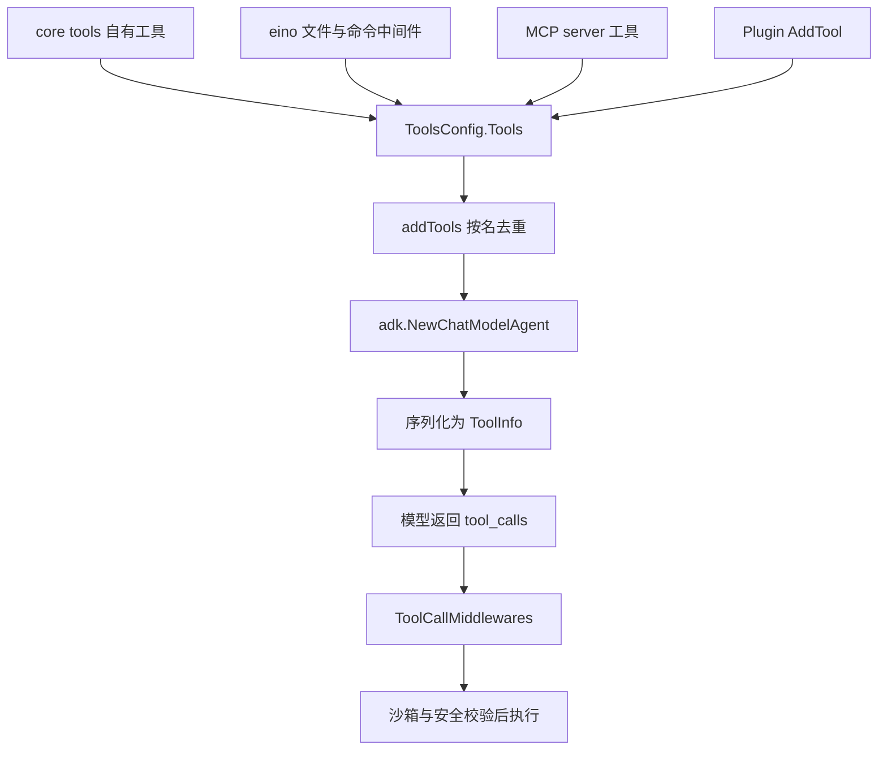
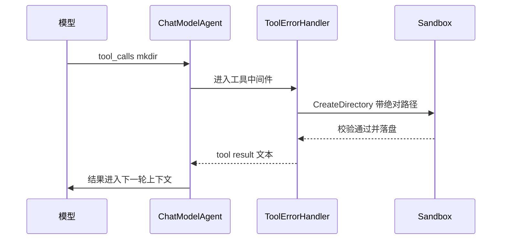
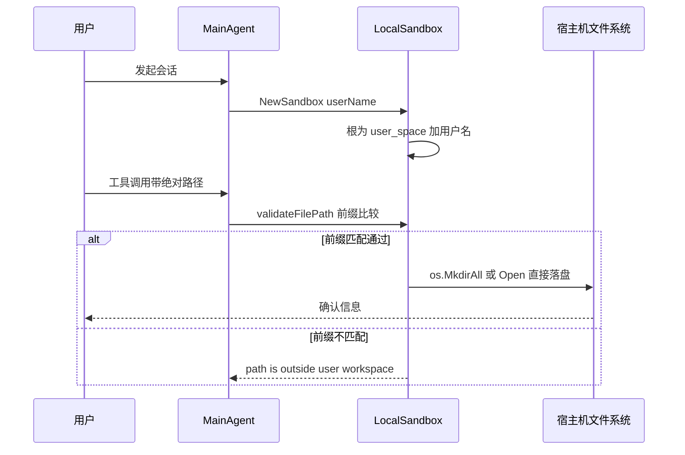
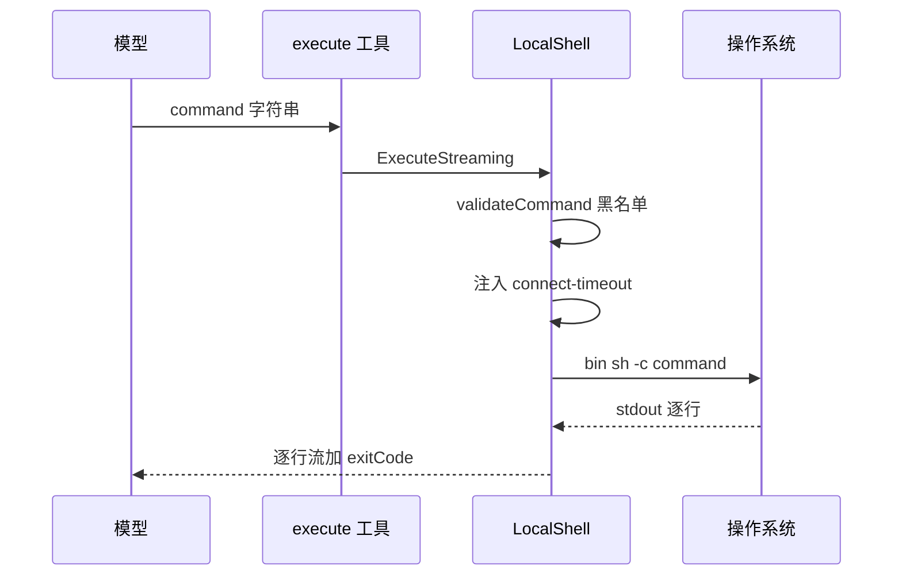

# GoRaven 工具系统解读：工具汇聚链路、Shell 执行、命令黑名单与沙箱的真实强度

> 本解读按 **ai-agent 类规格** 产出，解读基线为 GoRaven `v0.5.4`（`032c8b7`）。正文所有 `文件:行号` 引用均为 **GoRaven 仓库相对路径**，点开即可核对。

## 这个关注面在系统里干什么

GoRaven 的 README 把 **OS First**（"模型有知识无手脚，Agent 本质上是 Agent OS，运行时/依赖集成是第一优先级"）列为三条设计哲学之一。本篇就是这条哲学的落地代码，它由三层咬合而成：

- **工具层**（`core/tools`）：把"动作"包装成模型可见的函数，决定模型**能做什么**；
- **沙箱层**（`core/sandbox`）：决定这些动作**落在哪里**、以谁的身份落；
- **安全层**（`core/agent/safety_review.go`）：在 shell 命令真正 fork 之前**拦一道**。

去掉这一篇，GoRaven 剩下的只有会话管理、上下文压缩和一个聊天框——所有能产生副作用的"做事"能力都在这三层里。反过来说，读这三层也就读到了 GoRaven 从"聊天"变成"Agent"的那一步。

本篇的核心判断先给出来：**GoRaven 的隔离是粗粒度、进程内、约定式的**。它的 OS 边界主要来自"整个 GoRaven 跑在一个容器里"这个部署事实，而不是来自沙箱层；沙箱层实际提供的是"每用户一个目录 + 路径字符串前缀比较"，安全层实际提供的是一份 43 条正则的黑名单。这个组合在单租户自托管场景下是合理取舍，但如果把它读成多租户隔离，就会高估它的强度。以下逐条给出证据。

## 工具是怎么表示的

### 一个工具 = 一个 struct + 一次 InferTool

GoRaven 没有自定义工具类型，而是直接复用 eino 的 `tool.BaseTool` / `tool.InvokableTool` 接口：一个"工具"就是一个带 `Invoke` 方法的 struct，schema 由 `utils.InferTool` 从 struct tag 反射生成。以 `mkdir` 为例，请求体只是一个带 `jsonschema` tag 的 struct，构造函数把 `Name`、`Desc`、`Invoke` 三样交给 `InferTool`，就得到了一个模型可见的工具（`[core/tools/filesystem.go:68-74]()`
<!-- anchor: t := &createDirectoryTool{ … return utils.InferTool(t.Name, t.Desc, t.Invoke) -->
）。请求类型本身没有任何方法，全部语义都在 tag 里（`[core/tools/filesystem.go:52-53]()`
<!-- anchor: type CreateDirectoryRequest struct { … Path string `json:"path" jsonschema:"description=The absolute path of the direct -->
）。

这个选择带来两个直接后果。第一，**新增工具的边际成本极低**：写 struct、写 `Invoke`、调一次 `InferTool`、注册一次，不需要维护 schema 文件或中央注册表。第二，**工具描述成为一等公民，并被显式当作提示工程资产**：每个工具的 `Desc` 都是手写常量，带 Usage 清单、带"必须先调用"这类行为约束，且中英双份，运行时按 `config.Get().GetLanguage()` 二选一（`[core/tools/filesystem.go:62-65]()`
<!-- anchor: func NewCreateDirectory(sandbox sandbox.Sandbox) (tool.InvokableTool, error) { … desc = CreateDirectoryToolDescChinese -->
）。

对比同类做法：OpenAI Agents SDK 用 `@function_tool` 从类型注解生成 schema、从 docstring 取描述，Claude Code 的工具集是内置的、schema 写在协议层。GoRaven 相当于选了"eino 版 function_tool + 全手写描述"——好处是描述可以独立于实现迭代（例如 `goraven_get_current_time` 的描述里直接写"禁止凭空猜测"，`goraven_web_fetch` 的描述里主动交代"不具备 JS 渲染"），代价是描述与行为之间没有测试约束，容易随代码演进漂移。

一个容易被忽略的细节是**工具名被刻意做成 CLI 风格**：`mkdir`、`mv`、`rm`、`cp`（`[core/tools/copy_file.go:48-54]()`
<!-- anchor: t := &copyFileTool{ … return utils.InferTool(t.Name, t.Desc, t.Invoke) -->
、`[core/tools/delete_file.go:58-65]()`
<!-- anchor: func (t *deleteFileTool) Invoke(ctx context.Context, req *DeleteFileRequest) (st … return t.Sandbox.DeleteFile(req.Path) -->
）。这不是随手起的——`ls/read_file/write_file/edit_file` 与 `execute` 来自 eino 的 filesystem/shell 中间件，名字由上游固定；GoRaven 自有的四个文件工具对齐 Unix 命令名，让模型对"rm 是删文件"的先验直接可用。代价是**与 `execute` 产生语义重叠**：模型既能 `rm /path`（走沙箱路径校验）也能 `execute("rm /path")`（只走命令黑名单），两条路径的防护强度不一样，后文会展开。

### 工具清单在运行时汇总

工具不是一份静态列表，而是四路汇聚进同一个 `base.conf.ToolsConfig.Tools`：

1. **eino 中间件自带**：`RegisterLocalFileSystem` 用 `mfilesystem.New(...)` 把 GoRaven 的 backend 与 streaming shell 包成中间件挂上（`[core/agent/base_agent.go:293-320]()`
<!-- anchor: func (base *BaseAgent) RegisterLocalFileSystem() (err error) { … base.conf.Handlers = append(base.conf.Handlers, backedmid) //用户文件系统和shell -->
），由它注册 `ls`、`read_file`、`write_file`、`edit_file` 与 `execute` 等工具。也就是说，Agent 最常用的"读文件/写文件/跑命令"三个动作，**形状由 eino 决定、落点由 GoRaven 的 sandbox 决定**。
2. **GoRaven 自有工具**：`addDefaultTools` 挂 `goraven_web_fetch`（受系统设置 `tools.webfetch_enabled` 开关控制）、`goraven_check_file_exists`、`goraven_get_current_time`；`RegisterLocalFileSystem` 挂 `mkdir`、`mv`、`rm`、`cp`；`MainAgent.NewRunner` 再挂 `goraven_doc_parse`、`goraven_visual_understand`、四个自动化任务工具与 `sub_agent`（`[core/agent/main_agent.go:150-201]()`
<!-- anchor: func (main *MainAgent) NewRunner(ctx context.Context) (runner *MainRunner, e err … main.AddTool(updateTool) -->
）。
3. **MCP**：`loadMCPTools` 逐个起 client、`Initialize`、用 `mcpp.GetTools` 取回工具列表，再按名字并入同一个集合（`[core/agent/base_agent.go:171-209]()`
<!-- anchor: func (base *BaseAgent) loadMCPTools(ctx context.Context) error { … return nil -->
）。
4. **插件**：`Plugins.FireAgentBeforeCreate` 通过回调把插件工具注进来（`[core/agent/main_agent.go:30-48]()`
<!-- anchor: func NewMainAgent(param AgentParam) (*MainAgent, error) { … baseAgent := NewBaseAgent(mainAgentName, getMainInstructionPrompt(param), getMai -->
）。

去重逻辑值得单说：`addTools` 先调 `t.Info(ctx)` 取名字，再查 `toolNames` map，重名直接跳过；`Info()` 有 3 秒超时，**取不到名字的工具被静默丢弃**（`[core/agent/base_agent.go:141-159]()`
<!-- anchor: func (base *BaseAgent) addTools(newTools ...tool.BaseTool) { … base.toolNames[name] = struct{}{} -->
）。这是"工具名是唯一标识"的强假设：好处是 MCP 工具与内置工具撞名时不会把两个同名函数同时交给模型（那会让模型无法选择），代价是撞名与 `Info()` 失败都没有日志告警——对 MCP server 而言这是一个真实的静默失败面。

还有一处已经破裂的不变量：`mkdir`/`mv` 走 `addTools`（带去重），而 `rm`/`cp` 是直接 append 进 `ToolsConfig.Tools`，绕过了 `addTools` 与 `toolNames`（`[core/agent/base_agent.go:340-344]()`
<!-- anchor: copyFileTool, err := tools.NewCopyFile(base.sandbox) … base.conf.ToolsConfig.Tools = append(base.conf.ToolsConfig.Tools, copyFileTool) -->
）。当前名字唯一所以没有实际冲突，但"所有工具都经去重"这个假设已经不成立了。

另外为了让模型不要乱编工具，作者还挂了一个兜底：`UnknownToolsHandler` 在模型调用不存在的工具时返回一句固定的纠偏文案（"Tool 'x' does not exist. Do not retry or invent tools."），而不是报错终止（`[core/agent/base_agent.go:229-230]()`
<!-- anchor: base.conf.ToolsConfig.UnknownToolsHandler = func(ctx context.Context, name, inpu … return fmt.Sprintf("Tool '%s' does not exist. Do not retry or invent tools. Chec -->
）。这是一个很便宜的防幻觉设计，值得借鉴。

交给模型的终点只有一行：`adk.NewChatModelAgent(ctx, base.conf)`（`[core/agent/base_agent.go:266-266]()`
<!-- anchor: result, err = adk.NewChatModelAgent(context.Background(), base.conf) -->
）。从这一刻起，`ToolsConfig.Tools` 里的每个 `BaseTool` 都由 eino 序列化成 `[]*schema.ToolInfo` 打进模型请求的 `tools` 字段；GoRaven 自己不做裁剪或排序（裁剪交给 pruning 中间件，属上下文/中间件篇）。

### 从"声明"到"被模型调用"的链路



图中每一步对应的代码位置：四路汇聚在 `base_agent.go` 的 `addDefaultTools`/`RegisterLocalFileSystem`/`loadMCPTools` 与 `main_agent.go` 的 `NewRunner`；去重在 `addTools`（`[core/agent/base_agent.go:141-159]()`
<!-- anchor: func (base *BaseAgent) addTools(newTools ...tool.BaseTool) { … base.toolNames[name] = struct{}{} -->
）；生成 Agent 在 `GetChatModelAgent` 末尾（`[core/agent/base_agent.go:266-266]()`
<!-- anchor: result, err = adk.NewChatModelAgent(context.Background(), base.conf) -->
）；工具调用中间件链在同一个函数开头装配（`[core/agent/base_agent.go:213-219]()`
<!-- anchor: func (base *BaseAgent) GetChatModelAgent() (result *adk.ChatModelAgent, err erro … errorHandler.ToToolMiddleware(), -->
）。

### 一次工具调用的往返



## 沙箱隔离模型：OS First 的落点

### Sandbox 接口面

`Sandbox` 是一个 18 方法的接口（`[core/sandbox/types/types.go:11-17]()`
<!-- anchor: type Sandbox interface { … NewFileManager() FileManager -->
），按职责分四组：

- **文件操作**：`Exists`、`CopyFile`、`DeleteFile`、`CreateDirectory`、`MoveFile`，以及面向 Web 传输的 `Upload`/`Download`；
- **能力工厂**：`NewBackend`（给 eino 的文件工具用）、`NewStreamingShell`（给 `execute` 用）、`NewFileManager`（给 Web 文件管理器用）；
- **外部进程与技能**：`NewStdioMCPClient`（起 stdio MCP server）、`IsSkillInstalled`/`MarkSkillInstalled`（技能依赖安装标记）、`GetStorageUsage`/`GetStorageCapacity`；
- **生命周期与边界**：`GetWorkspace`、`SetExtraWorkspace`、`Delete`（删掉整个用户空间）。

接口设计本身是干净的——它把"文件从哪来、命令在哪个根下跑"抽象成可替换实现。但**替换点被写死了**：

```go
func NewSandbox(userName string) (Sandbox, error) {
	return local.NewLocalSandbox(userName), nil
}
```

工厂没有任何分支、没有读配置、没有按环境选择实现（`[core/sandbox/sandbox.go:21-22]()`
<!-- anchor: func NewSandbox(userName string) (Sandbox, error) { … return local.NewLocalSandbox(userName), nil -->
）。也就是说 `Sandbox` 这个接口当前是"只有一个实现的接口"，其抽象价值目前是**为未来预留**而非当下收益。

### docker 实现：一个只有 package 声明的文件

`core/sandbox/docker/docker.go` 全文只有一行（`[core/sandbox/docker/docker.go:1-1]()`
<!-- anchor: package sandbox -->
），内容是 `package sandbox`（注意包名与目录名还不一致）。仓库内没有任何文件 import 它。同时：

- `config.ToolsConf`、`SystemConf`、`BehaviorConf` 里没有任何 sandbox 模式开关；`system_setting.go` 的设置项注册表里也没有"沙箱模式"这一项（`[backend/service/system_setting.go:148-157]()`
<!-- anchor-base64:Ly8gLS0tLSB0b29scyAtLS0tIOKApiBpbnB1dFR5cGU6ICJudW1iZXIiLCBtaW46IHV0aWwuUHRyRmxvYXQ2NCgxKSwgbWF4OiB1dGlsLlB0ckZsb2F0NjQoMzApLCBkaXNwbGF5Tw== -->
）；
- `BehaviorConf.Docker` 只是一个"当前是否跑在 Docker 环境"的标记字段（`[config/config.go:81-91]()`
<!-- anchor: type RedisConf struct { … PoolTimeout  int    `toml:"pool_timeout" yaml:"pool_timeout"` -->
- 因此**不存在"一用户一容器"或"一命令一容器"的任何实现**——容器生命周期的讨论在这份代码里没有对应物。

README 里的 Docker 是另一回事：它是**整个 GoRaven 应用跑在一个容器里**，把 `/goraven/data` 挂出来做持久化（`[README_CN.md:131-135]()`
<!-- anchor-base64:ZG9ja2VyIHJ1biAtZCAtLXJlc3RhcnQ9YWx3YXlzIC0tbmFtZSBnb3JhdmVuLWFnZW50IFwg4oCmIDh0cmVlbmV0L2dvcmF2ZW46djAuNS40 -->
），并且明确要求持久化挂载，否则用户空间与 SQLite 一起丢（`[README_CN.md:133-135]()`
<!-- anchor: -v /opt/goraven:/goraven/data \ … 8treenet/goraven:v0.5.4 -->
）。给模型看的运行环境说明也自陈：Agent 运行在 Docker 容器（ubuntu 22.04）内、工具链预装（`[backend/repository/seed/skill_goraven_runtime.go:12-16]()`
<!-- anchor: 你运行在 Docker 容器（ubuntu 22.04）内。预装工具链均可通过 shell 直接使用： … - apt 缓存保留，可随时 apt-get install 安装额外系统包 -->
），并明确"不得访问其他用户的目录或文件"、容器是共享资源而非独占（`[backend/repository/seed/skill_goraven_runtime.go:176-176]()`
<!-- anchor: Your workspace is <root>. Do not access other users' directories or files. The c -->
）。

所以"OS First"里的 OS 边界，落到实现上是**整机（整容器）级别的粗粒度边界**：进程内没有 namespace、没有 cgroup、没有 chroot、没有 seccomp，一个用户的 shell 就是 GoRaven 服务进程的 shell，另一个用户的文件在同一个文件系统里可达。这一判断是后面所有安全分析的前提。

（附带一个陷阱：不要在 `core/sandbox` 目录里找"沙箱"——`local` 这个名字是诚实的，它就是一个本地文件系统包装器，不提供任何 OS 级隔离。）

### 文件根是怎么算出来的

用户根目录由配置项 `paths.user_space` 与用户名拼出来：`{user_space}/{userName}`（`[config/config.go:175-176]()`
<!-- anchor: func (conf *Configuration) GetUserSpace(userName string) string { … userSpace := fmt.Sprintf("%s/%s", conf.Paths.UserSpace, userName) -->
）。`GetUserSpace` 在返回前会顺手 `MkdirAll` 出 `documents/temp/downloads/images/videos/projects/skills` 一组子目录，并在根下放一个空的 `.profile`（`[config/config.go:190-200]()`
<!-- anchor: os.MkdirAll(userSpace, 0755) … _ = os.WriteFile(profilePath, nil, 0644) -->
）。这里有一个 72 小时量级的创建缓存（`userSpaceCache`），避免每次会话都 `MkdirAll` 一遍。

`LocalSandbox` 的构造只做一件事：把 `Workspace` 设成这个路径（`[core/sandbox/local/local.go:30-33]()`
<!-- anchor: func NewLocalSandbox(userName string) *LocalSandbox { … Workspace: config.Get().GetUserSpace(userName), -->
）。之后所有强制都收敛到一个函数：

```go
func (s *LocalSandbox) validateFilePath(filePath string) (string, error) {
	if !filepath.IsAbs(filePath) {
		return "", fmt.Errorf("path must be absolute: %s", filePath)
	}
	cleanPath := filepath.Clean(filePath)
	cleanWorkspace := filepath.Clean(s.GetWorkspace())
	if strings.HasPrefix(cleanPath, cleanWorkspace+string(filepath.Separator)) || cleanPath == cleanWorkspace {
		return cleanPath, nil
	}
	...
}
```

它做三件事：要求绝对路径、`Clean` 归一化、字符串前缀比较（`[core/sandbox/local/local.go:304-320]()`
<!-- anchor: func (s *LocalSandbox) validateFilePath(filePath string) (string, error) { … return "", fmt.Errorf("path is outside user workspace: %s", filePath) -->
、`[core/sandbox/local/local.go:311-312]()`
<!-- anchor-base64:aWYgc3RyaW5ncy5IYXNQcmVmaXgoY2xlYW5QYXRoLCBjbGVhbldvcmtzcGFjZStzdHJpbmcoZmlsZXBhdGguU2VwYXJhdG9yKSkgfHwgY2wg4oCmIHJldHVybiBjbGVhblBhdGgsIG5pbA== -->
）。`Clean` 能挡住 `../` 这类词法穿越，前缀比较能挡住拼到别人目录的路径。作为对照，`LocalFileManager.resolvePath` 用的是同一套思路的 `Join`+`Clean`+前缀版本（`[core/sandbox/local/file_manager.go:31-39]()`
<!-- anchor: func (m *LocalFileManager) resolvePath(relPath string) (string, error) { … return cleanPath, nil -->
）。

值得强调的是 `SetExtraWorkspace` 这个后门：它把一个额外根目录登记下来，`validateFilePath` 对该根下的路径一并放行（`[core/sandbox/local/local.go:161-162]()`
<!-- anchor: func (s *LocalSandbox) SetExtraWorkspace(workspace string) { … s.extraWorkspace = workspace -->
）。`MainAgent` 用它来放行**团队项目的当前项目子目录**，而不是整个团队项目根，注释里明确写了"避免跨项目读写"（`[core/agent/main_agent.go:42-43]()`
<!-- anchor: if param.ProjectWorkspace != "" && param.Project != "" { … box.SetExtraWorkspace(filepath.Join(param.ProjectWorkspace, param.Project)) -->
）。这是本篇少见的、把最小权限想清楚了的细节。

### 路径穿越防得怎么样：三层强度对照

`validateFilePath` 的 `Clean + HasPrefix` 方案有一个已知弱点：**它只做词法比较，不做符号链接解析**。攻击面很具体——工作区里只要存在一个指向外部的符号链接（Agent 自己可以用 `execute("ln -s /etc x")` 造一个，或者用户上传的压缩包里带一个），`Clean` 之后的路径仍以 workspace 前缀开头，校验通过，而实际写入落到了 workspace 之外。这是教科书式的 TOCTOU/软链接逃逸。

真正解决这个问题的是另一个包 `core/fs`，它的包注释直接点明了设计意图（`[core/fs/root.go:1-6]()`
<!-- anchor: // Package fs 提供以指定目录为根的文件系统安全操作。 … package fs -->
）：操作层基于 `os.Root` 稳定句柄，先词法归一（`Clean`）再执行，**避免"先校验路径后操作"的竞态**（`[core/fs/path.go:19-25]()`
<!-- anchor: // openFileRoot 打开以 rootDir 为根的稳定文件系统句柄。 … return rt, nil -->
）。`validateRootPath` 在词法检查之外，还额外解析符号链接并判断解析结果是否仍在根内（`[core/fs/path.go:41-71]()`
<!-- anchor: // validateRootPath 将根目录相对路径解析为绝对路径，并检查词法和符号链接边界。 … return cleanPath, nil -->
、`[core/fs/path.go:74-99]()`
<!-- anchor: // resolveRootExistingPath resolves existing symlinks while preserving a non-exi … path = parent -->
），`cleanRootRel` 负责把 `..` 逃逸在词法阶段就拒掉（`[core/fs/path.go:30-38]()`
<!-- anchor: func cleanRootRel(rel string) (string, error) { … return clean, nil -->
）。zip 解压那条路径还专门做了 zip slip 防护（`[core/fs/zip.go:140-150]()`
<!-- anchor: // zip slip 防护：目标必须严格位于解压目录内 … return fmt.Errorf("zip slip detected: %s", f.Name) -->
），`RemoveAll` 则显式拒绝删除根目录自身（`[core/fs/root.go:185-204]()`
<!-- anchor: func (r *Root) RemoveAll(rels []string) error { … return nil -->
）。

问题在于：**`core/fs` 不在 Agent 工具链路上**。它服务的是 Web 文件管理器（`backend/service/file_manager.go` 等），供人类用户点界面用；而 Agent 走的是 `core/sandbox/local`。同一个仓库里因此存在两代路径安全实现——新一代（`os.Root`）更正确但没接进 Agent，旧一代（字符串前缀）接了 Agent。这是本篇认为最值得上游修的一处架构债。

于是"check_path.go 与 sandbox 内是不是双重校验"这个问题的答案是：**没有双重校验，而且有两处连一次校验都没有**。

| 入口 | 校验实现 | 解析符号链接 | 在 Agent 工具链路上 |
|---|---|---|---|
| `core/fs`（`os.Root`） | 词法 + `EvalSymlinks` + 相对路径判定 | 是 | 否，服务 Web 文件管理器 |
| `LocalSandbox.validateFilePath` | `Clean` + 字符串前缀 | 否 | 是 |
| `LocalFileManager.resolvePath` | `Join` + `Clean` + 字符串前缀 | 否 | 否，服务 Web 侧 |
| `goraven_check_file_exists` | 无校验，直接 `os.Stat` | — | 是 |
| `goraven_visual_understand` | 只校验扩展名，直接 `os.ReadFile` | — | 是 |
| `execute`（shell） | 无路径校验，仅命令黑名单 | — | 是 |

前两处绕过值得展开。`goraven_check_file_exists` 的 `Invoke` 直接把模型给的绝对路径丢给 `os.Stat`，不看沙箱一眼（`[core/tools/check_path.go:56-57]()`
<!-- anchor: _, err := os.Stat(req.Path) … exists := err == nil -->
）——它构造时甚至没有接收 sandbox 参数（`[core/tools/check_path.go:34-49]()`
<!-- anchor: func NewCheckFileExists() (tool.InvokableTool, error) { … return invokable, nil -->
）。这给了模型一个**任意路径存在性探测侧信道**：`check_file_exists("/goraven/data/user_space/otheruser/images/private.png")` 的真假本身就是信息，而它不产生任何文件操作，不会有审计痕迹。修复成本极低（把 sandbox 传进去、用 `validateFilePath` 过一道），但当前没有。

`goraven_visual_understand` 更严重：它按扩展名判断媒体类型后，直接 `os.ReadFile(filepath.Clean(req.FilePath))` 把文件读进内存（`[core/tools/visual.go:177-178]()`
<!-- anchor: // 直接读取本地文件（goraven-upload 标签给出的绝对路径） … localPath := filepath.Clean(req.FilePath) -->
、`[core/tools/check_path.go:56-57]()`
<!-- anchor: _, err := os.Stat(req.Path) … exists := err == nil -->
、`[core/tools/doc_parse.go:166-180]()`
<!-- anchor: func (d *DocParse) resolveSourcePath(path string) (string, error) { … return "", fmt.Errorf("file not found: %s", path) -->
）。同一个仓库、同一个需求，三个工具三种做法，说明"路径校验"目前靠每个工具作者自觉，而不是靠框架。

### 用户请求到落盘的完整时序



时序图里唯一的分支就是那个字符串前缀比较；没有符号链接解析、没有句柄级根绑定、没有 chroot 或 namespace 介入。这就是"进程内约定式隔离"的全部内容。

## Shell 执行：Agent 真正长出"手脚"的地方

工具层里最有分量的是 `execute`——它是模型唯一能执行任意程序的动作。它的实现全在 `core/sandbox/local/shell.go`，是从 `eino-ext` 的本地 backend 移植并加了环境变量注入与超时。



### 命令怎么起的

每个前台命令都是 `/bin/sh -c <command>`，不是 pty、不是 login shell（`[core/sandbox/local/shell.go:127-133]()`
<!-- anchor: func (s *LocalShell) initStreamingCmd(ctx context.Context, command string) (*exe … cmd.Env = s.buildEnv() -->
）。`exec.CommandContext` 负责把 ctx 与进程绑定，`SysProcAttr` 打开 `Setpgid` 让命令自成进程组，并把 `cmd.Cancel` 换成"向进程组发 SIGKILL"（`[core/sandbox/local/shell.go:149-154]()`
<!-- anchor: // killProcessGroup 向 cmd 所属的进程组发送 SIGKILL，确保所有子进程（包括孙进程）都被终止。 … return syscall.Kill(-cmd.Process.Pid, syscall.SIGKILL) -->
）。

进程组这一层是必要的，理由很产品化：`curl url | head -1` 这类管道命令里，`head` 退出后 `curl` 还在跑，如果只 kill 直接子进程，孙进程会变成孤儿继续占带宽；`kill(-pgid, SIGKILL)` 能一次清干净。作者在代码注释里也明确写了这个意图。相比"只 kill 直接子进程"的朴素实现（很多自研 Agent 都停在这里），这是一个成熟的细节。

### 工作目录：一个没有被设置的字段

`initStreamingCmd` 依次设置了 `SysProcAttr`、`Cancel`、`Env`，**唯独没有设置 `cmd.Dir`**（`[core/sandbox/local/shell.go:127-133]()`
<!-- anchor: func (s *LocalShell) initStreamingCmd(ctx context.Context, command string) (*exe … cmd.Env = s.buildEnv() -->
）。全仓库检索 `cmd.Dir`、`SetDir`、`os.Chdir` 均无命中（负向证据）。

这意味着 shell 的当前工作目录是 **GoRaven 服务进程的工作目录**（容器里通常是 `/goraven` 或 `/`），而不是 `GetWorkspace()` 返回的用户根。后果是复合的：

- 模型执行 `ls`、`pwd`、`find .` 时看到的是服务目录而非自己的工作区，与提示词给它的心智模型不符；
- 相对路径不受任何沙箱约束——`validateFilePath` 只对文件工具的**绝对路径**生效，shell 里的相对路径既不经过它，也就没有"必须落在工作区内"这一层；
- 这直接与给模型看的运行说明冲突：那份说明写着 "Your workspace is `<root>`" "Keep file operations within `<root>`"（`[backend/repository/seed/skill_goraven_runtime.go:176-176]()`
<!-- anchor: Your workspace is <root>. Do not access other users' directories or files. The c -->
、`[backend/repository/seed/skill_goraven_runtime.go:286-291]()`
<!-- anchor: ### When Rejected … - Keep file operations within <root> -->
）。

这是一个**提示词承诺与实现事实不一致**的例子，也是把 shell 的默认目录直接设为用户工作区这种一行修复能显著改善的缺陷。

### 环境变量怎么注入

`buildEnv` 的策略是"全量继承 + 追加覆盖"：先 `os.Environ()` 拿父进程全部环境变量，再追加 `extraEnv`，同名以后者为准；没有 `extraEnv` 时返回 `nil` 让 `exec.Cmd` 自动继承（`[core/sandbox/local/shell.go:219-226]()`
<!-- anchor: // buildEnv 返回子进程的环境变量。始终继承父进程环境； … return append(os.Environ(), s.extraEnv...) -->
）。

`extraEnv` 里装的是用户自己的 `.profile`：`NewStreamingShell` 会先读用户根下的 `.profile`（不存在视为正常），用 `envfile.Parse` 解析成 `KEY=VALUE` 列表，再与调用方传入的 `cfg.Env` 合并，`.profile` 在前、`cfg.Env` 在后，于是**同名变量由调用方覆盖文件**（`[core/sandbox/local/local.go:45-64]()`
<!-- anchor: func (s *LocalSandbox) NewStreamingShell(cfg *types.ShellConfig) (types.Streamin … return NewLocalShell(cfg), nil -->
）。解析 `.profile` 失败会返回错误而不是静默忽略，这个选择是对的（否则用户会看到"环境变量神秘失效"）。读取 `.profile` 走的是 `NewFileManager().ReadFile(".profile")`（`[core/sandbox/local/local.go:69-80]()`
<!-- anchor: func (s *LocalSandbox) loadProfileEnv() ([]string, error) { … return envs, nil -->
），顺带落进了工作区校验，路径上是安全的。

两个设计判断值得评价：

- **站在用户角度**：把 `.profile` 当"每个用户的环境变量文件"注入到所有命令里，是很实用的产品化设计——用户配一次 `OPENAI_API_KEY`、`GIT_TOKEN`，之后所有 shell 命令和 skill 安装脚本都能直接用。模型侧也不需要 `source .profile`。
- **站在安全角度**：`os.Environ()` 全量继承意味着 **GoRaven 服务进程的环境变量对所有用户可见**。任何以环境变量形式传入的凭据（数据库口令、Redis 口令、代理凭据、CI token）都会出现在 `execute("env")` 的输出里，而 `env` 并不在黑名单上。再加上配置文件本身可读——`/goraven/data/config.yaml` 是默认配置路径（`[config/config.go:163-170]()`
<!-- anchor: func ParseConfigPath() string { … return "/goraven/data/config.yaml" -->
），而 `RedisConf` 里就有 `Password` 字段（`[config/config.go:81-91]()`
<!-- anchor: type RedisConf struct { … PoolTimeout  int    `toml:"pool_timeout" yaml:"pool_timeout"` -->
），黑名单只挡 `.env`／`.aws/credentials`／`.ssh/id_rsa` 这几类文件名，**不挡这个 YAML**。所以"读凭据"这条规则在实现上是有真实缺口的。

### 超时、输出与退出码

**超时**来自系统设置 `tools.shell_timeout_minutes`（默认 5 分钟，界面允许 1–30 分钟）（`[backend/service/system_setting.go:148-157]()`
<!-- anchor-base64:Ly8gLS0tLSB0b29scyAtLS0tIOKApiBpbnB1dFR5cGU6ICJudW1iZXIiLCBtaW46IHV0aWwuUHRyRmxvYXQ2NCgxKSwgbWF4OiB1dGlsLlB0ckZsb2F0NjQoMzApLCBkaXNwbGF5Tw== -->
），在 `RegisterLocalFileSystem` 里换算成 `time.Duration` 塞进 `ShellConfig`（`[core/agent/base_agent.go:304-310]()`
<!-- anchor: shellTimeout := time.Duration(base.sysCfg.ShellTimeoutMinutes) * time.Minute … Timeout:         shellTimeout, -->
）；`SystemAgent` 特殊，固定 10 分钟。`ShellConfig` 只有三个字段：`ValidateCommand`、`Env`、`Timeout`（`[core/sandbox/types/types.go:53-59]()`
<!-- anchor: type ShellConfig struct { … Timeout time.Duration -->
）。

超时**只对前台命令生效**：`RunInBackendGround=true` 时不做 `WithTimeout`，生命周期完全交给外层 ctx（`[core/sandbox/local/shell.go:63-70]()`
<!-- anchor: func (s *LocalShell) ExecuteStreaming(ctx context.Context, input *filesystem.Exe … return nil, err -->
）。超时或取消时走同一条分支——发一条固定文案并给出 `exitCode = 124`（`[core/sandbox/local/shell.go:290-296]()`
<!-- anchor-base64:aWYgZXJyb3JzLklzKGVyciwgY29udGV4dC5DYW5jZWxlZCkgfHwgZXJyb3JzLklzKGVyciwgY29udGV4dC5EZWFkbGluZUV4Y2VlZGVkKSAg4oCmIHcuU2VuZCgmZmlsZXN5c3RlbS5FeGVjdXRlUmVzcG9uc2V7T3V0cHV0OiB0aW1lb3V0TXNnICsgIlxuIiwgRXhpdENvZGU6ICZleGl0Q29k -->
）。选 124 而不是随便一个非零值，是 `timeout(1)` 的约定，模型对它有先验，这个细节很克制。

**stdout** 是按行流式推送的：`bufio.Reader.ReadString('\n')` 每读到一行就 `w.Send(...)`，管道缓冲区 100（`[core/sandbox/local/shell.go:63-70]()`
<!-- anchor: func (s *LocalShell) ExecuteStreaming(ctx context.Context, input *filesystem.Exe … return nil, err -->

**stderr** 是另一套：它在独立 goroutine 里被 `io.ReadAll(stderr)` 一次性读进内存（`[core/sandbox/local/shell.go:325-325]()`
<!-- anchor: *stderrData, err = io.ReadAll(stderr) -->
），命令结束后才随退出码一起回传。这里有两个后果：好的一面是 stderr 不会和 stdout 交错，错误信息完整；坏的一面是**stderr 无上界**——一个持续向 stderr 狂写的命令（`yes >&2`、编译器刷屏）会把内容全部堆在 Go 进程内存里，是一条 OOM 路径。stdout 有流量削峰（流式消费），stderr 没有。

**退出码与错误的回传**分三层（`[core/sandbox/local/shell.go:379-404]()`
<!-- anchor: func (s *LocalShell) handleCmdCompletion(ctx context.Context, cmd *exec.Cmd, std … w.Send(&filesystem.ExecuteResponse{ExitCode: new(int)}, nil) -->
）：

- 非零退出：`exec.ExitError` 被识别，回传 `Output="command exited with non-zero code N\n[stderr]:\n..."` 并带上真实 `ExitCode`（`[core/sandbox/local/shell.go:380-392]()`
<!-- anchor: if err := cmd.Wait(); err != nil { … return -->
）——模型既能读到码也能读到原因；
- 其他错误（起不来、管道错）：作为 error 返回，最终由 `ToolErrorHandler` 转成工具结果回注给模型；
- panic：被 `recover` 成 `panicErr` 带栈返回，不让整个 Agent 循环崩掉（`[core/sandbox/local/shell.go:277-308]()`
<!-- anchor: func (s *LocalShell) streamCmdOutput(ctx context.Context, cmd *exec.Cmd, stdout, … s.handleCmdCompletion(ctx, cmd, stderrData, hasOutput, w) -->

**后台模式**（`RunInBackendGround`）的语义是"只启动、不等待"：转发一条 `command started in background` 后立即关流，stdout/stderr 由两个 goroutine 并发 `io.Copy(io.Discard, ...)` 排空（`[core/sandbox/local/shell.go:107-112]()`
<!-- anchor: if input.RunInBackendGround { … return sr, nil -->
、`[core/sandbox/local/shell.go:231-257]()`
<!-- anchor: func (s *LocalShell) runCmdInBackground(ctx context.Context, cmd *exec.Cmd, stdo … w.Send(&filesystem.ExecuteResponse{Output: "command started in background\n", Ex -->
）。排空这一步是必需的——不读管道会让子进程在写满缓冲区时阻塞；同时它意味着**后台任务的输出对模型不可见**，模型只能靠"去读日志文件"的方式回收结果。ctx 取消时通过 `cmd.Cancel` 杀整个进程组。

**连接超时注入**是这套实现里最有作者印记的一处：命令首 token 命中 `curl`/`wget` 且未显式设置 `--connect-timeout` 时，自动在命令词后插入 `--connect-timeout 5`（`[core/sandbox/local/shell.go:166-169]()`
<!-- anchor: // connectTimeoutRules 连接超时注入规则表。 … var connectTimeoutRules = []connectTimeoutRule{ -->
）。动机写在注释里——国内访问被墙站点时 TCP 连接阶段会长时间卡死，而连接超时只约束握手、不影响传输，所以下载大文件不会被误杀。这是"真跑过 Agent、真被卡过"才会有的补丁。它的局限也明显：只匹配首 token 精确等于 `curl`/`wget`，`/usr/bin/curl`、`env curl`、`xargs curl` 都不生效，属于启发式而非机制。

## Docker 沙箱：能力差异表是空的

按题面要求如实指出：**docker 沙箱没有实现，也没有接线**。证据已经散落在前面，这里集中一次：

- `core/sandbox/docker/docker.go` 全文 1 行，只有 `package sandbox`（`[core/sandbox/docker/docker.go:1-1]()`
<!-- anchor: package sandbox -->
），且包名与目录名不一致；
- 仓库内无任何 `sandbox/docker` 的 import；
- `sandbox.NewSandbox` 直接返回 `local.NewLocalSandbox`，没有实现选择（`[core/sandbox/sandbox.go:21-22]()`
<!-- anchor: func NewSandbox(userName string) (Sandbox, error) { … return local.NewLocalSandbox(userName), nil -->
）;
- 系统设置注册表里没有"沙箱模式"这类配置项（`[backend/service/system_setting.go:148-157]()`
<!-- anchor-base64:Ly8gLS0tLSB0b29scyAtLS0tIOKApiBpbnB1dFR5cGU6ICJudW1iZXIiLCBtaW46IHV0aWwuUHRyRmxvYXQ2NCgxKSwgbWF4OiB1dGlsLlB0ckZsb2F0NjQoMzApLCBkaXNwbGF5Tw== -->
），`BehaviorConf.Docker` 这个字段也没有被任何代码读取。

因此"一用户一容器 vs 一命令一容器"、"镜像与挂载策略"、"local 与 docker 的能力差异"这些问题在 v0.5.4 没有答案——不是选错了方案，而是方案尚未存在。真实存在的容器是**部署容器**：单容器、多用户共享、`/goraven/data` 挂载持久化（`[README_CN.md:131-135]()`
<!-- anchor-base64:ZG9ja2VyIHJ1biAtZCAtLXJlc3RhcnQ9YWx3YXlzIC0tbmFtZSBnb3JhdmVuLWFnZW50IFwg4oCmIDh0cmVlbmV0L2dvcmF2ZW46djAuNS40 -->
、`[README_CN.md:133-135]()`
<!-- anchor: -v /opt/goraven:/goraven/data \ … 8treenet/goraven:v0.5.4 -->
）。

这个事实反过来解释了整篇的安全设计取向：既然隔离边界在容器外层，那么 `safety_review` 与 `validateFilePath` 承担的就不是"防恶意越权"，而是**防 Agent 误伤**（别把宿主搞坏、别把服务配置写烂）加上**防用户误闯**（别把文件建到别人目录里）。用"防误伤"的标准看，现有实现是称职的；用"防越权"的标准看，它不够——而 README 的"多用户隔离"叙事（`[backend/repository/seed/skill_goraven_runtime.go:303-304]()`
<!-- anchor: ### Multi-user Isolation … - Do not access other users' directories -->
）读起来更像后者。

## 安全边界：两级黑名单

### 规则怎么组织

安全审核是一个纯规则引擎，规则结构就三个字段：编译好的正则、中文描述、英文描述（`[core/agent/safety_review.go:357-376]()`
<!-- anchor: func validateWithRules(cmd string, rules []safetyRule) error { … return nil -->

- **`baseSafetyRules`**：10 条，所有 Agent 共用，只拦最不可逆的操作——`rm -rf /` 与 `rm -rf /*`、fork 炸弹、读 `/etc/shadow|passwd`、关机重启、裸块设备、`dd if=`、`mkfs`、netcat 反弹 shell、清空 iptables；
- **`extraStrictRules`**：33 条，仅 MainAgent 追加——`sudo`、`chmod 777`、`curl|sh`/`wget|sh`、磁盘分区、`chown` 根路径、`kill -9`、`crontab -`、SSH 私钥与 `.env`/云凭据、`systemctl`、用户账户管理、`passwd`、`mount/umount`、`history -c`、覆盖 `/etc` 关键文件、写 `authorized_keys`、docker `--privileged`、`sysctl -w`、内核模块、防火墙、`ip` 路由、`chroot`、`nsenter`、`setcap`、`strace`、`ldconfig`、SELinux、swap、LVM、`unshare`、`hostnamectl set`。

两层在 `init()` 里拼成 `strictSafetyRules`（`[core/agent/safety_review.go:336-343]()`
<!-- anchor: // strictSafetyRules 严格安全审核规则，用于 MainAgent。 … copy(strictSafetyRules[len(baseSafetyRules):], extraStrictRules) -->
），对外暴露两个入口：`ValidateCommand`（strict，MainAgent）与 `ValidateCommandForSystem`（只有 base，SystemAgent）（`[core/agent/safety_review.go:346-354]()`
<!-- anchor: // ValidateCommand 严格安全审核，用于 MainAgent。 … return validateWithRules(cmd, baseSafetyRules) -->
）。`SystemAgent` 在构造时显式选用宽松版（`[core/agent/system_agent.go:42-42]()`
<!-- anchor: baseAgent.SetValidateCommand(ValidateCommandForSystem) -->
），`BaseAgent` 侧默认值是 strict，且显式传 `nil` 也回落到 strict（`[core/agent/base_agent.go:82-88]()`
<!-- anchor: // SetValidateCommand 设置安全审核函数 … base.validateCommandFunc = fn -->
）——**默认严格**，这个默认值方向是对的。

判定逻辑极简：trim → 空则放行 → `strings.ToLower` → 逐条 `MatchString` → 首个命中即返回 `fmt.Errorf("Safety review rejected: <描述>")`（`[core/agent/safety_review.go:365-367]()`
<!-- anchor: lower := strings.ToLower(trimmed) … if rule.pattern.MatchString(lower) { -->
）。小写化的意图是让 `SUDO`、`Rm -Rf /` 也被覆盖。

### 拒绝之后：如何让模型换方案

拒绝发生在 `ExecuteStreaming` 的最前面，**在命令被 fork 之前**（`[core/sandbox/local/shell.go:63-70]()`
<!-- anchor: func (s *LocalShell) ExecuteStreaming(ctx context.Context, input *filesystem.Exe … return nil, err -->

这个 error 之所以能让模型换方案而不是直接崩，靠的是工具层统一装的那道中间件：`ToolErrorHandler` 用 `defer` 捕获 error 与 panic，把 error 通过 `FormatError` 转成字符串塞进 `ToolOutput.Result`，然后把 `err` 置回 `nil`（`[core/middleware/tool_error_handler.go:38-52]()`
<!-- anchor: func (h *ToolErrorHandler) WrapInvokableToolCall(next compose.InvokableToolEndpo … return output, err -->
）。默认格式化只有一行 `Tool '%s' execution failed: %s`（`[core/middleware/tool_error_handler.go:34-35]()`
<!-- anchor: func defaultFormatError(_ context.Context, toolName string, err error) string { … return fmt.Sprintf("Tool '%s' execution failed: %s", toolName, err.Error()) -->
），也就是说**模型实际看到的是** `Tool 'execute' execution failed: Safety review rejected: 禁止使用 sudo 提权执行命令`——规则说明就在里面。配合给模型看的运行说明里那节 "When Rejected"——被拒后应 "Adjust your approach rather than retrying the same command"（`[backend/repository/seed/skill_goraven_runtime.go:286-291]()`
<!-- anchor: ### When Rejected … - Keep file operations within <root> -->
），闭环是完整的：拒绝 → 说明规则 → 引导替代方案（pip 用 venv、npm 用 `--prefix`）。

这里的设计权衡值得点出来：GoRaven 选择"把拒绝**当作工具结果**回注"，而不是"弹给人类审批"（Claude Code 的 permission prompt）或"中断本轮"（部分框架的 guardrail 直接终止）。前者换来了无人值守下的持续自治（自动化任务、SystemAgent 安装依赖都需要），代价是**没有人类在环**——一个被拒绝十次的模型会第十一次换个写法再试，而没有人看到这十次。

### 局限：能绕过吗，为什么

能，而且不需要很高的技巧。原因是三重的：

**第一，黑名单本身不可能完备。** 43 条正则覆盖的是"作者想到的危险命令"，而 shell 的表达力远大于此。任何一条规则都能被"换个执行等价体"绕过，且代码里没有任何机制去枚举等价体：

- 变量拼接：`s=sudo; $s apt-get install -y x` —— 命令文本里没有独立的 `sudo` token，但语义完全相同。规则 11 是 `\bsudo\b`，匹配的是**文本**不是**语义**（`[core/agent/safety_review.go:101-104]()`
<!-- anchor: var extraStrictRules = []safetyRule{ … pattern: regexp.MustCompile(`\bsudo\b`), -->
）；
- 解码后执行：`echo c3VkbyBhcHQ= | base64 -d | sh` —— 整个管道里没有任何黑名单关键词；
- 写脚本再执行：`printf '%s\n' 'sudo ...' > /tmp/a.sh && sh /tmp/a.sh` —— `validateCommand` 只在 `ExecuteStreaming` 入口被调用一次，对 `sh` 之后读到的内容**完全不可见**；
- 换解释器：`python3 -c "import os; os.system('sudo id')"` —— 同理不在表内。

**第二，覆盖范围有几个明确的洞。** 规则 1 只挡 `rm -rf /` 与 `rm -rf /*` 两种字面形式（`[core/agent/safety_review.go:27-31]()`
<!-- anchor: // 1. 递归强制删除根目录，防止系统不可逆损坏 … descEn:  "Forbidden recursive force delete of root directory: rm -rf /", -->
），`rm -rf /goraven/data`、`rm -rf /home`、`rm -rf <另一个用户的目录>` 都不在表内；而在"shell 没有工作目录约束、也不做路径校验"的前提下（前面已论证），**跨用户/服务数据的递归删除是可行的**，只要命令文本不是那个特定字面量。同理，读凭据的规则只挡 `.env`/`.aws`/`.ssh/id_rsa` 这几类文件名，不挡 `config.yaml`、不挡 `tar cf - /goraven/data`、不挡 `env`。

**第三，防护层次是单点。** 黑名单是一道字符串闸门，背后没有第二道机制：没有 capability 降级（去 `CAP_SYS_ADMIN`）、没有 seccomp/AppArmor、没有只读挂载、没有独立 UID、没有 namespace。`validateFilePath` 也不在这里兜底，因为 shell 走的是相对路径与自造绝对路径，压根不经过它。

综合起来，这套安全层的准确定位是：**防手滑，不防对手**。它能可靠拦住"模型热心地想把系统配好"这类常见误伤（`sudo apt install`、`curl | sh`、`chmod 777`），这在自托管单租户场景里覆盖了绝大多数真实事故；但它拦不住一个愿意绕的对手，所以不能把多租户隔离的期待压在它身上——那应该由容器/虚拟机/独立 UID 承担，而正如上一节所述，这部分在代码里是空的。

对比来看：Claude Code 走的是"危险操作人类审批 + 工作目录沙箱"，OpenAI Agents SDK 走的是"guardrail 回调 + 可中断"，LangGraph 通常把权限交给部署方。GoRaven 的黑名单路线在"无人值守自治"这个目标上是最省事的，代价就是上面这三条。作者显然知道这个取向——规则描述里写的是"禁止…"（给模型看的指令），而不是"检测到攻击"（给运维看的告警），说明它首要服务的是**引导模型行为**，而非**审计对抗**。

## 工具错误是怎么传播的

结论：**工具返回错误不终止本轮，而是被回注成工具结果，模型继续下一轮**。这条路径由 `ToolErrorHandler` 中间件独占，四个 wrapper 一一对应 eino 的四类工具端点（invokable / streamable / enhanced invokable / enhanced streamable），最后合成一个 `compose.ToolMiddleware` 挂到 `ToolsConfig.ToolCallMiddlewares` 上（`[core/middleware/tool_error_handler.go:126-131]()`
<!-- anchor: func (h *ToolErrorHandler) ToToolMiddleware() compose.ToolMiddleware { … EnhancedStreamable: h.WrapEnhancedStreamableToolCall, -->
、`[core/agent/base_agent.go:213-219]()`
<!-- anchor: func (base *BaseAgent) GetChatModelAgent() (result *adk.ChatModelAgent, err erro … errorHandler.ToToolMiddleware(), -->
）。

它的实现范式很统一：`defer` 里先 `recover` panic 转成 error（带裁剪过的栈），如果 `err != nil` 就用 `FormatError` 生成文本写进 `Result`，再把 `err` 置 `nil`（`[core/middleware/tool_error_handler.go:38-52]()`
<!-- anchor: func (h *ToolErrorHandler) WrapInvokableToolCall(next compose.InvokableToolEndpo … return output, err -->
）。所以无论工具是"返回了 error"还是"直接 panic"，到达模型时都是**正常的工具结果字符串**，Agent 循环不会断。栈裁剪用 `util.TrimStack(3)`，避免把内部路径全量暴露给模型——小细节，方向正确。

错误处理还有一个分工层次：`UnknownToolsHandler` 负责"工具不存在"（返回纠偏文案而非 error，`[core/agent/base_agent.go:229-230]()`
<!-- anchor: base.conf.ToolsConfig.UnknownToolsHandler = func(ctx context.Context, name, inpu … return fmt.Sprintf("Tool '%s' does not exist. Do not retry or invent tools. Chec -->
），`ToolErrorHandler` 负责"工具执行失败"，而 run 级别的失败（模型错误、重试耗尽、`MaxIterations` 用尽、任务超时）走的是 runner 层，不在本篇范围。

【存疑待核实】run 级错误如何终止并汇报（`core/agent/main_runner.go` 的迭代上限与超时分支）、以及 pruning 中间件与这里的 ToolMessage 的先后顺序，属上下文/中间件篇与主循环篇，本篇只确认接口边界。

## 文档、可视化、网页三类"外挂能力"

这三个工具代表三种完全不同的依赖策略，正好回答"README 说的镜像内置 Go/Node/Python/Git 运行时到底为谁服务"。

### goraven_doc_parse：外挂 Python 进程

它解决的问题是"聊天附件里的 PDF/Word/Excel 不会自动转换，模型读不了"。工具形态是双模式：`read` 把文档文本抽出来放进工具结果，`convert` 把文档转成 Markdown 落到指定路径；还支持 `pages` 页段过滤与 `max_chars` 截断（默认 50000）（`[core/tools/doc_parse.go:226-262]()`
<!-- anchor: func (d *DocParse) Invoke(ctx context.Context, req *DocParseRequest) (*DocParseR … return &DocParseResponse{OutputPath: req.OutputPath}, nil -->
）。

实现上它是**纯外挂**（`[core/tools/doc_parse.go:45-51]()`
<!-- anchor: // DocParse 文档解析工具，通过 docling 脚本读取/转换文档。 … extraWorkspace string -->
）：`DocParse` 自己不解析任何文档格式，而是调 `core/knowledge` 里的 `runDocling`，由后者 `exec.CommandContext` 起一个 **Python 进程**跑 `scripts/docling/read.py` 或 `convert.py`（`[core/knowledge/docling.go:88-121]()`
<!-- anchor: // runDocling 执行 docling 脚本并返回 stdout。 … return stdout.String(), nil -->
）。Python 解释器靠 `exec.LookPath` 依次找 `python3`、`python`，找不到就给本地化错误（`[core/knowledge/docling.go:32-41]()`
<!-- anchor: func findPython() (string, error) { … return "", errors.New("python3/python not found, please install Python and retry -->
）；单次调用给了 10 分钟超时，理由是 docling 首次调用要加载模型（`[core/knowledge/docling.go:18-18]()`
<!-- anchor: const doclingTimeout = 10 * time.Minute -->
）。读文件入口还会先 `os.Stat` 一次源文件，把"文件不存在"与"解析失败"区分开（`[core/knowledge/docling.go:126-134]()`
<!-- anchor: func ReadFile(ctx context.Context, src string, opts ReadOptions) (string, error) … return runDocling(ctx, readArgs(script, src, opts)) -->
）。

这条链路解释了 README 里"镜像内置 Python"的实际用途：**docling 是硬依赖**，装不上这个工具就是坏的。依赖缺失时错误信息里直接给出安装命令（`uv pip install --no-cache -r <scripts>/docling/requirements.txt`），`scripts/docling/requirements.txt` 以 `docling>=2.115.0` 为主，并特意把 `opencv-python` 钉在 4.13 以下（注释说明 4.13+ 的 Linux wheel 链接 X11/XCB，会在 headless 容器里崩）。这说明作者是在真实容器里踩过这个坑的。

路径安全上，`goraven_doc_parse` 是本篇三个"外部能力工具"里唯一严谨的：`withinRoot` 要求路径绝对且落在 workspace 或 extraWorkspace 下，失败才回退到"把路径当相对路径拼到根上"（`[core/tools/doc_parse.go:151-160]()`
<!-- anchor: func withinRoot(path, root string) (string, bool) { … return "", false -->
、`[core/tools/doc_parse.go:166-180]()`
<!-- anchor: func (d *DocParse) resolveSourcePath(path string) (string, error) { … return "", fmt.Errorf("file not found: %s", path) -->
）。`convert` 模式还多一道：先写到 `os.TempDir()/goraven-docparse/<uuid>.md` 再复制到目标，且强制输出必须是 `.md` 绝对路径、不能与输入相同。

### goraven_visual_understand：不是外挂，是把多模态塞进一次模型调用

它解决的问题是"模型看不懂图片/视频/音频"。关键实现选择是：**不开子进程、不调外部工具，直接把文件字节 base64 后作为 `UserInputMultiContent` 发给模型**（`[core/tools/visual.go:192-205]()`
<!-- anchor: // invokeImage 处理图片：压缩缩略后 base64 编码，通过 UserInputMultiContent 传递 … mimeType = "image/jpeg" -->
）。

细节上分三种媒体分别处理（`[core/tools/visual.go:170-188]()`
<!-- anchor: func (v *VisualUnderstand) Invoke(ctx context.Context, req *VisualUnderstandRequ … return nil, fmt.Errorf("unsupported file type: %s", ext) -->
）：图片先用 `util.CompressImageBytes` 压缩到 `ImageMaxEdge` 并统一转 JPEG，目的是省多模态像素 token 和 base64 体积；视频和音频则只有 `OpenAI`、`Gemini` 格式的模型原生支持，其他格式直接返回"请切换为支持该输入的模型"并给出中文提示（`[core/tools/visual.go:238-240]()`
<!-- anchor: func (v *VisualUnderstand) invokeVideo(ctx context.Context, absPath, ext, questi … return nil, formatUnsupportedError("video", v.model.Format()) -->
）。工具还会把这次调用的 token 用量记进每日统计，用的是独立的运行 ID，避免污染主会话的会话归并头。

把多模态做成**工具**而不是"自动把附件塞进上下文"，是一个值得评价的取舍：好处是模型自己决定"什么时候需要看图"，上下文不被无关图片占满（对长会话尤其重要，也契合作者"不做记忆与进化"的立场——需要时现取，不做预处理）；代价是模型得先知道有这张图、还得知道路径，于是工具描述里专门写了"聊天附件用 goraven-upload 标签给出的路径"，把这条约定交给提示词维护。另外媒体类型的判定函数 `ClassifyMediaType` 被导出并与附件直发共用，作者注释写明"单一事实来源"——这一点做得好。

**但它的路径校验是缺的**：`Invoke` 里 `filepath.Clean(req.FilePath)` 之后直接 `os.ReadFile`（`[core/tools/visual.go:177-178]()`
<!-- anchor: // 直接读取本地文件（goraven-upload 标签给出的绝对路径） … localPath := filepath.Clean(req.FilePath) -->
）。前面已经论证这是跨用户读取的一个实际入口。修法也简单（复用 `doc_parse` 已有的 `withinRoot` 或 sandbox 的 `validateFilePath`），当前没有做。

【存疑待核实】`general.domain` 设置项的描述称"多模态（图片/音视频）传给模型需使用文件外链"，而 `visual.go` 走的是 base64 内联——附件直发链路与工具链路可能是两套不同实现，属附件/消息篇。

### goraven_web_fetch：纯 Go，明确不做 JS 渲染

它解决"读一个网页"。实现是纯 Go 的一个 HTTP GET 加 HTML 转 Markdown：客户端在 `init()` 里按 `tools.http_timeout_seconds` 建好复用（`[core/tools/webfetch.go:16-21]()`
<!-- anchor: func init() { … webFetchClient requests.Client -->
），`Invoke` 用 freedom 的 `requests` 取字符串、再由 `util.ConvertMarkDown`（底层 `html-to-markdown`）转 Markdown（`[core/tools/webfetch.go:61-71]()`
<!-- anchor: func (w *WebFetch) Invoke(ctx context.Context, req *WebFetchRequest) (*WebFetchR … markdown, err := util.ConvertMarkDown(html) -->
）。没有 headless 浏览器、没有 Chromium、没有 Node。

作者把这个能力边界**直接写进了工具描述**："这是一个简单的 HTTP GET 请求，不具备浏览器 JS 渲染能力，无法获取需要 JavaScript 动态加载的内容"（`[core/tools/webfetch.go:37-40]()`
<!-- anchor: const ( … WebFetchToolDescChinese = `获取网页内容并转换为Markdown格式。注意：这是一个简单的HTTP GET请求，不具备浏览器JS渲染能 -->
）。这是一个正确的做法：与其让模型反复对着 SPA 失败，不如提前告知能力边界。工程上也划算——内嵌一个 Chromium 会让镜像涨几百 MB 并带来进程管理问题，而 Agent 场景里"读文档/读文章"占绝大多数，"读 SPA"是少数。

它有两个实现层面的欠账：一是**没有 SSRF 防护**，URL 完全由模型给出，`http://169.254.169.254/...`（云元数据）、`http://127.0.0.1:8000/...`（自己）、内网地址都不被拦；二是转换失败时的错误路径只做 `fmt.Errorf` 包装，没有对超大响应做尺寸限制（限制能力目前只有 HTTP 超时）。相对地，这个工具是**可开关的**（`tools.webfetch_enabled`，默认 true），给了运维一个整体关掉的阀门。

### goraven_get_current_time：纯 Go 的小工具，但定位正确

它本身没有技术含量——解析可选 IANA 时区、`time.Now().In(loc)`、返回 RFC3339 与 unix 时间戳，还额外给了 `weekday` 与 `is_dst`（`[core/tools/time.go:56-68]()`
<!-- anchor: func (g *GetCurrentTime) Invoke(ctx context.Context, req *GetCurrentTimeRequest) … now := time.Now().In(loc) -->
）。但它的存在有明确设计意图：模型对"现在几点"没有可靠先验，与其让它猜（然后写错文件名里的日期、算错定时任务时间），不如给一个工具并在描述里写"需要知道当前时间时必须调用此工具，禁止凭空猜测"（`[core/tools/webfetch.go:37-40]()`
<!-- anchor: const ( … WebFetchToolDescChinese = `获取网页内容并转换为Markdown格式。注意：这是一个简单的HTTP GET请求，不具备浏览器JS渲染能 -->

## 自动化任务工具：工具形态与调度衔接

四个工具（create / list / get / update）是 GoRaven 把"定时执行"暴露给模型的方式：用户说"每天早上九点帮我跑一次"，模型就能落一个任务。它们在 `MainAgent.NewRunner` 里按 `AutomationTaskRepo != nil && Session != nil` 条件挂载（`[core/agent/main_agent.go:171-172]()`
<!-- anchor: // 创建自动化任务工具：注入持久化仓储与会话暂存上下文（MCP/技能/项目/模型/角色） … if main.param.AutomationTaskRepo != nil && main.param.Session != nil { -->
），也就是说这个能力是**可移除的依赖注入**，而不是硬编码进 Agent。

形态上有一个值得学的设计：**执行上下文由构建期注入、不暴露给 LLM**。`AutomationStaging` 里装的是当前会话的 MCP 列表、技能列表、项目、共享项目 ID、模型 ID、角色 ID（`[core/tools/automation_task.go:20-26]()`
<!-- anchor: type AutomationStaging struct { … PersonaId       int -->
），全部由 `NewRunner` 从会话快照里填好，模型在请求参数里**看不到也无法指定**这些字段。模型能决定的只有标题、自包含的 `requirement` 文本和执行计划。这是一条清晰的权限边界：模型可以决定"什么时候做什么"，但不能决定"用哪个模型/哪个 MCP/哪个项目去做"——防止模型在提示注入下把任务挂到高权限模型或别人的项目上。

执行计划的校验 create 与 update 共用一份 `validateSchedule`（`[core/tools/automation_task.go:100-138]()`
<!-- anchor: func validateSchedule(req *CreateAutomationTaskRequest, now time.Time) (*automat … "不支持的执行类型: %d（有效值：1=单次，2=按间隔，3=每天，4=每周）", req.ExecType) -->
）：四种 `exec_type`（单次/间隔/每日/每周），间隔下限 5 分钟，`run_at` 必须晚于当前时间且支持多种书写格式，`fixed_time` 必须是 `HH:MM`，每周必须给 `weekday`，并把与 `exec_type` 无关的字段**归零**落库（避免残留值）。`update` 采取全量替换语义，并在计划字段真的变化时才重算 `NextRunAt`（用分钟粒度比较，秒级差异不算变化）（`[core/tools/automation_task_update.go:112-117]()`
<!-- anchor: // 计划字段与库中不一致时重算 NextRunAt；仅改标题/需求时保持原值 … task.Weekday != schedule.Weekday -->
），仅改标题/需求时保留原值。已完成的任务拒绝修改，且所有读取都带 `userID` 做归属校验（`[core/tools/automation_task_update.go:100-109]()`
<!-- anchor: task, err := u.repo.GetTask(req.TaskId, u.userID) … "自动化任务 %d 已完成，不能修改", req.TaskId) -->
）。

查询侧坚持最小披露：`list` 只返回启用中的任务摘要、分页默认 10 上限 100、字段白名单不含 `requirement` 与 staging（`[core/tools/automation_task_list.go:86-100]()`
<!-- anchor: // Invoke 分页查询当前用户启用中的自动化任务并映射为安全摘要 … tasks, total, err := l.repo.ListEnabledTasks(l.userID, req.Title, page, pageSize -->
）；`get` 才返回完整需求描述，供模型在修改前回显当前值（`[core/tools/automation_task_get.go:77-83]()`
<!-- anchor: // Invoke 按 ID 查询当前用户的自动化任务并映射为完整详情 … "自动化任务 %d 不存在或不可访问", req.TaskId) -->
）。这种"列表脱敏、详情按需"的分层与前面那些"绕开沙箱"的工具形成对比——说明团队在数据披露上是有意识的，只是这份意识没有统一贯彻到路径校验上。

**调度衔接**：任务触发后如何新建会话、`NextRunAt` 由谁在何时重算、失败如何重试，这些在 `backend/service/chat.go` 一带，不在本篇范围。

【存疑待核实】自动化任务的扫描/触发循环与 `NextRunAt` 计算实现（`backend/service/chat.go` 及调度入口），本篇只覆盖工具形态与注入边界。

## 与其他模块的协同

工具层在架构上是个"汇聚点"，与四类外部模块相接，边界各有不同：

- **与 eino（上游框架）**：GoRaven 把 eino 的 filesystem middleware 当作"文件与命令工具的供应商"，自己只提供 backend 与 shell 实现。好处是复用成熟的工具描述与流式协议；代价是**工具清单的一半不归自己控制**——升级 eino 可能带来工具名/描述/行为变化，而 GoRaven 侧没有针对工具清单的回归测试。
- **与插件系统**：`Plugins.FireAgentBeforeCreate` 提供 `AddTool`/`AddMiddleware` 回调，插件可以在 Agent 构建期往工具清单里加东西（`[core/agent/main_agent.go:30-48]()`
<!-- anchor: func NewMainAgent(param AgentParam) (*MainAgent, error) { … baseAgent := NewBaseAgent(mainAgentName, getMainInstructionPrompt(param), getMai -->
）；另外 `Plugins.HasToolHooks()` 为真时还会追加一个工具拦截中间件（`[core/agent/base_agent.go:213-219]()`
<!-- anchor: func (base *BaseAgent) GetChatModelAgent() (result *adk.ChatModelAgent, err erro … errorHandler.ToToolMiddleware(), -->
）。这给企业定制留了口子，但**插件工具同样要过 `safety_review`**（只要它走 shell），这一点是自动成立的。
- **与 MCP**：MCP 工具通过 `mcpp.GetTools` 取回后走同一个 `addToolWithName`，与内置工具完全平权（`[core/agent/base_agent.go:171-209]()`
<!-- anchor: func (base *BaseAgent) loadMCPTools(ctx context.Context) error { … return nil -->
），只在 schema 有非标准类型名时套一层 `NewSchemaNormalizerTool` 归一化（`[core/agent/base_agent.go:200-206]()`
<!-- anchor: // Only wrap tools whose schema has non-standard type names … base.addToolWithName(toolInfo.Name, finalTool) -->
）。这就是本篇认为"外部工具并入统一工具清单"的接口边界：**唯一契约是工具名与 schema，没有来源标记、没有权限分级**——MCP 工具与内置 `rm` 在模型眼里没有任何区别。MCP 的连接、鉴权、生命周期细节归另一篇。
- **与中间件链**：`ToolErrorHandler` 是链上第一环（错误回注），其后依次是插件拦截、pruning、plantask、skill 等。顺序由 append 顺序决定（`[core/agent/base_agent.go:213-219]()`
<!-- anchor: func (base *BaseAgent) GetChatModelAgent() (result *adk.ChatModelAgent, err erro … errorHandler.ToToolMiddleware(), -->
、`[core/agent/base_agent.go:293-320]()`
<!-- anchor: func (base *BaseAgent) RegisterLocalFileSystem() (err error) { … base.conf.Handlers = append(base.conf.Handlers, backedmid) //用户文件系统和shell -->
）。这里有一个**代码级缺陷**值得上游修：`mfilesystem.New` 的错误被赋给命名返回值 `err` 后，紧接着的 `createDirTool, err := ...` 会把它覆盖掉——如果 filesystem 中间件构造失败，程序不会返回错误，只是**静默地少了一整套文件与 shell 工具**（`[core/agent/base_agent.go:317-318]()`
<!-- anchor: if e != nil { … err = e -->
- **与存储配额**：`Sandbox` 暴露了 `GetStorageUsage`/`GetStorageCapacity`，实现从挂载点反查容量（`[core/sandbox/local/local.go:452-480]()`
<!-- anchor: // GetStorageCapacity 获取用户空间所在磁盘的总容量和剩余可用空间 … FreeBytes:  int64(usage.Free), -->
），但**全仓库的调用点只有 dashboard 的展示**（`[backend/service/dashboard.go:378-383]()`
<!-- anchor: usage, err := box.GetStorageUsage() … capacity, err := box.GetStorageCapacity() -->
）——给模型看的运行说明里 "User file space has a capacity limit. Check available space before writing large files."（`[backend/repository/seed/skill_goraven_runtime.go:301-301]()`
<!-- anchor: User file space has a capacity limit. Check available space before writing large -->
）在实现上是**不可强制的提醒**：没有任何上传/写入路径会因超限而失败。这属于文档承诺超出实现的地方。

## 亮点与不足

**值得借鉴的地方**

1. **工具的表示方式极轻，描述被当成一等资产。** struct + jsonschema tag + `InferTool` 三步成工具，新增成本近似于零；描述中英双份、手写、带 Usage 与行为约束（"必须先调用"、"禁止凭空猜测"），把提示工程收敛到代码里而不是散落在 prompt 里。@@13@@、`[core/tools/filesystem.go:52-53]()`
<!-- anchor: type CreateDirectoryRequest struct { … Path string `json:"path" jsonschema:"description=The absolute path of the direct -->
、`[core/tools/filesystem.go:62-65]()`
<!-- anchor: func NewCreateDirectory(sandbox sandbox.Sandbox) (tool.InvokableTool, error) { … desc = CreateDirectoryToolDescChinese -->
2. **进程组级别的命令终止。** `Setpgid` + `kill(-pgid, SIGKILL)` 精确处理了管道命令产生孙进程的问题，比"只 kill 直接子进程"的实现成熟一档。@@65@@、`[core/sandbox/local/shell.go:149-154]()`
<!-- anchor: // killProcessGroup 向 cmd 所属的进程组发送 SIGKILL，确保所有子进程（包括孙进程）都被终止。 … return syscall.Kill(-cmd.Process.Pid, syscall.SIGKILL) -->
3. **`curl`/`wget` 自动注入 `--connect-timeout 5`。** 只约束握手不约束传输，既治好了被墙站点的长时间卡死，又不误杀大文件下载；是典型的"真跑过才知道要加"的补丁。`[core/sandbox/local/shell.go:166-169]()`
<!-- anchor: // connectTimeoutRules 连接超时注入规则表。 … var connectTimeoutRules = []connectTimeoutRule{ -->
4. **工具错误一律回注、绝不中断循环**，panic 也被 recover 成结果；配合 `UnknownToolsHandler` 的纠偏文案，模型在工具层几乎没有"死路"。@@92@@、`[core/agent/base_agent.go:229-230]()`
<!-- anchor: base.conf.ToolsConfig.UnknownToolsHandler = func(ctx context.Context, name, inpu … return fmt.Sprintf("Tool '%s' does not exist. Do not retry or invent tools. Chec -->
5. **自动化任务把执行上下文（模型/MCP/技能/项目/角色）在构建期注入、对 LLM 不可见**，模型只能决定"做什么、什么时候做"。这是一条干净、可复用的权限边界。@@31@@、`[core/agent/main_agent.go:171-172]()`
<!-- anchor: // 创建自动化任务工具：注入持久化仓储与会话暂存上下文（MCP/技能/项目/模型/角色） … if main.param.AutomationTaskRepo != nil && main.param.Session != nil { -->
6. **同仓库里的 `core/fs` 是正确示范**：`os.Root` 稳定句柄 + 符号链接解析 + 相对路径判定，明确针对"先校验后操作"的 TOCTOU 竞态；zip 解压还有 zip slip 防护。@@48@@、`[core/fs/path.go:41-71]()`
<!-- anchor: // validateRootPath 将根目录相对路径解析为绝对路径，并检查词法和符号链接边界。 … return cleanPath, nil -->
、`[core/fs/path.go:74-99]()`
<!-- anchor: // resolveRootExistingPath resolves existing symlinks while preserving a non-exi … path = parent -->
、`[core/fs/zip.go:140-150]()`
<!-- anchor: // zip slip 防护：目标必须严格位于解压目录内 … return fmt.Errorf("zip slip detected: %s", f.Name) -->

**需要还的债（均带证据）**

1. **docker 沙箱是空实现**：`docker.go` 全文一行，工厂硬编码 local，无配置开关、无 import。所谓"沙箱"只是每用户一个目录加字符串前缀比较。@@02@@、`[core/sandbox/sandbox.go:21-22]()`
<!-- anchor: func NewSandbox(userName string) (Sandbox, error) { … return local.NewLocalSandbox(userName), nil -->
2. **shell 没有工作目录约束**：`initStreamingCmd` 设置了 `SysProcAttr`、`Cancel`、`Env` 却没设 `cmd.Dir`，全仓库无 `os.Chdir`。相对路径不受任何沙箱约束，且与提示词 "Your workspace is `<root>`" 的承诺不一致。`[core/sandbox/local/shell.go:127-133]()`
<!-- anchor: func (s *LocalShell) initStreamingCmd(ctx context.Context, command string) (*exe … cmd.Env = s.buildEnv() -->
、`[backend/repository/seed/skill_goraven_runtime.go:176-176]()`
<!-- anchor: Your workspace is <root>. Do not access other users' directories or files. The c -->
3. **shell 全量继承服务进程环境变量**：`os.Environ()` 直接进子进程，`env` 不在黑名单里；`/goraven/data/config.yaml` 含 Redis 口令却可被读取，黑名单只挡 `.env`/`.aws`/`.ssh/id_rsa` 类文件名。@@69@@、`[config/config.go:81-91]()`
<!-- anchor: type RedisConf struct { … PoolTimeout  int    `toml:"pool_timeout" yaml:"pool_timeout"` -->
、`[config/config.go:163-170]()`
<!-- anchor: func ParseConfigPath() string { … return "/goraven/data/config.yaml" -->
4. **两个工具绕过了沙箱校验**：`goraven_check_file_exists` 直接 `os.Stat` 任意路径（构造时根本没拿 sandbox），`goraven_visual_understand` 只校验扩展名后 `os.ReadFile` 任意路径——后者构成跨租户读取的实际入口；而同仓的 `goraven_doc_parse` 明确做了 `withinRoot`，说明这是执行不一致而非设计取舍。@@16@@、`[core/tools/visual.go:177-178]()`
<!-- anchor: // 直接读取本地文件（goraven-upload 标签给出的绝对路径） … localPath := filepath.Clean(req.FilePath) -->
、`[core/tools/check_path.go:34-49]()`
<!-- anchor: func NewCheckFileExists() (tool.InvokableTool, error) { … return invokable, nil -->
、`[core/tools/doc_parse.go:151-160]()`
<!-- anchor: func withinRoot(path, root string) (string, bool) { … return "", false -->
5. **`validateFilePath` 不解析符号链接**，只做 `Clean + 字符串前缀`，工作区内的软链接可逃逸；正确的实现在同仓库的 `core/fs` 里，但没接进 Agent 链路。@@60@@、`[core/sandbox/local/local.go:311-312]()`
<!-- anchor-base64:aWYgc3RyaW5ncy5IYXNQcmVmaXgoY2xlYW5QYXRoLCBjbGVhbldvcmtzcGFjZStzdHJpbmcoZmlsZXBhdGguU2VwYXJhdG9yKSkgfHwgY2wg4oCmIHJldHVybiBjbGVhblBhdGgsIG5pbA== -->
、`[core/fs/path.go:41-71]()`
<!-- anchor: // validateRootPath 将根目录相对路径解析为绝对路径，并检查词法和符号链接边界。 … return cleanPath, nil -->
6. **安全黑名单覆盖有明确空洞**：`rm -rf` 系只挡 `rm -rf /` 与 `rm -rf /*` 两种字面量，配合"shell 无路径校验"可跨用户删数据；`sudo` 只匹配文本 `\bsudo\b`，变量拼接、base64 管道、写脚本再执行、换解释器四类等价体全部绕过。@@46@@、`[core/agent/safety_review.go:101-104]()`
<!-- anchor: var extraStrictRules = []safetyRule{ … pattern: regexp.MustCompile(`\bsudo\b`), -->
、`[core/agent/safety_review.go:365-367]()`
<!-- anchor: lower := strings.ToLower(trimmed) … if rule.pattern.MatchString(lower) { -->
7. **`mfilesystem.New` 的错误被后续 `:=` 覆盖**，构造失败时文件与 shell 工具会静默消失。`[core/agent/base_agent.go:317-318]()`
<!-- anchor: if e != nil { … err = e -->
8. **stderr 无界读入内存**：`io.ReadAll(stderr)` 在命令结束前持续堆积，stdout 有流式削峰而 stderr 没有，构成 OOM 路径。`[core/sandbox/local/shell.go:325-325]()`
<!-- anchor: *stderrData, err = io.ReadAll(stderr) -->
9. **文档承诺超出实现**：运行说明称 "User file space has a capacity limit."（`[backend/repository/seed/skill_goraven_runtime.go:301-301]()`
<!-- anchor: User file space has a capacity limit. Check available space before writing large -->
），但容量 API 只被 dashboard 展示调用，写入路径无配额强制（`[backend/service/dashboard.go:378-383]()`
<!-- anchor: usage, err := box.GetStorageUsage() … capacity, err := box.GetStorageCapacity() -->
）。
10. **`Download` 名不副实**：它不下载任何东西，只是校验路径后把本地绝对路径返回给 Web 层，语义与命名不符，容易误导后续维护者（`[core/sandbox/local/local.go:106-111]()`
<!-- anchor: func (s *LocalSandbox) Download(srcPath string) (string, error) { … return srcCleanPath, nil -->
）。

> **验证状态**：本篇 150 条 `文件:行号` 引用全部由 `verify-references.mjs` 与仓库真实源码逐条双向校验通过（OK=150 / WEAK=0 / MISMATCH=0 / UNVERIFIED=0），4 幅 Mermaid 图均通过 `check-mermaid.mjs` 的语法与渲染检查（ERROR=0 / WARN=0）。
