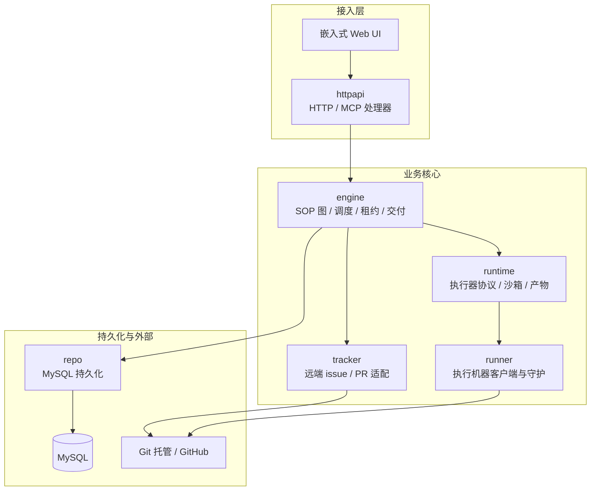
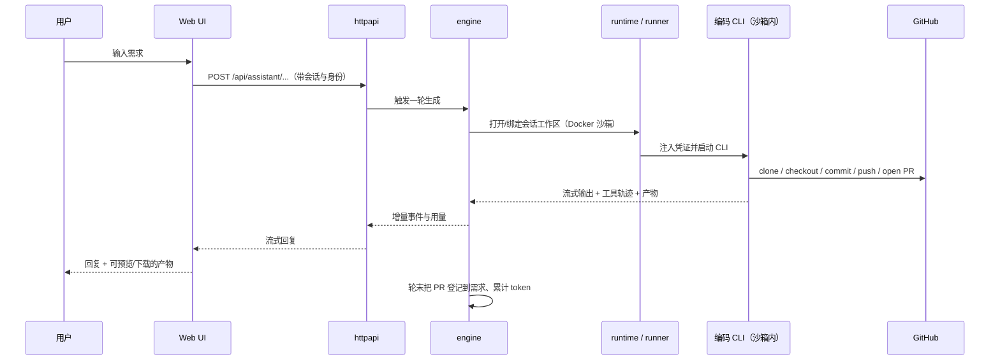

# 架构

## 一个进程，四种角色

LoopForge 的后端是**一个 Go 二进制**（`cmd/agentflow`），通过 `-role` 参数决定它在这个部署里扮演什么：

| 角色 | 做什么 | 是否执行 Agent 工作 |
| --- | --- | --- |
| `api` | 只提供 HTTP/MCP 接口，不执行运行 | 否 |
| `worker` | 领取并执行 SOP 运行与对话工作区，通常也提供接口 | 是 |
| `all`（默认） | 两者合一，单机部署的选择 | 由 `AGENTFLOW_EXECUTE_RUNS` 决定 |
| `agentflow-runner` | 独立的**执行机器**进程，用自己机器上的工具与仓库执行分配给它的任务 | 是（对外表现为一台执行机器） |

`all` 是单机 Compose 的默认形态：同一个容器既接请求也干活。当需要把执行分散到多台机器、或让机器用自己已装的 CLI 与本地登录时，就单独部署 `agentflow-runner`。执行角色通过**租约（lease）**领取运行，租约到期未续则别的实例可接管——这使多 worker 之间不需要共享内存即可协调。

此外还有两个小命令行程序：`agentflow-mcp` 与 `agentflow-gate-mcp`，分别提供对外 MCP 服务和结构化的人工门结果（见 [mcp-and-api.md](mcp-and-api.md)）。

> 注意模块名保留为上游的 `agentflow`，环境变量统一用 `AGENTFLOW_` 前缀——这是为了减少与上游同步时的冲突，不是历史遗留错误。

## 模块分层

下图是从"接请求"到"执行并落库"的分层，箭头是调用与数据流向。

各目录的职责（`docs/architecture.md` 的归纳）：

| 目录 | 职责 |
| --- | --- |
| `cmd/agentflow` | API、worker 或合并进程的入口 |
| `cmd/agentflow-runner` | 个人与池化执行机器 |
| `cmd/agentflow-mcp` / `cmd/agentflow-gate-mcp` | 对外 MCP 与结构化 gate 结果 |
| `internal/engine` | SOP 图、租约、调度、沙箱生命周期与交付；就绪分支并行执行 |
| `internal/repo` | MySQL 持久化，按业务域一个 repository |
| `internal/httpapi` | HTTP/MCP 处理器，按业务域一个 handler |
| `internal/runtime` / `internal/runner` | 执行器协议、凭证、隔离与产物 |
| `internal/tracker` | 远端 issue/PR 适配器 |
| `web` | 嵌入式 Web 界面、偏好设置与公开登录 |
| `migrations` | 显式数据迁移与可选的公开目录种子 |
| `local` | Local（旧版）工作流与宿主集成 |

三个设计取舍值得记住：

- **engine 与 httpapi 分离**：接口层只做鉴权、参数与序列化，所有调度与状态机在 engine；这样 CLI runner、定时器、MCP 都能走同一条核心路径。
- **repo 按业务域拆分**：一个业务域一个 repository 文件，避免一个巨大的"God store"。分析统计集中在 `internal/repo/analytics_*.go`。
- **执行器协议抽象在 runtime**：引擎不直接认识某个 CLI，而是通过 provider 协议驱动"某个 CLI + 某个模型 + 某份凭证"。加一个 CLI 只需加一个 provider。

## 一次请求的主链路

以"在对话里让 Main Bot 改一处代码并开 PR"为例（简化）：

服务端的路由按路径前缀分域：`/api/auth/*`、`/api/users/*`、`/api/projects/*`、`/api/issues/*`、`/api/runs/*`、`/api/assistant/*`、`/api/schedule/*`、`/api/notification-*`、`/api/platform/*` 等。所有请求先过身份鉴权中间件，再进各域 handler。MCP 走 `/mcp` 端点（Streamable HTTP）。

## 代码库总体布局

除 Go 后端外，仓库里还有几块值得知道的部分：

- `web/`：嵌入式前端（原生 JS + 自有组件库 + Monaco/VS Code 编辑器资源），随二进制 embedding 分发；界面文案有中英字典。
- `migrations/*.sql`：显式迁移脚本（50 余条），生产启动**不**自动执行，需手动按序跑；见部署页。
- `docs/`：上游自带的架构、部署、验证、API 等说明，是本章的主要依据来源。
- `e2e/`、`local/`：验收用例与 Local（旧版）产品。

> 依据：`docs/architecture.md`、`cmd/agentflow/main.go`、`internal/engine/engine.go`、`internal/httpapi/server.go`、`internal/domain/run.go`
