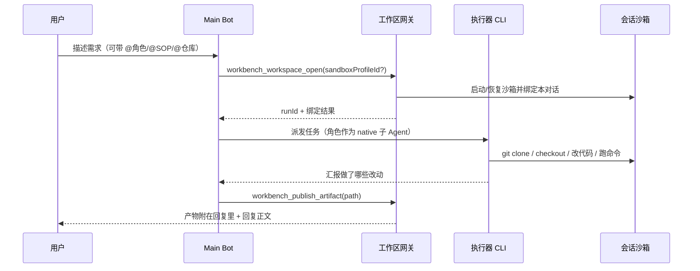
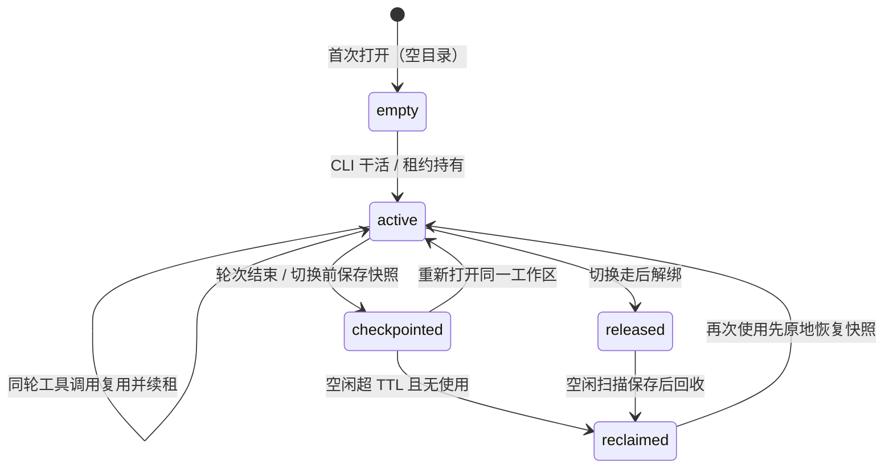

# 对话工作台：Main Bot 与会话工作区

LoopForge 的两条工作路径之一，是直接在聊天里跟 **Main Bot** 描述需求：它在该对话的工作区里开一个 Docker 沙箱、检出仓库、派发角色，最后交出一个 PR/MR 或一份文档。这页讲清这条聊天路径：Main Bot 是什么、每轮对话怎么跑、工作区在哪里、怎么被绑定和回收。

## Main Bot 是什么

Main Bot 是一个对话式的 Agent，坐在聊天首页的输入框后面。它本身保持在本地对话进程里；只有当这次任务需要看代码、改代码、跑命令、构建或访问 GitHub 时，它才会调用 `workbench_workspace_open` 进入**工作区模式**——把对话绑到一个真正的沙箱运行环境上。给它一个 SQL 清理、一段文案、一份文档，它可以在普通对话里直接做；只有"要碰真实仓库"时才需要工作区。

## 每会话一个执行器、模型与确认模式

每个会话都可以单独选择执行器（用哪个编程 CLI）、模型，以及权限/确认模式。这让"临时探索"和"认真改代码"可以用不同的档位——比如快速试错用一个便宜模型，关键改动用一个会仔细确认的模式。@ 引用可以在一句话里把角色、技能、需求、SOP、仓库拉进来，让 Main Bot 知道这轮该找谁、参考什么。

| 会话里可以 | 含义 |
| --- | --- |
| 选执行器 + 模型 | 这个会话的 CLI 与模型，覆盖默认值 |
| 选确认模式 | Agent 写操作是否需要用户确认，或走草稿 |
| `@` 角色 | 把某个项目角色作为子 Agent 派发 |
| `@` 技能 / 需求 / SOP / 仓库 | 在提示词里带上对应上下文与引用 |

> 依据：`README.md:179`、`docs/conversation-workspaces.md:11-15`

## 消息排队与 Steer

当一轮回复还在生成时发来的新消息不会丢：它们进入队列，等这一轮结束后再处理。如果用户想打断正在跑的回复、立刻改变方向，可以用 **Steer**——它中断当前回复，把新的引导马上送进去。对同一个生成，Steer 只接受一个待处理引导，第二个会被拒绝并提示"已有待处理的引导"，避免两条互相打架的指令同时生效。

> 依据：`internal/httpapi/assistant_steer_test.go:21-50`

## 一次聊天轮次的时序

把一轮对话拆开看：用户发消息 → Main Bot 判断要不要工作区 → 需要则 `workbench_workspace_open` 打开/绑定沙箱 → 交接给 CLI 执行 → CLI 用自己的 git 和工具干活 → 需要时 `workbench_publish_artifact` 发布产物 → 回复用户。下图是这条主链路。

该看什么：工作区是**按需打开的运行环境**而不是一次检出，打开后 CLI 自己决定 clone 什么、建什么分支；发布产物是把工作区里生成的 HTML/报告/文本文件附到回复供查看和下载。用户不需要手动 commit——PR 登记由平台在每轮回复保存前处理（见后文）。

> 依据：`internal/httpapi/assistant_workspace_open.go:228-297`、`internal/httpapi/assistant_workspace_open.go:27-71`

## 会话工作区：按需的 Docker 沙箱

工作区本质是一个 `Run.kind=workspace` 的运行记录，复用了 Runner、沙箱、Git、终端、快照、租约和空闲回收——但它不属于任何 SOP 调度，也不占 SOP 配额。`workbench_workspace_open` 只接收两个参数：`sandboxProfileId`（可选环境）和 `workspaceRunId`（可选，接入某个已有 SOP 运行或工作区）；传其他参数一律报错，因为普通工作区**不预先检出仓库或分支**，进入后由 Agent 自己 `git clone`。

选哪个环境有优先级：会话明确指定 > Main Bot 按发言人倾向的沙箱类型挑（Docker 或 native）> 平台默认 `generic-docker`。选中的环境不可用（被删除、跨项目私有、Dockerfile 缺失）会返回可操作的错误让 Main Bot 改选，而不是静默换成别的。

> 依据：`docs/conversation-workspaces.md:3-13`、`internal/domain/run.go:58-74`

## 工作区绑定与生命周期

一个对话同一时间只绑定**一个**工作区。切换的规则是：不传 `sandboxProfileId`、或传的与当前相同，就继续用当前工作区；传了别的环境就切过去——如果之前在那个环境开过且仍可用，直接接着用（文件与已 clone 的仓库都在），否则新开一个空工作区。切换完成时旧工作区解绑，交由空闲回收在保存兜底快照后回收。

| 状态 | 含义 |
| --- | --- |
| 新建（空目录） | 平台不预检出仓库，交 CLI 自行 clone |
| 活跃 | 本对话已绑定，按轮持租约使用 |
| 已快照 | 轮次结束或切换前保存了快照，可再打开 |
| 已解绑 | 切走后释放，等空闲回收 |
| 已回收 | 空闲超过 TTL（约 1 小时）后保存并回收沙箱 |
| 已恢复 | 切回已回收的工作区时先恢复快照 |

各状态之间靠"每轮租约 + 空闲回收"两个机制驱动。工作区只由 Main Bot 打开或切换，角色子 Agent 被禁用 `workbench_workspace_open`，它们共用 Main Bot 已经绑定的工作区。

> 依据：`docs/conversation-workspaces.md:28-48`、`internal/engine/conversation_workspace.go:17-90`

## 租约：按轮持有，两处保存

普通对话**按轮次**持有工作区租约：首次使用取得，此后整轮工具调用复用并持续续租，不再逐条命令都存快照。正常流程只在这两个时点保存完整快照：本轮结束（含失败、取消、超时、异常收尾），以及切换工作区之前。切换和轮次结束会等正在用该工作区的工具做完；重新打开同一个工作区不触发保存。若切换前保存失败（超限或超时），不阻止切换，旧工作区照常解绑、文件原样保留，空闲回收在回收前会再存一次、存成功前不回收。

> 依据：`docs/conversation-workspaces.md:34-36`、`internal/engine/conversation_workspace.go:44-72`

## 子 Agent：项目角色作为 native 子 Agent

在对话里 `@` 一个角色时，Main Bot 把它作为一个 **native 子 Agent** 派发。平台把这个角色渲染成一份 CLI 原生的 agent 定义（frontmatter 带子 Agent 名、描述、绑定的 Skills，正文是角色提示词加规则），让 CLI 用自己原生的子 Agent 机制去跑。子 Agent 与 Main Bot 共用同一个已绑定的工作区，但**不能**打开或切换工作区，也不能替 Main Bot 提交回复——需要用户确认的写操作要回到 Main Bot 由用户确认。这就把"角色复用"落到了聊天里：同一个角色定义，既能做 SOP 节点，也能在对话中当子 Agent。

> 依据：`internal/httpapi/assistant_subagents.go:19-118`、`internal/httpapi/assistant_subagents.go:102-118`

## Git 凭据注入（概括）

工作区模式下，每轮启动的 CLI 进程会按**本轮发言人**注入 Git 凭据，让 CLI 用自己的身份安全地操作仓库：

- **HTTPS**：用发言人个人配置的 Git Token。凭据通过 `GIT_ASKPASS` 脚本应答，脚本本身不含令牌，只解析出 URL 主机，并且**仅当主机恰好是 `https://github.com` 时**才应答；`github.com.example`、带 `oauth2:`/`private:` 前缀的令牌等都拿不到凭据。`GIT_TERMINAL_PROMPT=0` 避免卡在交互输入。
- **`GH_TOKEN`**：同一个令牌，供 `gh` 或 `curl` 调 GitHub API；平台进程自身的环境变量不会透传进沙箱。
- **SSH**：按 `host` 与端口的组合绑定的个人密钥，私钥只在内存中经临时 ssh-agent 签名，沙箱只拿到 agent socket、公钥和配置；平台内置了 github.com 的 22 端口与 ssh.github.com 的 443 端口这两条主机公钥。

提交身份设为发言人的登录名，回复和工具结果都会对令牌做脱敏。细节与安全边界见上游文档，这里不展开任何密钥。

> 依据：`docs/conversation-workspaces.md:17-26`

## 发布产物与把聊天 PR 登记到需求

要交给用户的文件（HTML demo、报告、JSON/CSV 等）用 `workbench_publish_artifact { path }` 发布，附在本轮回复里，HTML 可在产物栏交互预览。社区/空间会话里不带路径时，把 body/图片/url 发布到空间侧边栏。

代码改动要落到需求上，但 Agent **不需要**调用登记工具：每轮回复保存前，平台列出工作区里两层目录内的 git 检出，对其中指向 `github.com` 的远程仓库，用本轮发言人的 Git Token 查最近创建的 PR，只有"作者是该 Token 用户、创建时间晚于工作区创建、头提交正是工作区某本地分支当前提交、未关闭或已合入、且还没有任何需求跟踪它"才登记。这样别的会话或浏览器里开的 PR 不会被误登记；推送后又追加了未推送提交的，本轮不登记、下次推送再登记。登记成功时回复末尾附一句结果，需求转为 `in_review`，PR 合入默认分支后由轮询标记完成。

> 依据：`docs/conversation-workspaces.md:79-85`

## 与 SOP 的衔接

聊天和 SOP 共用同一套需求。借着工作区，两条路径可以衔接：从对话里派发 SOP（`issues_dispatch` / `runs_start`）时，若当前绑定的是本对话开的工作区，SOP 会在原执行机器上用自己的沙箱挂载该目录；SOP 会等对话释放工作区，同一工作区一次只交给一个尚未结束的 SOP。反过来，Main Bot 也能暂停、恢复或接管一条正在跑的 SOP。已关联 SOP 的任务会话里，SOP 执行中工作区只读，Main Bot 先停下 SOP 才进入工作区模式。

> 依据：`docs/conversation-workspaces.md:40-46`
