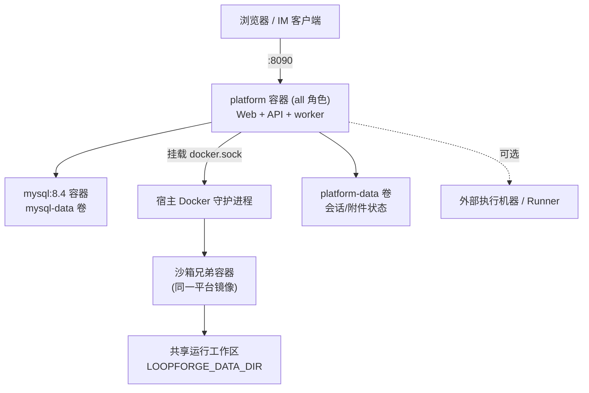

# 部署、账户与能力边界：能不能上、该不该选

这页写给两类人：准备把它**跑起来**的运维，和要判断它**值不值得选**的选型者。所以先讲怎么装、装出来长什么样、账户怎么管、怎么升级，再老实讲清它不做什么、不能做什么、和别的工具怎么比。

一句话概括边界：LoopForge 面向**一个可信团队**的自托管交付，它给你的是团队级流水线，不是给陌生人用的多租户 SaaS。

## Compose 一键部署

最快的方式是 `./start.sh`（等同 `bash scripts/install.sh`）。它默认**不本地构建**，而是拉取 `compose.yaml` 里固定的 GHCR 发布镜像（`ghcr.io/tencent/loopforge:0.4.2`），然后：

- 创建 MySQL 与平台两个服务；
- 生成 `.env`（含会话密钥、数据库密码等唯一密钥）；
- 安装内置沙箱、入门 SOP 和欢迎项目；
- 在浏览器打开地址、创建第一个账户（即管理员）。

宿主的 Go / Node.js 不需要预装。安装器会检查 Docker、Compose、Python 3 和 curl，缺什么就在 Linux 上用 apt/dnf/yum、在 macOS 上用 Homebrew 帮你装；Compose 插件按固定的官方发布并校验 SHA-256。安装需联网和包管理/管理员权限，设 `LOOPFORGE_YES=1` 可自动接受安装提示。它可安全重跑。

常用子命令：

| 命令 | 作用 |
| --- | --- |
| `./start.sh` / `./start.sh -d` | 后台安装或启动 |
| `./start.sh logs` | 跟踪平台日志 |
| `./start.sh stop [service]` | 停止但保留数据 |
| `./start.sh down` | 删除容器，保留数据卷 |
| `./start.sh restart` | 重启平台容器 |
| `./start.sh pull` | 刷新镜像并重建有变化的容器（必要时先迁移沙箱目录） |
| `./start.sh dev` | 用本检出从源码构建（`compose.dev.yaml`） |
| `./start.sh release` | 从源码构建切回发布镜像 |
| `./start.sh migrate-sandboxes` | 平台停止时应用沙箱迁移 041 |

**镜像源**：`ghcr.io` 下载卡住时，`./start.sh` 与 `pull` 会把它和南京大学镜像 `ghcr.nju.edu.cn` 比速，只有当南京镜像的 manifest digest 与刚读到的官方 digest 一致才用它（拉该 digest 后 tag 回官方名）。`MIRROR=ghcr.io` 强制走上游，`MIRROR=ghcr.nju.edu.cn` 强制走南京、跳过测速且不回退。这个选择不写进 `.env`。

## compose 里有哪几个服务

发布用的 `compose.yaml` 只拉镜像、从不构建。它包含这几个服务：

| 服务 | 镜像 | 职责 |
| --- | --- | --- |
| `mysql` | `mysql:8.4` | 数据库，数据存在 `mysql-data` 卷；默认仅本地端口映射 |
| `platform` | 固定的 `ghcr.io/tencent/loopforge` | 平台主进程（api + worker 合一的 `all` 角色），`platform` profile |
| `web` | 随镜像 | 内嵌 Web 界面，由平台进程提供 |
| `api` / `worker` / `runner` | — | 进程角色；生产单机部署以 `platform` 容器内的 `all` 角色运行，分离部署时另配 |

平台容器把宿主 Docker socket 挂进来，所以内置 AI SOP 开箱即用：默认沙箱从同一个平台镜像启兄弟容器，不再二次下载或构建。`AGENTFLOW_ISOLATED_IMAGE` 指向已安装的平台镜像。运行工作区以宿主的同一绝对路径挂入容器（工作区文件夹 `LOOPFORGE_DATA_DIR` 默认 `./.data`），因此 bind mount 在宿主侧能解析到正确路径。

下图是单机 Compose 部署的拓扑（浏览器 → 平台入口 → 平台进程 → 数据库 / 沙箱容器）：

该看什么：平台进程在容器里，但它通过挂进来的 socket **借用宿主 Docker** 起沙箱——这既是"开箱即用"的来源，也是下面"能力边界"里最关键的一条安全事实。

## 配置：.env 与 AGENTFLOW_*

配置主要落在 `.env`，由 `scripts/configure.sh` 生成；平台容器通过 `AGENTFLOW_*` 环境变量读取。常用项：

| 变量 | 作用 |
| --- | --- |
| `AGENTFLOW_HTTP_PORT` / `LOOPFORGE_BIND` | HTTP 端口与监听地址（默认监听全接口的 8090 端口） |
| `LOOPFORGE_IMAGE` | 覆盖镜像（可给 `@sha256:` digest）；`.env` 里存的值优先于后续 pin 变更 |
| `AGENTFLOW_MYSQL_DSN` | 用自带 MySQL 部署时的连接串 |
| `AGENTFLOW_ALLOW_SIGNUP` | 是否允许自助注册（默认 `true`，暴露公网务必设 `false`） |
| `AGENTFLOW_SECURE_COOKIES` | HTTPS 在代理终止时设为 `true` |
| `AGENTFLOW_SESSION_SECRET` / `AGENTFLOW_CREDENTIAL_KEYS` / `AGENTFLOW_PROJECT_CREDENTIAL_KEY` | 会话、Bot/项目凭据加密密钥——**必须随数据库一起备份**，丢失后已存密钥无法解密 |
| `AGENTFLOW_ISOLATED_IMAGE` / `AGENTFLOW_CONVERSATION_DIR` | 沙箱镜像与对话工作区目录 |

`AGENTFLOW_PROJECT_CREDENTIAL_KEY` 要跨实例一致、与数据库备份同存；换掉它之后，已有凭据都需要重新填写值。`AGENTFLOW_CREDENTIAL_KEYS` 同理，丢失后 Bot 的 Secret 无法解密。会话密钥要稳定，否则重启后登录态失效。

## 账户与访问模型：可信团队，不是多租户

这一节是选型的核心，务必读全：

- **首个账户即管理员**：在浏览器创建的第一个账户获得平台管理权限；在此之前登录页只提供这步设置。
- **自助注册默认开启**：`AGENTFLOW_ALLOW_SIGNUP=true` 时，任何能访问登录页的人都能注册为普通用户，而注册用户可以在你的 worker 上创建需求、跑 SOP。
- **登录用户可跨实例读数据**：LoopForge 假设团队互信——**每个登录账户都能列出所有项目、需求和运行**。项目设置与仓库只有项目 Owner 或平台管理员能改，个人凭据只有本人能改。
- **不要用它隔离互不信任的租户**：官方明确"不要用一个实例分隔不可信的租户"。

因此暴露到公网前必须做三件事：`AGENTFLOW_ALLOW_SIGNUP=false`、只给可信成员开户、先配好 HTTPS。创建管理员账户之前，还应把云安全组/防火墙收紧到运维自己的 IP，别让"首个账户设置页"暴露给任意互联网客户端。

管理员可在**平台管理 → 成员账号**显式开户（设登录名与初始密码、可选授予管理权），也可在命令行用 `cmd/loopforge-account` 非交互创建；密码用 bcrypt，浏览器会话是签名 HttpOnly、SameSite Cookie，七天过期。没有哪个人会被隐式当成管理员。

## 升级、备份与 Git over SSH

- **升级**：先更新检出（`git fetch --tags && git checkout vX.Y.Z`），按发行说明执行需要的手动迁移，再 `./start.sh pull`。新的 `compose.yaml` 会带上镜像 pin 和新设置，`pull` 在需要时先应用沙箱迁移 041（会在 `.local/` 留一份数据库备份）再启动。`dev` 源码构建不会被 `pull` 重建，需要再跑 `dev`。
- **备份**：MySQL 数据在 compose 卷里；用自带 MySQL 时外置。密钥类 `.env`（见上）必须与数据库一起备份，否则密钥类数据无法恢复。
- **Git over SSH**：GitLab、Gitea、Gogs 等用 Git SSH 检出与推送。每台 SSH 主机的个人私钥在**个人设置 → Git SSH 密钥**里登记，按 host:port 绑定；推送到某主机某端口的仓库共用一个 key。GitHub 的 `git@github.com:` 地址默认按 GitHub 仓库（HTTPS + token、自动 PR）处理，除非显式设 `provider=ssh`。Issue 导入与 PR/MR 自动化另需宿主平台 API 凭据或独立 MCP。

## 能力边界与选型硬事实

这一节不加修饰地列出"它需要什么、不做什么"，帮你判断该不该选。

| 维度 | 事实 |
| --- | --- |
| 运行前提 | 需要 Docker + Python 3；安装器可代装缺失组件，但仍需联网与包管理/管理员权限 |
| 面向对象 | 自托管、单实例、可信团队；非多租户隔离 |
| Docker socket | 挂载宿主 socket 等价于获得宿主 root 控制权；**不适合不可信多租户**。只有管理员可把仓库指向宿主路径 |
| 执行器 | 各 CLI 首用需 npm 或厂商网络装包；平台镜像内置 CodeBuddy/Codex/DeepSeek Harness，Claude Code 首用从 npm 装，Cursor/Antigravity/ZCode 需在相应机器安装 |
| 模型费用 | **不含模型用量**——自带 key（bring your own keys）；积分/订阅不当作账单 |
| GitHub | 可选：内置通用 SOP 无仓库也能跑（产品 SOP 出文档，新建前端/后端出源码文件），修 bug 仍需源码与复现信息 |
| 可达性 | 新装默认监听所有网卡，面向可信团队；公网前须 HTTPS 并收紧注册 |
| 协议 | MIT；第三方组件各自许可，见 `THIRD_PARTY_NOTICES.md` |
| 维护模型 | 公共仓库是自托管平台 + LoopForge Local；内部维护者私有保存与上游 `master` 的同步记录，公共源码不含部署密钥、生产数据或私有基础设施 |

关于"跑通了多少"的诚实说明：验证记录里明确列出 **未完整实测**的范围——付费的 Codex/Claude 服务、外部知识服务、企业 IM 通知的真实投递、真实多机云端池，以及在所有操作系统上的运行行为。已测的包括：全量 Go 套件、真实平台 HTTP/API 套件、公共浏览器套件、生产 Docker 镜像构建、fresh 容器安装、真实 GitHub 导入/交付、以及一次真实 CodeBuddy 交付 SOP（7 阶段、Python fixture，验证的是编排而非前端框架兼容或完全自主交付）。**历史验证结果不代表后续修订的认证**——要以具体公共 commit 的 CI 为准。

## 选型对比

两类常见对照。先看与通用 AI/自动化工作流工具的区别：

| 对比项 | LoopForge | Dify / n8n / Flowise |
| --- | --- | --- |
| 定位 | 用编码 Agent 做**软件交付** | 通用 AI / 自动化工作流搭建 |
| 核心构件 | 实现/评审角色、带真实仓库的 Docker 沙箱、GitHub 交付、人工验收门、运行证据 | 节点式流程编排、模型接入、应用搭建 |
| 适合谁 | 想把"团队怎么交付软件"标准化的研发团队 | 想快速搭 AI 应用或自动化各种任务的人 |

再看与"直接用编码 CLI"的区别：

| 对比项 | LoopForge | 直接用 Claude Code / Codex / CodeBuddy |
| --- | --- | --- |
| 关系 | **编排**这些 CLI，不替换它们——每个 Agent 步骤、每一轮对话都跑其中某个 CLI | 你自己在终端里驱动一个 CLI |
| 额外提供 | 谁做什么、在哪个沙箱、按什么顺序、经过什么检查、由谁签核 | CLI 本身的能力 |
| 适用 | 团队、需要可复现与审批 | 个人、探索性、一次性任务 |

一个常见的决策表：

| 你的情况 | 建议 |
| --- | --- |
| 一个可信团队，想把交付流程固化、可追溯 | LoopForge 合适 |
| 只是想试跑一下、没有 API key | 用内置"脚本 + 审批" demo，无需 key |
| 要按租户隔离、对外提供多租户服务 | 不适合——它明确不支持不可信多租户 |
| 不想自托管、不想运维 Docker | 直接用一个编码 CLI 更省事 |

> 依据：`compose.yaml`、`start.sh`、`docs/deployment.md`、`docs/validation.md`、`docs/open-source-scope.md`、`README.md`、`SECURITY.md`、`LICENSE`、`Dockerfile`。

## 小结

能上：一台装好 Docker + Python 3 的机器，`./start.sh` 拉镜像、建服务、生成密钥、装好入门内容，浏览器开号即用。该不该选：看你是不是"可信团队、想自托管、想固化软件交付流程"。它最强的地方是编排编码 CLI 的团队级流水线；它最需要你正视的边界是"挂 Docker socket = 宿主控制权""可信团队非多租户""模型费用自带""部分外部服务未完整实测"。
