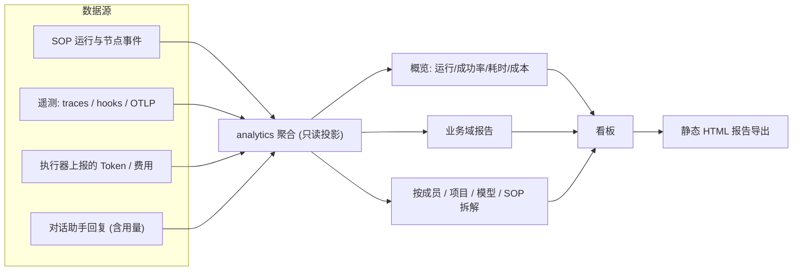

# 工程洞察与成本：跑了多少、值不值

前面讲过 LoopForge 怎么把需求交付出去，这一页回答交付之后的问题：**过去一段时间跑了多少次、成功率多少、花了多少钱、这些钱花在哪、值不值**。

所有洞察都从一个只读的统计投影算出来，不修改原始 Run、节点或外部上报的账单事实。读完后你应该能回答：有哪些指标、数据从哪来、成本怎么算、对话改代码的用量为什么单列、报告怎么导出。

## 数据从哪来，怎么聚合成指标

洞察的数据源不是单一事件流，而是几条并行的记录：SOP 运行及其节点事件、执行器上报的模型用量与遥测（traces/hooks/OTLP）、以及普通对话里保存的助手回复。这些数据经过一层聚合，产出概览看板、业务域报告和可导出的 HTML。

关键设计：所有维度共用同一个投影，所以"总额、趋势、项目、责任人、SOP、模型、需求明细"数字互相对得上。运行耗时尤其小心——它被拆成两把尺子（见下节）。

## 核心工程指标

概览层把 SOP 运行（以及它们关联的需求）汇总成一组指标。下表按分组列出主要几类：

| 指标组 | 代表字段 | 它回答什么 |
| --- | --- | --- |
| 运行量与终态 | 运行数、成功、失败、取消、返工次数 | 跑了多少、结果分布 |
| 成功率 | `successRate`（成功÷(成功+失败)）、`completionRate`（含取消）、`firstPassRate`（一次通过） | 质量好不好 |
| 耗时 | 平均、P50/P95/P99 | 快不快、长尾多长 |
| 执行耗时 vs 墙钟 | `ExecutionAvg/P95` vs `AverageDurationMs`、`WaitAverageDurationMs` | 真正在干活多久、卡在等什么 |
| Token 四分项 | 输入/输出/缓存读/缓存写、缓存命中率 | 用量结构 |
| 成本 | 总额、已上报、覆盖率、未识别次数 | 花了多少、多少没算准 |
| 需求维度 | 唯一需求数、每需求平均执行/失败次数、进行中需求数、需求 P50/P95 耗时 | 需求层面的效率 |
| 人均吞吐 | 近 7 天交付需求 ÷ 活跃成员 | 团队每周产能 |

两个最容易被混用的概念是"耗时"：

- **墙钟耗时**（`AverageDurationMs` 系列）：从 Run 创建到最后结束的端到端时间，含审批等待、暂停、恢复等待，可能长达数天。
- **执行耗时**（`ExecutionAverageDurationMs` 系列）：所有节点 `FinishedAt−StartedAt` 求和，重试会累加、并行节点不重复计，但不含等待。

两者相减得到 `WaitAverageDurationMs`，直接回答"时间卡在等什么"。需要判断 Agent 产能时看执行耗时，需要判断流程顺不顺时看等待。

## 业务域报告与导出

**业务域**（business domain）是按产品线/业务分组项目的一层归类。业务域报告把多个项目的运行、交付、成本汇总到域级，并给出跨项目对比。

报告包含：概览（Summary）、交付汇总、趋势、各项目用量、各业务域用量，以及一组**交付度量**——完成到合入的平均时长、周期时长（首次执行到最后一次）、已完成需求的平均 Token 等。这些度量用"完成时间"和"合入时间"两个独立时钟计算，不依赖 Run 创建时间，所以历史区间也能对齐。

导出方面：概览看板可以把当前筛选范围（项目、责任人、来源、时间粒度）渲染成一份**静态 HTML 报告**并下载，内含 KPI 卡片和多张明细表（SOP 一览、各模型用量、成员汇总、每人每日用量、需求类型分布、SOP 版本对比、趋势、各项目用量、交付明细）。看板上的趋势图本身用 SVG 绘制；报告页以表格承载数据，适合存档或打印。单张明细表也可单独导出 CSV。

报告需要项目负责人、维护者或平台管理员权限；业务域报告还要求对该域有查看权限。报告结果有 10 秒的短缓存，只用于合并同一瞬间的重复打开。

## Token 与成本核算

成本核算遵循一条明确口径：**有效上报费用优先，未上报时才按公开标准价估算**。

- 执行器上报了 `costStatus=reported` 且金额有限、非负，就直接采用上报金额——包括明确上报的 0；不会因为公开价更高而覆盖它。美元按 **1 USD = 7 CNY** 折算。
- 没有有效上报时才回退到公开标准价估算：优先用人民币单价，只有美元单价的按 7 折人民币。输入、输出、缓存读、缓存写分别计费；推理 Token 已含在输出里，不另收。
- 一个 Run 里有多个模型时，分别计价再求和。
- **无法估算时不会显示成"免费"**：缺模型、缺公开价或缺 Token 分项时，保留可识别部分的金额并显示**覆盖率**，未识别的数量单独计数。

有一个容易踩的坑：CodeBuddy 的兼容字段 `total_cost_usd: 0` 是占位值，不代表真的免费（其积分在另一字段上报），所以平台把它归一化为"未上报"，再走估算回退。

价格来自一张登记表（`token_pricing.go`），每项的币种、输入/输出/缓存单价都记录在案，并标注核价来源与日期。策略版本为 `reported-first-2026-11-22`；回退价表沿用 `public-standard-2026-11-05`。新增模型要先核实官方价格再登记，不给未知型号套模糊前缀价。

需要诚实说明的边界：**上报金额是执行器给出的事实，但公价回退部分是估算**，不是供应商结算账单。存量累计 Token 无法还原逐请求的长上下文阶梯、缓存 TTL、区域或峰谷价，回退统一按普通在线、基础上下文、标准缓存档计算。

## 对话改代码：为什么不按 Run 算

普通对话里直接改代码的工作区，是"绕过 SOP、在对话工作区里完成一次交付"的路径。它在统计里有一条特殊口径，因为它既不是 SOP 运行、也不该被忽略。

对话工作区不是 Run：**不计入**运行数、成功率、耗时和"平均 Token / Run"（它没有节点，在回收前一直处于等待态）。但它的 Token 与成本**计入总量、趋势、成员、项目和来源**，并在 `summary.conversation*` 里单列。

| 对话工作区 | 是否计入 |
| --- | --- |
| 运行数 / 成功率 / 耗时 / 平均 Token per Run | 否（不是 SOP 运行） |
| 总 Token、总成本、趋势、成员、项目、来源 | 是 |
| 单独的 `summary.conversation*` 系列 | 是（单列，不与 Run 重复加总） |
| "运行记录"列表、运行概览、全局搜索、"进行中/待审批" | 否 |
| 关联需求在需求列表的"对话工作区"标记 | 是 |

这样设计的目的：让"直接对话改代码"的投入可见（钱和 Token 不漏），又不污染"每条 SOP 运行花了多少"的运行级指标。只经对话改代码的需求，在交付明细里按 MR 状态单独显示"对话改代码中 / 待合入 / 已关闭"，合入后算"对话直接交付"。

## 遥测与 Traces

洞察用到的遥测走执行器侧采集：hooks（Agent 钩子）、Anthropic 流式协议，以及 OTLP traces。这些数据进入 `run_telemetry` 之类的观测表，支撑工具调用数、产物数、事件与日志计数（`AnalyticsCoverage` 里能看到有多少运行带遥测、带日志，以及各适配器与日志级别的分布）。运行详情里的节点状态、工具轨迹、日志也来自这一层——日志与 Trace 在运行记录里看，导出的用量报告则明确提示"日志与 Trace 请在运行记录中查看"。

> 依据：`internal/domain/analytics.go`、`internal/domain/analytics_dashboard.go`、`internal/domain/business_domain.go`、`internal/domain/run_timing.go`、`internal/domain/token_pricing.go`、`internal/repo/analytics_insights.go`、`internal/repo/analytics_token_usage.go`、`internal/repo/analytics_business_domains.go`、`internal/observability/otlp.go`、`docs/token-pricing.md`、`docs/conversation-workspaces.md`（统计节）。

## 小结

洞察页要回答的是"值不值"。它的可信度来自三个取舍：所有维度共用一个只读投影，数字才对得上；执行耗时与墙钟耗时分开，才能区分"真在干活"与"卡在等人"；成本上报优先、估算兜底、未知不显示为零，才不把账单美化成假象。对话改代码单独列账，则让另一条交付路径的投入也可见。

读这组指标时，请带着这些口径：公价回退是估算而非结算、存量 Token 无法逐请求还原、对话工作区不进运行指标但进总量。
