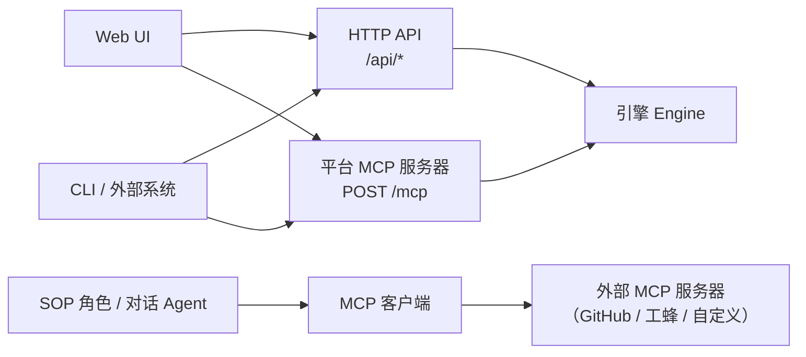

# 对外接口：HTTP API 与 MCP

LoopForge 通过两套接口对外提供能力：一套是 **HTTP API**（有 OpenAPI 描述），一套是 **MCP 服务器**
（Streamable HTTP）。它们不是两个功能集，而是**同一份能力清单的两种门面**——HTTP 与 MCP 共用
`/api/capabilities` 的 operation manifest，MCP 的 `tools/list` 就是由它生成的。这一页讲清两套接口各自
暴露什么、谁来调用、以及平台在 MCP 上的安全边界。

读完这页，你能回答：外部系统该怎么调 LoopForge、MCP 工具从哪来、人机闸门的结构化结果怎么产生、平台
如何把外部 MCP 当作角色的工具来用，以及密钥在 MCP 里如何被脱敏。

## 两套门面与调用方

平台对外有两个服务器，外加一个**客户端方向**（平台去调外部 MCP）：

该看什么：左边是**入站**——Web UI、CLI、外部系统既能调 HTTP API，也能调平台 MCP 服务器，两者都落到
同一个引擎。右下角是**出站**——SOP 角色或对话 Agent 作为调用方，通过平台的 MCP 客户端去调外部 MCP
服务器，把外部能力当成自己的工具。平台既是 MCP 服务端，也是 MCP 客户端。

## 两个服务器分别暴露什么

| 服务器 | 入口 | 暴露内容 |
| --- | --- | --- |
| 平台 MCP 服务器 | `POST /mcp`（无状态 Streamable HTTP） | 平台自身能力：需求（issues）、运行（runs）、工作区打开（`workbench_workspace_open`）、产物发布（`workbench_publish_artifact`）等，工具清单来自 operation manifest |
| `agentflow-gate-mcp` 闸门服务器 | stdio | 单一的 `submit_gate_result` 工具，产出结构化的人机闸门结果 |

平台 MCP 服务器用一个**保留的合成服务器 ID** `agentflow-platform` 标识，它在 `mcp_servers` 表里没有行，
由运行时按需解析。协议支持 `initialize`、`tools/list`、`tools/call`、`resources/*` 与
`notifications/*`，MCP 的 `tools/call` 底层映射成一次 HTTP 请求，2xx/非 2xx 映射为 tool result 的
`isError`，JSON 响应放在 `structuredContent.data` 里。

## 闸门 MCP：把人工闸门变成结构化结果

人机闸门（human gate）需要「人的裁决」变成引擎能读的结构。`agentflow-gate-mcp` 就是一个 stdio MCP
服务器，只暴露一个工具 `submit_gate_result`，要求调用方**恰好调用一次**来结束该节点。它的结果是一个
结构化的 gateResult，关键字段如下：

| 字段 | 说明 |
| --- | --- |
| `decision` | `pass` / `rework` / `fail` / `human` |
| `reason` | 必填，为什么这样裁决 |
| `actionRequired` | 需要执行的动作 |
| `summary` | 摘要 |
| `findings` | 发现列表（带 severity、title、evidence，最多 50 条） |

这样闸门产出的不是一段自由文本，而是引擎可判定、可路由（通过/打回重做/失败/转人工）的结构化对象。

## MCP 客户端：平台把外部 MCP 当工具

反过来，平台内置一个最小化的 Streamable HTTP MCP 客户端（`internal/mcpclient`），SOP 角色与对话 Agent
通过它调用外部 MCP 服务器。一次调用前，`PrepareMCPServers` 是**唯一**把「解析好的资产包」变成「这次调
用实际能调什么」的地方：先按目标地址重定位平台自服务的 MCP，再绑定凭据。绑不住的服务器（缺凭据、地址
不可达、SSH-only 工作流下的 GitHub Token MCP）会被丢弃并给出警告，而不是让调用挂着失败。

外部 MCP 按 `authType` 绑定凭据：`github-token` 表示运行时注入需求责任人的 GitHub Token，资产本身不能
保存个人 Token；`credential` 类则绑定该责任人平台托管的凭据。Agent 调用要求凭据必须存在，脚本和闸门则
宽松绑定。

## 安全：actor 作用域、脱敏与校验

MCP 相关的安全有三层，值得单独记住：

- **actor 作用域的令牌绑定**：凭据绑定到「责任人（actor）」，模型调用、Git 推送、PR 操作都用**当前这一轮
  发言人**的个人凭据，而不是某个隐式共享身份。个人 Token 明文只展示一次，支持有效期、最近使用与即时
  撤销。
- **MCP 脱敏（masking）**：API 返回 MCP 服务器定义时，所有字面 header 值、以及键名像凭据的环境变量
  （含 `TOKEN`/`SECRET`/`PASSWORD`/`API_KEY`/`AUTH`/`CREDENTIAL` 等片段）会被替换成 `******`；
  `${secret:NAME}` 引用按原样展示。客户端把 `******` 原样回传表示「保留已存值」；若某个掩码值在已存定
  义里没有对应项，则丢弃而不落库。
- **MCP 校验**：保存 MCP 服务器时校验定义（传输方式、scope、必填字段等），越界或非法的定义被拒绝，避免
  把错误配置带到运行时。

## HTTP API 一览

HTTP API 按领域拆分，除下载与 SSE 外都是 UTF-8 JSON 请求/响应。用 `Authorization: Bearer afp_<token>`
认证（个人 Token）。关键领域如下：

| 领域 | 主要路径前缀 | 作用 |
| --- | --- | --- |
| 协作与需求 | `/api/projects`、`/api/repositories`、`/api/issues`、`/api/tasks` | 项目、仓库、需求、评论、澄清、派发 |
| 能力注册表 | `/api/agents`、`/api/rules`、`/api/skills`、`/api/mcp-servers`、`/api/sandboxes` | Agent、规则、Skill、MCP、执行器、沙箱配置 |
| 编排与运行 | `/api/workflows`、`/api/runs`、`/api/schedule-jobs` | SOP、运行、审批、日志、制品、分析、定时任务 |
| 能力发现 | `GET /api/capabilities`、`POST /mcp` | 公共能力清单与 MCP 入口 |
| 外部同步/用量 | `/api/sync/*`、`/api/insights/v1/*` | 工蜂/TAPD 同步、外部工作流用量接入 |

## 外部用法

除了平台内建 UI，外部系统有两种协作方式：

- **调平台能力**：通过 HTTP API 或平台 MCP 服务器，外部系统可以列需求、起运行、查状态等，操作清单见
  `GET /api/capabilities`（它明确排除了 signals、OTLP、lease 和沙箱维护等内部接口）。
- **上报外部执行用量**：外部系统自己跑工作流，在成功/失败/取消后上报一次完整汇总到
  `/api/insights/v1/*`，数据独立存放、不创建平台 Run、不触发交付，仅并入用量分析。数据源 Token 只绑定
  一个项目与来源，数据库只存 SHA-256 摘要。

> 注意哪些不是稳定公共 API：`POST /api/runs/{runId}/signals`（Worker 内部上报）、`POST /api/otel/v1/traces`
> （仅 loopback 内部）、运行里的 `ownerInstanceId`/`leaseUntil`/`executionGeneration` 等定位元数据，以及
> 沙箱回收/清理——**当前没有公共 HTTP 接口**，`/api/sandboxes` 只管配置模板、不执行回收。

> 依据：`internal/mcpserver/server.go:1-70`、`internal/gatemcp/server.go:1-60`、
> `internal/mcpclient/client.go:1-70`、`internal/runtime/platform_mcp.go:1-100`、
> `internal/domain/mcp_masking.go:1-60`、`internal/domain/agent.go:59-83`、
> `internal/application/operations.go:42-94`、`cmd/agentflow-mcp`、`cmd/agentflow-gate-mcp`、
> `docs/api/README.md`、`docs/api/shared-schedules.md`、`docs/external-workflow-usage.md`。
