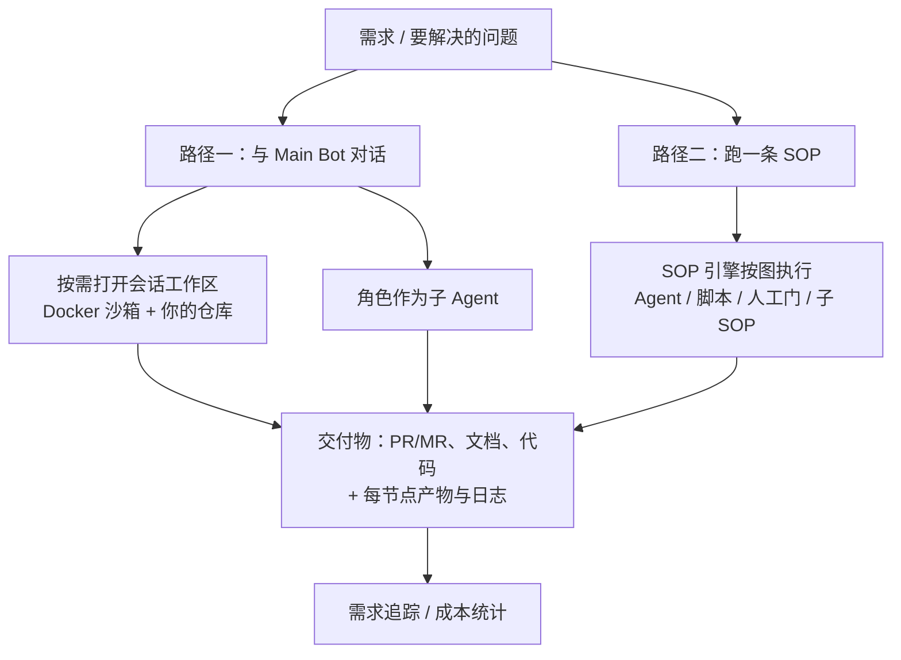

# 概览

## 它解决什么问题

直接让编码 Agent "修这个 bug"，结果取决于那一次运行：它可能跳过计划、忘掉测试、自己审自己的代码，或者中途悄悄停下。这对演示够了，但不是团队交付软件的方式——团队要的是**每次都一样、有人把关、可回溯**。

LoopForge 的出发点是把"一次成功的 Agent 运行"沉淀成"一条可重复、可审批的交付流程"。它围绕三个痛点设计：

- **可重复**：同一条 SOP、同样的阶段、同样的检查，对每个需求都执行一遍。内置后端、前端、修 bug、产品四类 SOP 作为起点。
- **角色分离**：规划、实现、评审、测试各有自己的 prompt、执行器、模型、规则、Skill 与 MCP 工具；一个角色既能充当 SOP 节点，也能在对话里当子 Agent。
- **人在环上**：Agent 自主运行，但你随时可暂停、介入、接管；人工审批门把流程停在"必须有人拍板"的地方——批准，或把活退回指定步骤。

一句话：**让 Agent 干活可复现、可评审、可交付，而不是每次掷骰子。**

## 面向谁

- 想让团队用编码 Agent 稳定交付软件、但需要角色分工与签核的工程团队；
- 想在自己的服务器上自托管全套流程（数据不出内网）的组织；
- 想先把"某种协作方式"固化成模板、再规模复用的技术负责人。

不需要读源码；本文档假设你没有打开过它的代码。

## 两条工作路径

LoopForge 有两条入口，但它们**共享同一套需求追踪**——无论代码是在对话里改的，还是被 SOP 交付的，都会回到"当初要的是什么"这个需求上，并计入交付与成本统计。

| | **与 Main Bot 对话** | **跑一条 SOP** |
| --- | --- | --- |
| 适合 | 探索、快速修复、与 Agent 迭代 | 固定阶段、固定签核的重复交付 |
| 怎么跑 | Main Bot 按需打开一个对话工作区（Docker 沙箱 + 你的仓库），把项目角色当作子 Agent 调用 | 引擎按顺序执行 Agent、脚本、人工门、子 SOP 节点，在各自的沙箱里 |
| 你怎么控制 | 回复进行中可排队或"打断并立刻发送"消息；可从对话暂停/恢复/接管正在跑的 SOP | 在人工门审批、把工作退回指定步骤、重试或从任意节点重跑 |
| 交付物 | 一个 PR/MR，或直推共享分支（`mode=direct`） | 文档、代码或 PR，外加每个节点的产物与日志 |

两条路径由同一套角色、沙箱、检查点、历史支撑，可以互相切换：Main Bot 能启动、暂停、接管 SOP 运行。

下图把两条路径并排画出来：它们从同一个"需求"出发，走不同的执行路径，最后都汇到"交付物 + 交付记录"。

该看什么：两条路只有"谁来驱动、按什么顺序"不同，底层共享角色、沙箱与需求追踪；这也是为什么一次需求既能由 SOP 交付、也能直接从对话改代码。

## 核心能力一览

| 能力域 | 你能得到什么 |
| --- | --- |
| **对话工作台** | Main Bot + 每会话独立的执行器/模型/权限模式；`@` 引用角色、Skill、需求、SOP、仓库；消息排队与打断；生成文件在侧栏预览与下载 |
| **会话工作区** | 按需 Docker 沙箱，检出项目仓库，项目角色作为原生子 Agent；可直接暂停/恢复/接管正在跑的 SOP 工作区 |
| **SOP 设计器** | 可视化画布，Agent / 脚本 / 人工门 / 子 SOP / 预览节点，失败重做边，校验、版本历史与发布；内置四类 SOP |
| **角色** | 可复用定义：prompt、执行器、模型、规则、Skill、MCP 工具、产物与门，跨 SOP 节点与对话子 Agent 共享 |
| **需求 → 交付** | 需求端到端追踪，无论由 SOP 还是直接从对话交付；PR/MR 状态跟踪、合入检测、直推分支合并 |
| **运行与审批** | 实时节点状态、工具轨迹、worker 日志、每节点产物快照与工作区预览；统一的"待我审批"收件箱 |
| **AI 定时任务** | 有完整工作区/SOP/MCP 权限的周期 Agent 任务；版本化、可参数化的共享任务模板市场；新需求自动派发 SOP |
| **洞察与成本** | 工程指标、业务域报告（静态 HTML/SVG 导出）、SOP 与会话按公开价目的 token/成本核算 |
| **执行环境** | 平台 worker、Docker 沙箱，或接入一台用你自己工具与仓库的本地执行机器 |
| **团队就绪** | 密码账户、项目与成员、明暗/跟随系统主题、OpenAPI 描述的 HTTP 与 MCP API；管理页中英双语，对话工作台目前以中文为主 |

## 技术栈

| 维度 | 选型 |
| --- | --- |
| 后端语言 | Go（`go 1.26.11`；模块名保留上游 `agentflow`） |
| HTTP 框架 | Gin；WebSocket 用于流式与执行机器控制 |
| 持久化 | MySQL 8（唯一数据源；分析用聚合查询） |
| 前端 | 嵌入式 Web 资源（`web/`，原生 JS + 自有组件体系 + Monaco/VS Code 资源），随二进制 embedding 分发 |
| 执行器 | 十个编码 Agent CLI：CodeBuddy、Codex、Claude Code、OpenCode、Cursor CLI、Antigravity、Kimi Code、Pi、DeepSeek Harness、ZCode |
| 沙箱 | Docker 容器；native 轻量沙箱（Linux `bwrap` / macOS `seatbelt`） |
| 部署 | Docker Compose（`platform` + `mysql`，可加 `agentflow-runner` 执行机器），`./start.sh` 一键拉起 |
| 协议 | MIT |

> 关于代码量的粗量：Go 源码约 1500 个文件、33 万余行（不含 `web/`），迁移脚本 50 余条——这是一个工程化相当成熟的中型平台，而非原型。

## 和其他工具的区别

**和 Dify / n8n / Flowise 比**：那些是通用 AI 与自动化工作流搭建工具；LoopForge 是**专为"用编码 Agent 交付软件"**而造——实现者/评审者角色、带真实仓库的 Docker 沙箱、GitHub 交付、人工验收门与运行证据。

**和直接用 Claude Code / Codex / CodeBuddy 等 CLI 比**：LoopForge 不替换它们，而是**编排**它们。每个 Agent 步骤、每一轮对话都由其中某个 CLI 实际执行；LoopForge 补的是"谁来做、在哪个沙箱、按什么顺序、过哪些检查、由谁签核"。

> 依据：`README.md`、`README.zh-CN.md`、`go.mod`、`compose.yaml`、`docs/architecture.md`（基线 `main@2ad5659`）
