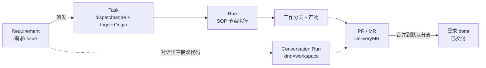

# 需求、运行与交付：从一句话到合入的代码

LoopForge 的结构化主线是一句话：**每个需求都能被端到端追踪，无论它是靠 SOP 交付，还是直接从对话里
改代码交付**。这一页讲清这条主线上的几个对象、它们之间的关系、交付是怎么被判定为「合入」的，以及两条
路径（SOP 与对话直改）如何汇入同一套需求与统计。

读完这页，你能回答：一次交付的「最小单位」是什么、运行有哪几种状态、一份 MR 在什么条件下算「已交付」、
以及为什么从聊天里随手改的一段代码也不会丢掉需求追踪。

## 主线：Requirement → Task → Run → 交付

整条链的核心对象有四个，逐层展开：

- **Requirement（需求）**：一个工作项，对应 domain 里的 `Issue`。它有自己的状态生命周期
  （`backlog → todo → in_progress → in_review → done …`）和交付字段（`deliveryMrUrl`/`deliveryMrs`/
  `deliveryState`）。需求是「要做什么」的唯一锚点。
- **Task（任务）**：把需求指派给某个 Agent 与 SOP 派发出去的结果。它记录派发方式
  （`dispatchMode`）与触发来源（`triggerOrigin`），是「这次派发给谁、为什么派发」的记录。
- **Run（运行）**：引擎真正执行 SOP 图的一次实例，带工作区、节点集合、日志、产物与用量。它是「实际怎
  么跑的」。
- **交付（Delivery）**：运行产出的分支/MR 被登记回需求，经合并判定后把需求推进到完成。它是「跑出来的
  东西有没有落地」。

该看什么：实线是 SOP 路径，从需求派发成任务、跑成运行、产出分支与 MR、合并后需求完成；虚线是对话
直改路径——没有 Task、没有 SOP 节点，直接在对话工作区改代码后开 MR，但**同样落回同一个需求的交付 MR
并登记合入跟踪**。两条路径在「交付 MR」这一步汇合，因此统计与需求列表都能统一口径。

## Task：一次派发的凭证

`Task` 记录这次需求是怎么被派出去的。两个字段最能说明问题：

| 字段 | 取值 | 含义 |
| --- | --- | --- |
| `dispatchMode` | `primary` / `scheduled` / `rerun` | 首次主动派发 / 定时或订阅触发 / 从某节点重跑 |
| `triggerOrigin` | `manual` / `timer` / `manual_run` | 人工点 / 定时器 / 手动执行 |
| `status` | `queued` / `dispatched` / `running` / `completed` / `failed` / `cancelled` | 任务的流转状态 |

一个需求可以先后有多个 Task（例如失败重跑、定时再派发），但最新一次运行通过 `LatestTaskID` 关联。需求
列表与详情靠这些关系还原「它被派发过几次、每次什么结果」。

## Run：SOP 与对话工作区两种形态

`Run` 有两种 `kind`：

- **SOP 运行**：引擎按 SOP 图执行节点（Agent、脚本、人工闸门、子 SOP），有节点集合、可重跑、可重排。
- **对话工作区运行（`kind=workspace`）**：普通对话里改代码时使用，标识为 `conversation-workspace`，没有
  节点、不参与 SOP 调度、不占 SOP 配额，但复用 Runner、沙箱、Git、快照、租约与空闲回收。

运行的状态是读者最常问的可枚举项，SOP 运行与对话运行共享同一套状态词汇：

| 状态 | 含义 |
| --- | --- |
| `running` | 正在执行 |
| `waiting` | 等待中（对话工作区在回收前一直是 waiting） |
| `pending_input` / `waiting_approval` | 等待输入或等待人工闸门确认 |
| `succeeded` | 成功完成 |
| `failed` | 失败 |
| `cancelled` | 已取消 |

引擎在运行内部把一个多仓库/多分支的工作拆成并行分支：**就绪的分支一起在运行工作区里执行**；取消后重
跑某一个分支，会恢复被取消的兄弟分支。节点依赖满足即启动，失败的检查可以把工作送回某个更早的节点重
做。

## SOPPlaybooks、lanes 与依赖

当需求绑定到 SOP 后，需求快照会用 **lane（泳道）** 描述每条工作分支的进展。`RequirementLane` 记录：
绑定的 `workflowId`、最新运行与任务、状态、`dependsOn`（依赖哪些 lane）、`handoff`（交接给哪些 lane）、
以及每条的 token/成本/耗时与节点阶段（`stages`）。

整体进度汇总在 `RequirementOverall` 里：运行数、失败数、成功 lane 数、活跃 lane 数、token、成本、周期
耗时与总状态。这让需求详情页能显示「几条泳道、各自走到哪、整体算完成没有」，而不是只给一个笼统的百分
比。

## 交付：PR/MR 跟踪与合并判定

交付的落点是 `DeliveryMR`：一个交付的合并请求。一个多仓库的 SOP 最多为每个运行的仓库交付一个 MR。它记
录仓库、IID、URL、目标分支与**归类后的交付状态**：

| 交付状态 | 判定条件 |
| --- | --- |
| `merged` | MR 已合并，且目标分支就是默认分支（真正落地主线） |
| `integrated` | MR 已合并，但目标是集成基线（`integrateBranch`），尚未进默认分支 |
| `opened` / `reopened` | 仍开着 / 重新打开 |
| `closed` | 已关闭（未合并） |
| `unknown` | 无法确认（主机查不到等） |

多仓库时会聚合：只有**所有** MR 都关闭才算 closed；全部进默认分支算 merged；全部至少进集成基线算
integrated；否则取第一个仍未完成的状态。

三个交付相关的判定词容易混淆，分开看：

- **`mode=direct`（直推共享分支）**：不走 MR，直接把工作分支推到某个共享分支（需求进 `in_review`，显
  示「已直推 · 待验收」）。
- **合并检测**：平台轮询 MR 状态，PR 合入默认分支后把需求标为完成。
- **`github:` 身份前缀**：以 `github:` 开头的仓库身份（如 `github:owner/repo`）用于区分 GitHub 的
  owner/repo 与旧的 tracker 身份（工蜂），上游 `gongfengProjectId` JSON 字段承载这个兼容。

### 集成基线：先对齐，再落 MR

交付不总是「工作分支直接进默认分支」。引擎有一个**集成基线（integrate baseline）**的概念：先把最新的
集成分支合进工作分支做对齐，再通过 MR 把工作分支落到集成分支上——冲突时会把运行送回修复节点，最多重
做几次。是否走「MR 合入集成」还是「直推」，取决于该仓库是否配置了工蜂合入能力：配置了就开 MR 自动
合并，没配置就直推。

`mode=mr` 的闸门会校验：每个可写仓库里，只要工作分支在 origin 上比目标分支多出提交，就必须存在一个
带着该推送 tip 的 MR（头提交等于 tip 的开放 MR，或已合并且头提交等于 tip 的 MR），先前的旧 MR 不算数。
这让「交付」不能靠一张过期或空的 MR 蒙混过关。

### 对话直改的交付

从对话里改代码的需求（没有 Task、关联运行全是对话工作区）不按 SOP 节点算状态，而按交付推进：未提 MR
为「对话开发中」，MR 未合入为「MR 待合入」，直推共享分支为「已直推 · 待验收」，MR 全部关闭为「MR 已
关闭」，合入后与 SOP 需求一致。平台会在回复保存前扫描工作区里指向 github.com 的检出、用本轮发言人的
Token 查最近创建的 PR，满足作者、时间、头提交、未关闭、且还没被别的需求跟踪这些条件才登记到需求——
所以同一用户在别的会话或浏览器里开的 PR 不会被误登记。

## tracker 适配器

外部需求来源（工蜂、TAPD、GitHub）通过 `internal/tracker` 的适配器层接入：Issue 导入、MR 状态回查、
回写澄清等都走各自的适配器。适配器把远端工单/PR 映射为平台的需求与交付 MR，使外部系统里的工作项和平台
自己的需求共享同一套交付跟踪。这不是一条独立引擎，而是喂给现有 user、token、repository、delivery 契约
的输入。

> 依据：`internal/domain/requirement.go:1-88`、`internal/domain/task.go:1-17`、
> `internal/domain/delivery_mr.go:1-120`、`internal/domain/mr.go:392-410`、
> `internal/domain/issue.go:15-70`、`internal/domain/run.go:10-90`、
> `internal/engine/integrate.go:90-200`、`internal/engine/gate_mr.go:1-60`、`internal/tracker/`、
> `README.md`（Requirement → delivery、Delivers）、`docs/architecture.md`。
