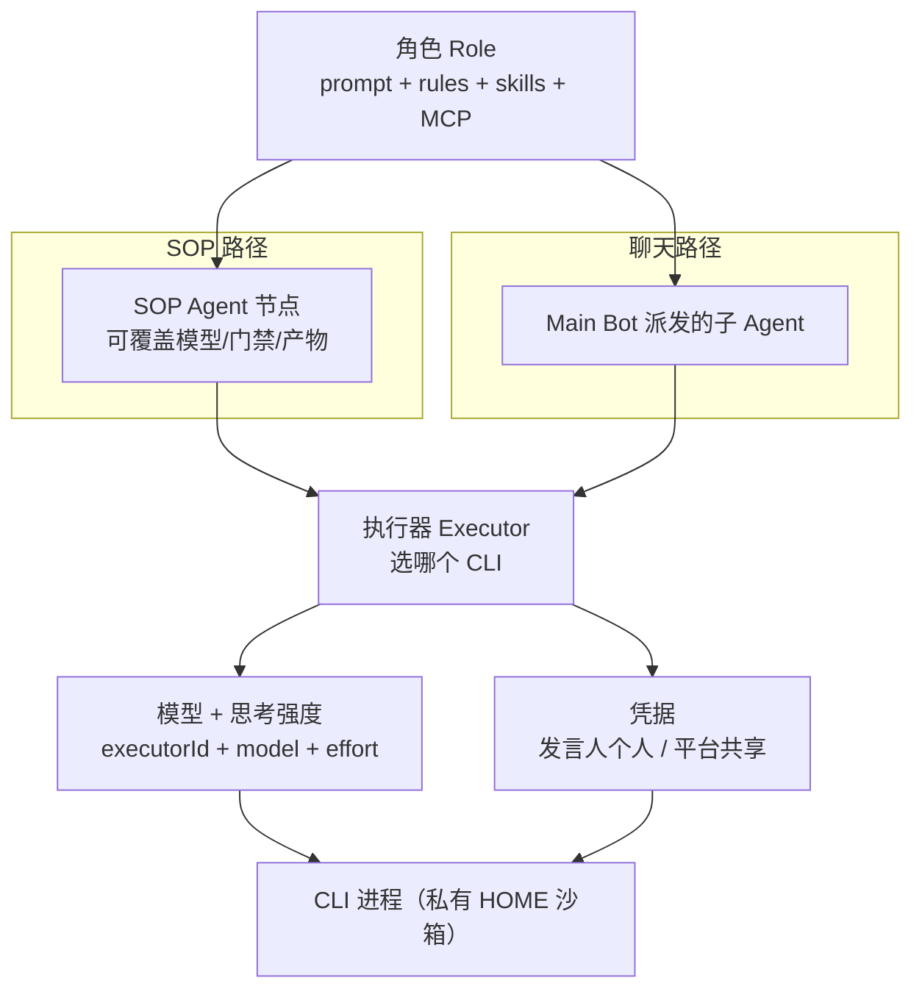

# 角色与执行器：谁来做、用什么模型

LoopForge 不自己"思考"，真正干活的是各种编程 Agent CLI。它在外围加了两样东西：**角色**（谁来做这件事、按什么规矩做）和**执行器**（用哪个 CLI、哪个模型、哪份凭据）。这页讲清这两个概念，以及它们怎么被 SOP 节点和聊天共用。

## 角色是可复用的定义

一个**角色**（Role，源码里是 `AgentDefinition`）不是"某次任务的提示词"，而是一份可复用的定义，包含：

| 组成 | 作用 |
| --- | --- |
| `Prompt` | 角色的单一自由文本任务书：身份、任务、顺序、边界 |
| `ExecutorID` + `Model` + `Effort` | 用哪个 CLI、哪个模型、多大思考强度 |
| `Rules` | 规则集，约束行为 |
| `Skills` + `MCPServers` | 绑定技能与 MCP 工具 |
| `ArtifactOutputs` + `Verification` | 声明产物契约与验证门禁 |
| `Interventions` | 人工检查点（如执行后、发布前） |
| `Loop` | 自修正策略：迭代上限、退出条件、耗尽后失败还是转人工 |

关键在于"复用"：同一个角色既能作为 SOP 里的一个节点干活，也能在聊天里被 `@` 出来当子 Agent；SOP 节点还可以在角色基础上覆盖模型、思考强度、产物和门禁。这就是为什么"评审"这类工作只需要定义一次，到处都用同一套标准。

> 依据：`internal/domain/agent.go:64-97`、`internal/domain/agent.go:115-135`、`README.md:182`

## 角色被执行器实例化

角色描述"要做什么"，执行器负责"真的跑起来"。执行器定义（`ExecutorDefinition`）决定用哪个 CLI 可执行文件、什么参数、什么协议解析它的输出、默认模型和思考强度。一次 Agent 调用的解析顺序是：角色的 `ExecutorID` → 节点的 `ExecutorID` → 默认 `codebuddy`。

下图展示一个角色如何被执行器、模型、凭据实例化，以及同一角色如何被两条路径共用。

读图要点：角色在中间，向上被两条路径复用，向下经由执行器落到"模型 + 凭据"再启动 CLI。同一个角色走 SOP 还是走聊天，差别只在被谁调度，不在定义本身。

> 依据：`internal/engine/node_execute.go:195-230`、`internal/domain/agent.go:137-147`

## 十种执行器 CLI

LoopForge 支持 10 种编程 CLI 作为执行器。它们的差别主要在凭据来源和安装方式：

| 执行器 | 凭据 | 安装方式 |
| --- | --- | --- |
| **CodeBuddy** | 个人 Key，或管理员配置的平台共享 Key（覆盖对话和 SOP） | 默认内置，源码构建时可省略 |
| **Codex** | 个人 Key；已连接的执行机器可用本机登录 | Docker 镜像内置 |
| **Claude Code** | 个人 Key；已连接的执行机器可用本机登录 | 首次使用时从 npm 安装并缓存 |
| **OpenCode · Kimi Code · Pi** | 仅个人 Key | 首次使用时从 npm 安装并缓存 |
| **DeepSeek Harness** | 仅个人 Key | Docker 镜像内置 |
| **Cursor CLI** | 仅个人 Key | 首次在对话中使用时由厂商安装脚本安装；不装进 SOP 沙箱 |
| **Antigravity** | 个人 Key，或执行机器所有者已有的账号登录 | 需在执行机器与用于 SOP 的 Docker 镜像里装官方 CLI |
| **ZCode** | 仅个人 Key | 未内置，需装到服务或执行机器 PATH |

内置模板默认用 CodeBuddy；但只要流程改用其他 CLI，平台可在未安装 CodeBuddy、未配其 Key 的环境里运行。

> 依据：`README.md:118-129`、`README.zh-CN.md:118-128`

## 私有 HOME 与个人凭据

Claude Code 之后的 7 种 Agent CLI（OpenCLI 类，`AgentCLIExecutorKinds`：opencode、cursor、agy、kimi、pi、dsh、zcode）每次运行都在**私有 HOME 目录**里生成模型和 MCP 配置。因为配置是按运行隔离的，它们始终使用责任人在个人设置里填写的 Key 和 Base URL——即使在已连接的执行机器上也一样，不会借用别人的登录态。这意味着团队推广时，每位成员需要各自配置凭据。

Codex 和 Claude Code 稍宽一些：除个人 Key 外，已连接的执行机器也可用本机已登录的账号。Antigravity 还能复用执行机器所有者已有的账号登录，其官方 CLI 刷新凭据副本后，Runner 会把刷新后的登录写回原始本地存储。

> 依据：`internal/domain/agent.go:25-35`、`README.md:129`、`internal/runtime/provider_agentcli.go:20-81`

## 凭据模型：个人 vs 平台共享

大部分执行器只认**个人 Key**：责任人在个人设置里配置自己的 Key（部分还要 Base URL），平台代其注入到 CLI 的私有 HOME。这让"谁调用、谁付费、用谁的额度"天然对齐。

唯一的例外是 **CodeBuddy**：它既可用个人 Key，也可用管理员配置的**平台共享 Key**。当责任人没配个人 Key 时，节点会退回平台共享 Key，但只能使用平台管理员允许的模型（`sponsoredExecutor` 会把选择限制在该模型集合内），并在运行事件里明确提示"本次使用平台共享 Key"。这是给"还没建好个人凭据的团队"用的过渡路径，而不是默认推荐。

> 依据：`internal/engine/codebuddy_auth.go:18-61`、`README.md:120`

## 思考强度按 CLI 而定

每个 CLI 支持的"思考强度"（reasoning effort）取值不同，角色里选择的强度会按解析出的执行器类型做校验，不支持就报错。平台维护一张每种 CLI 允许的强度表：

| CLI（kind） | 可用思考强度 |
| --- | --- |
| `claude-code` / `codebuddy` | low, medium, high, xhigh, max, ultracode |
| `codex` | low, medium, high, xhigh, max, ultra |
| `cursor` | none, minimal, low, medium, high, xhigh, max, ultra |
| `opencode` | low, medium, high |
| `agy`（Antigravity） | low, medium, high, xhigh, max |
| `kimi` | none, thinking, low, high, max |
| `pi` | minimal, low, medium, high, xhigh, max |
| `dsh`（DeepSeek Harness） | none, low, high, max |
| `zcode` | low, high, max |

空值表示用 CLI 自己的默认强度。表里可见各家的"档位语言"并不统一——有的用 `ultra`/`ultracode`，有的用 `max`，有的用 `thinking`，所以强度必须按 CLI 逐一映射，不能跨 CLI 直接套用。

> 依据：`internal/domain/agent.go:12-52`

## Provider 协议抽象

"用哪个 CLI"不该渗进引擎的其他部分，所以运行时把一切随执行器类型变化的行为收进一个 **Provider** 接口：如何把角色、规则、Skills、MCP 配置物化进工作区（`Materialize`），如何拼出启动命令（`Prepare`），如何把该 CLI 的输出解析成统一的遥测事件（`Protocol`），以及它需要什么样的沙箱（`SandboxRequirements`，比如是否需要私有 HOME、是否需要 Bun 文件系统）。引擎只跟这个统一接口打交道，新增一种 CLI 就是新增一个 Provider 实现，而不是在每个调用点加分支。

不同 CLI 的输出格式五花八门（Anthropic 风格、Codex 风格、需要翻译的 native 流），Provider 用不同的协议解析器把它们归一成同一套 provider-neutral 事件，引擎因此能对任何 CLI 一致地显示工具调用、推理、用量和结果。

> 依据：`internal/runtime/provider.go:33-60`、`internal/runtime/protocol.go:14-45`、`internal/runtime/provider_codebuddy.go:13-92`、`internal/runtime/provider_claude.go:14-97`

## 小结

- **角色**回答"这件事由谁、按什么规矩做"，是可复用定义，SOP 节点与聊天子 Agent 共用。
- **执行器**回答"用哪个 CLI、哪个模型、哪份凭据"，10 种 CLI 各有凭据与安装差异。
- **私有 HOME** 让 7 种 OpenCLI 类始终用个人凭据，团队里人人各自配置。
- **思考强度**按 CLI 分别定义，引擎按解析出的 CLI 校验。
- **Provider 接口**把"CLI 差异"关进一个笼子，引擎其余部分保持 CLI 无关。
