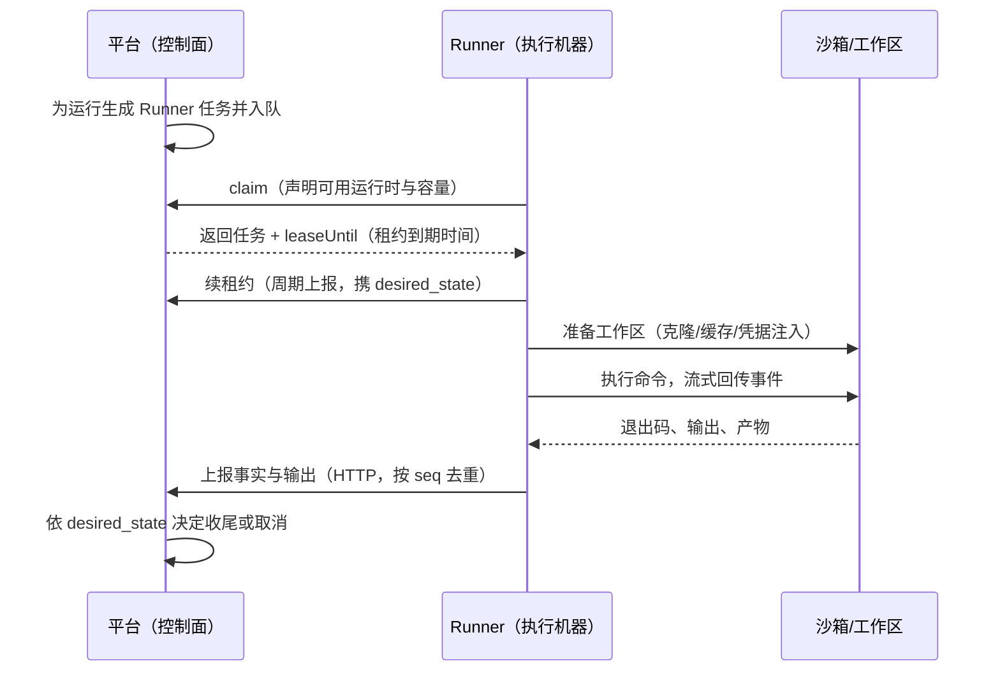

# 沙箱与执行机器：代码在哪里跑

LoopForge 的核心承诺是「和编码 Agent 一起把软件交付出去」，而 Agent 要真正改代码、跑命令、构建、测
试，就必须让代码在一个可控制的**执行环境**里落地。这一页回答一个问题：**一次运行里的代码，究竟在
哪台机器、哪种隔离环境里跑，谁把代码放进去，又由谁把结果带回来。**

理解这一页之后，你能判断：默认 Compose 部署为什么只能跑 Docker 沙箱、什么时候该接一台「本地执行机
器（Runner）」、native 沙箱的边界在哪，以及仓库缓存和 Git 凭据是怎么被安全地送进环境的。

## 沙箱是什么

**沙箱（sandbox）** 是一次运行（run）或一个对话工作区赖以执行命令的隔离环境，由一个
`sandboxProfile`（沙箱配置）决定它长什么样。LoopForge 支持两种形态：

- **Docker 沙箱**：从一个 Dockerfile 构建出镜像，在容器里执行命令。隔离最强，也最通用。
- **native 轻量沙箱**：直接使用执行机器上已安装的语言和工具链，靠操作系统自带的进程级隔离。
  在 Linux 上解析为 `bwrap`（bubblewrap），在 macOS 上解析为 `seatbelt`。它没有 Dockerfile、没有安
  装脚本，只有一组环境变量。

沙箱不是「一次检出」，而是一个**运行环境**：平台不预先克隆仓库、不建分支，进入环境后 Agent 用自己
（本轮发言人）的 Git 凭据去 `clone`、`checkout`、建分支、`commit`、`push`，需要时自己开 PR。沙箱只
负责把命令隔离开、把文件留在可回收的工作目录里。

配置驱动隔离：`sandbox_manager.go` 依据 profile 里的 `driver` 选择具体实现，`native` 会按执行机器的
操作系统再解析成 `bwrap` 或 `seatbelt`。所以同一个 native 配置在 Linux 和 macOS 的机器上都能跑，不必
和某个 Runner 的操作系统绑死。

## 三种执行环境

LoopForge 的代码最终落在三类环境中，它们是**并列**的，靠配置来选择：

| 执行环境 | 最适合 | 需要什么 | 隔离强度 |
| --- | --- | --- | --- |
| 平台 Worker（内置） | 默认开箱即用、无需自备机器 | 平台容器 + 宿主 Docker socket | Docker 沙箱容器，与平台同机 |
| Docker 沙箱（自定义镜像） | 需要特定语言/工具链的项目 | 一个 Dockerfile 或共享镜像 | 容器隔离，最通用 |
| 本地执行机器 / Runner | 需要本地环境、私有网络或强机器资源的团队 | 用户机器上安装并绑定 Runner | Docker 或 native，取决于机器 |

- **平台 Worker**：`cmd/agentflow` 进程自己就能执行。Compose 部署下，平台把宿主 Docker socket 挂进
  容器，内置 SOP 开箱即跑；默认沙箱用安装时的那张平台镜像起「兄弟容器」，不必二次下载 CLI 或再构建
  镜像。
- **Docker 沙箱**：用 Dockerfile 定义环境，适合需要固定依赖的项目。Compose 部署中对话工作区与 SOP 都
  用 Docker 沙箱，因为 native 沙箱需要建 user/pid 命名空间，而无特权的平台容器做不到。
- **本地执行机器（Runner）**：由用户在自己机器（或云主机）上安装 `agentflow-runner` 并绑定，平台把
  任务派给它执行。它的特点是**只向外连接**，从不监听端口，从公网无法反向访问它。

> 一个硬边界：Docker socket 访问等于宿主 root。因此平台没有「无隔离」沙箱类型——平台自己跑的每个任
> 务都在沙箱里。只有你信任的团队才给账号，不要把服务暴露给不可信网络。

## Runner 协议：平台派单，执行机器领取

Runner 与平台之间是一套「平台入队、机器领取、租约续期、上报结果」的协议。理解它你就明白为什么平台
重启、网络抖动都不会让一个正在跑的任务凭空消失。

整个过程里，**持久的 `desired_state` 是权威**：平台把希望在某个任务上发生的事（继续跑、取消）记在服
务端持久状态里，WebSocket 只是低延迟推送，丢了也不影响最终一致——Runner 续租约时总能从响应里拿到最
新的 `desired_state`，从而决定是否要取消本地进程。

该看什么：注意「领取（claim）→租约（lease）→续租→上报」这条链。租约是有期限的，Runner 用独立的续
租协程贯穿整个任务（含准备和产物收集），一旦租约被别的实例拿走或临近过期，本地就中止本轮，避免两个
机器同时跑同一个任务。取消不是靠断连，而是靠续租响应里带回的 `desired_state=cancel`。

Runner 输出通过一个批处理器回传：平台按 `(task_id, seq)` 去重，一个批次失败会并入下一批重试，所以输
出不丢也不重。低延迟控制（暂停/取消）优先走 WebSocket 推送，同时每秒用 HTTP 兜底查询，保证控制线路
抖动时暂停/取消仍然及时。

## 远程沙箱

当任务在 Runner 上执行时，平台并不拥有那个工作区路径，而是由 Runner 在自己的执行机器上创建沙箱。平台
侧用 `OpenRemoteSandbox` 在**已经存在的 Runner 任务工作区**上打开一个沙箱——它不替调用方选控制面工作
区，工作区的确切路径和生命周期归执行机器所有。这样一台远程机器上的隔离、CLI 版本、环境变量都由它自
己负责，平台只负责派单和收集结果。

## 仓库缓存

在 native 沙箱里做检出时，执行机器会维护一份**宿主侧的私有裸仓库缓存**，按仓库记录 ID 存放。一次检
出的流程是：先用**本次检出的 Git 凭据**按仓库加锁刷新本地裸仓库，再从本机缓存把 Git 对象复制到工作
区，最后把 `origin` 指回真正的仓库地址。

这样做的收益是：同一仓库的多次检出不必每次从远端全量克隆，快很多；缓存与工作区各自保存 Git 对象，
删除工作区后缓存仍可用于后续检出；缓存不可用时会自动退回直接从远端克隆，不会卡死。Docker 沙箱则照旧
直接从远端克隆，不走这份缓存。

> 仓库缓存在 Runner 0.12.0 起支持。普通对话工作区从空目录开始，Agent 用本轮发言人的凭据自行克隆所需
> 仓库。

## 沙箱生命周期

一个沙箱从创建到回收，主要经历三个阶段：

- **准备（prepare）**：按 profile 打开沙箱，聚合整个运行的资源需求后再构建（Docker 的挂载不能依赖哪
  个节点先跑），准备 Git 工具与凭据。
- **重建（rebuild/recreate）**：容器或工作目录在需要时被重建（例如从 cwd 恢复、并行分支隔离写入时），
  用一把读写在门闩（`execGate`）挡住：并行分支可并发执行，重建则等它们跑完再 `docker rm`，避免把别人
  正在用的容器拆掉。
- **回收（reclaim）**：运行结束或被取消后，控制面按「仍存活的运行 ID」回收孤儿容器、内容哈希缓存镜
  像与工作目录。缓存镜像按 Dockerfile 内容哈希保留，下一个用同一定义的任务直接复用，不必从 Node 基础镜像
  重新构建。

对话工作区使用独立的 `Run.kind=workspace`，不参与 SOP 调度、不占 SOP 配额，但**复用** Runner、沙箱、
Git、终端、快照、租约和空闲回收这一整套机制——所以它也有完整的「准备→保存快照→回收」生命周期。

## Git 凭据如何注入

凭据注入遵循「按本轮发言人、按协议与主机」的原则，最高层可以这样理解：

- **HTTPS**：注入本轮发言人个人配置的 Git Token。`GIT_ASKPASS` 指向一个不含令牌的脚本，它只在主机
  恰好是 `https://github.com` 时用 `x-access-token` 应答；平台进程自己的 `GH_TOKEN`/`GITHUB_TOKEN`
  不会透传进沙箱。
- **SSH**：按 `host:port` 绑定个人私钥，同一主机端口共用同一把密钥；私钥在执行进程内存中、通过临时
  ssh-agent 签名，沙箱只拿到 agent socket、公钥与 SSH 配置。
- **提交身份**：系统级 Git 配置为发言人的登录名与一个不可投递的邮箱（`@users.noreply.loopforge.invalid`），
  Agent 可自行覆盖。

工具结果与回复会对发言人的令牌（含去前缀后的裸令牌）做脱敏，提示词也要求 Agent 不打印、不回显、不写
入令牌。

## native 沙箱的约束

native 沙箱轻、快，但有几个不能忽视的边界：

- **Compose 平台镜像跑不了 bwrap**：bwrap 需要创建 user/pid 命名空间并挂载 `/proc`，而无特权的平台容
  器做不到，平台镜像也不带 bwrap。**Compose 部署请用 Docker 沙箱**；要用 Linux native 沙箱，就在原生
  安装的平台或接一台本地执行机器（Runner）上跑。
- **Linux（bwrap）**：布局与 Docker 一致，CLI 的 HOME 是 `<会话根>/home`、cwd 是 `<会话根>/ws`；宿主
  其余文件系统只读，网络与宿主 Docker 守护进程可达（可在工作区里构建镜像、起容器）。
- **macOS（seatbelt）**：没有每进程挂载命名空间，保留 HOME，工作区模式下 cwd 直接指向运行工作区；策略
  放开工作区、临时目录与 HOME 的写入，并拒绝篡改审批钩子；自动解析宿主 Docker context 注入 `DOCKER_HOST`。
- **只有环境变量**：native 沙箱没有安装脚本，命令用执行机器上已装的语言与工具；需要的设置（如
  `JAVA_HOME`、代理）写进沙箱环境变量。

> 迁移提示：`local` 沙箱类型已被移除。`024_native_sandbox_driver.sql` 把 seatbelt/bwrap 合并成单一
> `native` 选项，`041_native_sandbox_inline_assets.sql` 把旧的 local 沙箱改成 native、去掉对运行机器和
> 基础目录的绑定，并把依赖旧默认的 SOP 改到 `generic-docker`。

> 依据：`internal/runtime/sandbox_manager.go:44-140`、`internal/runtime/sandbox_docker.go:280-410`、
> `internal/runtime/remote_sandbox.go:10-40`、`internal/runtime/sandbox_environment.go:1-38`、
> `internal/runner/daemon.go:154-540`、`internal/runner/client.go:1-80`、
> `internal/runner/task_lease.go:1-81`、`internal/runner/exec.go:1-60`、
> `internal/runner/repository_cache.go:1-29`、`cmd/agentflow-runner/main.go:1-60`、
> `docs/conversation-workspaces.md`、`docs/deployment.md`、
> `migrations/024_native_sandbox_driver.sql`、`migrations/041_native_sandbox_inline_assets.sql`。
