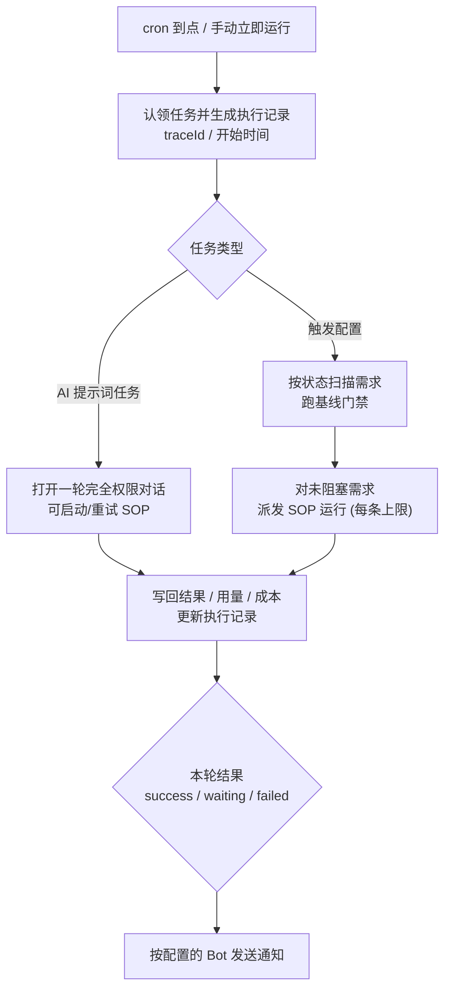
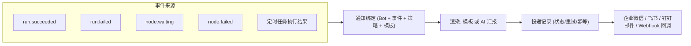

# 定时任务与通知：让 Agent 自己按时干活

前面几页讲的都是"人发起"的动作：在对话里说一句话，或手动跑一条 SOP。这一页讲两种"不需要人守着"的能力：**定时任务**让 Agent 按时间自己跑起来，**通知**让跑完或卡住的结果主动送到人眼前。

把它们放在一页，是因为它们经常配对使用：一条凌晨两点触发的定时任务跑完 SOP，结果通过企业微信送到负责人手机上。读完后你应该能回答：定时任务能干什么、cron 怎么写、一次执行会留下什么、通知从哪些事件来、能发到哪些渠道。

## AI 定时任务：一个会自己醒来的对话

普通对话要你打字才会开始，AI 定时任务则是**按时间表自动打开一轮对话**。触发后，平台会以"保存这个任务的人"的身份、用与主页 AI 对话相同的**完全权限**执行一轮普通对话：它会打开工作区、跑命令、调 SOP、用 MCP 工具——

| 能力 | 定时任务的表现 |
| --- | --- |
| 平台读写 | 与主页"完全权限"共用同一套策略，写入直接生效，不逐项确认 |
| SOP | 可按提示词启动、重试、发布 SOP，管理和运行触发配置 |
| 工作区与浏览器 | 共用主页的工具网关，提供工作区打开、读写、命令、提交 MR 和浏览器工具 |
| MCP | 使用执行账号在当前项目与个人安装的 HTTP/SSE MCP；不接入 stdio MCP |
| 结果与产物 | 支持自然语言结果与草稿提交；工作区附件、浏览器截图写入定时会话 |

一个容易误解的点：定时任务**不受定时任务专有的 SOP 限制**。它复用了主页对话的完全权限，执行身份只由服务端决定，请求里带的 `ownerUserId`、`runAsUserId` 不会生效。

任务保存时会校验可用凭据。Codex 和 Claude Code 优先用执行账号在默认执行机器上的"账号登录"（需 Runner 0.10.2+）；默认机器离线或未启用账号登录时，改用个人配置里填的 API Key 在云端执行；Key 缺失或失败会记录具体原因。每轮执行可配置时限 `timeoutMinutes`（1–240 分钟，默认 30），超时会停止 CLI 及本轮 MCP 调用并记录失败原因。关闭页面后任务继续执行，直到 CLI 结束、超时或你在会话页手动停止。

因为任务以保存人（或项目 Owner）身份、完全权限执行，新建、修改、立即运行、删除一条定时任务都要求**项目写权限**（Owner、平台管理员或非 viewer 成员），列表只返回调用者所在项目的任务。

## cron 表达式：五段，上海时区

定时任务用标准五段 cron 表达式决定何时醒：`分 时 日 月 周`。平台内置的 `internal/cronexpr` 只解析这五段，不认秒级（六段）写法。

| 字段 | 允许范围 | 说明 |
| --- | --- | --- |
| 分钟 | 0–59 | |
| 小时 | 0–23 | |
| 日 | 1–31 | 与"周"同时受限时，任一匹配即可（标准 cron 语义） |
| 月 | 1–12 | |
| 周 | 0–7 | 0 和 7 都代表周日 |

每一段支持通配 `*`、单值、范围 `a-b`、步长 `*/n` 和逗号列表 `a,b`。解析失败时错误信息会带字段中文名（如"分钟: 步长无效"），时区固定为 `Asia/Shanghai`。要避开"日"和"周"重复限制时的歧义，让"日"或"周"之一以 `*` 开头，另一段才真正参与匹配。

## 一条定时任务能触发什么

定时任务分两类，靠内部字段区分，界面上体现为"提示词任务"与"触发配置"：

| 类型 | 做什么 | 关键行为 |
| --- | --- | --- |
| AI 提示词任务 | 按提示词跑一轮对话，可顺带启动/重试 SOP | 走主页 `POST /api/assistant/chat` 路径；跑完把结果写回任务 |
| 触发配置（自动派发 SOP） | 按状态扫描需求，执行基线门禁后自动派发 SOP 运行 | 要选 SOP、扫描的需求状态、来源；每次最多派发 `DispatchLimit` 条 |

触发配置是"自动派发 SOP"：它按时扫描符合状态的需求（如 `backlog`/`todo`），先跑基线冲突检查（baseline guard），对未被阻塞的需求各启动一条 SOP 运行。它还能按需求来源过滤（`local`/`github`/`gongfeng`/`tapd`），并可为每个需求选用其绑定的 SOP。单个任务每轮派发上限被硬性限制在 10 条（`MaxScheduleDispatch`），以防一次扫描把队列打满。

下图是一条定时任务从到时到产出结果、再到通知的流转：

要点：每次执行都会先"认领"并生成一条独立的执行记录（带 traceId），所以失败能在服务器日志里按 trace 定位；一次任务只保存"最近一次结果"，历史在执行记录看板里查。

## 执行记录、配额与并发

- **执行记录**：每次执行落一条 `ScheduleJobExecution`（`sjx-<traceId>`），记录状态（running/success/failed/waiting）、错误、派发出多少需求、启动了哪些 SOP 运行、以及本轮对话的模型与 Token/成本。每个任务保留最近 200 条执行；删除任务时其执行记录与统计一并删除。
- **并发**：不同任务之间可以并发运行。同一任务仍执行中时不会重复启动；派发环节用一把互斥锁串行化"扫描需求 + 派发 SOP"，避免两个任务同时抢同一条需求。
- **派发配额**：`DispatchLimit` 硬上限 10 条，旧数据或外部存储的越界配置会被收敛到 10。
- **用量与成本**：AI 提示词任务的本轮生成会记录模型、Token 与估算成本（含失败前上报的用量），按与对话轮次相同的口径计价，进入统计分析。

## 共享任务模板市场

定时任务可以发布成**共享、带版本、带参数的模板**，供别的项目复用，这就是"共享市场"。

- 发布出的模板版本是**不可变、且不含凭据**的定义：名称、提示词、cron、模型、引用、以及一组参数。
- 参数有类型（`string`/`integer`/`number`/`boolean`）、是否必填、默认值；提示词里用 `{{ params.名字 }}` 引用，发布时校验引用的参数必须已定义、参数名唯一且以字母开头。
- 其他项目可以基于某个版本复制一份到自己的项目，填入参数后运行；原模板与副本各自演进，不互相牵连。

## 通知：从事件到渠道

通知解决"结果怎么主动找到人"。它分三层：谁来发（Bot）、凭什么发（来源事件与等待策略）、发到哪里（渠道）。

### 谁来发与从哪里触发

一个 **Bot** 是某个项目下绑定到某个 IM 渠道的机器人配置（或一条 Webhook 回调）。通知的**来源**是运行事件：

| 来源/事件 | 含义 | 典型内容 |
| --- | --- | --- |
| run · `succeeded` | SOP 整体成功完成 | AI 汇报 / 模板渲染 |
| run · `failed` | SOP 整体失败 | 失败摘要 + 原因 |
| node · `waiting` | 节点停在待人工处理 | 待确认卡片、查看链接 |
| node · `failed` | 节点执行失败 | 错误与重试/返工入口 |

- **run 级**通知是"跑完了/挂了"的整条总结；**node 级**通知是"某个节点卡住了/出错了"，通常是可操作卡片，带"通过/重试/返工"按钮。
- **等待策略**（WaitingPolicy）决定 `waiting` 怎么发：`actionable`（只在需要人动手时发，默认）或 `event`（每个等待事件都发）。run 级通知不支持 `waiting` 事件。
- 通知内容可以用**模板**渲染（占位符如 `{{issue.title}}`、`{{workflow}}`、`{{node}}`、`{{status}}`、`{{error}}`、`{{url}}`），也可以用 **AI 汇报**模式（`ContentMode: ai`）——用一个模型汇总整条 SOP 的结果。

### 发到哪里：通知渠道

通知最终通过一个渠道投递。支持的渠道与其能力如下：

| 渠道 | 接入方式 | 幂等/重试 | 写操作确认 |
| --- | --- | --- | --- |
| 企业微信 | `wecom-cli` 流式 SDK（平台镜像内置，也可单独安装） | 流式补发、送达待核对 | 卡片或网页确认，可选自动执行 |
| 飞书 | 开放平台长连接（Stream） | 同一 `uuid` 一小时内去重，55 分钟内自动重试 | 网页确认 / 卡片审批 |
| 钉钉 | Stream 模式机器人 | 结果未知记"送达待核对"，不自动重发 | 网页确认 / 卡片审批 |
| 邮件 | 平台邮件通道 | 按投递记录状态 | — |
| Webhook 回调 | 平台回调配置（URL/Method/Headers/Body） | 按投递状态 | — |

三个企业 IM 渠道都支持 SOP 主动通知；飞书、钉钉、企业微信的写操作（新建需求、派发或启动 SOP）要么在卡片上直接审批，要么生成"在平台确认"的链接，由发起人本人在平台确认后才执行。企业微信另可选"自动执行"。投递有完整的重试与幂等规则，未知结果会记为可人工"确认已收到"或"再次发送"的送达待核对。

下图展示通知来源如何汇入投递层、再分发到各渠道：

该看什么：来源与渠道之间不是硬连接，中间的"绑定"决定哪些事件发到哪个 Bot、用什么模板或 AI 汇报、`waiting` 走哪种策略；投递记录这一层负责失败重试与去重，所以"没收到"通常能在投递记录里查到状态。

### 通知汇报与发送身份

- 通知汇报（`NotificationReport`）默认用一个模型针对整条运行生成一段人类可读的总结；模型不可用时回退到模板文本并注明"AI 汇报暂不可用"，不会卡住发送。
- 通知会**回发到运行发起处**：从群里发起的 SOP，失败、待处理、完成时自动发回该群；从单聊发起的发回单聊，不需要在 SOP 或节点上另行配置 Bot。
- 换接收人时，若原接收人还有待发通知，管理员可选择"改发到新接收人"或"取消这些通知"，两种选择都写进发送记录。
- 数据保留：已结束的对话、通知正文默认保留 90 天，记录本身 180 天，按平台配置清理；仍在等待处理的通知不会被清理。

> 依据：`docs/ai-scheduled-task-capabilities.md`、`docs/im-channels.md`、`internal/schedule/service.go`、`internal/cronexpr/cron.go`、`internal/domain/shared_schedule.go`、`internal/domain/schedule_execution.go`、`internal/domain/notification.go`、`internal/domain/notification_workflow.go`、`internal/notification/service.go`、`internal/notification/push.go`、`migrations/034_schedule_job_executions.sql`。

## 小结

定时任务回答"谁在没人操作时把活干了"，通知回答"干完或卡住怎么让人知道"。两者合起来，LoopForge 才能把 SOP 从"人在电脑前手点"推进到"夜里自己跑、早上看结果"。

需要记住的几条硬事实：定时任务以完全权限执行、因此需要项目写权限才能管理；cron 是五段、上海时区；触发配置的自动派发每轮有上限；通知的 `waiting` 有等待策略、投递有重试与幂等；企业 IM 的写操作需要确认后才执行。
