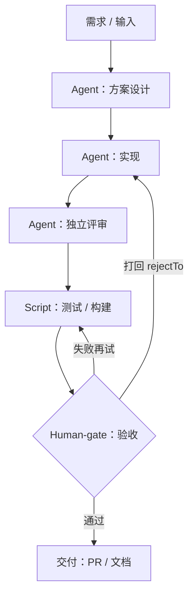
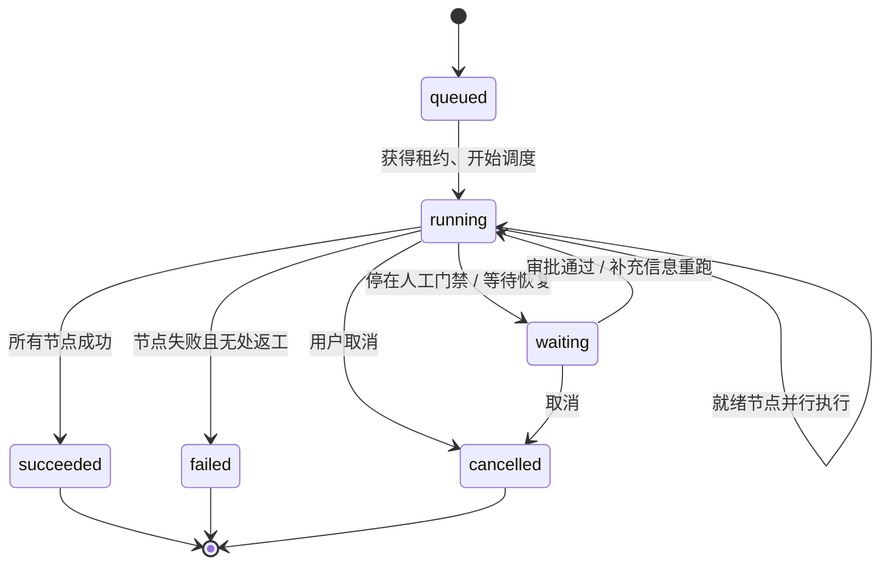
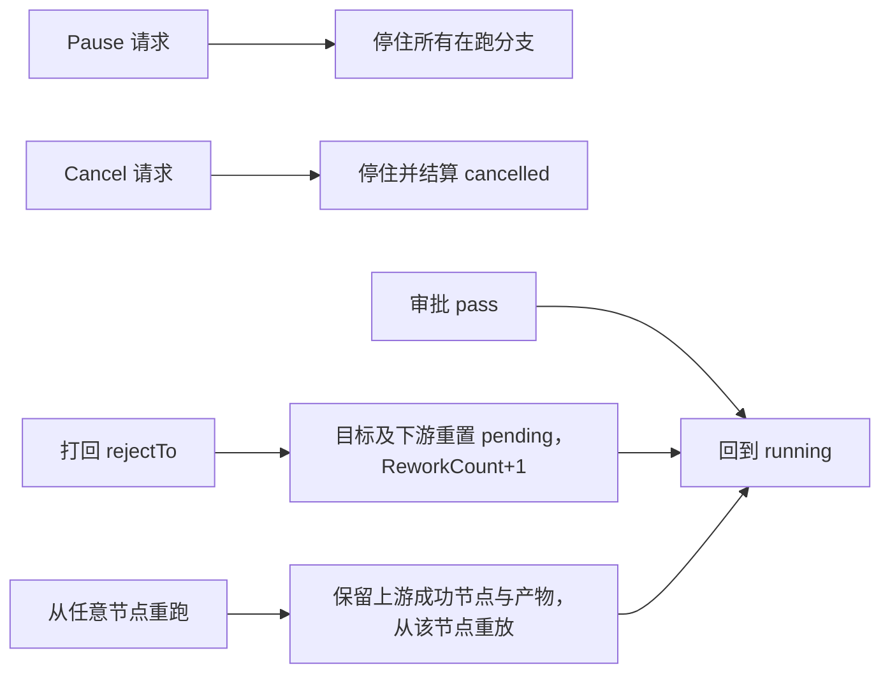

# SOP 引擎：图、调度与断点恢复

一个 **SOP**（标准作业流程）就是一段"交付要走的路"。它被画成一张有向图：节点是步骤（Agent、脚本、人工门禁、子 SOP、预览构建），边表示依赖。引擎负责"什么时候该跑哪个节点、跑失败了怎么办、进程挂了怎么接着跑"。这页面向没打开源码的读者，讲清一次 SOP 运行背后发生了什么。

## 一次运行就是一次对图的调度

SOP 定义（`WorkflowDefinition`）由节点（`WorkflowNode`）与边（`WorkflowEdge`）组成。每次运行（`Run`）开始时，引擎会把当前的 SOP 定义**冻结成快照**（`WorkflowSnapshot`）存进运行记录里。这一点很关键：之后无论 SOP 模板怎么改，这次运行都按当初冻结的那张图执行，重跑与审批不会因为模板被编辑而错乱。

下图是一条典型交付链：Agent 依次设计、实现、评审，脚本跑测试，走到人工门禁由人决定放行还是打回，最后进入交付节点。注意那条从"人工门禁"回到"实现"的回流边——它不是普通边，而是通过节点的 `rejectTo` 配置实现的受控返工（见后文"返工与打回"）。

读图要点：实线是正常的依赖推进（`when=success`），门禁节点是流程里唯一"停住等人"的地方；回到 `Impl` 的虚线语义（打回返工）来自门禁的失败策略，而不是图里有一条普通边——SOP 本身要求是一张无环图（DAG），返工走 `rejectTo`。

> 依据：`internal/domain/workflow.go:39-108`、`internal/engine/workflow_graph.go:242-273`

## 节点类型

SOP 画布支持五类节点。它们的区别在于"谁来干活、产出什么"。

| 节点类型 | `type` 取值 | 谁来执行 | 典型用途 |
| --- | --- | --- | --- |
| Agent | `agent` | 一个角色（prompt + 执行器 + 模型 + 规则 + Skills + MCP） | 设计、实现、评审、测试 |
| Script | `script` / `command` | 确定性 shell 或 python 脚本 | 构建、跑测试、lint、生成报告 |
| Human-gate | `approval` | 人 | 检查产物后放行或打回 |
| Sub-SOP | `sop` | 另一条 SOP 作为子流程 | 复用一段已有的交付流程（最多嵌套 6 层，禁止循环引用） |
| Preview build | 预览构建节点 | 内置构建 Agent | 构建静态站点并归档供评审（前端交付契约） |

Agent 与脚本是"自动"的，Human-gate 是"必须停"的，Sub-SOP 是"套娃"，Preview 是前端专用的交付形态。其中 Human-gate 也常写成"人工门禁""审批节点"，含义相同。

> 依据：`internal/domain/workflow.go:50-80`、`internal/engine/workflow_graph.go:189-238`、`internal/engine/sop_node.go:14`、`internal/domain/preview.go:36-41`

## 边、产物契约与验证门禁

节点之间除了依赖边，还有一层"交接约定"：

- **产物契约**（`ArtifactContract`）：节点声明自己会产出哪些文件（名称 + 相对路径 + 是否必需）。下游节点启动时会拿到上游产物的清单，接续别人的成果而不是重做。
- **验证门禁**（`VerificationGate`）：在节点执行后或发布前插入的自动/人工检查。它是"质量闸门"，跑在节点自己的沙箱里。

门禁有三种模式，失败后有四种处理策略：

| 门禁模式 `mode` | 含义 |
| --- | --- |
| `command` | 在工作区执行一条命令（如测试、`git diff --quiet`），按退出码判定 |
| `manual` | 人工确认（把 Agent 声明的检查点转成人工门禁） |
| `mr` | 核验工作分支在托管平台上是否已有覆盖最新提交的 MR/PR |

| 失败策略 `onFailure` | 后果 |
| --- | --- |
| `loop` | 在同一工作区让 Agent 自修正（受角色循环策略的迭代上限约束），耗尽后按 `onExhausted` 转失败或转人工 |
| `reject` | 打回到该节点的 `rejectTo` 目标（受控返工），需要配置返工目标 |
| `fail` | 直接标记该节点失败，流水线失败 |
| `human` | 暂停，转人工判断 |

Agent 节点还通过 `submit_gate_result` 这个 MCP 工具提交自己的终态：`pass`、`rework`、`fail`、`human`。`rework` 会被映射成对上游 `rejectTo` 的打回；如果节点没配返工目标，`rework` 退化为直接失败，避免出现"想打回却没地方打回"的误导错误。

> 依据：`internal/domain/workflow.go:10-20`、`internal/engine/gate_submit.go:82-105`、`internal/engine/node_outcome.go:109-117`、`internal/engine/gate_mr.go:40-85`

## 就绪调度：依赖成功才开跑

引擎的核心循环很朴素：**一个节点只要它的所有上游都 `succeeded`，且自己还是 `pending`，就可以启动**。这正是 `readyNodes` 的逻辑——遍历定义中所有节点，跳过非 pending 的，检查其依赖（来自边）是否全部成功。

这条规则带来两个直接结果：一是"没有依赖波次"——某个分支不必等最慢的兄弟，谁的上游先齐谁先跑；二是失败会"卡住"下游——依赖没成功，下游永远不 ready。当所有节点都成功，运行结算为 `succeeded`；有节点仍失败且无事可做，结算为 `failed`；停在人工门禁则运行进入 `waiting`。

运行状态里 `queued / running / waiting` 是活动态，`succeeded / failed / cancelled` 是终态。`waiting` 不是终态——它只是"暂时没人可跑，在等人或等恢复"，审批或重跑能把它拉回 `running`。

> 依据：`internal/engine/workflow_graph.go:11-32`、`internal/engine/node_execute.go:88-192`、`internal/domain/run_eval.go:269-276`

## 并行分支与重跑还原被取消的兄弟

SOP 里可以有几条互不依赖的分支同时进行，它们各自以独立的 goroutine 执行（`parallel_exec`）。引擎不去串行化整条运行，而是用更细粒度的锁避免冲突：

- 同一个 (run, node) 只有一份执行——暂停后恢复、返工或租约接管时，新的执行会等旧执行收尾，而不是交错进行。
- 同一个 (工作区属主, Agent) 的 CLI 调用轮流执行——同一角色的两个节点共享控制目录，必须排队。
- 每个 run 只有一个执行机器绑定，并发的首批节点挑同一台机器。

当一次返工或取消发生、某个正在跑的分支被重置时，引擎会取消那个分支在**本实例**上的执行（`cancelNodeExecutions`），并在重跑时把被取消的兄弟节点重新放回 `pending` 重新调度，从而"还原被取消的兄弟"。

> 依据：`internal/engine/parallel_exec.go:10-24`、`internal/engine/parallel_exec.go:123-157`、`internal/engine/run_ops.go:314-350`

## 租约与归属：谁有权推进一次运行

生产环境可能同时跑多个 API/Worker 进程。引擎用一套**租约（lease）**机制保证"一次运行同一时刻只有一个进程在推进它"：

- `Engine.running` 记录本进程当前正在调的 run，`claimRunning` 抢占失败说明别人在跑。
- `Run.OwnerInstanceID` 是持租约的实例，`Run.LeaseUntil` 是租约到期时间。`ownsRun` 同时校验"本进程启用执行、属主是我、代际号 `Generation` 匹配、租约未过期"。
- 执行循环里有一个心跳 goroutine，按 `leaseTTL/3` 续租；续租失败或收到控制请求就取消本地执行。默认 `leaseTTL` 是 30 秒。

租约把"能不能推进"变成一个可竞争、可过期的权利：进程崩溃后租约自然过期，别的进程可以接管。代际号 `Generation` 在接管时递增，用来区分"同一 run 的不同执行世代"，防止旧执行的写覆盖新执行。

> 依据：`internal/engine/engine.go:19-48`、`internal/domain/run.go:16-19`、`internal/engine/run_recovery.go:14-19`、`internal/engine/run_recovery.go:69-104`、`internal/engine/node_execute.go:30-57`

## 工作区准备与冻结快照

Agent 节点需要真实的代码和环境。运行开始准备时会按 SOP 的沙箱档案启动沙箱，检出仓库、准备工作分支。沙箱与 SOP 的档案、Dockerfile、环境变量会一并冻结进快照（`SandboxSnapshot`），所以即便之后模板改了，重跑仍能重建当时的环境。子 SOP 节点则直接复用父运行的工作区（在父目录里干活），其代码改动父流程继续时仍在，不经过远端。

> 依据：`internal/domain/workflow.go:178-186`、`internal/engine/sop_node.go:62-86`

## 暂停、恢复、取消与从任意节点重跑

人工在环路中（human on the loop），引擎把这些控制做成明确的运行操作：

- **暂停 / 取消**：写 `PauseRequested` / `CancelRequested`，执行循环检测到后 `stopNodes` 等所有在跑分支收尾，再写 `waiting` / `cancelled`。
- **审批通过**：门禁 `pass` 后运行回到 `running`。
- **打回（Reject）**：把 `rejectTo` 目标及其所有下游重置为 `pending`，目标节点 `ReworkCount` 加一，运行回到 `running`。返工次数受 `MaxReworks` 约束。
- **从任意节点重跑（Retry）**：从选定节点重开，保留原运行、上游已成功的节点和它们的冻结产物；已成功的运行即便工作区被回收也能被复活，以便补充上下文再重放。

> 依据：`internal/engine/run_ops.go:47-109`、`internal/engine/run_ops.go:140-351`、`internal/engine/run_ops.go:353-370`

## 断点恢复：进程挂了也能接着跑

服务的正常退出会走 `Drain`：停止领取新任务，把在途运行"停泊"（park）好让替身进程接着跑。真正的崩溃恢复靠 `ResumeInterruptedRuns`——启动时扫描所有仍处于活动态的 run：

- **等待人工门禁的**：保持不动，审批/重跑仍能拉回它们；但若存在与最后写入竞争掉的取消请求，恢复循环会认领并结算它，避免永远停在 running。
- **running 但归属已过期**：如果工作区绑定在本机或绑定的机器还活着，就接管租约、把在途节点重置为 pending、发出 `run.resumed` 事件后继续；如果工作区所在的机器已下线且此前有代码改动，则如实标记为需要从头重跑，而不是悄悄丢掉那些未推送的改动。
- **所有节点已完成但状态没结算的**：直接补结算为成功或失败。

恢复的关键是"从最后一个持久化检查点继续"，而不是把中断的节点一律判失败。

> 依据：`internal/engine/run_recovery.go:106-254`、`internal/engine/lifecycle.go:18-53`、`internal/engine/run_recovery.go:267-299`

## 交付节点

流水线的产出最终要么是一份文档，要么是一段代码或一个 PR/MR。交付相关的能力由引擎在运行结算时汇总：定时 SOP 在最后节点成功后还要把自己的工作分支合入集成基线（`integrateScheduledRun`），这一步没完成前不能把运行标成功，否则会在推送还在用工作区时就删掉检出。交付 MR 的识别优先按工作分支去托管平台查，查不到再回退到运行产物里带 MR 链接的记录。

> 依据：`internal/engine/node_execute.go:134-146`、`internal/engine/lifecycle.go:80-102`、`internal/engine/lifecycle.go:164-180`
