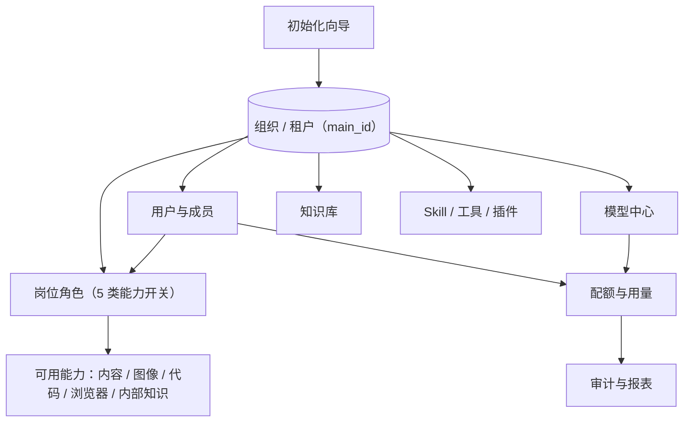

# 管理、治理与多租户

对员工来说 MOVO 是一个工作台，对管理员来说它是一个需要被治理的平台：谁能用、能用什么、花了多少、出了事怎么查。这一页讲管理后台背后的一套控制面。

## 首次初始化

部署完成后第一件事是打开 `http://localhost:3000/admin/setup` 走初始化向导。它会检查部署状态，并引导完成：

1. 创建组织（租户）与首位超级管理员；
2. 连接默认对话模型；
3. 按需配置 Embedding、Rerank、Vision、图片生成、联网搜索等服务商。

通过自托管初始化创建的租户会被标记为 `community`：不限成员数、不启用计费与商业套餐限制、允许自行配置模型，数据与运行服务都留在自己的部署里。系统不预置默认管理员密码——首位管理员只能由初始化向导创建。

## 控制面全景

管理面围绕"组织（租户）"这一个根节点展开。下图把主要治理对象串起来：

**该看什么**：能力不是直接挂在用户身上，而是先定义成"岗位角色"，再分配给用户——这让"新来一批同岗位的人"可以整体授权，而不是逐个配置。

## 岗位能力模型

MOVO 的权限不是简单的 RBAC，而是以"能力"为粒度。内置的 5 类 Agent 能力开关是：

| 能力 key | 含义 |
| --- | --- |
| `content_generation` | 内容生成（报告、文章等） |
| `image_generation` | 图像生成 |
| `code_generation` | 代码生成（配合 Code Agent） |
| `browser_automation` | 浏览器自动化（配合 Browser Agent） |
| `internal_knowledge` | 内部知识检索 |

管理员把能力组合成岗位角色（例如"全能力管理员"`full_access_admin`），再分配给成员；也支持对单个用户做能力覆盖。这样"某个岗位能不能用代码生成"是一处配置、全局生效，并且变更会写进审计。

## 多租户：main_id

MOVO 的多租户不是靠框架自动隔离的，而是显式传递一个租户标识 `main_id`：请求进来先解析出租户，后续所有数据库访问都带上这个范围过滤。未指定时回落到默认租户 `default`，并兼容历史数据里缺失该字段的记录。这是一个"约定优于强制"的做法——好处是灵活、迁移平滑，代价是每一处数据访问都要自觉遵守，不能依赖某个中间件兜底。

## 配额与用量

平台可以按组织或按用户设置 token 配额，周期支持按时 / 按日 / 按月，并带时区（默认 `Asia/Shanghai`）以对齐自然周期。配额检查发生在对话入口：一旦超出直接返回 `402`，而不是等跑完才发现超额。每次模型调用都会写入 `token_usage_logs`，供配额统计、部门报表与成本归因。

## 审计

MOVO 留了多本账，分别回答不同的问题：

| 账本 | 回答什么问题 |
| --- | --- |
| `system_audit` / 系统审计 | 管理员做过哪些平台级操作 |
| 岗位角色审计 | 谁被授予/收回了哪些能力 |
| 执行事件与回执 | 一轮对话里 Agent 具体做了什么、调用了哪些工具 |
| Token 用量 | 谁、在什么时候、花了多少模型用量 |

"出事了怎么复盘"就是把这几本账交叉起来看：谁发起的、用了什么能力、调了哪些工具、产生了什么产物。

## 平台配置面

管理后台还承载一整套平台配置：模型中心、知识目录与文档、知识检索设置、Skill 生命周期、工具与 MCP、DSH 插件、快捷键/呈现设置，以及仪表盘与统计。这些配置最终大多会汇入 Runtime Profile 的编译输入——也就是说，管理员在这里改的配置，下一次编译就会变成内核看到的新档案。

> 依据：`services/admin-api/README.md:1-45`、`services/chat-api/app/core/tenant.py:1-37`、`services/chat-api/app/core/quota_policy.py:1-70`、`services/chat-api/app/core/product_edition.py:1-37`、`services/admin-api/app/position_roles/constants.py:1-17`、`services/admin-api/app/api/routes/`、`services/chat-api/app/main.py:230-338`
