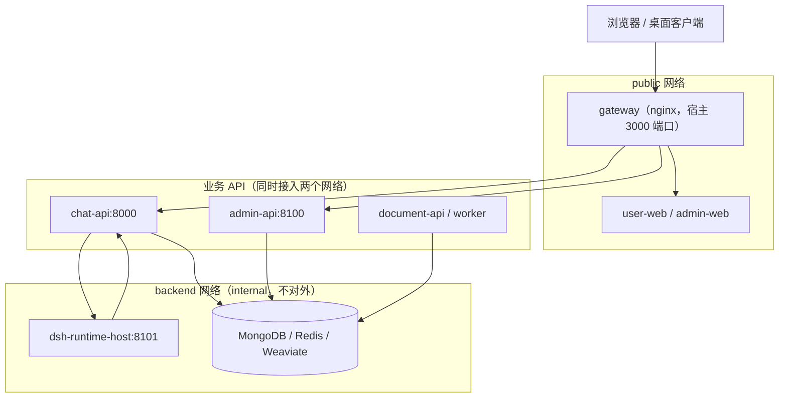
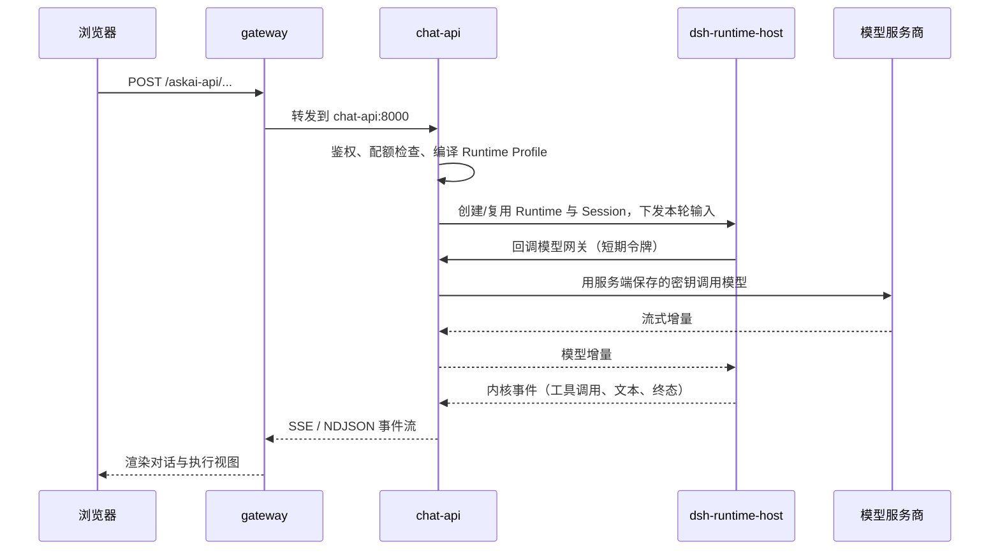

# 系统架构

MOVO 的架构可以一句话概括：**把 DSH 内核关进一个只能访问内网的容器，用一份与内核无关的契约驱动它，再把所有企业能力实现成它够得着的、由业务侧执行的回调。**

默认的 `docker compose` 部署会启动 12 个服务。理解架构，先理解这 12 个服务被分成了哪两类网络、以及一次请求怎么在它们之间流动。

## 整体形态：双网络分区

下面的图给出部署时的核心结构。关键不是节点数量，而是中间那条边界：网关和两个前端在 `public` 网络，数据库与内核宿主只在 `backend` 网络，业务 API 横跨两边。

**该看什么**：内核宿主 `dsh-runtime-host` 和数据存储只在 `backend` 网络，`backend` 被标记为 `internal: true`，这意味着它们无法主动访问外网。真正的模型推理和工具执行，都是内核"反向回调"到 `chat-api`、再由业务侧出网完成的——这是 MOVO 安全模型的地基，在 [dsh-runtime-host.md](dsh-runtime-host.md) 展开。

## 12 个服务与职责

| 服务 | 职责 | 网络 |
| --- | --- | --- |
| `bootstrap` | 一次性生成部署密钥（JWT、服务令牌、网关签名密钥、内核宿主令牌）写入共享卷后退出 | 无（不接入网络） |
| `gateway` | 统一入口 nginx，按路径分发到各前端/API，并对宿主机暴露 `3000` 端口 | public |
| `user-web` | Vue 3 用户工作台 | public |
| `admin-web` | Vue 3 初始化与管理后台 | public |
| `chat-api` | 对话、任务、Agent、Skill 与 DSH 网关；同时内置模型网关与工具网关的内部端点 | public + backend |
| `admin-api` | 组织、用户、模型、知识、Skill、工具、审计等平台管理 API | public + backend |
| `document-api` | 文档解析、预览、检索 API（与 worker 同一镜像，不同启动命令） | public + backend |
| `document-worker` | Celery worker，异步执行解析、分块、向量化等重活 | public + backend |
| `dsh-runtime-host` | Node 进程，实际承载 DSH 内核、Runtime 与 Session | backend |
| `mongo` | MongoDB 6，业务状态主库（数据库名 `gragentic`） | backend |
| `redis` | Redis 7，任务队列与协调 | backend |
| `weaviate` | Weaviate 1.25，向量检索（集合 `AskAIKnowledgeChunks`） | backend |

一次性密钥容器 `bootstrap` 只在首次启动时运行，把一串随机密钥写进 `deployment-secrets` 卷；其余服务都以它"成功完成"为前提才启动。这也是为什么默认部署不需要你手写 `.env`——敏感令牌由系统自己生成。

## 统一网关：一个端口、按路径分发

对宿主机只暴露一个端口（默认 `3000`），内部由 nginx 按路径把请求分给不同后端。这决定了用户访问的 URL 长什么样：

| 路径 | 转发到 | 用途 |
| --- | --- | --- |
| `/` | `user-web` | 用户工作台 |
| `/admin/` | `admin-web` | 管理后台 |
| `/admin-api/` | `admin-api`（8100） | 管理接口 |
| `/askai-api/` | `chat-api`（8000） | 对话与 Agent 接口 |
| `/api/` | `chat-api`（8000） | 用户侧接口（含 SSE 长连接） |
| `/healthz` | 网关自身 | 健康检查 |

对 `/api/` 与 `/askai-api/` 的连接，网关显式开启了 `Upgrade`/`Connection` 头和较长的读写超时——因为对话是流式长连接，不能被普通反向代理缓冲或超时截断。

## 一次对话请求的主链路

把服务串起来看，一次聊天请求会横穿几乎所有层。下图是一条典型的服务端执行路径（工具调用属于其中一环，详见 [skills-tools-mcp.md](skills-tools-mcp.md)）：

**该看什么**：注意内核宿主从不出网——它所有的模型调用与工具调用都"打回" `chat-api` 的 `/internal/...` 内部端点，由业务侧拿着真正的密钥执行。内核手里只有短期、限域的令牌，即使内核被攻破也拿不到长期密钥。

## 模块地图

仓库按"前端 / 业务后端 / 内核宿主 / 部署"分区，读源码时可按这张表定位：

| 路径 | 组件 | 关键概念 |
| --- | --- | --- |
| `apps/user-web/` | Vue 3 用户工作台 | 对话、执行视图、知识、Skill、文件、定时任务 |
| `apps/admin-web/` | Vue 3 初始化与管理后台 | 组织、用户、模型、知识、能力、审计 |
| `services/chat-api/` | FastAPI 对话与 Agent 网关 | Runtime Profile、模型网关、工具网关、事件投影 |
| `services/chat-api/dsh/runtime-host/` | Node.js DSH Runtime Host | kernel 契约、插件容器、事件日志 |
| `services/admin-api/` | FastAPI 平台管理 API | 组织、模型中心、知识、Skill、审计 |
| `services/document-parser/` | 文档解析与检索服务 | Docling 解析、分块、向量化、检索 |
| `deploy/` | 引导与网关配置 | `./movo` CLI、nginx 配置 |

## 关键设计取舍

| 选择 | 没选什么 | 代价 |
| --- | --- | --- |
| 内核装进独立进程 + 内网隔离 | 内核与业务后端同进程 | 跨进程调用与两次 HTTP 回调，链路更长 |
| 单网关统一入口、按路径分发 | 每个前端独立暴露端口 | 网关是单点，需保证它健康 |
| 三存储按用途分工（Mongo/Redis/Weaviate） | 一个数据库全包 | 组件多、运维面更宽 |
| document-api 与 document-worker 用同一镜像、不同命令 | 拆成两个独立镜像 | 镜像内需同时包含 API 与 worker 依赖 |
| 业务 API 同时接入 public 和 backend | 只接一边 | 需谨慎管理每个服务的网络归属 |

> 依据：`docker-compose.yml:9-355`、`deploy/docker/nginx.conf:1-86`、`README.md:126-142`、`README.md:227-238`、`services/chat-api/app/main.py:381-406`
