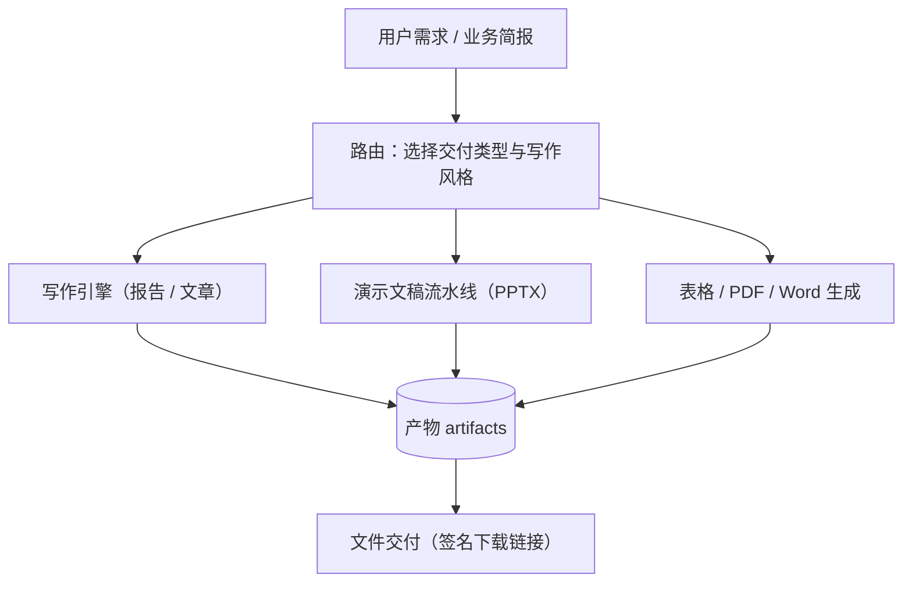

# 内容与文件交付

用户说"帮我做一份竞品分析报告/演示文稿/表格"，MOVO 不该只回一段聊天记录，而要给出一个能直接打开、能继续编辑的文件。这一页讲它怎么把"一句话需求"变成"可交付的文件"。

## 一个需求，几种产物

内容生产能力覆盖的产物类型，以及各自走的路径：

| 产物 | 说明 | 走的路径 |
| --- | --- | --- |
| 报告 / 文章 | Markdown 为主，也可产出 Word/PDF | 写作引擎（writer engine） |
| PPTX 演示文稿 | 可继续编辑的演示文件，支持主题、图表、图片 | 演示文稿流水线（presentation pipeline） |
| XLSX 表格 | 数据处理与表格生成 | 表格能力 + Office 生成脚本 |
| PDF | 文档排版与输出 | PDF 生成 / 编辑能力 |
| Word（DOCX） | 文档生成，另支持合同批注（docx review） | DOCX 生成 + 批注能力 |

除此之外还有几条围绕文档的辅助能力：表单填充、翻译、股票分析等，它们本质上是"带着特定模板与校验的 Skill"，复用同一套内容/文件生成底座。

## 内容生产的整体路径

无论哪种产物，大致都经过"路由 → 生产 → 落成产物 → 交付"四段：

**该看什么**：中间三种生产路径不必都经过，路由会按需求挑选；但它们最终都要落成"产物（artifact）"，再通过统一的交付环节给到用户——这样"下载 / 预览 / 引用"的行为对所有类型是一致的。

## 写作引擎：不是"让模型写一段"，而是带闭环地生产

内容生产不是简单地把需求丢给模型。写作引擎做了几件让结果可交付的事：

- **选择写作风格**：按内容类型套用不同的写作风格与结构模板（内置几种风格 Skill）。
- **先解析证据**：如果内容需要引用资料，先把证据（来源、片段）解析出来，再带着证据写，而不是凭空编。
- **质量闭环**：生成后做质量检查与可接受性判断，不达标可回退或修订，而不是"一次成型不管了"。
- **进度可见**：生产是分阶段推进的，进度会通过时间线投影给前端，用户能看到"在写、在校验"。

## 演示文稿流水线：可编辑、可续跑

PPTX 是这里面最"重"的产物，MOVO 把它做成了独立的、有状态的流水线：需求先落成一份内部的结构草案（blueprint），再逐步生成页面、图表与视觉，最后拼成可编辑的演示文件。因为耗时长，它由任务协调器管理、支持进度与续跑，而不是一个同步请求里硬等。

## 产物与交付

产物最终落在存储里（本地卷或对象存储），对外通过带签名的下载链接提供。这样做有两个好处：文件不直接暴露存储路径，链接可以带时效；同时前端能对同一份产物做预览、下载、引用。

| 环节 | 发生了什么 |
| --- | --- |
| 产物登记 | 生成的文件登记为 artifact，归属到会话/用户/租户 |
| 签名交付 | 对外给签名链接，前端据此预览或下载 |
| 留痕 | 产物与生成它的执行事件关联，可回看"这份文件是怎么来的" |

> 依据：`services/chat-api/app/enterprise_capabilities/content/service.py:1-45`、`services/chat-api/app/enterprise_capabilities/content/writer_runner.py:1-35`、`services/chat-api/app/enterprise_capabilities/presentation/service.py:1-40`、`services/chat-api/app/skills_specs/pptx/SKILL.md`、`services/chat-api/app/skills_specs/docx/SKILL.md`、`services/chat-api/app/skills_specs/xlsx/SKILL.md`、`services/chat-api/app/skills_specs/pdf/SKILL.md`
