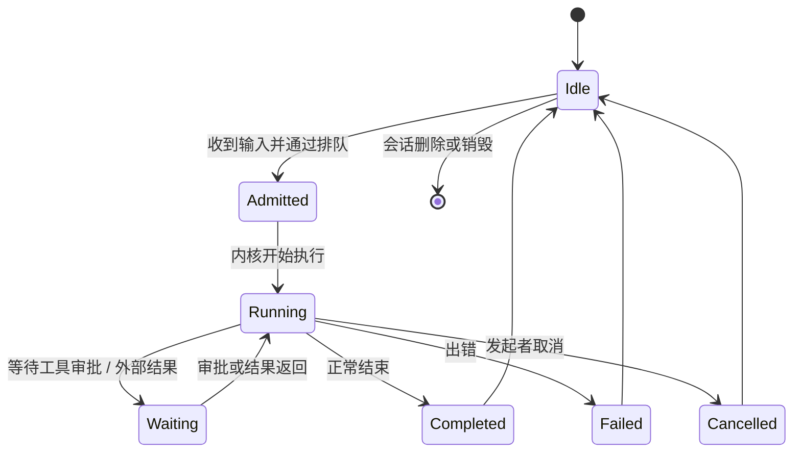
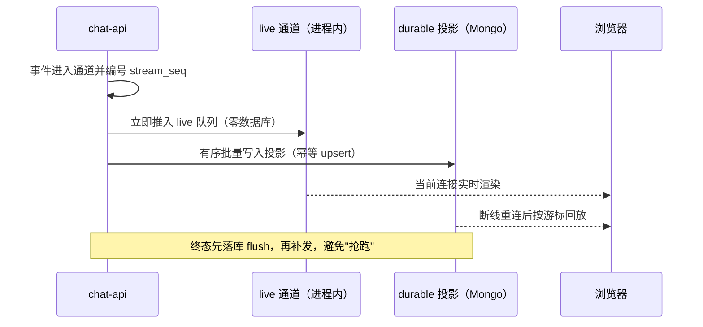

# 会话与一轮执行

用户在界面上看到的是"发一句话、Agent 开始干活、结果一段段冒出来"。这一页把这段体验背后的机制讲清楚：一条会话是什么、一轮执行经历哪些状态、事件怎么既"实时"又"可回放"、掉线以后怎么接上、以及多人共享一条会话时怎么保证权限不串。

## 先分清几个概念

MOVO 的对话模型里有几个容易混淆的词，先对齐：

| 概念 | 含义 | 在系统里的角色 |
| --- | --- | --- |
| Conversation（会话） | 用户视角的一整条对话，有标题、历史消息 | 用户在侧边栏看到的一条 |
| Session / Binding（内核会话绑定） | 一条会话当前挂在哪个内核 Runtime、哪个内核 Session 上 | `agent_kernel_bindings` 里的"当前绑定"，一条会话只有一个 current |
| Turn（一轮） | 用户发一次输入、Agent 跑到终态的一次执行 | 并发的基本单位，一条会话同时只跑一轮 |
| Message（消息） | 会话里的一条内容，带单调递增的 `seq` | 历史与回放的顺序依据 |
| Runtime | 内核进程内的一块执行环境，绑定租户与 Profile | 可复用，也可因 Profile 变化而更换 |

## 一轮执行的状态流转

一轮执行不是"请求-响应"两态，而是要覆盖排队、运行、等待审批、以及各种终态。下图给出主要状态：

**该看什么**：`Waiting` 这个状态是治理的关键——敏感工具调用会在这里停下来等人批准，而不是"先执行再补审批"。终态（Completed/Failed/Cancelled）一旦写入，就不允许再被抢跑改写。

## 事件双轨：实时直投 + durable 投影

一轮执行产生的内核事件（文本增量、工具调用、终态等）同时走两条路：

**该看什么**：live 通道负责"现在这一刻的快"，durable 投影负责"任何时刻都能回放"。两者用同一个 `stream_seq` 对齐，所以同一条事件不会因为走了两条路而错位。终态的规则是"先 flush 落库、再补发"，保证前端收到的"结束"背后数据已经持久化。

## 持久化：数据落在哪

一轮执行的痕迹分布在几组集合里，各司其职：

| 集合 | 存什么 | 关键约束 |
| --- | --- | --- |
| `chat_sessions` | 会话元信息、`next_message_seq`、`active_run`、共享字段 | 按 `(main_id, user_id, updated_at)` 建索引 |
| `chat_messages` | 消息内容与 `seq` | 唯一部分索引 `(main_id, session_id, seq)` 保证一轮消息序列不重复 |
| `execution_logs` / durable 投影 | 内核事件的持久化投影，供回放 | 带 `event_id`、`stream_seq`、`stream_seq_end` |
| `agent_kernel_bindings` | 会话↔内核 Session 的当前绑定 | 每条会话只允许一个 `current` 绑定 |
| `session_participants` | 会话共享的参与者与读游标 | 唯一 `(conversation_id, user_id)` |

会话序号由专用的序号分配器统一分配，`unique_main_session_seq` 这个唯一部分索引是最后的兜底——它让一条会话里的消息序号跨所有写入者都唯一。这个索引也是升级时最容易出问题的点，运维处置见 [deployment-and-operations.md](deployment-and-operations.md)。

## 断线之后怎么接上

Web 工作台用的是轮询式的 durable 实时投影：客户端连上 `/api/sessions/{id}/live` 后，每次轮询都从服务端读"会话状态 + 消息 + 参与者 + 已落库的执行事件"，而不是依赖某个进程内的广播器。这条设计的好处是无状态、可横向扩展、不依赖 Redis 广播。

| 机制 | 作用 |
| --- | --- |
| 冷附加（cold attach） vs 续读（resume） | 无游标即冷启动，有游标即从上次位置续读 |
| 不透明游标 | 客户端拿到的续读位置是编码过的，服务端严格校验，不信任客户端拼的值 |
| 修订摘要再校验（digest revalidation） | 读前读后各算一次摘要，不一致就整帧丢弃、下一轮重算，避免读到"撕裂"的中间态 |
| `thread.changed` 控制帧 | 游标失效、跳号或重放溢出时，让客户端整段重来而不是拼错 |

所以"刷新页面 / 换设备 / 掉线几分钟"都不会丢对话：历史在 Mongo，执行事件在投影里，续读位置只是一个可重算的游标。

## 并发与取消

一条会话同一时刻只允许一轮在跑。第二轮如果在第一轮未结束时进来，服务端直接返回 `409 session_already_running`，客户端把未发送的草稿保留下来，等这一轮结束再试。这个"串行化"是有意的：一轮执行会改动会话的活跃绑定、事件序和证据，两轮并发会互相污染。

取消同样受治理：**只有发起这一轮的人能取消它**。其他人（包括会话所有者）看到的是"有一轮在跑"，但没有停止按钮；服务端也会对非发起者的取消请求返回 `403`。这样做的原因是——审批和取消这类高风险动作，必须和"谁发起"绑定，否则一次共享会话里的成员可以互相打断。

## 会话共享（v0.2.3）

v0.2.3 起支持把一条会话共享给同组织的其他人一起看、一起聊。它的几个设计点值得单独记住：

| 维度 | 做法 |
| --- | --- |
| 分享方式 | 生成一条可撤销、可过期的分享链接（7/30/90 天），链接里是令牌，服务端只存令牌的哈希 |
| 加入条件 | 必须是同组织（同租户）的账号；跨组织链接无效 |
| 历史可见性 | 参与者能读到完整的、标注作者的历史，包括执行事件、证据、产物 |
| 权限不转移 | 每个成员按自己的账号编译模型、工具、Skill；参与者绝不使用所有者的模型或权限 |
| 一轮归属 | 一轮只属于发起者，只有发起者能停止它、只有发起者能审批它触发的工具调用 |
| 串行化 | 共享会话依然一次只跑一轮；别人在跑时发送会得到"正在进行"的提示而不是重复入队 |

一个容易踩的细节：**移除成员不等于拉黑**。移除或成员主动离开会立刻收回访问权，但只要分享链接还有效，他仍可通过链接重新加入。要永久排除某人，得撤销链接再重新生成一条只给指定人的。

> 依据：`services/chat-api/app/main.py:230-338`、`services/chat-api/app/dsh_runtime/events/turn_channel.py:14-60`、`services/chat-api/app/dsh_runtime/events/live_stream.py:1-38`、`services/chat-api/app/dsh_runtime/bindings/repository.py:13-31`、`services/chat-api/app/api/endpoints/dsh_chat.py:202-299`、`services/chat-api/app/dsh_runtime/session_live.py:1-16`、`docs/session-sharing.md:1-110`
