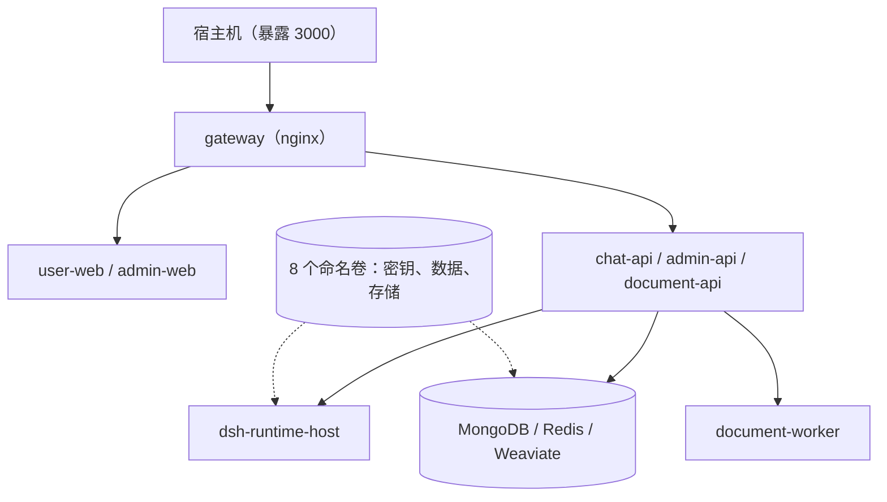

# 部署与运维

MOVO 主打"一条命令拉起整套企业 Agent 平台"。这一页讲清怎么起、怎么配、怎么升级、怎么备份、以及生产环境该注意什么。

## 部署形态

默认部署是一个单机 Docker Compose：宿主机只暴露一个端口，网关把前端与 API 串起来，状态服务与内核宿主留在内网，数据落在 8 个命名卷里。



**该看什么**：真正被备份/迁移的是那 8 个命名卷和它们承载的数据；容器本身是可丢弃、可重建的。所以运维的重点不是"保住容器"，而是"保住卷"。

## 环境要求

| 依赖 | 要求 |
| --- | --- |
| Git / Docker | Git；Docker Desktop，或 Docker Engine + Docker Compose v2 |
| 内存 / 磁盘 | 至少 8 GB 可用内存、20 GB 可用磁盘（镜像 + 数据） |
| 网络 | 首次拉镜像时能访问 GHCR 与 Docker Hub |
| 模型 | 至少一个兼容模型 API 的访问凭证，用于完成初始化 |

Windows 用户应在 Docker Desktop 的 WSL 2 + Ubuntu 中运行，不要在提示符以 `docker-desktop:` 开头的内部发行版里执行。

## 快速启动

```bash
git clone https://github.com/himovo/movo.git
cd movo
chmod +x movo
./movo up
# 完成后打开 http://localhost:3000/admin/setup
```

`./movo up` 会串行拉取官方预构建镜像、持续重试到成功、等待服务健康后打印初始化地址。它**不需要 `.env` 文件，也不需要在本地构建镜像**。也可以直接用 `docker compose up -d` 起同一套镜像（并发拉取，但没有启动器的重试与就绪等待）。

## `./movo` 命令行

| 命令 | 作用 |
| --- | --- |
| `./movo up` | 拉镜像、起服务（`--build` 则从源码构建） |
| `./movo build` | 只构建镜像不启动 |
| `./movo status` / `./movo logs <svc>` | 查看状态 / 日志 |
| `./movo restart` | 重启服务 |
| `./movo update` | 拉取配置的镜像版本并重建服务 |
| `./movo fix` | 仅在升级提示会话序号冲突时使用，停写修复 |
| `./movo backup <dir>` / `./movo restore <dir> --yes` | 备份 / 恢复全部命名卷 |
| `./movo down` / `./movo down -v` | 停止并保留数据 / 永久删除数据（需确认） |

## 配置

默认本地部署无需 `.env`。要改公开端口、访问地址、镜像版本或卷前缀时：

```env
MOVO_PORT=3000
MOVO_VOLUME_PREFIX=movo
MOVO_IMAGE_PREFIX=ghcr.io/himovo/movo
MOVO_VERSION=vX.Y.Z
PUBLIC_BASE_URL=https://movo.example.com
```

`MOVO_VOLUME_PREFIX` 一旦首次启动就要保持稳定——它决定数据卷的物理名字，改了等于换了一套数据。DNS、TLS 证书、外部反向代理由部署者自行负责。

## 升级、修复与备份

- **升级**：生产环境固定版本标签（`MOVO_VERSION`），不要用 `latest`；先读发布说明、做备份、确认可回滚的镜像标签，再 `./movo update`。
- **序号冲突修复**：升级会在替换 chat-api 前做会话共享相关索引的加法检查。若历史数据里真的出现重复的消息序号，升级会在替换前停下并报冲突，旧服务继续可用。此时在维护窗口执行 `./movo fix`（停 chat-api、备份库、只对受影响会话重排序、校验并建索引），再 `./movo up`。`fix` 与 `up` 之间不要 `./movo down`，因为修复需要 MongoDB 在线。
- **备份**：`./movo backup` 会短暂停机并把 8 个命名卷（含部署密钥）打包，恢复用 `./movo restore` 校验 SHA-256 并要求卷前缀匹配；恢复是"整体替换"而非合并，务必在一次性主机上先验证。

## 生产基线

官方给的默认 Compose 是**单机基线**，生产上线前至少要满足：

| 要点 | 说明 |
| --- | --- |
| TLS 在外部反代终止 | 只对外暴露网关端口 |
| 状态服务留在内网 | MongoDB / Redis / Weaviate 走 internal 网络 |
| 卷前缀稳定 | 全生命周期不变 |
| 备份要连密钥一起 | 部署密钥与数据、知识文档、Weaviate、DSH 状态一起备份 |
| 收敛 Docker 权限 | Docker 访问在很多安装里等价于 root |
| 监控与演练 | 监控磁盘/内存/容器健康/网关错误率，升级前用非生产数据演练备份恢复与回滚 |

需要高可用数据库、外部对象存储、集中式密钥或滚动升级时，应把自带的单机状态服务替换成托管等价物并单独验证——这超出了默认 Compose 的覆盖范围。

> 依据：`docker-compose.yml:9-355`、`deploy/docker/nginx.conf:1-86`、`movo:244-334`、`README.md:43-208`、`docs/docker-deployment.md:1-100`、`docs/session-sharing.md:111-239`
