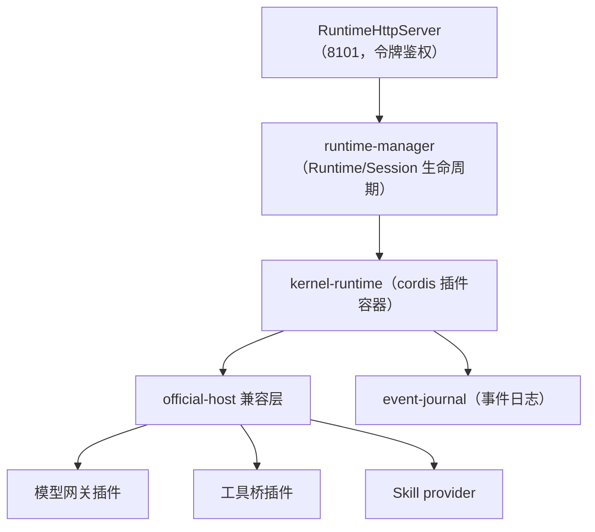

# DSH 内核宿主化

MOVO 没有把 Agent 内核和业务后端写在一起，也没有 fork 一份 DSH 再改。它做的是：**把官方 DSH 原样装进一个独立 Node 进程，用一份中立的契约驱动它**。这一页讲清三件事——为什么要这样切、契约长什么样、宿主进程里到底有什么。

## 为什么把内核单独关起来

把 DSH 关进一个单独的进程、单独的容器、单独的网络，换来三个可验证的收益：

| 动机 | 具体做法 | 换来的东西 |
| --- | --- | --- |
| 密钥不下发 | 内核拿不到长期模型密钥，只能拿短期、限域的令牌；`backend` 网络 `internal: true` 让它无法出网 | 内核即使被攻破，也偷不到长期凭据 |
| 不 fork 内核 | DSH 以精确版本的 npm 依赖引入，业务代码不修改内核源码 | 升级跟着官方走，不用维护私有分支 |
| 故障与扩缩隔离 | 内核是独立进程/容器，有自己的健康检查与数据卷 | 内核重启不影响业务 API；可单独观测 |

代价是跨语言、跨进程：Python 写的业务后端要用一份显式契约、通过 HTTP 与 Node 宿主通信，模型和工具调用还要再"反向回调"一次。这一层复杂度是刻意的交换。

## kernel 契约：8 个方法

业务侧只认一份与内核无关的异步接口（`askai.agent-kernel.v1`）。它的设计目标是"换一个内核实现也不用改业务代码"——DSH 只是当前唯一的实现。

| 方法 | 作用 |
| --- | --- |
| `create_runtime` | 创建一个 Runtime（进程内的执行环境，绑定租户与 Profile） |
| `dispose_runtime` | 销毁 Runtime |
| `create_session` | 在 Runtime 下创建 Session（对应一条对话的一次绑定） |
| `resume_session` | 恢复一个已有 Session |
| `send` | 向 Session 下发一轮输入（prompt / followup / steer） |
| `cancel` | 取消正在跑的一轮 |
| `dispose_session` | 销毁 Session |
| `subscribe` | 订阅该 Session 的内核事件流（可按游标续读） |

除了这 8 个方法，契约还定死了一批不可变的值类型（Runtime / Session 句柄、内容块、时间上下文等）和一个事件版本号 `askai.kernel-event.v1`。跨边界的数据都是冻结的强类型模型，避免"悄悄多传一个字段"。

## 宿主进程里有什么

宿主是一个 Node ESM 进程，用 cordis 做插件容器，把官方 DSH 的各个包组装成一个可运行的 Runtime。下图是它内部的分层：

**该看什么**：`official-host` 这一层是关键。MOVO 通过一组"覆盖层"（overlay）和兼容适配器，在不改 DSH 源码的前提下改写默认行为、把模型/工具/Skill 的调用接管到自己的网关上；`event-journal` 则把内核事件落成日志，供业务侧持久化与回放。

宿主里几类部件各自的职责：

| 部件 | 职责 |
| --- | --- |
| `runtime-http-server` / `host-auth` | 对业务侧暴露 HTTP 接口，用 `DSH_RUNTIME_HOST_TOKEN` 做鉴权，健康检查返回 `kernel: "dsh"` |
| `runtime-manager` | 创建/查找/销毁 Runtime 与 Session，管理并发与隔离键 |
| `kernel-runtime` | 用 cordis 容器组装 DSH 插件树（agent-loop、session、tools、llm 等） |
| `official-host/*` | 覆盖层、preset 隔离、插件对账、模型/事件/API 兼容适配 |
| `event-journal` | 记录内核事件，支撑订阅与断线续读 |
| `host-protocol.mjs` | 定义宿主协议版本 `askai.dsh-host.v1` 与内核版本常量 |

## 模型与工具怎么"回调"回业务侧

内核不直接调模型服务商，也不直接执行企业工具。它把这两件事都打回 `chat-api` 的内部端点：

- **模型**：内核向 `/internal/dsh/model/generate` 发请求，带一个 15 分钟有效、绑定租户/Profile/模型实例的短期令牌；业务侧校验令牌后，用服务端保存的真实密钥调用模型，再以 NDJSON 流式返回。细节见 [model-and-credentials.md](model-and-credentials.md)。
- **工具**：内核向 `/internal/dsh/tools/...` 发审批请求或执行请求；业务侧做策略判断、审批、真实执行并回执。细节见 [skills-tools-mcp.md](skills-tools-mcp.md)。

因此"企业能力"在 MOVO 里不是写进内核的，而是实现成内核"够得着、由业务侧执行"的回调。内核负责规划与决定调用什么，业务侧负责真正做、并留下证据。

## 版本锁定与兼容

宿主把 DSH 相关包全部锁在 `0.2.1-alpha.1`（这一版的运行时要求 Node `^22.19.0 || >=24.0.0`）。仓库里还带了几份供应链与兼容证据：`versions.lock` 钉住版本，`compatibility-matrix.yaml` 记录兼容矩阵，`sbom.cdx.json` 是软件物料清单。业务侧健康检查与就绪检查都会探测宿主，宿主不可用时 `chat-api` 的 `/ready` 直接返回 503——因为"每一轮对话都要用到这个离核内核"。

> 依据：`services/chat-api/dsh/runtime-host/src/host.mjs:29-55`、`services/chat-api/dsh/runtime-host/src/host-protocol.mjs:1-14`、`services/chat-api/dsh/runtime-host/package.json:1-38`、`services/chat-api/app/dsh_runtime/contracts/protocol.py:19-33`、`services/chat-api/app/dsh_runtime/contracts/versions.py:1-6`、`services/chat-api/app/dsh_runtime/application.py:44-90`
