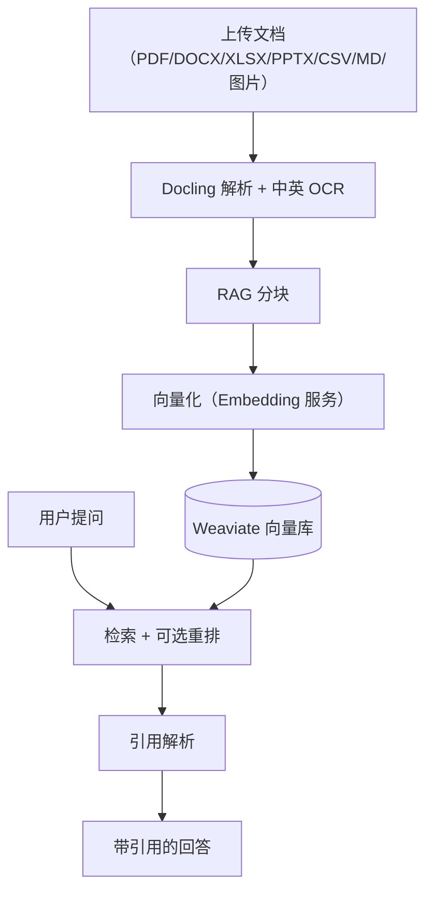

# 企业知识与研究

"让 Agent 用上企业自己的资料"是 MOVO 的核心卖点之一。这件事拆成两半：一半是**把文档变成可检索的知识**（摄取与检索），另一半是**让 Agent 去查、并保住引用**（研究）。这一页按这两半来讲。

## 一半：文档摄取流水线

用户上传一份文档后，它要经过"解析 → 分块 → 向量化 → 入库"才会变成可检索的知识。这条流水线由文档服务承担，`document-api` 受理请求，`document-worker` 在后台异步执行重活。

**该看什么**：左边是"写进去"，右边是"读出来"，中间靠 Weaviate 连接。文档解析优先用 Docling（带版面、表格与中英 OCR 能力），Docling 不可用时退化为轻量解析器处理 TXT/Markdown/CSV/JSON/DOCX 和文本型 PDF，其余格式则明确报错而不是静默失败。

支持的输入格式与处理方式：

| 格式 | 处理方式 |
| --- | --- |
| PDF | Docling 解析，含 OCR 策略判断，文本型可直接解析 |
| DOCX / DOC | Docling 或轻量解析；旧版 Office 先经 LibreOffice 转换 |
| XLSX / PPTX | Docling 解析，含表格与图片 |
| TXT / Markdown / CSV / JSON | 轻量解析 |
| 图片（png/jpg/webp） | 作为多模态内容处理 |

向量化用可配置的 Embedding 服务（如 Azure Embedding 或 DashScope），向量落到 Weaviate 的 `AskAIKnowledgeChunks` 集合，距离度量用 cosine。检索默认走向量检索，并可选开启重排（rerank）提升相关性。

## 知识的边界：谁能查什么

知识不是全局可见的。检索带访问策略：查询会按租户、用户、知识库范围做授权过滤，只有在授权范围内的候选片段才会被返回。MOVO 区分**企业知识**与**个人知识**：前者由组织维护、面向团队，后者是成员自己的资料空间，两者都有各自的目录与文档管理。

## 另一半：多源研究与证据

有些问题不是"查一下知识库"能答的，需要 Agent 主动上网找资料、多轮归纳、再给出带出处的结论。这就是研究能力：它把联网搜索、网页抓取、多轮推理组织成一个可追踪的循环，并把过程中用到的来源与片段存成证据。

| 关注点 | 做法 |
| --- | --- |
| 多轮 | 不是一次检索就结束，而是逐步收敛：收集来源 → 归纳 → 必要时再查 |
| 来源路由 | 搜索引擎与其他来源通过 provider 路由选择 |
| 证据留存 | 把用到的 URL、片段、结论落成 evidence，供回答引用与事后核查 |
| 引用保真 | 回答里的引用能指回原始来源，而不是"看起来像引用" |

企业知识与研究并不是两条互不相干的线：一次请求里，Agent 可能既查内部知识、又跑公开检索，最后统一编排成一段带出处的回答。区分"哪些来自内部文档、哪些来自公开网页"靠的就是证据与引用的记录。

> 依据：`services/document-parser/README.md:1-64`、`services/document-parser/app/services/document_parsing_service.py:1-40`、`services/document-parser/app/services/document_indexing_service.py:1-50`、`services/document-parser/app/services/retrieval_service.py:1-45`、`services/chat-api/app/knowledge/retrieval/retrieval_client.py`、`services/chat-api/app/knowledge/citations/citation_resolver.py`、`services/chat-api/app/enterprise_capabilities/research/progressive/agent.py`、`docker-compose.yml:223-282`
