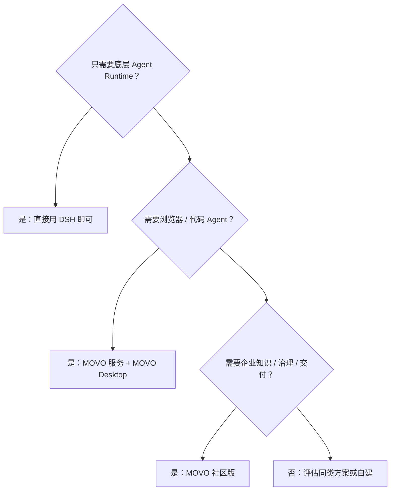

# 现状、边界与选型

前面的页面讲的是"MOVO 怎么运转"。这一页讲"它不做什么、有什么硬约束、你该不该选它"——选型需要的往往不是优点清单，而是这些硬事实。

## 一句话判断框架

**该看什么**：MOVO 的定位决定了两类"不该选"的情况——只要内核、或只要桌面级浏览器/代码能力（后者靠自己拿不到，得配 Desktop）。真正适合 MOVO 的，是"要把 Agent 变成组织可管理、可交付的产品"。

## 能力边界：哪些在仓库里，哪些不在

这是最需要说清的一点。自托管部署的 Web 工作台与"完整 MOVO"并不等价：

| 能力 | 私有化 Web 端 | MOVO Desktop |
| --- | :---: | :---: |
| 对话、研究与企业知识 | ✓ | ✓ |
| 文档理解与内容生成 | ✓ | ✓ |
| 浏览器 Agent | — | ✓ |
| Code Agent、本地项目、终端与 Git | — | ✓ |
| 源码是否包含在本仓库 | ✓ | —，独立分发 |

**Browser Agent 与 Code Agent 依赖独立分发的专有桌面客户端 MOVO Desktop**，它的源码不在社区版仓库内。也就是说：如果你要的是"在真实登录的浏览器里操作"或"操作本地代码仓库/终端"，光部署本仓库的服务是拿不到的，还要配 Desktop。这是 MOVO 与"一个纯 Web 的 Agent 平台"的关键差别。

## 社区版（Community Edition）

通过自托管初始化创建的租户被标记为 `community`，它放开了一些限制、也默认关闭了一些商业能力：

| 维度 | 社区版设定 |
| --- | --- |
| 成员数 | 不限制 |
| 计费 / 商业套餐 | 不启用 |
| 模型接入 | 支持自行配置 |
| 数据与运行服务 | 保留在部署者自己的环境 |

这意味着社区版适合"自己部署、自己用"的场景；而"作为托管式多租户 SaaS 对外运营"不是社区版授权的范围（见下）。

## 许可证：源码可见，但不是 OSI 开源

MOVO 采用 **MOVO Community License**：以 Apache License 2.0 为基础，附加了限制。未经书面授权，不允许：

- 将 MOVO 作为**托管式多租户 SaaS** 服务运营；
- 移除或修改所含前端中的 MOVO Logo 与版权声明；
- 将 MOVO 或其衍生版本作为主要产品，以 **OEM / 白标 / 换品牌** 的方式商业销售。

因此它**不应被描述为 OSI 认可的开源许可证**。需要商业授权、多租户 SaaS 授权、OEM/白标或换品牌时，要联系官方。这一条对"能不能拿来做成对外产品"是决定性的，选型前必须先确认。

## 部署与依赖上的硬事实

| 事实 | 影响 |
| --- | --- |
| 默认 Compose 是单机基线 | 高可用数据库、外部对象存储、集中密钥、滚动升级需自行替换验证 |
| 自带单机 MongoDB / Redis / Weaviate | 开箱即用，但不是高可用形态 |
| DSH 锁在 `0.2.1-alpha.1`（alpha） | 内核行为以该版本为准；DSH 仍在快速演进，升级需跟随官方 |
| 跨语言、跨进程（Python + Node） | 链路更长，排障要同时看业务侧与内核宿主 |
| 需要至少一个模型 API 凭证 | 初始化必须接一个可用模型，否则跑不起来 |
| 数据在本地卷 | 备份/迁移要按 8 个命名卷整体处理，含部署密钥 |

## 什么时候适合 / 不适合

| 场景 | 建议 |
| --- | --- |
| 企业内想给员工一个可管理的 Agent 工作台，接内部知识、能做报告/PPT/表格 | 适合，这正是 MOVO 的主场 |
| 需要浏览器自动化或代码 Agent | 适合，但必须同时用 MOVO Desktop |
| 只需要一个可嵌入的 Agent 内核 / SDK | 不适合，直接用 DSH |
| 想基于它做一个对外运营的多租户 SaaS | 需先取得商业授权，社区版不允许 |
| 要求开箱即用的高可用、多副本生产集群 | 默认 Compose 不覆盖，需要自行改造成熟的基础设施 |

## 文档未能确认的部分

本文档依据社区版 `v0.2.3` 源码与仓库内文档整理。以下几类信息未在仓库中给出确定答案，因此不做承诺：具体性能/并发上限、官方支持的高可用方案、MOVO Desktop 的内部实现（源码不在本仓库）、以及未来的版本路线图。涉及这些的判断，建议直接以官方文档与发布说明为准。

> 依据：`README.md:100-260`、`LICENSE:1-40`、`docs/docker-deployment.md:84-100`、`services/chat-api/app/core/product_edition.py:1-37`、`services/chat-api/dsh/runtime-host/package.json:1-38`
