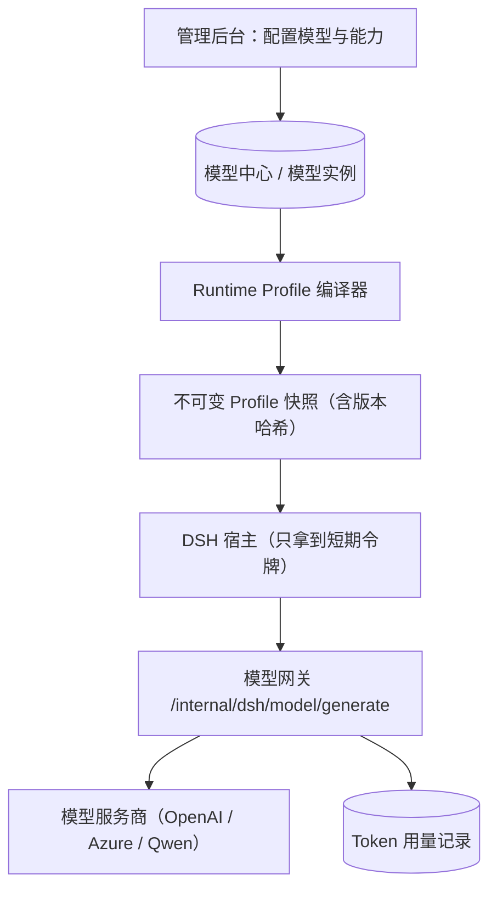

# 模型接入与凭据

MOVO 要在不把长期密钥交给内核的前提下，让 DSH 能正常调用模型。这一页讲清它怎么做到：模型在哪里配、怎么变成内核能用的"运行时档案"、内核怎么借"模型网关"用业务侧的密钥出网、以及长时间工具调用时凭据怎么续。

## 模型在哪里配

管理员在管理后台的"模型中心"接入模型服务商并登记模型实例。MOVO 支持 OpenAI 兼容协议与几种常见变体，封装在业务侧的 provider 适配层里：

| Provider 类型 | 典型用途 |
| --- | --- |
| OpenAI 兼容（default_openai） | 标准 chat completions 协议 |
| Azure OpenAI（azure_openai / azure_responses） | 企业 Azure 部署，含 Responses 变体 |
| Qwen（qwen） | 通义千问系列 |
| Azure GPT Image | 图片生成 |

初始化向导会引导接入默认对话模型，并可另配 Embedding、Rerank、Vision、图片生成、联网搜索等能力。**服务商凭证在存储前会加密**（部署密钥里的 `MODEL_CONFIG_SECRET` 参与加密），所以数据库里看不到明文密钥。

## Runtime Profile：把配置冻成快照

内核需要的不是"数据库里一堆可变的配置行"，而是一份确定的执行档案。MOVO 用一个**确定性的编译器**，把租户当前的管理配置编译成一份不可变、且不含密钥的快照（Runtime Profile）：

- 快照里包含：模型实例与能力、上下文窗口/最大输出、工具定义、Skill 定义、写作风格、插件版本等。
- 每个快照有一个 `profile_version`（内容哈希）和 `content_hash`；配置变了，版本就变。
- 快照本身是 secret-free 的——真正的密钥不存在快照里，只存在业务侧的配置表中。
- 每个租户保留一个"当前生效"的 Profile；一轮执行绑定某个版本，历史会话可以继续用旧版本，前提是执行契约兼容。

这样做的效果是：内核拿到的是"你该用哪个模型、能用哪些工具和 Skill"的确定性描述，而不是能反查密钥的引用。

## 模型网关：内核借业务侧的密钥出网

内核在需要模型时，不是自己直连服务商，而是回调 `chat-api` 的模型网关：

**该看什么**：模型网关是唯一持有真实密钥、且能够出网的一环。内核与它之间只有一枚短期令牌，网关校验令牌、按 Profile 解析出该用哪个模型实例，再用服务端密钥发起请求，并把结果以 NDJSON 流式回吐给内核；同时把用量记到 `token_usage_logs`，供配额与报表使用。

## 短期令牌与凭据租约

模型网关的令牌不是随便签的，它有明确的受众、范围和寿命：

| 维度 | 设定 |
| --- | --- |
| 令牌受众 | `askai-model-gateway`（只对模型网关有效） |
| 携带声明 | 租户、Profile 版本、模型实例、用户、签发/过期时间、随机 jti |
| 有效期 | 默认 900 秒（15 分钟） |
| 签名 | 用部署级密钥做 HMAC-SHA256，校验用常量时间比较 |

难题是：一轮执行里如果 Agent 卡在一个很长的工具调用上，15 分钟可能已经过去，回来再调模型令牌就过期了。MOVO 用一条"凭据租约"解决：在一轮活跃期间，后台每 240 秒刷新一次该会话的模型网关凭据，刷新失败也不打断正在进行的浏览器或工具操作，靠下一拍或下一次审批刷新恢复。

于是令牌有三条刷新路径：**下发 send 前**、**审批等事件触发时**、以及**活跃会话的后台租约**。三者共同保证内核在整个执行过程中始终握着一枚"还没过期"的令牌，而业务侧从未把长期密钥交出去。

> 依据：`services/chat-api/app/dsh_runtime/model_gateway/token.py:19-73`、`services/chat-api/app/dsh_runtime/model_gateway/service.py:1-70`、`services/chat-api/app/dsh_runtime/credential_lease.py:37-86`、`services/chat-api/app/dsh_runtime/profile/models.py:1-90`、`services/chat-api/app/dsh_runtime/profile/service.py:11-45`、`services/chat-api/app/api/endpoints/dsh_model_gateway.py:19-73`、`docker-compose.yml:10-68`
