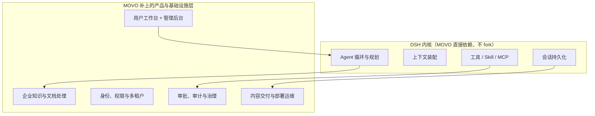

# 概览

MOVO 的自我定位只有一句话：**DSH runs the Agent; MOVO brings the Agent into enterprise production.**
（DSH 负责智能体如何运行，MOVO 负责智能体如何进入企业生产环境。）

这句话背后是一个判断：把 Agent 跑起来做一次演示，和让一个 Agent 平台真正服务一个组织，是两件事。DSH 已经把"Agent 怎么规划、怎么调工具、怎么装配上下文"做完了；真正卡住落地的，是围绕它的产品与基础设施层。MOVO 做的就是这一层。

## 解决什么问题

一个团队把 Agent 从"个人电脑上的脚本"推到"组织级生产使用"，通常要自己拼装下面这几件事。MOVO 的价值就在于它把这些都做好了：

| 落地时的痛点 | 不解决会怎样 | MOVO 的做法 |
| --- | --- | --- |
| 身份与边界 | 谁在用？属于哪个组织？能调哪些能力？ | 组织/用户/岗位能力，租户贯穿请求与运行时 |
| 模型密钥散落 | 每个人的机器上都存着 API Key | 密钥留在服务端，内核只拿短期令牌，网络层隔离外网 |
| 企业知识进不了上下文 | 内部文档无法被检索、引用不可追溯 | 文档解析 + 向量检索 + 引用保真，内网与公开检索统一编排 |
| Agent 输出无法验收、无法追责 | 出了问题说不清谁批的、做过什么 | 敏感工具前置审批、执行事件全程留痕、执行回执可回看 |
| 输出只是聊天记录 | 用户拿不到能直接用的报告、PPT、表格 | 报告 / PPTX / XLSX / PDF / Word 交付物生产线 |
| 想给非技术同事用 | 只有命令行和配置文件 | 图形化用户工作台 + 管理后台，一套部署同时服务员工和管理员 |

**不适用的场景**：只需要一个底层 Agent Runtime。作者自己也这么说——那种情况 DSH 可能就够了；也不需要"图形化 workflow 画布"，MOVO 的立场是让 AI 自动编排，人类只审阅关键决策与风险动作。

## 给谁用

MOVO 面向的是一个组织里的三类人，这也是它的两条主要使用界面：

| 角色 | 用什么 | 关心什么 |
| --- | --- | --- |
| 员工 / 普通成员 | 用户工作台（对话、研究、知识、文件、内容生成） | 能不能完成任务、结果能不能直接用 |
| 管理员 | 管理后台（组织、用户、模型、知识、能力、配额、审计） | 谁能用、能用什么、花了多少、出了事怎么查 |
| 部署者 / 运维 | `./movo` 命令行 + `docker compose` | 怎么起、怎么升级、怎么备份、怎么排障 |

典型场景包括企业知识问答、制度与项目资料检索、多源研究、竞品分析、报告和 PPT 生成、表格处理、翻译、模板填充，以及受控的业务系统集成。

## 核心能力一览

| 能力 | 用户能感知到的工作 |
| --- | --- |
| DSH 原生 Agent 运行时 | 规划、工具调用、Skill、子智能体与受控执行，都由内置的 DSH Runtime Host 承接 |
| 企业知识与研究 | 检索内部文档与公开信息，多轮研究，保留引用并查看支撑依据 |
| 文档与多模态理解 | 解析 PDF、DOCX、XLSX、PPTX、CSV、Markdown，含图片、图表等视觉内容 |
| 内容与文件生成 | 生成报告、文章、PPTX 演示文稿、电子表格、PDF、Markdown 交付物 |
| Skill、工具与 MCP | 复用工作流，通过 HTTP 或 MCP 服务连接企业业务系统 |
| 自动化与治理 | 创建定时任务，敏感工具操作需审批，追踪执行、留存产物 |
| 企业管理后台 | 管理组织、用户、角色、模型、知识、Skill、工具、审计记录、运行状态 |

这些能力并不是并列的一堆功能，而是围着同一条主线组织的：**一次请求进来 → 交给 DSH 内核跑一轮 → 期间按需检索知识、调用工具、生成交付物 → 全过程留痕**。后面的页面按这条线逐层展开。

## 与 DSH 的分工

理解 MOVO 最快的办法，是先看清它和 DSH 各管什么。下面的图把职责一分为二：上半部是 DSH 内核已经提供的能力，MOVO 不重造；下半部是 MOVO 在它外面补齐的产品与基础设施层。

**该看什么**：MOVO 没有替换 DSH，而是把 DSH 当作一个"精确锁版本的依赖"装进自己的进程边界里，再通过回调把模型、工具、Skill 接管回业务侧。这张图只是分工示意；"为什么不直接用 DSH、内核为什么被单独关起来"在 [dsh-runtime-host.md](dsh-runtime-host.md) 里展开。

## 技术栈

| 层 | 选型 | 说明 |
| --- | --- | --- |
| Agent 内核 | `@deepseek-ai/dsh` 系列 `0.2.1-alpha.1` | 以 npm 依赖引入并锁版本，不 fork、不 vendored |
| 内核宿主 | Node.js ESM + cordis 插件容器 | 独立进程运行 DSH，通过 HTTP 契约与业务侧通信 |
| 业务后端 | Python 3 + FastAPI + Pydantic + asyncio | 三个 API 服务：chat-api、admin-api、document-parser |
| 前端 | Vue 3 + TypeScript + Vite（user-web 另用 Tailwind） | 两个 Web 应用：用户工作台、管理后台 |
| 存储 | MongoDB 6（业务状态）、Redis 7（队列与协调）、Weaviate 1.25（向量） | 单机 Compose 内自带的三种状态服务 |
| 文档与渲染 | Docling、LibreOffice、Playwright | 文档解析、Office 预览转换、浏览器相关能力 |
| 交付 | Docker Compose + GHCR 预构建镜像 + 自研 `./movo` CLI | 一条命令拉镜像起服务，无需本地构建 |

几个关键选型的代价值得点明：**把 DSH 锁成 npm 依赖**意味着内核升级要跟着官方走，好处是不用维护一个私有 fork；**用 Python 写业务后端、Node 跑内核**意味着跨语言，代价是要用一份显式的 kernel 契约和两次 HTTP 回调把两边接起来；**默认只带单机三件存储**意味着开箱即用，但生产高可用需要自己替换。

## 现状与边界

- MOVO 的完整能力边界、社区版限制、许可证约束与选型硬事实，集中写在 [limits-and-selection.md](limits-and-selection.md)，选型前建议直接读那一页。
- 浏览器 Agent、Code Agent 属于独立分发的专有桌面客户端 MOVO Desktop，不在本仓库源码范围内。
- 本文档依据社区版 `v0.2.3`；MOVO 与 DSH 都在快速迭代，接口与能力请以对应版本为准。

> 依据：`README.md:29-98`、`README.zh-CN.md:29-100`、`docker-compose.yml:9-355`、`services/chat-api/dsh/runtime-host/package.json:1-38`、`apps/user-web/package.json`、`apps/admin-web/package.json`
