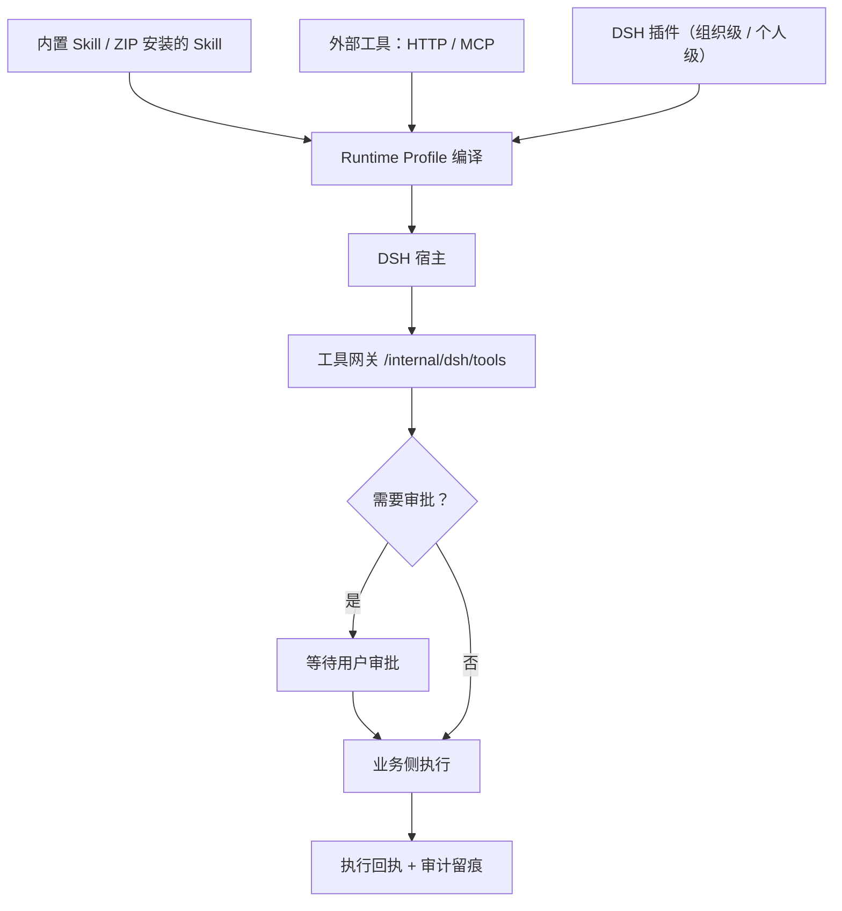

# Skill、工具与 MCP

Agent 能做什么，取决于它能调用什么。MOVO 把"能力"分成几类，分别管理：**Skill**（可复用的工作流与写作/生成规范）、**工具**（真正执行动作的接口，含 HTTP 与 MCP）、**插件**（更底层的 DSH 扩展）。这一页讲它们各自怎么进来、怎么被内核用上、以及高风险动作怎么被拦住。

## Skill：把工作流和规范变成可复用资产

Skill 是 MOVO 里最"产品化"的扩展单位。一个 Skill 用一份 `SKILL.md` 描述：它叫什么、适用什么意图、需要哪些输入、输出什么、用哪些工具、按什么步骤跑、有哪些校验要求、带哪些资源模板。下面是一个内置研究 Skill 的声明结构（节选，展示字段形态而非完整内容）：

```yaml
name: research
version: 1.0.0
description: General research skill with web search and summarization.
inputs: [topic, output_spec]
outputs: [report.md]
tools: [search_web]
when_to_use: [intent == "research"]
steps: [collect_sources, summarize_findings, compose_report]
```

MOVO 自带一批 Skill 模板，覆盖常见交付与写作场景：

| 内置 Skill | 用途 |
| --- | --- |
| `docx` / `pdf` / `pptx` / `xlsx` | 生成 Word、PDF、PPT、Excel 文件 |
| `research` / `deep_research_report_style_v1` | 通用研究与深度研究报告 |
| `blog_article_style_v1` | 博客文章写作风格 |
| `stock_analysis` | 股票分析模板 |
| `theme-factory` | 演示文稿主题生成 |

Skill 的分发也做成了完整生命周期：可以从 ZIP 包安装外部 Skill、发布成版本、直接分享给同组织的人、发现并拉取更新、收集反馈；企业级还可以统一管理。用户个人的 Skill 与组织共享的 Skill 分开存放，安装包带摘要（digest）用于版本与完整性识别。

## 工具与 MCP：真正执行动作的两类接口

工具是"真的会动手"的部分，分两类：

| 类型 | 说明 | 例子 |
| --- | --- | --- |
| 内部企业能力 | MOVO 自己实现的能力，走工具网关 | 知识检索、内容生成、演示文稿、研究、文件交付 |
| 外部工具（HTTP） | 通过 HTTP 调用企业业务系统 | 查询订单、拉取项目数据 |
| 外部工具（MCP） | 通过 MCP 协议接入工具服务（支持 Streamable HTTP） | 接第三方 MCP Server |

对外部工具，管理员在管理后台登记（类型是 `http` 或 `mcp`），并配置凭据与 schema；MCP 走的是有状态的 Streamable HTTP 客户端，兼容旧式 MCP HTTP 端点。工具最终都会以"定义 + schema"的形式进入 Runtime Profile，成为内核可调用的工具。

## DSH 插件

除了 Skill 与工具，MOVO 还开放了更底层的 DSH 插件接入：可以按插件规格（specifier）或上传插件归档安装，分为"组织级"和"个人级"两种作用域，安装后由隔离的插件运行时承载。安装来源有安全策略校验，归档有大小上限，安装失败有明确的错误分类。这类插件面向需要改动内核行为的进阶场景，普通业务接入用 Skill 与工具即可。

## 能力怎么进入内核

无论 Skill、工具还是插件，都不是直接塞进内核，而是先经过 Profile 编译，再随宿主下发、通过回调执行。下图是这条路径：



**该看什么**：内核始终只是"决定调用什么"，真正执行在业务侧；中间那道"是否需要审批"的判断，是治理能不能落地的分水岭。

## 审批与执行回执

敏感工具（例如会改数据、会对外发请求的动作）在执行前要经过审批。审批请求从内核打到工具网关，业务侧记录一条待办，前端展示给用户，用户批准或拒绝后，执行才继续。这条链上有几个关键约束：

| 约束 | 含义 |
| --- | --- |
| 审批归属发起者 | 审批只对发起这一轮的人可见、可决定；别人不能替他批 |
| 策略前置 | 执行前先跑策略（capability、授权范围），不满足直接拒绝 |
| 幂等与回执 | 执行带幂等键，产出执行回执；回执是"做过什么"的证据，进入审计与执行视图 |
| 双轨审批 | Web/企业侧走服务端状态机；桌面侧由本地审批代理承接同类语义 |

所以"Agent 自作主张改了东西"在 MOVO 的设计里是可拦截、可追责的：动作要么被审批挡住，要么在回执里留下痕迹。

> 依据：`services/chat-api/app/skills_specs/research/SKILL.md:1-24`、`services/chat-api/app/api/endpoints/dsh_plugins.py:1-45`、`services/chat-api/app/services/external_tools.py:1-40`、`services/chat-api/app/api/endpoints/dsh_tool_gateway.py:41-150`、`services/chat-api/app/main.py:248-330`
