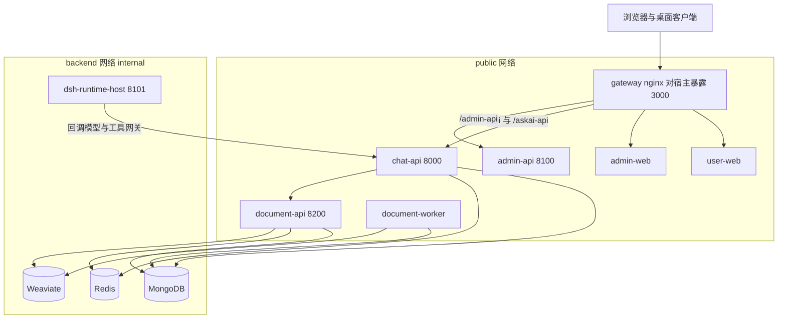

# MOVO 深度解读

> 本解读按 **ai-agent** 类规格产出（叠加可部署服务与数据模型关注面）。
> 解读基线：`v0.2.0`（`c6f20f6`）
> 版本变更记录见 [`CHANGELOG.md`](CHANGELOG.md)。

## 根因：Agent runtime 已经有了，缺的是"能交给一个组织使用"的那层

[MOVO](https://github.com/himovo/movo) 的自我定位只有一句话：**DSH runs the Agent; MOVO brings the Agent into enterprise production.**

[README.md:29-31]()
<!-- anchor: MOVO brings DSH Agents from development experiments into enterprise production. It combines … > **In one sentence:** DSH runs the Agent; MOVO brings the Agent into enterprise production. -->

这句话之所以成立，是因为它承认了 DSH（DeepSeek Harness）已经把最难的部分做完了——Agent 循环、规划、上下文装配、工具调用、Skill、MCP、子代理、会话持久化。真正卡住企业落地的从来不是"Agent 会不会用工具"，而是：

- **身份与边界**：谁在用？属于哪个组织？能调用哪些能力？模型密钥放在谁那里？
- **知识与上下文**：企业文档怎么进来、怎么被检索、引用怎么可追溯？
- **治理**：敏感动作谁批准？出了事怎么复盘？一次执行留下了什么证据？
- **交付**：Agent 输出的是聊天记录，还是用户能直接拿去用的报告、PPT、表格、合同批注？
- **运维**：怎么在一台机器上起起来、怎么升级、怎么备份、怎么排障？

MOVO 的全部价值就在回答这五个问题。因此本解读的主线不是"它有哪些功能"，而是**它在 DSH 之外补了哪几层，每层用什么机制实现，以及这些机制换来的收益和付出的代价**。

## 概览

### 是什么

自托管的企业级 Agent 平台（Community Edition），由 12 个 Docker Compose 服务组成：网关、两个 Vue 前端、三个应用 API、DSH Runtime Host、文档 worker、MongoDB、Redis、Weaviate，以及一个一次性密钥引导容器。默认部署面向单机自托管，浏览器打开 `http://localhost:3000/admin/setup` 完成初始化。

[README.md:142-142]()
<!-- anchor: The default Docker Compose deployment starts 12 services: the gateway, two Web -->

### 痛点与适用场景

| 场景 | MOVO 的做法 |
| --- | --- |
| 团队里每人都在本地跑 Agent 脚本，能力无法沉淀 | Skill 打包/安装/分享 + 企业能力目录，能力作为平台资产 |
| 模型 API Key 散落在各人电脑上 | 密钥留在服务端，内核进程只拿短期令牌，且网络层隔离外网 |
| Agent 输出无法验收，也无法追责 | 执行事件全程留痕、敏感工具前置审批、执行证据包可回看 |
| 企业知识进不了上下文 | 文档解析 + 向量检索 + 引用保真，内网知识与公开检索统一编排 |
| 输出只是聊天记录 | 报告 / PPTX / XLSX / PDF / Word 交付物生产线 |
| 想给非技术同事用 | 用户工作区（对话 + 执行视图 + 交付物）+ 管理控制台 |

**不适用**：只想拿一个底层 Agent runtime 的场景——作者自己也这么说，那种情况 DSH 就够了；也不需要"图形化 workflow 画布"，MOVO 的立场是让 AI 自动编排、人类只审阅关键决策与风险动作。

### 核心能力清单

| 能力 | 实现落点 |
| --- | --- |
| DSH 原生 Agent 运行时 | 独立 Node 宿主进程承载内核，chat-api 通过 kernel 契约驱动 → [`runtime-host.md`](runtime-host.md) |
| 每一轮对话的生命周期与可回放 | 会话级活跃轮互斥 + live 直投 + durable 有序落库 → [`session-and-turn-lifecycle.md`](session-and-turn-lifecycle.md) |
| 模型/工具配置热更新与凭据租约 | Runtime Profile 编译发布 + 模型网关反向代理 → [`runtime-profile-and-model-gateway.md`](runtime-profile-and-model-gateway.md) |
| Skill 体系 | SKILL.md 规范、ZIP 打包安装、按轮选择注入 → [`skill-system.md`](skill-system.md) |
| 工具与 MCP 接入、审批审计 | 工具网关回调 + 审批事件 + 审计与执行回执 → [`tools-mcp-approval.md`](tools-mcp-approval.md) |
| 企业知识库与检索增强 | Docling 解析 + 分块向量化 + 三类 RAG 服务 → [`knowledge-and-rag.md`](knowledge-and-rag.md) |
| 内容与文件生成 | 报告 / PPTX / XLSX / PDF / Word 生成与交付 → [`content-generation.md`](content-generation.md) |
| 浏览器代理 | 服务端控制面 + 用户本地浏览器会话反向连接 → [`browser-agent.md`](browser-agent.md) |
| 多源研究与证据保真 | 研究循环 + 证据包对外投影 → [`research-and-evidence.md`](research-and-evidence.md) |
| 企业级管理面 | 组织/用户/模型/知识/技能/工具/审计 + 首次初始化 → [`admin-console.md`](admin-console.md) |
| 多租户、配额与调度 | 租户贯穿请求与运行时，用量归因与定时任务 → [`tenancy-quota-billing.md`](tenancy-quota-billing.md) |
| 自托管部署运维 | 12 服务 Compose + 自研 `./movo` CLI → [`deployment.md`](deployment.md) |

### 技术栈一览

| 层 | 选型 |
| --- | --- |
| Agent 内核 | `@deepseek-ai/dsh` 0.1.6-alpha.1（npm 依赖，不 fork） |
| 宿主进程 | Node.js ESM + cordis 插件容器 |
| 业务后端 | Python 3 + FastAPI + Pydantic + `asyncio` |
| 前端 | Vue 3 + TypeScript + Vite + Tailwind |
| 存储 | MongoDB 6（业务状态）、Redis 7（队列与协调）、Weaviate 1.25（向量） |
| 文档与渲染 | Docling、LibreOffice、Playwright |
| 交付 | Docker Compose、GHCR 预构建镜像、自研 `./movo` CLI |

## 架构总览

MOVO 的架构可以一句话概括：**把 DSH 内核关进一个内网容器，用一份 kernel 无关的契约驱动它，再把所有企业能力实现成它够得着的、由业务侧执行的回调。**

三个结构性事实值得先记住，它们解释了后面绝大多数设计：

1. **内核是端口，不是底座**：chat-api 用 Python `Protocol` 定义 kernel 契约，DSH 只是它的唯一实现。业务代码不认识 DSH 的能力面。

[services/chat-api/app/dsh_runtime/contracts/protocol.py:19-34]()
<!-- anchor: class AgentKernelContract(Protocol): …     def subscribe(self, session_id: str, after_cursor: int = 0) -> AsyncIterator[KernelEventEnvelope]: ... -->

需要打折的地方：契约只覆盖 8 个方法，运行时内部仍直接依赖具体类 `DshAgentKernelGateway`（并调用契约之外的 `attach_session` / `events_once`），所以"内核可替换"是结构上可达、而非类型系统强制。详见 [架构总览](architecture.md)。

2. **`backend` 网络是 `internal: true`**：内核宿主、MongoDB、Redis、Weaviate 没有对外网关，唯一可达的出站口是同时挂两张网的 `chat-api`。

[docker-compose.yml:332-335]()
<!-- anchor: networks: …     internal: true -->

3. **事件是唯一的语义契约**：14 条 native 事件类型被映射成 kernel 事件词汇表，未知类型降级透传，因此内核升级不会击穿上层。完整的职责切分、冷启动链路、一次对话的跨服务时序、五个核心选择的代价，见 [架构总览](architecture.md)。

[services/chat-api/app/dsh_runtime/event_mapper.py:12-27]()
<!-- anchor: NATIVE_EVENT_TYPES: dict[str, str] = { …     "agent/status": "session.status.changed", -->

## 子文档索引

- [`architecture.md`](architecture.md) — 整体架构：职责切分、服务拓扑与网络边界、冷启动与对话链路、五个核心设计选择的代价
- [`runtime-host.md`](runtime-host.md) — DSH Runtime Host：内核宿主化、兼容层与 overlay、HTTP/SSE 面、多 runtime 隔离与跨平台兜底
- [`session-and-turn-lifecycle.md`](session-and-turn-lifecycle.md) — 会话与 Turn 生命周期：准入互斥、事件双轨投递、取消与崩溃恢复、会话分享的显式取舍
- [`runtime-profile-and-model-gateway.md`](runtime-profile-and-model-gateway.md) — Runtime Profile 编译发布、模型与工具网关、凭据租约与用量归属
- [`skill-system.md`](skill-system.md) — Skill 体系：SKILL.md 规范、打包安装、按轮选择与资源沙箱
- [`tools-mcp-approval.md`](tools-mcp-approval.md) — 工具网关、MCP 接入、审批拦截与审计留痕
- [`knowledge-and-rag.md`](knowledge-and-rag.md) — 企业知识库与检索增强：解析、分块、向量化、三类 RAG 与引用链
- [`content-generation.md`](content-generation.md) — 内容生成与文档智能：报告、PPTX、XLSX、PDF、Word 合同评审
- [`browser-agent.md`](browser-agent.md) — 浏览器代理：本地执行 + 服务端编排、挂起与人工介入
- [`research-and-evidence.md`](research-and-evidence.md) — 多源研究与证据保真：研究循环、证据包投影与引用
- [`data-model.md`](data-model.md) — 多租户数据模型：核心集合与索引、存储选型、Schema 演进与读写路径
- [`tenancy-quota-billing.md`](tenancy-quota-billing.md) — 多租户、配额计费与任务调度
- [`deployment.md`](deployment.md) — 自托管部署与运维：12 服务拓扑、密钥引导、升级备份与排障
- [`frontend-workspace.md`](frontend-workspace.md) — 前端工作区与管理控制台：事件流如何变成执行视图
- [`admin-console.md`](admin-console.md) — 管理面服务与首次初始化：职责边界、服务间鉴权、凭据加密

## 核心模块导读

| 模块 | 在系统里的位置 | 深读 |
| --- | --- | --- |
| 内核宿主化层 | 唯一运行 Agent 的进程，被网络隔离在内网，业务代码只通过 kernel 契约与它对话 | [`runtime-host.md`](runtime-host.md) |
| 会话与轮次 | 平台的心跳：准入、投递、持久化、恢复都在这里闭合 | [`session-and-turn-lifecycle.md`](session-and-turn-lifecycle.md) |
| 画像与网关 | 决定"这一轮用什么模型、能用哪些工具"，并守住密钥与用量归属 | [`runtime-profile-and-model-gateway.md`](runtime-profile-and-model-gateway.md) |
| Skill 体系 | 把团队经验变成可安装、可分享、可按轮注入的平台资产 | [`skill-system.md`](skill-system.md) |
| 工具与审批 | 企业能力真正被执行的入口，也是权限与审计的收口点 | [`tools-mcp-approval.md`](tools-mcp-approval.md) |
| 知识库与检索 | 让企业私有语料进入上下文，并保证引用可查 | [`knowledge-and-rag.md`](knowledge-and-rag.md) |
| 内容生成 | 把 Agent 输出变成可验收的交付物 | [`content-generation.md`](content-generation.md) |
| 浏览器代理 | 在 API 不完善的系统上完成操作，执行环境在用户机器 | [`browser-agent.md`](browser-agent.md) |
| 研究与证据 | 多源检索的编排层与"过程可解释"的物质基础 | [`research-and-evidence.md`](research-and-evidence.md) |
| 数据模型 | 12 个服务共享的事实来源与演进策略 | [`data-model.md`](data-model.md) |
| 多租户与配额 | 平台能被一个组织而不是一个人使用的前提 | [`tenancy-quota-billing.md`](tenancy-quota-billing.md) |
| 部署与运维 | 决定这套东西能否被运维同学接手 | [`deployment.md`](deployment.md) |
| 前端工作区 | 用户实际看到的"执行视图"与"交付物" | [`frontend-workspace.md`](frontend-workspace.md) |
| 管理面 | 初始化、组织治理与模型配置的落地方式 | [`admin-console.md`](admin-console.md) |

## 总结：这个项目值得学什么

- **把内核当端口**：不 fork、不魔改，用一份最小契约把内核隔在进程与网络之外。代价是要长期维护协议与兼容层，收益是内核可独立演进、业务可独立测试、崩溃可隔离。
- **让约束落到基础设施上**："内核拿不到密钥"如果只写在代码规范里迟早会被绕过；MOVO 用 `internal: true` 的网络分区把它变成物理事实。
- **协议适配层兼做错误语义收敛层**：模型供应商的错误码在映射层就被归一化成可判断重试的语义，上层不需要认识任何一家 provider。
- **低延迟与可回放可以兼得，但要有守卫**：live 直投 + durable 有序落库两条路径并行，终态事件**不抢跑**——先 `flush()` 落库、再做状态收敛，最后在 `finally` 里补发一次。这类"双写"设计的关键不在写，而在收尾顺序的守卫。
- **把已知代价写进 ADR**：会话分享选择全保真历史，同时把签名 URL 无身份校验、参与者可见性缺口逐条记录并冻结为测试边界。一个项目愿意公开自己的取舍，比它宣称"没有取舍"更可信。

## 不足与风险

读源码的过程中确认了若干可以质疑、甚至应当被后来者修掉的地方，一并列出，避免把这份解读读成宣传：

- **没有运行时版本握手**：Node host 自报内核 `0.1.6-alpha.1`、协议 `askai.dsh-host.v1`，Python 侧常量却还停在 `0.1.0-rc.6`，且拿到 host 返回的版本只做非空校验、不比对；host 与 chat-api 错配部署时系统不会拒绝启动。兼容性完全靠部署一致性与 CI 准入 → [`runtime-host.md`](runtime-host.md)
- **"内核是端口"只做到了结构上可达**：`AgentKernelContract` 是 8 方法 Protocol，但运行时内部仍直接标注具体类 `DshAgentKernelGateway`，并用契约之外的 `attach_session` / `events_once` → [`architecture.md`](architecture.md)
- **租户隔离靠自觉**：`main_scope_filter` / `add_main_scope` 有 77 处调用点，没有框架层强制；默认租户还会把 `main_id` 缺失、空串、null 的文档一并纳入可见范围——这是为开源化迁移做的妥协，同时也是一个静默的泄漏面 → [`tenancy-quota-billing.md`](tenancy-quota-billing.md)
- **同一句口号在不同关注面成立程度不同**：租户级隔离与轮次治理是真的；但同租户内**按人授权**在社区版只是扩展点，`filter_allowed_resource_ids` 对组织资产全放行 → [`skill-system.md`](skill-system.md)
- **提示配置存在、消费缺失**：知识库的上下文预算（最大 token 数、邻居分段数、引用条数上限）在管理端可配，检索侧并未真正消费；`tool_visibility` 的"按轮隐藏工具"也是保留签名、函数体空转 → [`knowledge-and-rag.md`](knowledge-and-rag.md)、[`tools-mcp-approval.md`](tools-mcp-approval.md)
- **产品路线切换留下了死代码**：`billing.py` 里两个前置拦截函数已无任何调用点，`governance/approval_runtime.py` 整份无调用方，`skill_md_parser` / `skill_catalog` 只在 `__init__` 里 re-export——判断机制是否生效只能 grep 调用点 → [`tenancy-quota-billing.md`](tenancy-quota-billing.md)、[`tools-mcp-approval.md`](tools-mcp-approval.md)、[`skill-system.md`](skill-system.md)
- **并发防护有边界**：工具回执的 insert + 唯一索引只在"回查到的行已不是 `running`"时能退化为一次执行；durable 写入队列无界且无背压，崩溃时丢掉的是整个未落库队列而不止一批 → [`tools-mcp-approval.md`](tools-mcp-approval.md)、[`data-model.md`](data-model.md)
