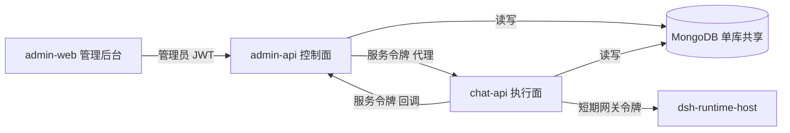
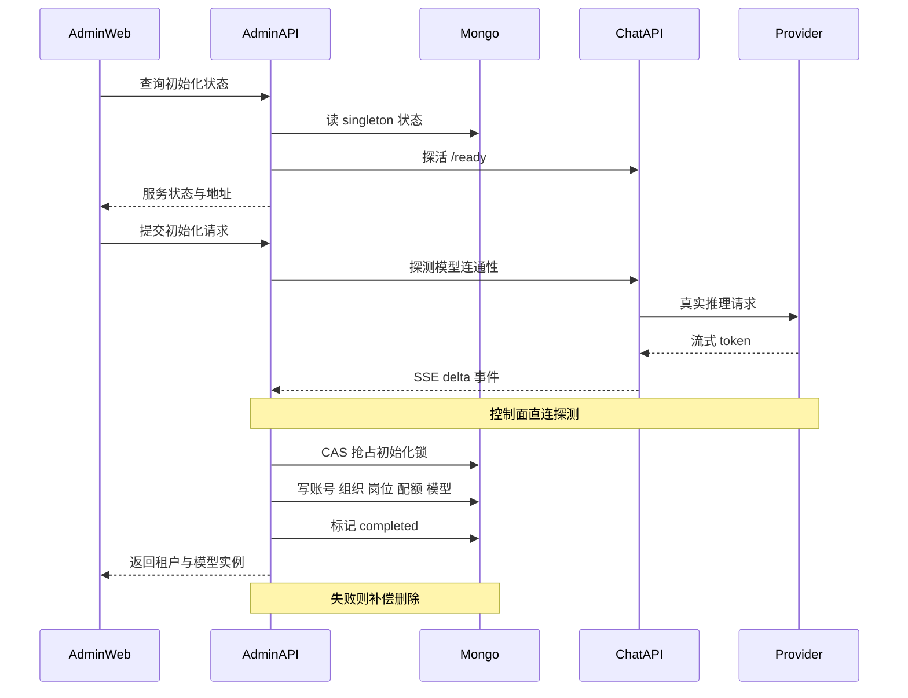

# MOVO 管理面服务与首次初始化

## 根因：自托管的第一个难题是「系统还没有主人」

这一面的全部张力来自一个别扭的时间窗：用户执行 `docker compose up -d` 之后、第一个管理员被创建之前，系统必须一边**没有任何主体可以授权**，一边**把整个租户建起来**。

三条硬约束同时成立，缺一条本模块的形状都会不一样。

第一，用户不该手填密钥。基础设施密钥若要求用户自己生成再粘进 `.env`，「一键部署」就不成立了。所以 Compose 里有一个 `bootstrap` 一次性容器：它挂载共享卷生成密钥文件，执行成功即退出，其余服务等到它 `service_completed_successfully` 才启动。

[docker-compose.yml:10-16]()
<!-- anchor: bootstrap: … - deployment-secrets:/run/askai-secrets -->

第二，初始化需要一个**没有可信主体**的写入口。README 写死了「系统不提供固定的默认管理员密码」，Compose 里同时把自举管理员开关关掉——两者合起来意味着首个管理员只能由那个「还没有管理员」的接口创建。

[services/admin-api/README.md:22-23]()
<!-- anchor: 系统不提供固定的默认管理员密码。Docker 部署完成后，请访问 … `http://localhost:3000/admin/setup` 创建首位管理员。直接源码开发如需启用 -->

[docker-compose.yml:185-199]()
<!-- anchor: admin-api: … ASKAI_ADMIN_ADMIN_API_PUBLIC_BASE_URL: http://admin-api:8100 -->

第三，管理面要写的所有东西——组织、账号、岗位、模型、知识库配额——都属于对话执行面**正在使用的同一份租户数据**。它不是一个可以事后同步的旁路系统，这也是后面「拆进程不拆数据库」这条决策的来源。

约束一旦摆明，结论就跟着来了：初始化必须是**一次性、有时限、可补偿**的原子动作；管理面必须是**独立进程**（它要在一段没有业务流量的时间里操作整份数据）；而它与 chat-api 之间必须有**比 HTTP 更早存在的约定**（共享库与共享密钥），否则第一次初始化根本没有通道把模型凭据交给执行面。

## 概览：控制面是一个独立 FastAPI 进程

Compose 里三个 Python 服务分工如下。

| 服务 | 端口 | 网关前缀 | 职责 |
|------|------|----------|------|
| `admin-api` | 8100 | `/admin-api/` | 首次初始化、组织与账号、岗位角色、模型中心、Skill/Tool 配置代理、统计与审计 |
| `chat-api` | 8000 | `/askai-api/`、`/api/` | 对话、任务、Agent 运行时、DSH 网关、模型执行面、知识检索 |
| `document-parser` | 8200 | 无（仅内网） | 文档解析与索引 API，同镜像另有 Celery worker |

admin-api 是一个标准 FastAPI 应用：`create_app()` 里装配 CORS、审计中间件、`/health`、startup 钩子与路由表，startup 阶段做的是「建库连接 → 自举账号 → 目录初始化 → 建各类索引」这一串幂等动作。

[services/admin-api/app/main.py:46-53]()
<!-- anchor: @app.on_event("startup") … await SystemAuditRepository().ensure_indexes() -->

「独立」的物理形态是完整的：独立镜像与 entrypoint、独立 `requirements.txt`、独立端口与健康检查，网关给它单独划一段前缀 `/admin-api/`，与 chat-api 的 `/askai-api/` 平行。

[deploy/docker/nginx.conf:35-45]()
<!-- anchor: location /admin-api/ { … proxy_buffering off; -->

它内部还有一个产品版本扩展点：默认返回 community 版实现；若设置了 `MOVO_ADMIN_PRODUCT_EXTENSION_MODULE`，则动态 import 一个私有扩展模块，而私有扩展被显式禁止自称 community 版。

[services/admin-api/app/product/extensions.py:42-46]()
<!-- anchor: def get_admin_product_extension() -> AdminProductExtension: … module = importlib.import_module(module_name) -->

[services/admin-api/app/product/extensions.py:55-55]()
<!-- anchor: if extension.edition.strip().lower() == "community": -->

## 架构：管理面在部署拓扑里的位置

这张图里最值得注意的不是节点，而是**边上的几类凭据**：管理员 JWT、服务令牌、短期网关令牌、回调令牌。它们分属不同信任方向——唯一被双向复用的一种是服务令牌，恰好也是这套设计最值得推敲的地方。

## 决策一：拆进程，但不拆数据库

admin-api 有自己的镜像、端口、健康检查、startup 钩子，甚至自己的启动时建索引逻辑，但它和 chat-api 指向**同一个 Mongo 数据库 `gragentic`**，装的是同一批集合。

[docker-compose.yml:148-149]()
<!-- anchor: MONGODB_URI: mongodb://mongo:27017 … MONGODB_DB: gragentic -->

[docker-compose.yml:191-192]()
<!-- anchor: ASKAI_ADMIN_MONGODB_URI: mongodb://mongo:27017 … ASKAI_ADMIN_MONGODB_DB: gragentic -->

所以「独立服务」在这里的准确含义是：**进程与部署边界被切开，数据边界没有**。最重要的推论是——模型配置**根本没有「下发」这个概念**。admin-api 往 `admin_model_instances` 写完密文，chat-api 直接读同一张表。这是本仓库最值得记住的一处架构事实，「凭据」与「下发」两节都建立在它之上。

为什么保留这个形状？源码和文档给出两种不同性质的答案，值得分开说。

文档给出的理由是「先冻结、后重构」：社区仓库不继承 ASKAI 的 Git 历史，而「当前服务之间仍有直接导入关系，因此第一阶段保留可独立构建和运行的完整服务端闭环；后续商业边界重构必须先增加接口和回归测试，再删除重复实现」。

[docs/open-source-productization/README.md:172-173]()
<!-- anchor: 社区仓库明确不发布桌面客户端、本地浏览器 Sidecar、官网、CRM 示例以及云服务或 … 企业版 Overlay。当前服务之间仍有直接导入关系，因此第一阶段保留可独立构建和运行 -->

这里需要如实指出一处文档与代码的偏差：在这份 v0.2.0 工作树里我没有定位到任何 `services/*` 之间的 Python 导入——三个服务里只有 chat-api 与 admin-api 各有 `requirements.txt` 与 `pyproject.toml`，document-parser 只有 requirements 文件（`requirements.txt` / `requirements-docling.txt`），彼此只通过 HTTP 与 Mongo 交互。那句话更像是描述历史状态或更宽仓库范围，不能当作当前架构的依据。同一份文档在部署形态一节提出的「最小可用版」，是让一个 `api` 进程同时承载「对话、任务运行时、管理 API」，也就是把 chat-api 与 admin-api 合并的形态；代码没有采纳这个方案。

[docs/open-source-productization/README.md:202-205]()
<!-- anchor: - `api` 承载对话、任务运行时、管理 API。 … - `nginx` 统一入口和反向代理。 -->

从工程上评估，合并的收益与代价都很清楚。收益是：少一个镜像与一份 FastAPI 样板、不需要服务令牌、初始化不再跨进程写数据、`system_bootstrap` 与模型表在同进程内不会有 schema 漂移。代价是：管理员 JWT 与员工 JWT 落在同一个进程里，两套主体的密钥、会话表、CORS 与审计策略要在一个 app 里共存；模型连通性测试、文档索引、浏览器任务这类重活会与对话的流式响应共享事件循环和发布节奏；任何一次管理面热修都要重启对话面。

现形状真正的额外收获是那个 `AdminProductExtension` 版本缝：社区版是一份默认实现，私有版可以把 routers、startup 钩子、模型增删回调挂进来，且扩展被禁止自称 community。放在独立进程里，商业边界就是「多挂一个模块」；若与 chat-api 合并，这条缝会退化成对话面里到处出现的 `if edition`。

但拆分不是免费的，代价至少有三处。其一，同一份 schema 被两个 Python 项目各自解释，没有共享模型定义，也没有契约测试。其二，admin-api 的配置层还留着「从 `../chat-api/.env` 读取 `MONGODB_URI`」的兜底路径——开发期耦合的直接证据。

[services/admin-api/app/core/config.py:65-69]()
<!-- anchor: def _read_env_file_value(key: str) -> str: … Path("../../services/chat-api/.env"), -->

其三，鉴权代码是两份：admin-api 有一套管理员 JWT，chat-api 有一套独立的 end-user 会话令牌，二者只在「共享同一个 Mongo」这件事上相遇。

## 决策二：五种凭据与一张信任矩阵

把上图各条边上的凭据摊开，能得到一张比「服务间鉴权」这个词更精确的表。

| 凭据 | 生成者 | 持有者 | 校验点 | 生命周期 |
|------|--------|--------|--------|----------|
| 管理员 JWT | admin-api 登录接口 | 浏览器 admin-web | admin-api 每个受保护路由 | 12 小时，可在服务端吊销 |
| `ADMIN_BACKEND_SERVICE_TOKEN` | Compose bootstrap 容器 | admin-api 与 chat-api | 双向对端 | 部署期固定，不轮换 |
| `DSH_RUNTIME_HOST_TOKEN` | Compose bootstrap 容器 | chat-api 与 dsh-runtime-host | 宿主 `/health` 与 kernel 调用 | 部署期固定 |
| 模型/工具网关令牌 | chat-api 按 profile 签发 | dsh-runtime-host | chat-api 的 `/internal/dsh/*` | 15 分钟 |
| 文档服务令牌与回调令牌 | Compose bootstrap 容器 | admin-api 与 document-parser | 文档 API 与三个回调端点 | 部署期固定 |

### 管理员 JWT 是自签的，但带服务端吊销

管理员令牌不是标准 JWT：没有 header，没有 `alg`，`sub` 里塞着一个嵌套 dict，签名是对 base64 载荷做的裸 HMAC-SHA256。这样做的收益是零依赖、格式完全自控；代价是与任何 JWT 生态工具不互通，也没有 `kid` 与轮换机制。

更值得注意的是它**不是纯无状态**的校验：签名与过期校验之后，还要拿 `session_id` 去 `admin_sessions` 查一条 `status == "active"` 的记录，再回查账号本身是否 active。

[services/admin-api/app/api/deps.py:28-32]()
<!-- anchor: session = await find_session(str(session_id)) … user = await find_account_by_username(str(username), main_id) -->

有效期由 `access_token_ttl_seconds` 决定，默认 12 小时。

[services/admin-api/app/core/config.py:15-15]()
<!-- anchor: access_token_ttl_seconds: int = 60 * 60 * 12 -->

这是有意用一次数据库往返换取「能被踢下线」。纯无状态 JWT 想让管理员立刻失效只能等过期或维护黑名单，而管理面恰恰是「踢下线」需求最强的地方。代价是每个管理请求至少两次额外查询，并且登出必须真正写库。

### 服务令牌：一个对称秘密，双向复用

admin-api 与 chat-api 之间的凭据只有一个 `ADMIN_BACKEND_SERVICE_TOKEN`，两边都从共享卷里的同一行读出来。admin-api 侧有个小的解析层把命名收敛：canonical 名优先于带 `ASKAI_ADMIN_` 前缀的兼容别名，两者同时存在时以前者为准。

[services/admin-api/app/core/internal_service_auth.py:6-14]()
<!-- anchor: def resolve_backend_service_token(configured_alias: str = "") -> str: … return canonical or str(configured_alias or "").strip() -->

chat-api 侧用同一个令牌把调用者识别为「管理服务主体」，并**从 query 参数取租户**：`mainId` 直接决定这次调用作用于哪个 `main_id`，只有取不到时才回落到默认租户。这意味着服务令牌同时承担了身份与租户选择两个职责。

[services/chat-api/app/api/principal.py:61-72]()
<!-- anchor: async def require_api_principal( … return ApiPrincipal(kind="admin_service", main_id=main_id) -->

反向调用用的是**同一个令牌、同一个请求头**。chat-api 代表员工做个人知识库的上传、重学、删除时，走的是 admin-api 的 `/api/internal/personal-knowledge/*`，服务端用 `hmac.compare_digest` 比对同一份配置值。

[services/chat-api/app/services/personal_knowledge/lifecycle_client.py:45-47]()
<!-- anchor: f"{base_url}/api/internal/personal-knowledge/{resource_id}/{action}", … headers={"X-MOVO-Service-Token": str(settings.ADMIN_BACKEND_SERVICE_TOKEN or "") -->

[services/admin-api/app/api/routes/personal_knowledge_internal.py:16-19]()
<!-- anchor: def _require_service(token: str) -> None: … raise HTTPException(status_code=401, detail="invalid_service_token") -->

这是本模块最需要说清的一处取舍。用同一个对称令牌覆盖双向调用，省掉了第二套凭据、第二份密钥分发和双向 mTLS 的部署复杂度，且比较时用了常数时间函数；但它同时意味着：**token 一旦泄露，攻击者既能冒充管理面调执行面，也能冒充执行面调管理面**；由于内部端点的租户来自参数而非令牌声明，泄露者还能自选租户。任何一方被攻破都等于两边都被攻破。可迁移的改进方向是给令牌加上方向与主体声明（或按服务签发不同令牌），代价是要引入一个轻量的签发与校验组件。

### 审计只看得到 JWT 那条路

审计中间件只在能解出管理员 JWT 时记录，且只记录变更类方法。

[services/admin-api/app/system_audit/middleware.py:20-21]()
<!-- anchor: if request.method not in MUTATING_METHODS or context is None: … return await call_next(request) -->

[services/admin-api/app/system_audit/middleware.py:39-56]()
<!-- anchor: def _audit_context(request: Request) -> dict[str, str] | None: … return {"main_id": main_id, "actor": actor} -->

`context is None` 的分支正是服务令牌路径：chat-api 用服务令牌调 admin-api 的内部端点时没有 Bearer JWT，于是**这些调用完全不进审计**。从「管理动作留痕」的角度看这是缺口；从「不把系统间调用混进管理员行为审计」的角度看又像是刻意的。无论哪种解释，事实是：管理员在后台对某位员工的知识库操作有记录，而对话面代表该员工触发的同一类操作没有。合理的下一步是给内部端点单独记一条 `category=internal` 的审计，而不是把它塞进 management 类目。同一层还有一处同向的细节：chat-api 的 debug 路由要求 `DEBUG` 打开且主体是 end-user，任一不满足即返回 404 而非 401/403，不暴露端点存在性。

[services/chat-api/app/api/endpoints/debug.py:10-13]()
<!-- anchor: async def require_debug_mode() -> None: … raise HTTPException(status_code=404, detail="Not found") -->

### 最尖锐的一处：chat-api 能签发管理员身份

chat-api 的 SSO 端点会**自己铸造一枚 admin-api 能接受的管理员令牌**：它用 `ASKAI_ADMIN_JWT_SECRET` 签一个结构完全相同的 payload，再往 admin-api 的 `admin_sessions` 集合插一条 active 会话，于是这枚令牌在 admin-api 侧就是一个合法的后台会话。

[services/chat-api/app/api/endpoints/auth.py:676-692]()
<!-- anchor: # 1. 后台账号与用户端账号分离：SSO 只校验已有后台账号，不自动补建。 … token, expires_at, session_id = _create_admin_token(subject, jwt_secret) -->

它的补偿控制是硬编码在流程里的：SSO 只校验**已存在**的后台账号，不自动补建，并且拒绝 `group_code == "member"` 的账号。这条控制很重要——它把「任何员工都能通过 SSO 变成管理员」堵住了，只留下「已有后台账号的员工可以免密进入后台」。

但从信任模型上看，结论仍然很硬：**持有共享密钥的服务本身就是管理员身份的签发者**。所谓「admin-api 与 chat-api 的权限域被切开」在进程与代码层面成立，在身份层面不成立。这也是「共享单库 + 共享单密钥」这个组合的必然结果，而不是某处实现疏忽。

## 决策三：把「无主窗口」压成一次性原子步骤

初始化接口本身是**没有鉴权依赖**的——`/api/setup/*` 的每个 handler 都没有 `Depends(get_current_admin_user)`，这在逻辑上不可避免（还没有账号可以授权）。它唯一的守门人是「已完成」判定：`system_bootstrap` 的 singleton 文档里 `completed` 为真之后，除 `GET /api/setup/status` 之外的 setup 接口都会立即返回 409——`/status` 不调用守门函数，因此完成后仍然返回 200 并把 `completed: true` 报给前端，只有另外 5 个 handler 调用了 `_ensure_setup_open`：

[services/admin-api/app/api/routes/setup.py:221-224]()
<!-- anchor: async def _ensure_setup_open() -> None: … raise HTTPException(status_code=status.HTTP_409_CONFLICT, detail="setup already  -->

[services/admin-api/app/api/routes/setup.py:227-244]()
<!-- anchor: @router.get("/status", response_model=SetupStatusResponse) … **common, -->

[services/admin-api/app/api/routes/setup.py:248-250]()
<!-- anchor: @router.get("/model-providers") … await _ensure_setup_open() -->

前端的分流也建立在这个字段上：路由守卫先拉一次 setup 状态，未完成就强制进 `/setup`。

[apps/admin-web/src/router/index.ts:11-23]()
<!-- anchor: router.beforeEach(async (to) => { … if (to.path !== '/setup') return '/setup'; -->

于是「首次初始化」的整个设计目标可以概括成一句话：**把这段必须开放的窗口，压缩成一次不可重入、能超时、失败能退回去的原子动作**。为此代码把 initialize 排成了一条严格有序的流水线。

### 步骤顺序本身就是设计

第一步是部署自检，六项并行探活：Mongo ping、Redis TCP 连接、两个持久化目录可写、chat-api 的 `/ready`、文档服务的 `/api/ready`、Weaviate 的 ready 探针。任何一项失败直接 503，并列出未就绪的服务名。

[services/admin-api/app/api/routes/setup.py:206-218]()
<!-- anchor: async def _deployment_services() -> list[SetupServiceStatus]: … return list(results) -->

放在最前面是有意的：**先证明环境可用，再写任何数据**。否则用户可能在半配置状态下创建了租户，然后发现模型根本连不通。

第二步是纯内存的输入不变式：管理员账号不能与员工账号同名、员工默认额度不能超过企业总额度、基础模型能力必须是 `chat`、可选模型每种能力只能配一个且不能重复配 `chat`。

[services/admin-api/app/api/routes/setup.py:300-310]()
<!-- anchor: if payload.adminUsername.strip() == payload.employeeUsername.strip(): … raise HTTPException(status_code=status.HTTP_400_BAD_REQUEST, detail="可选模型不能重复配置  -->

这一步的校验对象就是请求体本身，字段形状由 `SetupInitRequest` 定义：组织名、管理员账号密码、首个员工账号密码、企业总 Token、员工默认 Token、额度周期与时区、一个必填的对话模型、最多 4 个可选模型、可选的外部搜索配置。

[services/admin-api/app/api/routes/setup.py:101-115]()
<!-- anchor: class SetupInitRequest(BaseModel): … externalSearch: SetupExternalSearchRequest | None = None -->

第三步要出网，因此必须在抢锁之前完成：它会真实调用模型服务探活，embedding 能力还会把返回向量的维度记下来，用于后面写向量库配置。

[services/admin-api/app/api/routes/setup.py:314-319]()
<!-- anchor: await inspect_setup_model(payload.model.model_dump()) … embedding_dimension = inspection.dimension -->

这个顺序是刻意安排的：探活是一次真实外呼，如果放在锁内，一次慢网络就会让并发的第二个请求对着一个「初始化中」的 409 白等；放在锁前，失败者只是自己失败，不留任何脏数据。

第四步才生成租户 ID 并抢锁。`main_id` 形如 `<组织名 slug 截断 12 字>-<24 位随机 hex>`，生成时会回查 `admin_accounts` 保证唯一。

[services/admin-api/app/api/routes/setup.py:333-336]()
<!-- anchor: main_id = await _next_main_id(payload.orgName) … lock_token = secrets.token_urlsafe(32) -->

第五步是真正的写入：管理员账号与账号组、根部门、首个员工（`end_users` 行 + 组织关系 + 全能力岗位角色）、组织文档与额度策略、对话模型实例、可选模型实例、知识库模型配置、外部搜索配置。

[services/admin-api/app/api/routes/setup.py:440-455]()
<!-- anchor: model_instance_id = await create_setup_model(payload.model.model_dump(), main_id … await save_setup_search(payload.externalSearch.model_dump(), main_id) -->

最后一步标记完成、失败则补偿、无论如何释放锁。

[services/admin-api/app/api/routes/setup.py:457-470]()
<!-- anchor: await mark_setup_completed( … await release_setup_lock(lock_token) -->

### 原子性靠 Mongo CAS，不靠事务

整个初始化是十几次跨集合写入，没有用 Mongo 事务。互斥由 singleton 文档上的一次条件更新完成：谓词是「未完成 且 当前没有锁 或 锁已过期」，命中才写入自己的 `lock_token`，锁 TTL 是 15 分钟。

[services/admin-api/app/repositories/setup_repository.py:31-43]()
<!-- anchor: async def acquire_setup_lock(lock_token: str) -> bool: … {"lock_expires_at": {"$lte": now}}, -->

三个细节值得单独指出。

其一，`completed: {"$ne": True}` 同时充当了幂等闸门与互斥条件：第二次请求既抢不到锁，也不会覆盖已完成状态。

其二，完成时必须**断言锁还是自己的**。标记完成的更新带 `lock_token` 条件，并且检查 `modified_count == 1`；如果锁在初始化过程中超时被别人抢走，这里会抛错而不是默默写下「已完成」。

[services/admin-api/app/repositories/setup_repository.py:95-96]()
<!-- anchor: if result.modified_count != 1: … raise RuntimeError("setup initialization lock was lost before completion") -->

这一点比锁本身更重要：分布式锁的经典错误是「锁过期后仍继续写」，而这个断言把「我的锁已经失效」变成了一个显式失败，而不是数据被两个初始化者交叉污染。

其三，失败路径是**按本次生成的租户做补偿删除**，而不是回滚事务：`SETUP_SCOPED_COLLECTIONS` 里列了 16 个集合，逐一对 `main_id` 删除；并且有个下限守卫——`main_id` 长度不足 20 就拒绝执行，避免因为上游 bug 拿到空串或短 ID 时把别的租户清空。

[services/admin-api/app/services/setup_cleanup.py:26-32]()
<!-- anchor: async def cleanup_failed_setup(main_id: str) -> None: … await db[collection_name].delete_many({"main_id": main_id}) -->

必须诚实说明这里的代价：补偿的正确性**依赖那份硬编码集合清单不漏**。新增一个带 `main_id` 的集合而忘记加进清单，失败时就会留下半成品数据；而清单本身没有任何机制在编译期或测试期校验完整性。这是「不用事务、用补偿」这种方案的固有维护成本。顺带一个与文档的对照：部署规划文档曾把「Setup 的多请求并发原子锁仍需进一步加固」列为待办，而当前代码已经落了 CAS 锁与锁失效断言——这一条属于文档滞后于代码。

[docs/open-source-productization/self-hosted-deployment-implementation-plan.md:100-100]()
<!-- anchor: - Setup 的多请求并发原子锁仍需进一步加固；单次失败补偿清理已经实现。 -->

### 一次初始化的完整时序

### 「默认对话模型」其实不存在

一个容易被误读的细节：初始化要求必须配一个 `chat` 能力的基础模型，但写入时 `is_default` 被显式设为 `False`，`priority` 设为 10，注释写得很直白——运行时按优先级从租户已配置的模型里挑，自托管部署没有平台级默认模型。

[services/admin-api/app/services/setup_model.py:127-130]()
<!-- anchor: # Runtime selects from the tenant's configured models by priority. There is … "priority": 10, -->

所以「默认」是**隐式**达成的：初始化流程禁止在可选模型里再配一个 `chat`，因此租户里恰好只有一个 chat 模型；再加上它的优先级 10 低于后台手工新建实例的默认优先级 100，选择结果是确定的。这个设计避免了「全局默认模型」这种在自托管场景里没有归属的概念，代价是「默认模型」在数据层不可见，只能靠读代码理解。

## 决策四：一次生成的密钥，被三个服务共享

bootstrap 容器生成一个 48 字节的十六进制串，然后把它当成三个不同名字的变量写进同一份 `runtime.env`：管理员 JWT 签名密钥、模型凭据加密密钥、文档处理服务的管理员密钥。

[docker-compose.yml:32-43]()
<!-- anchor: echo "ASKAI_ADMIN_JWT_SECRET=$$admin_secret" … echo "MOVO_DOC_PROCESSING_ADMIN_JWT_SECRET=$$admin_secret" -->

也就是说，**一个秘密同时承担签名与加密两种用途，被 admin-api、chat-api、document-parser 三个服务共同持有**。这个选择的收益很直接：初始化时不需要任何密钥协商或密钥分发协议，一次生成、共享卷挂载、entrypoint `source` 注入即可。

[services/admin-api/entrypoint.sh:4-9]()
<!-- anchor: secret_file="${ASKAI_RUNTIME_SECRETS_FILE:-/run/askai-secrets/runtime.env}" … set +a -->

代价同样明确。第一，`ASKAI_ADMIN_JWT_SECRET` 泄露等于同时拿到「伪造管理员令牌」与「解密全部模型 API Key」两项能力；两个用途应该有两条独立的轮换周期，这里被绑成了一条。第二，**没有任何轮换路径**：换密钥意味着把所有 `admin_model_instances` 与 `external_search_configs` 里的密文重新加密一遍，代码里没有这个功能，也没有密钥版本字段。第三，任何拿到共享卷的服务都能解密全部租户的模型凭据。

### 加密算法是「三处必须逐字节一致」的约定

凭据格式是自定义的 `nonce(16) || HMAC-SHA256(32) || ciphertext`，密文由以 nonce 为前缀的 SHA256-HMAC 计数器流异或得到。admin-api 是唯一的写入方。

[services/admin-api/app/repositories/model_repository.py:253-263]()
<!-- anchor: def encrypt_secret(value: str) -> str: … return base64.urlsafe_b64encode(packed).decode("ascii") -->

chat-api 与 document-parser 各写了一份读取端实现，其中 document-parser 把这条约定直接写进了注释——「必须与 admin-api 的实现完全一致」。

[services/document-parser/app/services/secret_codec.py:33-33]()
<!-- anchor: # Must match admin-api/app/repositories/model_repository.py exactly. -->

### 密钥来源的对齐是 bootstrap 不变式，不是代码不变式

这是本节最值得细看的地方。admin-api 的密钥只有一个来源：`settings.jwt_secret`，即环境变量 `ASKAI_ADMIN_JWT_SECRET`。

[services/admin-api/app/repositories/model_repository.py:279-280]()
<!-- anchor: def _secret_key() -> bytes: … return hashlib.sha256(settings.jwt_secret.encode("utf-8")).digest() -->

chat-api 的密钥有一串回退：先取 `MODEL_CONFIG_SECRET`，再取 `ASKAI_ADMIN_JWT_SECRET`，最后再试一次同名环境变量；全都为空才报错。

[services/chat-api/app/llm/configured_models.py:59-69]()
<!-- anchor: def _secret_key() -> bytes: … return hashlib.sha256(secret.encode("utf-8")).digest() -->

两者能对上，完全是因为 Compose 保证 `MODEL_CONFIG_SECRET == ASKAI_ADMIN_JWT_SECRET == admin_secret`。这是一个**部署期不变式**，代码里没有任何启动检查去断言它。后果是：如果有人只在 chat-api 侧把 `MODEL_CONFIG_SECRET` 改成别的值，服务照常起来、健康检查照样通过，直到第一次真实推理才抛出「模型 API Key 解密失败，请确认 backend 与 admin 使用相同的 ASKAI_ADMIN_JWT_SECRET」。

[services/chat-api/app/llm/configured_models.py:76-82]()
<!-- anchor: nonce, mac, cipher = packed[:16], packed[16:48], packed[48:] … return payload.decode("utf-8") -->

这个错误信息写得很到位（它直接指出了要检查什么），但故障被发现的位置太晚。更稳的做法是在 chat-api 启动时做一次「加密已知明文再自校验」的握手，把配置错误变成启动失败——这是这个模块里我认为最容易补、收益也最明确的一处改进。

## 决策五：下发的是引用，不是凭据

回到最初的问题——模型供应商配置怎么「下发」给执行面？答案在这份仓库里是分裂成两半的：**存**在共享库里（上文），**用**的时候按引用现取，凭据从不离开 chat-api 进程。

chat-api 给 DSH 宿主下发的 Runtime Profile，自我描述就是「无秘密、不可变」，宿主载荷里只有 profile 版本、模型实例 ID、模型名、显示名、上下文窗口、网关地址和一个短期令牌。

[services/chat-api/app/dsh_runtime/profile/models.py:48-55]()
<!-- anchor: "profileVersion": self.profile_version, … "accessToken": access_token, -->

宿主拿到的是一张「凭据引用券」，不是凭据本身。真正的解密发生在 chat-api 进程内：模型目录按 `tenant_id + model_instance_id` 查同一个 `admin_model_instances`，并且显式拒绝跨租户访问。

[services/chat-api/app/dsh_runtime/profile/catalog.py:30-39]()
<!-- anchor: instance = await db[INSTANCE_COLLECTION].find_one( … raise ValueError("cross-tenant model access is forbidden") -->

配套的令牌是**按 profile 解析动作现场签发**的，不是预先发给宿主保管的。

[services/chat-api/app/dsh_runtime/profile/resolver.py:31-37]()
<!-- anchor: token = self._tokens.issue( … tool_token = "" -->

令牌本身有 15 分钟 TTL，密钥短于 16 字符直接拒绝构造签发器。

[services/chat-api/app/dsh_runtime/model_gateway/token.py:25-33]()
<!-- anchor: def __init__(self, secret: str, *, ttl_seconds: int = 900) -> None: … def issue(self, *, tenant_id: str, profile_version: str, model_instance_id: str, -->

这条链的好处是可以一句话说清的：**内核与宿主进程在整个生命周期里都不接触 provider 凭据**，即使宿主被完全攻破，攻击者拿到的也只是一个受租户、profile 与模型实例三重约束、15 分钟过期的引用。

代价也要讲清楚。配置生效依赖两个进程对同一份 schema 的理解完全一致，且没有任何版本协商或契约校验：admin-api 加一个字段，chat-api 读不到就退化成默认值；chat-api 期望的字段被改名，则表现为运行时报错而不是启动报错。共享库作为集成面在文档里是明说的——「模型配置保存在 MongoDB 的 `admin_model_providers` 和 `admin_model_instances` 中，`chat-api` 会读取这些集合」。

[docs/open-source-productization/self-hosted-deployment-implementation-plan.md:80-80]()
<!-- anchor: 模型配置保存在 MongoDB 的 `admin_model_providers` 和 `admin_model_instances` 中，`chat-api` -->

## 管理面的日常：能力代理、组织角色与审计

### 模型连通性测试被代理回执行面

后台点「测试连接」时，admin-api 并不自己调 provider，而是拿着服务令牌请求 chat-api 的 `/api/models/{id}/test/stream`，再把 SSE 事件流式转发给浏览器。

[services/admin-api/app/services/model_connectivity.py:15-29]()
<!-- anchor: base_url = str(settings.backend_base_url or "http://127.0.0.1:8000").rstrip("/") … "X-MOVO-Service-Token": settings.backend_service_token, -->

这个方向的合理性在于：LLM 客户端栈、流式解析、vision 与 tool-call 的各种特例、token 计量、健康状态写回全都在 chat-api；如果 admin-api 自己实现一遍，就要跟着每家 provider 的行为变化维护第二套代码。而仓库里恰好留着那第二套的残骸：admin-api 内部还有一条直连 provider 的测试链（`_provider_test_events` → `_azure_openai_test_events` / `_openai_compatible_test_events` → 令牌回退重试），在当前工作树里**已经没有任何调用方**，是一条纯遗留路径。它同时是最好的迁移证据：能力原本在 admin-api，后来被移到了 chat-api。

[services/admin-api/app/api/routes/models.py:461-469]()
<!-- anchor: def _provider_test_events( … return _openai_compatible_test_events(instance, provider, prompt) -->

### 但代理不是一刀切

向量与重排模型的探针是**反例**：admin-api 自己解密 API Key，然后直连 provider 的 `/embeddings` 或 `/rerank`。

[services/admin-api/app/services/setup_model_probe.py:39-45]()
<!-- anchor: base_url = str(model.get("base_url") or "").rstrip("/") … headers = {"api-key": api_key, "Content-Type": "application/json"} -->

探到的向量维度会被写进知识库配置，同时把 provider 类型固定为「模型中心」，并给出默认的批大小、超时与重排兜底策略。

[services/admin-api/app/services/setup_knowledge.py:26-31]()
<!-- anchor: config["embedding"] = { … "timeoutSeconds": 30, -->

为什么这里不代理？因为这两类能力的真实消费方是 document-parser 的 worker（索引时批量 embedding、检索时 rerank），chat-api 里并没有对应的探针实现。这恰好解释了「能力代理」这条边是怎么长出来的：它不是一条统一规则，而是**能力原本长在哪就留在哪**。对读者的启示是，判断一个控制面该不该拥有某个执行能力，要问的是「这个能力的真实消费路径在哪个进程」，而不是「控制面是否应该保持纯净」。

### 每个管理写操作都从 JWT 里取租户

模型、Skill、Tool、组织、角色的所有写接口都从当前管理员的 JWT 主体里取 `main_id`，请求体里不出现租户字段。这堵住了「管理员 A 通过改参数把模型建到租户 B」的越权路径，也让 `admin_model_instances` 上的唯一索引（`main_id + provider_id + model_name + display_name`）真正按租户生效。

[services/admin-api/app/api/routes/models.py:182-186]()
<!-- anchor: @router.post("/instances", status_code=status.HTTP_201_CREATED) … ) -> dict[str, object]: -->

### 两套账号平面

`admin_accounts`（后台登录账号，带 `group_code`）与 `end_users`（员工账号）是两套独立主体。初始化会同时创建两者：管理员进 `admin_accounts`，首个员工进 `end_users` 并挂上全能力岗位角色。授权模型不是简单的角色表，而是「岗位角色 + 能力位 + 用户级覆盖」：能力位是 `content_generation`、`image_generation`、`code_generation`、`browser_automation`、`internal_knowledge` 五个键，覆盖记录同时带 allow/deny 两组能力、生效与失效时间以及 reason。

[services/admin-api/app/position_roles/constants.py:1-6]()
<!-- anchor: AGENT_CAPABILITY_KEYS = ( … "internal_knowledge", -->

[services/admin-api/app/api/routes/position_roles.py:177-181]()
<!-- anchor: "allow_capabilities": payload.allowCapabilities, … "reason": payload.reason, -->

登录侧还保留了一套多租户挑战流程：同名账号命中多个租户时，先返回一个短时有效的 challenge 令牌与候选租户列表，由前端选好租户再换取正式令牌。对一个自托管、单租户的产品来说这是来自多租户 SaaS 血统的冗余，但它同时是「从云版迁移到自托管」不被账号模型卡住的兼容层。

[services/admin-api/app/api/routes/auth.py:154-154]()
<!-- anchor: expires_at = now + timedelta(minutes=5) -->

### 审计的业务语义优先于 HTTP 语义

中间件只有在「变更类方法 且 能解出管理员 JWT」时才记录，业务模块由路径前缀推导，且 `settings/*` 会被归并回 `settings` 而不是散成多个模块。

[services/admin-api/app/system_audit/middleware.py:100-108]()
<!-- anchor: def _module_key(path: str) -> str: … return parts[0] -->

一个值得学的细节是结果判定：它优先读响应头 `X-MOVO-Operation-Result`，只有当这个标记缺失时才退回 HTTP 状态码。原因很实在——不少接口在业务失败时依然返回 200，只靠状态码会把失败记成成功。

[services/admin-api/app/system_audit/middleware.py:90-92]()
<!-- anchor: def _audit_result(status_code: int, operation_result: str | None = None) -> str: … marker = str(operation_result or "").strip().lower() -->

存储层还有一条明确取舍：审计写入包在 try/except 里，任何异常都不影响已完成的管理操作返回结果。这是「审计不能成为业务可用性的单点」的正确姿态，代价是审计丢事件时静默无声，只能靠指标发现。

[services/admin-api/app/system_audit/middleware.py:85-86]()
<!-- anchor: except Exception: … # Audit storage must never turn a completed admin operation into a failure. -->

## 部署与运维要点

密钥文件的分发方式值得单独看：bootstrap 用 `umask 077` 生成、写临时文件再 `mv` 原子替换，避免其他容器读到半截文件；老版本安装缺 `DSH_RUNTIME_HOST_TOKEN` 时是**追加**而不是重新生成整套密钥，并且会把 `ADMIN_BACKEND_SERVICE_TOKEN` 的两种拼写重写成同值——这是一段为升级路径专门写的前向兼容代码。dsh-runtime-host 的健康检查则是另一个小而精的设计：容器内自己 `source` 同一份密钥文件取出 token，再用 node 请求 `/health` 并校验 `ok === true && kernel === "dsh"`。也就是说「宿主进程活着」不算健康，「装着 DSH 内核且能通过 Bearer 鉴权」才算。

[docker-compose.yml:131-135]()
<!-- anchor: healthcheck: … set -a; . /run/askai-secrets/runtime.env; set +a; -->

网络安全上，Compose 把 `backend` 定义成 `internal: true`，Mongo、Redis、Weaviate 与 DSH 宿主都不具备对外路由能力，只有 gateway 声明端口映射。

[docker-compose.yml:332-335]()
<!-- anchor: networks: … internal: true -->

数据迁移有两条并存的路线。chat-api 拥有数据迁移入口：升级时先用 `--no-deps` 跑一个一次性容器执行 `python -m app.migrations`，成功后才替换运行中的 chat-api。

[deploy/cli/migrations.sh:3-9]()
<!-- anchor: # Run the new image's additive migrations before replacing a running chat-api. … python -m app.migrations; then -->

admin-api 走的是另一条：它不参与这个迁移入口，而是在自己的 FastAPI startup 里创建索引，并且把 `OperationFailure` 整体吞掉——索引冲突（例如已有重复数据时建唯一索引失败）不会阻塞服务启动。

[services/admin-api/app/repositories/model_repository.py:73-87]()
<!-- anchor: async def ensure_indexes() -> None: … await seed_default_providers() -->

两种哲学在一个产品里共存，各有一半道理：chat-api 的做法保证「先迁移再上线」，admin-api 的做法保证「最坏情况下也能起来服务人工修复」。风险在于**schema 的所有权是模糊的**：admin-api 也在写 `admin_accounts`、`organizations`、`admin_model_instances` 这些 chat-api 会读的集合，但它的迁移节奏与 chat-api 的迁移入口完全解耦。自托管单机部署下这通常没事，多实例或滚动升级时就是隐患。

## 可迁移模式

**把「无主窗口」设计成一次性原子动作，而不是默认凭据。** 不做固定默认密码，而是让初始化接口在开放期无鉴权、用一个带 TTL 的 CAS 锁保证不可重入、用「锁失效断言」防止过期写、用按新租户 ID 的定向删除做补偿。这四点合起来才能让「一键起服务、网页建管理员」既成立又安全。别忘了补偿清单需要机制校验完整性——这是该方案最容易腐化的地方。

**共享数据库当服务契约时，把契约写在代码注释里。** MOVO 没有为模型配置设计下发接口，而是让三个服务读写同一批集合并共用一套加密格式；document-parser 明确注释「必须与 admin-api 完全一致」。这是低成本集成，但必须接受两个后果：没有 schema 版本协商，且密钥错配只能在运行时暴露。

**凭据下沉：控制面存密文，执行面解密，宿主只拿引用。** Runtime Profile 里没有任何 provider 凭据，只有一个实例 ID 与按次签发、15 分钟过期的网关令牌。这个模式可以直接搬到任何「内核/运行时 + 控制面」的分层里。

**对称服务令牌够用，但要把方向与主体写进令牌。** MOVO 用同一个 `ADMIN_BACKEND_SERVICE_TOKEN` 双向复用、且内部端点租户来自 query 参数。它用常数时间比较并靠单机部署降低了风险，但如果哪天需要多租户隔离审计或第三方接入，这个形状会最先成为瓶颈。

**版本能力用挂载点而不是条件分支。** `AdminProductExtension` 让社区版是默认实现，私有版通过环境变量注入模块，并且拒绝私有扩展自称社区版——用一个显式的边界错误替代了散落各处的 `if edition`。

**业务结果要能覆盖 HTTP 语义。** 审计结果优先读 `X-MOVO-Operation-Result`，而不是 `status < 400`；同时审计写入失败绝不影响业务返回。

## 未在源码中定位到

- 没有找到把服务令牌替换为按服务区分身份或双向 mTLS 的机制；当前是单一对称令牌双向复用。
- 没有找到模型配置的推送式下发通道（HTTP 接口或消息队列）；只有共享库读取与按引用现取。
- 没有找到密钥轮换或密钥版本字段；换密钥需要离线重加密全部密文。
- 没有找到 setup 开放期的任何访问控制（IP 白名单、一次性口令、限速）；唯一闸门是 `completed` 标志与 CAS 锁。
- 未逐字核对 admin-web 的 UI 步骤顺序与后端校验顺序是否完全一致；前端 store 只暴露 `completed / ready / services / urls` 四个状态字段，我据此判断前端不做二次校验，但这一条只到「未见二次校验代码」的程度，未验证中间步骤的全部交互。
