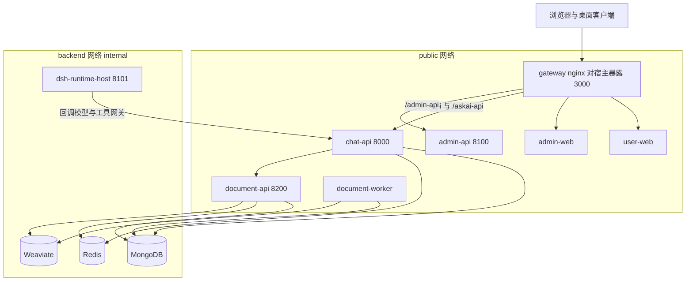
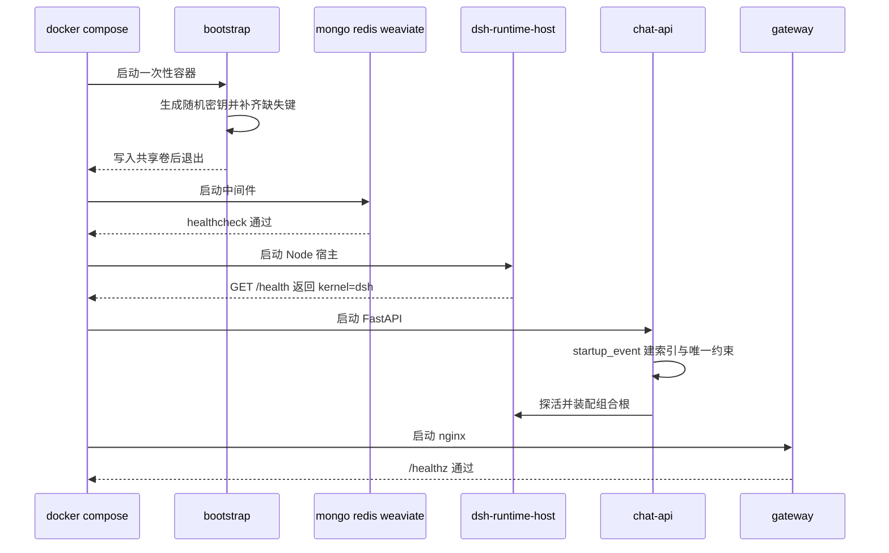
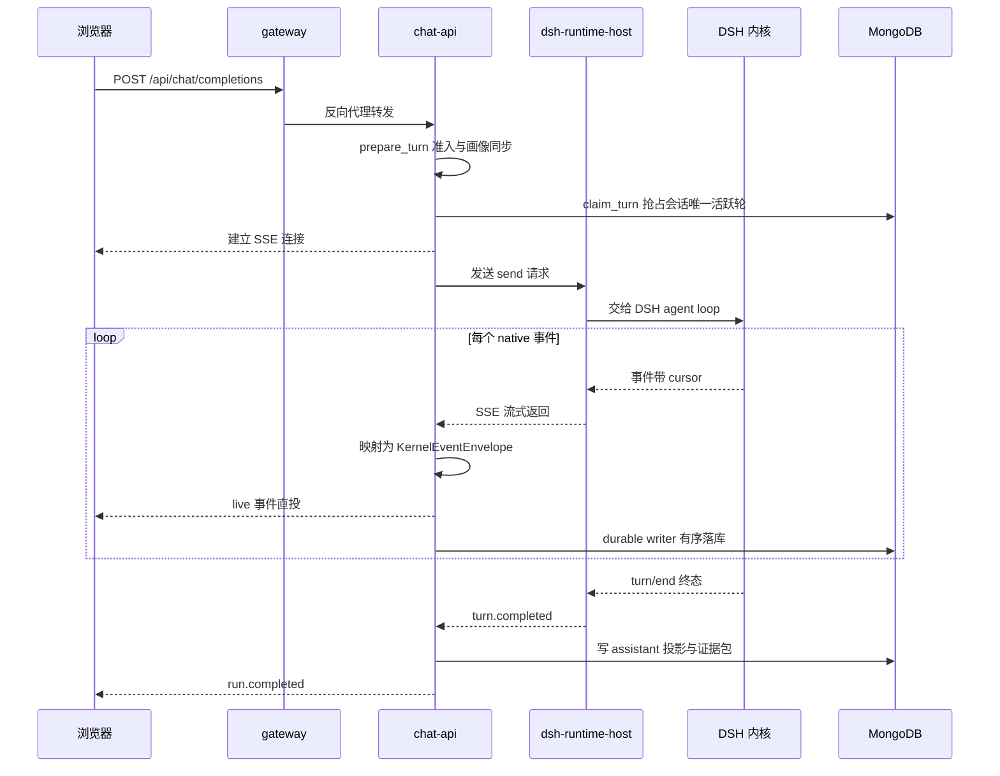
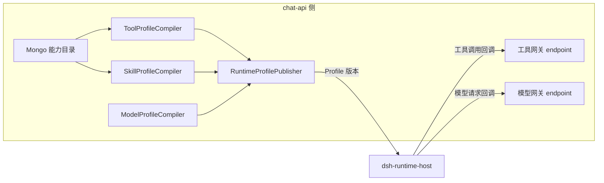

# MOVO 架构总览

## 根因：Agent runtime 与可交付的 Agent 产品之间缺一层

DSH（DeepSeek Harness）已经能跑 Agent：规划、工具调用、Skill、MCP、子代理、会话持久化都在内核里。但它是一个**开发态的运行时**——它不回答"谁在用、能用哪些能力、用完的产出物归谁、出事谁负责、怎么部署给一个组织"。MOVO 的全部架构选择，都是在 DSH 之外补上这一层。

项目自己的表述很直接：把 DSH Agent 从开发实验带进企业生产，把 DSH Runtime、Skills、Tools、MCP 生态与可部署的用户工作区、企业知识、身份与访问控制、管理、治理和文件交付组合起来。

[README.md:29-31]()
<!-- anchor: MOVO brings DSH Agents from development experiments into enterprise production. It combines … > **In one sentence:** DSH runs the Agent; MOVO brings the Agent into enterprise production. -->

仓库内的产品化文档把定位说得更锋利：这是面向企业真实业务现场的目标驱动智能体平台，终端用户只描述目标，AI 自动编排并执行。

[docs/open-source-productization/README.md:1-11]()
<!-- anchor: # MOVO Community Source Productization Strategy … 这个定位和传统低代码工作流平台不同。传统平台强调用户手工设计 workflow -->

而它的价值主张被压缩成一句口号：

[docs/open-source-productization/README.md:17-17]()
<!-- anchor: > AI 自动编排，过程可解释，风险可审批，结果可验收，路径可沉淀。 -->

由此可以读出 MOVO 要解决的**根本问题不是"Agent 不够聪明"，而是"Agent 的产品化缺口"**：身份与多租户、能力目录与权限、知识与文档理解、治理与审计、可验收的交付物、可运维的部署形态。这份文档后续所有"为什么这样分层"的回答，都回到这一点。

## 两个半场的职责切分

MOVO 与 DSH 的分工不是"上层包装下层"，而是**把内核降级为一个可替换件**：

| 半场 | 负责 | 不负责 |
| --- | --- | --- |
| DSH 内核（Node 进程内） | Agent 循环、规划、上下文装配、工具调用协议、子代理、Skill 装载、会话生命周期 | 用户与租户、模型密钥、企业工具实现、审批策略、审计、文档与知识、交付物 |
| MOVO（chat-api 为主） | 多租户与身份、能力目录与画像、模型/工具网关与凭据、事件归一化与持久化、审批与审计、知识检索与文档处理、内容生成与交付、部署运维 | 不实现 Agent 推理循环 |

这个切分在代码里有一条硬证据：chat-api 用 Python `Protocol` 定义了一个 **kernel 无关**的异步契约，只包含 runtime/session 生命周期与事件订阅：

[services/chat-api/app/dsh_runtime/contracts/protocol.py:19-34]()
<!-- anchor: class AgentKernelContract(Protocol): …     def subscribe(self, session_id: str, after_cursor: int = 0) -> AsyncIterator[KernelEventEnvelope]: ... -->

而 DSH 只是它的**唯一实现**，并且实现类被明确要求"不拥有规划与模型逻辑"：

[services/chat-api/app/dsh_runtime/gateway.py:1-1]()
<!-- anchor: """ASKAI-owned AgentKernel Gateway with DSH as its only implementation.""" -->

[services/chat-api/app/dsh_runtime/gateway.py:55-56]()
<!-- anchor: class DshAgentKernelGateway(AgentKernelContract): … """Thin lifecycle/event boundary; it owns no planning or model logic.""" -->

这是典型的**端口—适配器（六边形）**结构，但动机不是"以后换成别的内核"这种假想需求，而是三条现实收益：内核可以按自己的节奏升级（甚至降级）而不牵动业务代码；业务代码可以用普通 Python 单元测试而不启动 Node；内核崩溃不会把 FastAPI 进程一起带走。

不过这条"端口"需要打一个折扣，否则会高估它：`AgentKernelContract` 只覆盖 8 个生命周期与事件方法，而运行时内部（`chat_service`、`turn_runner`、`turn_recovery`、`turn_cancellation`）的构造函数参数类型写的仍是**具体类** `DshAgentKernelGateway`，并且会用到契约之外的 `attach_session` 与 `events_once`：

[services/chat-api/app/dsh_runtime/turn_runner.py:50-50]()
<!-- anchor:         gateway: DshAgentKernelGateway, -->

[services/chat-api/app/dsh_runtime/gateway.py:151-151]()
<!-- anchor:     def attach_session( -->

[services/chat-api/app/dsh_runtime/gateway.py:302-302]()
<!-- anchor:     async def events_once(self, session_id: str, after_cursor: int = 0) -> list[KernelEventEnvelope]: -->

所以"内核可替换"目前是**结构上可达**，而不是**类型系统强制**：契约把内核的能力面写清楚了，但业务代码并没有被编译器挡在契约之外。这是一处值得学的诚实状态——很多项目号称"可插拔内核"，实际上连这层 Protocol 都没有。

## 服务拓扑与网络边界

默认部署由 12 个 Compose 服务组成，其中真正承载 Agent 的是一个独立的 Node 容器：

[docker-compose.yml:119-120]()
<!-- anchor:   dsh-runtime-host: …     image: ${MOVO_IMAGE_PREFIX:-ghcr.io/himovo/movo}-dsh-runtime-host:${MOVO_VERSION:-latest} -->

| 服务 | 角色 | 关键事实 |
| --- | --- | --- |
| `bootstrap` | 一次性初始化 | 生成随机密钥写入 `deployment-secrets` 共享卷，运行完即退出；后续服务只在卷里读 |
| `mongo` | 主数据存储 | 会话、消息、事件、绑定、画像、技能、审批等全部业务状态 |
| `redis` | 队列与短期状态 | 文档处理任务、跨进程协调 |
| `weaviate` | 向量库 | 仅承载知识分块向量，不存业务元数据 |
| `dsh-runtime-host` | **Agent 内核宿主** | Node 进程装载 `@deepseek-ai/dsh`，对外只暴露 HTTP/SSE，Bearer 令牌鉴权 |
| `chat-api` | 业务内核 + 双向网关 | 对话/任务/技能 API；同时向宿主提供模型与工具回调端点 |
| `admin-api` | 管理面 | 组织、用户、模型供应商、平台管理 |
| `document-api` / `document-worker` | 文档处理 | 解析、预览、检索的服务与异步 worker |
| `user-web` / `admin-web` | 两端前端 | Vue 3 用户工作区与管理控制台 |
| `gateway` | 统一入口 | nginx，聚合两个前端与三个 API，把 `:3000` 暴露给宿主 |

拓扑里最值得注意的一行是 `backend` 网络被声明为 `internal: true`：

[docker-compose.yml:332-335]()
<!-- anchor: networks: …     internal: true -->

`internal: true` 在 Docker 语义下意味着该网络**没有对外网关**。而 `dsh-runtime-host`、MongoDB、Redis、Weaviate 只挂在 `backend` 上，只有 `chat-api`、`admin-api`、`document-api` 同时挂 `public` 与 `backend`。于是得到一个结构性结论：

> 承载 Agent 内核的容器**在物理上无法直连模型供应商或任何外网地址**。它想调用模型或执行企业工具，唯一可达的出口是 `chat-api`。

这把"凭据不下发"从一条编码约定升级成了**网络层强制的信任边界**：即使宿主进程被投毒拿到了 token，它能联系到的也只有内部网关。与之配套，chat-api 把两个回调地址显式传给宿主——这是宿主唯一被允许的出站目的地：

[docker-compose.yml:162-164]()
<!-- anchor:       DSH_RUNTIME_HOST_URL: http://dsh-runtime-host:8101 …       DSH_MODEL_GATEWAY_URL: http://chat-api:8000/internal/dsh/model/generate -->

## 技术栈一览

| 层 | 选型 | 在本项目中的用法 |
| --- | --- | --- |
| Agent 内核 | `@deepseek-ai/dsh` 0.1.6-alpha.1 与一组 `dsh-*` 插件包 | 以 npm 依赖形式装载，不 fork |
| 宿主进程 | Node.js ESM + cordis 插件容器 | `services/chat-api/dsh/runtime-host/` |
| 业务后端 | Python 3 + FastAPI + Pydantic | chat-api / admin-api / document-parser 三个服务 |
| 异步模型 | `asyncio` 单进程事件循环 + 后台 Task | 一轮对话就是一个 `asyncio.Task` |
| 前端 | Vue 3 + TypeScript + Vite + Tailwind | 用户工作区与管理控制台 |
| 存储 | MongoDB 6 / Redis 7 / Weaviate 1.25 | 业务状态 / 队列与协调 / 向量检索 |
| 交付 | Docker Compose + GHCR 预构建镜像 + 自研 `./movo` CLI | 12 服务一键起停、升级、备份 |
| 解析与渲染 | Docling、LibreOffice、Playwright | 文档解析、Office 文档渲染、浏览器自动化 |

## 链路一：冷启动

启动顺序由 Compose 的 `depends_on` + `healthcheck` 条件编排，而不是靠应用自己等待。宿主的健康探针不只检查端口，它同时校验响应里的 `ok` 与 `kernel` 字段，因此"端口通了但内核没起来"不会被误判为健康：

[docker-compose.yml:131-136]()
<!-- anchor:     healthcheck: …           node -e "fetch('http://127.0.0.1:8101/health',{headers:{authorization:'Bearer ' -->

服务端的装配分两步。进程级启动钩子负责**数据层就绪**：建库连接、创建索引与唯一约束，其中包含会话唯一序列索引；注释明确写出，如果既有数据里存在重复的 `(main_id, session_id, seq)`，启动会带报告失败而不是带病运行：

[services/chat-api/app/main.py:222-231]()
<!-- anchor: @app.on_event("startup") …     await db.chat_sessions.create_index([("user_id", 1), ("created_at", -1)]) -->

随后 `DshRuntimeApplication.start()` 充当**进程内组合根**：

[services/chat-api/app/dsh_runtime/application.py:50-51]()
<!-- anchor:     async def start(self) -> None: …         settings = get_settings() -->

它先构造 HTTP 传输层并带上宿主令牌，再探活确认对端确实是一个 DSH 内核：

[services/chat-api/app/dsh_runtime/application.py:62-66]()
<!-- anchor:         self._transport = HttpKernelHostTransport( …             access_token=settings.DSH_RUNTIME_HOST_TOKEN, -->

这里有一个刻意的设计：**宿主不健康不是致命错误**。探活失败只把 `host_healthy` 置为 `False`，HTTP 服务照常起来，再由健康检查与后续请求的失败路径暴露问题。对于自托管产品，"网关能起、能报错、能给出诊断"比"起不来且没有任何界面"更有运维价值。

## 链路二：一次对话

一次对话要横跨浏览器、nginx、chat-api、Runtime Host、DSH 内核与 MongoDB 五个角色。核心机制是**一轮对话 = 一个受会话级互斥保护的持久化 turn**：

准入闸门是 `claim_turn`：它以一次原子更新抢占该会话的活跃轮，抢不到就抛 `ConversationBusyError`。**"一个会话同时只有一轮在跑"不是靠前端置灰按钮，而是靠一次数据库写入**——这条约束同时解决了重复提交、多标签页竞争、参与者并发发言三个问题：

[services/chat-api/app/dsh_runtime/chat_service.py:299-305]()
<!-- anchor:         claimed = await self._bindings.claim_turn( …             raise ConversationBusyError("another DSH turn is already running for this Conversation") -->

轮次启动后并不阻塞 HTTP 请求：`asyncio` 起一个后台 Task 承载整轮执行，立即把 SSE 流交给客户端。SSE 的消费端是进程内的 `LiveTurnStream`，`finally` 里显式 `detach()` 并从注册表移除——也就是说**客户端断开不会取消这轮执行**，Agent 会继续跑完并落库，这正是"过程可回放"的前提：

[services/chat-api/app/dsh_runtime/chat_service.py:392-405]()
<!-- anchor:     async def stream(self, turn: PreparedTurn, *, tenant_id: str, user_id: str) -> AsyncIterator[str]: …                 self._live_streams.pop(turn.message_id, None) -->

真正的投递逻辑在轮次执行器里。它对每个 native 事件做三件事：投影成对 UI 友好的结构、立即直投 live 流、同时入队给 durable writer 有序写库。注意 `publish_live=not is_terminal` 这个参数——**终态事件不走直投，只走持久化**，落库成功后才在收尾阶段补发，避免"前端收到完成、数据库还没写完"的窗口：

[services/chat-api/app/dsh_runtime/turn_runner.py:146-154]()
<!-- anchor:                 is_terminal = event.type in {"turn.completed", "runtime.failed"} …                 writer.enqueue(KernelEventWrite(event=event, projected=projected)) -->

订阅本身带游标，从绑定记录里持久化的 `event_cursor` 开始。这让"进程重启后接着上次的位置继续消费"成为默认行为，而不是异常处理路径：

[services/chat-api/app/dsh_runtime/turn_runner.py:134-136]()
<!-- anchor:             async for event in self._gateway.subscribe( …                 str(binding["kernel_session_id"]), int(binding.get("event_cursor") or 0) -->

## 事件归一化：一份与内核无关的词汇表

MOVO 与 DSH 之间唯一的**语义**契约是事件。映射表把 DSH 的 native 事件类型翻译成 kernel 事件类型，共 14 条，例如 `assistant/chunk → agent.message.delta`、`approval/asked → tool.approval.requested`、`turn/end → turn.completed`：

[services/chat-api/app/dsh_runtime/event_mapper.py:12-27]()
<!-- anchor: NATIVE_EVENT_TYPES: dict[str, str] = { …     "agent/status": "session.status.changed", -->

这张表有三个细节值得学：

- **未知类型不报错**：查不到的 native 类型统一落到 `kernel.native.event`，payload 原样透传。DSH 加新事件不会让上层崩溃，只是前端暂时不认识。
- **一对多收敛**：`tool/call` 与 `tool/code-dispatch-start` 都映射到 `tool.call.started`，代码委派（code dispatch）被建模成普通工具调用，UI 不必为它写第二套渲染。
- **语义增强发生在映射层**：`assistant/chunk` 里如果藏着模型失败信息，会被就地改判为 `model.request.failed`，并把 provider 错误码归一化成可判断是否可重试的 `retryable` 字段。**协议适配层同时也是错误语义的收敛层**——上层不需要理解任何一家模型供应商的错误码。

## 企业能力如何"挂"进内核

MOVO 的企业能力（浏览器代理、内容生成、研究、证据、交付）全部实现于 chat-api，一行都不进内核。它们通过三个注入面被内核"看见"：

- **画像注入（能力目录 → Runtime Profile）**：模型、工具、技能三份目录在 chat-api 侧被编译成一份不可变的 Runtime Profile，宿主按 profile 版本装载。用户改了模型或工具配置，走的是"发布新画像版本 + 同步绑定"，而不是重建会话：

[services/chat-api/app/dsh_runtime/application.py:106-117]()
<!-- anchor:         publisher = RuntimeProfilePublisher( …             conversations, bindings, publisher, kernel_version=self.KERNEL_VERSION -->

- **工具注入（回调执行）**：内核决定"要调用什么"，但调用本身被桥接回 chat-api 执行，因此权限裁剪、审批拦截、审计留痕都发生在能力真正被使用的那一刻。
- **技能注入（每轮选择）**：Skill 不是启动时一次性塞进上下文，而是按轮选择、按预算注入，宿主侧由一个专门的 bundle materializer 把技能包物化成内核能加载的目录。

浏览器与桌面能力则是这个模型的一个变体：**本地执行、服务端编排**。桌面客户端主动向 chat-api 建立 WebSocket 长连接，服务端通过这条反向通道把浏览器动作下发给用户的本地浏览器会话：

[services/chat-api/app/browser/ws_endpoint.py:43-44]()
<!-- anchor: @router.websocket("/agent/connect") … async def agent_connect(ws: WebSocket) -> None: -->

这也解释了 README 的能力矩阵为何把 Browser Agent 与 Code Agent 划归桌面端专属——**它们的执行环境在用户机器上，因此不可能被服务端镜像包含**；仓库里只有服务端的控制面契约，没有桌面端实现。

## 五个核心设计选择与它们的代价

架构解读的价值在于代价，而不是收益清单。把上面的机制折算成"选了什么 / 换来什么 / 付出什么"：

| 设计选择 | 换来的 | 付出的代价 |
| --- | --- | --- |
| 内核宿主化而非 fork | 内核可独立升级、业务代码可脱离 Node 测试、崩溃域隔离 | 跨进程 HTTP/SSE 成为必须长期维持的契约；`package.json` 里那一串 `0.1.6-alpha.1` 说明内核尚在 alpha，升级要带兼容层与回归测试 |
| 凭据不下发 + 内网隔离 | 模型密钥不进入内核进程；用量按"说话者"归属清晰 | 每次模型/工具调用多一跳内部网络；宿主无法直接访问外网，任何需要出网的能力都必须先被产品化成网关端点 |
| 事件双轨投递 | 用户看到的是低延迟流，重连看到的是有序历史 | 两条路径的一致性需要额外守卫，旁路事件与子代理事件的排序由独立的投递守卫兜住 |
| 企业能力外挂 | 内核保持纯净，能力随产品快速演进 | 需要维护"能力目录 → 工具 schema → 内核工具面"的转换层，工具数量增长会推高画像体积与加载开销 |
| 单仓多服务 + 共享镜像前缀 | 一次 `./movo up` 拉起完整产品，版本天然对齐 | 12 个容器的部署门槛（官方建议 8 GB 内存 / 20 GB 磁盘）；任一服务的契约变更都要按整体发布 |

还有一类代价被项目**显式记账**而不是藏起来：会话共享选择"全保真历史"，参与者能看到所有者授权下产生的全部执行事件、证据、图片与文档，序列化路径不做任何按观察者的裁剪：

[docs/adr/0001-session-sharing-full-fidelity-history.md:17-17]()
<!-- anchor: We share history at full fidelity. A participant can read the owner's -->

随之而来的已知限制是文件签名 URL 只校验签名与过期时间、不携带用户身份，因此撤销分享无法回收已签发的 URL，只能等 TTL 到期：

[docs/adr/0001-session-sharing-full-fidelity-history.md:19-19]()
<!-- anchor: We accept the signed URL property that comes with it. A file URL is an HMAC over -->

这一整组取舍详见 [会话与 Turn 生命周期](session-and-turn-lifecycle.md)。

## 模块导读

| 模块 | 读它回答什么问题 | 子文档 |
| --- | --- | --- |
| DSH Runtime Host | 内核怎么被装进一个可托管、可隔离、可升级的宿主进程 | [`runtime-host.md`](runtime-host.md) |
| 会话与 Turn 生命周期 | 一轮对话怎么被准入、投递、持久化、取消与恢复；分享的边界在哪 | [`session-and-turn-lifecycle.md`](session-and-turn-lifecycle.md) |
| Runtime Profile 与模型网关 | 管理员改了模型配置怎么不重建会话就生效；凭据怎么租、怎么刷 | [`runtime-profile-and-model-gateway.md`](runtime-profile-and-model-gateway.md) |
| Skill 体系 | 技能怎么定义、打包、发现，以及每轮怎么决定注入什么 | [`skill-system.md`](skill-system.md) |
| 工具、MCP 与审批 | 工具调用怎么回到业务侧执行，敏感动作怎么被拦住并留痕 | [`tools-mcp-approval.md`](tools-mcp-approval.md) |
| 知识库与检索 | 文档怎么进库、怎么被检索、引用怎么保持可追溯 | [`knowledge-and-rag.md`](knowledge-and-rag.md) |
| 内容生成与文档智能 | 报告、PPTX、XLSX、PDF、Word 这些交付物怎么被生产出来 | [`content-generation.md`](content-generation.md) |
| 浏览器代理 | 服务端控制面与本地执行环境怎么协同 | [`browser-agent.md`](browser-agent.md) |
| 多源研究与证据 | 研究循环怎么收敛，执行证据怎么变成可展示的证据包 | [`research-and-evidence.md`](research-and-evidence.md) |
| 数据模型 | 12 个服务背后的集合、索引与迁移策略 | [`data-model.md`](data-model.md) |
| 多租户与配额 | 租户怎么贯穿请求与运行时，用量与额度怎么算 | [`tenancy-quota-billing.md`](tenancy-quota-billing.md) |
| 部署与运维 | 12 个服务怎么起、怎么升级、怎么备份、怎么排障 | [`deployment.md`](deployment.md) |
| 前端工作区 | 事件流怎么变成用户能看懂的执行视图 | [`frontend-workspace.md`](frontend-workspace.md) |
| 管理面与控制台 | 首次初始化与组织/模型治理的落地方式 | [`admin-console.md`](admin-console.md) |
