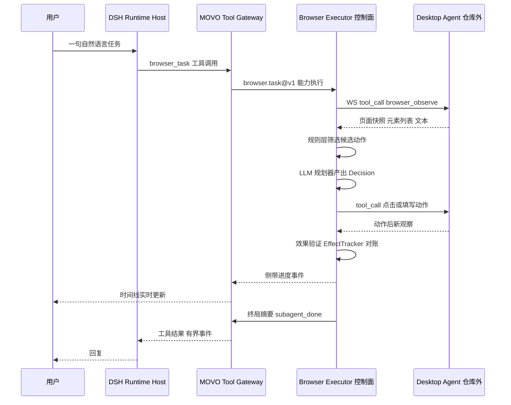
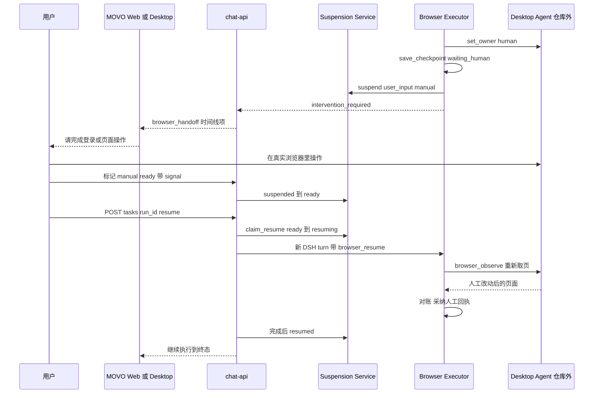

# MOVO 浏览器代理与桌面协同

## 根因：一个把浏览器能力赶出服务端的架构决策

MOVO Community Edition 的自我定位是「DSH runs the Agent; MOVO brings the Agent into enterprise production」——DSH 负责跑 Agent，MOVO 负责把它推进企业生产。在这个分工里，浏览器代理的位置非常反常：README 的能力矩阵明确写着 Browser Agent 与 Code Agent **只在 MOVO Desktop 提供**，自托管 Web 工作区不支持，而桌面端是「distributed separately as proprietary software; its source code is not included in this repository」。[README.md:111-124]()

<!-- anchor: ### Browser Agent and Code Agent … | Source included in this repository | ✓ | —, distributed separately | -->

但同一个仓库里，`services/chat-api/app/enterprise_capabilities/browser/**` 有 250 个 Python 文件、37703 行代码，外加 `app/browser/` 的 WebSocket 桥接层。这个反差就是本文要回答的根本问题：**如果没有服务端浏览器，这三万八千行在干什么？**

答案是这个模块的定位：**它是浏览器任务的控制面，不是浏览器本身。** 页面在哪里打开、DOM 怎么读、点击怎么发，全在仓库外的桌面进程里；而「下一步该做什么、这个动作算不算生效、什么时候必须停下来问人、崩了怎么恢复」全在仓库里。这种切分带来一条很强的不变式：服务端可以停机升级、可以多实例、可以把控制面当纯逻辑代码测试，而用户的企业内网会话和 cookie 从来不出他的电脑。

这条不变式也解释了后面所有看起来"过度设计"的东西：因为执行体不在自己手里，控制面必须把执行体当成一个**会断线、会被人接管、会返回语义不明结果**的远程对象来对待。3.8 万行里绝大部分是在处理这三件事。

## 执行位置：控制面在服务端，浏览器在桌面端

### 唯一的执行出口是一条约定的 WebSocket

桌面端的浏览器 Agent 作为客户端连到 chat-api 的 `/api/agent/connect`，服务端按 `user_id` 记住这条连接。端点是裸的 WebSocket，用户身份从查询参数、`X-User-Id` 头或 bearer 里依优先级取——注释直言 bearer 是"typically a session token, not a user identifier — but we keep it as a dev-time fallback"。[services/chat-api/app/browser/ws_endpoint.py:43-55]()

<!-- anchor: @router.websocket("/agent/connect") … conn = await agent_registry.attach(user_id=user_id, send=send, capabilities=[]) -->

注册表是**进程内单例**，每个用户至多一条活跃连接，注释里留了明确的扩展语义："In-process singleton. Replace with Redis pub/sub for multi-worker."——也就是说这一层的水平扩展还没做，多副本部署时同一用户可能落在不同 worker 上。[services/chat-api/app/browser/registry.py:47-56]()

<!-- anchor: class AgentRegistry: … self._active_recordings: Dict[tuple[str, str], str] = {} -->

远程调用的模型是"分配一个 call_id，在 future 上会合"：`send_tool_call` 生成 `call_id`、登记 `PendingCall`、发 `{"type": "tool_call"}` 帧，然后 `asyncio.wait_for` 等桌面端回 `tool_result`；超时则主动补发 `tool_cancel`，理由标记为 `backend_timeout`，避免服务端已经放弃而桌面端还在操作页面。[services/chat-api/app/browser/registry.py:93-110]()

<!-- anchor: async def send_tool_call( … conn.pending[call_id] = pc -->

入站帧按 `type` 分派：`tool_result` 兑现 future，`tool_progress` 走 `progress_sink` 变成时间线事件，`login_result`、`hello`（上报 capabilities）、`authentication_completed`（本地登录监听成功）各有分支。[services/chat-api/app/browser/registry.py:192-210]()

<!-- anchor: async def on_frame(self, user_id: str, frame: Dict[str, Any]) -> None: … await res -->

`authentication_completed` 这个分支特别值得注意：桌面端有一个本地登录监听器，一旦检测到用户在真实浏览器里登录成功，会主动推这条帧，服务端直接把它转成挂起记录的 `mark_ready`——**登录恢复不需要用户回聊天界面点按钮**。[services/chat-api/app/browser/registry.py:238-248]()

<!-- anchor: elif t == "authentication_completed": … source="local_auth_watch", -->

### 没有服务端浏览器后备路径

`browser_task` 的第一件事就是检查连接，连不上直接抛 `ConnectionError`，没有任何降级到服务端 Playwright 的分支。[services/chat-api/app/enterprise_capabilities/browser/service.py:41-42]()

<!-- anchor: if agent_registry.get(context.user_id) is None: … raise ConnectionError("MOVO local browser agent is not connected") -->

这一点需要澄清一个常见误解：**本基线里"服务端 Playwright 与桌面浏览器会话的分工"并不存在，因为浏览器代理根本没有服务端实现。** 仓库里的 Playwright 只用在别的关注面——`app/tools/pdf.py` 与 `app/utils/markdown_assets.py` 用它做文档转 PDF 和 Markdown 图片渲染，与浏览器代理无关。更直接的证据是 `browser/engine/pages/`：三个 `wechat_*_page.py` 页面对象导入了 `playwright.async_api`，写的是 `page.get_by_label("标题")` 这类服务端页面操作——但这个包**全仓库无任何引用**（只有它自己的 `__init__.py` 导入），是典型的遗留死代码。[services/chat-api/app/enterprise_capabilities/browser/engine/pages/wechat_editor_page.py:1-15]()

<!-- anchor: from __future__ import annotations … await self.page.get_by_text("保存为草稿").first.click() -->

这也顺手回答了关注面问题⑤的一部分：`engine/pages/`（47 行）不是架构，是历史残渣；把它当"服务端浏览器实现"来解读会完全误判这个项目。

### 桌面端的边界，必须在文档里说清

仓库内多处注释暴露了桌面端的存在与形状，但对应源码不在仓库里。最关键的是 `_obs_from_payload` 的注释：页面文本字段 `pageText` 由"The Tauri agent (agent/src/browser/observer.ts)"发送；紧接另一个注释指明 `browser_navigate` 的返回结构定义在 `agent/src/tools/browser_tools.ts::browser_navigate`。[services/chat-api/app/enterprise_capabilities/browser/engine/desktop_agent_executor.py:430-433]()

<!-- anchor: # The Tauri agent (agent/src/browser/observer.ts) sends `pageText` for … # default and keeps the planner prompt shape stable. -->

仓库根下没有 `agent/` 目录，`apps/` 只有 `user-web` 与 `admin-web`。**Tauri 桌面应用、native CDP 驱动、本地 CDP screencast、浏览器池（BrowserPool）都在本仓库之外，本文不对它们做任何实现层面的断言。** 仓库内能确证的只有契约层：帧类型、工具名清单、观察对象字段名。

一个容易被误读为"服务端也传截图"的地方是 `browser.preview` 事件。它紧靠 Skill 快路径之前发出，注释写得很清楚：**"This event deliberately contains no screenshot: desktop clients connect to the sidecar's local CDP screencast, while web clients may use the existing backend stream as a compatibility fallback."** 事件体只有 `mode: "local"`、`transport: "native_cdp"`、`session_id` 三个字段。[services/chat-api/app/enterprise_capabilities/browser/engine/desktop_agent_executor.py:929-936]()

<!-- anchor: # Signal the desktop workspace before the Skill fast path runs. This … "session_id": self.session_id, -->

### 会话身份：browser_session_id 不等于 DSH session

挂起与恢复要能在同一个浏览器会话上续跑，就必须区分"内核执行身份"和"浏览器可见身份"。`resolve_browser_session_id` 的文档字符串把这条规则写死了：**"DSH kernel sessions are execution identities and must never become desktop browser identities."** 新任务用 ASKAI 会话 ID（Electron 渲染进程选定的那个），只有受信任的 resume 记录才允许保留旧的 browser session。[services/chat-api/app/enterprise_capabilities/browser/session_identity.py:8-18]()

<!-- anchor: def resolve_browser_session_id(*, conversation_id: str, resume: dict[str, Any])  … return resumed or visible or "default" -->

这是一条很值得迁移的约束：**执行身份一旦泄漏为会话身份，恢复路径就会跨会话串台**——用户 A 的恢复指令可能落到用户 B 打开的浏览器上下文里。

## browser_task：一次工具调用承载一整段浏览任务

### 工具契约

对 DSH 内核暴露的浏览器工具**只有 `browser_task` 一个**。它被登记为 `browser.task@v1`，输入是 `objective`（必填）、`operation`（七值枚举：read/navigate/submit/modify/delete/file_transfer/publish）、`target_name`、`target_url`（URI 格式）、`inputs`；`risk_level="dangerous"`，`idempotent=False`，`timeout_ms=300000`。[services/chat-api/app/enterprise_capabilities/runtime/catalog.py:349-358]()

<!-- anchor: capability_ref="browser.task@v1", tool_name="browser_task", domain="browser", … approval_argument="operation", approval_values=("submit", "modify", "delete", "f -->

这里有一个很精巧的审批设计：`approval_required=False`，但 `approval_argument="operation"` 且 `approval_values` 只列出五个写操作。也就是说**"读"不审批、"写"审批，且审批点是参数值而不是工具名**——同一次任务里先 read 后 submit，只有 submit 那一下会弹审批。这个机制由 host 侧的 pre-execute 钩子实现：它把工具描述符里的 `approval_argument`/`approval_values` 与实参比对，命中就返回 `{kind: 'ask', reason: 'MOVO policy requires approval for ...'}`。[services/chat-api/dsh/runtime-host/src/askai-tool-bridge-plugin.mjs:78-85]()

<!-- anchor: const dynamicApproval = descriptor.approval_argument … return { kind: 'allow' } -->

工具面本身由 host 插件按 Runtime Profile 注册进 DSH，并给网关留了 30 秒收尾余量：`timeoutMs: descriptor.timeout_ms + TOOL_GATEWAY_DEADLINE_GRACE_MS`，注释说明是为了让 ASKAI 网关先完成自己的超时与回执落库，避免两层在同一时刻抢跑。[services/chat-api/dsh/runtime-host/src/askai-tool-bridge-plugin.mjs:33-46]()

<!-- anchor: for (const descriptor of this.#config.tools) { … timeoutMs: descriptor.timeout_ms + TOOL_GATEWAY_DEADLINE_GRACE_MS, -->

模型发出工具调用后，host 走 HTTP 打到 chat-api 的 `/internal/dsh/tools/execute`，由企业工具网关做鉴权、审批与超时托管。[services/chat-api/app/api/endpoints/dsh_tool_gateway.py:67-70]()

<!-- anchor: @internal_router.post("/execute") … execution = asyncio.create_task( -->

最终落到内部能力注册表里以 `browser.task@v1` 为键的处理器 `browser_task`。[services/chat-api/app/enterprise_capabilities/runtime/adapters.py:327-330]()

<!-- anchor: registry.register("document.transform@v1", document_transform) … registry.register("data.run_script@v1", run_script) -->

注意 handler 的 alias 就是能力本身的函数名 `browser_task`，它的返回值是给模型看的——`success`、`status`、`operation`、`responseSummary`、`artifacts`、有界的 `domain_events`（最多 20 条，且 `intervention_required` 与 `subagent_done` 被钉在尾部）、`event_counts`，以及仅在挂起时出现的 `intervention_suspension`。[services/chat-api/app/enterprise_capabilities/browser/result_contract.py:77-95]()

<!-- anchor: result: dict[str, Any] = { … return result -->

### 返回给模型的为什么要"有界"

`BrowserResultEventAccumulator` 只保留 `intervention_required`、`subagent_done`、`runtime_status`、`answer` 四类事件，最多 20 条，其余只留计数。理由是分开两条管道：**给模型的必须是可判定的终局摘要，给用户的必须是完整过程**——完整过程走侧带事件流，不进工具结果。`_PROJECTABLE_EVENTS` 与 `_SUCCESS`/`_SUSPENDED` 两个集合定义了这套摘要口径；`build_browser_tool_result` 里 `success = suspended or successful` 意味着"挂起"对模型也是成功分支，模型不该把它当失败重试。[services/chat-api/app/enterprise_capabilities/browser/result_contract.py:9-11]()

<!-- anchor: _PROJECTABLE_EVENTS = {"intervention_required", "subagent_done", "runtime_status … _SUSPENDED = {"suspended_waiting_approval", "intervention_required"} -->

### 为什么整段 loop 塞进一次工具调用

`browser_task` 不是"调一次工具做一步"。它内部起了一个完整的 ReAct 循环：最多 500 步、对同一页面状态最多读 3 次、连续失败 3 次触发终止路径。[services/chat-api/app/browser/loop_policy.py:6-7]()

<!-- anchor: BROWSER_MAX_STEPS = 500 … BROWSER_MAX_READS_PER_STATE = 3 -->

除 Skill 快路径外，真正的浏览器动作只在 `_dispatch` 一处发生：把 `Decision` 转成 `bridge.execute(tool, args, domain=..., timeout=timeout_for_tool(tool))`，再归一成 `(payload, ok, err)` 三元组。`domain` 是元字段而非工具参数，它被从 args 里取出提升到帧顶层，决定这次调用落在哪个浏览器上下文池里。[services/chat-api/app/enterprise_capabilities/browser/engine/desktop_agent_executor.py:4838-4855]()

<!-- anchor: async def _dispatch(self, decision: Decision): … timeout=timeout_for_tool(decision.tool), -->

被这个限定排除在外的一条支路正是 Skill 快路径：`execute_skill_fast_path` 在进入 ReAct 循环之前，就直接用 `browser_execute_workflow` 调桥，动作不经过 `_dispatch`。[services/chat-api/app/enterprise_capabilities/browser/engine/skill_fast_path.py:124-128]()

<!-- anchor: envelope = await bridge.execute( … timeout=120.0, -->

循环内部还有三个内部工具（`browser_done`、`browser_ask_user`、`browser_fail`），它们在清单里但**明确标注"NOT dispatched to the agent — they terminate / redirect the loop"**。[services/chat-api/app/browser/tools.py:28-33]()

<!-- anchor: # Virtual control-flow tools the ReAct loop understands internally. These … "browser_fail",     # give up -->

另外 20 个 `browser_*` 工具名（observe/navigate/click/fill/press/upload_file/paste_image…）由一份共享常量表定义，注释说这份表的存在意义是"so backend + frontend + agent all reference the same strings"——**它们是跨进程协议常量，不是 DSH 工具注册表**。[services/chat-api/app/browser/tools.py:1-2]()

<!-- anchor: """Canonical browser tool names. Kept here so backend + frontend + agent … all reference the same strings. -->

这个"一次调用扛一整个任务"的选择，权衡很清晰：

- **省的是**：内核 turn 数量、模型侧的微决策次数、跨进程往返的协议开销。模型只需要判断"这一步要不要开浏览器"，不需要为"点哪个按钮"发 300 次工具调用。
- **付的是**：控制面必须自己实现超时、预算、取消、检查点、幂等与恢复——DSH 的 turn 机制在这里帮不上忙，因为对内核而言这只是**一次很慢的工具调用**。
- **直接后果**：三层超时必须精细咬合。网关硬超时 300 秒；执行器给自己设 240 秒软预算，注释写明是"Preserve a full minute for result projection before the Capability Gateway's immutable 300-second hard deadline"。[services/chat-api/app/enterprise_capabilities/browser/service.py:74-76]()

<!-- anchor: # Preserve a full minute for result projection before the … "execution_budget_seconds": 240, -->

- **再下一层**：单次工具调用超时分两档——`observe` / `read_text` / `screenshot` / `wait_for` 这类只读工具走 60 秒默认档；`navigate` / `hover` / `scroll` / `tab_new` / `back` / `forward` 这些非写操作，以及 click / fill / press / upload / paste 等可能触发自动交班的工具统一 75 秒，多出的 15 秒是留给"自动人机交班"的窗口，注释说"a broken DOM observation still fails fast instead of blocking the agent loop"。[services/chat-api/app/browser/tool_deadlines.py:6-14]()

<!-- anchor: # The sidecar may spend up to 45 seconds waiting for automatic human-to-agent … "browser_navigate", -->

软预算耗尽的处理方式也很讲究：它不是简单报错，而是返回 `partial_success` + `continuation_required: True` 的部分结果；但如果被中断的恰好是写操作或语义不透明的工具（上传、粘贴图片、执行工作流、press），`interrupted_effect_requires_handoff` 会**fail closed**，强制转人工确认而不是当作没发生。[services/chat-api/app/enterprise_capabilities/browser/engine/execution_budget.py:14-16]()

<!-- anchor: _WRITE_CAPABILITIES = frozenset({ … "browser.file_transfer", "browser.publish", -->

### 一次调用的内部形状

下面这张时序图把"一次 browser_task 调用内部发生了什么"画清楚——注意它内部已经是完整的 agent loop，而不是单次动作。

（图中"点击或填写动作"对应 `browser_click` / `browser_fill`；"终局摘要"对应 `subagent_done`。）

## 挂起与恢复：把人接进 loop，而不是绕过 loop

浏览器任务最容易失败的地方不是选择器，而是**需要人**：登录、验证码、政企门户的二次确认、平台侧风控。方案有两条常见路线：一是让 Agent 失败退出，让用户自己搞完再重新发起；二是让 Agent 在循环里阻塞等待用户输入。MOVO 选了第三条：**把整段执行挂起、序列化状态、结束当前 DSH turn，恢复时开一条新 turn 并复用一个检查点。** 这样既不占用运行时资源，也不丢失已经走完的路径。

### 两类挂起与一个统一的状态机

挂起记录是全局治理对象，不是浏览器私有的。状态机共七态：`suspended / ready / resuming / resumed / resume_failed / denied / expired`；类型共五种，其中与浏览器直接相关的是 `browser_auth` 与 `user_input`。[services/chat-api/app/governance/suspensions/contracts.py:10-25]()

<!-- anchor: class SuspensionStatus(str, Enum): … EXTERNAL_CALLBACK = "external_callback" -->

`SuspensionRecord` 带 `suspension_id`、`run_id`、`task_id`、`node_id`、`user_id`、`subagent_id`、`suspension_type`、`status`、`resume_policy`、`context`、`ready_signal`、`resume_token_hash`、`expires_at` 等字段——注意 `run_id` / `node_id` 是**一等公民**，这正是恢复时能精确回到"哪个图的哪个节点"的原因。[services/chat-api/app/governance/suspensions/contracts.py:28-46]()

<!-- anchor: class SuspensionRecord(BaseModel): … resumed_at: Optional[datetime] = None -->

两类浏览器挂起共用这张表，区别在 `resume_policy`：

- **`user_input`（人工介入）**：`resume_policy="manual"`，必须用户显式声明"我做完了"。
- **`browser_auth`（登录）**：`resume_policy="automatic"`，桌面端本地监听登录成功即可自动 ready。[services/chat-api/app/enterprise_capabilities/browser/engine/auth_suspension.py:44-61]()

<!-- anchor: async def suspend(self, record: BrowserAuthSuspension) -> BrowserAuthSuspension: … return self._browser_model(stored) -->

登录挂起还有个防误判细节：`suspend_or_reuse` 优先复用同一 `run_id` + `node_id` 上已存在的活跃登录挂起，避免"用户点一次、挂起记录攒十条"。[services/chat-api/app/enterprise_capabilities/browser/engine/auth_suspension.py:33-42]()

<!-- anchor: async def suspend_or_reuse(self, record: BrowserAuthSuspension) -> BrowserAuthSu … return await self.suspend(record) -->

而通用人工介入的 `suspend_browser_intervention` 会把 `browser_session_id`、`tab_id`、`category`、`url` 以及可选的 `handoff`、`mission` 一起塞进 `context`。[services/chat-api/app/enterprise_capabilities/browser/engine/intervention_suspension.py:28-43]()

<!-- anchor: return await suspension_service.suspend( … **({"mission": dict(mission)} if mission else {}), -->

其中 `mission` 是给恢复时重建任务用的最小描述（objective / operation / target_name / target_url / language），`handoff` 是给人看与回填的业务契约。

### 人工介入点：所有权移交，而不是弹窗打断

挂起不是"暂停一下"，而是**把浏览器的所有权交给人**。认证挂起的实现最直白：先 `set_owner(owner="human")` 把控制权交给人类，再落检查点（`phase="waiting_auth"`、`status="suspended_waiting_approval"`），再建挂起记录，最后 `start_auth_watch(..., initially_blocked=True)` 让桌面端开始监听登录完成。[services/chat-api/app/enterprise_capabilities/browser/engine/auth_intervention.py:74-98]()

<!-- anchor: """Persist one resumable auth intervention and terminate the current run.""" … initially_blocked=True, -->

通用人工介入还会顺手开一段**人类操作录制**：`begin_recorded_human_handoff` 在移交所有权之前就启动，注释解释了顺序原因——"Start before transferring ownership so the first human click cannot fall into the handoff race window." 录制 ID 由 run/node 加随机后缀拼出。[services/chat-api/app/enterprise_capabilities/browser/engine/desktop_agent_executor.py:1595-1608]()

<!-- anchor: run_id = str((inputs.output_spec or {}).get("run_id") or "") … category=category, -->

这段录制的去向后面会讲：它能被蒸馏成可复用工作流，是"人教一次、Agent 会一遍"的入口。

挂起的最后一步是**序列化**。`save_checkpoint(phase="waiting_human")` 会先把挂起时该保留什么写清楚。[services/chat-api/app/enterprise_capabilities/browser/engine/desktop_agent_executor.py:1629-1655]()

<!-- anchor: if run_id and self.checkpoint_session: … resume_context = browser_resume_context(suspension) -->

具体导出的内容包括 planner 历史、driver 状态、context 状态、效果跟踪器、表单事务、填充重试策略、替代目标恢复、完成目标恢复、目标历史、自动协助计数与活跃录制 ID。[services/chat-api/app/enterprise_capabilities/browser/engine/desktop_agent_executor.py:1414-1440]()

<!-- anchor: async def save_checkpoint(*, phase: str, next_step: int, status: str = "running" … "fill_retry_policy": fill_retry_policy.export_state(), -->

然后发出 `intervention_required` 事件（带 category、reason、url、domain、handoff 与 resume 上下文）并以 `suspended_waiting_approval` 收尾；注意子代理终态事件后跟着的 meta 里有一个 `"gateway": "SUSPEND"` 标记和 `intervention_suspension`。[services/chat-api/app/enterprise_capabilities/browser/engine/desktop_agent_executor.py:1657-1687]()

<!-- anchor: yield {"type": "intervention_required", "content": { … if resume_context else {} -->

### 检查点里到底存了什么

`BrowserExecutionCheckpoint` 是恢复能力的实体。它版本号为 3，字段分成四组：**位置**（current_url / current_title / current_revision）、**紧凑历史**（最多 12 条 StepRecord，含 tool、args、rationale 截断、ok、error、result_digest）、**循环控制状态**（consecutive_failures、soft_recovery_used、no_progress_streak、last_progress_signature、login_recovery_failures、wait_for_text_calls/refs）、**子系统状态**（driver_state、context_state、browser_runtime_state、learning_trace）。[services/chat-api/app/enterprise_capabilities/browser/engine/checkpoint.py:14-38]()

<!-- anchor: class BrowserExecutionCheckpoint(BaseModel): … learning_trace: Dict[str, Any] = Field(default_factory=dict) -->

`capture` 里有一个容易被忽略的设计决策：历史里的 `args` 会经过 `_stable_args` **丢掉 `ref`**，注释是"Drop transient DOM refs; restored steps are evidence, not replay commands."——恢复后的历史是**证据**，不是回放脚本。这条与效果验证体系里 `blocks_replay` 的设计是一套的。[services/chat-api/app/enterprise_capabilities/browser/engine/effect_verification/contracts.py:85-88]()

<!-- anchor: def blocks_replay(self) -> bool: … "confirmed_success", "confirmed_failure", "pending", "unknown", -->

会话重开时 `BrowserCheckpointSession.open()` 按 task_id + node_id + run_id 找回记录，只有状态属于 `{pending, running, suspended, suspended_waiting_approval}` 才认定为可恢复，并把它置回 running；否则新建一个 `sa_<12位随机>` 的 subagent 记录。[services/chat-api/app/enterprise_capabilities/browser/engine/checkpoint.py:141-160]()

<!-- anchor: async def open(self) -> Optional[BrowserExecutionCheckpoint]: … return None -->

### 恢复：开一条新 turn，但把权威留在服务端

恢复不是"唤醒原 turn"，而是**开一条新的 DSH turn**，因为原 turn 已经正常结束了。这条新 turn 的启动点是一个专门的内部端点 `POST /tasks/{run_id}/resume`，它做四件事：[services/chat-api/app/api/endpoints/tasks.py:148-183]()

<!-- anchor: # DSH owns the existing Session history. Never replay client-supplied … "resume_signal": resume_signal, -->

第一，`claim_resume` 走一个受约束的状态迁移：记录必须属于调用者、必须处于 `ready`（用户已声明做完）、未过期、且若设置了 `resume_token_hash` 则必须令牌匹配，才能从 `ready → resuming`。任何一步不满足都返回 `None`，端点转成 409。[services/chat-api/app/governance/suspensions/service.py:64-91]()

<!-- anchor: async def claim_resume( … to_status=SuspensionStatus.RESUMING, -->

第二，**不重放客户端历史**。源码里注释写得很直白："DSH owns the existing Session history. Never replay client-supplied history into the resumed turn; only send a bounded continuation command." 所以恢复请求只发一条极短的用户消息（中文"继续刚才暂停的浏览器任务。"或英文），其余全由 `trusted_turn_context` 携带；如果 `node_id` 与挂起记录不符，会先把状态 `release_resume` 回退到 `ready` 再报 409，避免把一条合法挂起"吃掉"。

第三，把 `browser_resume` 作为**受信任 turn 上下文**注入：`run_id`、`node_id`、`suspension_id`、`browser_session_id`、`mission`、`resume_signal`。这个参数只由内部已鉴权端点提供，源码注释明确它"is never copied from ChatRequest"。[services/chat-api/app/dsh_runtime/chat_service.py:155-159]()

<!-- anchor: # (for example browser resume). It is never copied from ChatRequest. … turn_context["browser_resume"] = dict(browser_resume) -->

而 `resume_admission` 模块把这条边界讲成了原则："The public chat payload is not a trust boundary: clients can submit arbitrary `output_spec` fields. Only the task-resume endpoint may open this context, after it has claimed a real suspension owned by the authenticated user."[services/chat-api/app/governance/suspensions/resume_admission.py:1-5]()

<!-- anchor: """Trusted admission context for continuing an already accepted task. … after it has claimed a real suspension owned by the authenticated user. -->

第四，把 `resume_signal` 与**服务端存储的协助契约**重新绑定：`bind_browser_resume_signal` 会从挂起记录的 `context.handoff.contract` 里取出契约，覆盖客户端传来的 `assistance_contract`。也就是说客户端只能说"我做完了"，**不能自己声明这份协助是什么类型的契约**。[services/chat-api/app/enterprise_capabilities/browser/engine/intervention_suspension.py:60-73]()

<!-- anchor: def bind_browser_resume_signal( … return resolved -->

### 模型怎么知道要恢复，以及为什么它不知道太多

这里有一处很克制的设计。`browser_resume` 确实作为 turn 上下文穿透进了 runtime host，但 host 侧有一道白名单加一次降维：`normalizeTurnContext` 只接受六个字段，并从 `browser_resume.mission` 里**只取出 objective / operation / target_name / target_url** 四项；`suspension_id`、`run_id`、`resume_signal` 全部被丢掉，不会出现在任何提示词里。[services/chat-api/dsh/runtime-host/src/runtime-turn-context.mjs:18-24]()

<!-- anchor: const allowed = new Set(['knowledge_qa_enabled', 'knowledge_base_ids', 'images', … ? browserResume.mission : {} -->

渲染进系统提示词的只有一句话：**"A server-authorized browser checkpoint is ready to resume. Call browser_task exactly once with these mission arguments: {...}. Do not start a different browser mission."** 模型的任务被压缩成"照着这四个参数调一次 browser_task，别开新任务"。[services/chat-api/dsh/runtime-host/src/runtime-turn-context.mjs:64-65]()

<!-- anchor: if (value.browserResume) { … sections.push(`A server-authorized browser checkpoint is ready to resume. Call b -->

而真正的恢复权威——`suspension_id`、`resume_signal`、`assistance_contract`——由服务端的活跃 turn 记录提供给 `browser_task`，从 `context.turn_context` 读出。[services/chat-api/app/enterprise_capabilities/browser/service.py:45-57]()

<!-- anchor: resume = dict(context.turn_context.get("browser_resume") or {}) … resume=resume, -->

所以完整语义是：**模型负责"再去调一次浏览器工具"，服务端负责"这次调用其实是一次恢复、恢复到哪、怎么对账"。** 模型即使被提示注入操纵，也无法伪造一个 `suspension_id` 去解锁别人的挂起。这是这套架构里最值得迁移的一条：把"是不是恢复"的判定权从模型手里拿走。

`browser_resume` 之所以能穿过内核边界，还因为它在 `DshTurnRunner` 的 `_KERNEL_TURN_CONTEXT_KEYS` 白名单里——内核 turn 上下文是正面清单，不在清单里的键根本不会被送往 host。[services/chat-api/app/dsh_runtime/turn_runner.py:33-35]()

<!-- anchor: _KERNEL_TURN_CONTEXT_KEYS = frozenset({ … "selected_writing_skill_id", "selected_skill_id", -->

### 恢复后怎么续跑：重新对账，绝不重放提交

新 turn 里的 `browser_task` 因为拿到了 `browser_resume`，会跳过无头开始的部分（`fast_path_request = None if resume_checkpoint else ...`），并复用同一个 `SubAgentStateStore` 记录与检查点。之后的关键动作是**先重新观察，再对账**，`save_checkpoint` 恢复出来的只是"上次到哪了"，不是"上次做过什么所以跳过"。

对认证态尤其严：如果上次停在 `waiting_auth`，恢复时必须先判定登录是否真的成立了。`authentication_resume_is_blocked` 的规则是——只要页面/auth 状态仍属于 `{required, registration_required, authenticating, failed}` 就继续拦住；只有在信号类型是 `browser_auth_completed` 或来源是 `local_auth_watch` / `manual_return_to_agent` 时，才承认一次"URL 看起来还像登录页但状态为空"的转移是有效的。[services/chat-api/app/enterprise_capabilities/browser/engine/desktop_agent_executor.py:1741-1764]()

<!-- anchor: if resume_checkpoint and resume_checkpoint.phase == "waiting_auth": … last_safe_url_by_domain[resumed_scope] = current_obs.url -->

这就是前面"不要把 DOM 假象当真"的落地：URL 里有 `/login` 是弱证据，本地登录监听器的回调才是强证据。

对写操作更保守。如果人工协助的契约属于 `form_commit` / `form_effect_verify` / `form_task_completion` 三类，而恢复时**拿不到新鲜页面观察**，执行器不会采纳旧状态、不会重放保存或提交，而是走 `RESUME_RECONCILIATION_UNAVAILABLE` 分支——要么再次挂起请用户"保持目标页面打开、切到正确标签页、稳定后再交回"，要么以 `resume_reconciliation_unavailable` 终态失败。[services/chat-api/app/enterprise_capabilities/browser/engine/desktop_agent_executor.py:1766-1799]()

<!-- anchor: resume_signal = dict(runtime_output_spec.get("resume_signal") or {}) … }}, {"browser_receipt": browser_failure_receipt(error=reason, status="resume_rec -->

这段分支连文案都写明了承诺："**The Agent will not replay a save or submit.**" 这是一个非常清晰的领域不变式：**不确定是否已提交时，宁可再问一次人，也绝不重提交。**

### 人的回执如何变成"已验证效果"

恢复最妙的一步在这里。人在浏览器里点完"保存"之后，Agent 手上并没有一个可信的效果凭证；如果它把这当成"未确认"，就会再点一次——重复提交。MOVO 的解法是**把人的确认提升为一等效果凭证**：`manual_effect_receipt` 会以原凭证为模板生成新凭证，把 `succeeded/failed/uncertain` 映射成 `confirmed_success/confirmed_failure/unknown`，并在指纹里打上 `human_verified`（只有 `confirmed_success` / `confirmed_failure` 时才为 `True`，`uncertain` 映射成 `unknown` 时为 `False`）和 `human_outcome`；`manual_commit_receipt` 更直接，产出 `contract_key=f"human:{contract_id}"`、`confidence=1.0`、`completes_goal=True` 的成功凭证。[services/chat-api/app/enterprise_capabilities/browser/engine/form_human_assistance.py:225-245]()

<!-- anchor: def manual_effect_receipt( … "observation_revision": observation.revision, -->

之所以能这样"信任人的回执"，是因为协助请求里带了可校验的契约对象：`build_assistance_contract` 生成 `schema_version`、由内容哈希截断而来的 `contract_id`、`kind`、`action`、`payload`、`replay_policy`（默认 `reconcile_before_retry`）和 `allowed_outcomes`。契约类型与允许结果的映射是硬编码的——例如 `form_effect_verify` 只接受 `succeeded / failed / uncertain`，`form_task_completion` 只接受 `task_completed / continue_agent / uncertain`。[services/chat-api/app/enterprise_capabilities/browser/engine/form_human_assistance.py:32-50]()

<!-- anchor: def build_assistance_contract( … **body, -->

这样恢复信号就只能落在预先声明的枚举里，客户端无法用一个自定义字符串把"未知"变成"成功"。

### 挂起之后的前端循环

前端把这件事写成了一个循环而不是一次性动作：`resumeBrowserInterventionTaskUntilSettled` 先等"ready"（登录类走 `/tasks/browser-auth/status` 轮询，人工类走挂起服务的 manual-ready），确认拿到 `suspension_id / run_id / node_id` 后启动恢复流，恢复流本身可能**再次**挂起，于是外层 `while` 再来一轮。[apps/user-web/src/composables/tasks/browserInterventionTaskFlow.ts:57-76]()

<!-- anchor: const resumed = startTaskResumeStream({ … onMessageId: input.onMessageId, -->

这个"恢复本身也会挂起"的循环是必要的：人工做完第一步之后，Agent 可能立刻发现第二步也需要人。把恢复建模成幂等循环，比让调用方处理嵌套回调要简单得多。

### 挂起期间的第二道闸

还有一处细节值得单独点出：如果用户在人工介入挂起期间又发了一条新消息，`browser_task` 不会另起一个浏览器任务，而是返回一条"已有协助待处理"的结果，让当前 turn 立刻停下：它去查该会话下 `user_input` 类型的活跃挂起，若 `context.browser_session_id` 非空，就合成一个 `intervention_required` 事件、状态 `suspended_waiting_approval`，摘要写着"Browser assistance is already pending. Stop this turn and wait for the user to resume it."[services/chat-api/app/enterprise_capabilities/browser/pending_intervention.py:11-24]()

<!-- anchor: async def pending_browser_result(*, user_id: str, conversation_id: str) -> dict[ … return None -->

这是防止"人还没弄完，Agent 又开了一个浏览器会话去抢同一个登录页"的关键闸门。

### 完整挂起—恢复时序

注意这张图里没有"唤醒旧 turn"这一步——**挂起即结束，恢复即新开**，这是整套协议最简单的部分，也是最容易被忽略的设计选择。

## 观测与留痕：用户看到什么，重连之后还能看到什么

### 原生事件必须被翻译，且翻译器不许自己编话

执行器产出的是自己的事件形状（`activity`、`tool_requested`、`tool_completed`、`intervention_required`、`browser.preview`…），落库前要经过 `BrowserTimelineProjector` 投影成 ASKAI 的 V3 时间线协议。[services/chat-api/app/enterprise_capabilities/browser/progress.py:28-47]()

<!-- anchor: def project(self, event: dict[str, Any]) -> list[dict[str, Any]]: … "browser_activity_kind": str(content.get("kind") or ""), -->

每一行的形状由投影器统一铸造：`v: 3`、形如 `askai-v3:browser:<namespace>:<自增计数>` 的 `event_id`（同时写进 `id`）、`item_kind`、`item_id`，以及固定指向外层 `browser_task` 工具项的 `parent_item_id`。[services/chat-api/app/enterprise_capabilities/browser/progress.py:125-136]()

<!-- anchor: self._event_counter += 1 … "revision": revision, -->

投影器有一条自我约束，注释原文是"Preserve producer-authored descriptions; own only IDs and lifecycle."——**只负责 ID 与生命周期，不生产文案**。落到代码上就是 `tool_requested` 分支的硬门槛：只有 `rationale_source == "model"` 才投影，并且注释写明理由："The rationale is model output from the Browser Agent. If it did not describe the action, this adapter does not invent prose."[services/chat-api/app/enterprise_capabilities/browser/progress.py:50-54]()

<!-- anchor: if event_type == "tool_requested": … return [] -->

这是个漂亮的架构纪律：**适配层的错误模式就是"补一句看起来合理的话"**，而它明确禁止自己这么做。另外在中文场景下还有一个过滤规则：如果 `language` 是 zh 而标签里一个中文字都没有，这一行直接丢弃——避免把纯英文调试串灌给中文用户。[services/chat-api/app/enterprise_capabilities/browser/progress.py:34-36]()

<!-- anchor: label = self._label(content.get("message")) … return [] -->

人工介入会被投影成专用的时间线条目：`item_kind="browser_handoff"`、`item_id=f"browser-handoff:{suspension_id}"`、`status="pending"`，把整个 `intervention_required` 的内容展开进 payload。[services/chat-api/app/enterprise_capabilities/browser/progress.py:95-107]()

<!-- anchor: if event_type == "intervention_required": … "status": "pending", -->

时间线还有一个兜底投影：工具结果里若带 `intervention_suspension`，DSH 事件投影器会把最新的 `intervention_required` 事件内容合并成一个 `browser_intervention` 字段挂在工具项 payload 上。前端 `browserInterventionTransition` 对两条来源做了兼容——新协议读 `browser_handoff` 条目，旧记录回退读工具 payload 里的 `browser_intervention`。[services/chat-api/app/dsh_runtime/events/projection.py:352-371]()

<!-- anchor: def _browser_intervention(name: str, value: Any) -> dict[str, Any] | None: … "status": "pending", -->

前端的兜底判定本身也是一段很短的适配代码。[apps/user-web/src/composables/browser/browserInterventionProjection.ts:31-43]()

<!-- anchor: export function browserInterventionTransition( … return { kind: 'unchanged' } -->

条目类型是一张显式的枚举，浏览器相关的两个是 `browser_handoff` 与 `browser_preview`。[services/chat-api/app/infrastructure/execution_events/schema.py:30-36]()

<!-- anchor: TOOL = "tool" … EVIDENCE = "evidence" -->

### 双轨投递：侧带事件为什么必须等父行

这是本关注面里最值得抄的一段并发设计。

浏览器进度事件属于"侧带"（side-band）：它们不是 DSH 内核产生的，而是 ASKAI 能力在执行过程中往同一个 turn 通道里投的行。`TurnEventChannel` 对侧带事件的处理是**先直投、后落库**，但落库要等一个条件——父工具项已经 durable。[services/chat-api/app/dsh_runtime/events/turn_channel.py:109-117]()

<!-- anchor: def _publish_side_locked(self, row: dict[str, Any], *, action_id: str) -> None: … self._pending_durable[action_id].append(sequenced) -->

父工具项还没出现时，侧带行会被暂存进 `_pending`，直到 `publish_kernel` 收到带 `callId` 的 `item.started` 行、把该 action 登记为已知，才把积压的行整批放行。[services/chat-api/app/dsh_runtime/events/turn_channel.py:37-51]()

<!-- anchor: async def publish_kernel( … return sequenced -->

而 `publish_side` 自身的逻辑就三行：父项未知就入队，已知就直接交给 `_publish_side_locked`。[services/chat-api/app/dsh_runtime/events/turn_channel.py:53-60]()

<!-- anchor: async def publish_side(self, action_id: str, row: dict[str, Any]) -> None: … self._publish_side_locked(row, action_id=action_id) -->

放行的时机在 turn 主循环里：每收到一个内核事件、先把内核行 flush 落库，然后若该事件是侧带父项，就调 `mark_action_durable`。[services/chat-api/app/dsh_runtime/turn_runner.py:154-161]()

<!-- anchor: writer.enqueue(KernelEventWrite(event=event, projected=projected)) … message_id, side_band_action_id -->

而"侧带父项"的判定被硬编码成**工具名等于 `browser_task`**。[services/chat-api/app/dsh_runtime/turn_runner.py:331-337]()

<!-- anchor: def _side_band_action_id(projected: dict[str, Any] | None) -> str: … return str(payload.get("callId") or "") -->

这么做的原因写在注释里："The parent tool row must be durable before any child Browser Agent rows become replayable after reconnect."——**如果浏览器步骤行先落库而父工具行还没落，重连回放会看到一串孤儿行**，前端无法知道它们属于哪次工具调用，也无法正确归并到时间线节点上。而如果为了顺序而干脆不直投，用户就会在 240 秒的浏览器任务里看不到任何进展——这就是双轨存在的全部理由：**直投换低延迟，落库换可回放，两者用"父行 durable"这一个条件解耦。**

同一份代码里还有第二条轨道规则：**终态事件不直投**。turn 主循环在收到 `turn.completed` 或 `runtime.failed` 时把 `publish_live` 置为 false，终态只走持久化路径。[services/chat-api/app/dsh_runtime/turn_runner.py:146-152]()

<!-- anchor: is_terminal = event.type in {"turn.completed", "runtime.failed"} … publish_live=not is_terminal, -->

这与"普通事件即时可见、终局以落库为准"的策略一致：终态是权威结论，宁可晚一拍也不能让实时流与落库状态分叉。

### 页面状态与截图去了哪里

必须说清一件容易被想象出来的事：**页面观察与截图没有进入 execution_events。**

观察对象 `Observation` 承载 url、title、elements、revision、page_text、clean_dom、dom_diff、auth、frame_count、interaction、effects、diagnostics、viewport、screenshot、screenshot_metadata 等字段，它是**规划器的输入**，不是给用户的输出。[services/chat-api/app/enterprise_capabilities/browser/engine/desktop_agent_executor.py:419-429]()

<!-- anchor: def _obs_from_payload(payload: Any) -> Observation | None: … return _obs_from_payload(merged) -->

截图在循环里只用于两件事：给模型做视觉判断，以及在"页面与截图范围都没变"时复用上一张截图——这个复用被刻意放在时间线发射之前，所以规划器的一次重试不会变成用户看到的又一个步骤。[services/chat-api/app/enterprise_capabilities/browser/engine/desktop_agent_executor.py:2186-2191]()

<!-- anchor: # Reuse an immediately preceding screenshot when the page and … current=current_obs, -->而给用户看浏览器画面这件事，仓库里的方案是明确的"不在服务端做"——`browser.preview` 事件只通知桌面端"现在是本地模式、传输方式是 native CDP"，桌面客户端自己去连 sidecar 的本地 screencast。[services/chat-api/app/enterprise_capabilities/browser/engine/desktop_agent_executor.py:929-936]()

<!-- anchor: # Signal the desktop workspace before the Skill fast path runs. This … "session_id": self.session_id, -->

因此在 Web 客户端上，用户看到的是**语义化的进度流**（做了哪一步、点击/填写的模型自述理由、执行成功或失败），而不是实时画面；真正的画面只在桌面端的本地浏览器窗口里。这是"浏览器留在用户电脑上"这一决策的必然结果：既然页面不出内网，服务端自然也没有画面可分发。

## 3.8 万行里哪些是控制面，哪些是适配与规则

关注面问题⑤要求区分控制面与页面适配代码。读完主干后，这个包可以分成四层，重要性差异极大。

**第一层：控制面（必须读）。** 集中在 `engine/desktop_agent_executor.py` 与它的协作模块：

- `engine/agent_loop/`（约 1000 行）：planner、协议对象（`Observation` / `Decision` / `StepRecord`）、观察压缩、结构化输出解析。这是 ReAct 循环的骨架。
- `engine/drivers/`（1920 行）：把"下一步做什么"抽象成可替换的决策引擎。`select_driver` 是唯一决策点：上游若选中带可用步骤的 composite_task 技能，就返回 `SkillDriver` 严格回放并把 `ExplorationDriver` 接成 fallback；若 `input_context` 非空则返回包着 `ExplorationDriver` fallback 的 `FormInputDriver`；两者都不满足才直接返回探索驱动。[services/chat-api/app/enterprise_capabilities/browser/engine/drivers/factory.py:1-13]()

<!-- anchor: """Driver selection — single decision point for "which driver runs … function; the decision is task-type agnostic. -->

这里还有一支常被忽略：`input_context` 非空时先被包成 `FormInputDriver`，它失败后才退回 `ExplorationDriver`，所以"没有技能步骤就纯探索"并不完全成立。[services/chat-api/app/enterprise_capabilities/browser/engine/drivers/factory.py:86-100]()

<!-- anchor: steps = _extract_composite_steps(output_spec) … return fallback -->

- `engine/effect_verification/`（3749 行）：副作用合同、提交前置条件、表单事务、语义对齐、效果凭证。这是"能不能宣布成功"的唯一裁决者。
- `engine/contexts/`（4101 行）：表单/抓取/通用三类任务上下文，决定"追踪什么、怎么收尾"。由 `maybe_init` 按 `content_task_spec.schema.category` 选择。[services/chat-api/app/enterprise_capabilities/browser/engine/contexts/factory.py:37-43]()

<!-- anchor: def maybe_init( … category = _extract_category(output_spec) -->

- `engine/recovery_router.py`：把耗尽的失败路由成"转人工"或"硬失败"，其文档字符串明确了职责边界——"This module does not retry tools, suspend runs, or build media resources. It only decides whether an exhausted browser failure should reuse a typed human handoff or remain a real terminal error."[services/chat-api/app/enterprise_capabilities/browser/engine/recovery_router.py:1-7]()

<!-- anchor: """Terminal-bound recovery routing for the live browser loop. … form, media, authentication, and graph recovery policies. -->

`engine/drivers/__init__.py` 的模块文档把两个驱动的分工写得比任何外部解释都清楚：`ExplorationDriver` 包住 LLM planner 每一步从零决策，`SkillDriver` 严格回放录制好的 composite_task 步骤、步骤耗尽或无法解析时把控制权交给 fallback 驱动；驱动只决定**做什么**，上下文决定**追踪什么与如何结束**。[services/chat-api/app/enterprise_capabilities/browser/engine/drivers/__init__.py:1-18]()

<!-- anchor: """Browser driver abstraction. … and HOW TO FINISH. -->

这是这个包最有迁移价值的一处解耦：**决策与状态追踪正交**，所以"规则回放"和"模型探索"可以互换而不改动业务上下文。

**第二层：确定性规则层（值得单独看）。** `engine/rules/`（约 900 行）与 `engine/rules/tokens/`（133 行）实现了一条明确的三层回退链，模块文档写的是 "observer → rules (this package) → LLM fallback"：规则函数返回 `CandidateSet`，用 `.action` 告诉调用方怎么走——恰好一个候选就自动合成动作（`auto_execute`）、2 到 8 个候选就摆给 LLM 挑（`llm_pick`）、0 个或超过 8 个就退给规划器（`fallback`）。[services/chat-api/app/enterprise_capabilities/browser/engine/rules/__init__.py:1-14]()

<!-- anchor: """Browser rule layer — deterministic entry discovery for every task type. … small when adding a new locale or synonym. -->

这一层是"能不起模型就不起模型"的经济学：规则命中直接省掉一次 LLM 往返，规则不确定就把候选集喂给模型收窄搜索空间。`rules/page_kind.py` 还特意声明"All signals come from ARIA roles and element positions in the observed sequence. No site-specific class names."——**用可访问性角色而不是站点 CSS 类名做结构化判定**，这是让规则层能跨站点存活的关键，也是它跟第三层的分界线。

**第三层：页面适配与词表数据（可以跳过）。** `engine/rules/tokens/*.py` 是纯词表：CRUD / 表单 / 导航各一份中英文同义词表，甚至包含拼音（注释解释是为了覆盖"iconfont class names are romanized rather than localized"的中文企业前端）。[services/chat-api/app/enterprise_capabilities/browser/engine/rules/tokens/crud.py:1-4]()

<!-- anchor: """Verb vocabularies specific to CRUD (entity lifecycle) operations. … class names are romanized rather than localized. -->

这一层是数据不是架构，读它的价值在于知道"多语言规则如何组织"，而不是理解系统怎么跑。

至于站点特化代码，活代码里出现站点名的地方只有两个文件、共 19 处（都是 xiaohongshu：`desktop_agent_executor.py` 16 处、`action_contracts/_publish.py` 3 处）；`wechat` 这组命名则集中在 `engine/pages/` 的 4 个页面对象文件里，而那个包属已认定的死代码（见本节末的第四层），活代码中只剩 `_publish.py` 把 `wechat_official` 列为发布通道名，不含行为分支。这些活代码里**带真实行为分支的只有一处**：`desktop_agent_executor.py` 里的小红书发布页兜底——SPA 未水合时会停在落地页（`creator.xiaohongshu.com` 或其 `/login`、`/new/home`），执行器识别出"发布"意图后把导航目标改写为解析出的发布页 URL。[services/chat-api/app/enterprise_capabilities/browser/engine/desktop_agent_executor.py:2213-2229]()

<!-- anchor: # Xiaohongshu creator console is a JS-heavy SPA and the root … logger.info("xiaohongshu navigate rewritten", extra={"event": "browser.xhs_navig -->

另一处出现站点名的地方是发布契约的提示文案，只在 schema 说明里列举发布通道名，不含任何分支逻辑。[services/chat-api/app/enterprise_capabilities/browser/engine/action_contracts/_publish.py:24-24]()

<!-- anchor: reason="delivery.channel missing — e.g. 'email' / 'wechat_official' / 'xiaohongs -->

这类特化被压在很局部的位置、且走的是"URL 改写"而不是"专用点击脚本"，代价可控。

**第四层：可以确认是死代码的。** `engine/pages/`（47 行，服务端 Playwright 页面对象，全仓库无引用）、`engine/recording/`（124 行，人类录制事件存储，仍在使用）。前者是残留，后者要保留。

**一个必须点出的代价：`desktop_agent_executor.py` 单文件 4872 行。** 挂起、恢复、认证、表单协助、效果对账、导航来源校验、缓存准入全在这一个 `execute()` 巨型生成器里。它的内部结构靠 `save_checkpoint` 之类的闭包与 `suspend_for_*` 系列协程维持，耦合度很高——这也解释了为什么这个包需要 250 个文件才能把周边策略拆出去，却仍然留了一个近 5000 行的主循环。这是"一次工具调用扛一整个 agent loop"决策的直接账单。

## 从工作流缓存看"越用越快"的设计

这个包还有一个不在关注面问题清单里、但很能说明设计取向的子系统：`engine/workflow_cache/`（6200 行），它把成功路径蒸馏成可复用的参数化工作流，下次同站点同任务优先回放而不是重新探索。

准入条件用得极其保守：缓存只在**终局业务效果被确认**之后才允许写入——`terminal_effect_allows_cache` 不通过就直接跳过，注释写明"Admission is tied to the terminal business effect, not to any earlier successful click/open action in the same run."[services/chat-api/app/enterprise_capabilities/browser/engine/desktop_agent_executor.py:1455-1462]()

<!-- anchor: def schedule_workflow_capture() -> None: … if not terminal_effect_allows_cache(action_capability_id, receipts): -->

更重要的是它接受**人工录制的输入**。人在挂起期间的操作被录成事件流，`capture_manual_recording` 把它编译成和其他来源完全相同的缓存格式，复用同一条 `capture_success` 路径。[services/chat-api/app/enterprise_capabilities/browser/engine/workflow_cache/manual_capture.py:19-35]()

<!-- anchor: ) -> tuple[bool, str]: … accepted = await cache.capture_success( -->

录制事件在编译前会先做归一化，注释里给的理由很实在："Reactive editors may expose one user edit through a native input and one or more contenteditable mirrors. Only the final portable write is useful to a replay plan. Click/navigation boundaries are retained so separate business interactions are never folded together."[services/chat-api/app/enterprise_capabilities/browser/engine/workflow_cache/manual_events.py:22-31]()

<!-- anchor: def normalize_manual_events(events: Iterable[Dict[str, Any]]) -> NormalizedManua … (dict(item) for item in events if isinstance(item, dict)), -->

把三件事串起来看：挂起时自动开录 → 归一化成与自动探索同构的缓存 → 下次优先回放。**"人机交班"于是不只是容错机制，还是能力获取机制。** 这是我认为这个项目里最值得迁移的一条产品化模式：不要为"人来做"单独设计一条产品路径，让它沉淀成 Agent 自己的技能。

## 治理与审批：两条审批面为什么不合并

MOVO 的浏览器写操作审批**不走 DSH 原生审批**。证据在 host 的组装代码：`DesktopApprovalBroker` 注册时会把所有企业工具名放进 `excludedTools`，也就是对 `browser_task` 直接 `next()` 放行，把审批让给 ASKAI 自己的网关。[services/chat-api/dsh/runtime-host/src/kernel-runtime.mjs:95-96]()

<!-- anchor: this.#desktopApprovals = new DesktopApprovalBroker(ctx, { … excludedTools: enterpriseToolNames(this.modelProfile), -->

这条切分有实际原因：`kernel-runtime.mjs` 里 `enterpriseToolNames` 的取法是"Runtime Profile 里注册的工具名减去 `nativeReplacements`"，[services/chat-api/dsh/runtime-host/src/official-host/session-composer.mjs:19-29]()

<!-- anchor: export function enterpriseToolNames(modelProfile) { … .filter(name => typeof name === 'string' && name && !replaced.has(name)) -->

也就是**企业工具面完全是数据驱动的**。既然企业工具的审批策略（`risk_level` / `approval_argument` / `approval_values`）由服务端 profile 决定，审批状态机也应该留在服务端——否则同一份策略要在两侧各维护一遍，且 DSH 原生审批事件缺少 `callId`，无法安全驱动 UI（`events/projection.py` 里明确让 `tool.approval.requested/decided` 返回 `None`，理由是"Native DSH approval events remain in the kernel inbox for audit, but cannot safely drive UI state because `decided` omits callId."）。

换句话说：**DSH 原生审批面服务的是内核自带的工具（代码 Agent 的 shell/git 等），MOVO 审批面服务的是企业能力工具**，两者以工具名清单为界，不重叠。对浏览器代理而言，只有 `operation` 落在 submit/modify/delete/file_transfer/publish 时才会弹审批，读操作零打扰。

## 与设计哲学的对照

主 agent 给出了五条初步论断。按本关注面的源码证据逐条核对如下。

**论断一「Kernel 边界化」——成立，且在本关注面有强证据。** 浏览器代理不 fork 内核，`browser_task` 只是被注册进 host 的一个工具描述符；所有浏览器逻辑都在 chat-api 进程里完成，内核只看到一个"很慢的工具"。更彻底的是，连"这一次调用其实是恢复"这个语义都没有交给内核：内核收到的只是系统提示里一句"请照着这四个参数调一次 browser_task"。

**论断二「凭据不下发 / 能力反向代理」——在本关注面成立，但需要精确表述。** 浏览器工具的执行不在 host 内：host 通过 `/internal/dsh/tools/execute` 反向回调 chat-api（Bearer 网关令牌），chat-api 再通过 WebSocket 把动作发给桌面端。至于"模型推理不在 host 内"，本关注面只能给出间接证据（模型网关适配器是 host 里的一个 `ctx.llm.registerAdapter`，`askai-model-gateway-plugin.mjs`），我不把它算作本关注面的验证结果。

**论断三「事件双轨投递」——成立，但要修正一处细节。** "一路 live SSE 直投、一路 durable writer 有序落库"确有实现；"终态事件不直投、只走持久化"也确有实现。需要修正的是"经映射归一化为带 cursor 的信封"在浏览器侧带事件上不适用：**侧带行没有内核 cursor，用的是通道自增的 `stream_seq`**，`_sequence()` 给每行加 `stream_seq` 与 `stream_seq_end`。[services/chat-api/app/dsh_runtime/events/turn_channel.py:119-124]()

<!-- anchor: def _sequence(self, row: dict[str, Any]) -> dict[str, Any]: … "stream_seq_end": self._next_stream_seq, -->

内核事件才带 `cursor`：投影时 `revision` 取 `max(1, cursor)`，`stream_seq` 与 `stream_seq_end` 直接等于 `cursor`（模块文档写明"native cursor is the item revision"），而侧带行的这三个值来自通道自己的自增计数。[services/chat-api/app/dsh_runtime/events/projection.py:174-178]()

<!-- anchor: "ts": int(event.occurred_at.timestamp() * 1000), … "stream_seq_end": event.cursor, -->

这个差异有实际后果：前端做重连去重时必须区分两套序号来源，否则一次重连可能把侧带行和内核行判成同一区间。

**论断四「企业能力外挂」——成立。** 浏览器能力全套在 chat-api 侧实现，通过工具网关注入 DSH 的工具面；内核保持纯净。浏览器侧还额外多一层"外挂"：20 个 `browser_*` 工具根本不是 DSH 工具，而是 chat-api 与桌面端之间的私有协议。

**论断五「多租户与治理内建」——部分成立，本关注面的证据偏向"治理"而非"多租户"。** 治理证据很硬：挂起记录带 `user_id` / `task_id` / `run_id` / `node_id`，`claim_resume` 校验属主与令牌，`resume_admission` 明确把公开 chat 载荷定性为不可信输入，写操作走企业审批面。多租户证据较弱：`AgentRegistry` 只按 `user_id` 索引，**没有 tenant 维度**，且是进程内单例（注释自己承认要换 Redis pub/sub 才能多 worker）。也就是说，在浏览器这条链路上，租户隔离目前主要靠"一个进程内一个用户一条连接"这个隐含假设，而不是显式的 tenant 校验。这一点我认为应当在任何生产化改造里优先补齐。

## 回到根因：这些设计选择都是在为"浏览器不在自己手里"买单

把全篇收束回开头的反差：README 说浏览器能力只在桌面端提供，仓库里却有 3.7 万行浏览器代码。读完主干可以看到，除了 `engine/pages/` 那 47 行遗留 Playwright 页面对象，这 3.7 万行没有一行在实现浏览器——它们全在处理"执行体在别人电脑上、且用户随时会伸手接管"这件事派生的后果：

- 因为执行体是远程对象，所以需要 `call_id` future 会合、双层超时、`ConnectionError` 硬失败，以及一个 4872 行、自己实现预算与取消的主循环；
- 因为要用户接管，所以需要所有权移交（`set_owner`）、检查点序列化、七态挂起状态机，以及一条"恢复即新 turn、权威留在服务端"的协议；
- 因为语义不可靠，所以需要效果凭证、提交前置条件、`blocks_replay`，以及"不确定就再问一次人、绝不重提交"的 fail-closed 恢复分支；
- 因为重连要能看懂历史，所以需要时间线投影与"父行 durable 才放行子行"的双轨投递。

反过来说，如果哪天 MOVO 改成服务端 Playwright 集群执行，这个包里的**大部分代码会失效**：检查点不再必要、挂起恢复可以退化成同步等待、审批可以只走一层。真正能原样留下的只有三样：确定性规则层（`observer → rules → LLM fallback`）、效果验证驱动的成功判定，以及"人机交班即能力获取"的工作流缓存闭环。**这三样才是与执行位置解耦的资产，也是本文认为最值得迁移的部分。**

## 未能在源码中定位到的点

以下论断我无法用仓库内锚点坐实，逐条标注 `[UNVERIFIED]`，不计入结论：

- **`"gateway": "SUSPEND"` 标记的消费方** `[UNVERIFIED]`。它在人工介入与认证挂起的 meta 里被产出，经 `service.py` 的 `artifacts.update(produced)` 合并进工具结果 artifacts，但全仓库（Python / JS / TS / Vue / JSON）没有找到任何读取该键的逻辑。可能由仓库外的桌面客户端消费，也可能已是遗留标记。
- **`browser_receipt` 的挂起类下游消费方** `[UNVERIFIED]`。它并非没有读取点：结果契约的摘要函数会把 `browser_receipt` 的 summary/reason/error 当作兜底摘要，工具结果压缩也会递归读它的摘要字段，并在超限兜底时把它列入保留键。

[services/chat-api/app/enterprise_capabilities/browser/result_contract.py:49-57]()
<!-- anchor: def _summary(artifacts: dict[str, Any], status: str) -> str: … return str(receipt[key]).strip() -->

[services/chat-api/app/enterprise_capabilities/tools/result_compaction.py:24-35]()
<!-- anchor: def _summary(value: Any) -> str: … return "" -->

[services/chat-api/app/enterprise_capabilities/tools/result_compaction.py:90-94]()
<!-- anchor: keep = ( … "browser_result", "artifact", "documents", "failures", "total", -->

  但全仓没有找到把挂起态 `browser_receipt` 当作业务信号消费的下游，这条负面结论仍标注 `[UNVERIFIED]`。
- **桌面端实现** `[UNVERIFIED]`：Tauri 应用、native CDP 驱动、本地 CDP screencast、浏览器连接池（注释里提到的 `BrowserPool.getLastActivePage`）、本地登录监听器（`start_auth_watch` 的另一端）、HTML 侧的元素标注与截图生成，全部在仓库外。本文只依据仓库内的注释与契约字段描述其**存在与接口**，不对其实现做断言。
- **Web 客户端"兼容性后端流"** `[UNVERIFIED]`。`browser.preview` 的注释提到"web clients may use the existing backend stream as a compatibility fallback"，但我在仓库内没有定位到这条后端画面流的具体实现路径。
- **`AgentRegistry` 多 worker 一致性** `[UNVERIFIED]`。注释称需替换为 Redis pub/sub，仓库内未见该实现；因此多副本部署下的行为无法从源码判定。

