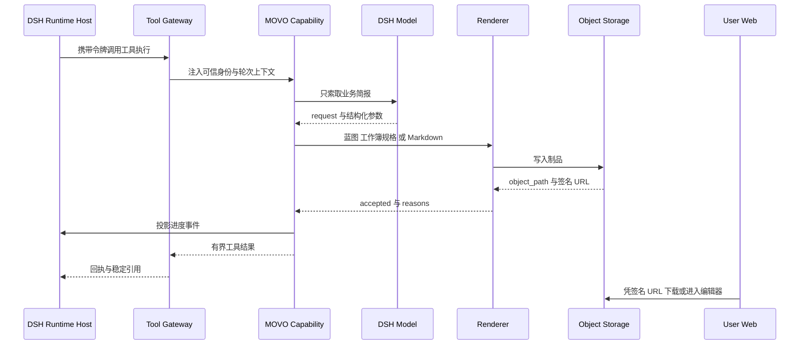

# MOVO 内容生成与文档智能

MOVO 把 DSH 当作 Agent 内核，自己负责「企业生产」。本关注面覆盖的是其中最容易失败的一段：用户要的不是一段文字，而是一份能打开、能编辑、能签字盖章的文件——报告 DOCX、汇报 PPTX、数据 XLSX、精简 PDF、带批注的合同副本。这条链路上的每一环都不可能交给模型「直接生成二进制」，因此 MOVO 在这里堆了大量**确定性契约**：声明式能力目录、结构化输入协议、渲染后回读校验、机器可读的验收裁决、制品所有权校验。

本篇顺着 `services/chat-api/app/enterprise_capabilities/{content,presentation,docx_review,spreadsheets,pdf_editing,images,data,artifacts,delivery}` 与 `app/services/{presentation,translation,form_filling}` 的调用链读下来，重点回答「为什么这样选、放弃了什么」。

## 根因：模型会写字，但不会「交付文件」

假设让模型直接产出 OOXML 或 PPTX 二进制，会同时踩四个坑。第一，字节级正确性无保证——OOXML 是 ZIP 包加多份互相引用的 XML，一个标签失配文件就打不开；第二，无法定位失败点，二进制不可差量审阅，出错只能重生成；第三，不可验证，服务端拿不到「这份文件是否真的符合用户要求」的判定依据；第四，不可治理，一个「随便写文件」的工具既无法做审批分级，也无法做限流与幂等。

所以 MOVO 的选择是：**模型只输出结构化参数或 Markdown，文件由服务端确定性渲染器产出**。这条原则渗到了三种不同的粒度上——PPT 是「只给业务简报」，长文是「只给写作要求」，表格是「只给工作簿规格」，而所有二进制组装都在 Python 侧完成。下面这张图是本关注面的主干链路。

## 链路总览

关键点在于中间那两个「Capability」与「Renderer」的分工：能力层负责**语义与治理**（要不要做、能不能做、做到什么程度算合格），渲染层负责**字节**（把已定的结构变成合法文件）。能力层从不相信模型给出的 URL、路径或二进制，渲染层从不做业务判断。

## 工具面：能力目录即契约

MOVO 侧所有可被模型调用的能力都登记在一张声明式目录里，`_definition(...)` 统一构造出不可变的 `CapabilityDefinition`：能力引用、工具名、输入输出 schema、风险等级、审批要求、超时策略、幂等性、投递模式全部在编译期固定下来：
- [services/chat-api/app/enterprise_capabilities/runtime/contracts.py:11-34]()
<!-- anchor: class CapabilityDefinition(BaseModel): … idempotent: bool = True -->
`model_config = ConfigDict(extra="forbid", frozen=True)` 让这份契约无法在运行时被就地篡改；`required_scopes` 按风险等级自动推导为读或写作用域，`timeout_mode` 支持 `fixed` 与 `activity` 两种语义（后者用于长任务，见后文）。目录项的版本号不是人工维护的语义版本，而是**内容的 SHA-256 摘要**：
- [services/chat-api/app/enterprise_capabilities/runtime/catalog.py:90-92]()
<!-- anchor: digest = hashlib.sha256(json.dumps(payload, ensure_ascii=False, sort_keys=True). … return CapabilityDefinition(version=f"cap-{digest}", required_scopes=scopes, **p -->
这一点值得单独说：只要 schema、描述、风险等级、超时任意一项改动，`version` 就变，DSH 侧编译出的 Tool 版本随之变。它放弃的是「人类可读的 v1/v2」，换来的是**不可能忘记 bump 版本**。

更有意思的是 `description` 字段的地位。它不只是给模型看的说明，而是**行为契约的正文本体**——PRESENTATION 能力的描述里逐字禁止模型碰内部结构：
- [services/chat-api/app/enterprise_capabilities/runtime/catalog.py:291-297]()
<!-- anchor: description="Create one complete, editable presentation through MOVO's governed  … consumes_execution_evidence=True, -->
「Pass only the business brief ... never construct, guess, export, or trial internal Blueprint JSON yourself」这类祈使句在源码里反复出现（`artifact.export`、`image.generate`、`artifact.table_generate` 都有）。为什么把约束写进工具描述而不是写进系统提示？因为工具描述是**随能力一起版本化、随能力一起下发**的局部契约：换能力就换约束，不会污染全局提示，也不会因为别的模块改了提示词而失效。

第三层是**工作流节点到能力的映射**。MOVO 的老产品有 `read_material`、`generate_content`、`export_delivery` 之类的业务节点词汇，它们被声明式地编译到能力引用上，其中 `read_material` 还会按配置分流到不同的能力：
- [services/chat-api/app/enterprise_capabilities/runtime/workflow_mapping.py:47-54]()
<!-- anchor: def workflow_capability_for_node(node: dict) -> WorkflowCapabilityBinding: … return workflow_capability(node_type) -->
映射表本身带注释强调「declarative only ... does not execute a graph」。也就是说业务节点词只是**编译期词汇**，运行时不存在图执行器。放弃图引擎、改用「节点→工具」的一次性编译，代价是失去节点级并行的表达能力，收益是运行时只有一条心智模型：Agent 在循环里调工具。

## 决策一：模型只交业务简报，制品由确定性渲染器产出

PPT 是这条原则最纯粹的例子。能力类只有一句话的自我定位：
- [services/chat-api/app/enterprise_capabilities/presentation/service.py:38-39]()
<!-- anchor: class PresentationCreationCapability: … """Own the internal Blueprint; expose only a business brief to DSH.""" -->
它对外的输入 schema 只允许 `request`、`page_count`、`audience`、`design_intent`、`required_sections`、`use_agenda`、`grounding_mode`、`use_conversation_evidence`：
- [services/chat-api/app/enterprise_capabilities/presentation/contracts.py:8-41]()
<!-- anchor: def presentation_create_input_schema() -> dict[str, Any]: … "additionalProperties": False, -->
`additionalProperties: False` 在这里是关键：模型无法夹带一个 `blueprint` 字段来绕过。故事规划、页面构成、配图、质量检查、HTML 预览、可编辑蓝图持久化全部由这个 Tool 内部完成（描述原话：The Tool owns story planning, page composition, visuals, quality checks, HTML preview and editable Blueprint persistence）。

**放弃的方案**是让模型直接产出页面 IR。那条路线的表达能力上限更高——模型可以精确控制每个元素的位置——但代价是无法保证一致性，且每次生成都要把完整的 IR schema 塞进上下文。MOVO 选择把 IR 定义为**能力私有的中间表示**，模型既看不到它的 schema，也不需要为它负责。

为了让「拒绝」也能被模型正确消化，返回值里带了一个结构化的裁决对象，而不是一句自由文本错误：
- [services/chat-api/app/enterprise_capabilities/presentation/service.py:173-189]()
<!-- anchor: reasons: list[str] = [] … reasons=reasons, -->
`presentation_has_no_slides`、`requested_slide_count_mismatch`、`editable_blueprint_missing`、`html_preview_missing` 这些常量配上 `retry_allowed`，把「重试」的决策权显式交还给调用方。拒绝路径同样保持同样的 schema（`_rejected`），所以 DSH 侧的输出校验永远不会因为失败而破例：
- [services/chat-api/app/enterprise_capabilities/presentation/service.py:336-346]()
<!-- anchor: "success": False, … "message": message, -->
这里有个工程细节值得一提：**工具结果有预算**。预览包里的完整 deck IR 是 JSON，再次塞回工具结果会触发 DSH 的截断替换，截断后的值不再满足输出 schema。所以能力层只回稳定引用：
- [services/chat-api/app/enterprise_capabilities/presentation/service.py:278-285]()
<!-- anchor: """Return the small, durable artifact descriptor DSH and the UI need. … ``deck_ir_artifact.object_path`` when the editor opens. -->
这是一个可迁移的模式：**大对象走对象存储，模型上下文里只留指针**。前端要编辑时自己去 `deck_ir_artifact.object_path` 取蓝图，编辑后写回同一路径并重新签名，模型永远不承载这份 IR：
- [services/chat-api/app/api/endpoints/documents.py:96-108]()
<!-- anchor: async def save_blueprint(payload: SaveBlueprintRequest) -> ApiResponse: … "url": signed_url, -->

长文（`content.produce@v1`）走的是另一条粒度：模型交的是写作要求与约束，管道回的是 Markdown，而 Markdown 才是这一能力的**权威交付物**。目录里给它标了 `delivery_mode="authoritative_markdown"`：
- [services/chat-api/app/enterprise_capabilities/runtime/catalog.py:319-320]()
<!-- anchor: delivery_mode="authoritative_markdown", … consumes_execution_evidence=True, -->
表格（`artifact.table_generate`）同理，模型交的是工作簿规格。schema 注释明确说明「只向 DSH 广告规范化形状，遗留别名只在边界容纳」，这样契约稳定而兼容性下沉：
- [services/chat-api/app/enterprise_capabilities/spreadsheets/contract.py:24-28]()
<!-- anchor: def workbook_input_schema() -> dict[str, Any]: … only this canonical shape is advertised to DSH so the contract stays stable. -->
容错到了边界就结束。归一化之后是一串硬校验，缺列、缺行、列键重复都直接拒绝，宁可失败也不产出空表：
- [services/chat-api/app/enterprise_capabilities/spreadsheets/contract.py:173-192]()
<!-- anchor: def normalize_workbook_spec(raw: Any) -> SpreadsheetSpec: … raise WorkbookContractError(f"sheet '{sheet.name}' contains duplicate column key -->

### 一个真实存在的「反向路径」

MOVO 并没有彻底禁止模型写文件。仓库里同时挂着 Anthropic 的 office Skills（`services/chat-api/app/skills_specs/{docx,pptx,xlsx}/`，`LICENSE.txt` 标注 © Anthropic PBC），里面有 `SKILL.md`、OOXML 校验脚本、`soffice.py`、`recalc.py` 等，允许 Agent 在脚本沙箱里自己拆包、改 XML、跑 LibreOffice 校验。

两条路径并存不是历史包袱，而是**能力分层**：结构化工具负责「高频、可验收、需要治理」的交付（报告、PPT、表格、批注副本），Office Skill 负责「一次性、长尾、需要精细控制」的文件改造。前者能被审批、限流、幂等重放，后者不能——所以前者才是产品主线，后者是逃生舱。这个分工在别的平台里常常被做反：先给一个万能的文件工具，再想办法在上面补治理。

## 决策二：一份 IR，两套渲染器

PPT 的落地路径值得单独拆开，因为它是这套设计里唯一同时要满足「网页预览」和「可编辑 PPTX」两个消费者的地方。

当前唯一的 PPT 管道叫 `ImageNativePresentationPipeline`，阶段是固定的：故事规划 → 页面规划 → 结构消毒 → 配图兜底 → HTML 预览编译 → 碰撞检测 → 预览包持久化。
- [services/chat-api/app/services/presentation/image_native/pipeline.py:100-110]()
<!-- anchor: blueprint = await self._page_planner.build( … # usual no-op as a user-facing generation stage. -->
所谓 image_native，是指每一页最终被表示成**一张整页图**：页面规划阶段调用管理员配置的图像模型，把该页的标题、正文、图示一次性画进 16:9 画面，然后写成一个占据全画布的单块蓝图。
- [services/chat-api/app/services/presentation/image_native/image_page_builder.py:9-34]()
<!-- anchor: """Represent one generated slide as one full-canvas image block.""" … style={"fit": "cover"}, -->
**为什么敢这么做？** 因为它一次性消掉了传统「LLM 生成版式」路线的全部老大难：字体缺失、文本溢出、中英混排断行、层级与留白——这些在生成阶段就由图像模型「画」进像素里，不需要布局求解器。放弃的是原生文本可编辑性，换来的是一次成功率与视觉下限。

**代价怎么补？** 三层。第一层是提示词契约：每页的最终文案被显式列为 FINAL COPY，要求「exactly once, verbatim and fully legible」，并明令不得翻译、改写、省略、重复或新增措辞；第二层是结构消毒器；第三层是几何碰撞检测（见下一节）。
- [services/chat-api/app/services/presentation/image_native/prompt_builder.py:28-34]()
<!-- anchor: copy_rules = ( … f"FINAL COPY:\n{json.dumps(copy_payload, ensure_ascii=False)}" -->
这段提示词还明确交代了「there will be no later text overlay or reconstruction」——也就是系统层面承认**没有文字回贴层**，所以图像模型必须一次画对。这是一个诚实的工程声明：与其做一个永远对不齐的隐形文字层，不如把约束前移到生成提示里，再靠确定性检测兜住可检测的部分。

真正的关键设计在 IR 与渲染器的关系上。PPTX 导出并不是「截图塞进幻灯片」，而是**同一份蓝图用第二套渲染器重画**：
- [services/chat-api/app/services/presentation/pptx_compiler.py:1-5]()
<!-- anchor: """PPTX compiler — converts FreeformDeckBlueprint to a .pptx file. … and chart spec extraction. -->
文档注释把关系说得很直白：`Consumes the same upstream blueprint as html_renderer, using shared render_utils`。坐标换算、z 序、样式解析、图表规格抽取都从同一份 `render_utils` 取，所以浏览器里看到的和 PowerPoint 里打开的不会各自漂移。

**放弃了什么？** 放弃了「用无头浏览器把 HTML 打印成 PPTX」和「用 LibreOffice 转换」这两条看似省事的路。前者得不到真正的形状级可编辑性（只会得到一堆图片或错位的文本框），后者把转换质量交给一个不可控的外部进程。也放弃了让 PPTX 成为第一等交付物：`presentation.create@v1` 只产出**预览包**（HTML + 蓝图 JSON），PPTX 是编辑器里再导出的产物：
- [services/chat-api/app/services/presentation/preview_bundle.py:61-75]()
<!-- anchor: html_ref = self._safe_upload_ref( … failure_messages=failures, -->
预览包结构里 HTML 与蓝图各占一个制品槽位，但 `delivery_mode` 只在 **HTML 预览拿不到 URL** 时才退化为 `artifact_preview_degraded`；蓝图那一侧的上传失败只记进 `preview_upload_failures`，交付模式仍是 `artifact_preview`。也就是说预览 HTML 挂了不算整单失败，仍然能用蓝图导出 PPTX。
- [services/chat-api/app/services/presentation/preview_bundle.py:91-95]()
<!-- anchor: preview_metadata={ … "preview_upload_failures": list(failures), -->

导出侧则是一条独立的能力路径：`artifact.export@v1` 的 `pptx` 分支先校验蓝图属于当前用户，再读回蓝图交给编译器，并且**显式检查页数大于零**后才算成功：
- [services/chat-api/app/services/documents.py:140-161]()
<!-- anchor: async def render_presentation_pptx( … filename=filename or "", -->

- [services/chat-api/app/enterprise_capabilities/artifacts/service.py:45-57]()
<!-- anchor: elif output_format == "pptx": … raise ValueError("PPTX export produced no slides") -->
编辑闭环也由此闭合：前端用 Fabric.js 打开 HTML 预览与蓝图，用户改完调用保存接口写回同一 `object_path`，再请求导出。也就是说，**「可编辑」指的是蓝图可编辑、可重新导出**，而不是 PowerPoint 里每个字都是原生文本框。这个取舍需要在文档里对用户说清楚，否则会被理解为功能缩水。

## 判定：确定性能算清的，不交给模型

这个模块里最值得学的一段，是它对「什么该用模型、什么该用代码」的划分纪律。

**结构消毒器**的自我约束近乎苛刻：只处理数学上不可能渲染的结构缺陷，明令「no layout opinions, no spatial reasoning, no style judgments」，并且立了一条规则——任何一条规则一旦改动了此前视觉质检判定为合格页面的任何一个字节，就必须删掉该规则：
- [services/chat-api/app/services/presentation/structural_sanitizer.py:1-25]()
<!-- anchor: """Deterministic pre-render sanitizer for presentation. … about it. -->
**几何碰撞检测器**则把动机写在了文档里：它要取代的正是「多模态质检以极高时间和 token 成本才能发现」的那一类缺陷，而它自己每页 1-2 毫秒、在它能判定的范围内 100% 准确。范围被刻意收窄到顶层块、不做递归下钻，并逐条论证了为什么：
- [services/chat-api/app/services/presentation/geometry_collision_detector.py:1-16]()
<!-- anchor: """Pure-geometry collision detector for presentation page blueprints. … 2. Children typically use parent-relative coordinates, requiring -->
这两处的共同模式是：**先问「这个问题有没有确定性判据」，有就把模型赶出去**；只有在确定性判据不存在时（对比度、语义错配、文本截断的观感）才动用多模态质检。很多 Agent 项目反着做——先上模型评审，发现成本高、不稳定，再回头补规则——结果是规则与模型职责重叠、互相打架。

同样的纪律出现在长文管道的「修复」决策上。质量闭环只在**单次成稿**路径上运行，发现问题就带着反馈重写一次，然后**刻意不做第二次校验**，并给出了理由：
- [services/chat-api/app/enterprise_capabilities/content/quality.py:60-81]()
<!-- anchor: if initial.verdict == "pass": … return result -->
「一次修复后不再复核」听起来像偷工减料，其实是一次明确的成本-收益判断：同步的二次校验无法触发第二次修复，只会增加时延与 token 成本而不改变最终交付内容。所以它诚实地把结论标成 `repaired_unverified`，并在 metadata 里留下 `post_repair_review_skipped: true`——**不假装已经验证过**。这种「宁可暴露不确定性，也不虚报绿勾」的态度，比多跑一次评审更值得抄。

验收裁决本身也被刻意做薄：
- [services/chat-api/app/enterprise_capabilities/content/acceptance.py:8-31]()
<!-- anchor: def build_content_acceptance( … "required_visual_min": int(required_visual_min), -->
注释写明「Project existing pipeline outcomes; this function owns no quality rules」。裁决层只**投影**已有结果（正文非空、配图数量达标），不自行发明质量标准。这样质量标准只有一个来源（评估管道 / 写作规范契约），不会出现「裁决说合格但评估说不合格」的双头治理。

还有一个不太显眼但很实用的判定：**模式路由**。长文只有两条路——一次性长文与分章节超长文，历史遗留的多种 writer mode 被折叠掉：
- [services/chat-api/app/enterprise_capabilities/content/routing.py:10-41]()
<!-- anchor: class ContentWriterRouter: … "reasons": list(decision.reasons or []), -->
折叠本身不难，难的是**防止模式被无脑升级**。解析器里有一条「证据地板」：当证据强度提示偏低且字数预算不大时，拒绝升级到 document_scale 模式，理由是「document_scale_compose can over-expand a thin report」：
- [services/chat-api/app/enterprise_capabilities/content/execution_mode/resolver.py:98-105]()
<!-- anchor: # Evidence floor: document_scale_compose can over-expand a thin report. … and target_words < 1500 -->
这是一个很典型的「模式膨胀」治理案例：一旦存在更强的模式，提示词或模型就会倾向于选它，结果产出被稀释的注水长文。用一条确定性阈值把它挡回去，比事后让用户抱怨「太啰嗦了」便宜得多。

## 决策三：每种格式用最「薄」的库

各格式的落地方式并不统一，选择标准是「用能保证字节正确性的最小依赖」。

### DOCX：Markdown 是唯一输入

导出 DOCX 的入口不做模板引擎，而是把 Markdown 先做资源内联（图片等），再交给一个成品函数生成带封面与目录的文档：
- [services/chat-api/app/services/documents.py:61-63]()
<!-- anchor: if format == "docx": … rendered_markdown = await render_markdown_assets(markdown, user_id) -->

- [services/chat-api/app/services/documents.py:83-90]()
<!-- anchor: from app.skills_specs.docx.markdown_to_docx import render_from_markdown … skip_toc=skip_toc, -->
这里要诚实指出一个**与直觉不符的事实**：`markdown_to_docx._resolve_template()` 会依次查找 `templates/report_template.docx` 与 `templates/report.docx`，但这两个候选路径所在的 `skills_specs/docx/templates/` 目录在当前仓库里**根本不存在**，两个候选因此全部落空：
- [services/chat-api/app/skills_specs/docx/markdown_to_docx.py:9-18]()
<!-- anchor: def _resolve_template() -> Optional[str]: … return None -->
仓库里的 OOXML 注释部件模板（`comments.xml`、`commentsIds.xml`、`people.xml` 等）其实在另一个目录 `skills_specs/docx/scripts/templates/`，由 Skill 自己的 `document.py` 通过 `TEMPLATE_DIR` 消费，与报告模板无关：
- [services/chat-api/app/skills_specs/docx/scripts/document.py:44-44]()
<!-- anchor: TEMPLATE_DIR = Path(__file__).parent / "templates" -->
因此在本基线里 `template_path` 恒为 `None`，实际走的是 `python-docx` 空白文档 + `_setup_styles()` 内置样式 + 代码生成的封面与目录。也就是说「企业模板」在当前开源版是**预留钩子而非既有能力**，不要照抄文档里的说法。

目录（TOC）与封面由代码生成，并启用了「打开时更新域」，这是绕开 Word 域字段无法预渲染这一限制的常用手法：
- [services/chat-api/app/tools/docx.py:354-356]()
<!-- anchor: def _enable_update_fields_on_open(doc: Document): … Ask Word to update fields (e.g., TOC) when the document is opened. -->
`skip_cover` / `skip_toc` 两个开关的存在说明短文档（邮件、备忘录、简历）需要跳过封面，否则会多出一页编辑噪音。

### XLSX：先校验输入，再回读校验产物

渲染时刻意分两步：渲染前校验规格，渲染后**把产物重新打开并逐项比对**：
- [services/chat-api/app/services/spreadsheets.py:28-29]()
<!-- anchor: def _render_validated(self, spec: SpreadsheetSpec) -> tuple[bytes, Dict[str, Any … validate_spreadsheet_spec(spec) -->

- [services/chat-api/app/services/spreadsheets.py:82-86]()
<!-- anchor: bio = BytesIO() … return content, validation -->
回读校验的实现是「重新 load 一遍工作簿，比对 sheet 名、表头、非空行数」，任何一项不符就抛错：
- [services/chat-api/app/services/spreadsheet_validation.py:25-30]()
<!-- anchor: def validate_rendered_workbook(content: bytes, spec: SpreadsheetSpec) -> dict[st … raise SpreadsheetValidationError(f"rendered workbook cannot be opened: {exc}") f -->
**这是一个可以直接迁移的模式：不要相信渲染器的返回值，去读它写出来的文件。** 它把「渲染成功但内容错了」这一类最难排查的缺陷关在服务端，而不是等用户下载后发现表格是空的。代价是每次生成多一次反序列化，对于 XLSX 这种体量的文件完全可以接受。

### PDF：Markdown → HTML → 无头 Chromium

PDF 走的是完全不同的技术栈：先把 Markdown 转成 HTML（内联样式、目录、代码块、图表脚本），再用 Playwright 的 Chromium 打印成 A4：
- [services/chat-api/app/tools/pdf.py:407-413]()
<!-- anchor: async def generate_pdf_file(markdown_content: str, filename: str = "report.pdf") … html_body = _markdown_to_html(markdown_content) -->

- [services/chat-api/app/tools/pdf.py:654-692]()
<!-- anchor: tmp = tempfile.NamedTemporaryFile(delete=False, suffix=".pdf") … return tmp.name -->
这里必须点出两个**脆弱性**，因为它们决定了这套东西能不能上生产：一是 HTML 里通过 CDN 引入 mermaid 与 Chart.js 以及 Google Fonts，离线或受限网络环境下会退化；二是打印前硬等 5000 毫秒让图表渲染完——这是一个无法证伪的等待，页面复杂时不够、简单时浪费。真正稳妥的做法是把图表在服务端预渲染成图片（见下）并自托管字体与脚本。

启动参数包含 `--no-sandbox`、`--disable-dev-shm-usage`，是容器内跑 Chromium 的常规妥协。仓库也为此写了一条明确的失败提示（提示运行 `playwright install chromium` 并检查宿主机是否允许无头 Chromium），说明这条路径被当作**需要环境前置条件的可选能力**，而不是默认可用。

### 图表与泳道图：先栅格化再嵌入

对 DOCX 这种压根不能执行脚本的格式，Markdown 里的 `mermaid` / `chart` 围栏会先被扫描出来，渲染成 PNG 上传对象存储，再替换成图片语法：
- [services/chat-api/app/utils/markdown_assets.py:23-32]()
<!-- anchor: async def render_markdown_assets(markdown: str, user_id: str) -> str: … blocks = list(CODE_BLOCK_RE.finditer(markdown)) -->
渲染同样用 Playwright 起一个页面加载 mermaid，截图 SVG 元素后上传；任何异常都降级为文本占位图，而不是让整份文档生成失败：
- [services/chat-api/app/utils/markdown_assets.py:71-73]()
<!-- anchor: from playwright.async_api import async_playwright … return _render_text_placeholder(diagram, uploader, user_id, "mermaid") -->
「图表先变图片」这个决定值得表扬：它让**下游所有渲染器共享同一份视觉结果**。否则 DOCX 用 python-docx、PDF 用 Chromium、PPT 用图像模型，三方各自解释 Mermaid 方言，必然出现三套不一致的图。

### LibreOffice 与无头渲染的取舍

这是本关注面里最容易被误传的一点。**chat-api 的镜像里没有 LibreOffice**——它的 apt 装包清单只有证书、下载工具、字体配置与中文字体（中文字体是为了 Chromium 打印 PDF 与图表截图时不断字），既没有 `libreoffice*` 也没有 pandoc：
- [services/chat-api/Dockerfile:19-26]()
<!-- anchor: ca-certificates \ … && rm -rf /var/lib/apt/lists/*; \ -->
LibreOffice 出现在两个别的地方：

其一，独立的 `document-parser` 服务：用它把 `.doc`/`.ppt`/`.xls` 转成现代格式，并把 Office 文档转成 PDF 预览供前端查看。它自己的镜像里显式安装了 `libreoffice-core/writer/calc/impress`：
- [services/document-parser/Dockerfile:54-58]()
<!-- anchor: libreoffice-core \ … libreoffice-impress \ -->
其二，`skills_specs/{docx,pptx,xlsx}` 里的 Anthropic Skill 脚本（`soffice.py`、`recalc.py`），供 Agent 在沙箱里做「重算公式」「渲染缩略图」这类辅助动作。

**所以取舍是：生成路径零 Office 依赖，转换/预览路径集中到一个独立服务。** 好处是生成服务保持轻量、可按需水平扩展，且不必为每个容器准备字体与 LibreOffice profile；代价是格式保真度上限受 Python 库限制（例如 python-pptx 没有透明度 API，`pptx_compiler` 只能直接改 OOXML 的 `<a:alpha>` 节点来打补丁）。

### 在位翻译：LLM 只看文本段

`document.transform@v1` 的 DOCX 分支是本模块里「模型与格式彻底解耦」的范本。它的顶部注释把设计原则一条条列了出来：
- [services/chat-api/app/services/translation/docx_inplace.py:1-15]()
<!-- anchor: """In-place DOCX translator. … - Placeholders / numbers / dates / hyperlinks preserved verbatim. -->
其中最关键的一句是 `The LLM never sees XML — it only receives plain text batches`。做法是：遍历 python-docx 对象模型抽出文本段（正文/单元格/页眉页脚），只在段落级别替换 run 文本，从而自然保留字体、颜色、合并单元格、图片、页面设置与主题；翻译侧用**文档级术语表 + 每批 8-10 段 + 相邻段滑动上下文**来保证术语一致与跨批衔接；表格还会自动重排列宽，避免「窄列里塞长英文」导致版式炸开。

这条路线放弃的是「整篇一次性翻译」带来的天然全局一致，换来的是**格式零损失**。用术语表 + 滑动上下文去补偿一致性，是一个成本可控的折中；它也解释了为什么这个能力有 300 秒超时（批量多轮调用）。

## 决策四：制品是「有主的对象」，交付范围是显式决定

所有生成能力最终都要落成对象存储里的一个 key，而 key 的**第一段就是用户 ID**（`generate_object_path`）。围绕这个约定，MOVO 做了三层防护。

第一层是**引用即授权**。任何来自模型参数里的制品引用，都要先过所有权前缀校验，路径穿越与越权一律拒绝；同时把模型可能塞进来的 `url` / `signed_url` **直接丢弃**：
- [services/chat-api/app/enterprise_capabilities/artifacts/references.py:11-21]()
<!-- anchor: def require_owned_artifact(artifact: dict[str, Any], *, user_id: str) -> dict[st … return value -->
注释写得很明确：`Bearer URLs are never trusted from model arguments`。这个决定很关键——如果把签名 URL 当作可传递的凭据，模型一旦从上下文里捡到别的会话的 URL（或幻觉出一个），越权就发生了。所以签名 URL 只在**返回路径**上生成，从不在输入路径上被消费。

第二层是**投递范围语义化**。同一个渲染结果，可能是用户要的最终交付物，也可能只是下游工作流的中间产物；两者在存储生命周期与可见性上不同：
- [services/chat-api/app/enterprise_capabilities/artifacts/delivery_scope.py:8-19]()
<!-- anchor: def apply_delivery_scope(value: dict[str, Any], scope: Any) -> dict[str, Any]: … return result -->
`intermediate` 会被标记为 `lifecycle=intermediate` + `visibility=internal`，`final` 则是 `user` 可见。`artifact.table_generate@v1` 的描述里甚至专门用一段话教育模型：只有用户明确要表格附件时才设 `final`，报告里嵌的表格不构成「另出一个 XLSX」的理由。把这种产品判断写成工具描述，是这套体系里最省钱的一招——否则用户会收到一堆没人要的中间文件。

第三层是**后端可切换的签名方案**。社区版默认走本地磁盘存储，签名不是 OSS 的 Query 签名，而是自己实现的 HMAC-SHA256（签名串是「过期时间 + object_path」）：
- [services/chat-api/app/utils/oss_uploader.py:184-195]()
<!-- anchor: def sign_url(self, object_path: str, expires: Optional[int] = None) -> str: … return self.bucket.sign_url("GET", object_path, ttl) -->

- [services/chat-api/app/core/config.py:140-144]()
<!-- anchor: # Object storage. STORAGE_BACKEND=oss preserves the existing enterprise … LOCAL_STORAGE_PATH: str = "storage" -->
配置注释把意图讲明白了：`oss` 保留原有企业行为，`local` 把制品落到磁盘并通过 `/api/files` 提供。下载端点会再次校验签名与有效期，并明确拒绝在非 local 模式下提供服务：
- [services/chat-api/app/api/endpoints/documents.py:282-292]()
<!-- anchor: @router.get("/files/{object_path:path}") … raise HTTPException(status_code=404, detail="File proxy is only available for lo -->

- [services/chat-api/app/api/endpoints/documents.py:300-311]()
<!-- anchor: if not verify_local_file_signature( … return FileResponse(file_path, media_type=media_type) -->
**这是一个值得抄的开源化改造模式。** 企业版依赖云对象存储是合理的，但社区版自托管必须能零云依赖跑起来；做法不是抽象一个庞大的 Storage 接口层，而是保留原类名（`AliyunOSSUploader` / `ObjectStorageClient`）与全部调用点，只在内部按配置分派。代价是命名与实现不一致（叫 OSS 却能写本地盘），收益是**调用点零改动**——这也是为什么你在 `presentation`、`documents`、`artifacts` 各处都会看到看起来像硬编码 OSS 的代码。

### 交付的最后一公里：权威交付物与重试复用

长文交付被单独处理成「权威交付物」：能力声明 `delivery_mode="authoritative_markdown"` 后，工具执行框架会在**执行前**先查有没有同一轮同工具已接受的交付，命中就直接复用、不重跑管道：
- [services/chat-api/app/enterprise_capabilities/tools/service.py:280-289]()
<!-- anchor: if tool.delivery_mode == "authoritative_markdown" and self._authoritative_delive … if reused_result is not None: -->

- [services/chat-api/app/enterprise_capabilities/delivery/reuse.py:14-29]()
<!-- anchor: async def reuse_accepted_delivery( … if delivery is None: -->
执行成功后写入持久化集合（`enterprise_authoritative_deliveries`，`action_id` 上建唯一索引）：
- [services/chat-api/app/enterprise_capabilities/tools/service.py:425-438]()
<!-- anchor: if tool.delivery_mode == "authoritative_markdown" and self._authoritative_delive … and result.get("accepted") is False -->
为什么要费这个劲？因为**长文生成是这条链路上最贵的一次调用**（可能几十秒到几分钟、消耗上万 token），而 DSH 的动作重试、网络抖动、用户重复点击都会让同一个 `actionId` 再来一次。语用上，这也解决了一个更微妙的问题：如果重试真的重跑，第二次生成的内容与第一次不同，用户会看到「同一句话产出两个版本」。

同一文件里还有一处细心之处：被治理的拒绝（`accepted is False`）被当作**执行成功**处理——因为这是一次合规的裁决，不是系统故障：
- [services/chat-api/app/enterprise_capabilities/tools/service.py:436-440]()
<!-- anchor: governed_rejection = ( … execution_succeeded = bool(result.get("success", True)) or governed_rejection -->
如果把它标成 failed，DSH 会认为工具出错并可能触发自动重试，反而让「明确拒绝」变成重试风暴。

### 还有一层：工具结果进入模型上下文之前要瘦身

解析类工具会把上游解析器的内部树从结果里剥掉（注释说明 Docling 的树既大又含 `$ref` 之类的 JSON 引用键），并且去掉重复的 Markdown 副本，避免同一份大文本在结果里出现三次：
- [services/chat-api/app/enterprise_capabilities/artifacts/document_result.py:25-36]()
<!-- anchor: def public_document_parse_result(result: dict[str, Any]) -> dict[str, Any]: … if key not in {"parsed_documents", "documents", "active_document_markdown"} -->

这和前面「只回稳定引用」的策略是同一条原则的两种粒度：**模型上下文是稀缺资源，能放外部的都不放进来**。

### 附带的三个能力：图像、数据脚本、表单填充

**图像生成**（`image.generate@v1`）刻意做成「provider 中立」：描述里明确禁止模型点名 Qwen/OpenAI/Azure 等具体供应商，只提交图像规格，最多 4 张，逐张上报进度，返回的 `markdown` 字段可直接嵌进正文：
- [services/chat-api/app/enterprise_capabilities/images/service.py:46-75]()
<!-- anchor: for index, spec in enumerate(requests, start=1): … return self._result(requested=total, assets=assets, failures=failures) -->
部分成功不报错，而是给出 `partial_success` + `continuation_required`，让调用方决定是否补生成：
- [services/chat-api/app/enterprise_capabilities/images/service.py:84-95]()
<!-- anchor: generated = len(assets) … "continuation_required": status == "partial_success", -->
这也是一处「诚实建模」：4 张图里成了 3 张，既不该整体失败（用户已经拿到 3 张），也不该假装完成。用三态枚举把它说清楚，比布尔 `success` 有用得多。

**数据脚本**（`data.run_script@v1`）是沙箱逃生舱，但入口做了两层翻译。第一层是语法兼容：允许模型写普通 Python，编译器用 AST 判定有没有 `run(inputs, context)`，没有就自动包一层，把 stdout 收集成结构化数据、把输出目录里的文件登记成制品：
- [services/chat-api/app/enterprise_capabilities/data/script_contract.py:9-22]()
<!-- anchor: def compile_script_plugin(code: str) -> str: … indented = textwrap.indent(source, "    ") -->
这样一来，模型写「像普通 Python 一样的东西」也能得到确定性结果，而不是因为不符合历史 plugin 协议而失败。第二层是终态断言：脚本执行完必须真的拿到 `succeeded`，否则以异常终止，绝不让半成品冒充成功：
- [services/chat-api/app/enterprise_capabilities/data/script.py:53-57]()
<!-- anchor: if terminal_status != "succeeded": … return {"success": True, **scoped} -->
**表单填充**（`document.fill_form@v1`）是这条链路上唯一被标为需要审批的文档能力（`risk_level="write"`, `approval_required=True`），这并非官僚主义：填充会**修改已有单元格内容**，语义上比「产出一份新文件」危险。实现上，模型只负责把用户给的非结构化事实映射到模板字段，且映射的主路径就是 LLM——`build_fill_plan` 会先做一份正则/CSV 的确定性 plan，但那份 plan 只作兜底：它先 `await llm.ainvoke`，只有模型调用抛异常、或模型输出为空而确定性 plan 非空时，才返回确定性 plan：
- [services/chat-api/app/services/form_filling/mapper.py:91-107]()
<!-- anchor: resp = await llm.ainvoke( … return fallback -->
写入时默认不覆盖已有内容：`overwrite` 为假时，**含匹配 `{{label}}` 占位符的非空单元格仍会写入并计入填充数**，其余非空单元格才被跳过；要整格覆盖必须由调用方显式要求：
- [services/chat-api/app/services/form_filling/xlsx_fill.py:281-287]()
<!-- anchor: if old not in (None, "") and not overwrite: … filled += 1 -->
「模型为主 + 确定性 plan 兜底 + 默认不破坏」这三件事合起来，才让这个被审批门保护的写操作变得可解释。

## 决策五：Word 合同评审——规则与模型的分工

这是整个仓库里少见的**垂直领域 Agent 样本**：不是通用工具，而是「服务合同预审」。它把「规则」与「模型」的职责切得很硬，值得逐层拆。

### 规则侧：规则是一份有编号的知识文档，不是提示词

规则被写成 Markdown 知识文档，逐条编号（R01–R15），每条给出「检查什么 / 触发条件 / 判断与建议」，并且**先识别角色再审核条款**——因为同一份合同里，我方是采购方还是服务提供方，付款与验收的关注点是相反的：
- [docs/service-contract-review-rules-dual-role.zh-CN.md:10-14]()
<!-- anchor: 1. 以我方公司全称及实际权利义务识别角色，不能只看“甲方”“乙方”标签。先写明合同中的我方名称、甲乙方身份、服务采购方或服务提供方身份、付款方、交付方及对应原 … 5. 每条使用“通过、需修改、缺失、不适用、无法判断”之一。仅对能在原文中逐字、唯一定位的问题作原文批注；缺失条款、需核实事实和无法定位的意见写入独立报告。 -->
注意这里的措辞——规则文档自己就规定了**批注的准入条件**：「仅对能在原文中逐字、唯一定位的问题作原文批注」。也就是说，随后要实现的那套严格定位逻辑，其判据先写在业务规则里，再由代码落实。这是「规则与实现一致」的正面例子。

规则条目本身也按固定小标题组织（检查什么 / 触发条件 / 判断与建议），保持业务语言而非机器语言，并且明确禁止编造条款与页码：
- [docs/service-contract-review-rules-provider.zh-CN.md:19-23]()
<!-- anchor: ### R01 签约主体和文件范围 … 触发条件：A 被写成非实际签约主体；客户签约主体与付款主体不同但没有付款责任安排；服务范围、价格或验收标准引用附件而附件缺失；正文与附件对同一事项冲突但无优先顺 -->
产品规格文档进一步把规则**结构化成字段**（`rule_id` / `applicable_when` / `pass_condition` / `fail_condition` / `exception` / `suggestion_template` / `source_location`），并固定了五种判定状态：`pass`、`risk`、`missing`、`not_applicable`、`needs_human_review`：
- [docs/contract-review-agent-spec.zh-CN.md:31-49]()
<!-- anchor: ## 4. 企业审核规则的数据结构 … 判定状态固定为：`pass`、`risk`、`missing`、`not_applicable`、`needs_human_review`。没有找到条款时使用  -->
其中最有价值的一条约定是「没有找到条款时使用 `missing`，不能自动视为通过」。它把**静默通过**这个最危险的失败模式从设计上堵死——合同里没有验收条款，恰恰是最需要报警的情况，而朴素实现（只在发现违规文本时才报警）会把它当成合格。

顺带一提，规格文档本身是一份**证据驱动的升级方案范本**：它先列出「已验证的代码事实」（逐条说明哪个节点对应哪个 Tool、哪个数据结构存在、哪个字段其实没有被渲染），再给最小闭环，再明确「首版不做什么」：
- [docs/contract-review-agent-spec.zh-CN.md:227-235]()
<!-- anchor: ### 13.1 已验证的代码事实 … - `content.produce@v1` 能读取同一轮的 Evidence；`artifact.export@v1` 可导出 Word。它们无需为此场景重做 -->

- [docs/contract-review-agent-spec.zh-CN.md:237-245]()
<!-- anchor: ### 13.2 应先实现的最小闭环 … 具体实现应把文档授权和分页读取放入独立小模块；`runtime/adapters.py` 只负责调用。现有 `runtime_parse_service.par -->
值得注意的是，这份文档里列为「应先实现」的 `knowledge.read_document@v1` 在**当前基线里已经落地**，而且 `document.review_source@v1` 的分页语义（`next_offset` 直到 `has_more` 为假）也与之同构：
- [services/chat-api/app/enterprise_capabilities/runtime/catalog.py:164-170]()
<!-- anchor: capability_ref="knowledge.read_document@v1", tool_name="knowledge_read_document" … "This reads the parsed document, not similarity-search snippets." -->

- [services/chat-api/app/enterprise_capabilities/runtime/catalog.py:181-187]()
<!-- anchor: capability_ref="document.review_source@v1", tool_name="document_review_source",  … "max_chars": {"type": "integer", "minimum": 1000, "maximum": 20000}, -->
再加上 `workflow_mapping.py` 里 `read_material` 按 `sourceType == "knowledge_document"` 的分流（见上文引用），规格文档里「应先实现的最小闭环」第 1、3、4 条都已可观察到落地。这说明仓库遵循的是「先写清事实与缺口、再分步实现」的流程，而不是先实现再补文档。

### 模型侧：两个工具加模型判定，把「读、判、写」切开

评审侧的「读」与「写」被拆成两个工具：`document.review_source@v1` 分页读取原文块，`document.annotate@v1` 把判定写成原生 Word 批注；能力目录里只注册了这两个，中间的「判」不在能力目录内，由模型自己在两次工具调用之间完成。读取侧有两个硬约束：源文件必须是**本轮上传**的文档（防止用历史附件做越权阅读），且只支持 DOCX、上限 25 MB：
- [services/chat-api/app/enterprise_capabilities/docx_review/service.py:20-34]()
<!-- anchor: def _source(arguments: dict[str, Any], context: CapabilityExecutionContext) -> t … return artifact, content, filename -->
另一个工具就是批注写入侧本身：
- [services/chat-api/app/enterprise_capabilities/runtime/catalog.py:190-193]()
<!-- anchor: _definition( … description="Create a commented copy of an authenticated original DOCX. Each com -->
原文被切成**稳定编号的段落块**（`p000001` 形式），ID 对这份不可变文件是稳定的，包括内容完全相同的重复段落：
- [services/chat-api/app/enterprise_capabilities/docx_review/source.py:36-47]()
<!-- anchor: def review_blocks(root: etree._Element) -> list[ReviewBlock]: … return blocks -->
分页读取则强制 `max_chars` 落在 1000–20000 之间，并对超大段落直接报错（注释理由是「too large for reliable annotation」）：
- [services/chat-api/app/enterprise_capabilities/docx_review/source.py:50-54]()
<!-- anchor: def page_blocks(blocks: list[ReviewBlock], *, offset: int, max_chars: int) -> di … raise ValueError("max_chars must be between 1000 and 20000") -->
这是在**为可控性主动牺牲便利**：允许一次读 20 万字很爽，但一个无法逐字定位的巨型段落最后一定会变成含糊的批注。

### 写回侧：唯一可定位的逐字引用才配成为批注

这是本模块最值得抄的一段。批注写入的准入判据是逐字的、可枚举的、机器可读的：
- [services/chat-api/app/enterprise_capabilities/docx_review/annotations.py:109-110]()
<!-- anchor: def annotate_docx(source_bytes: bytes, findings: list[dict], *, language: str =  … """Only exact, unique quotes in a declared source block become comments.""" -->
每条 finding 都要过一串检查：声明的块是否存在、必填字段是否齐、引用文本是否在该块中、引用在该块中是否唯一；任何一步失败都会被贴上一个具体原因码（`source_block_not_found` / `incomplete_finding` / `quote_not_found` / `ambiguous_quote` / `unsupported_text_structure`）并进入 rejected 列表，而不是被悄悄丢弃：
- [services/chat-api/app/enterprise_capabilities/docx_review/annotations.py:133-143]()
<!-- anchor: reason = "" … reason = _anchor(block.paragraph, quote, next_id) or "" -->
如果一条都没能定位，它不返回一个「空批注文件」，而是明确失败并建议改用报告形式：
- [services/chat-api/app/enterprise_capabilities/docx_review/annotations.py:159-164]()
<!-- anchor: if not accepted: … raise ValueError("annotation changed source document text") -->
上面这段区间里还藏着一条极妙的**不变式断言**：在序列化之前，它把内存中已经插入批注锚点的 root 与**重新从原文件字节解析出来的** review_blocks 逐块比较 (id, text) 是否完全一致——批注不允许改动正文。注意这一步比对的对象是内存里待写出的树与原文件，不是结果文件；序列化后的结果文件不再比对正文，只在回读时逐个校验批注的三个锚点与批注正文（见下文）。批注本质上是给文件加圈注，一旦动了正文，合同就不再是用户给的那份合同了。

写完之后还会**重新打开 ZIP 校验**：每个被接受的批注，必须在 `document.xml` 里找到 `commentRangeStart`/`commentRangeEnd`/`commentReference` 三个锚点，且在 `comments.xml` 里找到批注正文，缺一就抛错：
- [services/chat-api/app/enterprise_capabilities/docx_review/annotations.py:191-201]()
<!-- anchor: result = output.getvalue() … raise ValueError("annotated DOCX is missing a verified comment body") -->
这和 XLSX 的「回读校验」是同一种思维：**写入方自己不能给自己发合格证，必须由读回方验证。** 批注是典型的「用户打开文件才发现没生效」的失败模式，提前在服务端断言比事后排查便宜得多。

还有两处细节体现了产品级的严谨。其一，源文件在读取时会算出 `sha256`，写回时必须匹配，否则报「review source changed; read the original document again」：
- [services/chat-api/app/enterprise_capabilities/docx_review/service.py:54-63]()
<!-- anchor: async def document_annotate(arguments: dict[str, Any], context: CapabilityExecut … annotated, accepted, rejected = annotate_docx(content, findings, language=langua -->
这防止了「模型在读完原文后，用户又换了文件」这种竞态导致的错位批注。其二，批注正文的字段是**强制**的：`finding`（问题）、`suggested_revision`（修改建议）、`criterion_text`（审核依据）三者缺一不可，规则编号只是可选的补充，注释原话是「a rule ID is never the explanation」：
- [services/chat-api/app/enterprise_capabilities/docx_review/comment_content.py:27-40]()
<!-- anchor: def comment_lines(finding: dict, *, language: str = "zh") -> list[str]: … return lines -->
这一条直击垂直领域 Agent 的常见退化：模型很擅长输出「依据 R05，存在风险」，但法务要的是「预付款比例 60%，超过规则要求的 30%，建议改为验收后分三期」。**强制模型写出规则原文与建议文本，等于强制它真的完成推理**，而不是只做一次标签检索。

### 这个样本的可迁移结论

把上面的做法抽象出来：**当「输出必须落到用户的原件上」时，先设计一个可定位的坐标系统，再让模型只在坐标系统内表达判断，最后用读写双端校验把结果钉住。**

具体可迁移的四条：其一，给模型一个稳定 ID 空间（段块编号），模型只引用 ID + 逐字引用文本；其二，把「定位失败的原因」变成枚举值返回，让上游能自愈（重读原文、改引用）；其三，对写入类操作加正文不变式 + 回读断言；其四，把「无法定位」与「没找到条款」作为一等结果上报，绝不静默降级为通过。

至于这个样本的**边界**，源码与规格文档都写得很清楚：只支持 DOCX 原地批注（其他格式退回报告）；规则集的「上传 → 抽取 → 人工确认 → 版本发布」链路**尚未实现**，规格文档明确说「当前代码没有这条发布链路，不能把它当作 P0 的现成依赖」；跨多次工具调用的长规则文档覆盖率仍受工具结果与 Evidence 压缩限制（规格文档自陈只保留同轮最近 12 个 bundle）。

## 决策六：长任务的进度、超时与断点

生成类任务动辄几十秒到几分钟，而工具调用在 DSH 侧是一个有超时的同步动作。MOVO 的解法不是「把超时调大」，而是三个机制配合。

**机制一：真实进度事件。** 管道每一阶段通过 `progress_sink` 抛出一条事件，投影器把它翻译成 DSH 时间线已经认识的 v3 `item.completed` / `commentary` 结构，挂在当前工具动作下：
- [services/chat-api/app/enterprise_capabilities/content/timeline.py:16-29]()
<!-- anchor: def project(self, event: dict[str, Any]) -> list[dict[str, Any]]: … event_id = f"askai-v3:content:{self._namespace}:{self._counter}" -->
复用 DSH 既有事件词汇而不是新开一条通道，意味着 UI 侧零改动就能展示「正在规划结构」「正在生成第 3/8 张配图」。事件 ID 里带 `message_id` 与 `action_id` 命名空间，避免并发会话串台。

**机制二：以真实进度为准的超时。** `timeout_mode="activity"` 的能力会拿到一个总时限和一个**静默时限**；每次进度上报都会「喂」一次活动信号，超时判定同时看两个剩余量：
- [services/chat-api/app/enterprise_capabilities/tools/execution_timeout.py:29-50]()
<!-- anchor: class ExecutionActivity: … return publish -->

- [services/chat-api/app/enterprise_capabilities/tools/execution_timeout.py:80-83]()
<!-- anchor: if total_remaining <= 0: … raise ExecutionDeadlineExceeded("tool execution stopped reporting progress") -->
两个原因码是分开的：「exceeded its maximum duration」是硬上限，「stopped reporting progress」是卡死。类注释还特意强调 `Tracks real capability progress without manufacturing keepalives`——**不做心跳造假**。这是这套设计最容易被做坏的地方：一旦有人为了「别超时」而定期空发心跳，静默超时就彻底失效，卡死的任务会一直挂着占资源，直到硬上限。宁可让「不报进度」等于「可能卡死」，也不要假心跳。

**机制三：断点续跑与幂等作业。** PPT 是唯一被持久化成「作业」的能力。作业身份不含 DSH 的 `actionId`，而是由租户、用户、会话、消息 ID 与**请求参数的规范化指纹**共同推导：
- [services/chat-api/app/services/presentation/execution/identity.py:17-47]()
<!-- anchor: def build_presentation_job_identity( … request_fingerprint=request_fingerprint, -->
注释说明理由是「Build a stable identity that survives DSH action-id retries」。也就是说，同一条用户消息里对同一个工具的重试，会落到同一个作业上；而换个 `actionId` 也不会凭空造出新作业。

有了稳定身份，作业仓库就能做三件事：命中已成功则直接返回上一次的最终结果；命中已取消则返回终止性拒绝；发现并发运行则拒绝重复生成并带上续跑令牌：
- [services/chat-api/app/enterprise_capabilities/presentation/job_coordinator.py:47-65]()
<!-- anchor: snapshot = claim.snapshot … continuation_token=snapshot.continuation_token, -->
作业内部则在阶段边界打检查点（故事规划、页面规划、逐页蓝图），每个检查点都先检查取消信号再落库：
- [services/chat-api/app/services/presentation/execution/session.py:54-74]()
<!-- anchor: async def checkpoint_story(self, payload: dict[str, Any]) -> None: … self._snapshot.pages[str(page_id).replace(".", "_")] = checkpoint -->
因此图片原生管道恢复时会跳过已完成页面——只有「已是整页图片」的检查点才被承认，半成品页面会被丢弃并重画：
- [services/chat-api/app/services/presentation/image_native/page_planner.py:126-132]()
<!-- anchor: if execution_session is not None: … restored_pages[page_id] = (restored_page, dict(checkpoint.get("metadata") or {}) -->
对「10 页 PPT 烧了 8 页的钱然后超时」这种场景，这是唯一合理的答案；超时事件也会把 `continuation` 信息带回给调用方（见 `tools/service.py` 中 `ExecutionDeadlineExceeded` 分支对 `presentation.create@v1` 的特判）。

**代价**是复杂度明显上升：作业身份、检查点、取消传播、幂等键这几样东西散在四个文件里，任何一处改错都会造成「明明生成了却重复生成」。MOVO 的取舍是只给最贵、最容易重试的 PPT 做作业化，其余能力靠幂等参数 + 权威交付复用兜底——**不为所有能力上重装备**，这个克制值得肯定。

## 与设计哲学的核对

| 哲学论断 | 本关注面的证据 | 结论 |
| --- | --- | --- |
| 企业能力外挂、内核保持纯净 | 内容/文档能力的实现全在 chat-api 侧（`enterprise_capabilities/*`），DSH 侧只看到 `CapabilityDefinition` 编译出的 Tool；PPT 的 IR、XLSX 的规格、DOCX 的 OOXML 全是 MOVO 私有 | **验证** |
| 凭据不下发 / 能力反向代理 | 本关注面看到的是其推论：模型参数里的 URL 与签名一律被丢弃，由服务端按 object_path 重新解析（`artifacts/references.py`）；图像/模型凭据由管理员配置后服务端注入，模型只给「规格」 | **验证（间接）** |
| 多租户与治理内建 | `required_scopes` 按风险等级推导、写类能力带审批（`document.fill_form@v1`）、制品路径强制用户前缀、权威交付按 `action_id` 唯一索引；但作业身份按 tenant/user/conversation 加 message_id 与请求参数规范化指纹共同推导，未看到租户级配额在本关注面生效 | **验证 + 一处未覆盖** |
| 事件双轨投递 | 本关注面只用到其中的「进度直投」一侧：阶段事件被投影成 DSH 已识别的 v3 timeline 事件（`content/timeline.py`，以及与之同构的 PPT 投影器） | **部分验证** |
| Kernel 边界化 | 内容与文档能力全部通过 Tool Gateway 执行（`tools/service.py` 组装 `CapabilityExecutionContext`），没有看到任何 MOVO 业务逻辑进入 DSH 内核 | **验证** |

一处需要**修正的措辞**：把 `presentation.create@v1` 说成「生成 PPT」并不准确。它产出的是「HTML 预览 + 可编辑蓝图」的预览包，PPTX 是编辑器里再导出的产物（或由 `artifact.export@v1` 按蓝图编译）。`display_name` 与用户话术一致，但如果据此设计前端或接口，会踩坑。

## 未坐实的部分

以下内容在本基线里**没有找到**对应实现，因此本文没有把它们当作既有能力：

- **规则集的版本化与发布链路**。规格文档明确说当前代码没有「上传规则文档 → 自动提取 → 表格校对 → 发布规则版本」这条链路；我也没有在源码中定位到规则集的版本表或发布接口。
- **PPT 的系统级模板库**。`theme_factory_catalog.py` 与 `theme_factory/themes` 提供主题 token，但没有定位到「企业上传统一母版/模板」的实现。
- **DOCX 的企业报告模板**。如正文所述，代码预留了 `templates/report_template.docx`（以及 `templates/report.docx`）的查找路径，但该候选目录 `skills_specs/docx/templates/` 在本基线中并不存在，实际回落为空白文档 + 内置样式；我未在企业版或其他服务中定位到该模板的提供方。
- **Excel 公式重算的确定性与依赖**。`skills_specs/xlsx/scripts/recalc.py` 依赖 LibreOffice 宏，且该脚本属于 Skill 沙箱路径；本关注面的工具链（`table_generate` 走 openpyxl 直写值）**不做公式重算**，两者不是同一个执行环境。
- **图表能力**。`pptx_chart_renderer.py`、`chart_svg_renderer.py` 存在并被 `render_utils` 引用，但我没有逐行验证图表在 HTML 与 PPTX 两侧的渲染一致性，故正文只陈述「共享 render_utils」这一已见事实。
- **PPT 形状级的文本可编辑性**。image_native 路径下每页是一个整页图片块，PPTX 编译时走的是「下载图片再 `add_picture` 嵌入」这一条分支：

  - [services/chat-api/app/services/presentation/pptx_compiler.py:482-501]()
<!-- anchor: def _render_image( … slide.shapes.add_picture(BytesIO(image_bytes), left, top, width, height) -->
  我没有找到「把每页文案再叠加成原生文本框」的实现，因此 PPTX 里的文字是否为可编辑文本，取决于图像模型是否只画了图；这一点使用者需自行验证。

