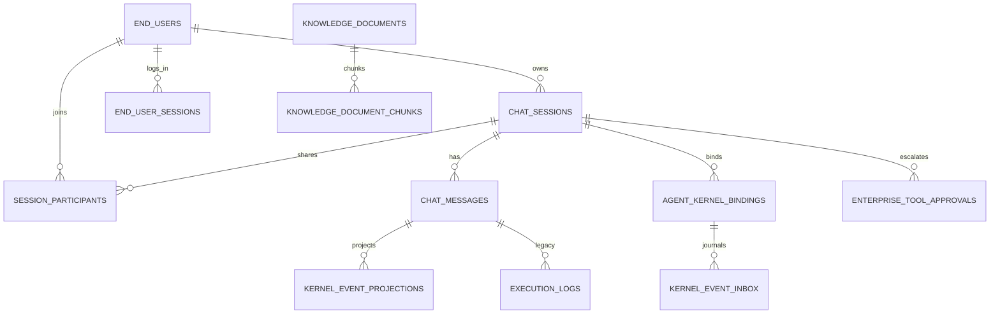
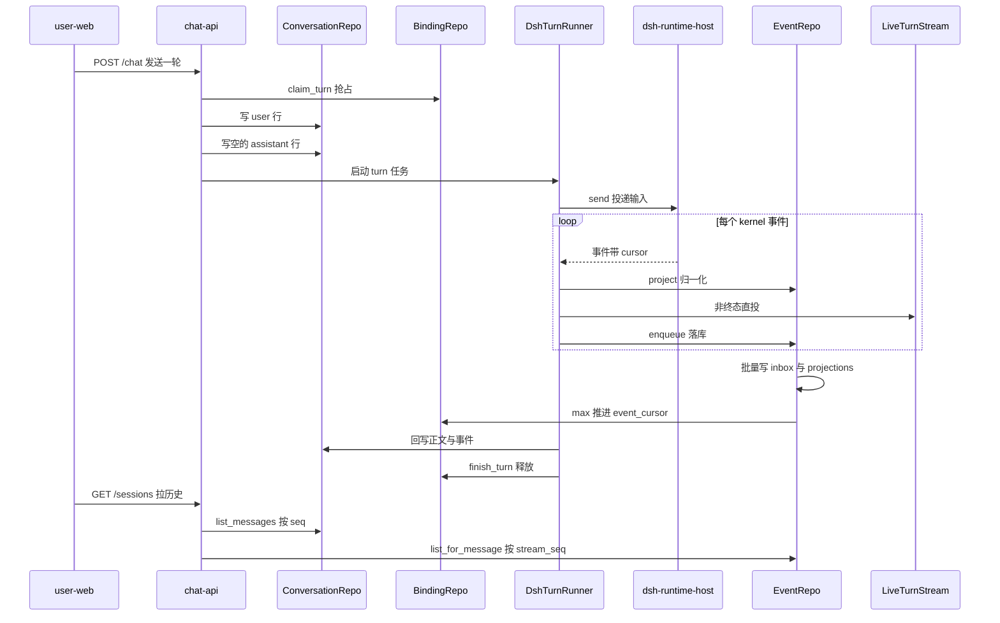

# MOVO 多租户数据模型与 Schema 演进

## 根因：一个 Agent 平台同时存在三份"真相"

MOVO 的数据模型值得单独拆，是因为它被三个互相拉扯的约束逼出来的。第一，DSH kernel 自己就是有状态组件：每个 runtime 把 `isolationKey` 做 sha256 后作为子目录挂在 `/data/dsh-runtime` 卷上
[services/chat-api/dsh/runtime-host/src/kernel-runtime.mjs:64-65]()
<!-- anchor: const storageKey = createHash('sha256').update(isolationKey).digest('hex') … this.storageRoot = resolve(storageRoot, storageKey) -->

[docker-compose.yml:348-349]()
<!-- anchor: dsh-runtime-data: … name: ${MOVO_VOLUME_PREFIX:-movo}_dsh-runtime-data -->
会话转录归 kernel 所有，MOVO 不解析它。第二，DSH 的**对外事件流**是进程内存态：host 的 `EventJournal` 用 `Map` 存事件、cursor 从 1 递增，`replay` 只能回放这个内存 journal 里的内容（进程重启后 journal 为空，需要 `resumeSession` 从 DSH 自己的 session persistence JSONL 里 `resetFromEvents` 重建）
[services/chat-api/dsh/runtime-host/src/event-journal.mjs:21-22]()
<!-- anchor: replay(sessionId, afterCursor = -1) { … return (this.#events.get(sessionId) ?? []).filter(event => event.cursor > afterC -->
第三，企业侧要的是跨进程、跨重启、可审计、按租户隔离的对话历史。

这三条约束决定了 MOVO 的数据模型不是"给业务建表"，而是**给一个不属于自己的有状态内核建投影层**。所有取舍最终都能回溯到一句：kernel 是唯一真源，但它的真源不可查询、不跨租户、不保证留存，所以 MOVO 必须在 Mongo 侧重建一份**可查询的派生真源**，并明确声明这份派生数据丢失时的语义边界。

## 存储选型：四种存储各守一条边界

| 存储 | 卷 | 实际职责 | 关键约束 |
|------|-----|----------|----------|
| MongoDB 6 | `movo_mongo-data` | 唯一的权威业务库（`MONGODB_DB=gragentic`）：会话、消息、绑定、事件投影、治理、身份、知识元数据 | 单库单连接，`init_db()` 建立全局 Motor client |
| 文件卷 `dsh-runtime-data` | `/data/dsh-runtime` | DSH kernel 自己的 session 落盘，按 `tenant:profile` 的 sha256 分目录 | 只有 `dsh-runtime-host` 进程持有，Python 侧只经 HTTP 访问 |
| Redis 7 | `movo_redis-data` | **仅** document-parser 的 Celery broker/backend，外加 admin-api 的就绪探针 | chat-api 全程不连 Redis |
| Weaviate 1.25 | `movo_weaviate-data` | **仅**存知识库 chunk 向量（只有 document-parser 读写），`vectorizer: none` | 元数据仍以 Mongo 为准 |

文件卷的归属需要单独说明：`docker-compose.yml` 里只有独立服务 `dsh-runtime-host` 的 `volumes` 挂载了它，chat-api 的 `volumes` 列表里没有这一项，Python 侧是经 `DSH_RUNTIME_HOST_URL` 走 HTTP 访问 kernel
[docker-compose.yml:123-125]()
<!-- anchor: volumes: … - dsh-runtime-data:/data/dsh-runtime -->
[docker-compose.yml:158-168]()
<!-- anchor: TOKEN_USAGE_PUSH_ENABLED: "false" … - knowledge-storage:/data/knowledge-documents -->

Mongo 侧是一个极简连接层——全局 client、一个库对象、超时全走环境变量
[services/chat-api/app/core/db.py:13-29]()
<!-- anchor: def init_db() -> None: … global _client, _db -->
这种朴素写法是刻意的：既然租户隔离靠文档内的 `main_id` 字段而非分库分片，连接层就没有路由复杂度，代价是**隔离责任完全下沉到每个 repository 的查询条件**——写错一个 `main_id` 就是跨租户泄漏，没有第二道防线。

关于 Redis 需要纠正一个常见预期：它**不是**会话缓存或分布式锁。全仓 `import redis` 为零；唯一真实用法是 document-parser 的 Celery 配置
[services/document-parser/app/workers/celery_app.py:7-15]()
<!-- anchor: celery_app = Celery( … task_default_queue=settings.celery_queue, -->
broker 与 backend 都指向同一个 Redis 实例
[docker-compose.yml:231]()
<!-- anchor: MOVO_DOC_PROCESSING_REDIS_URL: redis://redis:6379/0 -->
admin-api 里出现 Redis 的地方全是 TCP 探活
[services/admin-api/app/api/routes/setup.py:179-190]()
<!-- anchor: async def _probe_redis() -> SetupServiceStatus: … return SetupServiceStatus(key="redis", label="Redis", ok=False, message=str(exc) -->
`services/chat-api/app/` 下所有 `redis` 命中都是 `rediscover`/`redistribute` 这类英文词的子串误报。所以"Redis 做什么"的正确回答是：**异步文档处理的任务队列**，与对话数据模型正交。这个偏差值得记下——compose 里存在一个中间件，不等于数据模型依赖它。

Weaviate 侧同样克制：只有 document-parser 做向量读写，admin-api 仅做探活与配置，类名默认 `AskAIKnowledgeChunks`，`vectorizer` 显式设为 `none`，属性表就是 chunk 元数据的扁平坦本
[services/document-parser/app/services/vector_store.py:51-71]()
<!-- anchor: body = { … self._request_json("POST", "/v1/schema", body) -->
[services/admin-api/app/api/routes/setup.py:209-216]()
<!-- anchor: weaviate_ready = f"{str(settings.weaviate_endpoint).rstrip('/')}/v1/.well-known … _probe_http("weaviate", "Weaviate", weaviate_ready), -->
[services/admin-api/app/api/routes/knowledge_settings.py:24-41]()
<!-- anchor: os.getenv("ASKAI_ADMIN_KNOWLEDGE_WEAVIATE_ENDPOINT", "") … or os.getenv("MOVO_DOC_PROCESSING_WEAVIATE_DISTANCE_METRIC", "") -->
`mainId` 被作为普通 text 属性写入，而不是用 Weaviate 的 tenant 机制或独立 class——租户过滤在 MOVO 里始终是同一套 `where` 条件，多引入一层 Weaviate tenancy 只会让"哪边权威"更难回答。

## 实体关系总览

下图覆盖多租户身份、会话/消息、kernel 绑定、事件投影、知识库与治理五组实体。关系全是 Mongo 内的引用或跨存储副本，join 基本都在应用层完成（全仓只有一处例外：个人知识库的授权资源列表用了一段 `$lookup` + `$unwind` + `$facet` 聚合）。

图里刻意没有画 `organizations` 与 `runtime_profile_versions`：前者只在计费/配额路径被引用，后者是租户级单例配置而非业务实体，塞进同一张图只会混淆"数据关系"和"配置关系"。同理，实体的字段留给后面每张表的字段表，ER 图只回答"有哪些实体、怎么关联"。

## 租户键的选择：`main_id` 而非 `tenant_id`

MOVO 的租户隔离字段叫 `main_id`，并且有一条不寻常的语义：**空值等于默认租户**。
[services/chat-api/app/core/tenant.py:9-11]()
<!-- anchor: def resolve_main_id(value: Any = None) -> str: … return main_id or DEFAULT_MAIN_ID -->

[services/chat-api/app/core/tenant.py:14-25]()
<!-- anchor: def main_scope_filter(main_id: Any = None) -> Dict[str, Any]: … return {"main_id": resolved} -->
`main_scope_filter` 在 `main_id == "default"` 时展开成一个 `$or`，把**缺字段、空串、null** 三类历史文档一并纳入默认租户的可见范围。这是典型的渐进式加列：`main_id` 不是第一天就存在的字段，早期单租户数据没有它，靠读侧宽松匹配把老数据认领下来，而不是写一个 `update_many` 全库回填。代价是默认租户的查询永远走不了最优点位的复合索引（`$or` 退化成索引扫描 + 过滤），收益是升级路径上零停机、零回填、零误删。

这个选择在 repository 层被反复加固：`owned()` 用 `{_id, main_id, user_id}` 三条件定位，而 `list_messages()` 只用 `{main_id, session_id}`
[services/chat-api/app/api/endpoints/sessions.py:962-964]()
<!-- anchor: # Session-scoped read (todo 6): deliberately no viewer filter — the … # index and every member reads the full thread. -->
也就是说"能不能读这条会话"由调用方（owner 或 participant）判定，"读了看到什么"不再按 viewer 过滤。事件读取走同一条路线，`user_id` 参数只为"调用形状兼容"而保留
[services/chat-api/app/dsh_runtime/events/repository.py:192-204]()
<!-- anchor: # Conversation-scoped: events are attributed to the run's author at … ).sort("stream_seq", 1) -->

**把鉴权从数据查询里剥离、上移到端点层**是这套模型的核心安全姿态：数据层只保证 `main_id` 边界，成员资格是端点的责任。反过来说，一旦有人在 repository 里加回 `user_id` 条件，共享会话会静默地只对 owner 可见——这类回归没有编译期保护，只能靠注释和测试兜。

租户维度还延伸到 kernel 的物理隔离：runtime 的 `isolationKey` 是 `tenant:{tenant_id}:profile:{profile_version}`
[services/chat-api/app/dsh_runtime/runtime_coordinator.py:18-20]()
<!-- anchor: @staticmethod … return f"tenant:{tenant_id}:profile:{profile_version}" -->
它既决定同一租户共享一个 kernel runtime（省内存、共享 profile 编译结果），又通过 sha256 决定磁盘目录，让不同租户的 session 文件天然分流。注意隔离粒度是"租户 + profile 版本"而非"用户"——同租户所有用户共用一个 runtime 进程，用户边界只存在于 chat-api 的查询条件里。这是明知的取舍：进程级隔离按用户做，runtime 数量会随用户数线性膨胀。

## 核心集合的字段设计

### `chat_sessions`：会话元数据 + 已读态 + 共享态 + 运行态

被写入最频繁也最"杂"的一张表，同时承载标题、最后消息摘要、文档注册表、共享令牌哈希、当前运行锁、待审批计数。DSH 路径下的创建形态是
[services/chat-api/app/dsh_runtime/conversation/repository.py:152-167]()
<!-- anchor: async def create(self, *, tenant_id: str, user_id: str, title: str) -> dict[str, … "share_revoked_at": None, -->

| 字段 | 类型 | 约束 | 说明 |
|------|------|------|------|
| `_id` | ObjectId | 主键 | 被 `session_participants.conversation_id` 以字符串引用，被 `chat_messages.session_id` 以 ObjectId 引用 |
| `main_id` / `user_id` | string | `(main_id, user_id, updated_at)` 复合索引 | 租户键 + owner；缺失 `main_id` 即默认租户 |
| `updated_at` / `last_message_at` / `last_message_preview` | date/string | 倒序索引 | 列表页主排序键与免 join 预览 |
| `message_count` | int | — | 空会话删除判定（要求为 0） |
| `next_message_seq` | int | — | **per-session 序号分配器**，见下节 |
| `runtime_owner` | string | 固定 `"dsh"` | 标记该会话由 DSH 路径接管 |
| `share_token_hash` / `share_expires_at` / `share_revoked_at` | string/date | 唯一偏索引 `unique_main_share_token_hash` | 只存哈希；未共享时为 `null` 不入偏索引 |
| `active_run` | object | — | `{run_id, message_id, initiator_user_id, source, status, started_at}`；清理用 `$unset` |
| `pending_approval_count` | int | — | 审批聚合驱写的红点计数 |
| `document_registry` / `active_document_id` / `latest_artifact_ref` | array/string/object | — | 文档编辑路径的"当前文档"状态 |

会话列表一次建了 5 条索引（其中两条带 `_id` tie-breaker）：`user_id+updated_at`、它的 `_id` 变体、`user_id+created_at`、`main_id+user_id+updated_at`、以及它的 `_id` 变体；多出来的两个 `_id` 版本是为了让 `sort([("updated_at", -1), ("_id", -1)])` 完全落在索引里，避免同毫秒并列记录在翻页时错位
[services/chat-api/app/main.py:228-232]()
<!-- anchor: await db.chat_sessions.create_index([("user_id", 1), ("updated_at", -1)]) … await db.chat_sessions.create_index([("main_id", 1), ("user_id", 1), ("updated_a -->
值得注意的是 `end_users` 上唯一索引的失败处理方式与消息表**完全相反**：登录名索引建不起来（错误码 85）时只记 warning 并复用旧索引，不阻断启动
[services/chat-api/app/main.py:203-206]()
<!-- anchor: await db.end_users.create_index( … name="user_main_login_name_unique", -->
这说明 MOVO 对"数据不变量"是有分级的：**身份唯一性可以让步，消息顺序不能**。

### `chat_messages`：排序元数据与投影载荷

这张表承担三个角色：对话转录、每轮的事件投影、序号契约的载体。
[services/chat-api/app/dsh_runtime/conversation/repository.py:276-288]()
<!-- anchor: document = { … "runtime_owner": "dsh", -->

| 字段 | 类型 | 约束 | 说明 |
|------|------|------|------|
| `session_id` | ObjectId | `unique_main_session_seq` 第 2 键 | 指向 `chat_sessions._id`，是 ObjectId 而非字符串 |
| `main_id` / `seq` | string/int | `unique_main_session_seq` 第 1、3 键 | **per-session 单调连续序号**，从 1 开始 |
| `message_id` | string | 唯一偏索引 `unique_string_message_id` | 全局唯一，同时是幂等键与投影外键 |
| `role` / `content` | string | — | 最终答案在流式结束后一次性回写 |
| `execution_events` | array | — | **V3 事件投影数组**，终态时整体 `$set` 覆盖 |
| `evidence_bundles` | array | — | 证据包，仅非空时写入 |
| `message_type` | string | — | `normal` / `context_summary`；后者是压缩产物，UI 默认过滤 |
| `covers` | object | — | 仅摘要行有，`{start_seq, end_seq}` 记录覆盖的原始区间 |

索引契约被抽成跨模块共享的常量模块，因为**启动期建索引**与**离线修复脚本**必须对"什么算合法文档"有完全一致的理解
[services/chat-api/app/migrations/sequence_index.py:3-9]()
<!-- anchor: UNIQUE_MESSAGE_SEQ_INDEX_NAME = "unique_main_session_seq" … MESSAGE_SEQ_INDEX_KEYS = [("main_id", 1), ("session_id", 1), ("seq", 1)] -->
三个 `$type` 条件把索引限定为 partial index：只有 `main_id` 是字符串、`session_id` 是 ObjectId、`seq` 是 int 的文档才受唯一约束。这解决一个真实的历史包袱——早期写入的 `session_id` 是字符串，全量唯一索引会让这些老文档互相冲突甚至阻止启动。partial index 让新契约与老数据在同一张表里共存：**新写入严格遵守序号契约，老文档被排除在索引之外但仍可读**。

### 唯一索引 `(main_id, session_id, seq)` 解决什么问题

这是整个数据模型里信息量最大的设计点，它同时是并发控制、幂等保障和升级门禁。
分配序号不能靠 `count_documents`（并发下必然重号），MOVO 用会话文档上的 `next_message_seq` 做原子自增。但 MongoDB 不允许 `$inc` 和 `$max` 作用于同一字段的同一次操作，于是自增被写成 `$set` + `$max` 表达式
[services/chat-api/app/dsh_runtime/conversation/repository.py:244-251]()
<!-- anchor: # Session-scoped lookup: {_id, main_id} only, so a participant may … # cannot cause a collision on the next DSH turn. -->

[services/chat-api/app/dsh_runtime/conversation/repository.py:257-271]()
<!-- anchor: session = await self._sessions.find_one_and_update( … return_document=ReturnDocument.AFTER, -->
`{"$max": [{$add: [next_message_seq, 1]}, max_seq + 1]}` 的含义是**取"计数器 +1"与"当前实际最大 seq + 1"中的较大值**：前一项保证正常递增，后一项是修复性下限。如果某个 legacy writer 直接写了 `seq` 却没推进计数器，下一次 DSH 轮次不会撞号。这张表的设计默认存在**第二个写入者**，并且不要求它守规矩——与其消灭异构写入者，不如让主路径自愈。

即便如此竞态仍会发生，所以插入失败路径被显式二分
[services/chat-api/app/dsh_runtime/conversation/repository.py:291-301]()
<!-- anchor: await self._messages.insert_one(document) … ) from None -->
按 `message_id` 查到同一文档 = **幂等重放**，直接返回已有行；查不到才是序号被抢，抛 `MessageSequenceConflict`（带稳定 `code`），让端点层映射成可重试状态而不是未捕获的 500。把底层唯一键冲突拆成两个语义明确的业务错误，是最容易被忽略但收益最大的细节。

启动期则完全相反——**硬失败**。建唯一索引遇到 `OperationFailure` 时先用聚合找出冲突样本，再抛 `MessageSequenceIndexConflict`
[services/chat-api/app/dsh_runtime/conversation/repository.py:23-28]()
<!-- anchor: class MessageSequenceIndexConflict(RuntimeError): … automatically would corrupt the sequence contract. -->
它在 `startup_event` 里被调用
[services/chat-api/app/main.py:233-239]()
<!-- anchor: from app.dsh_runtime.conversation import ConversationRepository … await db.chat_messages.create_index([("main_id", 1), ("user_id", 1), ("session_i -->
理由是明确的：**允许它静默跳过索引或自动去重，序号契约就被悄悄破坏了**，之后每次写入都建立在不可信的排序上。宁可让新版本起不来，也不带着脏数据跑。这条规则只有配合下一节的离线修复工具才成立——否则就是把用户锁在门外。
`ensure_indexes()` 里还有一段容易读漏的兼容逻辑
[services/chat-api/app/dsh_runtime/conversation/repository.py:84-96]()
<!-- anchor: existing = (await self._messages.index_information()).get( … return -->
若现存同名索引的键序与 unique 标志都对，且 `partialFilterExpression` 是 `None` 或与当前契约一致，则**直接复用并返回**：一个已存在的全量唯一索引是比偏索引更强的约束，强行重建反而会把它降级。这是"MongoDB 索引没有真正的版本管理"的直接后果——只能靠读回索引元数据推断该不该动它。

### `session_participants`：owner 不在这里

参与者表有一个反直觉之处：**会话 owner 没有 participant 行**，成员资格分居两处。
[services/chat-api/app/dsh_runtime/conversation/participants_repository.py:1-8]()
<!-- anchor: """Non-owner participant memberships for shared conversations. … which is globally unique across tenants. -->
模块 docstring 顺带解释了唯一索引为什么可以省掉 `main_id`：`conversation_id` 存的是 session 的 ObjectId，本身全局唯一，加租户前缀是冗余。这是对"多租户字段一律进唯一索引"教条的合理例外——前提是引用 ObjectId 主键而非业务 ID。

| 字段 | 类型 | 约束 | 说明 |
|------|------|------|------|
| `conversation_id` / `user_id` | string | **唯一**复合索引 | `conversation_id` 存 session `_id` 的字符串形式 |
| `main_id` | string | `(main_id, user_id, joined_at desc)` 索引 | 服务"我参与的所有会话"列表 |
| `role` | string | — | 恒为 `"participant"`，owner 不在此表 |
| `joined_at` / `removed_at` | date | — | 软删除：`removed_at` 为 `null` 表示在册 |
| `last_read_seq` | int | — | 已读游标，对齐 `chat_messages.seq` |

[services/chat-api/app/dsh_runtime/conversation/participants_repository.py:24-32]()
<!-- anchor: async def ensure_indexes(self) -> None: … name="participant_memberships_by_user", -->
加入操作是 upsert + 唯一键冲突重试，作者在 docstring 里直接引用了 MongoDB 对并发 upsert 的处方
[services/chat-api/app/dsh_runtime/conversation/participants_repository.py:36-40]()
<!-- anchor: """Idempotently join ``user_id`` to ``conversation_id``. … remedy the loser retries the update, which then matches the winner's -->
这里有一个必须指出的瑕疵：重试时的 `$set` 会把 `last_read_seq` **重置为 0**，对已入会成员重复调用 `add` 会清空他的已读游标。而且这不依赖任何边角条件——**任何 `add()` 调用都会清零**，同一用户重复兑换同一个分享链接就会走到这条路径，所以它是可复现的行为，而不是需要特殊前置条件的隐患。作为"幂等 join"语义并不干净——真正的幂等应该用 `$setOnInsert` 区分首次与复入。相反，`remove` 只写 `removed_at` 不删行，让重入复用同一行并保留历史，这个取舍是对的。
[services/chat-api/app/dsh_runtime/conversation/participants_repository.py:48-59]()
<!-- anchor: update = { … await self._collection.update_one(filter, update, upsert=True) -->
[services/chat-api/app/api/endpoints/session_shares.py:152-155]()
<!-- anchor: if str(session_doc.get("user_id") or "") != principal.user_id: … tenant_id=principal.main_id, conversation_id=conversation_id, -->

### `agent_kernel_bindings`：会话到 kernel session 的权威映射

这张表是 MOVO 与 DSH 的接缝，也是全库唯一带"轮换"语义的表。
[services/chat-api/app/dsh_runtime/bindings/repository.py:22-31]()
<!-- anchor: async def ensure_indexes(self) -> None: … await self._collection.create_index([("tenant_id", 1), ("user_id", 1), ("convers -->
`one_current_kernel_binding_per_conversation` 是偏唯一索引，只约束 `current: true` 的行：一个会话在**任一时刻**只能有一个当前绑定，历史绑定可以无限堆积（`replacing` → `superseded` / `disposed`）。这解决了绑定轮换的原子性难题——不可能"先删后建"（中间有空窗），只能让 MongoDB 在插入瞬间判负。
`kernel_session_id` 单独建全局唯一索引很关键：它由 chat-api 侧铸造，形如 `dsh-{uuid4()}`
[services/chat-api/app/dsh_runtime/gateway.py:183]()
<!-- anchor: session_id = f"dsh-{uuid4()}" -->
因此天然全局唯一，可以作为 `kernel_event_inbox` 的唯一索引前缀而不需要租户维度。**每次轮换都换一个新的 kernel session**，这正是 cursor 命名空间能安全重启的原因——旧 session 的 cursor 序列不会与新 session 相撞。

| 字段 | 类型 | 约束 | 说明 |
|------|------|------|------|
| `binding_id` / `kernel_session_id` | string | 各自唯一 | `akb-{uuid4()}` / `dsh-{uuid4()}` |
| `tenant_id` / `user_id` / `conversation_id` | string | `(tenant_id, conversation_id)` 偏唯一（`current: true`） | 租户/所有权/会话三元定位 |
| `runtime_id` | string | — | 指向 kernel runtime，重建后可被 `update_runtime` 改写 |
| `profile_version` / `model_instance_id` / `preset_id` | string | — | 决定该会话用哪套 Agent profile、模型与预设 |
| `execution_location` | string | 枚举 `server`/`desktop`/`remote_sandbox` | `server` 禁止引用本地 workspace |
| `dsh_workspace_id` / `git_branch` / `base_commit` / `detached_head` / `worktree` | — | — | 桌面与代码会话的 workspace / git 上下文 |
| `status` / `current` | string/bool | `current` 是偏索引条件 | `idle`/`running`/`failed`/`cancelled`/`replacing`/`superseded`/`disposed`，另有释放失败时的 `disposal_pending`（列举非穷举） |
| `event_cursor` | int | — | **已持久化的最大 kernel cursor**，只增不减 |
| `active_turn` | object | — | `{message_id, request_id, status, turn_context, started_at, finished_at, suspension_id, ...}` |
| `replaces_binding_id` | string | — | 轮换链，指向前驱 |

`status` 的取值不是穷举：`dispose_session` 抛错时绑定先落 `disposal_pending`，释放成功才写 `disposed`
[services/chat-api/app/dsh_runtime/bindings/repository.py:260-266]()
<!-- anchor: await self._collection.update_one( … "active_turn": None, -->

`event_cursor` 用 `$max` 推进
[services/chat-api/app/dsh_runtime/bindings/repository.py:199-202]()
<!-- anchor: async def advance_cursor(self, binding_id: str, cursor: int) -> None: … {"$max": {"event_cursor": int(cursor)}, "$set": {"updated_at": datetime.utcnow() -->
这不是防御性写法而是必需的：批量写入可能乱序完成，`$max` 保证游标在任何交错下都不回退。它同时是"重连从哪里续"的唯一依据。

轮换的失败回滚是**用偏唯一索引做乐观锁**的完整范式：先把前驱置为 `current: false, status: "replacing"`，插入后继；若插入抛错，回查确认没有 current 行才把前驱恢复
[services/chat-api/app/dsh_runtime/bindings/repository.py:113-128]()
<!-- anchor: await self._collection.insert_one(row) … {"$set": {"status": "superseded", "updated_at": datetime.utcnow()}}, -->
成功则把前驱终结为 `superseded`。任何一步崩溃，偏唯一索引都保证不会出现两个 current 绑定，恢复逻辑只需处理状态字段。

另一个值得一提的细节是 `by_message` 按 `active_turn.message_id` 反查绑定
[services/chat-api/app/dsh_runtime/bindings/repository.py:148-156]()
<!-- anchor: async def by_message(self, message_id: str, *, tenant_id: str) -> dict[str, Any] … "active_turn.message_id": message_id, -->
这条查询**没有对应索引**——`agent_kernel_bindings` 只有 `(tenant_id, user_id, conversation_id)` 复合索引，这个等值查询会退化成集合扫描。当前绑定行数与会话数同阶所以可接受，但这是后续要补的索引。注释同时解释了 `user_id` 为什么被刻意去掉：任一成员发起的终态恢复都必须能找到该绑定。

### `kernel_event_inbox` 与 `kernel_event_projections`：同一批事件存两遍

这是本关注面最重要的决策。DSH 每产生一个原生事件，MOVO 同时写两个集合
[services/chat-api/app/dsh_runtime/events/repository.py:24-38]()
<!-- anchor: class KernelEventRepository: … [("tenant_id", 1), ("user_id", 1), ("message_id", 1), ("stream_seq", 1)] -->

- **inbox**：原生事件的**归档**，保存 `event.model_dump()` 的完整 raw payload（字段名就叫 `kernel_event`），唯一索引是 `(kernel_session_id, cursor)` 与 `event_id`。注释明说它的用途是审计，UI 不读。
- **projections**：归一化后的 **V3 UI 事件**，唯一索引 `event_id`，查询索引 `(tenant_id, user_id, message_id, stream_seq)`。UI 只读它。

为什么要存两遍而不是只留投影？因为**投影是有损的**。`KernelEventProjector` 主动丢弃或改写大量信息，例如原生审批事件被整个 `return None`
[services/chat-api/app/dsh_runtime/events/projection.py:141-145]()
<!-- anchor: elif event_type in {"tool.approval.requested", "tool.approval.decided"}: … return None -->
理由写在注释里——原生 `decided` 事件不带 `callId`，无法安全驱动 UI 状态，所以审批的 UI 权威另立一张 `enterprise_tool_approvals` 表，原生事件只留在 inbox 做审计。同理 `skill` 这个内部工具调用被过滤，因为它对用户不可见。

如果只有投影表，这类"被有意丢弃的原生事实"就永久消失了，而审计恰恰需要这些丢弃记录。所以 inbox 不是冗余，它是**投影的证词**。代价是存储翻倍且两表之间没有事务，它们的最终一致性靠一个精巧的重放不变式兜底
[services/chat-api/app/dsh_runtime/events/repository.py:116-123]()
<!-- anchor: async def persist() -> None: … await asyncio.gather(*operations) -->
两个集合的 `bulk_write` 用 `asyncio.gather` 并发提交，任一方失败就整体重试；**跨集合没有原子性**（不是事务，两边的提交互不等待），重复由 `event_id` 唯一索引与 op 级的 `$setOnInsert` 吸收；因为每个 op 都是 `$setOnInsert` + 稳定的 `event_id`，**重放整批只会补上缺的那一半**。这是一个"无事务的幂等双写"范式：用幂等写替代两阶段提交，用确定性 ID 替代协调者。

批次由独立协程聚合，容量 256、延迟 200ms，docstring 明说目标是"不背压实时流"
[services/chat-api/app/dsh_runtime/events/durable_writer.py:24]()
<!-- anchor: """Persist ordered events in batches without backpressuring the live stream.""" -->
实时路径绝不能等落库，否则一次 Mongo 抖动就会卡住模型输出。代价是**崩溃会丢掉整个未落库的内存队列**——队列是无界 `asyncio.Queue()`，入队用 `put_nowait`、没有任何背压，所以丢掉的可能远多于一个批次——这就是"投影是派生真源"的具体含义，也是 inbox 必须保留足够原生信息的原因：丢失的事件无法从投影反推。
[services/chat-api/app/dsh_runtime/events/durable_writer.py:48-54]()
<!-- anchor: self._queue: asyncio.Queue[KernelEventWrite | _FlushBarrier | object] … self._queue.put_nowait(write) -->

### 两种序号：`cursor` 与 `stream_seq` 不能混用

契约里有两个看起来重复、语义完全不同的事件标识
[services/chat-api/app/dsh_runtime/contracts/events.py:23-34]()
<!-- anchor: class KernelEventEnvelope(EventContractModel): … source: KernelEventSource -->

- `event_id`：全局唯一、跨重启稳定，用作幂等键（`$setOnInsert` 的匹配条件）与投影 ID 前缀。
- `cursor`：**kernel 原生序号**，在单个 kernel session 内从 1 递增，进程重启后从 1 重来，只在 `(kernel_session_id, cursor)` 下唯一。

投影行里还有第三个序号，初看就是把 cursor 透出
[services/chat-api/app/dsh_runtime/events/projection.py:170-179]()
<!-- anchor: result: dict[str, Any] = { … "payload": payload, -->
但 `TurnEventChannel` 会在发布前**覆盖**它
[services/chat-api/app/dsh_runtime/events/turn_channel.py:119-124]()
<!-- anchor: def _sequence(self, row: dict[str, Any]) -> dict[str, Any]: … "stream_seq_end": self._next_stream_seq, -->
`stream_seq` 是 MOVO 侧为"一个 turn 内的有序时间线"重新编的号，从 1 单调递增。**`cursor` 是 kernel 的账本编号（续传与幂等），`stream_seq` 是 UI 的显示编号（排序与增量读取）**。投影表的查询索引建在 `stream_seq` 上，因为 UI 的 `after_cursor` 语义是"我已经渲染到第几条时间线元素"，而非"kernel 走到第几个事件"。混淆两者会导致重连时出现空洞或重复。

`stream_seq` 在锁内分配，因此**所有事件源共享同一个计数器**——kernel 原生事件、浏览器 Agent 的 side-band 行、ASKAI 自造的审批卡片排在同一条时间线上。这解释了 `publish_standalone` 的存在
[services/chat-api/app/dsh_runtime/events/turn_channel.py:62-68]()
<!-- anchor: async def publish_standalone(self, row: dict[str, Any]) -> None: … items are first-class timeline items and can be persisted immediately. -->
审批请求 ID 由 DSH 审批协议生成，与模型的 tool-call ID 不同；若把它当"工具子进度"就会永远排队等一个不会出现的父项。作者给这类行开了一条"立即持久化"的旁路。这是**在没有统一事件模型的前提下用一条特例通道换正确性**的典型妥协：不优雅，但消除了死锁。

### 单轮 turn 的完整写入路径

终态事件是这条链路上唯一的例外
[services/chat-api/app/dsh_runtime/turn_runner.py:146-154]()
<!-- anchor: is_terminal = event.type in {"turn.completed", "runtime.failed"} … writer.enqueue(KernelEventWrite(event=event, projected=projected)) -->
`publish_live=not is_terminal`：终态**不直投 SSE**，只走持久化，由 finally 块在落库完成后统一发布
[services/chat-api/app/dsh_runtime/turn_runner.py:295-297]()
<!-- anchor: if terminal_projection is not None: … live_stream.finish() -->
这是"事件双轨"里最反直觉的一条，动机是**顺序与真相的绑定**：如果终态先到客户端、落库却失败，UI 会显示"已完成"而历史里是失败或缺失，用户永远看不到纠正。把终态押后到持久化成功之后，等于让"UI 认为结束"和"数据认为结束"同时发生。代价是终态延迟增加一个批量落库往返——这是用尾延迟换最终一致性正确性的交易。
实时轨则刻意不落库
[services/chat-api/app/dsh_runtime/events/live_stream.py:1]()
<!-- anchor: """Process-local, zero-database live delivery for one DSH turn.""" -->
`LiveTurnStream` 就是一个 `asyncio.Queue`。**它是进程内的**，意味着 chat-api 多副本部署时 SSE 订阅必须落到持有该 turn 的实例上——社区版 compose 起单副本，所以这个限制被隐藏了。一旦水平扩容，这里需要跨实例转发（Redis pub/sub 或 sticky routing）。这是必须在数据模型文档里点明的边界：**实时轨的正确性依赖单写者假设**。

消费侧的写法强化了这个边界
[services/chat-api/app/dsh_runtime/chat_service.py:392-401]()
<!-- anchor: async def stream(self, turn: PreparedTurn, *, tenant_id: str, user_id: str) -> A … yield json.dumps(row, ensure_ascii=False, separators=(",", ":")) + "\n" -->
`live_stream` 不存在时直接抛 `live_turn_stream_not_found`——实时流只能由本进程内的 `LiveTurnStream` 提供，不存在"从库里重建一条流"的兜底；跨进程或断线重连一律走 `snapshot`，由 `list_for_message` 从 Mongo 按 `after_cursor` 补齐——**实时轨只服务在线，持久轨服务一切**。
[services/chat-api/app/dsh_runtime/chat_service.py:407-433]()
<!-- anchor: async def snapshot( … after_cursor=after_cursor, -->

### `runtime_profile_versions`：租户级不可变配置

Agent profile 也是数据模型的一部分，因为它决定 kernel 里跑什么、以及 runtime 的隔离键。
[services/chat-api/app/dsh_runtime/profile/store.py:88-96]()
<!-- anchor: async def ensure_indexes(self) -> None: … name="one_active_runtime_profile_per_tenant", -->

| 字段 | 类型 | 约束 | 说明 |
|------|------|------|------|
| `profile_version` | string | 唯一 | **发布后不可变**：同版本内容不同则 `publish` 抛错 |
| `tenant_id` | string | `one_active_runtime_profile_per_tenant` 偏唯一 | 每租户至多一个 `active: true` |
| `active` | bool | 偏唯一索引条件 | 激活标记 |
| `snapshot` | object | — | 编译后的 profile 全量快照 |

设计语言是**不可变版本 + 单活跃指针**：回滚不改旧版本，只切 `active`。审计表 `runtime_profile_audit` 单独存在、按 `(tenant_id, occurred_at desc)` 检索。这与 `agent_kernel_bindings` 的 `current` 偏索引是同一个模式复用——MOVO 在多个地方用"偏唯一索引表达单例约束"。

## Schema 演进策略：加法优先、修复例外

MOVO 没有引入 Alembic / Flyway 这类通用迁移框架。迁移层是一个极短的 `__main__`，只做一件事
[services/chat-api/app/migrations/__main__.py:1]()
<!-- anchor: """Run additive database migrations before a new image replaces the old one.""" -->

[services/chat-api/app/migrations/__main__.py:29]()
<!-- anchor: print("Database indexes are ready; existing documents were not modified.") -->
CLI 包装说明它的运行时机是**旧版本仍在服务、新镜像已就位**之间
[deploy/cli/migrations.sh:3-9]()
<!-- anchor: # Run the new image's additive migrations before replacing a running chat-api. … python -m app.migrations; then -->
（`movo_compose run --rm --no-deps`，不启动任何依赖，只借用现有网络）。"迁移先于替换"的顺序，加上"只建索引不改文档"的内容约束，构成了升级路径的安全基础：**任何时刻都可以中止在新旧之间而不留半成品状态**。

三个脚本的职责正好对应三类演进风险。

**`session_sharing.py`——最低风险的纯加索引**，只调两个 repository 的 `ensure_indexes`

[services/chat-api/app/migrations/session_sharing.py:1-4]()
<!-- anchor: """Non-destructive, repeatable session-sharing upgrade for existing MongoDBs. … Only indexes are created; existing documents are never rewritten or deleted. -->
"repeatable" 是它的全部要点：可以对着任何版本的库反复跑，结果相同。共享会话需要的新索引（分享令牌哈希、参与者唯一键）都是纯增量的，不需要任何数据操作。

**`sequence_index.py`——被三方复用的契约常量**。它不是脚本，而是一份被三处共享的声明：启动期建索引、离线修复脚本、冲突检测聚合。抽成模块的原因是这三处必须对"什么是合法文档"给出完全一致的答案——如果启动期用偏索引过滤而修复脚本用全量聚合，修复工具会报告一批根本不受索引约束的"冲突"。

**`sequence_repair.py`——唯一的破坏性操作，因此防护最重**。docstring 声明三条纪律：必须停写、必须先归档、只改排序元数据不动消息

[services/chat-api/app/migrations/sequence_repair.py:1-4]()
<!-- anchor: """Repair duplicate per-session message sequence numbers during maintenance. … first. This module changes ordering metadata only; it never removes messages. -->
第三条在代码里被强制校验：修复完成后逐行比较除 `seq`/`covers` 之外的所有字段，任一变化就抛错
[services/chat-api/app/migrations/sequence_repair.py:124-127]()
<!-- anchor: for row in actual: … raise RuntimeError(f"message content verification failed for {row['_id']}") -->
前置条件同样是代码强制而非文档约定
[services/chat-api/app/migrations/sequence_repair.py:131-134]()
<!-- anchor: def main() -> int: … return 2 -->
必须显式传入 `MOVO_SESSION_FIX_WRITES_STOPPED=1`，否则拒绝执行。CLI 侧把"停写"实现成一个可回滚事务：停 chat-api → 确认无残留进程 → `mongodump` 全库归档 → 对归档做 `mongorestore --dryRun` 验证 → 才允许修复
[deploy/cli/sequence-fix.sh:84-87]()
<!-- anchor: movo_msg fix_stopping … return 1 -->

[deploy/cli/sequence-fix.sh:116-119]()
<!-- anchor: MOVO_FIX_BACKUP_VALID=true … movo_msg fix_backup_complete "${backup_dir}" -->
它监听 EXIT/INT/TERM，任何中断都用备份回滚 `chat_messages`/`chat_sessions`/`session_participants` 三个集合并重启服务。**一个修复脚本配了完整的备份-验证-回滚机制**，本身就说明了这类操作的风险等级。

为什么需要它而不是让启动逻辑自愈？因为唯一索引**不可协商**：启动期发现重复会直接 abort，服务起不来，用户没有界面可操作。把修复做成需要人工确认（`--yes` 或交互输入 `FIX`）、需要维护窗口的独立工具，是在"自动修复可能造成静默数据损坏"与"服务不可用"之间选的第三条路。

修复算法本身有两处细节值得学。第一是排序键的三级构造——`seq` 是否为 int、`created_at`、`_id` 字符串
[services/chat-api/app/migrations/sequence_repair.py:41-49]()
<!-- anchor: def key(row: dict[str, Any]) -> tuple[Any, ...]: … return sorted(rows, key=key) -->
`_id` 作为最终 tie-breaker 保证排序确定性，否则两个 `created_at` 相同的行在两次运行里可能拿到不同新序号，而修复必须可重放。非 int 的 `seq` 被排到最后而不是丢弃。

第二是重编号必须分两趟
[services/chat-api/app/migrations/sequence_repair.py:105-112]()
<!-- anchor: # Two passes avoid transient key collisions if another unique index exists. … db.chat_messages.update_one({"_id": row["_id"]}, {"$set": patch}) -->
先把所有行的 `seq` `$unset` 掉，再统一写入新值。若一趟直接 `$set`，中间状态会出现两行暂时共享同一个 `seq`，撞上唯一索引。注释里的 "if another unique index exists" 说明作者把未来可能加的约束也当成了设计输入——**把一个暂时性约束违反当作正式问题来解**。

修复还顺带维护两处派生数据：摘要行的 `covers` 区间按新旧序号映射重算（区间为空则抛错），参与者的 `last_read_seq` 被映射到"新序号中不大于旧游标的最大值"
[services/chat-api/app/migrations/sequence_repair.py:89-102]()
<!-- anchor: participants = list(db.session_participants.find({ … default=0, -->
最后回写 `chat_sessions.next_message_seq = len(rows)`。这说明 `last_read_seq` 是**真实的外键式引用**——任何改动 `seq` 的操作都必须级联更新它，否则已读态错位。这类隐式引用是文档型数据库缺少外键约束的直接代价。

## 读写路径：UI 拿到的历史是三条来源的合并

历史读取的关键在这段合并逻辑
[services/chat-api/app/api/endpoints/sessions.py:1006-1016]()
<!-- anchor: # Prefer finalized V3 logs. Older records are imported at this read boundary … exec_events_by_msg_id[message_id] = events -->
它先并行读 `execution_logs`（V2 老格式）和 `execution_runs_v3`（V3 格式），后者覆盖前者；再逐条消息回退到 `chat_messages.execution_events`
[services/chat-api/app/api/endpoints/sessions.py:1042-1048]()
<!-- anchor: msg_id_val = str(msg.get("message_id") or "") … events_for_msg = normalize_execution_history(events_for_msg) -->
这段代码的实际语义与注释有微妙偏差。注释说 "Prefer finalized V3 logs"，但 `stored_events_for_msg`（即 `chat_messages.execution_events`）**只在 `events_for_msg` 为空时才生效**，真正的优先级是「独立事件集合 > 内嵌数组」。对 DSH 路径没有影响，因为没有任何生产代码往 `execution_logs` / `execution_runs_v3` 写**新事件**——这两张表唯一的生产侧改动是 `session_persistence_service` 的 rekey 改写（`update_many` 把已有行的 `session_id`/`main_id` 重指向当前会话）
[services/chat-api/app/services/session_persistence_service.py:549-566]()
<!-- anchor: async def _rekey_execution_logs(self, *, session_id: ObjectId, main_id: str … log_print(f"[session_persistence] rekey execution_runs_v3 failed: -->

这一点值得单独确认：`V3StreamRecorder` 类虽然存在且完整
[services/chat-api/app/infrastructure/execution_events/persistence.py:9]()
<!-- anchor: COLLECTION_NAME = "execution_runs_v3" -->
但全仓搜索下来它只在 `tests/runtime/test_stream_recorder_recovery.py` 里被实例化，生产代码没有调用点；`session_persistence_service` 对 `execution_runs_v3` 的唯一操作是把 `session_id`/`main_id` 重指向正确的会话
[services/chat-api/app/services/session_persistence_service.py:561-565]()
<!-- anchor: await get_db().execution_runs_v3.update_many( … except Exception as exc: -->
所以这两张表是**遗留读取通道**，服务 DSH 接管之前的历史会话，而 DSH 会话的事件全部落在 `chat_messages.execution_events`。这是"旧格式只读、只留 rekey 一处改写"的教科书式收尾。

legacy 路径的写入形态是往单个文档里 `$push` 一个数组
[services/chat-api/app/historical/legacy_execution_logs/store.py:37-52]()
<!-- anchor: await self._coll.update_one( … upsert=True, -->
它与 DSH 路径的 `kernel_event_projections`（每事件一行）形成鲜明对比：内嵌数组一次 `find_one` 就能读整个 turn、最快，但**不支持增量读**（只能全取再过滤）、并发追加要争文档锁、受 16MB 限制、重放会重复 push。逐行文档多一次索引范围扫描，却天然支持 `stream_seq > after_cursor`、每行独立 upsert 无锁、无大小风险、`event_id` 唯一索引天然幂等。

DSH 路径选逐行，正是因为实时流需要**增量读**与**幂等写**这两个内嵌数组给不了的能力。老路径那套还得额外处理 16MB 上限，`BaseStreamRecorder` 里专门有把 base64 截图外置到 OSS、失败则替换为 `<stripped:NB>` 占位的逻辑
[services/chat-api/app/historical/legacy_execution_logs/recorder.py:22-27]()
<!-- anchor: def _strip_heavy_blobs(obj: Any) -> None: … 16MB document limit. -->
逐行模型让 DSH 路径完全不需要这段代码。**这是"存储粒度决定下游代码复杂度"的清晰案例。**

单轮写入的集合清单可以概括为：抢占 `agent_kernel_bindings.active_turn` → 写两行 `chat_messages` → 写 `chat_sessions.active_run` → 流式期间批量写 `kernel_event_inbox` + `kernel_event_projections` → 推进 `event_cursor` → 终态回写 `chat_messages.content/execution_events/evidence_bundles` → 清空 `active_run` 并更新会话计数。

回写投影是整轮唯一的"非幂等直觉点"
[services/chat-api/app/dsh_runtime/turn_runner.py:256-263]()
<!-- anchor: history_events.sort(key=lambda row: int(row.get("stream_seq") or 0)) … evidence_bundles=evidence_bundles, -->
`update_assistant_projection` 用 `$set` 整体覆盖 `execution_events`，匹配条件是 `{message_id, main_id}`。如果同一轮被恢复逻辑重跑，覆盖会**丢弃新数组里没有的行**——包括那些已持久化到 `kernel_event_projections` 的行。由于 `history_events` 是内存里按 `stream_seq` 累积的，崩溃恢复后的重跑只能拿到重放段的事件。这是双轨模型的真实缺口：**逐行投影是累积真源，内嵌数组是快照**，两者在异常路径上可能不一致；生产代码靠 `_terminal_recovery.ingest_once` 收敛，但值得作为已知风险记录。

## 知识库：Mongo 存元数据、Weaviate 存向量

知识侧是标准的两段式。`knowledge_documents` 存文档全生命周期状态
[services/admin-api/app/api/routes/knowledge_documents.py:730-733]()
<!-- anchor: doc = { … "scope": document_scope, -->

| 字段 | 类型 | 约束 | 说明 |
|------|------|------|------|
| `_id` | string | 主键 | **自定义字符串 ID**，便于直接用于 OSS key 与 chunk 引用 |
| `main_id` | string | 几乎所有索引的前缀 | 租户键 |
| `scope` / `owner_user_id` / `resource_id` | string | `(main_id, scope, owner_user_id, resource_id, deleted_at, updated_at)` | `organization` / `personal` 的分叉与授权锚点 |
| `knowledge_base_id` | string | `(main_id, knowledge_base_id, deleted_at, updated_at)` | 实为目录 ID，字段名与语义有历史偏差 |
| `storage_type` / `storage_bucket` / `storage_key` / `local_path` | string | `(main_id, storage_type)` | 本地盘与 OSS 双后端抽象 |
| `checksum` | string | `(main_id, checksum)` | 去重检测 |
| `status` | string | `(main_id, status, updated_at)` | `uploaded`/`pending_parse`/`parsed`/`indexed`/`failed` |
| `parse_*` / `index_*` / `preview_*` | — | `parse_job_id`、`preview_job_id` 单列索引 | 解析、向量化、预览三条流水线各自的作业回执与错误 |
| `vector_store_type` / `vector_collection_name` | string | — | 冗余记录向量落点，支持多向量库 |
| `created_at` / `updated_at` / `deleted_at` | date | `(main_id, deleted_at, updated_at desc)` | **软删除**：`deleted_at` 为 `null` 表示有效 |

[services/admin-api/app/api/routes/knowledge_documents.py:1582-1597]()
<!-- anchor: async def ensure_indexes() -> None: … await db[CHUNK_COLLECTION].create_index([("main_id", 1), ("knowledge_base_id", 1 -->
`chunk` 侧是两个集合的镜像：`knowledge_document_chunks` 在 Mongo 存全文与结构，Weaviate 存向量与可过滤元数据。`knowledge_chunks_doc_stage_order` 服务"读某文档某阶段的 chunk 并按 ord 排序"这个主查询。`chunk_stage` 区分 `raw` 与 `rag` 两阶段——同一篇文档的原始切片与检索用切片共存一表。chat-api 侧的读取逻辑先探测存不存在 `raw` 阶段再决定读哪种
[services/chat-api/app/enterprise_capabilities/knowledge/document_reader.py:66-76]()
<!-- anchor: stage = "raw" if await db.knowledge_document_chunks.count_documents({**base, "ch … cursor = db.knowledge_document_chunks.find(query).sort([("ordinal", 1), ("_id",  -->
用 `count_documents` 做存在性探测而不是在文档上存标记位，是刻意的**不引入冗余状态**：代价是每次读取多一次 count 查询，收益是永远不会出现"标记说有 raw 但实际没有"的不一致。
Weaviate 的属性表与 Mongo chunk 字段几乎一一对应，只有 `knowledgeBaseId` 是过滤用而 Mongo 侧存在文档上。`vectorizer: none` 意味着向量由 document-parser 算好后灌入，Weaviate 不做任何推理——它退化成"带 ANN 索引的属性存储"。因此它的 schema 演进必须与 Mongo 侧手工保持同步，没有共享的迁移机制。这是跨存储模型的固有代价，也是为什么 MOVO 把向量库的读写全部收拢在 document-parser 一个服务里（admin-api 只有探活与设置项，不碰向量数据）。

## 治理数据的落点

`enterprise_tool_approvals` / `enterprise_action_receipts` / `enterprise_tool_audit` / `enterprise_session_approval_grants` 由同一个 repository 管理，索引全部以 `(tenant_id, ...)` 开头
[services/chat-api/app/enterprise_capabilities/tools/repository.py:25-43]()
<!-- anchor: async def ensure_indexes(self) -> None: … name="active_session_approval_grant", -->
审批表的存在理由正是上面提到的投影有损：原生 DSH 审批事件不带 `callId`，**无法安全驱动 UI 状态**，所以 MOVO 自己建一张带 `action_id` 唯一索引的权威表。这是"企业能力外挂"在数据层的体现——不是包装内核概念，而是在内核概念无法满足需求时**另立权威**。

工具参数与结果这类任意嵌套数据被显式编码成 JSON 字符串存储
[services/chat-api/app/enterprise_capabilities/tools/persistence_codec.py:9-11]()
<!-- anchor: def encode_json_field(value: Any) -> str: … return json.dumps(value, ensure_ascii=False, default=str, separators=(",", ":")) -->
docstring 一句话点明动机：`without exposing its keys to BSON semantics`。MongoDB 字段名不能含 `.`、不能以 `$` 开头，而工具参数是外部输入的任意 JSON——直接存会让用户的 `{"a.b": 1}` 或 `{"$set": ...}` 触发写入错误甚至操作符注入。**把不可信结构包成字符串、只把需要索引的字段提升为顶层列**，这是文档型库里处理任意 payload 的标准防御，也让这些字段彻底不可能被索引（有意的）。

也有一处必须诚实指出的弱点：`ActionReceiptStore._persist` 吞掉所有异常
[services/chat-api/app/governance/action_receipt_store.py:192-201]()
<!-- anchor: async def _persist(self, receipt: ActionReceipt) -> None: … return -->
它的设计是"内存缓存为主、Mongo 为尽力持久化"：`upsert` 先 `_cache` 再 `_persist`，落库失败时当前进程内的 `find_by_idempotency` 仍命中。单实例下没问题；多实例或重启后，幂等保证退化成"本地内存命中"。`recover_stale_running` 启动时扫描 `running` 超时记录、按证据可信度判定 `succeeded` 或 `abandoned`，是对这个弱持久化模型的补偿。相对于 `kernel_event_inbox` 那种"最多 4 次有界重试、仍失败则整轮失败"的持久化，治理凭证走的是另一条路线——**一致性等级在同一系统内被有意分层**。
[services/chat-api/app/dsh_runtime/events/persistence_retry.py:27-36]()
<!-- anchor: @dataclass(frozen=True) … DEFAULT_PERSISTENCE_RETRY_POLICY = PersistenceRetryPolicy() -->
[services/chat-api/app/dsh_runtime/events/persistence_retry.py:105-121]()
<!-- anchor: except Exception as error: … logger.warning( -->

## 可迁移的模式

**一、给不属于自己的有状态组件建投影层，并声明投影的权威等级。** MOVO 没有读取或改写 kernel 的磁盘 session，而是在 Mongo 重建派生真源，并用"inbox 保存原生、projections 保存归一化视图"的双层结构保留反推能力。判据是：**如果投影丢失，还能否从原始记录重建？**答案若否，inbox 这层就不能省。

**二、用偏唯一索引表达单例约束，替代应用层锁。** `one_current_kernel_binding_per_conversation`、`one_active_runtime_profile_per_tenant`、`unique_main_share_token_hash`、`unique_string_message_id` 都是这个手法。它把"同一时刻只能有一个"交给存储引擎在插入瞬间判定，消除"先查后写"的竞态窗口。代价是**约束只对满足 `partialFilterExpression` 的文档生效**，读代码时必须同时看过滤表达式才能理解约束的真实范围。

**三、把"不可协商的不变量"和"可以让步的历史包袱"分开处理。** `chat_messages` 的序号唯一索引建不起来就拒绝启动，`end_users` 的登录名唯一索引建不起来只记 warning。可迁移的做法是：为每个唯一约束写一句"如果它不成立，系统还能不能正确运行"，答案决定该 abort 还是该降级。

**四、离线修复要配齐前置闸门、可回滚备份和结果校验，而不是写个 `update_many`。** `sequence_repair` 的完整形态是：环境变量写停标志（代码强制）→ 停服务并确认无残留 → 全库归档 → 归档 dry-run 验证 → 双趟重编号规避暂时冲突 → 逐行比对非排序字段 → 级联更新派生引用 → 再次扫描确认无冲突。关键是**级联更新必须显式枚举**——文档型库没有外键，所有隐式引用都得靠人记住。

**五、序号要区分"账本编号"与"显示编号"。** kernel cursor 与 MOVO `stream_seq` 各有用途，混用会在重连时产生空洞或重复，而这类 bug 只在断线场景复现。判据是：**如果这个序号在对方进程重启后会重来，它就绝不能作为 UI 排序或去重的依据。**

最后回到全局。这些集合没有一处是为"企业级"这个标签而存在的：`main_id` 的宽松匹配是为了升级不停机，`kernel_event_projections` 的逐行模型是为了 SSE 增量读，`stream_seq` 与 `cursor` 的分离是为了重连，`sequence_repair` 的全套防护是因为启动逻辑选择了硬失败。每一条都是被 DSH 内核的具体性质——进程内 journal、随重启重置的 cursor、不可查询的磁盘 session——逼出来的。**先理解内核的边界，数据模型的样子就基本确定了。**
