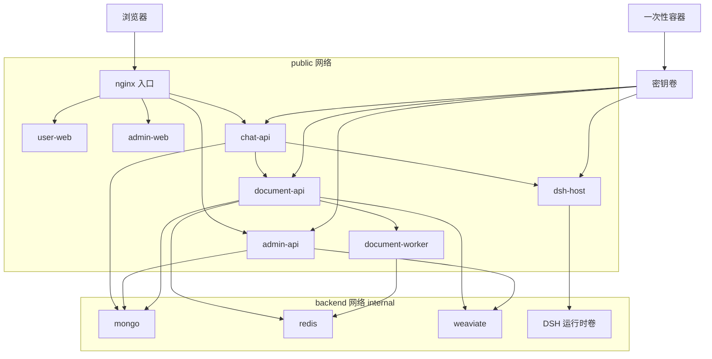
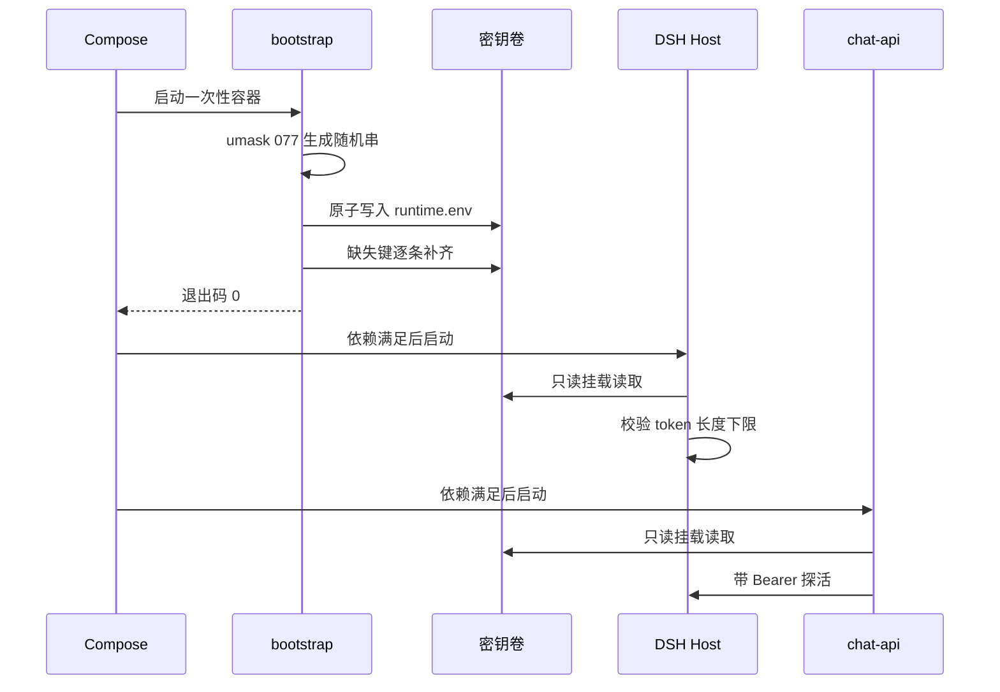
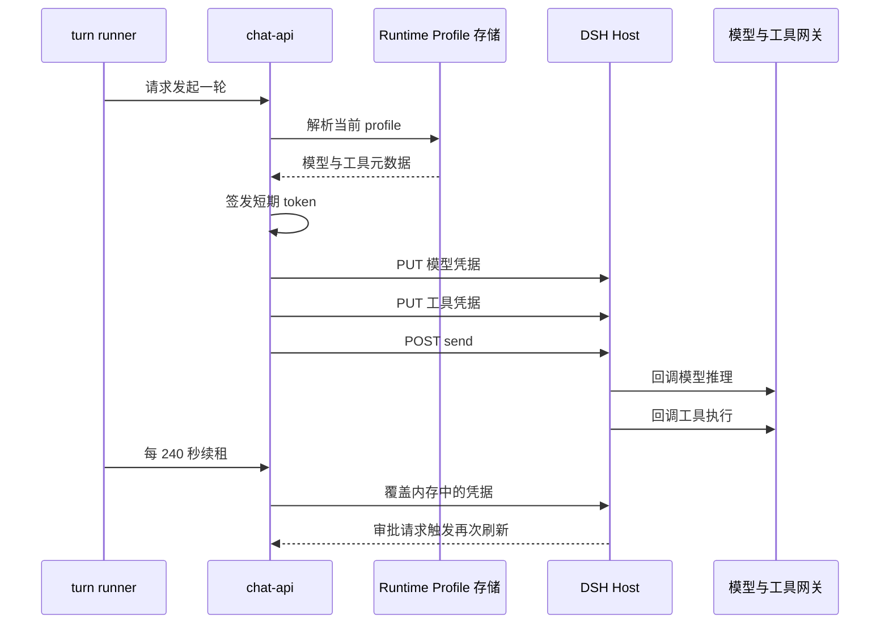

# MOVO 自托管部署与运维

## 根因：Agent 平台的生产化难点不在 Agent 循环，而在交付面

MOVO 的自我定位把这句话说得很直白： [README.md:31-31]() 写的是「DSH runs the Agent; MOVO brings the Agent into enterprise production」——内核交给 DSH，MOVO 自己的增量价值恰恰落在「怎么把它送进企业生产环境」这一面。
<!-- anchor: > **In one sentence:** DSH runs the Agent; MOVO brings the Agent into enterprise -->

所以对 MOVO 来说，`docker-compose.yml` 与 `./movo` 不是「附带示例」，而是产品的一部分：12 个服务要在一台单机主机上以正确的顺序起来、密钥要自己生自己传、镜像要能匿名拉、升级要能把老服务的写入安全地停下来、出事要能退回上一个 tag。这份解读关注的就是这条交付面——它的取舍、代价，以及它凭什么能把「自托管」做成一个可维护的承诺。
需要先说清一个基线事实：MOVO 用的是单机 Compose，而不是 Kubernetes/Helm。规划文档在讨论拓扑时明确列出了 12 个必须进入 Compose 的服务，并顺手说明了为什么是 12 这个数字——`document-api` 与 `document-worker` 共用同一个 `services/document-parser` 镜像，只是启动命令不同。 [docs/open-source-productization/self-hosted-deployment-implementation-plan.md:116-129]()
<!-- anchor: 1. `bootstrap`：首次生成内部密钥并准备目录，执行成功后正常退出。 … > 实际是 12 个 Compose 服务；其中 `document-api` 和 `document-worker` 使用同一个 `services/docu -->

同一份文档还给出了这一版拓扑的目标形态，其中一条边值得单独记住：`bootstrap ── deployment-secrets ── 各业务服务`，即密钥不是通过配置文件分发，而是通过一个共享卷分发。 [docs/open-source-productization/self-hosted-deployment-implementation-plan.md:144-154]()
<!-- anchor: ├── chat-api ─────────── dsh-runtime-host … bootstrap ── deployment-secrets ── chat-api/dsh-runtime-host/admin-api/document- -->

值得注意的反差是：产品化文档在更早的章节里设想的是「最小可用版 / 推荐开源版 / 增强版」三层形态，增强版里包含 MinIO、browser-sandbox、可观测栈。最终落地的是一个单一形态的 12 服务 Compose，对象存储仍是本地卷（`STORAGE_BACKEND: local`），浏览器能力则被移到需要单独安装的桌面端。这说明团队最终选择了「先把一条路径做到可验证」，而不是把部署形态做成配置矩阵。 [docs/open-source-productization/README.md:189-245]()
<!-- anchor: ### 7.1 最小可用版 … - `observability` 可包含 Prometheus、Grafana、OpenTelemetry collector 等。 -->

## 拓扑：一个公开端口、两张网络、按健康状态排序的启动

`docker-compose.yml` 的组织方式是很典型的「单入口 + 内网收敛」：只有 gateway 声明 `ports`，其余服务全部只在 Compose 网络内互相可见。 [docker-compose.yml:311-314]()
<!-- anchor: ports: … - ./deploy/docker/nginx.conf:/etc/nginx/conf.d/default.conf:ro -->

### 两张网络不只是命名，而是两种信任级

网络定义本身只有四行，但 `internal: true` 是全文最重的一行：挂在内网上的服务不具备对外路由能力，MongoDB、Redis、Weaviate 因此不可能被误暴露。 [docker-compose.yml:332-335]()
<!-- anchor: networks: … internal: true -->

按当前定义，`mongo`、`redis`、`weaviate`、`dsh-runtime-host` 只挂 `backend`；而 `chat-api`、`admin-api`、`document-api`、`document-worker`、`user-web`、`admin-web`、`gateway` 挂的是 `public`。以 chat-api 为例： [docker-compose.yml:178-180]()
<!-- anchor: networks: … - backend -->

这里有一个值得诚实指出的松弛点。`backend` 是 internal 网络，所以「挂 backend」= 能访问数据库；「挂 public」= 能和 gateway/前端互相访问。但 `document-worker` 只消费 Redis 队列、不接任何 HTTP 流量，却被同时挂在 `public` 上；`document-api` 只需要被 chat-api 调用，也被挂在 `public` 上。换句话说，`public` 网络实际上承担了「所有需要被 gateway 或彼此以服务名访问的服务」，而不是严格意义上的「公开面」。这是 Compose 单文件方案的常见折衷：多切一张只给 gateway 用网络会让 `depends_on` 与 nginx 解析更绕，收益在这个规模下不明显。安全边界最终不是靠网络名保证的，而是靠「只有 gateway 发布端口 + 上游 API 自己做鉴权」。

### 启动顺序是声明式的，不是 sleep 猜的

所有依赖都用 `condition` 表达，而不是靠 `restart` 兜底。gateway 必须等到四个上游全部 healthy 才启动： [docker-compose.yml:315-323]()
<!-- anchor: depends_on: … condition: service_healthy -->

而 chat-api 依赖的是更完整的一条链——bootstrap 必须成功退出、mongo 必须 healthy、document-api 必须 healthy、dsh-runtime-host 必须 healthy： [docker-compose.yml:169-177]()
<!-- anchor: depends_on: … condition: service_healthy -->

注意 `depends_on` 只保证启动顺序与健康门槛，不保证运行期可用性。dsh-runtime-host 的 healthcheck 是一个用 Node 写的真实探针：读取共享卷里的 token、带 Bearer 调 `/health`，并且额外校验 `ok === true` 与 `kernel === 'dsh'` 两个字段。这意味着一个「进程活着但内核没装对」的 host 会被判定为不健康，从而阻止 chat-api 启动——把一个原本会在第一轮对话才暴露的问题提前到启动阶段。

## bootstrap：把「生成密钥」做成一等公民容器

密钥管理是这个部署面里第一个真正的设计决策。MOVO 没有要求部署者去填 `.env`——`.env.example` 里只有端口、卷前缀、镜像前缀、版本和可选的 Embedding 凭证，没有任何必须手填的密钥字段。 [.env.example:1-10]()
<!-- anchor: # Optional public port and canonical enterprise URL. … PUBLIC_BASE_URL= -->

密钥生成被交给一个一次性的 Alpine 容器。 [docker-compose.yml:10-11]()
<!-- anchor: bootstrap: … image: alpine:3.21 -->

### 生成逻辑的三段结构

第一段是「首次生成」：`umask 077` 保证文件从创建那一刻起就只有属主可读，48 字节 `/dev/urandom` 经十六进制展开成 96 字符的随机串。 [docker-compose.yml:21-23]()
<!-- anchor: umask 077 … random_hex() { head -c 48 /dev/urandom | od -An -tx1 | tr -d ' \n'; } -->

文件不存在时才写入，并通过 `temp_file` + `mv` 保证原子性——避免半截文件被别的容器读到。 [docker-compose.yml:24-45]()
<!-- anchor: if [ ! -s "$$secret_file" ]; then … mv "$$temp_file" "$$secret_file" -->

第二段是「缺失键补齐」，这是这份脚本里最能说明设计意图的部分。注意它不是「重新生成整份文件」，而是逐键判断：如果 `DSH_RUNTIME_HOST_TOKEN` 不存在，就**只追加这一行**，其余密钥原样保留。 [docker-compose.yml:47-51]()
<!-- anchor: if ! grep -q '^DSH_RUNTIME_HOST_TOKEN=' "$$secret_file"; then … mv "$$temp_file" "$$secret_file" -->

这是一个向后兼容动作：`DSH_RUNTIME_HOST_TOKEN` 是后来引入的密钥（对应 DSH runtime host 这个组件），老安装升级上来时卷里没有它，补一行就能跑，而不会因为整份重生成导致全体用户 session 失效。

第三段是键名归一化。`ADMIN_BACKEND_SERVICE_TOKEN` 与历史名 `ASKAI_ADMIN_BACKEND_SERVICE_TOKEN` 被显式对齐成同一个值：先尝试读新名，再退回旧名，都读不到才新生成，最后把两个键名一起重写。 [docker-compose.yml:53-66]()
<!-- anchor: admin_backend_service_token="$$(sed -n 's/^ADMIN_BACKEND_SERVICE_TOKEN=//p' "$$s … mv "$$temp_file" "$$secret_file" -->

### 为什么用共享卷而不是别的机制

Compose 提供的密钥分发手段其实有几种，MOVO 都没选：

- **环境变量写在 `.env`**：需要一个部署者可见的明文文件，且 `docker compose config` 会把值打进 stdout，容易泄漏进日志。更关键的是它把「生成」这一步留给了人。
- **Docker secrets**：`secrets` 顶层键在非 Swarm 的 Compose 里行为有限；而且它解决的是「注入」不是「生成」。
- **宿主 bind mount**：要求宿主上先有一个存在且权限正确的文件，正好把首启体验搞坏——这与「`git clone` 之后 `./movo up` 就能用」的目标冲突。

共享卷方案的实际形态是：bootstrap 写 `/run/askai-secrets/runtime.env`，其余容器以 `:ro` 挂载同一个卷，再由各自的 entrypoint 把它 source 进环境。chat-api 与 admin-api 的 entrypoint 逻辑几乎一样： [services/chat-api/entrypoint.sh:5-10]()
<!-- anchor: local secret_file="${ASKAI_RUNTIME_SECRETS_FILE:-/run/askai-secrets/runtime.env} … set +a -->

代价有三个，都是真实存在的：

1. **备份必须包含这个卷**。因为它不在任何数据库里，也是最不容易被想起的一份状态。备份脚本把它列进卷清单的第一位，文档也用一整条生产基线强调「deployment secrets 要和 MongoDB 一起备份」。
2. **没有运行期轮转实现**。这是必须说清的一点：bootstrap 实现的是「缺失即补齐」，仓库里没有任何脚本或命令能在运行期把已下发的密钥换掉并让所有服务重新加载。发布检查清单里那条关于撤销凭证的待办，指的是「开源前把曾暴露给审查工具的凭证轮换掉」，是发布前的一次性动作，不是运行期能力。 [docs/open-source-productization/release-checklist.md:14-20]()
<!-- anchor: - [x] No desktop client, local browser sidecar, official website, CRM example or … - [x] DSH lock, compatibility matrix, SBOM and DSH notice are current. -->

   `rotat` 在仓库里的其他命中都不构成运行期轮转能力：一处是安全策略把「轮换自己部署里用到的每一份凭据」划给自托管运营者，
   [SECURITY.md:10-10]()
<!-- anchor: controls, backups, and rotating every credential used by their deployment. -->

   一处是产品化文档把「脱敏和密钥轮换」列为开源前门槛的第一条，
   [docs/open-source-productization/README.md:312-312]()
<!-- anchor: 1. 脱敏和密钥轮换 -->

   还有一处与凭据无关——浏览器表单填充里指动态占位提示文本的 rotating placeholder：
   [services/chat-api/app/enterprise_capabilities/browser/engine/form_input/resolver.py:196-196]()
<!-- anchor: # Placeholder text is frequently dynamic (for example rotating search -->

3. **一个随机值被多个用途复用**。`MODEL_CONFIG_SECRET` 与 `MOVO_DOC_PROCESSING_ADMIN_JWT_SECRET` 都直接等于 `ASKAI_ADMIN_JWT_SECRET`，而 `DSH_MODEL_GATEWAY_SIGNING_SECRET` 是独立生成的。前者是「少一把钥匙少一个运维负担」的取舍，后者是刻意的隔离——因为模型网关签名密钥会被送到 runtime host 那一侧，不能与 JWT 签发密钥同源。

这里有一个漂亮的补偿设计：模型网关与工具网关复用同一把 signing secret，但工具侧在派生 HMAC key 时加了域分隔前缀 `tool:`，而模型侧直接对 secret 取 SHA-256。 [services/chat-api/app/dsh_runtime/tool_gateway/token.py:26-30]()
<!-- anchor: def __init__(self, secret: str, *, ttl_seconds: int = 900) -> None: … self._ttl = max(30, int(ttl_seconds)) -->

同一份随机材料派生两套互不可伪造的凭据，代价是「泄露一把等于泄露两套」，收益是共享卷里少一个必须同步的键。

## 凭据不下发：runtime host 只拿得到短期 token

这是整个部署面里最能体现架构意图的一处，也是「自托管」这个承诺能不能站住的关键：如果 Node 进程里放着厂商的模型 API key，那它就成了一个必须被同等保护的高价值目标；MOVO 的做法是让 host 根本不持有长期凭据。

host 容器的启动路径很短：entrypoint 先 source 共享卷，然后对 host token 做一次长度下限校验，通过之后 `exec gosu node` 降权运行。 [services/chat-api/dsh/runtime-host/entrypoint.sh:12-14]()
<!-- anchor: runtime_token="${DSH_RUNTIME_HOST_TOKEN:-}" … echo "DSH_RUNTIME_HOST_TOKEN is missing or too short." >&2 -->

镜像层面同样收敛：只暴露 8101，并固定入口脚本——运行时没有可被环境变量改写的启动命令。 [services/chat-api/dsh/runtime-host/Dockerfile:55-57]()
<!-- anchor: EXPOSE 8101 … ENTRYPOINT ["/app/entrypoint.sh"] -->

### 鉴权是 fail-open 的，但被两处前置校验兜住了

host 的 HTTP server 构造时第一件事就是拒绝「非 loopback 绑定 + 过短 token」的组合，然后才对每个请求做 Bearer 比对，比对使用 `timingSafeEqual` 且长度不等直接判否，避免时序侧信道。 [services/chat-api/dsh/runtime-host/src/host-auth.mjs:9-21]()
<!-- anchor: export function assertSecureHost(host, authToken) { … return actual.length === expected.length && timingSafeEqual(actual, expected) -->

这里有一个容易误读的细节：`validBearerToken` 在 `expectedToken` 为空时直接返回 `true`——是 fail-open 的。安全网来自另外两处：构造函数拒绝长度小于 32 的 token，entrypoint 拒绝缺失或过短的 token。也就是说「空 token + 网络绑定」这个危险组合在 host 起来之前就已经不可能成立。这种「判定函数写成 fail-open、把约束放在更早的构造/启动阶段」的写法在可读性上是有争议的，但它确实让单测可以独立验证 token 比对逻辑。

### 反向代理：模型与工具都不在 host 里执行

host 的接口面是完整的 runtime 生命周期：`/health`、`/v1/runtimes` 的增删查、会话创建与销毁、`send`/`cancel`、事件回放与 NDJSON 事件流、审批查询与决策、插件装载。而凭据刷新是其中两个专有路由： [services/chat-api/dsh/runtime-host/src/runtime-http-server.mjs:115-119]()
<!-- anchor: if (request.method === 'PUT' && parts[3] === 'model-credential' && parts.length  … return sendJson(response, 200, runtime.refreshToolCredential(await readJson(requ -->

收到之后并不落盘，而是就地替换插件里那份被 `Object.freeze` 的配置，然后返回一个「已刷新」——credential 在内存里，不在磁盘上。 [services/chat-api/dsh/runtime-host/src/kernel-runtime.mjs:245-255]()
<!-- anchor: refreshModelCredential(credential) { … return { refreshed: true } -->

host 侧发起模型/工具调用时，是 POST 到 chat-api 的目标地址并带上 Bearer token。这三个地址（host 地址、工具网关、模型网关）其实声明在 chat-api 服务自己的 `environment` 里，且网关地址指向 chat-api 同容器内的 `/internal/` 路径；`dsh-runtime-host` 服务没有 `environment` 块，host 侧根本拿不到这三个变量： [docker-compose.yml:162-164]()
<!-- anchor: DSH_RUNTIME_HOST_URL: http://dsh-runtime-host:8101 … DSH_MODEL_GATEWAY_URL: http://chat-api:8000/internal/dsh/model/generate -->

这三个值由 chat-api 自己读取，再随 Runtime Profile 与凭据刷新下发；host 侧的模型适配器只接受 payload 里的 `gatewayUrl` 与 `accessToken`： [services/chat-api/app/core/config.py:120-123]()
<!-- anchor: DSH_TOOL_GATEWAY_URL: str = "http://127.0.0.1:8000/internal/dsh/tools" … DSH_MODEL_GATEWAY_URL: str = "http://127.0.0.1:8000/internal/dsh/model/generate" -->

[services/chat-api/dsh/runtime-host/src/askai-model-gateway-plugin.mjs:29-31]()
<!-- anchor: updateCredential({ gatewayUrl, accessToken }) { … this.config = Object.freeze({ ...this.config, gatewayUrl, accessToken }) -->

签发侧在每次刷新时用 PUT 把模型凭据的 `gatewayUrl` 与 `accessToken` 一起写进 host（工具凭据只覆盖 token）： [services/chat-api/app/dsh_runtime/gateway.py:373-387]()
<!-- anchor: await self._transport.request( … json={"accessToken": tool_profile.get("accessToken")}, -->

这两个回调端点自己也做鉴权，用同一把 signing secret 验证 token，拿不到合法 Bearer 直接 401： [services/chat-api/app/api/endpoints/dsh_tool_gateway.py:27-38]()
<!-- anchor: def _tokens() -> ToolGatewayTokenService: … raise HTTPException(status_code=401, detail=str(exc)) from exc -->

### token 的设计：短 TTL + 最小权限声明

先看模型网关 token。它是自签的 HMAC-SHA256 结构，TTL 默认 900 秒，claims 里带 `aud`、tenant、profile 版本、模型实例 ID、用户 ID 与 `jti`。校验时逐项检查签名、audience 和过期时间。 [services/chat-api/app/dsh_runtime/model_gateway/token.py:33-43]()
<!-- anchor: def issue(self, *, tenant_id: str, profile_version: str, model_instance_id: str, … "jti": secrets.token_hex(8), -->

工具网关 token 更进一步：claims 里含 `tool_names` 与 `scopes`，即「这一轮这个用户只被允许调用这几个工具、只被授予这几个 scope」，而不是一个笼统的「已认证」标记。 [services/chat-api/app/dsh_runtime/tool_gateway/token.py:66-73]()
<!-- anchor: return ToolGatewayClaims( … expires_at=int(payload["exp"]), -->

签发点在 Runtime Profile 解析器里，而且这里有一道跨租户闸门——如果调用方声明的 `tenant_id` 与快照里的不一致，直接抛错，而不是悄悄按快照签发。 [services/chat-api/app/dsh_runtime/profile/resolver.py:27-46]()
<!-- anchor: async def resolve(self, profile_version: str, *, tenant_id: str | None = None) - … scopes=sorted({scope for tool in snapshot.tools for scope in tool.required_scope -->

### 三条刷新路径，而不是一条

任务的原始假设是「按轮 / 按审批动作刷新」。源码里的实际情况比这更细，一共有三条：

第一条，**每轮发送前**。`send()` 内部先刷新再发请求，而这个刷新是加锁的——多个会话共享同一个不可变 runtime 时，刷新不会并发打架。 [services/chat-api/app/dsh_runtime/gateway.py:222-224]()
<!-- anchor: async def send(self, request: SendRequest) -> str: … await self._refresh_model_credential(binding.runtime_id) -->

刷新动作本身是「重新解析 profile → 校验模型身份没变 → PUT 两个 credential」，并且校验「已发布 profile 的模型身份不能被换掉」： [services/chat-api/app/dsh_runtime/gateway.py:362-386]()
<!-- anchor: async def _refresh_model_credential(self, runtime_id: str) -> None: … json={"accessToken": tool_profile.get("accessToken")}, -->

第二条，**一个后台租约**。这是原始论断里没有提到的部分，也是最能说明为什么需要它的地方：浏览器类工具调用可能长时间阻塞，DSH 一直卡在工具里出不来，此时没有「轮次边界」可供刷新。所以 turn runner 会启动一个默认 240 秒周期的 `ActiveTurnCredentialLease`。 [services/chat-api/app/dsh_runtime/credential_lease.py:37-49]()
<!-- anchor: class ActiveTurnCredentialLease: … self._interval = max(0.05, float(interval_seconds)) -->

租约的失败处理也值得留意：刷新失败只记日志，不取消正在进行的浏览器操作——理由是下一轮租约 tick 或显式审批刷新还能救回来。

第三条，**审批动作前**。在事件流里一旦看到 `tool.approval.requested` 就再刷一次，确保「用户点批准」和「工具真正执行」之间的窗口里凭据是最新的。 [services/chat-api/app/dsh_runtime/turn_runner.py:138-139]()
<!-- anchor: if event.type == "tool.approval.requested": … await credential_lease.refresh_now() -->

而 turn runner 在发出第一轮请求之前还会额外刷一次，注释给出的理由是「长时间存活的 Runtime 要用当前发言者范围的凭据做用量归因」——也就是说刷新不只是为了可用性，也是为了计费与审计能落到正确的人头上。 [services/chat-api/app/dsh_runtime/turn_runner.py:120-133]()
<!-- anchor: # Refresh before the first model call so a long-lived Runtime uses … credential_lease.start() -->

这条链路上最值得迁移的模式是：**把「凭据」和「凭据的持有者」解耦成一次可撤销的租约**。真实 API key 留在 chat-api（并且以 `MODEL_CONFIG_SECRET` 加密存在 Mongo 里），host 拿到的是一把 15 分钟有效、绑定了 tenant/用户/模型/工具清单的 token，且在任何时刻都可以被重新签发覆盖。代价是每轮多一次 HTTP PUT，以及一份需要维护的时钟依赖——但这个代价远小于「在 Node 进程里放一把厂商 key」。

## 镜像：预构建优先，源码构建是兜底路径

镜像命名遵循一个固定模式：`${MOVO_IMAGE_PREFIX}-<component>:${MOVO_VERSION}`，默认前缀 `ghcr.io/himovo/movo`，默认 tag `latest`。七个组件是 `dsh-runtime-host`、`chat-api`、`admin-api`、`document-parser`、`user-web`、`admin-web`、`gateway`；文档也确认了「两条命令都拉这七个官方镜像，且都不需要 `.env`」。 [docs/docker-deployment.md:13-17]()
<!-- anchor: Both `./movo up` and `docker compose up -d` pull the seven official MOVO images … Docker's default parallel pull behavior. -->

### 默认不装的东西，才是体积决策的核心

chat-api 的 Dockerfile 把「重资产」做成默认关闭的构建开关——Playwright 浏览器与配套系统依赖的 `ARG` 默认都是 `false`，并且跳过分支会把决策显式打进构建日志，便于事后追溯镜像里到底装了什么： [services/chat-api/Dockerfile:38-47]()
<!-- anchor: ARG INSTALL_PLAYWRIGHT_AT_BUILD=false … echo "Skip playwright browser install in build stage (INSTALL_PLAYWRIGHT_AT_BUIL -->

document-parser 的默认值相反——它默认装系统依赖、装 Python 依赖、下载 Docling 模型，因为一个缺模型的解析器没有任何意义。 [services/document-parser/Dockerfile:94-103]()
<!-- anchor: ARG INSTALL_DOCLING_MODELS_AT_BUILD=true … echo "Skip Docling model download and verification (INSTALL_DOCLING_MODELS_AT_BUIL -->

于是源码构建路径的代价就有了准确的来源：`docker-compose.build.yml` 打开的就是这几个开关，包括 Playwright（含系统依赖）与 Docling 模型资产。 [docker-compose.build.yml:8-16]()
<!-- anchor: chat-api: … PLAYWRIGHT_WITH_DEPS: "true" -->

文档把这句话说得很直白：源码构建「会下载并构建 Playwright、LibreOffice、Docling 与模型资产，因此比预构建镜像路径需要显著更多的时间和磁盘」。这正是 `./movo up` 默认走 `pull_policy: missing` 而不构建的原因——对绝大多数使用者，镜像拉取是分钟级，源码构建是十分钟级且需要几 GB 额外磁盘。

### 一个镜像两种角色

`document-api` 与 `document-worker` 用同一个镜像、同一个环境锚点，只是 `command` 不同。这是把 Celery 的两端当成同一个部署单元的产物：代码、依赖、模型资产完全一致，没有理由构建两次。代价是两边的资源画像无法独立裁剪——worker 需要的内存和 API 一样多。

### 版本锁定：构建期把「声明」变成「事实」

runtime host 的 Dockerfile 在 `pnpm install` 之后立刻跑一段 Node 断言：`package.json` 里声明的 `@deepseek-ai/dsh` 版本必须等于实际安装的版本，不等就让构建失败。 [services/chat-api/dsh/runtime-host/Dockerfile:14-16]()
<!-- anchor: COPY package.json pnpm-lock.yaml pnpm-workspace.yaml ./ … RUN node -e "const declared=require('./package.json').dependencies['@deepseek-ai' -->

这条断言解决的是一个具体而隐蔽的问题：`package.json` 里写的是 `0.1.6-alpha.1` 这种带 prerelease 的精确版本，而 pnpm 的 lockfile 与 registry 上可能发生解析差异。把校验放在构建期而不是运行期，意味着「内核版本不匹配」永远不会变成一个只在生产对话中偶发的诡异行为——它根本过不了构建。

### 发布流水线：候选 tag → 门禁 → 提升

发布不是「打个 tag 就推镜像」，而是三段：

第一步，validate-release。开源卫生检查是这一步的第一个动作，之后是 Compose 变体校验。 [.github/workflows/container-release.yml:38-45]()
<!-- anchor: - name: Validate publication boundary … run: python scripts/release/test_plan_container_release.py -->

第二步，候选镜像构建。多架构、BuildKit 缓存、`provenance: mode=max` 与 `sbom: true` 一次带上，而 `MOVO_SECURITY_REFRESH` 被赋值为 `run_id-run_attempt`——一个每次运行都不同的值： [.github/workflows/container-release.yml:147-163]()
<!-- anchor: - uses: docker/build-push-action@v6 … sbom: true -->

这个构建参数在各 Dockerfile 里只被用来做一件事：`test -n` 之后执行 `apt-get upgrade`。它的真正作用是**缓存击穿**——因为参数值每次都变，`apt-get upgrade` 这一层永远不能复用缓存，从而保证每次发布都真的取到了当天的安全补丁，而不是命中几个月前的旧层。用「一个必然变化的字符串」来表达「这一层不许缓存」，比在 CI 里手工清缓存可靠得多。

第三步，漏洞门禁。Trivy 扫候选镜像摘要，`ignore-unfixed: true` 只拦「有修复方案的」高危与严重漏洞，`exit-code: "1"` 直接失败构建： [.github/workflows/container-release.yml:171-178]()
<!-- anchor: - name: Scan candidate image … severity: CRITICAL,HIGH -->

候选通过之后才由独立的 workflow 把 `candidate-<sha>` 提升为目标 tag。提升用的是 `docker buildx imagetools create`（只改 tag 指针，不重新构建），并且先把后缀白名单校验一遍： [.github/workflows/container-promote.yml:46-62]()
<!-- anchor: for suffix in "${suffixes[@]}"; do … docker buildx imagetools inspect "$target" -->

这个「先发 candidate、验证后再提升」的次序是有意的：一旦镜像进了公开 GHCR，`latest` 就可能被人拉到。候选 tag 让「已构建」与「已发布」之间隔了一道可回退的闸门，也解释了发布文档里那句「任何镜像构建、漏洞扫描或 attestation 失败，就不要创建 GitHub Release」。

### 把部署不变量写成可执行测试

`scripts/check_compose_image_modes.sh` 校验的是一组容易在重构中悄悄失效的约定：预构建模式下所有七个镜像必须解析成官方前缀 + `latest`；源码构建模式下必须解析成 `movo-<suffix>:latest`；并且 `movo_configure_images` 在两种模式下导出的前缀必须正确。 [scripts/check_compose_image_modes.sh:27-29]()
<!-- anchor: prebuilt_images="$(compose_images -f docker-compose.yml)" … grep -Fxq "${official_prefix}-${suffix}:latest" <<<"${prebuilt_images}" -->

它的实现方式值得一提：脚本 `unset` 掉所有相关环境变量、用 `--env-file /dev/null` 屏蔽 `.env` 干扰，再 source `deploy/cli/images.sh` 并 stub 掉 `dotenv_value`——也就是把 CLI 的镜像解析函数当成被测单元，在 CI 里直接断言它的输出。shell 项目里很少见到这种程度的可测试性投入。

## ./movo CLI：把运维路径固化成一个命令

`./movo` 是一个 337 行的 bash 脚本，但主体逻辑并不都在里面——它把能力拆到了 `deploy/cli/` 下的七个模块里（i18n、dsh-version、images、migrations、pull、backup、sequence-fix），启动时逐个 source。 [movo:24-37]()
<!-- anchor: source "${ROOT_DIR}/deploy/cli/i18n.sh" … source "${ROOT_DIR}/deploy/cli/sequence-fix.sh" -->

选择 bash 而不是 Go/Python 二进制，权衡很清楚：目标是「宿主上除了 Docker 什么都没有也能跑」。Docker Desktop 场景下 bash 一定存在（WSL/Git Bash），不需要额外下载一个分发包；代价是没有类型检查，只能靠 shellcheck 与脚本体测试（`scripts/test_serial_image_pull.sh` 就是一个纯 bash 单测，stub 掉 `movo_compose` 和 `sleep` 后断言调用序列与次数）。脚本还对 macOS 的 Docker Desktop 路径做了兜底：先探测 `/Applications/Docker.app/Contents/Resources/bin` 是否在 `PATH` 里，不在就补上；若 `docker` 仍不可用，则直接改用该目录下的二进制： [movo:51-60]()
<!-- anchor: local docker_desktop_bin="/Applications/Docker.app/Contents/Resources/bin" … DOCKER_BIN="${docker_desktop_bin}/docker" -->

### up 的两条路径

`command_up` 按有没有 `--build` 分成两条完全不同的路径。这是整个 CLI 最重要的分支，因为它的语义差异远超「要不要编译」：

- **源码构建路径**：加载 `docker-compose.build.yml`，先 `build chat-api`，然后在替换正在运行的 chat-api 之前跑数据库迁移，最后 `up -d`（不带 `--pull never`，因为本来就不需要拉）。
- **预构建镜像路径**：先**串行**拉取缺失镜像，再在 chat-api 正在运行时跑增量迁移，最后 `up -d --pull never`。 [movo:190-196]()
<!-- anchor: if ! movo_pull_images_serially missing; then … movo_upgrade_database_if_running || return 1 -->

预构建路径的那一行是刻意写的——`--pull never` 表示「拉取由启动器负责，Compose 不许自己拉」，于是镜像拉取只发生一次、按顺序、带重试： [movo:191-196]()
<!-- anchor-base64: aWYgISBtb3ZvX3B1bGxfaW1hZ2VzX3NlcmlhbGx5IG1pc3Npbmc7IHRoZW4g4oCmIGlmICEgbW92b19jb21wb3NlIHVwIC1kIC0tcHVsbCBuZXZlciAiJEAiOyB0aGVu -->

为什么值得为「串行」专门写代码？因为 Docker Compose 默认并行拉镜像，在网络受限的环境里会同时开七个连接然后集体超时，重试时又从头再来。MOVO 改成 `--parallel 1` 加无限重试循环，并把中断信号（130/143）与普通失败区分开——前者立即退出，后者退避后继续。 [deploy/cli/pull.sh:13-26]()
<!-- anchor: while true; do … attempt=$((attempt + 1)) -->

这个改动直接对应 Windows 文档里的排障条目：镜像拉取报 `EOF` 或连接中断，说明 registry 访问不稳，而「最新的 `./movo up` 会串行拉取并自动重试，已完成的层会被复用」。 [docs/windows-installation.md:98-100]()
<!-- anchor: ### Image pulls fail with `EOF` or interrupted connections … This usually indicates unstable access to Docker Hub or GitHub Container R -->

### 就绪判据只有一个

`wait_until_ready` 最多轮询 90 次、每次间隔 2 秒，判据是 admin-api 的 `/api/setup/status` 返回体里包含 `"ready":true`： [movo:133-144]()
<!-- anchor: status_is_ready() { … [[ "${response}" == *'"ready":true'* ]] -->

用业务语义的「初始化完成」而不是「容器 healthy」作为最终就绪判据，是一个有意思的选择：容器全 healthy 只说明进程活着，用户真正关心的是「能不能打开页面开始配置」。它也顺带把「首次初始化还没做」这个中间态和「部署坏了」区分开来。默认语言是英文（`MOVO_LANG` 缺省为 `en`），可以用 `--lang zh-CN` 切换，全部面向用户的字符串集中在 `deploy/cli/i18n.sh` 的一个 `case` 里。 [deploy/cli/i18n.sh:4-4]()
<!-- anchor: local requested="${MOVO_LANG:-en}" -->
顺带补上其余几个子命令的形态：`status`、`logs`、`restart` 都刻意做得很薄——先 `require_docker`，`status` 直接透传 `compose ps`，`logs` 固定只取尾部 200 行（避免把长跑服务的全量日志一次性倒进终端），而 `restart` 是全栈重启、结束后会重新走一遍就绪等待并打印就绪提示，因为它会让服务短暂不可用，必须以「应用真的能打开」而不是「命令返回了」作为结束标志。 [movo:281-292]()
<!-- anchor: movo_compose ps … wait_until_ready -->

### 为什么 `movo fix` 要停下 chat-api

`sequence_repair` 模块的文档字符串把约束写得非常明确：调用方必须先停掉唯一的写入者（chat-api）并先取一份 Mongo 归档；这个模块只改排序元数据，绝不删除消息。 [services/chat-api/app/migrations/sequence_repair.py:1-4]()
<!-- anchor: """Repair duplicate per-session message sequence numbers during maintenance. … first. This module changes ordering metadata only; it never removes messages. -->

于是 `movo fix` 的整个结构都围绕「安全停机」展开，而且是防御性的：

- 先做前置检查（mongo 镜像里必须有 `mongodump`/`mongorestore` 且支持 `--dryRun`），**在停服务之前**就失败掉；
- 检查是否存在上次未完成的修复标记，存在就拒绝开始，避免覆盖别人留下的恢复点；
- 要求 chat-api 当前正在运行——因为「能回退」和「能修复」是同一件事的两面。 [deploy/cli/sequence-fix.sh:62-64]()
<!-- anchor: # Check prerequisites before taking the writer offline. The official Mongo … if ! movo_compose exec -T mongo sh -c \ -->

真正的停机阶段带 `-t 600` 的超时（给长任务 10 分钟收尾），停下来之后还要再确认一次容器真的不在了，然后立刻挂上 EXIT trap 与 INT/TERM trap： [deploy/cli/sequence-fix.sh:84-98]()
<!-- anchor: movo_msg fix_stopping … trap 'movo_fix_recover_on_exit' EXIT -->

修复本身的执行方式是把修复跑成一个一次性的 chat-api 容器，并显式传入「写入者已停止」的环境变量，跑完再走一次数据库迁移： [deploy/cli/sequence-fix.sh:122-124]()
<!-- anchor: -e MOVO_SESSION_FIX_WRITES_STOPPED=1 chat-api \ … && movo_run_database_upgrade fix; then -->

值得注意的是这里没有直接 `start chat-api`。修复成功后 chat-api 保持停止，并提示用户立刻执行 `./movo up` 完成升级——因为修复本来就是为了让新版本的索引迁移能通过，重启老服务没有意义。这也解释了 i18n 里那句「修复和验证成功。聊天服务保持停止」。

所以「`movo fix` 只在序列冲突时用」并不是一条拍脑袋的运维建议，而是三种约束叠出来的：修复要求独占写者、修复本身是幂等但不可中断的、修复的唯一目的是让新版本能启动。

### backup / restore：停机一致性 + 完整性校验

备份是「停机 + 打包卷」而不是「在线 mongodump」。脚本先把整个 Compose 停掉，然后逐个卷用一次性 alpine 容器打包成 tar.gz。 [deploy/cli/backup.sh:79-89]()
<!-- anchor: movo_msg backup_stopping … movo_msg backup_complete "${target_dir}" -->

卷清单是硬编码的八个，第一位就是 `deployment-secrets`——这正好呼应了前面「密钥只存在于共享卷」的设计： [deploy/cli/backup.sh:3-11]()
<!-- anchor: MOVO_VOLUME_SUFFIXES=( … admin-static -->

每个备份目录里除了八个 tar.gz，还写入卷前缀、镜像版本与 git commit，再生成一份 SHA256SUMS： [deploy/cli/backup.sh:44-57]()
<!-- anchor: for suffix in "${MOVO_VOLUME_SUFFIXES[@]}"; do … git -C "${ROOT_DIR}" rev-parse HEAD > "${target_dir}/git-commit.txt" 2>/dev/null -->

这三样元数据解决了三个不同的恢复期问题：`volume-prefix.txt` 防止把 A 环境的备份恢复到 B 环境（前缀不匹配直接拒绝）；`movo-version.txt` 告诉你该回退到哪个镜像 tag；`git-commit.txt` 在出问题时给出精确的源码坐标。而 SHA256SUMS 是恢复前的强制门槛——恢复命令不会在校验失败时继续。

## 反向代理与安全边界

gateway 是一个只做路由的 nginx，配置本身极简，但有几处细节直接由业务形态决定。 [deploy/docker/nginx.conf:6-10]()
<!-- anchor: server { … client_max_body_size 220m; -->

**220MB 的上传上限**对应知识库文档与演示文稿产物的体积；`absolute_redirect off` 则是为了让 nginx 生成的 301 Location 保持相对路径——否则部署者换成域名访问时，重定向会把用户甩回容器内部的地址。
真正需要小心的是 SSE 与 WebSocket。聊天流式输出与 Browser Agent 的控制通道都会走长连接，所以 chat-api 的两个 location 都做了三件事：关闭代理缓冲、把读/写超时提到 600 秒、把 `Upgrade`/`Connection` 头透传，并使用最上面的 `map` 决定连接升级策略。 [deploy/docker/nginx.conf:48-60]()
<!-- anchor: location /askai-api/ { … proxy_buffering off; -->

对应的应用侧配套是 uvicorn 启动时带 `--proxy-headers`，即声明了「信任代理头」的意图；但仓库里没有任何 `--forwarded-allow-ips`，而 nginx 位于另一个容器，所以要让 `X-Forwarded-Proto`/`X-Forwarded-For` 真正被信任，还需要显式指定允许的代理地址。头部本身由 nginx 侧注入： [services/chat-api/Dockerfile:65-65]()
<!-- anchor-base64: Q01EIFsidXZpY29ybiIsICJhcHAubWFpbjphcHAiLCAiLS1ob3N0IiwgIjAuMC4wLjAiLCAiLS1wb3J0IiwgIjgwMDAiLCAiLS1wcm94eS0= -->

[deploy/docker/nginx.conf:26-33]()
<!-- anchor: location /admin/ { … proxy_set_header X-Forwarded-For $proxy_add_x_forwarded_for; -->

**nginx 自己不做任何鉴权**，它只负责把请求分发到正确的上游。安全边界因此落在两层：网络层（只有 gateway 发布端口，数据库在 internal 网上）与应用层（chat-api 与 admin-api 各自的 JWT 与内部服务 token）。文档把这条线画得很明确，并且把 TLS、访问控制、Docker daemon 权限全部划给部署者： [docs/docker-deployment.md:84-95]()
<!-- anchor: ## Production baseline … every production upgrade. -->

其中「Docker access is equivalent to root access on the host」这一条尤其重要：既然 `./movo` 和所有卷都依赖 Docker daemon，那么能执行 `docker` 的人就能读取 `deployment-secrets` 卷里的所有密钥。这解释了为什么密钥不放 `.env`（文件权限更弱、更容易被误提交）——但也要承认，共享卷方案并没有解决「Docker 权限即 root」这个前提。

一个部署相关的镜像细节也在这里得到解释：三个使用 nginx 的镜像（gateway、user-web、admin-web）都固定用 `nginx:1.31.6-trixie` 这个 Debian/glibc 变体，而不是更常见的 alpine 版本，并且注释里写明了原因——Alpine 的 musl 实现的 `pwritev2` 路径在较旧的容器宿主上会被拒绝。 [deploy/docker/gateway.Dockerfile:1-3]()
<!-- anchor: # Keep this runtime aligned with both web images. The Debian/glibc variant avoid … FROM nginx:1.31.6-trixie -->

这类「为了兼容旧宿主的运行时选择，把三处镜像绑在同一基线上」的决定，如果不写注释，几个月后一定会被「顺手换成 alpine 省体积」的改动破坏。

## 升级与回滚：迁移跑在替换之前，并且是可放弃的

升级路径的核心顺序是：**新镜像的增量迁移先跑，成功之后才替换正在运行的 chat-api**。`deploy/cli/migrations.sh` 把它做成一件独立的事——用一个 `--no-deps` 的一次性容器执行新镜像里的迁移，它加入现有网络但不启动任何依赖。 [deploy/cli/migrations.sh:3-9]()
<!-- anchor: # Run the new image's additive migrations before replacing a running chat-api. … python -m app.migrations; then -->

这个顺序解决了滚动升级最经典的难题：如果新版本需要新索引，而索引是在服务启动时才创建的，就会出现「新进程在等索引、老进程还在写」的窗口。把迁移提前到替换之前，窗口就消失了。注意「additive」这个词——迁移只加索引、不改文档，`app.migrations.__main__` 的模块文档字符串就是这句话： [services/chat-api/app/migrations/__main__.py:1-1]()
<!-- anchor: """Run additive database migrations before a new image replaces the old one.""" -->

失败语义也设计得很保守：迁移失败时打印明确的「在服务替换之前就停止了」，返回非 0，而**老服务继续保持运行**。 [services/chat-api/app/migrations/__main__.py:25-29]()
<!-- anchor: print(f"Database upgrade stopped before service replacement: {exc}", file=sys.st … print("Database indexes are ready; existing documents were not modified.") -->

CLI 侧再包一层：只有 chat-api 正在运行才升级，失败就中止整个 `up`/`update`。
i18n 里对应的文案把承诺讲得很清楚：「数据库升级未通过；旧服务保持运行，数据未被迁移脚本改写」。也就是说，一次失败的升级应该是一个**无副作用的空操作**——这是把「迁移必须可放弃」当作硬约束的直接结果。

那什么时候需要用 `movo fix`？当存在真正重复的消息序号、导致唯一索引根本建不起来的时候。此时迁移会失败，升级被卡住，而修复需要独占写者——这就是前面那个「停机 + 归档 + dryRun + trap 回滚」流程存在的唯一理由。

版本层面的回滚策略写在发布文档里：`MOVO_VERSION` 要固定到显式 tag 而不是 `latest`，升级前要备份并确认回退用的镜像 tag，每次发布前要在 amd64 与 arm64 的新机器上把备份恢复和版本回退演练一遍。 [docs/release-process.md:25-34]()
<!-- anchor: 4. On fresh amd64 and arm64 hosts, clone the tag, set `MOVO_VERSION` to that … vulnerabilities. Prerelease tags never update `latest`. -->

回滚本身不需要专门命令：把 `MOVO_VERSION` 改回上一个 tag，再 `./movo update` 就是回滚。但有一个前提必须清楚——迁移是单向的（additive 但不可自动撤销）。如果新版本的迁移已经建了新索引，回退镜像通常仍然能跑，因为老版本不认识新索引不会报错；真正的风险是回退到缺少解析新数据格式能力的版本。发布检查清单里「备份、升级、回滚已在非生产数据上演练过」这一项至今仍是未勾选状态，这个诚实本身比任何承诺都有价值： [docs/open-source-productization/release-checklist.md:33-33]()
<!-- anchor: - [ ] Backup, upgrade and rollback steps have been exercised on non-production d -->

还有两个容易忽略但很实用的升级细节：

- **`./movo update` 拒绝在纯本地镜像模式下工作**。如果只配置了本地构建的镜像、没有 registry，`update` 直接返回错误码 2 并提示改用 `./movo up --build`——因为「更新」这个概念依赖于能拉到新镜像。 [movo:222-231]()
<!-- anchor: movo_configure_images false … movo_run_database_upgrade || return 1 -->

- **`./movo up` 会自动重启 gateway**。这不是额外功能，而是一致性修复：nginx 官方镜像在启动时解析 `proxy_pass` 里的 Compose 服务名并缓存 IP，而重建上游容器会让它们拿到新 IP，于是「上游换了、代理还在往旧 IP 发」就成了一次静默故障。由于 gateway 是无状态代理，重启它的成本几乎为零，所以启动器直接把它当成幂等收尾动作。 [movo:89-98]()
<!-- anchor: refresh_gateway_resolution() { … movo_compose restart gateway -->

- **旧 Compose 项目名迁移是显式开关**。`MOVO_MIGRATE_LEGACY_PROJECT` 默认 `false`，只有部署者主动打开时才会去停掉 `askai` 这个旧项目名下的容器。默认关闭是正确选择：一次自动 `down` 掉未知项目可能会误伤同机上的其他部署。 [movo:77-84]()
<!-- anchor: retire_legacy_compose_project() { … movo_msg migrating_project -->

### 危险动作必须有人为确认

`./movo down -v` 会删除全部卷，因此它不接受静默执行：需要交互输入大写 `MOVO`，或者显式传 `--yes`；非交互环境（`-t 0` 为假）下不传 `--yes` 会直接放弃。 [movo:307-321]()
<!-- anchor: if [[ "${remove_volumes}" == "true" ]]; then … movo_compose down "${compose_down_args[@]}" -->

`restore` 同理，必须带 `--yes`： [deploy/cli/backup.sh:113-116]()
<!-- anchor: if [[ "${confirmed}" != "true" ]]; then … movo_msg restore_confirm -->

而 `backup` 全程没有任何交互确认，`movo_backup` 只在目标目录已存在时才拒绝执行、失败时自动把服务拉回来： [deploy/cli/backup.sh:64-90]()
<!-- anchor: movo_backup() { … movo_msg backup_complete "${target_dir}" -->

所以这套「交互确认 + 显式自动化开关」的模式只在恢复与销毁两个动作上成立，让脚本既能被人安全地使用，也能被 CI 使用。

## Windows 与 WSL 2：文档解决的是三个具体的失败

Windows 支持没有做成原生安装包，而是「Docker Desktop + WSL 2 + Ubuntu」这一条路，文档开头就把最容易踩的坑钉死：Docker Desktop 创建的 `docker-desktop` 发行版是内部设备环境，不是给用户用的 shell，绝对不能在里面跑 MOVO 启动器。 [docs/windows-installation.md:3-3]()
<!-- anchor: The recommended Windows environment is **Docker Desktop + WSL 2 + Ubuntu**. The  -->

文档列了三个具体失败及处置：

1. **提示符以 `docker-desktop:` 开头**、或者报 `env: can't execute 'bash': No such file or directory`——都是误入了内部发行版，用 `wsl -d Ubuntu` 显式进入即可。
2. **`Permission denied`**，或者用 Windows 解压的 ZIP 导致脚本没有执行位。解法是改调 `bash ./movo up`，绕过执行位检查。
3. **镜像拉取 `EOF`**。解法就是启动器内的串行重试。

ZIP 场景给了完整的命令序列，并解释了为什么必须用 `bash ./movo`： [docs/windows-installation.md:65-74]()
<!-- anchor: ## Using a ZIP extracted by Windows … Using `bash ./movo` bypasses script execute-bit problems caused by Windows ZIP e -->

文档还建议把仓库克隆到 Linux home 目录以获得最好的权限兼容与文件系统性能，但没有解释原因 [docs/windows-installation.md:48-48]()
<!-- anchor: Clone into the Linux home directory for the best permission compatibility and fi -->
——实际上 `/mnt/d` 走的是 Windows 文件系统的 9p 挂载，`node_modules` 与 Python 虚拟环境的元数据操作会慢一个数量级，而 Compose 构建上下文从那里读取也会明显变慢。这一条是「未在源码/文档中给出理由的推荐」，我把它标注出来而不是替它补理由。

另外，中文文档不是英文的翻译副本：它在命令示例里带上了 `--lang zh-CN`，正好与 i18n 的默认语言（英文）互补。

## 开源卫生检查：发布门禁的第一道

`scripts/check_open_source_hygiene.py` 在发布流程中的位置很靠前：它既是 `validate-release` job 的第一个动作，也常驻在常态 CI 里。 [.github/workflows/runtime-guard.yml:46-47]()
<!-- anchor: - name: Open-source hygiene guard … run: python scripts/check_open_source_hygiene.py -->

它检查四类东西：

**第一类，仓库边界。** 有一份明确的「哪些路径不允许进社区仓库」清单——桌面端、本地浏览器 sidecar、官网、CRM 及其服务端。这是把「社区版是开源产品的一部分，不是内部仓库的子集」这个决定写成可执行断言。 [scripts/check_open_source_hygiene.py:10-20]()
<!-- anchor: BLOCKED_PARTS = ( … "services/crm-service/", -->

**第二类，发布物完整性。** 七个必需根文件必须被 git 跟踪（`LICENSE`、`NOTICE`、`README`、`CONTRIBUTING`、`SECURITY`、`SUPPORT`、`CODE_OF_CONDUCT`），并且 `docker-compose.yml` 必须恰好定义 8 个带 `MOVO_VOLUME_PREFIX` 的物理卷——这是一个防止有人「顺手复用」旧项目卷名的具体防线。 [scripts/check_open_source_hygiene.py:53-62]()
<!-- anchor: REQUIRED_ROOT_FILES = ( … EXPECTED_MOVO_VOLUMES = 8 -->

**第三类，脱敏。** 私有部署域名、私有 Azure 端点、私有 registry、内部邮箱（含 `guoran`/`askbot` 这些历史标识）都被列为禁止出现的模式；此外还有密钥正则：私钥头、AWS AKIA、阿里云 LTAI、OpenAI 风格 `sk-`、JWT 三段结构、以及「带用户名密码的连接串」。

**第四类，对未跟踪文件也生效。** 这一点是设计上的关键：扫描列表来自 `git ls-files --cached --others --exclude-standard`，也就是**包含尚未提交但未被忽略的文件**。如果只看已提交内容，那么「先写进工作区、再提交」的窗口里泄漏是查不出来的。另外 `.env` 被单独禁止（除 `.env.example` 外），而且 `.env.example` 里的占位符本身还要过一遍「不能是真密钥」的检查。 [scripts/check_open_source_hygiene.py:101-111]()
<!-- anchor: for relative in publication_files(): … failures.append(f"tracked generated/runtime data: {relative}") -->

脚本还处理了两个容易被忽略的边界：符号链接必须解析后仍在仓库内（防止用软链接把外部文件带进发布物），以及超过 2MB 的文件跳过内容扫描（出于性能考虑，也意味着超大文件是这套检查的盲区）。

它放在最前面而不是最后，理由是直接的：**镜像一旦推进 GHCR 就无法真正撤回**。同理，`runtime-guard` 这个常态 CI job 把四道 DSH 边界守卫也纳入必过项，让「内核边界不被破坏」变成一次机械判定，而不是靠代码评审的自觉： [.github/workflows/runtime-guard.yml:52-59]()
<!-- anchor: - name: DSH Legacy Runtime Boundary Guard … run: python services/chat-api/scripts/check_dsh_upgrade_contract.py -->

## 与设计哲学的对照

回到主 agent 给出的五条论断，逐条核对我在这条交付面上看到的证据。

**内核边界化：成立，而且比论断更强。** MOVO 确实没有 fork DSH：`package.json` 以 npm 依赖形式声明一整套 `@deepseek-ai/dsh-*` 包，Node 进程独立承载内核。chat-api 侧用 `AgentKernelContract` 这个 `Protocol` 定义语言无关的最小生命周期契约（创建/销毁 runtime、创建/恢复/销毁 session、send、cancel、订阅事件），恰好八个方法： [services/chat-api/app/dsh_runtime/contracts/protocol.py:19-34]()
<!-- anchor: class AgentKernelContract(Protocol): … def subscribe(self, session_id: str, after_cursor: int = 0) -> AsyncIterator[Ker -->

`DshAgentKernelGateway` 是唯一实现，而且它的类文档字符串自己声明了边界——「薄生命周期/事件边界，不持有任何规划或模型逻辑」： [services/chat-api/app/dsh_runtime/gateway.py:55-70]()
<!-- anchor: class DshAgentKernelGateway(AgentKernelContract): … self._credential_refresh_locks = KeyedAsyncLock() -->

比论断更强的地方在于：这条边界不是靠纪律维持的，而是被四道 CI 守卫 + 构建期版本断言 + `versions.lock` 机械强制的。也就是说「业务逻辑不写进 kernel」有一个会失败的检查在看着。

**凭据不下发 / 能力反向代理：成立，且机制比论断更细。** host 里没有厂商 API key，它持有的是 chat-api 签发的短期 token；模型推理与工具执行都通过 HTTP 回调 chat-api；刷新不只有「按轮」和「按审批」，还有一个 240 秒的后台租约（因为浏览器工具可能长时间阻塞）。需要修正的一处措辞是「host 只持有短期 accessToken」——准确说是持有两个不同作用域的 token（模型与工具），工具 token 还带 `tool_names` 与 `scopes` 的最小权限声明。

**多租户与治理内建：在交付面上成立。** 租户贯穿了凭据签发：token claims 里带 `tenant_id`，Runtime Profile 解析时有显式的跨租户拒绝，create_runtime 的 payload 也带 tenant。审批面也是真实存在的运行期接口——chat-api 侧既有公开的审批查询路由，也有内核回调用的 `/internal/dsh/tools/approval/request` 端点。 [services/chat-api/app/api/endpoints/dsh_tool_gateway.py:24-24]()
<!-- anchor: public_router = APIRouter(prefix="/dsh/tool-approvals", tags=["dsh-tool-approv -->
但「审批与审计留痕」的完整链路（谁在什么时候批了什么、留存在哪里）超出我这次分析的范围，我没有逐条核实持久化细节，因此不做结论。

**事件双轨投递：方向正确，我只验证了一个切片。** 在 turn runner 里能看到终态事件被排除在 live 直投之外、只走持久化写入： [services/chat-api/app/dsh_runtime/turn_runner.py:146-152]()
<!-- anchor: is_terminal = event.type in {"turn.completed", "runtime.failed"} … publish_live=not is_terminal, -->

host 侧的 EventJournal 也确实给每个事件生成单调 cursor 并支持 `after` 回放。但这属于运行时面而非交付面，我没有把 durable writer 的落库顺序、权威投递与重连回放整条链读完，因此只能确认「双轨」的形态存在，不能确认「落库严格有序」这类更强结论。

**企业能力外挂：从部署配置可以间接确认。** `docker-compose.yml` 把工具网关与模型网关都指向 chat-api 的 `/internal/` 端点，说明企业能力（浏览器、内容生成、研究等）确实活在 chat-api 侧；host 侧则通过 `askai-tool-bridge-plugin`、`askai-skill-provider` 这类适配器把它们接进内核的工具面。 [services/chat-api/dsh/runtime-host/src/kernel-runtime.mjs:13-32]()
<!-- anchor: import { AskaiToolBridge } from './askai-tool-bridge-plugin.mjs' … import { registerAskaiSkillProvider } from './askai-skill-provider.mjs' -->
内核镜像里因此只 COPY 了 `src/` 与 `config/`，没有任何企业能力代码。 [services/chat-api/dsh/runtime-host/Dockerfile:48-49]()
<!-- anchor: COPY src ./src … COPY config ./config -->

### 顺带发现的两处偏差

第一，**规划文档与最终实现之间收敛了形态**。产品化文档设想过最小/推荐/增强三层部署形态，增强版包含 MinIO、浏览器沙箱与可观测栈；最终落地的是单一 12 服务形态，对象存储仍是本地卷。这不是缺陷，而是「先做一条可验证路径」的取舍，但它意味着文档里的部署矩阵目前并不存在。这份三层设想写在产品化文档的「Docker 部署形态」一节，而不是被引的部署实施计划里： [docs/open-source-productization/README.md:189-245]()
<!-- anchor: ### 7.1 最小可用版 … - `observability` 可包含 Prometheus、Grafana、OpenTelemetry collector 等。 -->

第二，**共享卷方案没有轮转能力**。这是本轮解读里最值得指出的一处能力缺口：bootstrap 能做首次生成和缺失补齐，但没有任何命令或脚本能把已下发的密钥换掉并让所有服务重新加载。密钥一旦需要轮换（例如运维人员离职、卷被复制到了别处），当前只能整体重建部署或手工编辑卷内文件并重启全部服务。发布检查清单里那条未勾选的备份/升级/回滚演练，与这条缺口在性质的严重程度上是不同的——前者是验证待办，后者是功能缺失。

### 可迁移的三个模式

最后提炼三个我认为值得搬到其他 Agent 平台上的模式：

**密钥生成做成一次性容器 + 只读共享卷。** 它同时解决了「零配置启动」和「不在磁盘上放明文配置」两个问题，代价是必须把卷一起备份、并且要自己实现轮转。补充的工程细节同样重要：原子写入（临时文件 + `mv`）、`umask 077`、逐键补齐而不是整份重生成、以及键名归一化以兼容历史名字。

**凭据租约而不是凭据分发。** 把「调用模型/执行工具」这件事变成一次带 tenant/用户/工具清单约束、15 分钟有效、可随时覆盖的授权，让承载内核的进程成为一个低价值目标。代价是每轮一次额外往返和一个后台刷新任务，并且要小心处理「刷新失败不能打断正在进行的工具调用」。

**升级路径 = 先跑迁移、后换服务，且迁移必须可放弃。** 把迁移失败变成无副作用的空操作，再加上「停机 + 归档 + dryRun 校验 + EXIT trap 自动回滚」的维护模式修复流程，才能让「自托管用户自己升级」变成一个可以承诺的能力。这套流程里最值得学的不是脚本本身，而是它对失败的态度：每一步都先假设自己会失败，并预先安排好退路。

