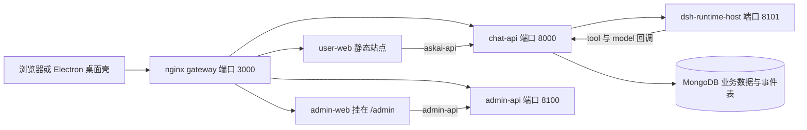
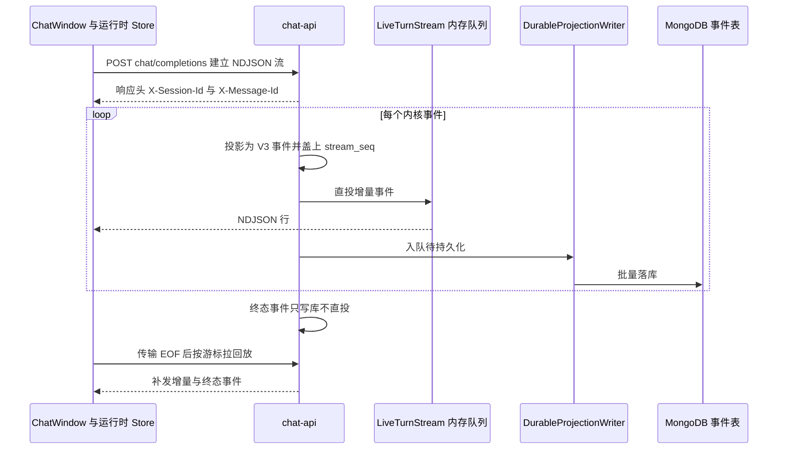

# MOVO 前端工作区与管理控制台

## 根因

MOVO 的 Agent 运行在独立的 DSH Runtime Host 里，一轮对话可能持续几分钟、产生数百个事件（文本增量、工具调用、审批、浏览器接管、文档交付物），而且**任何一个环节都可能断线**。前端的真正难点不是"把 JSON 画出来"，而是三件事同时成立：

**长时运行的状态必须活得比组件久**（切页面、切会话、刷新重连都不能丢）；**事件必须可去重、可乱序、可补发**（直投通道和持久化通道是两条物理路径，谁也不能假设对方一定成功）；**一套 UI 要覆盖两种运行形态与两种授权模型**（同一份 `user-web` 既跑浏览器也跑 Electron，同一份租户策略快照既要驱动渲染又不能当安全边界）。

仓库里恰好有两个前端应用，规模相当但世界观完全不同，这本身就是可比较的样本：

| 维度 | `apps/user-web` | `apps/admin-web` |
| --- | --- | --- |
| 源码规模 | `src` 下 230 个 `.ts/.vue`，约 4.12 万行 | `src` 下 134 个文件，约 3.40 万行 |
| 路由 | 无 `vue-router`，单个 `currentView` 引用充当视图枚举 | `vue-router` 4.4.5 + `createWebHistory` |
| 全局状态 | 无 `pinia`，模块作用域的 `reactive` 运行时 Store | `pinia` 2.3.1，两个 Store（`auth`、`setup`） |
| 视图容器 | 单根 `App.vue` 3338 行 | `BasicLayout.vue` + `router-view` |
| 组件库 | naive-ui，按需 import | naive-ui，入口处显式注册 48 个组件 |

`user-web` 的依赖列表里确实找不到 `vue-router` 与 `pinia`，整份源码也没有任何 `createRouter` / `createPinia` / `defineStore` 调用；这不是遗漏，而是下述一系列取舍的结果：

[apps/user-web/package.json:26-31]()
<!-- anchor: "dependencies": { … "@vicons/ionicons5": "^0.13.0", -->

## 架构总览

网关把两个前端挂到同一域名下的不同前缀：`/` 交给 `user-web`，`/admin/` 交给 `admin-web`，`/setup` 与 `/admin` 则 302 跳到管理后台；对 `/askai-api/` 显式关掉 `proxy_buffering`，这是 NDJSON 流能逐行到达浏览器的前提：

[deploy/docker/nginx.conf:48-60]()
<!-- anchor: location /askai-api/ { … proxy_buffering off; -->

`admin-web` 的构建基路径必须与网关前缀一致，构建期就把它钉死，避免部署环境漏配变量导致白屏：

[apps/admin-web/vite.config.ts:5-12]()
<!-- anchor: const productExtensionPath = process.env.MOVO_ADMIN_PRODUCT_UI_EXTENSION … base: process.env.VITE_BASE_PATH || (command === 'build' ? '/admin/' : '/'), -->

### 两个应用共享的"产品扩展接缝"

`user-web` 与 `admin-web` 都在 Vite 层留了一个可被环境变量替换的别名 `@movo-product-extension`，默认指向仓库内极简的 `community.ts`。社区版通过这个别名注入登录弹窗；企业版用 `MOVO_PRODUCT_UI_EXTENSION` / `MOVO_ADMIN_PRODUCT_UI_EXTENSION` 指向另一份实现，从而在不 fork 前端的前提下替换登录、计费、模型权限编辑、菜单分组和整条路由：

[apps/user-web/vite.config.ts:5-13]()
<!-- anchor: const communityProductExtension = fileURLToPath(new URL('./src/product/community … '@movo-product-extension': configuredProductExtension || communityProductExtensi -->

这是一个值得单独记住的模式：**开闭边界画在构建期别名上，而不是画在运行时 feature flag 上**。代价是扩展必须提供编译期可解析的模块，无法在容器启动后热插拔；收益是社区版产物里根本不存在企业版代码。

## 决策一：把路由退化成状态机

`user-web` 是一个"单壳多视图"应用：对话、Skill 管理、工具、知识库、定时任务、Token 用量共享同一个左侧会话列表和顶部栏。它没有引入 `vue-router`，而是在 `App.vue` 里用一个字符串联合类型当视图枚举：

[apps/user-web/src/App.vue:147-147]()
<!-- anchor: const currentView = ref<'chat' | 'skills' | 'tools' | 'knowledge' | 'skill-confi -->

这个选择的收益是实的：真正的"导航状态"不是 URL，而是**当前激活的会话面板加当前视图**，两者必须一起切换；视图组件全部用 `defineAsyncComponent` 懒加载，切走即卸载，不需要处理路由守卫、嵌套路由出口、路由级 keep-alive 这些在单壳场景下纯属负担的机制。代价同样实：浏览器前进后退只能靠手写的 `popstate` 监听兜底，深链接几乎不可分享（只有会话分享 token 走了 URL），视图数量增长后 `App.vue` 必然膨胀——它已经 3338 行，模板中 1 个 `v-if` 加 6 个 `v-else-if` 并列排布。

`admin-web` 的处境相反：它天然是"多页控制台"，每个管理面都值得一条可收藏的 URL，所以老老实实用了 `vue-router`，并把菜单直接从路由表派生（见后文）。

## 决策二：运行时状态放在模块作用域，视图可以随时被销毁

`user-web` 的对话状态不在任何组件里，而在 `useChatRuntimeStore.ts` 的模块级 `reactive` 对象中，`panes` 是全部会话面板的数组：

[apps/user-web/src/composables/useChatRuntimeStore.ts:145-148]()
<!-- anchor: const state = reactive({ … unreadSessionIds: new Set<string>(), -->

这个决定解释了一批看起来"神奇"的行为：

- **切视图不会中断运行。** 对话区在模板里只属于那个兜底的 `<template v-else>` 分支，切到 Skill 管理页时 `ChatWindow` 组件被真正卸载，但发起请求的 `sendMessage` 是模块作用域函数，闭包里持有的是 `state.panes` 里的 pane 对象；它继续把增量写进 `pane.messages`，时间线组件重新挂载时直接看到最新数组：

[apps/user-web/src/App.vue:2679-2680]()
<!-- anchor: <template v-else> … 
 -->

- **多个会话面板同时存在。** `App.vue` 用 `v-for` 渲染全部 pane，用 `v-show` 只显示激活的一个，于是切换会话时滚动位置、`ExecutionStoreV3` 实例、进行中的流都不会重建：

[apps/user-web/src/App.vue:2813-2815]()
<!-- anchor: v-for="pane in visibleChatPanes" … :key="pane.key" -->

- **必须自己管内存。** 没有路由级缓存机制帮忙，代码里显式写了上限 8 个会话 pane 的淘汰策略，且**运行中的 pane 与当前激活 pane 永不被淘汰**：

[apps/user-web/src/composables/useChatRuntimeStore.ts:233-250]()
<!-- anchor: function pruneInactivePanes() { … state.panes = state.panes.filter((pane) => mustKeep.has(pane.key) || keepBySessi -->

- **"未读"是运行态推导出来的，不是服务端字段。** pane 从 running 翻到 not running 且不是当前激活会话时，才点亮未读点：

[apps/user-web/src/composables/useChatRuntimeStore.ts:274-280]()
<!-- anchor: function setPaneRunning(pane: ChatRuntimePane, running: boolean) { … if (!running) pruneInactivePanes() -->

这份收益的代价是全局单例：模块级 `state` 意味着同页只能有一份运行时，测试必须靠重新导入模块来隔离，而任何跨 pane 的隐式耦合都不会被类型系统拦住。`ChatWindow.vue` 的顶部注释等于把这条纪律写进了代码：它只是"对话外壳"，新的能力必须通过子组件或 composable 接入，禁止把业务逻辑和流编排直接塞进来。

[apps/user-web/src/components/ChatWindow.vue:52-57]()
<!-- anchor: // Architecture boundary: … // to this file. -->

`ChatWindow` 自己接 30 多个 props、不持有任何权威状态，消息数组也只是对运行时 Store 数组的一层只读暴露，而不是拷贝：

[apps/user-web/src/components/chat/useAuthoritativeMessages.ts:7-8]()
<!-- anchor: export function useAuthoritativeMessages<T>(source: () => T[] | undefined): Comp … return computed(() => source() || []) -->

[apps/user-web/src/components/ChatWindow.vue:59-62]()
<!-- anchor: const props = defineProps<{ … sessionId?: string -->

## 决策三：终态事件不直投，逼出一套客户端恢复协议

这是整个前端最反直觉、也最值得迁移的一处设计。后端的实时通道是进程内的内存队列，它的自我描述非常克制：

[services/chat-api/app/dsh_runtime/events/live_stream.py:1-1]()
<!-- anchor: """Process-local, zero-database live delivery for one DSH turn.""" -->

每一条内核事件进来后，会经过"投影 → 盖序号 → 直投 + 入队持久化"三步，两条轨道共用同一个 `stream_seq`：

[services/chat-api/app/dsh_runtime/events/turn_channel.py:37-51]()
<!-- anchor: async def publish_kernel( … return sequenced -->

持久化一侧是异步批写，128 条或 0.2 秒触发一次落库，并支持"屏障"式 flush 来保证顺序：

[services/chat-api/app/dsh_runtime/events/projection_writer.py:29-36]()
<!-- anchor: class DurableProjectionWriter: … max_batch_delay_seconds: float = 0.2, -->

关键在调用方：当抵达终态（`turn.completed` / `runtime.failed`）时，**这条事件只写库、不直投**——`publish_live` 被显式置为 `not is_terminal`：

[services/chat-api/app/dsh_runtime/turn_runner.py:152-163]()
<!-- anchor: publish_live=not is_terminal, … if projected is not None and projected.get("type") != "item.delta": -->

于是客户端的 EOF 变得**语义上不可信**：流正常关闭不等于任务完成。前端因此把"传输结束"和"运行终态"拆成两个独立判据，并在传输结束时主动去拉回放接口验证：

[apps/user-web/src/composables/useChatRuntimeStore.ts:530-533]()
<!-- anchor: if (!ctrl.signal.aborted && !backendTerminalReceived) { … await recoverDisconnectedStream(true) -->

恢复循环本身是一段"幂等重试"：以 `message_id` 与本地已见的最大 `stream_seq` 为游标，反复请求 `GET /chat/messages/{id}/events?after_cursor=`，把回来的事件照常喂给同一个投影器（靠 `event_id` 去重，所以重复投递无害），直到服务端报告不再是 live：

[apps/user-web/src/composables/useChatRuntimeStore.ts:458-486]()
<!-- anchor: const messageId = assistantMsg.message_id || activeHandle?.messageId || '' … await new Promise((resolve) => setTimeout(resolve, 2000)) -->

为什么值得这么做？因为"直投 + 持久化"两条轨道不可能同时可靠：直投要求连接活着，持久化要求写库成功。如果终态既直投又落库，就会出现两种不一致——客户端收到终态但库里没有（刷新后状态回退），或库里已终态但客户端永远等不到（流被代理切断）。**把终态唯一地交给可回放的持久化轨道，等于指定了唯一权威来源**，代价是完成信号永远要等一次额外的轮询往返（代码里是 2 秒间隔），以及恢复接口本身在断网期间同样不可用——代码注释也承认了这一点，并把它降级为"下次轮询再试"。同一个恢复原语复用在了三个场景：流中断续跑、打开一个**别人正在跑**的会话（此时只跟随进度、不提供停止按钮）、以及浏览器干预结束后的续跑。停止按钮的授权边界写在注释里——服务端对非发起者的取消请求一律拒绝：

[apps/user-web/src/composables/useChatRuntimeStore.ts:700-706]()
<!-- anchor: // Todo 29: the stop control is the composer's running button, shown … const runInitiatorUserId = detail.active_run.initiator_user_id || '' -->

前端据此计算出"外部运行"的概念：只有状态是 running/suspended 且发起者不是自己时才成立；没有记录发起者的历史运行也被保守地当作外部运行：

[apps/user-web/src/composables/sessionRunPresence.ts:9-18]()
<!-- anchor: export function foreignRunForViewer( … status: activeRun.status, -->

## 决策四：客户端镜像的是内核事件，不是消息

`user-web` 没有把 SSE/NDJSON 变成一个"字符串拼接"的过程，而是定义了一套版本化的投影协议 `ExecutionEventV3`：事件有 `event_id`、单调的 `revision`、`item_kind`、`stream_seq`，类型集合固定为 `run.*` 与 `item.*` 两组：

[apps/user-web/src/features/execution-v3/domain/protocol.ts:1-3]()
<!-- anchor: export type V3EventType = … | 'item.started' | 'item.updated' | 'item.delta' | 'item.completed' | 'item.fail -->

这份协议是前后端共同资产。后端的投影器把 DSH 原生事件翻译进来，并在文件头声明"DSH 原生负载绝不跨越这条边界"：

[services/chat-api/app/dsh_runtime/events/projection.py:1-1]()
<!-- anchor: """Stable V3 UI projection; DSH-native payloads never cross this boundary.""" -->

客户端则用一个约 150 行的 Store 把这串事件折叠成"条目 + 顺序表 + 交付物 + 证据包 + 运行状态"，去重与单调性就在这里：

[apps/user-web/src/features/execution-v3/stores/executionStore.ts:24-27]()
<!-- anchor: function applyEvent(event: ExecutionEventV3) { … state.rawEvents.push(event) -->

[apps/user-web/src/features/execution-v3/stores/executionStore.ts:56-59]()
<!-- anchor: if (existing && event.revision <= existing.revision && !clearsIntervention) retu … payload.text = String(existing?.payload?.text || '') + String(event.payload?.tex -->

三点设计值得注意：

1. **原始事件流被完整保留在 `rawEvents` 里**，视图渲染的是折叠结果。于是"时间线"和"调试视图"共用同一份数据，`sticky_debug=1` 这类排查开关不需要额外埋点。
2. **`revision` 让投影可重放且可乱序**。回放接口补发的事件与直投事件可能有重叠或次序颠倒，靠 `revision` 比较直接丢弃陈旧版本，而不是靠到达顺序。
3. **Store 用 `markRaw` 返回**。注释解释了原因：它同时含 ref 与方法的服务对象，一旦被 Vue 深度代理，`visibleItems` 这个 computed 会被自动解包成数组，调用方拿到的东西就不稳定了——这是把"领域对象"与"响应式树"分离的一个具体手法：

[apps/user-web/src/features/execution-v3/stores/executionStore.ts:139-140]()
<!-- anchor: const visibleItems = computed(() => state.order … .map((id) => state.items[id]) -->

Store 与消息的挂载只有唯一入口 `ensureMessageExecutionV3`，并且承担一段向后兼容：新会话的事件日志是权威来源，而老的持久化记录里 `documents` / `evidence_bundles` 字段还在、事件日志缺卡片时，用"合成一条 `item.completed`"的方式把它们回灌成同构条目：

[apps/user-web/src/features/execution-v3/stores/messageExecution.ts:34-36]()
<!-- anchor: * Single attachment boundary for V3 execution state. … * fallback for older records whose event log did not persist those cards. -->

这比"再写一套老格式渲染分支"省得多，代价是合成事件会占用 `event_id` 空间（用 `history_seed_*` 前缀规避冲突），且一旦老记录的字段语义与新协议漂移，回灌逻辑会变成隐性技术债。

## 决策五：让一段文本只在正文与时间线之间归位一次

工具循环中，模型先说一句"我先看一下项目结构"，然后调工具，再给最终答案。流式输出时，这句话到底属于"答案正文"还是"执行轨迹"？在收到完整的消息对象之前，无从判断。

MOVO 的做法是**延迟分类**：增量事件一律以 `item.delta` + `final_answer` + `provisional: true` 投影出来，明确标注它只是暂定：

[services/chat-api/app/dsh_runtime/events/projection.py:54-60]()
<!-- anchor: elif event_type == "agent.message.delta": … payload = {"text": text, "provisional": True} -->

前端据此遵守两条互补规则。其一，暂定条目仍然出现在时间线里（`visibleItems` 只把**非** provisional 的 `final_answer` 过滤掉，交给正文区渲染），所以文本从一开始就有位置、不会闪。其二，正文只在收到 `item.completed` 的那一刻被整体赋值，`item.delta` 直接 return：

[apps/user-web/src/features/execution-v3/domain/assistantContent.ts:20-26]()
<!-- anchor: if (event.item_kind === 'final_answer' && event.type === 'item.delta') { … message.content = String(event.payload?.text ?? message.content) -->

这层权衡在于：如果边流边写正文，那么当消息最终被判定为"带工具调用的 commentary"时，这段文字就必须从正文区**搬回**时间线，用户会看到文本跳位。用"暂定位置 + 一次性提交"换来位置稳定，代价是正文区在流式过程中是空的，用户读到的其实是时间线里的暂定文本——这也是 `ProvisionalAssistantItem` 这个几乎只为渲染 Markdown 而存在的组件之所以必要的原因。

## 事件到 UI 的映射

| 事件 / 条目 | UI 呈现 | 关键实现 |
| --- | --- | --- |
| `run.started` / `run.completed` | 时间线标题行与耗时 | `ExecutionViewV3` 的秒级时钟与 `formatRunDuration` |
| `item.delta` + `final_answer` | 暂定 Markdown 块 | `ProvisionalAssistantItem` |
| `item.completed` + `final_answer` | 提交到答案正文 | `applyAssistantContentEvent` |
| `item.completed` + `commentary` | 时间线一行说明文字 | `CommentaryItem` |
| `item.*` + `tool` | 工具卡片，连续同类折叠成组 | `RepeatedToolCallGroup` / `collapseRepeatedToolCalls` |
| `item.started` + `approval` | 审批卡片（内联） | `ActivityItem` 的 allow/deny 按钮 |
| `approval` 且 `source` 为 `dsh` | 独立审批弹层，走专用决策接口 | `ToolApprovalPrompt` + `useDshToolApprovals` |
| `browser_handoff` / 工具载荷里的 `browser_intervention` | 干预提示条 + 浏览器接管 | `LocalBrowserInterventionPrompt` |
| `item.completed` + `artifact` / 工具载荷 `artifacts` | 交付物卡片，动作由注册表决定 | `ArtifactList` |
| `item.completed` + `evidence` | 证据抽屉入口 | `EvidenceDrawer` / `KnowledgeSourceViewer` |
| `item.failed` + `error` | 时间线错误行 + 终态提示 | `executionStore` 的 `errors` 与 `runStatus` |

时间线的两条"降噪"逻辑值得单看。其一是**运行态归属**：一个正在运行但已经有可见子条目的条目是"分组节点"而不是活动叶子，只有真正没有可见子节点的运行条目才算"活跃"，据此决定是否显示"思考中"占位动画。其二是**工具调用折叠**：连续的同类工具调用会被合并成一条摘要行，摘要文本由工具名归一化后映射到固定的能力标签（读文件／改文件／执行命令／搜索代码／用浏览器／搜网页／装 Skill／更新计划），并且对参数做了三类脱敏——敏感字段（token/secret/password/authorization/cookie/api key）、内部存储路径、以及过长的命令与代码正文：

[apps/user-web/src/features/execution-v3/domain/repeatedToolCalls.ts:7-11]()
<!-- anchor: const SENSITIVE_ARGUMENT = /(?:token|secret|password|authorization|cookie|api[_- … const DETAIL_LIMIT = 180 -->

同一处还有一个细节：展示名优先取工具画像里的 `display_name`，但如果它与适配器名相同、或长得像 `a.b.c` 形式的适配器标识，就退回本地化的能力标签——**原始适配器名只作为审计元数据存在，不做界面标题**。

### 审批为什么有两套通道

`dsh` 来源的审批项没有内联按钮，走的是独立组件加一个 2 秒的持久化兜底轮询：

[apps/user-web/src/components/ChatWindow.vue:2221-2227]()
<!-- anchor: <ToolApprovalPrompt … @decide="(decision, grantScope) => approvalControl.decide(approval, decision, gr -->

[apps/user-web/src/composables/useDshToolApprovals.ts:88-93]()
<!-- anchor: function resetTimer() { … timer = setInterval(() => { void refresh() }, RECOVERY_INTERVAL_MS) -->

这个 composable 把"实时事件"和"服务端待办列表"按 action_id 归并——事件到了就用事件，事件丢了（页面刷新、直投丢失）也能从不落空的待办接口里捞回来：

[apps/user-web/src/composables/useDshToolApprovals.ts:33-39]()
<!-- anchor: const eventItems = computed(() => options.messages.value.flatMap((message) => { … && ['askai-approval', 'dsh'].includes(String(item.payload?.source || '')), -->

[apps/user-web/src/api/toolApprovals.ts:16-27]()
<!-- anchor: export async function listPendingToolApprovals( … return Array.isArray(payload?.data) ? payload.data : [] -->

这实际上是把决策三的"双轨"思想下沉到了审批这种**需要人决策**的交互上：审批卡片不允许因为一次网络抖动而永久消失，因为那会把一个等待人工的 Agent 挂死。

### 浏览器干预是一个循环，不是一次弹窗

干预提示确认后，前端并不是简单地重新发一条消息，而是进入一个"等待就绪 → 提交续跑信号 → 消费续跑流 → 若再次挂起则重复"的循环：

[apps/user-web/src/composables/tasks/browserInterventionTaskFlow.ts:33-53]()
<!-- anchor: const intervention = input.getIntervention() … input.setWaitController(null) -->

[apps/user-web/src/composables/tasks/browserInterventionTaskFlow.ts:57-76]()
<!-- anchor: const resumed = startTaskResumeStream({ … onMessageId: input.onMessageId, -->

循环条件用 `isResumableBrowserIntervention` 严判：只有同时具备 `resumable`、`suspension_id`、`run_id`、`node_id`、`browser_session_id` 五个字段才算可续跑，避免对一个已经失效的挂起点反复重试。认证类干预走 `waitForBrowserAuthReady`，人工接管类走 `waitForBrowserInterventionReady`，两者返回的就绪信号被翻译成续跑请求里不同的 `signal.type`；续跑请求本身也是一条 NDJSON 流，收到流首部后立刻清除本地干预态、重新置为运行中，并把 `X-Message-Id` 回填到同一条助手消息上，使前后两段输出落在同一个时间线里。这条路径复用决策三的恢复原语，而不是另起一套。

### 取消是"先就绪再取消"

停止按钮不能一按就 abort 本地 fetch：如果服务端那一轮已经建立，本地断开只会让 Agent 变成无人观看的孤儿进程。所以实现会先等流首部就绪拿到真实 `session_id`，再调用服务端取消接口，成功后才释放本地控制器；若在服务端轮次建立之前就按了停止（例如还在跑额度校验和附件上传），则直接本地失效并递增 `operationId` 让在途的异步步骤自然作废：

[apps/user-web/src/composables/chatCancellation.ts:52-65]()
<!-- anchor: await handle.ready … const cancelled = await cancelChat(conversationId, pane.activeAuthToken) -->

`operationId` 这个单调计数器是这个 Store 的隐性主角：发送、上传、恢复、刷新等多条异步路径都会在每一步后比对它，一旦发现自己的轮次已被取消或替换就静默返回。没有第三方状态机库，靠一个整数解决了"晚到的异步结果污染新一轮会话"的经典问题。

会话级互斥则由服务端 409 承担，而错误分支的判据被明确限定为"状态码加错误码，而不是展示文案"：

[apps/user-web/src/composables/useChatStream.ts:11-13]()
<!-- anchor: * Non-OK chat-completions response. `code` is the parsed FastAPI dict-detail … * on the display message. -->

命中"该会话已在运行"后，前端撤掉刚插入的一问一答两条乐观气泡、不发错误提示，而是转去展示"外部运行"；而流首部携带的服务端会话 id 与消息 id，是后续补发、续跑与审批归并的前提：

[apps/user-web/src/composables/useChatStream.ts:105-113]()
<!-- anchor: const sid = resp.headers.get('X-Session-Id') … opts.onMessageId?.(mid) -->

## 富内容：注册表驱动的交付物卡片

生成的 PDF / DOCX / XLSX / PPTX 在对话里不是"一条链接"，而是带图标与动作集合的卡片。动作不是靠十几个 `v-if` 判断出来的，而是由一份 `kind → { icon, labelKey, actions }` 的注册表决定：

[apps/user-web/src/registries/artifacts.ts:46-48]()
<!-- anchor: registerArtifact('pptx', { icon: ICON_PPT,  labelKey: 'artifact.pptx', actions:  … registerArtifact('presentation_preview_bundle', -->

`actions` 里出现的 `edit` / `preview` / `export` 才是真正的差异点：PDF 只能预览与下载，DOCX 走 Markdown 编辑器，PPTX 与 `presentation_preview_bundle` 才能进可视化编辑器并导出成品。这里有一个容易被忽略的坑：**交付物的"业务身份"不等于文件格式**。`presentation_preview_bundle` 的持久化载荷可能指向一个 HTML 预览，但如果按扩展名或 MIME 反推类型，卡片就会退化成"下载一个 html"，编辑与导出动作全部消失。因此类型解析把语义 kind 放在最高优先级：

[apps/user-web/src/features/execution-v3/domain/artifactKind.ts:17-21]()
<!-- anchor: // These are business artifact identities, not file formats. Their persisted … 'presentation_preview_bundle', 'email_draft', 'code_diff', -->

PPT 的呈现路径是最能说明"前后端职责切分"的一条：浏览器端用 fabric.js 打开一份**蓝图 JSON**（deck 中间表示）做画布级编辑，导出时把蓝图交回服务端渲染成 pptx，而不是在浏览器里拼 OOXML：

[apps/user-web/src/components/PresentationEditor.vue:2-4]()
<!-- anchor: import { ref, onMounted, onBeforeUnmount, watch, nextTick, computed } from 'vue' … import { renderPresentationPptx, saveBlueprint } from '../api/documents' -->

这个选择的理由很硬：PPTX 的文本框自动换行、字体回退、行距与分页在浏览器与服务端 PowerPoint 之间几乎不可能像素级一致。让服务端成为唯一渲染权威，前端只负责"编辑体验"，用户看到的预览与服务端导出结果之间的偏差就被收敛到一个可控的蓝图层。代价是每次导出都必须有一次往返，且前端编辑器与后端渲染器共享同一份蓝图 schema——schema 一改，两端必须同步发布。

文本渲染走的是自研路径：`AssistantMarkdown` 把 Markdown 渲染成 HTML 字符串后用 `v-html` 注入，配套的 `escapeHtml` 负责转义，代码高亮、Mermaid 代码块清洗、工作区文件引用都是自己实现的，没有引入 markdown-it 之类的运行时依赖：

[apps/user-web/src/components/chat/AssistantMarkdown.vue:53-57]()
<!-- anchor: class="assistant-markdown prose prose-slate max-w-none prose-p:leading-7 prose-h … @keydown="openFileByKeyboard" -->

这是典型的"省依赖换控制力"：体积与供应链风险更低，链接安全策略可以自己写死，但任何 Markdown 边角语法都要自己补，且 `v-html` 的正确性完全押在自家转义函数上。

## 引用与证据：合并逻辑放在了前端

引用不是一个"来源列表"字段，而是 `EvidenceBundleItem`：来源、已确认事实、未决问题三部分。多轮工具调用会各自产出证据包，最终展示时前端把它们按 URL 或"文档 ID + chunk ID"去重合并：

[apps/user-web/src/composables/evidenceBundles.ts:50-62]()
<!-- anchor: export function mergeEvidenceBundles(bundles: EvidenceBundleItem[]): EvidenceBun … if (!hasSourceContent(source) || isEmptyKbSource(source)) continue -->

合并时还做了一层"空源过滤"：知识库检索有时会返回一个只有计数、没有任何定位信息与正文的占位来源，这类来源如果直接展示会让读者以为"有引用但点不开"，因此被识别并剔除。展示侧再按文档聚合成"一份文档、N 个片段"，而不是把同一份文档的五个 chunk 铺成五条引用：

[apps/user-web/src/features/execution-v3/domain/evidenceSourceGroups.ts:21-29]()
<!-- anchor: export function groupEvidenceSources(sources: EvidenceSourceItem[]): EvidenceSou … existing.sources.push(source) -->

把合并放在前端而非后端的理由是可以辩护的：证据包是**逐工具产出**的，后端并不掌握"用户最终会看到哪些轮次"这个信息，前端反而天然拥有完整的合并视野，且合并是纯函数、可离线测试（仓库里确实有 `tests/evidence-source-groups.test.ts`）。代价是同一份逻辑无法被其他客户端复用，如果将来出现移动端或第三方接入，合并规则会被复制一遍。

## admin-web 的信息架构

`admin-web` 是标准的控制台：一条 `BasicLayout` 包裹路由出口，菜单不手工维护，而是**从路由表推导**：

[apps/admin-web/src/composables/useMenuOptions.ts:44-49]()
<!-- anchor: function buildOptions() { … const groups = [...builtInGroups, ...(adminProductUiExtension.menuGroups ?? [])] -->

这样一来"加一个管理面"只需要加一条路由：`meta.title` 变成菜单文案，`meta.icon` 变成菜单图标，`meta.hideInMenu` 表示"详情页不进菜单"，`meta.menuGroup` 表示挂到某个分组下（内置只有"组织与用户"一个分组，其余分组由产品扩展提供）。收益是菜单与路由永不漂移；代价也很直接——**菜单项是路由的投影，于是当多条路由指向同一个组件时，菜单会退化**。设置页正是这种退化：

[apps/admin-web/src/router/routes.ts:182-197]()
<!-- anchor: path: '/settings/presentation', … meta: { title: '知识库设置', hideInMenu: true }, -->

七条 `/settings/*` 路由全部指向同一个 1641 行的 `ExternalSearchSettingsPage.vue`，页面内部用"路由路径 → 分区"的反查表来决定渲染哪个分区，并在切换分区时反向 `router.push` 保持 URL 与视图同步：

[apps/admin-web/src/views/settings/ExternalSearchSettingsPage.vue:688-694]()
<!-- anchor: const sectionRouteMap: Record<SettingsSection, string> = { … knowledge: '/settings/knowledge', -->

这是一个务实的折中：设置类页面共享同一套"左侧分区 + 未保存拦截"的骨架，拆成六个组件会重复大量布局与离开确认逻辑；但代价是文件名与内容严重不符（`ExternalSearchSettingsPage` 里装着 PPT 生成设置与页面采集设置），新读者第一次打开必然困惑，而且这个文件的未保存拦截是围绕快捷键面板**特判**出来的，并不通用。

### setup wizard 是路由守卫，不是引导页

首次部署时最要紧的是"别让用户在没初始化的系统里瞎点"。MOVO 没有把这条规则放进每个页面，而是放在全局前置守卫的最前面，且**先于认证检查**：未完成初始化一律重定向到 `/setup`，已完成初始化则不允许再进 `/setup`；连状态接口都失败时也保守地送去 `/setup`。可见邀请接受页被显式豁免，否则被邀请人会被卡在初始化页外：

[apps/admin-web/src/router/index.ts:11-23]()
<!-- anchor: router.beforeEach(async (to) => { … if (to.path !== '/setup') return '/setup'; -->

状态本身是 pinia 里的一个极小 Store，带"已检查过就不再请求"的幂等语义，避免每次路由跳转都发一次请求：

[apps/admin-web/src/stores/setup.ts:41-48]()
<!-- anchor: async ensureStatus(force = false) { … this.checked = true; -->

向导本体是五步加一个完成态：部署检测 → 组织与账号 → 对话模型 → 其他模型 → 联网搜索，最后给出员工 Web / 管理后台 / 桌面端连接地址三个入口地址——`SetupUrls` 里虽然还有 `agentWebSocket`，但完成页并未渲染它。 [apps/admin-web/src/components/setup/SetupProgressSteps.vue:9-16]()
<!-- anchor: const steps = computed(() => [ … t('完成'), -->

[apps/admin-web/src/components/setup/SetupCompleteStep.vue:35-39]()
<!-- anchor: const items = computed(() => [ … { key: 'desktop', label: t('桌面端连接地址'), value: props.urls.desktopService }, -->

值得注意的是**服务未就绪时按钮是禁用的**：第一步的「下一步」按钮绑定了 `:disabled="!setupStore.ready"`，同时在有服务尚未就绪时给出警示条，提示可以稍后刷新状态。 [apps/admin-web/src/views/auth/SetupPage.vue:42-42]()
<!-- anchor: <n-button block type="primary" size="large" :disabled="!setupStore.ready" -->

### 控制面的覆盖面

| 管理面 | 路由 | 观察 |
| --- | --- | --- |
| 工作台 | `/dashboard` | 一个聚合接口给出计费额度与成员上限、健康告警、24 小时调用量与成本、资产异常、待办、最近调用 |
| 组织与用户 | `/organizations/*` | 账号组、用户、岗位角色、流量分配，体量最大的域 |
| 模型与 Skill 工具 | `/models`、`/skills`、`/tools` | Skill 配置 4424 行、工具编辑 2126 行，重型表单集中区 |
| 知识、统计与审计 | `/knowledge/documents`、`/token-stats`、`/system-audit` | 文档列表与连续 PDF 预览、Token 统计、审计概览加日志与抽屉 |

工作台的聚合接口形状本身就是一份"控制台应该回答什么问题"的清单，健康状态不是另开接口，而是这套聚合里的一个字段：

[apps/admin-web/src/views/dashboard/DashboardPage.vue:159-166]()
<!-- anchor: interface DashboardOverview { … userLimit: number | null; -->

组件库的引入方式也有别于 `user-web`：`admin-web` 在入口处显式 `create({ components: [...] })` 注册了 48 个 naive-ui 组件，而不是依赖自动按需导入插件：

[apps/admin-web/src/bootstrap.ts:8-10]()
<!-- anchor: const app = createApp(App); … const naive = create({ -->

好处是构建完全确定、不需要额外的 unplugin 依赖，坏处是**新增一个组件必须记得往这个数组里加**，否则模板里写了也不渲染——这是一个纯靠约定维持的清单。

## 权限：两道互不相干的门

前端有两套独立的可见性/可用性判据，混在一起会出错。

第一道是**平台能力门**（`PlatformCapabilities`），回答"这个壳能不能做这件事"：是否 Electron、能否托管真实 Chromium 页面、是否能弹原生保存对话框、是否由主进程托管 DSH Runtime、是否有本机终端与 Git 检视能力。这组能力描述符由一份运行时选择的适配器实现——同一份 API 表面，在 Electron 里动态换成 `electron` 实现，加载失败则回退到 web 实现：

[apps/user-web/src/platform/types.ts:30-41]()
<!-- anchor: export interface PlatformCapabilities { … /** A secured DSH Runtime Host is owned by the desktop main process. */ -->

[apps/user-web/src/platform/index.ts:18-23]()
<!-- anchor: // Top-level await keeps consumers synchronous after module init. … console.warn('[platform] Electron impl failed to load; falling back to web', err -->

第二道是**租户策略门**，回答"这个用户的租户允许不允许"。策略快照里既有按能力的布尔开关（代码生成、浏览器自动化、内部知识、内容生成），也有"资源族访问模式"这一层——模式缺省意味着部署已切到更细的按资源权限契约，此时前端一律放行、由资源接口自己做过滤：

[apps/user-web/src/composables/useEnterpriseAccessPolicy.ts:4-18]()
<!-- anchor: export function agentCapabilityAllowed(profile: UserProfile | null, key: AgentCa … return Array.isArray(ids) && ids.length > 0 -->

源码注释明确写着：模式缺省意味着部署已切到更新的按资源权限契约，真正的过滤由资源接口完成。这等于承认了前端这两道门的性质——**它们只是 UX，不是安全边界**；`user-web` 的会话列表与对话页从不假设自己能拦住越权访问，判定全在 chat-api 侧。

两道门的失败处理方式也故意不同。`admin-web` 是纯控制台，401/403 直接清会话并硬跳登录页，因为管理后台没有"局部失效"的概念：

[apps/admin-web/src/api/client.ts:17-28]()
<!-- anchor: apiClient.interceptors.response.use( … window.location.replace('/login'); -->

`user-web` 则不能这么做：用户可能正在一轮运行中，硬跳转会丢掉整个界面。它改成广播一个全局事件，由应用根组件决定如何处置（弹登录、保留当前运行态、重新认证后继续）：

[apps/user-web/src/api/authExpiry.ts:13-20]()
<!-- anchor: export function notifyAuthExpired(): void { … notifyAuthExpired() -->

这个差异不是风格问题，而是"工作区"与"控制台"两种产品形态的必然结果：工作区里用户**有正在进行的资产**，控制台里没有。

## i18n：四套互不共享的机制

MOVO 的多语言不是一个模块，而是四个各自独立的小系统：

| 层 | 载体 | 语言标识 | 键的形态 |
| --- | --- | --- | --- |
| 工作区界面 | `apps/user-web/src/locales/` | `zh` / `en` | **中文原文即键** |
| 管理台界面 | `apps/admin-web/src/locales/` | `zh-CN` / `en-US` | 中文原文即键，落 localStorage |
| 生成物文案 | `services/chat-api/app/i18n/strings.json` | `en` / `zh` | 语义化 snake_case 键，两语各 280 条 |
| 生成物语言判定 | `services/chat-api/app/dsh_runtime/locale.py` | `zh-CN` / `en-US` | 无键，靠显式参数或 CJK 正则 |

前端的 `t()` 极其朴素：先查产品扩展注入的键，再查内置词表；查不到就回退到该键的中文，再查不到就把键本身返回。于是"键就是中文原文"这个约定让漏翻永远不会白屏：

[apps/user-web/src/composables/i18n.ts:45-47]()
<!-- anchor: export function t(key: string, params?: Record<string, string | number>): string … const template = entry?.[_locale.value] || entry?.zh || key -->

配套的成本体现在文件名上：核心词表之外还维护着一份按功能切分的"补充词表"，其中第一份直接叫 `uncoveredMessages`，字面意思就是"类型系统覆盖不到、靠人工补齐的那批键"：

[apps/user-web/src/locales/uncoveredMessages.ts:1-3]()
<!-- anchor: export const uncoveredMessages = { … '已复制': { zh: '已复制', en: 'Copied' }, -->

选择"中文即键"的收益是编写时零心智负担（写 `t('复制')` 即可），代价是**词表与源码无法做键级别的一致性校验**，只能靠人肉维护补充词表，且文案一改就等于改键，历史翻译全部失效。

后端那一套完全不同：它是给**生成物**用的（报告标题、目录变体、章节角色标签、文档封面默认值），键是语义化的，两种语言条目数量严格对等，加载用 `lru_cache` 缓存并在文件缺失时优雅降级为空表：

[services/chat-api/app/utils/i18n.py:13-25]()
<!-- anchor: @lru_cache(maxsize=1) … return str(data.get(lang, {}).get(key, default if default is not None else key)) -->

最关键的一处衔接发生在"用户用中文提问时，生成的报告该是什么语言"。前端的 `output_spec` 从不发送语言字段（只发 user_id / main_id / task_id / 选中的 Skill），于是后端落在了一个 CJK 正则启发式上：显式参数优先，否则文本含中日韩统一表意文字就判中文，否则判英文：

[apps/user-web/src/composables/useChatRuntimeStore.ts:503-508]()
<!-- anchor: output_spec: { … manual_skill_selected: Boolean(input.selectedSkillId) || undefined, -->

[services/chat-api/app/api/endpoints/dsh_chat.py:221-221]()
<!-- anchor: language_name=str(output_spec.get("language") or output_spec.get("locale") or "" -->

[services/chat-api/app/dsh_runtime/locale.py:8-14]()
<!-- anchor: def resolve_turn_locale(text: str, explicit: str | None = None) -> str: … return "zh-CN" if re.search(r"[\u4e00-\u9fff]", str(text or "")) else "en-US" -->

这条链路的合理解释是"界面语言与产物语言解耦"——一个把界面设成英文的用户，仍然可能想要中文报告。但它同时也是一处真实的缺口：接口协议里确实留了 `language` / `locale` 入口，可交互式前端从不填它（上文那五个 `output_spec` 键里没有语言），于是产物语言只能由提问文本的字形决定，用户没有显式开关可拨。

## 工程约束与覆盖率

**测试。** `user-web` 没有引入 vitest / jest，也没有 jsdom。做法是用 esbuild 把单个 `.ts` 测试文件连同其依赖打成 ESM 产物丢到 `/tmp` 再用 node 跑，断言用内置的 `node:test` 与 `node:assert/strict`：

[apps/user-web/tests/session-ordering.test.ts:1-6]()
<!-- anchor: import assert from 'node:assert/strict' … } from '../src/utils/sessionOrdering' -->

这带来一个明确的测试形态偏好：**只测纯函数与领域 Store，不测组件**。体量最大的一个用例文件 `tests/execution-v3-store.test.ts`（约 2.5 万字节）直接构造事件序列喂给 `createExecutionStoreV3`，再断言时间线折叠、工具脱敏、审批归并、干预状态迁移等纯逻辑。这是与"状态放在模块作用域、视图可随时销毁"这一架构互相印证的选择——被测试的东西恰好就是不被 Vue 代理的那部分。没有被覆盖的是组件渲染、样式、无障碍与交互时序，这些只能靠手工验证。

**镜像基线。** 三个前端相关镜像（user-web 生产镜像、admin-web 镜像、网关镜像）的最终基础镜像被一个仓库脚本强制要求完全一致，且必须是以 `-trixie` 结尾的官方 Debian/glibc nginx：

[scripts/check_web_runtime_baseline.py:13-18]()
<!-- anchor: WEB_DOCKERFILES = ( … SUPPORTED_RUNTIME_SUFFIX = "-trixie" -->

这解决的是一个很具体的历史问题：三个镜像若各自漂移（有人用 Alpine、有人用 Debian），PDF.js 的 worker 与某些容器的 `pwritev2` 行为会不一致，排查成本极高。用一条 CI 可跑的断言把"运行时同源"变成硬约束，比写在文档里有效得多。

**覆盖率自述。** 本关注面涉及约 **7.5 万行**前端代码（`user-web/src` 41202 行 / 230 文件，`admin-web/src` 34048 行 / 134 文件）。我实际精读约 **4800 行**，约占 6.4%，抽样策略与缺口如下：

- 完整读完（对话链路主干）：`useChatRuntimeStore`、`useChatStream`、`execution-v3` 的 protocol / store / messageExecution / assistantContent / activityPresentation、`repeatedToolCalls` 前 80 行、`ExecutionViewV3`、`ActivityItem`、`ProvisionalAssistantItem`、`useDshToolApprovals`、`browserInterventionProjection`、`browserInterventionTaskFlow`、`taskResume`、`chatCancellation`、`sessionRunPresence`、`evidenceBundles`、`evidenceSourceGroups`、`registries/*`、`api/*` 中的 documents 与 toolApprovals 与 authExpiry、`composables/i18n`、`platform/index` 与 `platform/types`、两个 app 的全部构建与部署配置。
- 按结构加关键片段读：`App.vue`（3338 行，读约 500 行）、`ChatWindow.vue`（2742 行，读约 400 行）、`PresentationEditor.vue`（2396 行，只读头部）、`AssistantMarkdown.vue`、`utils/assistantMarkdown`（只读函数签名）；为坐实"终态不直投"另跨读后端 `services/chat-api/app/dsh_runtime` 的 `turn_runner`、`events/*`、`authoritative_delivery` 与 `api/endpoints/dsh_chat` 约 700 行。
- **未覆盖**：`MySkillConfigPage.vue`（4341 行）、`MyToolsPage.vue`（2126 行）等重型配置页；`composables/code/` 与 `composables/desktop/` 下 DSH Code 会话、工作区、终端、Electron 浏览器表面的全部实现（只读了 `platform` 抽象层与 `useDshCodeRuntime` 的调用点）；`admin-web` 侧 `SkillConfigPage.vue`（4424 行）、`KnowledgeDocumentsPage.vue`（2685 行）、`ToolEditPage.vue`（2126 行）、`OrganizationUsersPage.vue`（1750 行）的表单与权限细则；定时任务调度页；`admin-web` 无任何测试文件，其 API 层只读到 `client.ts`、`setup.ts`、`systemAudit.ts` 的片段。

因此本文对"流式渲染与重连"、"事件投影协议"、"构建期产品扩展接缝"、"i18n 分层"这四块有较高置信度；对 DSH Code 与桌面能力、以及两个管理台重型表单的细节，本文只覆盖到接口形状，未做实现级判断。

## 可迁移模式

1. **终态只走可回放轨道。** 实时通道负责低延迟，持久化通道负责唯一权威；客户端把"传输结束"与"运行完成"当成两个独立判据，并在 EOF 后主动按游标补拉。这条规则让断线、代理截断、页面刷新三种故障收敛到同一套恢复代码。
2. **事件即 API。** 定义一套带 `event_id` / `revision` / `item_kind` / 序号的版本化投影协议，并声明"内核原生负载不越界"。代价是前后端要共同维护它，收益是去重、乱序、回放、历史兼容、调试视图全部免费。
3. **客户端镜像事件流而不是镜像消息。** 消息是事件的折叠结果。把折叠做成可重放纯函数（`markRaw` 的服务对象），就能同时支撑实时流、历史回放与老数据回灌，避免为"老格式"再写一套渲染分支。
4. **状态活在组件之外，视图可以随便销毁。** 模块级运行时 Store 加上显式的 pane 淘汰上限与"运行中不淘汰"规则，换来"切页面不中断任务"。代价是必须自己管内存与单例隔离。
5. **开闭边界画在构建期别名上。** `@movo-product-extension` 这类可被环境变量替换的 Vite alias，让社区版产物里根本不存在企业版代码，避免运行时 feature flag 的"代码在但功能关"状态。
6. **两种产品形态配两种失效策略。** 工作区里有正在进行的资产，认证失效只能广播事件、允许原地恢复；控制台没有资产，直接清会话跳登录。把这条差异写进各自的 HTTP 层，而不是塞进一个共享的"全局 401 处理"。
