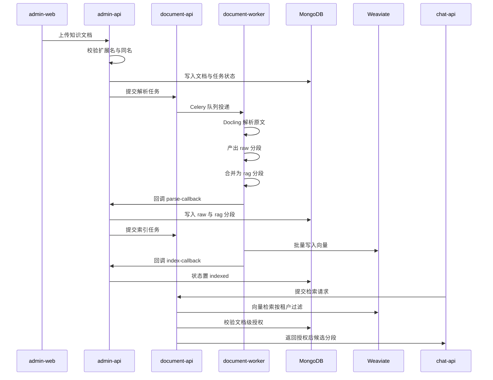

# MOVO 企业知识库与检索增强

MOVO 的知识面被刻意放在 Agent 内核之外：DSH 负责跑 Agent，而「企业知识」在 DSH 眼里只是两个工具——`knowledge_search` 与 `knowledge_read_document`。这个边界决定了整条链路的形状：解析、分块、向量化、授权、引用还原全部落在 MOVO 自己的 FastAPI 服务与 MongoDB 里，内核只看到一个被服务端注入了租户与知识库范围的函数调用。本篇沿着「一次上传到一条引用」的顺序，把这条链路拆开，重点解释它在几处关键分叉上的取舍。

## 根因：Agent 内核不该认识「企业知识」

如果让内核去理解「知识库归属、谁能看哪份文档、chunk 的主键是什么」，那么内核的每一次升级都会牵动权限模型与数据结构。MOVO 的选择是把知识能力做成**外挂的能力条目**，由能力目录统一声明给内核，执行体在 chat-api 里。

工具的定义写在能力目录里，它的描述明确把范围定义成服务端注入量：租户与知识库范围由 MOVO 注入，模型永远不该询问或提供它们。

[services/chat-api/app/enterprise_capabilities/runtime/catalog.py:154-161]()
<!-- anchor: capability_ref="knowledge.search@v1", tool_name="knowledge_search", domain="know … }, ("query",)), -->

执行体拿到的是**回合上下文**而不是模型参数：`context.tenant_id`、`context.user_id`、`context.conversation_id`，以及这一回合被选中的知识库列表，全部由上层会话请求决定。

[services/chat-api/app/enterprise_capabilities/runtime/adapters.py:73-83]()
<!-- anchor: async def knowledge_search(arguments: dict[str, Any], context: CapabilityExecutio … top_k=int(arguments.get("top_n") or 8), -->

而上层请求里确实只有两个知识相关字段：`knowledgeQaEnabled` 表示「严格只用内部知识作答」，`knowledgeBaseIds` 表示这一回合选中了哪些知识库。

[services/chat-api/app/api/endpoints/dsh_chat.py:82-87]()
<!-- anchor: knowledge_qa_enabled: bool = Field( … knowledge_base_ids: list[str] | None = Field(default=None, alias="knowledgeBaseI -->

除了相似度检索，还有一个**顺序阅读**工具：它不做向量召回，而是按 `ordinal` 顺序读整篇解析结果，用游标翻页。这条能力的存在说明 MOVO 承认「检索片段不能替代读原文」——需要通读合同时，召回 TopN 是没有意义的。

[services/chat-api/app/enterprise_capabilities/runtime/catalog.py:163-170]()
<!-- anchor: capability_ref="knowledge.read_document@v1", tool_name="knowledge_read_document", d … "This reads the parsed document, not similarity-search snippets." -->

**代价**：范围既然由服务端回合上下文决定，模型就无法在一次对话里「换一个知识库再查一次」。它只能请求，不能选择。这个限制换来的是授权判定永远发生在可信侧——不需要相信模型给出的任何 scope 参数。

## 全景：一次上传到一条引用

整条链路横跨四个服务、两个存储，每一段都靠回调而不是同步调用串起来：

| 环节 | 承担者 | 落脚点 |
| --- | --- | --- |
| 上传与状态机 | admin-api `knowledge_documents` 路由 | `knowledge_documents` 文档，状态 `uploaded → pending_parse → parsed → indexed` |
| 解析作业 | document-worker 的 Celery 任务 | 对象存储 `parsed.md` / `parsed.json` / `raw_chunks.json` / `rag_chunks.json` / `chunks.json` |
| 分段落库 | admin-api 的 parse 回调 | `knowledge_document_chunks`，`chunk_stage` 为 `raw` 或 `rag` |
| 向量化与检索 | document-api 的 embedding / vector_store 模块 | Weaviate 集合，只存文本与计分字段 |
| 授权 | document-api 的检索访问策略 | 反查 `knowledge_documents`、`knowledge_resources`、`resource_grants` |

## 决策一：解析与索引是异步作业，重活只在 document-worker 里

上传接口本身很薄：把文件落盘、写一条文档记录、然后**提交作业**；此时文档状态还是 `uploaded`。对象存储路径按 `{前缀}/{main_id}/{document_id}/{原始文件名}` 构造——租户在最外层、文档 id 在中层，因此同租户的同名文件天然落到不同前缀而不会互相覆盖。

[services/admin-api/app/api/routes/knowledge_documents.py:722-748]()
<!-- anchor: document_id = uuid.uuid4().hex … "status": "uploaded", -->

随后 admin-api 依次发起预览转换作业与解析作业，把租户设置里的分段参数一起下发；提交成功推进到 `pending_parse`，失败直接标 `failed`。这里有一个明确的工程妥协：提交作业用的是 5 秒超时的同步 HTTP，且要求对方必须返回 `jobId`。

[services/admin-api/app/api/routes/knowledge_documents.py:843-848]()
<!-- anchor: parse_settings = await get_effective_parse_settings(main_id) … chunk_overlap=parse_settings["chunkOverlap"], -->

[services/admin-api/app/api/routes/knowledge_documents.py:489-497]()
<!-- anchor: with urllib.request.urlopen(request, timeout=5) as response: … return job_id -->

重活之所以能外放，是因为依赖栈太重：document-api 与 document-worker 用的是**同一个镜像**，只是启动命令不同。

[docker-compose.yml:223-227]()
<!-- anchor: document-api: … command: ["api"] -->

[docker-compose.yml:261-265]()
<!-- anchor: document-worker: … command: ["worker"] -->

[docker-compose.yml:156-156]()
<!-- anchor: DOCUMENT_PROCESSING_BASE_URL: http://document-api:8200 -->

同一个 entrypoint 用第一个参数分派角色：`api` 起 uvicorn，`worker` 起 Celery 消费者；服务自己的 README 把这件事写成了一句设计陈述：「同一个镜像既能跑 API 服务也能跑 Celery worker」，并说明模型资产在构建期下载校验，客户部署时不会到第一次上传文档才发现要联网。

[services/document-parser/entrypoint.sh:23-28]()
<!-- anchor: case "${1:-api}" in … start_worker -->

[services/document-parser/README.md:36-36]()
<!-- anchor: The Docling requirements are pinned to the version set verified for this service -->

**为什么这样做**：解析栈同时包含 Docling、PyTorch、ONNX Runtime 与 LibreOffice，镜像体积和冷启动成本都很大。如果把它塞进 admin-api 进程内，则上传接口的 P99 会被一次 PDF 解析直接拖垮，而且这个进程无法按解析负载单独扩容。拆成「API 只编排、worker 只重算」之后，两侧可以独立扩缩容，Celery 侧也用 `task_acks_late` 与 `worker_prefetch_multiplier=1` 避免长任务被预取堆积。

**代价**：admin-api 必须对 document-api 可达（回调 URL 由 `admin_api_public_base_url` 拼接），并且两端共享一个回调令牌；作业提交是短超时同步调用，document-api 短暂不可用会让文档直接进入 `failed` 状态，必须人工重试。换句话说，这套设计把「解析慢」的风险换成了「编排不可达」的风险。

## 决策二：Docling 主解析，LibreOffice 只做旧格式外壳，OCR 只在整篇无文本层时全页启用

解析入口是一个按扩展名分派的函数，顺序很有信息量：旧版 Office 先做格式转换，图片直接走 OCR，其余交给 Docling；Docling 不可用时再退回轻量解析器。

[services/document-parser/app/services/document_parsing_service.py:100-113]()
<!-- anchor: def parse_document(path: Path, filename: str) -> ParsedDocument: … return parse_with_fallback(path, ext) -->

这里 LibreOffice 的角色被限定得很死：它只把 `doc/ppt/xls` 转成现代格式，好让 Docling 接手，而**不**参与正文抽取。这样避免了「用 LibreOffice 抽文本」带来的版式丢失，也让旧格式文档和新格式文档最终走同一个解析器——分段规则、标题路径、页码锚点因此完全一致。

图片路径则直接是 RapidOCR，并明确按中英双语、ONNX Runtime 后端、只对 PDF 生效的管线参数配置；`force_full_page_ocr` 由 OCR 策略决定。

[services/document-parser/app/services/document_parsing_service.py:159-164]()
<!-- anchor: pipeline_options = pdf_pipeline_options() … backend="onnxruntime", -->

OCR 策略本身是这份代码里最克制的一处设计：函数文档字符串直接写出取舍——只有当**每一页**都缺少可用的原生文本时，才启用全页 OCR。

[services/document-parser/app/services/pdf_ocr_policy.py:18-23]()
<!-- anchor: def inspect_pdf_ocr_policy( … """Choose full-page OCR only when every PDF page lacks useful native text.""" -->

判定方式是逐页抽取原生文本、去掉空白后与 20 字符阈值比较，把不达标的页收集进 `image_ocr_pages`；只有「缺文本页数 == 总页数」时才置 `force_full_page_ocr`。

[services/document-parser/app/services/pdf_ocr_policy.py:42-45]()
<!-- anchor: return PdfOcrPolicy( … force_full_page_ocr=page_count > 0 and len(image_ocr_pages) == page_count, -->

**为什么这样做**：对一个有原生文本层的 PDF 强上全页 OCR，等于主动把「确定性文本」降级成「识别文本」——引入字符错误、丢失表格结构、还慢。反过来，纯扫描件没有文本层可用，不 OCR 就是零召回。所以判据不是「有没有图片」，而是「有没有可用的文本层」。

**代价与边界**：混合型 PDF（部分页是扫描件）不会被单独强上 OCR，那些页仍然走 Docling 的布局推断；`image_ocr_pages` 在代码里只被用来给分段打 `sourceKind: image_ocr` 标记。我在 `parse_document` 的分派路径里**未找到**「对单页强制 OCR」的分支。

离线可用性是靠构建期解决的，运行时环境变量把 Hugging Face 中心彻底关掉：

[services/document-parser/Dockerfile:112-112]()
<!-- anchor: ENV HF_HUB_OFFLINE=1 -->

## 决策三：两段式分块——raw 保留结构，rag 面向检索

解析完一篇文档后，落地的不是一套分段而是**两套**：解析回调先按文档清空旧分段，再分别把 raw 与 rag 两批写入同一个分段集合，靠 `chunk_stage` 区分。

[services/admin-api/app/api/routes/knowledge_documents.py:1343-1344]()
<!-- anchor: append_rows(raw_chunks, "raw") … append_rows(rag_chunks, "rag") -->

第一段是 Docling 的 `HybridChunker`，配一个自定义的轻量分词器：CJK 字符按字计数、ASCII 按词计数。它还开了 `merge_peers`（合并同源小块）与 `repeat_table_header`（跨页表格重复表头）。

[services/document-parser/app/services/document_parsing_service.py:198-201]()
<!-- anchor: chunker = HybridChunker( … repeat_table_header=True, -->

这一段的产物是 `raw_*` 分段，携带相当重的结构元数据：Docling 自己的 chunk 元信息与原始导出、`sourceAnchor`（页码加 bbox），以及 `parser` / `chunker` / `tokenizer` 三件溯源标记。

[services/document-parser/app/services/document_parsing_service.py:237-253]()
<!-- anchor: "chunkId": f"raw_{len(chunks) + 1:06d}", … "sourceAnchor": source_anchor, -->

第二段是 MOVO 自己的合并器。它的 `RagChunkOptions` 数据类自带 min 400 / target 750 / max 1000 token、重叠 80 的默认值：

[services/document-parser/app/services/rag_chunk_optimizer.py:21-26]()
<!-- anchor: @dataclass(frozen=True) … overlap_tokens: int = 80 -->

但这两个默认值在本基线的两条解析路径上都不生效——两个调用点都显式传入 `_rag_chunk_options(...)` 覆盖了它们：

[services/document-parser/app/services/document_parsing_service.py:58-61]()
<!-- anchor: rag_chunks = parsed.rag_chunks if parsed.rag_chunks is not None else build_rag_c … _rag_chunk_options(request.minChunkSize, request.chunkSize, request.chunkOverlap -->

markdown 解析路径复用同一套换算：

[services/document-parser/app/services/markdown_parse_service.py:55-58]()
<!-- anchor: rag_chunks = parsed.rag_chunks if parsed.rag_chunks is not None else build_rag_c … _rag_chunk_options(request.minChunkSize, request.chunkSize, request.chunkOverlap -->

换算规则是「max 取 `chunkSize`、min 取 `minChunkSize`、target 取 max 的 75%、overlap 再夹到 max 的三分之一以内」，配合 admin-api 侧 minChunkSize=800 / maxChunkSize=1500 / chunkOverlap=120 的默认设置，实际生效的是 min 800 / target 1125 / max 1500 token、重叠 120：

[services/document-parser/app/services/document_parsing_service.py:607-614]()
<!-- anchor: def _rag_chunk_options(min_chunk_size: int, chunk_size: int, chunk_overlap: int) … overlap_tokens=max(0, min(int(chunk_overlap or 0), max_tokens // 3)), -->

[services/admin-api/app/api/routes/knowledge_settings.py:54-63]()
<!-- anchor: def _default_min_chunk_size() -> int: … return _default_int_env("ASKAI_ADMIN_KNOWLEDGE_CHUNK_OVERLAP", 120) -->

它的合并规则是有类型的：表格与图片遇到就先把待合并缓冲刷掉，各自独立成块——表格不被切碎、图片不与正文混在一起。

[services/document-parser/app/services/rag_chunk_optimizer.py:49-57]()
<!-- anchor: if content_type in TABLE_TYPES: … continue -->

超过 max token 的大表格会按行重新切分，并且**把表头行复制到每一片**，这样任何一片单独召回来都仍然能读懂列含义。

[services/document-parser/app/services/rag_chunk_optimizer.py:132-138]()
<!-- anchor: def _table_to_rag_chunks(raw: dict[str, Any], start_index: int, options: RagChun … return [_make_rag_chunk(start_index, [raw], options, forced_type=content_type)] -->

合并后的分段会把自己的来历写进元数据：来源 chunk id 列表、来源内容类型集合、来源解析器集合、token 估算，以及本次生效的合并参数。`contextualText` 则是标题路径与正文的拼接，专门供 embedding 与召回后展示使用。

[services/document-parser/app/services/rag_chunk_optimizer.py:94-108]()
<!-- anchor: metadata = { … "overlapTokens": options.overlap_tokens, -->

而 bbox 溯源是**跨段继承**的：合并器会把所有来源 raw 分段的 `sourceAnchor.bboxes` 收集、归一化、去重后挂到 rag 分段上。这意味着 rag 分段虽然由多个原始块拼成，仍然能指回原文的坐标区域。

[services/document-parser/app/services/document_parsing_service.py:486-500]()
<!-- anchor: def _docling_source_anchor(meta: Any, fallback_page_no: int | None = None) -> di … return _make_source_anchor(page_no, bboxes) -->

**为什么值得存两份**：检索粒度与阅读粒度天然冲突。把 target 1125 token 的 rag 块喂给 embedding 能获得稳定的语义密度；但如果模型需要「按顺序读整篇文档」，拼接后的 rag 块已经丢掉了原始段落边界与重叠拼接痕迹，读起来会出现重复句。MOVO 因此让 `knowledge_read_document` 优先读 `raw` 分段，只有没有 raw 时才退回 rag。

[services/chat-api/app/enterprise_capabilities/knowledge/document_reader.py:65-68]()
<!-- anchor: base = {"main_id": tenant_id, "document_id": document_id} … **base, "$or": [{"chunk_stage": "rag"}, {"chunk_stage": {"$exists": False}}], -->

**代价**：同一份文档在 MongoDB 里存两套分段，对象存储里还要留 `raw_chunks.json`、`rag_chunks.json` 与内容等同 rag 的 `chunks.json` 三份冗余。

## 决策四：向量库只放「能算分的」，出处与授权只留 MongoDB

Weaviate 集合的 schema 是手写的，`vectorizer` 显式设为 `none`——也就是向量必须由 MOVO 自己算好再写进去，不使用 Weaviate 内置的向量化模块。

[services/document-parser/app/services/vector_store.py:47-55]()
<!-- anchor: def ensure_schema(self) -> None: … "vectorIndexConfig": {"distance": _weaviate_distance(self.distance)}, -->

属性清单只有 12 项，全部是「检索要用」或「回答要显示」的字段：租户、知识库、文档、分段、阶段、正文、上下文正文、标题路径、页码、内容类型、来源分段 id、序号。**没有** ACL 字段、**没有** 用户字段、更**没有** 一个 `metadata` 字段。

[services/document-parser/app/services/vector_store.py:56-68]()
<!-- anchor: "properties": [ … {"name": "ordinal", "dataType": ["int"]}, -->

对象主键是 `uuid5(命名空间, "main_id:document_id:chunk_id")`——把租户与文档拼进主键，于是重跑索引是幂等覆盖而不是追加重复向量。

[services/document-parser/app/services/vector_store.py:253-254]()
<!-- anchor: def _stable_uuid(*parts: str) -> str: … return str(uuid.uuid5(uuid.NAMESPACE_URL, ":".join(parts))) -->

检索命中的行也刻意不带元数据，返回的是纯计分与展示字段；`score` 在向量库层就归一化成 `1 - distance`，把距离语义收敛成一个越大越好的分数。

[services/document-parser/app/services/vector_store.py:186-197]()
<!-- anchor: "documentId": str(row.get("documentId") or ""), … "distance": distance, -->

**与存储选型呼应的一点**：既然向量库只回答语义接近，那么「打开原文」就必须另发一条短期签名 URL。本地存储后端用「过期时间加对象路径」的 HMAC 签名，远端 OSS 则直接委托官方 SDK。

[services/chat-api/app/utils/oss_uploader.py:184-195]()
<!-- anchor: def sign_url(self, object_path: str, expires: Optional[int] = None) -> str: … return self.bucket.sign_url("GET", object_path, ttl) -->

文档标题、知识范围标签这些「给人看的信息」是**授权那一跳顺手补上的**：策略模块拿到候选的 documentId 列表后批量查 Mongo，再把 `document_title`、`knowledge_scope`、`knowledge_label` 注入候选的 metadata。

[services/document-parser/app/services/retrieval_access_policy.py:129-139]()
<!-- anchor: document = documents_by_id.get(document_id) or {} … output.append({**item, "metadata": metadata}) -->

更关键的是 bbox 不在向量库里。引用面板要点开原文高亮，就必须另发一次请求到 chat-api 的分段详情接口，从 MongoDB 里取那条分段——注意它显式要求 `chunk_stage` 为 `rag` 或字段缺失，避免把 raw 分段当成检索结果暴露出去。

[services/chat-api/app/api/endpoints/knowledge_sources.py:106-124]()
<!-- anchor: @router.get("/knowledge/sources/documents/{document_id}/chunks/{chunk_id}") … return _serialize_chunk(chunk) -->

前端也确实是这么做的：打开引用时并行拉「文档元信息」和「分段详情」两个接口，再拿分段的 `metadata.sourceAnchor` 去画高亮。

[apps/user-web/src/components/execution/KnowledgeSourceViewer.vue:162-164]()
<!-- anchor: const [doc, currentChunk] = await Promise.all([ … fetchKnowledgeSourceChunk(source.document_id, source.chunk_id, token), -->

**为什么这样切**：Weaviate 不提供文档级 ACL，也不认识业务的软删与索引状态。如果把这些语义塞进向量属性，那么「某个用户失去一份文档的可见性」就必须重灌这份文档的所有向量。MOVO 反过来让 Mongo 做唯一事实源：`deleted_at`、`index_status`、`scope`、`owner_user_id`、授权关系全部在 Mongo，向量库只回答「哪些片段语义接近」。

**代价**：一致性变成跨存储问题，必须由状态机维护。删除文档时先把 Mongo 侧的分段与文档软删、并写下 `vector_delete_status: pending`，再去调向量删除接口，最后把结果回写为 `succeeded` 或 `failed`。

[services/admin-api/app/api/routes/knowledge_documents.py:1119-1127]()
<!-- anchor: result = await db[COLLECTION].update_one( … "vector_delete_error": "", -->

## 决策五：授权在检索之后做，用分页扫描逼近「先过滤后排序」

授权策略是一个 Protocol，社区版实现只做一件事：把候选里的 documentId 批量取出，到 Mongo 里查它们的 `scope` / `owner_user_id` / `resource_id`，再决定哪些留下。

[services/document-parser/app/services/retrieval_access_policy.py:42-48]()
<!-- anchor: document_ids = sorted({ … return [] -->

规则本身很直白：`scope` 不是 `personal` 的文档对全租户可见；个人文档只有在调用者是其 owner、或者持有该 resource 的有效 grant 时才可见。**没有传 user_id 时，一律只保留组织级文档**——这是一个默认拒绝的语义，而不是默认放行。

[services/document-parser/app/services/retrieval_access_policy.py:67-73]()
<!-- anchor: allowed_document_ids = { … return _keep_documents(items, allowed_document_ids, documents_by_id) -->

由于过滤必然发生在向量检索之后，检索服务只能**边扫边授权**：按页向向量库要候选，每页立即批量授权，累计够数就停，否则继续翻页；页大小随 candidateTopK 在 50 到 500 之间伸缩，扫描上限默认 10000 条。

[services/document-parser/app/services/retrieval_service.py:54-71]()
<!-- anchor: def _search_authorized_candidates( … scan_limit = max(page_size, max_candidate_scan) -->

[services/document-parser/app/services/retrieval_service.py:86-92]()
<!-- anchor: authorized.extend(knowledge_retrieval_access_policy.filter_candidates( … return authorized -->

**为什么不做前置过滤**：一份文档在向量库里是 N 条向量，而 ACL 对象只有一个是文档。若要把过滤下推，就得在每次授权变化时改写这 N 条向量的属性、或者把授权关系物化成向量属性并接受「授权变更需要重索引」的滞后。当前的取舍是：**授权变更零重索引、立即生效**，代价是最坏情况扫 10000 条向量只为凑一页结果。而且分页是在租户过滤之后的相似度序上做的，翻得越深相关性越低——所以那个 10000 的扫描上限，本质是在给「为了凑够授权候选而牺牲多少相关性」定价。租户级隔离仍然由向量库自己的 where 条件完成，没有落到这一层。

**发行版钩子**：策略不是硬编码的。社区版把「组织/角色 ACL」这类概念明确排除在开源数据模型之外，同时留了一个由发行版实现同一契约的入口，用环境变量指定模块名并约定工厂函数名。

[services/document-parser/app/services/retrieval_access_policy.py:1-4]()
<!-- anchor: """Open-source knowledge authorization for retrieval candidates. … without adding organization/role ACL concepts to the open-source data model. -->

[services/document-parser/app/services/retrieval_access_policy.py:143-155]()
<!-- anchor: @lru_cache(maxsize=1) … return factory() -->

同一模式在 chat-api 侧还有一次：文档详情接口对组织级文档会去问产品扩展的 `knowledge_access_policy`，包括能不能下载。

[services/chat-api/app/api/endpoints/knowledge_sources.py:49-62]()
<!-- anchor: async def _find_document_or_404(document_id: str, main_id: str, user_id: str = " … raise HTTPException(status_code=status.HTTP_403_FORBIDDEN, detail="knowledge_for -->

## 决策六：检索侧的配置面明显宽于实现面

管理端暴露的检索配置相当完整：模式可选向量或混合，召回条数、候选池大小、分数阈值、单文档最大分段数、去重开关，还有一整套混合检索参数——向量权重、关键词权重、融合方法（RRF 或加权）、RRF 的 k、关键词分析器（standard/cjk/ik）、关键词 topK。

[services/admin-api/app/api/routes/knowledge_settings.py:112-120]()
<!-- anchor: mode: Literal["vector", "hybrid"] = "vector" … rerank: RerankSettingsPayload = Field(default_factory=RerankSettingsPayload) -->

[services/admin-api/app/api/routes/knowledge_settings.py:90-96]()
<!-- anchor: class HybridSettingsPayload(BaseModel): … keywordTopK: int = Field(default=50, ge=1, le=500) -->

但向量库实现侧只有一个二选一：`hybrid` 就发一条 Weaviate hybrid 查询、`alpha` 固定 0.7，否则发 `nearVector`。没有 BM25 或独立关键词检索分支，RRF、分析器、`rrfK`、`keywordTopK` 这些参数**都没有被消费**。

[services/document-parser/app/services/vector_store.py:162-167]()
<!-- anchor: if mode == "hybrid": … selector = f'nearVector: {near_vector}' -->

更实际的问题是混合模式在工具链路上根本不可达：chat-api 的检索客户端把 `retrievalMode` 写死为 `vector`。

[services/chat-api/app/knowledge/retrieval/retrieval_client.py:41-50]()
<!-- anchor: async with httpx.AsyncClient(timeout=self.timeout) as client: … rerank=rerank, -->

而 document-parser 的取值顺序是「请求字段优先于租户设置」，请求里既然已经带了 `vector`，租户设置里的 `hybrid` 就永远不会被读到。

[services/document-parser/app/services/retrieval_service.py:19-22]()
<!-- anchor: mode = request.retrievalMode or str(retrieval.get("mode") or "vector") … score_threshold = float(retrieval.get("scoreThreshold") or 0) -->

我全仓确认过：`/api/retrieval/search` 在仓库内只有这一个调用点，所以「管理端选混合检索」在当前版本没有任何生效路径。

**召回预算的实际形状**：从外到内，一条查询会依次经过这些闸门：工具 schema 允许 `top_n` 最大 20；chat-api 的 QA 服务把它夹到 1 到 50 之间，默认 8；document-parser 侧默认 topN 10、候选池 50；授权后再按文档去重、每篇最多留 5 段。

[services/chat-api/app/services/rag_service/internal_knowledge_qa_service.py:184-184]()
<!-- anchor: top_n=max(1, min(50, int(top_k or 8))), -->

[services/document-parser/app/services/retrieval_service.py:159-172]()
<!-- anchor: def _deduplicate(items: list[dict[str, Any]], retrieval: dict[str, Any]) -> list … return output -->

「每篇最多 5 段」这条规则本身是个有意识的取舍：它防止一份长文档霸占全部候选位，代价是当答案确实集中在一份文档里时，会主动丢掉第 6 段之后的证据。

重排是可选且**失败即降级**的：默认 `enabled: false`；一旦启用，模型调用抛异常时会按 `fallbackPolicy` 处理，默认是「返回向量结果」而不是报错，也可以配成返回空或直接抛出。

[services/document-parser/app/services/reranker_provider.py:28-33]()
<!-- anchor: except Exception: … return [] -->

**上下文预算：配置存在，消费缺失。** 管理端还暴露了上下文与引用两块配置：是否带标题路径、是否带页码、前后邻居分段数、最大上下文 token 数，以及引用是否必填、是否回传来源分段、是否回传原始分段引用、是否允许跳页、引用条数上限。

[services/admin-api/app/api/routes/knowledge_settings.py:133-145]()
<!-- anchor: includePageNo: bool = True … maxCount: int = Field(default=5, ge=1, le=50) -->

但 QA 提示词的构造方式是把**全部候选**顺次拼进一条 user 消息，字段固定为 chunkId、citationId、title、score、content，没有按 token 裁剪、也没有插入邻居分段。我在 `build_knowledge_qa_messages` 与 QA 调用链上**未找到** `maxContextTokens`、`neighborChunksBefore/After`、`citation.maxCount` 的消费者；这几项目前只存在于设置读写与前端表单里。这是本关注面上最明显的一处「文档与实现落差」。

真正生效的上下文裁剪只有两处：召回条数（topN 与每文档上限）和候选正文的 `contextualText` 拼接。

## 引用保真：citationId 是复合键，歧义一律丢弃

引用链路的起点是提示词里的一条硬约束：模型必须输出 JSON，`answer` 是 Markdown 正文，`usedChunkIds` 必须填**候选里给出的 citationId**，而不是只填 chunkId——理由写得很直白：不同文档可能存在相同 chunkId。

[services/chat-api/app/knowledge/prompting/knowledge_qa_prompt.py:27-34]()
<!-- anchor: 请严格输出 JSON，不要输出 Markdown 代码块。 … usedChunkIds 必须填写候选中提供的 citationId，而不是只填写 chunkId。不同文档可能存在相同 chunkId。 -->

这个担心不是理论上的：分段 id 由分块器按序生成，形如 `chunk_000001`，不同文档必然重名。所以 `citationId` 被定义为 `document_id:chunk_id` 的复合键，并在提示词里显式打印出来。

解析阶段的处理是这套设计里最值得学的一段：它同时建立「按复合键」与「按纯 chunkId」两张索引，但一旦发现某个 chunkId 在不同文档里重复出现，就把它记入歧义集合，之后**拒绝**用纯 chunkId 解析引用。

[services/chat-api/app/knowledge/citations/citation_resolver.py:62-86]()
<!-- anchor: def resolve_citations(chunks: list[KnowledgeChunk], used_chunk_ids: list[str]) - … return output -->

也就是说：模型如果偷懒只回 `chunk_000001`，而这个 id 在候选里是唯一的，仍然可以还原；一旦它是有歧义的，这条引用就直接被丢弃，宁可少一条引用也不张冠李戴。这是一个明确的「保真优先于召回」的取舍。

模型不按格式输出时的兜底也很克制：先从原始文本里尝试解析 JSON，失败再用正则把 `usedChunkIds` 数组里的 chunk 形 id 抠出来。

[services/chat-api/app/knowledge/agents/knowledge_qa_agent.py:28-33]()
<!-- anchor: def _extract_used_chunk_ids(raw: str) -> list[str]: … return re.findall(r"(?:[0-9a-f]{24,64}:)?chunk_[0-9A-Za-z_-]+", match.group(1),  -->

还原出来的引用对象会把溯源信息一并带上：它从分段元数据里挑出 `sourceAnchor`、`anchor`、`bbox`、`boundingBox`、`pageBbox` 这些键，合成一个 `source_anchor`。

[services/chat-api/app/knowledge/citations/citation_resolver.py:31-44]()
<!-- anchor: def _source_anchor(chunk: KnowledgeChunk) -> dict[str, Any]: … return {key: value for key, value in anchor.items() if value not in (None, "", [ -->

然后转成给模型和前端共用的证据包：`build_knowledge_evidence_bundle` 为每条来源写下的 `meta` 只有 document_id、chunk_id、page_no、title_path、source_name、knowledge_scope 与 provenance：

[services/chat-api/app/enterprise_capabilities/evidence/capability_bundles.py:60-67]()
<!-- anchor: "meta": { … "provenance": "knowledge_retrieval", -->

而 content_type、source_chunk_ids、source_anchor 这三个字段不在这个 `meta` 里：它们定义在引用对象 `KnowledgeCitation` 上，并由证据来源的归一化投影按同名键透传给前端：

[services/chat-api/app/knowledge/citations/citation_resolver.py:47-58]()
<!-- anchor: def _citation_from_chunk(chunk: KnowledgeChunk) -> KnowledgeCitation: … metadata=chunk.metadata, -->

[services/chat-api/app/enterprise_capabilities/evidence/foundation/kb_document_sources.py:61-72]()
<!-- anchor: page_no = source.get("page_no") if source.get("page_no") is not None else source … row["source_anchor"] = source_anchor -->

最后在事件投影里，工具返回的 `items` 被规范化成统一的 sources 结构，交给前端的证据抽屉渲染。

[services/chat-api/app/dsh_runtime/events/projection.py:296-320]()
<!-- anchor: if name != "knowledge_search": … return { -->

**一处诚实的缺口**：投影里 `citation_id` 取的是 `item.citation_ref`，但 `citation_ref` 在全仓只有这一处**读取**、没有任何写入点。所以实际下发的 `citation_id` 是空串，来源 id 走 `kb-{documentId}-{chunkId}` 兜底；前端也为此写了第二层兜底，`citation_id` 为空时自己用 `document_id:chunk_id` 拼。结论上这仍然是一致的（两端都用复合键），但它说明这条链路上有一次未完成的字段迁移。

## 个人知识库与团队知识库：同一张表，靠 scope 与 resource 关系分叉

个人库与团队库没有分成两套存储。`knowledge_documents` 里用 `scope`（`organization` 或 `personal`）分叉，个人文档额外带 `owner_user_id` 与 `resource_id`；注意它的 `knowledge_base_id` 字段对个人文档填的就是 resource id。

[services/admin-api/app/api/routes/knowledge_documents.py:672-679]()
<!-- anchor: main_id = str(current_user.get("main_id") or "default") … document_scope = "personal" if documentScope == "personal" else "organization" -->

个人库的上传是**绕一圈**的：chat-api 先建一个 resource 记录，再以服务令牌调 admin-api 的内部端点，由后者复用同一个 `upload_document` 实现，并把 `directoryId` 与 `knowledgeBaseId` 都设成 resource id。

[services/chat-api/app/api/endpoints/personal_knowledge.py:143-159]()
<!-- anchor: @router.post("/personal-knowledge") … return _response({"items": results}) -->

[services/admin-api/app/api/routes/personal_knowledge_internal.py:26-38]()
<!-- anchor: @router.post("/documents") … current_user=_actor(mainId, ownerUserId), -->

这一圈不是多余的：它保证了个人文档与团队文档在**解析、分块与向量写入上复用同一套实现**，而不是两套平行代码；差别落在 scope 与授权判定上。

问答侧也印证了这一点：个人库问答就是把 resource id 当作 knowledge 过滤条件传进去，然后复用同一个内部知识问答服务。

[services/chat-api/app/api/endpoints/personal_knowledge.py:257-268]()
<!-- anchor: @router.post("/personal-knowledge/{resource_id}/ask") … return _response(result) -->

资源级访问判定的规则是：owner 天然可见，非 owner 需要一条 `status: active` 的 grant；`can_share` 由 owner 身份或 grant 上的 `can_reshare` 决定，`can_manage` 只给 owner。

[services/chat-api/app/services/personal_knowledge/access.py:24-49]()
<!-- anchor: class PersonalKnowledgeAccessService: … can_manage=owner, -->

授权与再分享：分享时写 grant，若已有生效授权且当前操作者不是 owner，则**保留原有**的 `granted_by_user_id` 与 `can_reshare`——避免被分享者通过再次分享悄悄提权。

[services/chat-api/app/services/personal_knowledge/service.py:163-178]()
<!-- anchor: query = {"main_id": resolve_main_id(main_id), "resource_type": "personal_knowled … await db[GRANT_COLLECTION].insert_one({"_id": uuid.uuid4().hex, **query, **value -->

**替换语义**只对 `scope=personal` 且带 `resource_id` 的文档生效（`is_personal_document` 是这套资源生命周期的入口守卫），因此它是个人库特有的复杂度：上传新版本时旧文档保持 `active`，新文档挂在 `processing_document_id` 上；只有索引成功后才原子地把 `active_document_id` 切到新文档，并返回旧 id 供上层软删。

[services/admin-api/app/services/personal_knowledge_lifecycle.py:7-8]()
<!-- anchor: def is_personal_document(document: dict[str, Any]) -> bool: … return str(document.get("scope") or "") == "personal" and bool(document.get("res -->

[services/admin-api/app/services/personal_knowledge_lifecycle.py:23-41]()
<!-- anchor: async def activate_indexed_document( … "updated_at": updated_at, -->

配套有一道 guard：回调只有在「自己仍是当前处理版本」时才被接受，否则视为过期回调丢弃。这让乱序或重复的索引回调不会把已经切走的版本又切回来。

[services/admin-api/app/services/personal_knowledge_lifecycle.py:59-72]()
<!-- anchor: document_id = str(document.get("_id") or "") … "active_document_id": resource.get("active_document_id", ""), -->

删掉个人资源时还会把该资源所有生效授权一并置为 `revoked`，并写入 `revoke_reason: source_deleted`，避免留下指向已删资源的可用授权。

[services/chat-api/app/api/endpoints/personal_knowledge.py:233-243]()
<!-- anchor: @router.delete("/personal-knowledge/{resource_id}") … return _response({"id": resource_id}) -->

## 多租户与既有语义：main_id 是硬隔离，user_id 不进向量库

`main_id` 在所有层都是硬过滤：Mongo 侧有一个统一的 scope 拼装函数，Weaviate 侧的 where 子句第一个条件就是它。

[services/document-parser/app/services/vector_store.py:157-160]()
<!-- anchor: where_operands = [{"path": ["mainId"], "operator": "Equal", "valueText": main_id … where = {"operator": "And", "operands": where_operands} -->

但 `user_id` **不进向量库**：向量侧只按租户过滤。它只用于两件事——读取侧的授权判定，以及本地历史 RAG 的按用户过滤。前者分布在开放版策略（个人文档的 owner/grant 判定）、文档读取入口与分段详情接口上：

[services/chat-api/app/services/personal_knowledge/access.py:24-45]()
<!-- anchor: class PersonalKnowledgeAccessService: … grant=grant, -->

[services/chat-api/app/enterprise_capabilities/knowledge/document_reader.py:13-39]()
<!-- anchor: async def _resolve_document(*, tenant_id: str, user_id: str, scope: str, source_ … main_id=tenant_id, user_id=user_id, document_id=document_id, -->

[services/chat-api/app/api/endpoints/knowledge_sources.py:49-62]()
<!-- anchor: async def _find_document_or_404(document_id: str, main_id: str, user_id: str = " … raise HTTPException(status_code=status.HTTP_403_FORBIDDEN, detail="knowledge_for -->

后者是一段值得记住的既有语义——同一个租户里，历史消息召回是**按用户隔离**的，因为它把 `user_id` 直接写进了 Mongo 查询条件。

[services/chat-api/app/services/rag_service/local_knowledge_rag_service.py:111-125]()
<!-- anchor: # 1) Candidate set from chat messages. … .to_list(length=240) -->

另一处既有语义在租户判定的兼容分支上：当租户是默认租户时，查询会额外匹配「`main_id` 字段不存在」「为空串」「为 null」的文档。这是为历史数据留的兼容口子，也意味着默认租户的可见集合比其他租户更宽。

[services/chat-api/app/core/tenant.py:14-25]()
<!-- anchor: def main_scope_filter(main_id: Any = None) -> Dict[str, Any]: … return {"main_id": resolved} -->

读取侧还会再校验一次：个人文档走资源级 `require_view`，组织级文档先按 tenant 与 scope 查出文档，再交给产品扩展的访问策略（若存在）。

[services/chat-api/app/enterprise_capabilities/knowledge/document_reader.py:13-20]()
<!-- anchor: async def _resolve_document(*, tenant_id: str, user_id: str, scope: str, source_ … raise LookupError("knowledge_document_not_ready") -->

综合起来，这一层的隔离模型是：**tenant 硬隔离 + 文档级授权 + 个人资源关系**，没有「按用户的行级向量过滤」这种概念。

## 三类 RAG 服务：只有一类在活路径上

`app/services/rag_service/` 下确实有三个类，但它们的定位差别很大，且**没有**运行时的统一选择逻辑——用哪个由调用点静态决定。

| 服务 | 数据来源 | 计分方式 | 在 v0.2.0 的接线情况 |
| --- | --- | --- | --- |
| `InternalKnowledgeQAService` | document-parser 的向量检索接口 | 向量分数（可选重排） | 活路径：`knowledge_search` 工具与个人库问答 |
| `LocalKnowledgeRAGService` | `chat_messages` 与会话产物文件 | 词元重合度 + 时近性加分 | 仅测试（含冻结边界守卫测试）引用，无生产调用点 |
| `RemoteKnowledgeRAGService` | 外部平台候选接口 | 外部 `reRankScore` | 仅 `scripts/kb_search_probe.py` 探针脚本引用 |

`InternalKnowledgeQAService` 的类注释说明了它的契约形状：返回的是**最终答案加上 QA 模型选中的分段**，而不是原始 topN 候选集。

[services/chat-api/app/services/rag_service/internal_knowledge_qa_service.py:137-141]()
<!-- anchor: class InternalKnowledgeQAService: … the QA model. It does not expose raw topN retrieval candidates by default. -->

`LocalKnowledgeRAGService` 的自我定位是「基于已持久化的对话与会话产物的轻量本地检索器」。它的实现是纯词法匹配：CJK 按二字以上片段、ASCII 按词切分，命中率即分数，再加一点时近性加权；候选来自最近 240 条消息与最近 30 个会话的最新产物文件。

[services/chat-api/app/services/rag_service/local_knowledge_rag_service.py:74-75]()
<!-- anchor: class LocalKnowledgeRAGService: … """Lightweight local knowledge retriever based on persisted chat/session artifac -->

[services/chat-api/app/services/rag_service/local_knowledge_rag_service.py:186-196]()
<!-- anchor: sess_filter: Dict[str, Any] = {"user_id": uid, "latest_artifact_ref": {"$exists" … .to_list(length=30) -->

`RemoteKnowledgeRAGService` 面向的是一个外部平台接口：它把 requestId、query、enableRewrite、limit、topN 与 knowledgeIds 一起 POST 过去，并支持通过显式 URL 或「基址 + 固定路径」两种方式定位接口。

[services/chat-api/app/services/rag_service/remote_knowledge_rag_service.py:29-42]()
<!-- anchor: class RemoteKnowledgeRAGService: … return f"{base}/dialog-api/llm/bot/candidates-with-scope" -->

三个类被集中在包初始化里统一导出，这解释了为什么「存在三个服务」和「只有一个在跑」可以同时成立——导出面看起来是三选一，实际调用面只有一个。

[services/chat-api/app/services/rag_service/__init__.py:1-11]()
<!-- anchor: from app.services.rag_service.local_knowledge_rag_service import ( … remote_knowledge_rag_service, -->

**需要纠正的一个常见印象**：这里不是「按场景在三种 RAG 之间路由」，而是「三个实现、一个在跑」。本版本没有把它们串成选择逻辑，我也没有依据声称它们会在运行时被自动降级调用。

## 可迁移的模式

- **重依赖角色化**：把 Docling 这类重解析栈放在与 HTTP 服务**同镜像、异命令**的 Celery worker 里，API 侧只编排作业。可按角色扩容，代价是回调可达性与共享令牌。
- **解析保真与检索粒度分离**：同一份文档同时保留 `raw`（结构完整、带 bbox）与 `rag`（默认合并到 target 1125 token 级）两套分段；相似度检索用 rag，顺序通读用 raw。代价是双份存储。
- **计分存储与事实存储分离，策略契约外置**：向量库只放能算分与能显示的字段，ACL、软删状态、bbox 出处全部留在文档数据库；社区版只实现最保守的可见性规则，通过 Protocol 加环境变量把组织级 ACL 留给发行版。
- **检索后授权 + 分页扫描**：在无法把 ACL 下推到向量引擎时，用「边扫边批量授权、够数即停」逼近先过滤后排序，并把扫描上限显式参数化（默认 10000）。
- **复合引用键 + 歧义即丢**：引用标识定为 `document_id:chunk_id`，一旦纯 chunkId 在候选中有歧义就拒绝解析该引用。宁可少一条引用，也不做错误归属。

## 未在源码中定位到的部分

以下几处我无法用源码锚点坐实，按要求显式标注，不计入论断：

- 混合检索参数（`vectorWeight`、`keywordWeight`、`fusionMethod`、`rrfK`、`keywordAnalyzer`、`keywordTopK`）在检索实现中的消费点——只在设置读写与前端表单里找到。
- 上下文与引用设置（`maxContextTokens`、`neighborChunksBefore/After`、`citation.required`、`returnSourceChunks`、`returnRawChunkRefs`、`enablePageJump`、`citation.maxCount`）在问答链路上的消费者。
- `citation_ref` 的写入点：全仓只有一处读取，没有赋值处。
- 「对单个扫描页强制 OCR」的分支，以及 `LocalKnowledgeRAGService` / `RemoteKnowledgeRAGService` 的运行时选择或降级逻辑：后者未找到除包导出与探针脚本外的调用点。
- `_filter_active_documents` 这个兼容包装函数是否仍有外部调用方——仓库内未见调用，保留疑点。

