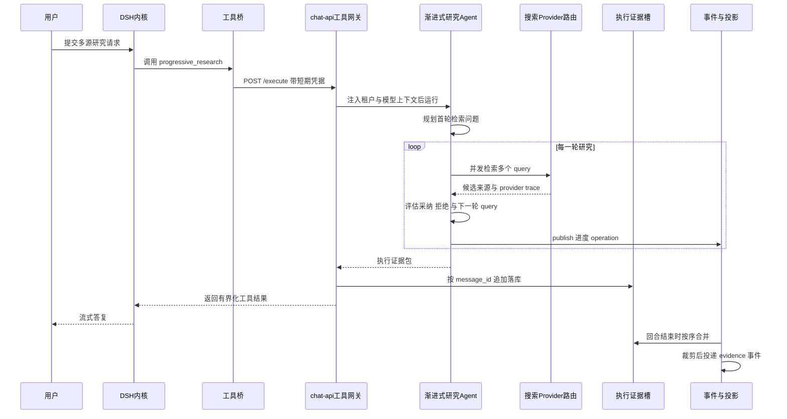
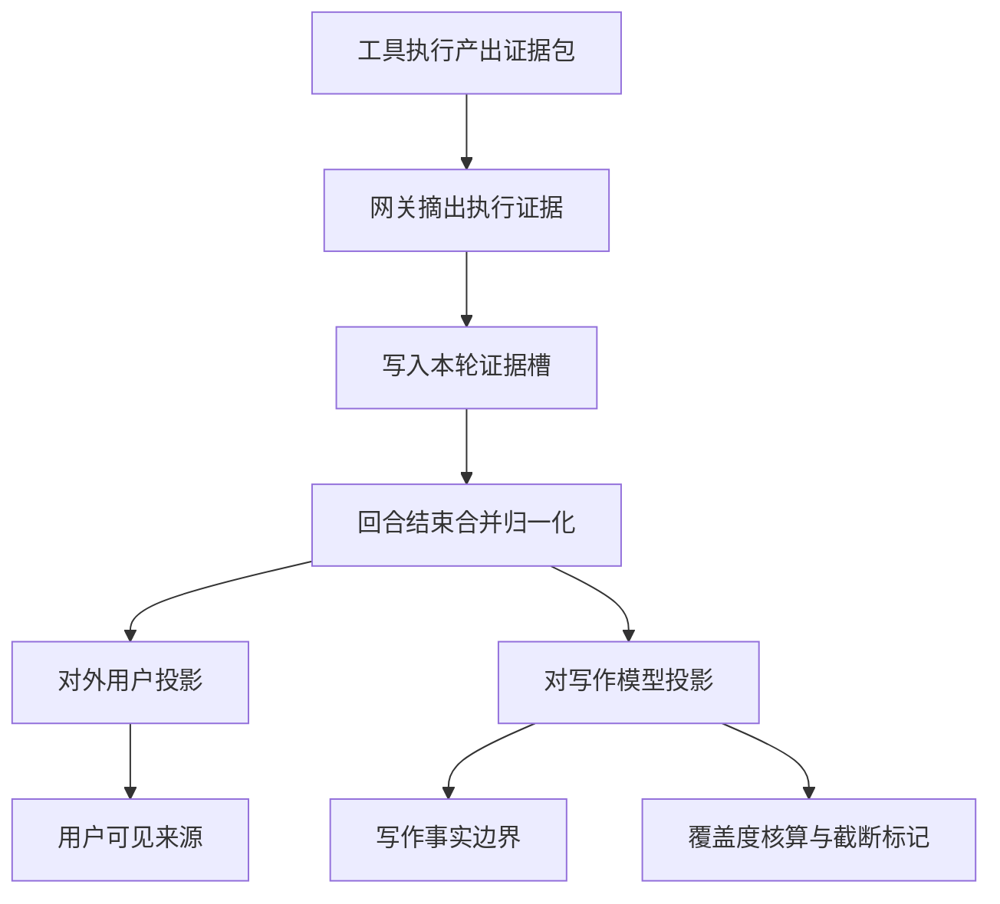

# MOVO 多源研究与证据保真

## 根因：研究能力不能长在内核里

MOVO 的自我定位是「DSH runs the Agent; MOVO brings the Agent into enterprise production」。研究与证据这条链路正好卡在这句话的接缝上：**「搜网页并给出可核验来源」是通用 Agent 能力，而「搜了几轮、采纳了什么、拒绝了什么、给用户看什么、给审计看什么」是企业侧才有的责任**。

于是代码里出现了一个清晰的切分：DSH 内核拥有 `web_search` 这个工具名、拥有它的预算与 persona 约束；MOVO 只以内核期望的 provider 接口把搜索实现注册进去。运行时 persona 直接把「搜多深」写成产品规则：

[services/chat-api/dsh/runtime-host/src/runtime-persona.mjs:7-7]()
<!-- anchor: Choose search depth from the user's actual research need. Use web_search at most -->

同一套边界在回合上下文里对模型再声明一次，并且明确禁止把内部定位符写进答案：[services/chat-api/dsh/runtime-host/src/runtime-turn-context.mjs:56-56]()
<!-- anchor: sections.push('MOVO retrieval mode is automatic. Choose knowledge_search for ent -->

这条设计避免了三个会让企业 Agent 失控的结局：内核被外网数据污染（提示注入面）、研究过程不可回放（审计缺口）、研究无界（成本与延迟失控）。**代价是 MOVO 必须自己承担全部的研究编排、证据归一化与对外投影**——这恰好构成了本文要讲的七个关注面。

## 全景：研究挂在哪一条链上

研究能力不是一个 HTTP 接口，而是「内核工具面 → 工具网关 → MOVO 能力实现 → 事件/投影」的一条闭环。工具桥把每次工具调用变成一次携带短期凭据的网关 POST：

[services/chat-api/dsh/runtime-host/src/askai-tool-bridge-plugin.mjs:53-61]()
<!-- anchor: const payload = await this.#post('/execute', { … return payload.result -->

链路里最容易被忽略的一环是：**工具结果与执行证据是两条不同的通道**。网关先 `pop` 出内部证据包（带下划线前缀的私有字段），把它存进证据槽，再把剩余部分作为工具结果返回内核：

[services/chat-api/app/enterprise_capabilities/tools/service.py:414-423]()
<!-- anchor: execution_evidence = result.pop("_execution_evidence_bundle", None) … bundle=execution_evidence, -->

这条「先摘证据、再回结果」的顺序，是后面所有保真机制的前提。而回给内核的结果本身也有一道独立的体积闸门：超过 64KB 就分档压缩（字符串 8000/3000/1000 字符、数组 20/10/5 项逐档收紧），并在退化到只保留少数关键字段时打上 `truncated` 与 `originalBytes`：

[services/chat-api/app/enterprise_capabilities/tools/service.py:533-534]()
<!-- anchor: def _bounded_result(result: dict[str, Any], max_bytes: int = 64 * 1024) -> dict[ … return compact_tool_result(result, max_bytes=max_bytes) -->

也就是说，**同一次工具调用产出三份不同用途的表征**：给内核的有界结果、给审计与下游的完整证据包、给用户的裁剪投影。三者共用一次执行，但各自的预算与形状完全不同。

## 决策一：一个「搜网页」的动作，两种粒度

模型面对的工具面里只能有一个叫「搜网页」的动作，否则它会在两个语义重叠的工具之间摇摆，并在失败时把一个工具的不足当成另一个工具的入口。MOVO 的处理方式很硬：`external_search` 作为内部原始能力存在，但**不被声明为面向模型的第二个搜索工具**：

[services/chat-api/app/enterprise_capabilities/runtime/catalog.py:253-257]()
<!-- anchor: display_name="外部搜索 Provider", description="Internal MOVO search-provider primiti … }, ("queries",)), timeout_ms=120_000, -->

真正暴露给模型的是多轮研究能力，它的工具描述里写清了与 `web_search` 的分工——一次受限公开查询 vs. 多源比较与证据充分性判断：

[services/chat-api/app/enterprise_capabilities/runtime/catalog.py:262-266]()
<!-- anchor: description="Use for complex public-web research that needs multiple sources, co … "max_results_per_query": {"type": "integer", "minimum": 1, "maximum": 20}, -->

在主机侧，这个映射靠 `nativeReplacements` 完成：被替换掉的 `external_search` 不在企业工具白名单里出现，取而代之的是内核原生的 `web_search` 名字：

[services/chat-api/dsh/runtime-host/src/official-host/session-composer.mjs:26-31]()
<!-- anchor: const replaced = new Set(profile.nativeReplacements ?? []) … names.push(...skillTools) -->

**放弃的替代方案**是「MOVO 自己实现一个搜索工具，并把内核原生 `web_search` 从工具面移除」。那样 MOVO 必须重新实现搜索预算、重复调用抑制、以及 persona 里的搜索纪律；而把 provider 挂进内核的搜索注册表，这些约束天然由内核的 persona 与工具面承载。**代价**是 MOVO 只能拿到内核搜索 provider 接口允许返回的形状——见下一节。

### web search provider 的返回形状是有损的

Provider 把 DSH 的 `search(request, signal)` 翻译成一次 `/execute` 调用，工具名仍是 `external_search`，然后把结果压成 `{sources, truncated}`：

[services/chat-api/dsh/runtime-host/src/askai-web-search-provider.mjs:58-74]()
<!-- anchor: async search(request, signal) { … return normalizeSearchResult(payload.result, request?.maxResults) -->

注意 `normalizeSearchResult` 只取 `results` 字段：`provider_trace`、`evidence_bundle` 这些 MOVO 侧的富信息不会进入模型上下文。这是有意为之——模型只需要「来源、标题、摘要、时间」，不需要看到 provider 路由的内部记账。而这些富信息并没有丢：因为 provider 走的也是同一个 `/execute`，网关照样把 `_execution_evidence_bundle` 摘走落库（见下一节）。**这就是同一个能力实现同时服务「模型可见结果」与「审计可见证据」的方式**。

## 决策二：编排权交给模型，把「停」写成显式契约

`ProgressiveResearchAgent` 是一个「规划 → 检索 → 评估 → 决定是否继续」的循环。它的所有预算在构造时都被 clamp 进硬上限：模型无法把研究规模放大到上限之外，但**可以在上限内调节**：

[services/chat-api/app/enterprise_capabilities/research/progressive/agent.py:36-60]()
<!-- anchor: class ProgressiveResearchAgent: … self.progress_callback = progress_callback -->

上限就写在构造函数里——`max_rounds` 封顶 6、`max_results_per_query` 封顶 20、`max_evidence` 封顶 40；而 `runtime/adapters.py` 把模型传入的 `max_rounds` / `max_results_per_query` 原样交给构造函数，默认值 3 / 8，schema 允许的范围与构造函数上限一致：

[services/chat-api/app/enterprise_capabilities/research/progressive/agent.py:55-57]()
<!-- anchor: self.max_rounds = max(1, min(6, int(max_rounds or 3))) … self.max_results_per_query = max(1, min(20, int(max_results_per_query or 8))) -->

[services/chat-api/app/enterprise_capabilities/runtime/adapters.py:271-275]()
<!-- anchor: agent = ProgressiveResearchAgent( … progress_callback=publish_native, -->

[services/chat-api/app/enterprise_capabilities/runtime/catalog.py:263-269]()
<!-- anchor: input_schema=_object({ … }, ("query",)), timeout_ms=300_000, -->

轮次循环的终止条件有三个出口，而不是一个：没有新 query、判断器说够了、预算耗尽。

[services/chat-api/app/enterprise_capabilities/research/progressive/agent.py:103-115]()
<!-- anchor: for round_index in range(1, self.max_rounds + 1): … extra={"event": "progressive_research.round_skipped", "round": round_index, "reason": "no_new_queries"}, -->

最关键的控制面逻辑是「done 可以被推翻」：如果判断器一边说 `done=true`、一边又给出了下一轮 query，并且轮次预算还没用完，代码会强制把 `done` 改回 `false` 继续研究；只有当轮次已经用尽时，才把这次「想停但还有线索」记账成 `budget_exhausted`：

[services/chat-api/app/enterprise_capabilities/research/progressive/agent.py:242-269]()
<!-- anchor: accepted_before = len(accepted) … budget_exhausted = True -->

最终结果用三态 `stop_reason` 把「为什么停」变成可观测、可归因的字段，而不是让调用方从 `ok=false` 里猜：

[services/chat-api/app/enterprise_capabilities/research/progressive/agent.py:303-321]()
<!-- anchor: round_limit_reached = bool(rounds >= self.max_rounds and not done) … else "no_more_queries" -->

### 判断器失灵不等于研究结束

研究循环里最脆弱的部件是那个用 LLM 做的判断器。MOVO 用两道控制面兜底。第一道把「既没采纳证据、又没给出下一轮 query」的响应判定为语义空，明确写上「即使 `done=true` 也不能在没有证据时完成一个需要证据支撑的任务」：

[services/chat-api/app/enterprise_capabilities/research/progressive/decision_guard.py:9-17]()
<!-- anchor: def is_semantically_empty_decision(decision: ResearchTurnDecision) -> bool: … return not decision.accepted_evidence and not decision.next_queries -->

第二道是恢复查询：它不合成证据，只把原始研究目标加后缀拓宽一次，保证一次无效的判断响应不能静默地终止整个研究：

[services/chat-api/app/enterprise_capabilities/research/progressive/decision_guard.py:37-40]()
<!-- anchor: if str(language or "").startswith("zh"): … suffixes = ("authoritative sources implementation case studies data", "industry -->

如果恢复查询也拿不到新方向，才退化为「搜索提供的摘要直接作为证据」的 fallback（`_fallback_evidence`），而不是返回空。

**为什么不做代码规则过滤？** 判断器的提示词里明确禁止：「不要靠代码规则过滤；请基于用户需求、来源标题、URL、摘要内容判断相关性、可用性、覆盖缺口和可信度」。这是一个自觉的选择——**相关性判断是语义问题，规则过滤只能表达长度、域名、关键词黑名单**。代价是每轮多一次 LLM 调用，且判断质量不可离线复现（只能用 mock 单测覆盖控制流）。

### 时间也是证据质量的一部分

研究场景里「最新」是硬需求，但模型的时间感来自训练数据。MOVO 用冻结的时间上下文把当前日期、当前年、新鲜度窗口注入两个不同的提示词位置（规划期与评估期），并且要求「至少一个 query 包含当前年份」：

[services/chat-api/app/enterprise_capabilities/research/progressive/temporal_context.py:57-66]()
<!-- anchor: def query_planning_temporal_guidance(context: ResearchTemporalContext) -> str: … "explicit historical comparison." -->

`freshness_days` 另有一个解析器 `resolve_research_freshness_days`，它会去读 `research_contract` 或 `effective_policy.research_policy`；但这个函数在全仓零调用点，是一处**未接线的化石**。真正生效的取值来自模型参数——`ProgressiveResearchAgent(freshness_days=int(arguments.get("freshness_days") or 30))`，也就是说「这个交付物要求多新的资料」目前由模型自己给，不填则默认 30 天，产品配置那条路尚未接线。

[services/chat-api/app/enterprise_capabilities/research/progressive/temporal_context.py:41-54]()
<!-- anchor: def resolve_research_freshness_days(output_spec: dict[str, Any] | None, *, defau … return max(1, min(3650, int(default))) -->

[services/chat-api/app/enterprise_capabilities/runtime/adapters.py:271-275]()
<!-- anchor: agent = ProgressiveResearchAgent( … progress_callback=publish_native, -->

### 证据工作集是有限且去重的

每轮采纳的证据进入一个有界工作集：工作区上限是输出上限的三倍（至少 40），超限时**只有当新证据的置信度严格高于当前最低分时才顶替它，否则新证据被直接丢弃**；输出时按置信度排序取前 N，再按原始顺序还原，保证引用顺序稳定。把这条规则和决策三的分数现状放在一起看更清楚：四家 provider 的 `score` 都缺失、实际是 `0.0` 平局，于是超限时平局的新证据会被直接丢弃，已有条目原样保留：

[services/chat-api/app/enterprise_capabilities/research/progressive/evidence_store.py:10-15]()
<!-- anchor: class ResearchEvidenceStore: … self.working_limit = max(40, min(120, self.output_limit * 3)) -->

[services/chat-api/app/enterprise_capabilities/research/progressive/evidence_store.py:19-30]()
<!-- anchor: def extend(self, values: Iterable[EvidenceItem]) -> int: … added += 1 -->

[services/chat-api/app/enterprise_capabilities/research/progressive/evidence_store.py:43-54]()
<!-- anchor: def _replace_lower_confidence(self, candidate: EvidenceItem, key: str) -> None: … self.items[lowest_index] = candidate -->

这里值得留意的是类的 docstring：**存证据的组件不做「够不够」的判断**。充分性判断被完全留在 LLM 判断器手里，存储组件只保证有界与去重。这是一个很小的职责切分，但它让「研究是否充分」这件事只剩一个决策点。

## 决策三：搜索 provider 的运行时解析与去重

`SearchProvider` 是一个只有 `name` 与 `search` 的 Protocol，实现有五个（Tavily / Serper / SerpApi / 百度千帆 / 火山方舟）：

[services/chat-api/app/enterprise_capabilities/research/progressive/provider_router.py:20-23]()
<!-- anchor: class SearchProvider(Protocol): … async def search(self, query: str, *, max_results: int) -> list[SearchCandidate] -->

provider 的**来源顺序**体现了企业产品的现实：先把外部注入的 provider 当成事实（便于测试与定制），否则读租户级管理员配置，最后才回落到进程环境变量里的密钥：

[services/chat-api/app/enterprise_capabilities/research/progressive/provider_router.py:255-266]()
<!-- anchor: async def available_providers(self) -> list[SearchProvider]: … return list(self._providers) -->

[services/chat-api/app/enterprise_capabilities/research/progressive/provider_router.py:268-322]()
<!-- anchor: settings = get_settings() … return providers -->

注意管理员配置只允许**选一个** provider，而环境变量可以额外补齐 Tavily / Serper / SerpApi——这是一个明确的取舍：**「按租户选定的官方通道」与「运维兜底通道」是两个不同信任级别的东西**，前者可被超管审计，后者只是部署便利。另外 `volc_ark` 的实现不是真的搜索 API，而是把「联网搜索」当成一次带 references 的模型调用，因此它的 provider 名与 trace 会如实记录在 `search_trace` 里。

跨 provider 的结果按 URL（退化为 `provider:title:snippet` 前缀）去重，并逐条记录 `{provider, query, hits}` 的 trace：

[services/chat-api/app/enterprise_capabilities/research/progressive/provider_router.py:324-357]()
<!-- anchor: async def search(self, queries: list[str], *, max_results_per_query: int) -> tup … candidates.append(row) -->

**代价**是 `SearchCandidate.score` 只有 Tavily 会填，其他四家都是 `None`。这个不可比性会一路传到证据的 `confidence`，最终影响有界工作集的淘汰顺序——换句话说，**多 provider 并行时的淘汰是不公平的**。这个缺陷在代码里没有被掩盖，也没有被补偿：`EvidenceItem.confidence` 是可选字段，排序时按 `0.0` 处理。

## 决策四：执行期证据包与回合级证据槽

证据包不是一个展示结构，而是**执行范围的从属物**。所有工具的证据包先经过归一化，然后按 `action_id` 追加到「当前活跃回合」的证据槽里，每回合最多保留 12 个：

[services/chat-api/app/enterprise_capabilities/evidence/execution_scope.py:27-45]()
<!-- anchor: if not message_id or not bundle: … "$slice": -12, -->

写入必须命中原子的条件（同一租户、同一用户、同一内核会话、同一 `message_id`、状态为 `running`），否则抛 `LookupError`：

[services/chat-api/app/enterprise_capabilities/evidence/execution_scope.py:50-51]()
<!-- anchor: if result.matched_count != 1: … raise LookupError("active execution evidence scope is unavailable") -->

这是一个**把证据与执行生命周期绑定的乐观并发控制**：调度任务、重放、并发回合都不会把证据写进错误的回合。代价是证据只能在回合运行期间写入——一旦回合结束，追加就会失败。这个约束看起来严苛，但它换来的是「证据归属不需要额外对账」。

回合结束时按顺序合并所有证据包：`results`、`raw_tool_results`、`confirmed_facts`、`open_questions`、`tools_used` 逐项拼接，**充分性取所有证据包的交集**（`all`），只要有一轮说「不够」，整个回合就是「不够」：

[services/chat-api/app/enterprise_capabilities/evidence/execution_scope.py:72-92]()
<!-- anchor: entries = list(((row or {}).get("active_turn") or {}).get("evidence_bundles") or []) … merged["stop_reason"] = str(bundle.get("stop_reason")) -->

这个 `all` 是保守的：它宁可把一次「其实够了」的研究标成不够，也不愿把证据不足的交付说成充分。研究链路的 `stop_reason` 与 `budget_exhausted` 也被合并带上，供下游写作链路判断要不要继续检索。

## 决策五：双投影——对用户裁剪，对写作模型换载体

同一个执行证据包会派生两个方向完全不同的投影。

**对用户的投影**是一个纯裁剪函数：内部结构进、用户可见来源出。

[services/chat-api/app/dsh_runtime/evidence_projection.py:9-20]()
<!-- anchor: def project_execution_evidence( … return {"id": evidence_id, **payload} if evidence_id else payload -->

裁剪规则集中在 `build_user_evidence_payload`，且规则本身有明确的动机：

- **KB 空结果不展示**。当 `kb_search` 返回 `mode=qa`、provider 含 knowledge、`usedCount` 与 `retrievedCount` 都为 0 且没有来源时，这行被跳过——「内部知识库检索无命中」不是一条给用户看的来源：

[services/chat-api/app/enterprise_capabilities/evidence/foundation/user_payload.py:222-231]()
<!-- anchor: for idx, item in enumerate(list(bundle.get("results") or [])[:20], start=1): … kb_document_sources = extract_kb_document_sources(item) -->

- **总量与字段级双重封顶**。来源最多 12 条；`summary` 里保留分类计数；`confirmed_facts` 每条截 320 字符、最多 12 条；`open_questions` 最多 8 条：

[services/chat-api/app/enterprise_capabilities/evidence/foundation/user_payload.py:310-322]()
<!-- anchor: summary = f"本次生成参考了 {len(sources)} 条资料" if sources else "本次生成使用了已提取事实" … ][:12], -->

- **内部产物形态的文本被反向解析成可展示来源**。研究摘要（`### Deep Research Digest` / `Sources Analyzed:`）本身是给模型看的中间产物，不能当来源展示；但摘要的 `### Sources` 段里含真实 URL，于是有一个解析器把 `[n] Title URL | quality_score=...` 这类行还原成来源行：

[services/chat-api/app/enterprise_capabilities/evidence/foundation/user_payload.py:111-135]()
<!-- anchor: def _extract_digest_source_rows(text: str) -> List[Dict[str, str]]: … "snippet": fallback_summary, -->

  这是一处很诚实的工程妥协：**上游把来源压成了人类可读文本，下游再把它解析回来**。它脆弱（依赖 `### Sources` 这个标记与 `[n]` 行格式），但比重造整条研究链路便宜，也比丢掉来源好。代价是当摘要被识别为「搜索摘要」时，`confirmed_facts` 会被整体清空（`has_search_digest` 分支），因为那些「事实」其实是摘要的转储，不是可归因事实。

**对写作模型的投影**是换载体，而不是裁剪：长文引擎用 `WriterEvidencePacket` 替换原始的 `evidence_bundle` 与全部工具观测，`mode` 字面上写着「active_packet_replaces_projection_and_raw」。原因是长文写作的失败模式不是「信息不够」，而是「证据里有大量结构化转储，模型把转储误当事实复述」。因此 packet 把证据分成 typed materials（数据集、指标、来源摘录、引用、执行失败），并且明确记录「哪些记录无法归类」。渲染器也只做确定性序列化，不做摘要排序：

**为什么值得做成两个投影而不是一个？** 因为两者的失败代价不同：用户投影裁错了，用户看到一条噪音来源；写作投影裁错了，模型会引用一条它没读到的证据。所以写作投影保留了「覆盖度」这类元信息，而用户投影把它全部丢掉。

## 决策六：引用保真 = 坐标保真 + 覆盖度核算

MOVO 的引用保真不是「校验结论是否被来源支持」，而是把**从候选到展示的每一步都留成可核对的坐标**。

第一层，检索侧只接受候选集中真实存在的引用 ID。`resolve_citations` 用 `documentId:chunkId` 建索引，并专门处理一个真实世界的坑：**不同文档可能有相同 `chunkId`**，此时不允许用裸 `chunkId` 回退匹配：

[services/chat-api/app/knowledge/citations/citation_resolver.py:62-86]()
<!-- anchor: def resolve_citations(chunks: list[KnowledgeChunk], used_chunk_ids: list[str]) - … return output -->

第二层，提示词把「填 citationId 而不是 chunkId」写成硬约束，并给出理由：

[services/chat-api/app/knowledge/prompting/knowledge_qa_prompt.py:34-34]()
<!-- anchor: usedChunkIds 必须填写候选中提供的 citationId，而不是只填写 chunkId。不同文档可能存在相同 chunkId。 -->

第三层，模型即使不按格式输出也能救回来：如果 `usedChunkIds` 缺失，代码用正则从原始输出里再抽取一次 chunk 标识：

[services/chat-api/app/knowledge/agents/knowledge_qa_agent.py:87-95]()
<!-- anchor: if not used_chunk_ids: … raw_model_output=raw, -->

第四层，展示侧的引用 ID 就是坐标本身，并且带上页码、锚点与源 chunk 谱系：

[services/chat-api/app/knowledge/citations/citation_resolver.py:103-112]()
<!-- anchor: citation_id = f"{item.document_id}:{item.chunk_id}" … "source_type": "document", -->

第五层，也是最能说明设计意图的一层：写作投影会**反向核算覆盖度**。它先收集「期望被保留」的 URL 集合与 KB 坐标集合，再和实际进入 packet 的 citations 比对，缺失就置 `truncated=true` 并写明掉了什么：

[services/chat-api/app/enterprise_capabilities/evidence/foundation/writer_packet/builder.py:68-88]()
<!-- anchor: expected_web_urls = set(web.get("expected_direct_source_urls") or []) … packet.coverage.notes.append("One or more KB citation coordinates were not retai -->

**这里有一个必须点明的边界**：`ensure_section_citation` 只保证「每节至少有一个引用标记」——如果正文里一个 `[n]` 都没有，就在段末补上 `参考依据：[1]`，用的是引用列表的第一条：

[services/chat-api/app/enterprise_capabilities/content/writer_engine/unified_compose/components.py:1071-1077]()
<!-- anchor: def ensure_section_citation(section_markdown: str, refs: List[Dict[str, Any]], l … idx = int(refs[0].get("index") or 1) -->

所以准确的说法是：**MOVO 做到了「引用坐标不丢失、覆盖率可核算、形式上有引用」，但没有做「断言级语义校验」**。全库没有发现把「某句话」与「某个来源片段」做蕴含判定的代码。这不是疏漏的判断，而是成本判断——语义校验要么引入第二个模型（自身也会幻觉），要么引入标注集（企业私有语料上无法通用）。承认这条边界比宣称「引用已校验」更负责。

## 决策七：清洗原始外网载荷

多源研究最容易被忽视的污染源是：工具结果里混进了**上一步执行证据的原始 JSON 转储**。当研究能力把 `raw_tool_results` 序列化进工具输出，它会在后续轮次再次进入模型上下文，形成「证据套证据」的膨胀与自引用。

MOVO 的对策是一个显式的外部 web 原始记录清理器：识别工具名（`progressive_research` / `web_fetch` / `firecrawl_collect_url`）或内容标记（`### Deep Research Digest`、`Sources Analyzed:`），把整条记录递归摘掉，**同时显式保留 KB 与业务数据**。工具名判定并不止这三个白名单项：任何名字里含 `firecrawl`，或落在 `web` / `search` / `web_search` / `internet_search` 的工具名，也一律算外部原始载荷：

[services/chat-api/app/enterprise_capabilities/evidence/foundation/external_web_raw.py:8-11]()
<!-- anchor: EXTERNAL_WEB_RAW_TOOLS = { … "firecrawl_collect_url", -->

[services/chat-api/app/enterprise_capabilities/evidence/foundation/external_web_raw.py:38-46]()
<!-- anchor: def is_external_web_raw_record(record: Any) -> bool: … return False -->

[services/chat-api/app/enterprise_capabilities/evidence/foundation/external_web_raw.py:72-79]()
<!-- anchor: def strip_external_web_raw(value: Any, *, _depth: int = 0) -> Tuple[Any, int]: … return None, 1 -->

它有两个应用面：一是上游节点产出的结构化值（`compose_skill.py` 在把上游产物拼进提示词前先清洗），二是渲染后的文本形态（`sanitize_external_web_raw_text` 处理「行首是 `- key: {...}`」或「标题后跟 JSON 块」的两种形态）。

[services/chat-api/app/enterprise_capabilities/research/url_collection.py:241-245]()
<!-- anchor: def public_artifact(item: Any) -> dict[str, Any]: … return row -->

网页采集这条路径还有第二个清理动机：**签名 URL 是临时的凭据**。`public_result` 会把对象存储的 `url` / `signed_url` 从对外结果里剥掉，只留 `object_path`，避免短期凭据被写进会话历史、导出文件或模型上下文。

## 边界：知识库 RAG 与研究链路怎么分

MOVO 没有用一个代码路由器来分发「该走 RAG 还是该走研究」。这个决定被写成给模型的**语义判据**，而不是 if-else：

- 默认模式：`knowledge_search` 管企业内部事实与制度；`web_search` 管一次受限公开查询；`progressive_research` 管多源比较、覆盖度分析与证据充分性判断；「只有在用户需要比较时」才同时使用内外证据。
- 严格模式：当请求带 `knowledge_qa_enabled=true`（描述为 `Strict internal-knowledge-only mode`）时，模型**必须先调用 `knowledge_search`**，且只能基于返回的 chunk 作答；此时内部引用定位符（`citation_ref`、`documentId`、`chunkId`、`kb://` 地址、`chunk_*` 标识）被明确禁止出现在答案里。

[services/chat-api/dsh/runtime-host/src/runtime-turn-context.mjs:54-54]()
<!-- anchor: sections.push(`MOVO Knowledge QA mode is enabled for ${scope}. You must call kno -->

**为什么用提示词而不是路由器？** 因为「该不该检索」本身是语义问题：同一个词在有的上下文里是企业内部制度、在另一个上下文里是公开事实。用关键词路由会稳定地错。代价是这个边界只能被观测（工具调用序列），不能被静态验证。

代码里还留着一份**未被接线**的研究焦点构造器：`ResearchFocusBuilder` 按写作模式（report / article / comparison / tutorial / proposal ...）给出查询模板、来源优先级与证据字段 schema——例如 report 模式要求「数据口径、来源机构、发布时间、关键指标」：

[services/chat-api/app/knowledge/research_focus_builder.py:31-42]()
<!-- anchor: conf = dict(self._modes.get(mode) or self._modes.get("report") or {}) … "hard_constraints": dict(hard_constraints or {}), -->

但全仓检索只发现它在 `app/knowledge/__init__.py` 里被导出，**没有任何生产调用点**。它代表了一个早期设想：先用模板化查询与证据 schema 约束研究，再交给 LLM。现行实现选择了相反的路线——把查询规划与证据 schema 都交给模型（见决策二），模板只作为 `modes.yaml` 的配置残留。两者并存不是架构混乱，而是**方案演进的化石**：模板方案可预测但覆盖不了长尾研究意图，模型方案覆盖广但不可离线复现。

## 反馈闭环：覆盖的是沉淀物，不是来源

这是本次解读中最需要纠正直觉的一节。问「用户对来源/结果的反馈如何回灌」时，直觉答案是「给来源点赞/点踩，用于排序」。源码给出的答案是**不是**。

`resource_feedback` 支持三种资源类型，而且这三种都是**被分享出去的沉淀物**，不是某次回答里的来源：分享的 Skill 分发、组织 Skill、个人知识资源。

[services/chat-api/app/services/resource_feedback/access.py:19-29]()
<!-- anchor: async def require(self, *, main_id: str, user_id: str, resource_type: str, resource_id: str) -> FeedbackSubject: … raise PermissionError("feedback_resource_unsupported") -->

服务本身的自我描述也很明确：给「受访问控制、版本稳定」的资源做扁平讨论与点赞：

[services/chat-api/app/services/resource_feedback/service.py:33-37]()
<!-- anchor: class ResourceFeedbackService: … self._access = access or FeedbackAccessResolver() -->

反馈面包含：评论（支持一级回复、作者可软删除）、资源级点赞、评论级点赞、未读通知与通知列表。写入路径都先过 `FeedbackAccessResolver`——每一类资源有各自的可见性判定（Skill 分发看成员表、组织 Skill 复用产品级资源授权、个人知识看访问服务），**权限判定与反馈存储是两个独立关注点**。

**没有发现的回灌路径**（全库检索结论）：`resource_comments` / `resource_reactions` 除索引创建与反馈服务自身外，没有被检索排序、证据采纳或研究规划读取；也没有「消息级 / 回答级 / 来源级」的评分集合。因此准确表述是：**MOVO 当前的反馈闭环作用于「沉淀下来的可分享资源」，而研究来源与回答本身尚无反馈回灌通道**。这是一个真实的产品缺口——研究侧目前只有 `rejected_sources`（判断器给出的拒绝理由）这一种「关于来源质量」的信号，而它只存在于单次执行结果里，不跨回合累积。

## 跨回合证据：另一种「研究结果复用」

与研究链路相邻但职责不同的一条链是会话证据选择：写作类交付物可以声明依赖历史回合的证据。它用 LLM 从最近 30 条消息里挑选 `selected_seqs`，最多两轮尝试，返回 `sufficient` 标志，选不出来就抛 `ConversationEvidenceUnavailable` 而不是编造。

[services/chat-api/app/services/conversation_evidence_service.py:204-220]()
<!-- anchor: def _compact_evidence(bundles: List[Dict[str, Any]]) -> List[Dict[str, Any]]: … if isinstance(item, dict) -->

注意 `_compact_evidence` 的封顶策略非常具体：每回合最多 6 个证据包、每个包最多 8 条事实（每条 360 字符）与 8 条来源（标题 180 / 摘要 520 / URL 800）。**这与用户投影的封顶数字不同，说明「裁剪预算」是按下游用途分别调的**，不存在一个通用的证据大小上限。

## 代价与未接线之处

把这条链路的设计代价一次说清，比只讲亮点有用：

- **多一次 LLM 判断就是多一次不可离线复现的调用**。研究循环的正确性只能靠 mock 判断器来测控制流，真实判断质量依赖模型版本。
- **provider 的 score 不可比**，有界工作集的淘汰在多 provider 场景下不公平（决策三）。
- **摘要是文本，来源要从文本里解析回来**（决策五）。格式一变，来源提取就退化。
- **引用保真止于坐标与覆盖度**，没有断言级语义校验（决策六）。
- **`admit_knowledge_evidence` 是一处已写好但未接线的准入策略**。它的注释写得很清楚：检索会故意返回更宽的候选集，候选不等于够格展示给用户的证据，这个边界「有意与检索排序、UI 投影分开」。策略本身是「绝对噪声下限 + 相对最高分的比例」双门限，并为已有强命中的文档留了连续性门限：

[services/chat-api/app/enterprise_capabilities/evidence/knowledge_admission.py:58-75]()
<!-- anchor: def admit_knowledge_evidence( … return KnowledgeEvidenceAdmission(tuple(candidates), (), None, "unscored_compati -->

  但全仓检索显示它只被 `evidence/__init__.py` 导出、只被单测调用，**生产链路没有消费方**。也就是说：检索候选目前仍然全量进入证据包，再由用户投影的 `sources[:12]` 兜底截断。这与 `ResearchFocusBuilder` 的处境一样——**设计已经想清楚了，接线还没做**。需要说明的是，这两处我给出的是**反向证据**（全仓检索不到消费方），而不是某个「它被调用」的锚点；如果存在运行时反射式装配，结论会被推翻。
- **研究过程的进度消息有一条死代码**。`ProgressiveResearchAgent._emit_progress` 的注释写着「下面的 operation 生命周期是唯一的用户可见工作通道」，函数体直接 `return None`；真正驱动 UI 的是 `_emit_operation` → `ResearchTimelineProjector.project` → `publish_progress`，即项目把研究语义保留在生产者侧，只把生命周期 ID 做命名空间隔离：

[services/chat-api/app/enterprise_capabilities/research/progress.py:10-16]()
<!-- anchor: class ResearchTimelineProjector: … self._counter = 0 -->

## 小结：可迁移的三条模式

**一、把「能力实现」和「能力归属」拆开**。DSH 拥有 `web_search` 这个动作与它的纪律，MOVO 只提供实现。凡是「通用 Agent 能力 + 企业责任」的组合，都适用这个切分：内核保留语义与预算，产品侧保留实现与证据。

**二、证据是执行范围的从属物，投影按用途分叉**。证据写进与 `message_id` 绑定的活跃回合槽位，合并规则保守（充分性取交集），对外有两套投影——用户投影做裁剪，写作投影换载体。这套结构的价值不在任何一个函数，而在于**「谁看到什么」被显式建模了**。

**三、保真的可验证下限是坐标，不是语义**。与其宣称引用已被校验，不如让每一步都能被程序重定位：候选 ID 只在候选集中解析、引用 ID 就是 `documentId:chunkId`、投影后反向核算覆盖率并标记截断。做不到语义校验时，**把「掉了一条引用」变成一个可观测字段**，是比假装保真更可维护的承诺。
