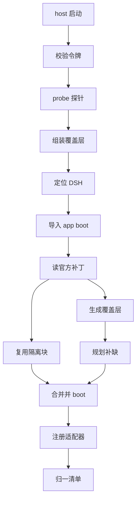
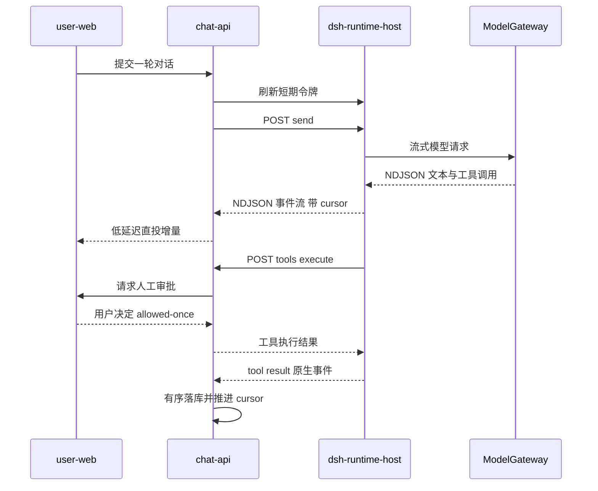

# MOVO DSH Runtime Host 宿主化层

DSH Runtime Host 是 MOVO 里唯一一个用 Node 写的服务。它存在的理由可以压缩成一句话：DeepSeek Harness 是 Node ESM 加 cordis 插件的运行时，而 MOVO 的产品逻辑长在 Python/FastAPI 上。这一层既不实现 Agent 循环，也不实现企业能力；它做的是把上游内核**装起来、连上去、看清楚、管得住**——把 DSH 的插件图组装成一个可用运行时，把它的模型调用与工具调用反向代理回 chat-api，再把内核事件归一化成带游标的信封交给上层。

理解这一层的关键是理解它对上游的三种姿态：**只加不换**（用覆盖层配置官方插件，不改 DSH 源码）、**探测而不猜**（用模块解析探测能力，而不是比对版本号）、**代理而不下发**（长期密钥留在 chat-api，host 只拿短期令牌）。这三种姿态各自都有代价，本文会逐条说清代价是什么。

## 根因：内核是依赖，不是代码

MOVO 与 DSH 的关系在仓库里被明确约束成「依赖关系」：DSH 只出现在一份 npm 依赖清单里，并且要求整条 release train 的每个包都精确落在同一个版本号上。

[services/chat-api/dsh/runtime-host/package.json:13-33]()
<!-- anchor: "dependencies": { … "fflate": "0.8.3" -->

这份清单只声明约 20 个直接包，而真正被 boot 起来的插件图来自 `@deepseek-ai/dsh-base` 与 `@deepseek-ai/dsh-web-app` 两个官方 bundle 随包携带的补丁文件。`resolveDshInstallation` 用两级 `createRequire` 把这件事做出来：先从 host 自身解析 `@deepseek-ai/dsh` 的清单路径，再以那份清单为基准创建第二个 require，用 DSH 自己的解析上下文去解析 `@deepseek-ai/dsh-base`、`@deepseek-ai/dsh-web-app`、`@deepseek-ai/dsh-agent-presets`，读出各自 `dsh.bundle.patch` 指向的补丁文件绝对路径。

[services/chat-api/dsh/runtime-host/src/official-host/installation.mjs:23-31]()
<!-- anchor: export async function resolveDshInstallation() { … throw new Error('@deepseek-ai/dsh-base does not declare dsh.bundle.patch') -->

上面这个函数最终冻结成一个不可变对象，把版本、清单路径、模块基准 URL、两份官方补丁路径、随包 preset 根目录一次性固定下来，后续所有组装都只读它。这里有一个容易被忽略的设计事实：`@deepseek-ai/dsh-app-boot`、`dsh-base`、`dsh-web-app`、`dsh-agent-presets` **都不是 MOVO 的直接依赖**，它们是从 DSH 自己的依赖树里解析出来的传递依赖。换句话说，MOVO 依赖的不只是「DSH 这个包」，还依赖「DSH 内部如何组织它的 bundle」这一私有约定。`installation.mjs` 为此做了两处防御：`dsh.bundle.patch` 缺失就抛错而不是静默跳过；能解析与否用 `canResolveDependency` 单独探测，并且把 `ERR_PACKAGE_PATH_NOT_EXPORTED` 与 `MODULE_NOT_FOUND` 一律当作「该能力不存在」而非崩溃。

[services/chat-api/dsh/runtime-host/src/official-host/installation.mjs:64-66]()
<!-- anchor: error?.code === 'ERR_PACKAGE_PATH_NOT_EXPORTED' … ) return false -->

这是本关注面第一个值得迁移的模式：**把上游能力探测退化成模块解析问题**。上游是否提供 `@deepseek-ai/dsh-tool-subagent/model-selection-settings` 这个子路径，比任何语义化版本号都更能说明问题，所以覆盖层直接据此决定要不要插入那一行插件。

[services/chat-api/dsh/runtime-host/src/official-host/composition.mjs:55-56]()
<!-- anchor: subagentModelSelection: installation.canResolveDependency( … '@deepseek-ai/dsh-tool-subagent/model-selection-settings', -->

[services/chat-api/dsh/runtime-host/src/official-host/overlay.mjs:28-29]()
<!-- anchor: id: 'subagent-model-selection-settings', … name: '@deepseek-ai/dsh-tool-subagent/model-selection-settings', -->

## 装配：空根配置加官方 bundle 加版本化覆盖层

config/official-host-root.yml 的内容只有一行 `[]`，前面三行注释解释了为什么故意留空：ASKAI 的 DSH Host 没有手工维护的插件树，生效的树等于官方 `@deepseek-ai/dsh-base` bundle 加上一个由 `composition.mjs` 施加的版本化 ASKAI 覆盖层。

[services/chat-api/dsh/runtime-host/config/official-host-root.yml:1-3]()
<!-- anchor: # ASKAI's reusable DSH Host has no hand-maintained plugin tree. The effective … # overlay, applied by src/official-host/composition.mjs. -->

`OfficialDshHostComposition.start` 把这个空配置复制进每个 runtime 独立的 profile 目录，然后在真正的 boot 之前做三件窗口期清理，最后按「官方基础补丁 → 官方 preset 隔离块 → ASKAI 覆盖层」的顺序合并成一个补丁数组交给官方的 `appBoot.boot`。

[services/chat-api/dsh/runtime-host/src/official-host/composition.mjs:30-38]()
<!-- anchor: async start() { … await writeFile(profileRoot, await readFile(ROOT_CONFIG, 'utf8')) -->

注意 `boot` 的调用方式：MOVO 没有自带插件加载器，而是把「根配置文件路径、补丁数组、模块基准 URL」交给官方 boot 函数，由官方 boot 完成 cordis 上下文的创建与插件挂载。这意味着内核生命周期的形状由上游决定，MOVO 只提供输入。

[services/chat-api/dsh/runtime-host/src/official-host/composition.mjs:60-65]()
<!-- anchor: this.#ctx = await appBoot.boot( … installation.moduleBaseUrl, -->

需要标注一处证据边界：上游 `dsh.bundle.patch` 文件的**实际内容**（补丁数组的完整形状、`insert` 行的字段约定、`loadOverlayPatches` 与 `appBoot.boot` 的确切签名）未在源码中定位到——本仓库既不 vendored DSH 也不提交 `node_modules`，MOVO 只是消费这些产物。因此本文关于补丁结构的描述全部来自消费侧代码，这一点在判断「上游改了什么」时需要留出余量。

### 覆盖层规划器：只补缺，不重复挂载

覆盖层最容易踩的坑是「官方已经把某个插件挂上了，我又挂了一遍」，结果是同名插件被注册两次、配置互相覆盖、事件被处理两遍。MOVO 的做法是把补丁分成两类处理：先用 `collectInsertedEntryIds` 扫描官方基础补丁里所有 `insert` 行的 id 集合，再对覆层要挂的每一行判断——id 未被官方占用就作为新增插入，已被占用就只发一条不带模块名的配置补丁。

[services/chat-api/dsh/runtime-host/src/official-host/overlay-planner.mjs:18-26]()
<!-- anchor: export function planOverlayRows(rows, occupiedIds) { … if (row.config !== undefined) patches.push({ id: row.id, config: row.config }) -->

源码注释把这层意图说得很直白：ASKAI 覆盖层依赖这份 inventory，是为了在官方 bundle 之间搬迁插件条目时存活下来，而不是为了注册第二份同样的插件。这是一个典型的**按标识符对齐的幂等组合**模式——组合的正确性不依赖条目在哪个 bundle 里，只依赖条目 id 是否已存在。

### 装配与装载的信息流

覆盖层里真正改行为的只有几条，且都能看出「企业部署不想要什么」：关掉 HMR；关掉 DSH 的 LLM 会话标题，因为 ASKAI 在自己的企业库里拥有权威标题，不想为一次没有消费方的首轮请求再付一次模型调用费。

[services/chat-api/dsh/runtime-host/src/official-host/overlay.mjs:66-70]()
<!-- anchor: { id: 'hmr', disabled: true }, … { id: 'session-title-llm', disabled: true }, -->

另外几条是路径与开关的重定向：session persistence 落到 runtime 自己的存储根、settings 与 credentials 落到 runtime 专属的 dsh-home 并关掉文件监听、附件落在同一 home 下。注意 credentials 域被显式重定向——这是为了让内核的凭据存储也随 runtime 隔离，而不是共享宿主机的默认 home。

[services/chat-api/dsh/runtime-host/src/official-host/overlay.mjs:72-77]()
<!-- anchor: id: 'session-persistence-jsonl', … { id: 'attachment-local', config: { dshHome: runtimeHome } }, -->

### 企业 preset 也是覆盖层，而不是复制的插件树

ASKAI 普通会话的 agent preset 只有三行有效声明：一个只提供人格的系统提示插件、一个被接管搜索提供方的 web 工具、一个原生 skill 加载工具。

[services/chat-api/dsh/runtime-host/config/agent-presets/askai-enterprise/agent.cordis.yml:1-6]()
<!-- anchor: # ASKAI's ordinary enterprise preset intentionally owns no local coding tools. … name: '../../../src/official-host/enterprise-preset-plugin.mjs' -->

注释解释了缺席的部分：企业 preset **故意不拥有**任何本地编码工具，企业工具由 ASKAI 工具网关在宿主平面注册；而 Code 会话直接选 DSH 随包提供的 `code` preset，而不是把它的组合复制一份进来。这是一个很克制的决定——preset 是产品身份，工具面是运行时事实，两者不能混在一处维护。产品侧看到的 preset 名（`askai-enterprise`、`code`）与展示文案被单独放在一个三行的 preset.yml 里，与插件组合解耦。

## 兼容层：不改内核源码，改写默认行为

不 fork 内核不是一句口号，它在仓库里有硬约束：兼容政策表格里「DSH Core fork」一行的状态是 none、升级规则是 prohibited，措辞是「never patch vendored or installed DSH source」。政策同时规定 DSH 专属兼容代码只能待在 `dsh/runtime-host/` 下，并按上游子系统切成小组件。这是整个兼容层存在的合法性来源——如果允许打补丁，就没有必要写这些适配器。

[services/chat-api/dsh/COMPATIBILITY.md:14-17]()
<!-- anchor: | Host protocol | `askai.dsh-host.v1` | frozen | adapt DSH changes inside Runtim … | DSH Core fork | none | prohibited | never patch vendored or installed DSH sour -->

于是「改写默认行为」只能通过三条公开路径完成：给官方插件发配置补丁、关掉不需要的官方插件、以 cordis 插件形式注册自己的适配器。兼容层里的每个文件都对应其中一条。

### 复用官方隔离块：从 roster 往前扫

Code preset 会把 bash、文件系统、skill、compaction、subagent、instructions、web 这七条「agent 平面」插件挂进会话作用域。官方 Web Host 有自己的隔离方案（一串连续的 disabled 行），MOVO 想要同样的隔离效果，但又不想把那份还在演进的清单抄一份进自己的仓库。做法是**结构化扫描**：先找到官方补丁里插入 agent-presets roster 的那一条，然后从它往前收集所有连续的 `disabled: true` 行，再要求这份收集结果必须覆盖那七条必需行，否则直接抛错。

[services/chat-api/dsh/runtime-host/src/official-host/preset-isolation.mjs:21-35]()
<!-- anchor: export function extractOfficialPresetIsolation(webAppPatches) { … const missing = REQUIRED_AGENT_PLANE_ROWS.filter(id => !disabledIds.has(id)) -->

这里的设计取舍很清楚：**宁可启动失败，也不要静默地少隔离一层**。如果上游把 roster 挪走、或者隔离块被拆散，`rosterIndex < 0` 或 `missing.length > 0` 会让整个 runtime 起不来。代价是升级 DSH 时很可能在 boot 阶段就炸——但这正是想要的：企业部署里「少隔离了几条工具链」比「服务起不来」危险得多。这也解释了为什么升级需要一整套准入清单，而不是「装上试试」。

### 会话编排：产品身份在上，原生身份在下

`OfficialSessionComposer.prepare` 把「产品侧 preset 名」与「原生 preset 名」拆成两个变量：对外返回的 `presetId` 始终原样回传请求方给的名字（请求 `code` 就是 `code`，请求 `askai-enterprise` 就是 `askai-enterprise`），实际 mount 的才是这个 DSH train 里存在的原生 preset。setup 函数里先装模型选择、再挂原生 preset，最后对 `askai-enterprise` 走一次工具面收窄。

[services/chat-api/dsh/runtime-host/src/official-host/session-composer.mjs:42-60]()
<!-- anchor: async prepare(requestedPreset) { … this.#restrictEnterpriseSession(agentCtx) -->

收窄那一段的注释值得单独读：preset 工具被限定在 agent 作用域，因此**故意对宿主/根目录不可见**，所以不能用根工具目录做预过滤——早期那样做会把 DSH 原生 `web_search` 这类带作用域的工具静默滤掉。取而代之，直接按 Runtime Profile 声明的工具名白名单做 restrict。

[services/chat-api/dsh/runtime-host/src/official-host/session-composer.mjs:77-82]()
<!-- anchor: #restrictEnterpriseSession(agentCtx) { … agentCtx.tools.restrict({ allow: this.enterpriseTools }) -->

产品身份与原生身份的桥接集中在一个 24 行的文件里：`code` preset 解析失败时回退到 `standard`，历史里可能存在的 `ptc` 在读出时由 `normalizePersistedPreset` 归一化回 `code`。注释把目的写明了——在 DSH 演进 preset 名字的同时保持 ASKAI 稳定的 `code` 契约，以及跨 DSH 的 V2 到 V3 改名保住 MOVO 的公开 preset 身份。

[services/chat-api/dsh/runtime-host/src/official-host/api-compat.mjs:5-12]()
<!-- anchor: /** Keep ASKAI's stable `code` contract while DSH evolves preset names. */ … return await presets.resolve('standard') -->

这里有一个可以怀疑的点：`resolveNativePreset` 只在 `code` 上做这件事，其他 preset 名（包括 `askai-enterprise`）被原样透传。也就是说兼容层是**逐名字点状适配**而非通用映射表。对小规模 preset 集合这是合理的——通用映射表反而会掩盖「上游到底改了什么」；但每新增一个被产品引用的 preset，都要记得加一条适配。

### 三种形态适配：事件、模型请求、模型工具调用

DSH V3 把流式模型分片压缩进最终的 assistant 事件里。MOVO 的投影层需要稳定的增量事件，所以 `compatibleSessionEvents` 把压缩形态**展开回去**：`chunk` 项还原成 `assistant/chunk`，`text-chunks` 项按 index 逐个还原成 text-delta，最后再补上原始事件本身。注意返回的是「展开结果加原事件」，即展开与保留并不互斥。

[services/chat-api/dsh/runtime-host/src/official-host/event-compat.mjs:1-20]()
<!-- anchor: /** Expand DSH V3's compact assistant stream into MOVO's stable native events. * … return [...expanded, event] -->

另一个 V3 行为是系统提示可能作为历史里的 system 消息存在。模型网关侧需要一个稳定的请求信封，所以 `stableModelRequest` 在 `options.system` 缺位时从历史里取**最后一条** system 消息提升为 system 字段，并从 messages 里剔除所有 system 消息；显式提供了 system 就以它为准。

[services/chat-api/dsh/runtime-host/src/official-host/model-request-compat.mjs:10-19]()
<!-- anchor: /** Keep the MOVO Model Gateway request stable when DSH stores system nodes in h … messages: system === undefined ? messages : messages.filter(message => message?. -->

第三类适配最像「现实修补」：模型侧的工具调用参数在两个具体场景下与 DSH 的校验冲突。其一是权限升级——每个 MOVO 桌面 Code 会话本身就跑在 workspace-write，某些提供方会把这一现状回显成一次升级请求，而 DSH 正确地拒绝了它（升级必须严格更宽），于是兼容层把这次冗余请求降级成 no-op，同时保留真正的 danger-full-access 审批。

[services/chat-api/dsh/runtime-host/src/official-host/model-tool-call-compat.mjs:25-31]()
<!-- anchor: // Every MOVO desktop Code Session already runs at workspace-write. Some … delete args.justification -->

其二是裸通配符的 glob 被这一版 DSH 解释成整树搜索，于是被改写成一个有界的目录列举命令，并且按平台选真正被 Code preset 挂载的 shell 工具（Windows 用 pwsh，其他平台用 bash）。

[services/chat-api/dsh/runtime-host/src/official-host/model-tool-call-compat.mjs:35-45]()
<!-- anchor: // A bare wildcard is interpreted as a whole-tree search by this DSH train. … ...(typeof args.path === 'string' && args.path ? { workdir: args.path } : {}), -->

还有一类适配不属于「形态翻译」而属于「形状归一」：插件清单。文档注释说得很清楚，要同时归一同步的 rc 形态与异步的 0.1.2 快照形态，于是把 `agentPresets` 里的 preset 行摊平成与顶层 `entries` 同构的记录再合并。

[services/chat-api/dsh/runtime-host/src/official-host/inventory-compat.mjs:11-19]()
<!-- anchor: /** Normalize the synchronous rc inventory and asynchronous 0.1.2 snapshot. */ … agentPresets: Object.freeze(agentPresets), -->

### 兼容层的代价

把六七个小组件拼起来看，这一层的真实成本不是代码量（每个文件 20 到 50 行），而是**判断上游变更的方式不统一**。同一个目录里同时存在三种探测手法：模块解析探测（`canResolveDependency`）、函数形态探测（用 `heal.constructor?.name === 'AsyncFunction'` 区分位置参数与选项参数两代契约）、以及结构化扫描加必需项校验（preset 隔离块）。第三种最稳，因为它校验语义；第一种最通用；第二种最脆——它把「0.1.2 改成了异步选项对象」这件事编码进了构造函数名，一旦上游用别的方式实现异步就会误判。

[services/chat-api/dsh/runtime-host/src/official-host/composition.mjs:98-109]()
<!-- anchor: async function healModuleFallback(appBoot, installation, moduleHome) { … await heal(installation.dshManifestPath, moduleHome) -->

源码注释也承认这是权宜之计：0.1.2 把 module fallback 修复改成了异步选项契约，位置参数调用只为「已批准的 rollback train」保留。这提示了一个可迁移的判断：**当上游没有提供稳定的能力描述符时，兼容层只能退化成启发式，而启发式必须成对提供「探测失败就显式报错」的路径**，否则降级会静默。

## 进程和语言边界：为什么塞不进 FastAPI

一个自然的反问是：既然 chat-api 已经要写 `/internal/dsh/*` 回调端点，为什么不干脆把内核放进 Python 进程（比如内嵌一个 Node 子进程、或者用某种 FFI）？源码给出的答案分布在部署与加载两层。

加载层：cordis 的插件加载是**基于 Node 模块解析**的。前面那个 `resolveDshInstallation` 已经展示了这一点——它用 `createRequire(dshManifestPath)` 在 DSH 自己的解析上下文里 `resolve` 出各 bundle 的入口，而 `loadAssociatedAppBoot` 最后用 `import(pathToFileURL(entry).href)` 把官方 boot 模块动态导入。子路径导出条件、`node_modules` 逐级查找、ESM 与 CJS 的桥接，这套语义没有语言无关的等价物，靠 IPC 抽象不掉。

[services/chat-api/dsh/runtime-host/src/official-host/installation.mjs:73-75]()
<!-- anchor: export async function loadAssociatedAppBoot(installation) { … return import(pathToFileURL(entry).href) -->

部署层：host 是一个独立容器，跑在 node:24-bookworm-slim 上，暴露出 8101 端口，CMD 明确绑定 `0.0.0.0`。绑定非回环地址就必须带认证——`assertSecureHost` 在构造函数里强制这条规则，没有 token 直接拒绝启动。

[services/chat-api/dsh/runtime-host/Dockerfile:55-58]()
<!-- anchor-base64:RVhQT1NFIDgxMDEg4oCmIENNRCBbIm5vZGUiLCAic3JjL2hvc3QubWpzIiwgIi0taG9zdCIsICIwLjAuMC4wIiwgIi0tcG9ydCIsICI4MTAxIiwgIi0tc3RvcmFnZS1y -->

[services/chat-api/dsh/runtime-host/src/host-auth.mjs:9-12]()
<!-- anchor: export function assertSecureHost(host, authToken) { … throw new Error(`DSH Runtime Host network binding requires an authentication tok -->

凭据的注入方式也刻意做得很窄：容器启动脚本从共享卷里 source 出 `runtime.env`，检查 token 长度不少于 32 字符后，用 `gosu` 降权到 `node` 用户再 exec 真正的进程；`host.mjs` 还支持 `--auth-token-file`，读一次即把文件删掉，把「一次性凭据」这个语义直接编码进文件系统。

[services/chat-api/dsh/runtime-host/entrypoint.sh:4-15]()
<!-- anchor: secret_file="${ASKAI_RUNTIME_SECRETS_FILE:-/run/askai-secrets/runtime.env}" … exit 1 -->

[services/chat-api/dsh/runtime-host/src/host.mjs:22-26]()
<!-- anchor: async function consumeTokenFile(path) { … return token -->

README 那句「DSH runs the Agent; MOVO brings the Agent into enterprise production」在这一层落成了具体的形态：MOVO 不重写内核，而是给内核配一个它自己的进程、自己的用户、自己的容器和一份只够启动一次的 token。独立进程的收益是崩溃隔离与资源控制（内核 OOM 或插件段错误不会带走 FastAPI），代价也真实存在：每次模型推理、每次工具执行都要多一跳 HTTP，多一个故障域，多一份启动编排——chat-api 必须等 host 通过健康检查才肯起来，而那个健康检查自己也要先从共享密钥卷里读出 token 才谈得上鉴权。

[docker-compose.yml:135-136]()
<!-- anchor: set -a; . /run/askai-secrets/runtime.env; set +a; … node -e "fetch('http://127.0.0.1:8101/health',{headers:{authorization:'Bearer '+ -->

反过来说，host 本地不需要保存任何模型提供方密钥——这直接导出下一节的设计。

## 凭据不下发：模型与工具都反向代理

MOVO 的模型访问路径是这样一段接力：chat-api 解析出 Runtime Profile，把 `gatewayUrl` 与短期 `accessToken` 一起塞进 `modelProfile` 交给 host；host 把这段配置冻结在内存里，每次模型调用都 POST 回 chat-api 的 `/internal/dsh/model/generate`，用 Bearer token 鉴权。承接这件事的是一个实现 DSH 官方 `LlmAdapter` 抽象的适配器，它以 `ctx.llm.registerAdapter(['askai-model-gateway'], ...)` 挂进内核，并在插件前言校验四个必填字段，缺失就在启动期抛错。

[services/chat-api/dsh/runtime-host/src/askai-model-gateway-plugin.mjs:53-72]()
<!-- anchor: async *stream(options) { … signal: options.signal, -->

需要澄清一个容易记错的细节：`DSH_MODEL_GATEWAY_URL` 与 `DSH_TOOL_GATEWAY_URL` 这两个环境变量是 **chat-api 侧的设置项**，host 进程从不读它们；host 拿到的是已经被放进 profile 里的 `gatewayUrl`。所谓「回调 chat-api」在实现上是「chat-api 把回调地址随配置下发」。

[docker-compose.yml:161-164]()
<!-- anchor: REQUEST_DEBUG_SNAPSHOT_ENABLED: "false" … DSH_MODEL_GATEWAY_URL: http://chat-api:8000/internal/dsh/model/generate -->

工具走同一条路但更复杂。`AskaiToolBridge` 按 profile 里的描述符逐个把企业工具注册进 DSH 的工具面，execute 时向工具网关 POST `/execute`，请求体里带 `profileVersion`、`sessionId`、`toolName`、`actionId`、以及一个由「会话加调用 id」拼成的 `idempotencyKey`；返回的 `payload.result` 直接作为工具结果回给内核。

[services/chat-api/dsh/runtime-host/src/askai-tool-bridge-plugin.mjs:48-61]()
<!-- anchor: execute: async (args, exec) => { … return payload.result -->

这里最能看出「谁拥有超时」的取舍：工具描述符自带 `timeout_ms`，但注册给 DSH 的超时是它加上 30 秒的宽限。注释的理由是 ASKAI 网关拥有能力超时并且负责持久化最终回执，所以必须给网关一个短暂的收尾窗口，避免两层在同一个 deadline 上竞态。

[services/chat-api/dsh/runtime-host/src/askai-tool-bridge-plugin.mjs:43-47]()
<!-- anchor: // ASKAI's gateway owns the capability deadline and persists the final … isConcurrencySafe: () => descriptor.risk_level === 'read', -->

审批不在 host 内部决定。`tools/pre-execute` 钩子只做两件事：按 JSON Schema 校验参数（不合法就直接 deny），以及判断这条工具是否需要审批；需要就把参数暂存起来并回答 `ask`。

[services/chat-api/dsh/runtime-host/src/askai-tool-bridge-plugin.mjs:68-85]()
<!-- anchor: this.#disposers.push(ctx.on('tools/pre-execute', async (exec, next) => { … return { kind: 'allow' } -->

真正的审批问询被转发到 chat-api 的 `/approval/request`，拿回 `outcome` 后再交还 DSH。注意 `timeoutSeconds` 被显式设成 240，注释说明要在 DSH 原生审批应答器触达自己的 deadline 之前先结束——也就是**让上游的等待窗口包住下游的等待窗口**。

[services/chat-api/dsh/runtime-host/src/askai-tool-bridge-plugin.mjs:87-102]()
<!-- anchor: this.#disposers.push(ctx.on('approval/request', async (request, next) => { … return payload.outcome -->

凭据的刷新有三条触发路径，构成一个挺有意思的防御组合：每次 `send` 前刷新一次（Python 侧 `gateway.send` 先调 `_refresh_model_credential`，用按 runtime 加锁的方式串行化，避免同一 runtime 下多个会话并发刷新）；事件流里每遇到一个 `tool.approval.requested` 就刷新一次；以及一个活动租约后台任务按固定间隔刷新，专门为了覆盖「DSH 正阻塞在一次很长的工具调用里」这种场景。租约的注释把风险写明了——单次刷新失败绝不能取消浏览器操作，下一个 tick 或显式审批刷新会救回来。

[services/chat-api/app/dsh_runtime/credential_lease.py:37-50]()
<!-- anchor: class ActiveTurnCredentialLease: … self._task: asyncio.Task[None] | None = None -->

[services/chat-api/app/dsh_runtime/gateway.py:362-386]()
<!-- anchor: async def _refresh_model_credential(self, runtime_id: str) -> None: … json={"accessToken": tool_profile.get("accessToken")}, -->

这整套机制的经济学是：长期密钥只存在于 chat-api 进程与它的签名服务里，host 侧拿到的是有 TTL 的短期令牌（模型与工具令牌默认都是 900 秒），且在整条链路上携带租户、用户、工具白名单与 scope 声明。代价是整个 host 无法独立运行——chat-api 挂掉时，运行中的 turn 会在下一次模型调用或工具调用上失败，而 host 本身仍然健康。对自托管企业部署这是可接受的取舍：宁可耦合也不要让密钥扩散。

### 一轮对话的完整回路

## 事件面：进程内 journal 加游标

host 暴露给 chat-api 的事件通道不是 DSH 的原生事件，而是被包了一层信封的投影：每条事件有会话内单调递增的 `cursor`、`nativeType`（原生类型名）、`nativeSeq`、毫秒时间与深拷贝过的 `data`。`append` 负责分配 cursor 并同步广播给所有订阅者，`subscribe` 则在返回订阅句柄的同时把「重连时需要补发的历史」一并算好交出去。

[services/chat-api/dsh/runtime-host/src/event-journal.mjs:5-18]()
<!-- anchor: append(sessionId, nativeType, data, nativeSeq = undefined) { … return event -->

HTTP 面是一个 NDJSON 长连接而不是真正的 `text/event-stream`：路由 `GET .../event-stream?after=<cursor>` 先写 head，再把 replay 数组逐条写出，然后每 2 秒写一个空行当心跳，连接关闭时清掉定时器并退订。心跳用空行是个细节——Python 侧的流读取会跳过空白行，所以心跳不会污染事件序列。

[services/chat-api/dsh/runtime-host/src/runtime-http-server.mjs:157-173]()
<!-- anchor: if (request.method === 'GET' && parts[5] === 'event-stream') { … response.once('close', cleanup) -->

[services/chat-api/app/dsh_runtime/transport.py:90-92]()
<!-- anchor: async for line in response.aiter_lines(): … continue -->

### 一处需要修正的论断：双轨投递不在这一层

要明确纠正一条容易想当然的说法。**「一路 live SSE 直投、一路 durable writer 有序落库」的双轨设计，并不实现在 Runtime Host 里**。host 侧只有一个纯内存 journal：它不是持久化的，也没有两条路。在 host 内部分叉的是**两类来源不同的事件**：

- 一类来自 DSH 会话原生事件，会先经 `compatibleSessionEvents` 展开；
- 一类来自 `agent/assistant-stream` 这种**转瞬即逝、DSH 不落盘的增量帧**，由 `LiveAssistantStream` 按 attemptId 追踪并合成 `assistant/chunk` 写进 journal。

两者的关系有一个很容易写错的竞态：DSH 会先提交持久事件、再发布与之匹配的 end 帧。所以当某个 attempt 已经登记、且收到的是 `assistant/message` 或 `assistant/attempt` 这类终态事件时，代码**不再展开**，只把这一条写进 journal，避免同一段文本既以增量形式又以终态形式各出现一次。

[services/chat-api/dsh/runtime-host/src/official-host/live-assistant-stream.mjs:48-54]()
<!-- anchor: observeSessionEvent(session, event) { … this.#journal.append(session.id, compatible.type, compatible.data, compatible.se -->

真正的双轨在 chat-api：`TurnEventChannel` 在同一把锁下把每条行都发进进程内的 `LiveTurnStream`（零数据库的低延迟路径），但**并非每条都落库**——side event 只在它所属的 tool action 已被标记 durable 时才 enqueue，否则进 `_pending_durable` 等待，并在 channel close 时被**刻意丢弃**，避免一条缺失 tool-start 的进度泄漏到别的条目上。

[services/chat-api/app/dsh_runtime/events/turn_channel.py:109-117]()
<!-- anchor: def _publish_side_locked(self, row: dict[str, Any], *, action_id: str) -> None: … self._pending_durable[action_id].append(sequenced) -->

[services/chat-api/app/dsh_runtime/events/turn_channel.py:91-97]()
<!-- anchor: async def close(self) -> list[dict[str, Any]]: … self._closed = True -->

分工的理由是这样的：host 是内核边界，它的职责是「把内核发生的事按序翻译出来」；而「哪些要让用户立刻看到、哪些必须落库、落库失败怎么办」属于产品语义，应该留在拥有数据库和重试策略的那一侧。**把持久化留在 host，会让内核层不得不理解租户、会话、消息与游标推进的事务边界**，那正是这一层刻意不碰的东西。

### 游标的连续性从哪里来

既然 journal 是纯内存的，host 重启后 cursor 会不会断？源码给出的答案是：断，但可以重建。`resumeSession` 会通过 session persistence 读出持久事件，用 `resetFromEvents` 把 journal 以相同的顺序重放一遍，再补一条当前 agent 状态。也就是说**cursor 的可恢复性来自 DSH 自己的 JSONL 持久化，而不是 MOVO 的数据库**。

[services/chat-api/dsh/runtime-host/src/kernel-runtime.mjs:173-190]()
<!-- anchor: async resumeSession(sessionId) { … return await this.describeSession(handle.agent) -->

[services/chat-api/app/dsh_runtime/gateway.py:274-292]()
<!-- anchor: async def subscribe(self, session_id: str, after_cursor: int = 0) -> AsyncIterat … yield event -->

上层因此必须做两件事：订阅时带上 `after_cursor`（值来自持久化的 binding），以及在 host 不可用时把传输异常转成一条 `runtime.failed` 事件而不是直接断流——`DshAgentKernelGateway.subscribe` 的 except 分支就是干这个的，让「内核不可达」成为一种可被投影、可被展示、可被重试的事件类型。

原生类型到契约类型的映射表是显式列举的，未知类型会落到 `kernel.native.event` 兜底，也就是说**新增原生事件不会让上层崩，但会以未分类的形态出现**。这是刻意的开放世界策略：宁可丢语义也不丢事件。

[services/chat-api/app/dsh_runtime/event_mapper.py:12-26]()
<!-- anchor: NATIVE_EVENT_TYPES: dict[str, str] = { … "agent/status": "session.status.changed", -->

## 多 runtime：isolationKey 的粒度与代价

一个 host 进程可以承载多个 kernel runtime。`RuntimeManager.create` 是唯一的入口，它做三件事：把 isolationKey 当作唯一性约束（同一个 key 已经有 runtime 就拒绝创建）、为每个 runtime 生成独立的 UUID、再交给 `KernelRuntime` 去 boot 自己的 cordis 上下文。

[services/chat-api/dsh/runtime-host/src/runtime-manager.mjs:21-36]()
<!-- anchor: async create({ isolationKey, profileVersion, modelProfile }) { … return runtime -->

正向查询也以 isolationKey 为键，这正是 Python 侧 `discover_runtime` 能用的原因——它不需要知道 runtimeId，只需要知道自己属于哪个租户加哪个 profile。

[services/chat-api/dsh/runtime-host/src/runtime-manager.mjs:45-47]()
<!-- anchor: findByIsolation(isolationKey) { … return runtimeId === undefined ? undefined : this.#runtimes.get(runtimeId) -->

那 isolationKey 到底多细？Python 侧的推导函数只有一行，看得出粒度就是**租户乘以 Runtime Profile 版本**，不含用户、不含会话。

[services/chat-api/app/dsh_runtime/runtime_coordinator.py:18-20]()
<!-- anchor: @staticmethod … return f"tenant:{tenant_id}:profile:{profile_version}" -->

这个粒度的收益是可以算出来的：boot 一次 runtime 要创建 cordis 上下文、加载官方 bundle 的完整插件图、写 profile 目录、做 Windows 兜底清理，代价是秒级；如果按会话隔离，一个活跃企业租户会产生成百上千个 runtime，内存与启动开销都不可接受。代价同样清楚：**同一租户同一 profile 下的所有用户与会话共享一个内核实例**，隔离边界是 tenant 而不是 user。跨租户是进程内的两套 cordis 上下文加两套存储根，不是两个操作系统进程。

存储隔离是真的做了：`KernelRuntime` 把 isolationKey 做 sha256 后作为子目录名，拼在传入的 storageRoot 之下，于是每个 runtime 得到独立的 session 持久化根、dsh-home、host-storage 与 profile home。创建路径还处理了「多个 chat-api worker 同时发现 runtime 不存在、同时创建」的竞态：`RuntimeCoordinator._runtime` 先发现、发现不到再创建、创建失败（比如 isolationKey 已被别的 worker 抢先占用）就再发现一次，成功则复用，仍失败才上抛。

[services/chat-api/dsh/runtime-host/src/kernel-runtime.mjs:58-65]()
<!-- anchor: constructor({ runtimeId, isolationKey, profileVersion, storageRoot, modelProfile … this.storageRoot = resolve(storageRoot, storageKey) -->

[services/chat-api/app/dsh_runtime/runtime_coordinator.py:156-180]()
<!-- anchor: async def _runtime(self, *, tenant_id: str, profile_version: str): … return concurrent -->

值得一提的是启动探针：`RuntimeManager.probe` 在 HTTP 端口真正监听之前，用一个一次性的 isolationKey 创建并立刻销毁一个 runtime。这让「DSH 装不上、插件图组装不起来、某个必需插件缺失」这类错误在启动阶段就暴露，而不是等到第一个用户说话时。这也是 preset 隔离块校验抛错能被及时发现的原因。

[services/chat-api/dsh/runtime-host/src/runtime-manager.mjs:13-18]()
<!-- anchor: async probe() { … await this.dispose(runtime.runtimeId) -->

## 生命周期与两层簿记

内核生命周期在 host 里是显式三段的：`start` 组装 composition 并拿到 cordis 上下文，随后按 profile 能力注册若干扩展（skill provider 与 skill 资源读取工具、web 搜索提供方、桌面审批 broker、模型适配器或确定性模型插件、工具桥、会话编排器、workspace 服务），最后挂上全局事件钩子把内核发生的事送进 journal 与技能调用追踪器。

[services/chat-api/dsh/runtime-host/src/kernel-runtime.mjs:68-75]()
<!-- anchor: async start() { … this.#ctx = ctx -->

`dispose` 的顺序是有讲究的：先把所有会话逐个取消并以 `disposed` 为原因 dispose，再依次释放模型适配器、审批 broker、工具桥、web 搜索、skill 相关 disposer、时间与轮次上下文，最后才 `composition.dispose()` 释放 cordis 上下文本身。

[services/chat-api/dsh/runtime-host/src/kernel-runtime.mjs:326-342]()
<!-- anchor: async dispose() { … this.#ctx = undefined -->

第二层簿记在 Python 侧：`DshAgentKernelGateway` 维护会话到 runtime 的绑定，并且在每次拿到 host 返回的会话描述时**校验不可变身份**——preset 与 workspace 一旦与绑定时记录的不一致就抛协议错误。这个类的自我定位写在它的文档字符串里：一条薄的生命周期与事件边界，不拥有任何规划或模型逻辑。

[services/chat-api/app/dsh_runtime/gateway.py:55-56]()
<!-- anchor: class DshAgentKernelGateway(AgentKernelContract): … """Thin lifecycle/event boundary; it owns no planning or model logic.""" -->

[services/chat-api/app/dsh_runtime/gateway.py:339-344]()
<!-- anchor: returned_preset = self._optional_text(response, "presetId") or binding.preset_id … raise DshProtocolError("DSH Runtime Host changed the immutable Session workspace") -->

这两层簿记的分工是：host 只知道自己进程里活着的会话（`#handles` 是内存 Map，host 重启即清空），chat-api 拥有跨进程、跨重启的权威绑定（Mongo）。所以 host 重启后的会话不是「自动恢复」，而是由 chat-api 走 discover、attach、resume 三步重新接上。会话创建还有一条硬约束：不能同时指定 `cwd` 与 `workspaceId`，也不接受裸 `cwd`。

[services/chat-api/dsh/runtime-host/src/kernel-runtime.mjs:132-138]()
<!-- anchor: async createSession({ … if (cwd !== undefined && workspaceId !== undefined) throw new Error('session can -->

裸 `cwd` 这一点在 HTTP 层被进一步收紧：`POST .../sessions` 遇到请求体里带 `cwd` 直接报错，要求改用 `workspaceId`；并且当预设是 `code` 时必须带 workspaceId，permissionPreset 若被指定也只能是 `workspace-write`，否则一律覆写。

[services/chat-api/dsh/runtime-host/src/runtime-http-server.mjs:121-132]()
<!-- anchor: if (request.method === 'POST' && parts[3] === 'sessions' && parts.length === 4)  … return sendJson(response, 201, await runtime.createSession(body)) -->

这是一个典型的**把策略下沉到最内层边界**的做法：不是在 UI 上藏起来，也不是只在 chat-api 校验，而是在 host 的 HTTP 路由上拒绝。最有意思的一条是权限上限——`code` 会话的权限被钉死在 `workspace-write`，即使调用方请求了更宽的模式也会被覆写成它。软肋是这层仍是「同租户可信任内网」假设下的防线，真正的租户隔离靠网络分段与 token。

会话里还有一个不得不做的折衷：取消不是发一个信号就返回。`cancelSessionWork` 会先杀掉所有 `running` 的后台 job，再取消 turn，然后并发等待 job 与 turn 在 4 秒超时内落定，并把 `jobsPending` 与 `turnPending` 一起返回给上层。与之对称，`disposeSession` 会先等 `whenIdle()` 再 dispose 句柄，然后清掉 live stream 与 journal，避免句柄释放后还有事件被投递到已销毁的会话。

[services/chat-api/dsh/runtime-host/src/session-cancellation.mjs:16-25]()
<!-- anchor: /** Cancel one official DSH agent turn and every background job it owns. */ … waitForTurnToSettle(agent, turnTimeoutMs), -->

host 暴露的动态插件面被刻意收得极窄：`NativePluginRegistry` 的白名单里只有一个包——cordis 的 timer 插件，白名单之外的一律拒绝。

[services/chat-api/dsh/runtime-host/src/native-plugin-registry.mjs:1-2]()
<!-- anchor: const ALLOWED_NATIVE_PLUGINS = new Set([ … '@deepseek-ai/cordis-plugin-timer', -->

白名单只有一项，说明「动态加载第三方插件」在这个部署里不是产品能力，而是一个**受控的诊断入口**（配套的 `probe` 动作还会真的调用一次 timer 并报告耗时）。如果哪天要放开插件市场，这里会是必须重新设计的安全边界，而不是简单地把白名单扩长。

企业工具与 DSH Code 工具的重名也是硬约束：预留名单列了 28 个 DSH 原生工具名（注释说明它是从 DSH 0.1.6-alpha.1 官方 PTC 版 `code` 组合里核定的，并且过时的名字要一直保留到 rollback train 退役为止），任何企业工具描述符撞名都会在装配时直接抛错——MOVO 企业工具不得遮蔽原生 Code 语义。

[services/chat-api/dsh/runtime-host/src/official-host/tool-name-policy.mjs:6-12]()
<!-- anchor: export const DSH_CODE_RESERVED_TOOL_NAMES = Object.freeze(new Set([ … 'workflow', 'ralph', 'exit_plan_mode', 'subagent', 'subagent_fork', 'run_code', -->

## 版本锁定与升级闸门

DSH 还处在 alpha，上游的 bundle 补丁形状在 train 之间会变，而覆盖层正是按官方补丁清单规划出来的。于是「锁死版本」不是谨慎，而是**正确性前提**：版本错了，覆盖层的 id 对齐与隔离块扫描都会失效。仓库为此做了四道锁：第一道在依赖清单，每个 `@deepseek-ai/dsh*` 包都写成精确版本，Node 引擎范围也一并声明；第二道在镜像构建阶段，`pnpm install --frozen-lockfile --prod` 装完之后立刻用一段内联 node 脚本断言「清单里声明的 DSH 版本」等于「实际安装的版本」，不等就构建失败。

[services/chat-api/dsh/runtime-host/package.json:6-7]()
<!-- anchor: "engines": { … "node": "^22.19.0 || >=24.0.0" -->

[services/chat-api/dsh/runtime-host/Dockerfile:14-16]()
<!-- anchor: COPY package.json pnpm-lock.yaml pnpm-workspace.yaml ./ … RUN node -e "const declared=require('./package.json').dependencies['@deepseek-ai -->

第三道在工作区策略：依赖图只允许两个被承认的 train 存在（当前 train 与回滚 train），这与回滚单位必须是「整个版本化容器发布」的规则一致——不允许在同一张依赖图里混两个 DSH 版本。工作区还关掉了 `node-pty`、`dsh-subprocess-local` 等包的构建脚本，把原生编译需求压到最低。

[services/chat-api/dsh/runtime-host/pnpm-workspace.yaml:12-13]()
<!-- anchor: minimumReleaseAgeExclude: … - '@deepseek-ai/cordis-plugin-group@1.0.2' -->

[services/chat-api/dsh/runtime-host/pnpm-workspace.yaml:234-234]()
<!-- anchor: - '@deepseek-ai/dsh@0.1.2-alpha.2 || 0.1.6-alpha.1' -->

第四道是供应链证据与准入政策。`versions.lock` 记录被评审的上游 commit、被批准的 npm train、以及每个直接产物的 registry integrity 与 shasum；同时它明确声明一件事：npm 元数据没有提供可信的源码到产物的映射，因此 MOVO **不主张**源码与二进制之间存在可验证的对应关系，只把 npm integrity 当作可部署产物的身份。

[services/chat-api/dsh/versions.lock:16-19]()
<!-- anchor: # unverified until DeepSeek publishes that mapping. … source_mapping = "unverified-by-upstream" -->

升级政策同样写成了可执行的清单：不允许浮动版本、不允许就地改动已安装的运行时、候选版本必须通过完整契约套件与打包冒烟、必须验证旧会话可恢复、回滚单位是版本化容器发布且回滚保留运行时数据、准入失败不得发布。

[services/chat-api/dsh/compatibility-matrix.yaml:69-77]()
<!-- anchor: upgrade_policy: … publish_on_failed_admission: false -->

运维侧还留了两个探针，分别回答「这次构建的目标版本是什么」和「现在跑的是什么」。前者从 package.json 里 sed 出版本号，后者进容器执行一次 `require('@deepseek-ai/dsh/package.json').version`，两个值在 `movo up --build` 与 `movo up` 的输出里都会被打印——也就是把「镜像里的实际 DSH 版本」变成部署时可见的事实，而不是需要进容器手查的猜测。

[deploy/cli/dsh-version.sh:28-37]()
<!-- anchor: movo_print_running_dsh_version() { … movo_msg dsh_running_version "${version}" -->

准入清单里还有一条容易被忽略的约束（它与上表的 `mutate_installed_runtime_in_place: false` 是同一条规则的两种表述）：候选版本必须在隔离的临时工作区里评估，**绝不能原地改动正在运行的运行时**。这跟「升级可能是一次性的」有关——上游的会话迁移可能是单向的，所以回滚必须先在副本上排练。

### 一处真实的版本信息漂移

必须指出一个源码事实，而不是替它圆场：host 侧声明的内核版本是 `0.1.6-alpha.1`，协议版本是 `askai.dsh-host.v1`，这两个值既出现在 `/health` 响应里，也出现在进程启动时写到 stdout 的 ready 事件里。

[services/chat-api/dsh/runtime-host/src/host-protocol.mjs:1-3]()
<!-- anchor: export const ASKAI_DSH_HOST_PROTOCOL_VERSION = 'askai.dsh-host.v1' … export const ASKAI_DSH_READY_EVENT = 'askai-dsh-runtime-ready' -->

但 Python 侧用来给事件标注来源的常量仍然是 `0.1.0-rc.6`，并且这个常量会被传给事件映射器、绑定的 `kernel_version` 字段以及若干仓储。

[services/chat-api/app/dsh_runtime/application.py:40-40]()
<!-- anchor: KERNEL_VERSION = "0.1.0-rc.6" -->

更关键的是，Python 侧拿到 host 返回的 `kernelVersion` 之后**只做非空校验、不做版本比对**，启动时的健康检查也只断言 `ok is True` 且 `kernel == "dsh"`。

[services/chat-api/app/dsh_runtime/gateway.py:97-103]()
<!-- anchor: return RuntimeHandle( … isolation_key=self._required_text(response, "isolationKey"), -->

[services/chat-api/app/dsh_runtime/application.py:68-69]()
<!-- anchor: health = await self._transport.request("GET", "/health") … self.host_healthy = health.get("ok") is True and health.get("kernel") == "dsh" -->

结论是：**这一层没有运行时的版本握手，也没有协议版本协商**。协议兼容性完全靠部署期的一致性（同一个镜像 tag）与 CI 准入来保证，而不是靠运行时校验。这是一个可以质疑的设计选择：优点是内网部署下少一次协商、少一类失败模式；缺点是如果 host 与 chat-api 被错配部署（例如只更新了其中一个镜像），系统不会拒绝启动，只会在行为上出现难查的偏差——上面那个陈旧的 `0.1.0-rc.6` 常量就是这种偏差已经存在的证据。

## 跨平台兜底：Windows 上的两种真实故障

`official-host/` 下有两个文件专门处理 Windows，它们的注释本身就是一份故障报告。第一类故障：DSH 的原子写作者**故意把孤儿锁的恢复留给调用方**，而一个被强杀的 Windows host 会把 profile 级锁文件永久留在磁盘上。恢复逻辑的判断链条很克制——先读 PID 并要求它是不为 0 的数字，用 `process.kill(pid, 0)` 判活，只有确认 owner 已死才继续。

[services/chat-api/dsh/runtime-host/src/official-host/windows-stale-module-lock.mjs:4-5]()
<!-- anchor: // DSH's atomic writer intentionally leaves orphan recovery to its caller. … // A killed Windows host can leave this profile-local lock behind indefinitely. -->

真正值得学的是删除前的三重校验：重新 stat 拿 mtime 与 size、重读文件内容、两者都必须与最初观测一致才删除，源码注释把这叫做「不要删掉在 owner 检查与删除之间被写入的替代锁」。这就是一个手写的 TOCTOU 防护。

[services/chat-api/dsh/runtime-host/src/official-host/windows-stale-module-lock.mjs:24-31]()
<!-- anchor: if (!/^[1-9]\d*$/.test(owner) || isAlive(Number(owner))) return false … if ((await readFile(lockPath, 'utf8')).trim() !== owner) return false -->

第二类故障：被强停的 boot 可能在应该有 junction 的位置留下一个空目录。清理规则同样保守：先看 `node_modules.lock` 是否在手（别人可能正在物化同一棵树，这时直接跳过），遍历时跳过 `@` 开头的 scope 目录，跳过符号链接，只删除**真实且为空**的目录。

[services/chat-api/dsh/runtime-host/src/official-host/windows-empty-module-fallbacks.mjs:4-5]()
<!-- anchor: // A force-stopped DSH boot may leave an empty package directory where a … // generated junction should be. Never touch links or non-empty directories. -->

[services/chat-api/dsh/runtime-host/src/official-host/windows-empty-module-fallbacks.mjs:19-25]()
<!-- anchor: for (const entry of entries) { … try { await rmdir(path); removed += 1 } -->

这两个文件的存在说明了一件工程现实：**只要宿主化层要接管内核的安装与落盘，就要接管内核留给调用方的清理责任，而这些责任的触发条件往往只在某个平台上出现**。两者都通过注入 `platform` 参数让测试可以在 macOS/Linux 上跑 Windows 分支——这是一个很实用的、可迁移的测试手法：平台相关的破坏性清理逻辑，用参数注入而不是条件跳过，才能被真正验证。

## 可迁移的模式

把这一层拆完之后，可以提炼出六个与具体项目无关的模式。

| 模式 | 在本项目中的载体 | 可迁移的判断 |
|---|---|---|
| 内核依赖化 | 精确锁版本的 npm 依赖加官方 boot | 只要上游提供了「配置加插件注册」的公开装配面，代理层就不必 fork |
| 幂等覆盖层 | 以 entry id 对齐的补丁规划器 | 覆层与官方补丁按标识符对齐，比按顺序对齐更能承受上游重组 |
| 复用上游策略块 | 从 roster 往前扫连续 disabled 行并校验必需项 | 「抄一份清单」会随上游腐化；「校验式复用」会在腐化时立刻报错 |
| 能力探测优先于版本比较 | `canResolveDependency` 探测子路径导出 | 上游没有能力描述符时，模块解析比版本号更接近事实 |
| 反向代理而非下发凭据 | 模型与工具网关加短期令牌与活动租约 | 把长期密钥留在拥有身份与审计的一侧，代价是运行时强耦合 |
| 边界处收紧策略 | HTTP 层拒绝裸 cwd 与越权 permissionPreset | 策略放在最内层边界，才是最不可能被绕过的位置 |

如果只能从这一层带走一条经验，那就是它对**失败的偏向**：所有兼容假设在被打破时都倾向抛错而不是降级——隔离块缺行就起不来、外部插件不在白名单就拒绝、声明版本与安装版本不符就构建失败、企业工具撞名就装配失败。对一个把 alpha 期内核带进企业生产的项目来说，「起不来」远比「少隔离一层」便宜。

