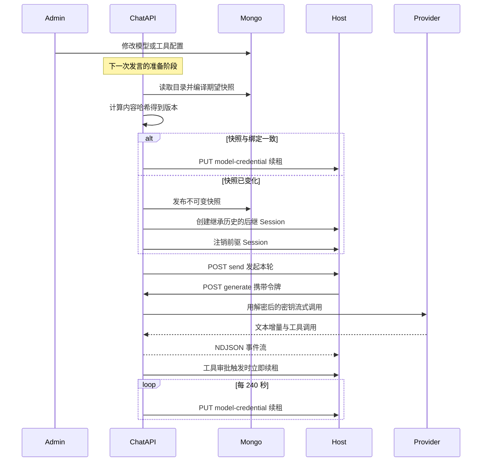

# MOVO Runtime Profile、模型网关与凭据租约

## 根因：可变的管理配置，撞上不可变的执行身份

企业 Agent 平台必须回答四个问题：这次发言**用哪个模型**、**凭谁的额度**、**能碰哪些工具**、**出事了怎么回溯**。这四个问题的答案都来自管理员随时会改的后台配置——模型实例、provider 密钥、工具启用状态、岗位授权。

而 DSH 内核这一侧的前提正好相反：Runtime 以 `isolationKey` 隔离、Session 一旦创建，其 preset 与 workspace 就是不可变身份。MOVO 的网关层甚至会把这种不可变性做成硬断言：恢复一个已持久化的 Session 时，如果它绑定的 Runtime 与落库的 `profileVersion`／`modelInstanceId` 对不上，就直接抛协议错误，而不是"尽力而为"地修补。

[services/chat-api/app/dsh_runtime/gateway.py:162-171]()
<!-- anchor: runtime = self._runtime_binding(runtime_id) … workspace_id=workspace_id, -->

这条约束决定了整个关注面的形状：管理者想改的东西是**可变且高频**的，内核愿意持有的东西是**不可变且按标识寻址**的。两者之间必须有一个编译器、一个版本号，和一条明确的"什么时候把新版本交出去"的路径。MOVO 的答案是把配置编译成内容寻址的 Runtime Profile 快照，把 provider 密钥与工具执行全部留在 chat-api，只把**短期令牌**交给内核进程。

值得先点明的是边界层的自我定位——它只是生命周期与事件的薄壳，不承担任何规划或模型逻辑：

[services/chat-api/app/dsh_runtime/gateway.py:55-56]()
<!-- anchor: class DshAgentKernelGateway(AgentKernelContract): … """Thin lifecycle/event boundary; it owns no planning or model logic.""" -->

## 决策一：把管理配置编译成不可变快照

### 编译：一次哈希，一个版本

编译器把一次执行要用到的全部输入拍平成一个字典：模型实例与 provider 的展示信息、能力集合、上下文窗口、工具定义与版本、技能与写作风格版本。然后对这个字典做规范化 JSON 序列化并取 SHA-256，`profile_version` 就是 `rp-` 加上哈希前 24 位。这意味着**同内容必得同版本**（幂等发布不会产生重复快照），**不同内容必得不同版本**（任何一处工具描述变化都会换版本）。

[services/chat-api/app/dsh_runtime/profile/compiler.py:53-75]()
<!-- anchor: payload: dict[str, Any] = { … "plugin_versions": (), -->

[services/chat-api/app/dsh_runtime/profile/compiler.py:84-87]()
<!-- anchor: @staticmethod … return hashlib.sha256(canonical.encode("utf-8")).hexdigest() -->

编译前还有一道**授权裁决**：如果产品扩展提供了模型访问策略，编译器会先在"后台默认模型"和"这个用户被允许的模型"之间做一次解析，再拿解析结果去目录里取实例。也就是说权限判断发生在编译期，而不是等到 host 发起推理时才拒绝。

[services/chat-api/app/dsh_runtime/profile/compiler.py:36-43]()
<!-- anchor: if self._model_access_policy is not None and user_id: … instance, provider = await self._catalog.resolve(tenant_id, authorized_model_id) -->

同一层还承担 fail-fast 的校验：跨租户模型引用直接拒绝、实例或 provider 被停用即拒绝、能力集合里没有 `chat`／`text` 即拒绝、模型名为空即拒绝。这些错误在编译期抛出，比让 Node 进程去揣摩一个坏 profile 要便宜得多。

[services/chat-api/app/dsh_runtime/profile/compiler.py:90-104]()
<!-- anchor: def _validate(instance: dict[str, Any], provider: dict[str, Any], tenant_id: str … raise ValueError("model name is empty") -->

### schema：secret-free 是硬约束，不是约定

快照本身是 Pydantic 的 frozen 模型、`extra="forbid"`，schema 版本号写死在字段里。真正关键的是 `host_payload()`：它只挑出内核需要的十来个字段，凭据位置放的是 `gatewayUrl` 加一枚 `accessToken`。**provider 的 API key 从来不在这个结构里**——这不是"记得别写进去"，而是这个结构根本没有承载密钥的字段。

[services/chat-api/app/dsh_runtime/profile/models.py:13-18]()
<!-- anchor: class RuntimeProfileSnapshot(BaseModel): … content_hash: str = Field(pattern=r"^[0-9a-f]{64}$") -->

[services/chat-api/app/dsh_runtime/profile/models.py:47-55]()
<!-- anchor: payload: dict[str, object] = { … "accessToken": access_token, -->

工具配置也走同一份 payload 下发，并且带一个 `nativeReplacements` 列表：列进来的是 **MOVO 自己的**工具名（当前恒为 `external_search`），语义是「这个能力不再注册成模型工具，改由 DSH 原生工具承担」——host 侧会跳过 MOVO 这个工具的注册，而原生 `web_search` 被加进 agent 作用域白名单，其 search provider 由覆盖层指向 ASKAI 工具网关。也就是说这里做的是**原生能力接管**，不是同名覆盖（`external_search` 与 `web_search` 本来就不同名）。

[services/chat-api/app/dsh_runtime/profile/models.py:57-65]()
<!-- anchor: if self.tools: … "nativeReplacements": native_replacements, -->

### 存储与发布：不可变 + 每租户单一 active

Mongo 侧用两条唯一性约束守住语义：`profile_version` 唯一；再给 `tenant_id` 建一个**部分唯一索引**，只约束 `active: true` 的文档，从而保证"每个租户最多一个 active profile"（另外还建了一个 `(tenant_id, active)` 普通复合索引供查询）。发布时（`activate=True`）先把该租户旧的 active 文档全部置否，再把目标版本置为 active，随后写一条 `publish` 审计；`activate=False` 只落版本、不动 active 指针。

[services/chat-api/app/dsh_runtime/profile/store.py:90-96]()
<!-- anchor: await db[PROFILE_COLLECTION].create_index("profile_version", unique=True) … name="one_active_runtime_profile_per_tenant", -->

[services/chat-api/app/dsh_runtime/profile/store.py:126-135]()
<!-- anchor: if activate: … {"$set": publish_values}, -->

同一份快照被重复发布时，存储层会逐字段比对既有文档；不一致就抛"profile version is immutable"，而不是静默覆盖。

[services/chat-api/app/dsh_runtime/profile/store.py:108-125]()
<!-- anchor: existing = await db[PROFILE_COLLECTION].find_one({"profile_version": snapshot.profile_version}) … raise ValueError("profile version is immutable") -->
这条规则让 `profile_version` 成为一个**可长期引用的地址**：落库的 binding 只需要记住版本字符串，事后仍能取回完全相同的工具展示元数据、上下文窗口与技能集合。

[services/chat-api/app/dsh_runtime/profile/store.py:139-143]()
<!-- anchor: async def active(self, tenant_id: str) -> RuntimeProfileSnapshot: … return self._snapshot(row) -->

离线导出与回放沿用了同一套寻址方式：载入 bundle 时把 `content_hash` 与 `profile_version` 摘出来重新计算，哈希对不上或版本号不是 `rp-<hash24>` 的形状，一律判定完整性失败。这让快照可以跨环境搬运而不需要额外的签名体系。

[services/chat-api/app/dsh_runtime/profile/bundle.py:18-23]()
<!-- anchor: def load(payload: bytes | str) -> RuntimeProfileSnapshot: … actual_hash = ModelProfileCompiler.content_hash(document) -->

### 代价

- **配置漂移窗口**：没有推送通道，改完配置到生效之间存在一个"到下一次发言为止"的空档（详见决策二）。
- **每轮都编译**：目录读取、岗位策略解析、资源授权过滤都在发言准备阶段重复执行；换来的是永远不需要维护进程内缓存失效逻辑。
- **版本表只增不减**：我在源码中没有定位到快照的清理／GC 任务；`runtime_profile_versions` 会随配置变更持续增长。
- **控制面能力暂时没有消费者**：`disable()`／`rollback()`／租户级 `active()` 都已实现并有审计，但除测试外我在 chat-api 里没有找到运行时调用方——热路径始终是"按轮编译、`activate=False` 发布"，租户级 active profile 更像一套预留的治理面。

## 决策二：两类变更，两条生效路径

这是本关注面最容易被误读的地方。管理员改配置有不同的"生效语义"，MOVO 用两条路径区分它们。

### 路径 A：只换密钥／端点——同一会话直接生效

provider 的 `api_key`、`base_url` 这些字段**不在 profile payload 里**（回看决策一的字段清单：只有 provider 的 id／类型／名字和模型名进入哈希）。因此轮换密钥不会改变 `profile_version`，也就不会触发任何重建。

真正读密钥的地方是模型网关的服务层：每次请求都按 `modelInstanceId` + 租户去 Mongo 取一次配置，现场解密出明文 key 再构造客户端。密钥的密文由 chat-api 侧的派生密钥解出，密文格式是 nonce、MAC、cipher 三段并用 HMAC 校验完整性——校验失败即抛错，而不是返回半个空 key 去发请求。

[services/chat-api/app/llm/configured_models.py:72-82]()
<!-- anchor: def decrypt_secret(value: str) -> str: … return payload.decode("utf-8") -->

[services/chat-api/app/llm/configured_models.py:195-221]()
<!-- anchor: def _to_runtime_config( … "settings": dict(settings or {}), -->

[services/chat-api/app/llm/configured_models.py:273-288]()
<!-- anchor: def build_llm_client_from_config( … api_key=api_key, -->

**这就是"不重建 session 就生效"的确切含义**：换密钥、换 base_url、切到另一个同样已授权的推理端点，都不影响 Runtime 与 Session 的身份，下一轮模型调用自然用新值。端到端只有一次数据面读取的延迟。

### 路径 B：模型身份或工具集变化——轮次边界换绑

一旦模型实例、能力集合、工具定义或技能版本变化，哈希就变，`profile_version` 就变。这时不能原地改内核里的 Runtime，只能换绑。同步器被放在**发言准备阶段、领取本轮之前**执行：

[services/chat-api/app/dsh_runtime/profile/synchronizer.py:45-64]()
<!-- anchor: restored = await self._coordinator.restore(binding) … await self._profiles.publish_snapshot(desired, actor_id=user_id, activate=False) -->

[services/chat-api/app/dsh_runtime/chat_service.py:250-262]()
<!-- anchor: binding = (await self._profile_sync.synchronize( … )).binding -->

同步器的逻辑很短但三句话都不能省：先恢复（restore）现有绑定并取出它引用的版本；再按期望模型重新编译一份快照；版本相同就直接返回、什么都不做（这是稳态下的零成本路径）；版本不同才发布新快照、把绑定旋转到一个后继 Runtime／Session，并**尽力注销前驱 Session**。

[services/chat-api/app/dsh_runtime/profile/synchronizer.py:65-70]()
<!-- anchor: successor = await self._coordinator.rotate_binding( … disposed = await self._coordinator.dispose_restored_session(restored) -->

所以严格说，这不是"不重建 session"，而是**不重建 conversation**：对话与消息历史属于 chat-api 的业务数据，始终留在原 conversation 上；内核 Session 确实被替换了，但它以"从已完成的前驱导出事件种子"的方式继承历史，而不是从空白开始。前驱必须处于完成态——host 侧导出种子前会等待它 idle；同时 host 明确拒绝调用方直接传裸 `seed`，只接受由可信前驱推导出来的种子。

[services/chat-api/app/dsh_runtime/runtime_coordinator.py:96-104]()
<!-- anchor: """Create a successor Session seeded from the completed predecessor. … kept. ``execution_location`` is always preserved. -->

[services/chat-api/dsh/runtime-host/src/session-seed.mjs:2-20]()
<!-- anchor: export async function resolveSessionSeed(manager, input) { … return body -->

Runtime 的复用粒度由隔离键决定：`tenant:<租户>:profile:<版本>`。同一版本的多个 Session 共用一个 Runtime，发现即复用；创建撞车时（并发首次发言）再查一次，避免两个进程同时建出两个 Runtime。

[services/chat-api/app/dsh_runtime/runtime_coordinator.py:18-20]()
<!-- anchor: @staticmethod … return f"tenant:{tenant_id}:profile:{profile_version}" -->

[services/chat-api/app/dsh_runtime/runtime_coordinator.py:156-170]()
<!-- anchor: async def _runtime(self, *, tenant_id: str, profile_version: str): … isolation_key=isolation_key, -->

### 为什么是"轮次边界"而不是事件推送

我读到的证据是：同步调用点只出现在发言准备路径（首轮创建、后续每轮同步、桌面端引导三处），而 binding 的领取用 `claim_turn` 加部分唯一索引保证"一个 conversation 同时只有一轮"。也就是说，轮次边界天然是**没有并发读者**的安全点：此刻换绑不会让任何进行中的回合读到半新半旧的 profile，也不会出现两个 Runtime 同时服务一条对话。

需要说明的是，"为什么不做推送"这层动机源码里没有显式注释，是我从调用点的分布与并发语义推断的；可以确证的只是**没有任何推送通道，且同步只发生在轮次边界**这一事实。代价很直接：管理员改完配置后，用户必须再发一条消息才看得到变化；一个长时间空闲的会话会一直停留在旧版本上。

## 决策三：模型推理反向代理回 chat-api

### 内核里只留一个 adapter 壳

Node 侧的 Runtime 启动时，如果 profile 里带了 `modelProfile`，就注册一个名为 `askai-model-gateway` 的 LLM adapter；只有在完全没有 profile（例如确定性测试模式）时才退回内置的 Deterministic 插件。

[services/chat-api/dsh/runtime-host/src/kernel-runtime.mjs:98-101]()
<!-- anchor: if (this.modelProfile === undefined) await ctx.plugin(DeterministicModelPlugin) … this.#modelAdapterDispose = ctx.llm.registerAdapter(['askai-model-gateway'], thi -->

这个 adapter 的"密钥"只有两样东西：网关 URL 和一枚 access token。续租就是**替换这两样**，它不持有、也无法导出任何 provider 凭据。

[services/chat-api/dsh/runtime-host/src/askai-model-gateway-plugin.mjs:29-31]()
<!-- anchor: updateCredential({ gatewayUrl, accessToken }) { … this.config = Object.freeze({ ...this.config, gatewayUrl, accessToken }) -->

推理调用就是一次带 Bearer 的 HTTP POST，把 DSH 的请求体（system、messages、tools、maxTokens、sessionId）原样转成 MOVO 网关的请求模型，响应则是一条 NDJSON 流，事件类型只有 `text-delta`、`tool-call`、`usage`、`finish`、`error` 五种。DSH 侧的 block 生命周期（block-start／tool-call-delta／block-end）由 adapter 自己拼装。

[services/chat-api/dsh/runtime-host/src/askai-model-gateway-plugin.mjs:55-72]()
<!-- anchor: const response = await fetch(this.config.gatewayUrl, { … signal: options.signal, -->

### token 是自签的，但被三方 scope 约束

网关令牌不是 JWT 库产物，而是"base64url 载荷 + HMAC-SHA256 签名"的两段式结构：固定 `aud`、租户、profile 版本、模型实例、用户、签发与过期时间（默认 900 秒），密钥由共享 secret 派生，校验用定时安全比较。签名与过期检查之外，还要校验 `aud`。

[services/chat-api/app/dsh_runtime/model_gateway/token.py:25-47]()
<!-- anchor: def __init__(self, secret: str, *, ttl_seconds: int = 900) -> None: … return f"{encoded}.{signature}" -->

[services/chat-api/app/dsh_runtime/model_gateway/token.py:49-62]()
<!-- anchor: def verify(self, token: str) -> ModelGatewayClaims: … raise ValueError("Model Gateway token has expired") -->

内部端点把 token 校验与流式响应接在一起：缺 Bearer 直接 401，签名或过期失败同样是 401；真正的流以 `application/x-ndjson` 返回，并显式关闭缓冲（`X-Accel-Buffering: no`），否则 nginx 会把增量攒成整包，流式就白做了。

[services/chat-api/app/api/endpoints/dsh_model_gateway.py:32-55]()
<!-- anchor: @router.post("/generate") … "X-Accel-Buffering": "no", -->

真正让"凭据不下发"站得住的是**三方交叉校验**：请求体里自报的 `profileVersion`、`modelInstanceId` 与 `provider` 必须逐项等于签名里的声明，`provider` 还必须是字面量 `askai-model-gateway`。即使有人拿到一枚合法 token，也无法用它去调用另一个 profile、另一个模型，或绕过 adapter 直接冒充别的 provider。

[services/chat-api/app/dsh_runtime/model_gateway/service.py:193-198]()
<!-- anchor: if request.profileVersion != claims.profile_version: … raise ModelGatewayFailure("provider_scope_mismatch", "provider scope mismatch", -->

方向反过来同样有防线：host 侧对 `modelProfile` 做**字段 allowlist**，出现未知字段直接拒绝；`profileVersion` 必须与创建 Runtime 时声明的版本一致。两条独立实现的校验互不信任对方，任何一侧写错都会在启动或首个请求时暴露，而不是悄悄放宽。

[services/chat-api/dsh/runtime-host/src/model-profile.mjs:1-11]()
<!-- anchor: const ALLOWED_FIELDS = new Set([ … 'skillProfile', -->

### 为什么值得多一跳

**用量归属可编程**。chat-api 侧构造客户端时会显式打包一份 `output_spec`：租户、用户、模型实例、会话、profile 版本、以及固定的 `stage="dsh_agent_turn"`。这些值不是从环境变量或全局单例里猜的，而是从签名 token 与请求体里取出来的。

[services/chat-api/app/dsh_runtime/model_gateway/service.py:174-187]()
<!-- anchor: config = await get_model_config(model_instance_id, tenant_id) … "profile_version": request.profileVersion, -->

这份 spec 一路传到被装饰的 LLM 客户端，在那里落成一条 TokenUsageRecord，包含 main_id、user_id、session_id、模型名与计数字段——企业侧要的"谁用了多少 token"就是这样闭合的。

[services/chat-api/app/llm/instrumented_client.py:170-192]()
<!-- anchor: record = TokenUsageRecord( … completion_tokens=int(usage.get("completion_tokens") or 0), -->

这里有个容易踩的坑：被装饰的客户端会把**环境里的请求上下文覆盖在显式 output_spec 之上**，而 chat-api 的 HTTP 中间件只往请求上下文里塞 `http_request_id`、`method`、`path` 这类元信息、不含任何身份。因此在内网网关上，身份只能来自签名声明。

[services/chat-api/app/llm/instrumented_client.py:223-232]()
<!-- anchor: def _resolved_output_spec(self) -> Dict[str, Any]: … return resolved -->

**流式协议由自己做主**。网关服务层把 provider 的 chunk 归并成前面那五种事件：文本增量直接透传，工具调用按 index 累积参数片段（有 `arguments` 就整段替换、只有 `arguments_delta` 就追加），usage 做方言归一，最后补一个 finish 事件并明确告知是 `tool-calls` 还是 `stop`。

[services/chat-api/app/dsh_runtime/model_gateway/service.py:59-77]()
<!-- anchor: async def generate( … response = await client.ainvoke(messages, **kwargs) -->

需要说明一处**新旧并存**：`app/llm/model_router.py` 那套按 stage／intent／node 选模型、读 YAML 并按 mtime 热加载的路由器，仍然服务于非 DSH 的历史路径；它唯一的调用点是工厂函数。

[services/chat-api/app/llm/model_router.py:63-69]()
<!-- anchor: by_stage = cfg.get("by_stage") if isinstance(cfg.get("by_stage"), dict) else {} … return ModelSelection(model=str(by_intent[str(intent)]), source="by_intent") -->

DSH 回合不走这条路：模型选择在**编译期**由数据库目录 + 用户授权策略决定，到了网关只是按 id 取配置。也就是说"选哪个模型"从"进程级配置文件"迁移到了"每次编译的内容寻址快照"，这正是决策一存在的理由。

### 代价

- **多一跳**：host → chat-api → provider，首 token 延迟叠加，且 chat-api 成为模型调用的单点；`DSH_RUNTIME_HTTP_TIMEOUT_SECONDS` 默认只有 5 秒，说明设计上假定了内网低延迟。
- **两套协议要自己维护**：DSH 的请求／事件形状变化时，adapter 与 `ModelGatewayRequest` 都得跟着改，这正是仓库里放兼容矩阵与 lock 文件的原因（见"与内核的边界"）。
- **流式错误晚到**：一旦响应已经开始，错误只能作为流里的事件送达，HTTP 状态码无法再表达失败。

## 决策四：工具 schema 的方言转换与可见性

### 三种来源，一份定义

工具目录把外部 HTTP 工具、MCP 工具与内部能力统一编译成同一个 `ToolProfileDefinition`。编译前先过两道筛：资源级授权（`filter_allowed_resource_ids`）与岗位策略——岗位不允许的内部能力直接不进 profile。风险等级优先采用管理员显式填写的值（属于 read／write／dangerous 即生效），缺省时才推断：HTTP 工具按方法推断（GET／HEAD／OPTIONS 为 read，其余为 write），MCP 工具按 MCP 注解推断（`destructiveHint` → dangerous，`readOnlyHint` → read）。`approval_required` 默认跟随"非只读"。

[services/chat-api/app/dsh_runtime/profile/tools.py:84-99]()
<!-- anchor: async def compile(self, *, tenant_id: str, user_id: str) -> tuple[ToolProfileDef … definitions.append(self._compile_http(row)) -->

工具名与工具版本都是**内容派生**的：名字是 `askai_<kind>_<安全化标签>_<hash10>`，版本是 `tool-<hash24>`。这带来一个很实用的性质——改一段描述、加一个参数、换一次风险等级，都会改变工具版本，从而改变整个 profile 的哈希并触发换绑，而不会被"同名工具"悄悄沿用旧 schema。

[services/chat-api/app/dsh_runtime/profile/tools.py:228-236]()
<!-- anchor: def _name(kind: str, tool_id: str, label: str) -> str: … return f"tool-{hashlib.sha256(value.encode()).hexdigest()[:24]}" -->

### 管理后台的表单 schema 不是 JSON Schema

后台的输入输出节点是一套自定义类型（String／Integer／Number／Boolean／Object／Array／ArrayObject）加 `children` 与 `[Array Item]` 标记。编译器要把它翻译成 JSON Schema，还要处理两个不对称：数组的"对象元素"有两种表达（显式 `[Array Item]` 或直接把字段挂在数组节点下），以及**输出侧的非必填字段一律包成可空 union**——因为模型输出的字段缺失是常态，而严格校验会把正常结果判成失败。

[services/chat-api/app/dsh_runtime/profile/tools.py:239-255]()
<!-- anchor: def _admin_schema(cls, value: Any, *, output: bool = False) -> dict[str, Any]: … schema["required"] = required -->

另外还有一个刻意的宽松：HTTP 工具的输出节点在旧运行时里只是"展示/投影提示"，并不是线上契约，因此除非管理员显式打开严格校验，输出验证模式为 `none`；而 MCP 的 `outputSchema` 是协议作者写下的契约，一律 `strict`。

### MCP 的方言：能改就改，改不了就只丢那一个工具

MCP server 可以发布完整 JSON Schema 加厂商扩展，而 DSH 只认一个刻意收窄的子集。MOVO 在这一层做三件事，且把"被丢弃的路径"记下来回报：

- **无害元数据**：`$schema`、`$id`、`deprecated`、`x-` 前缀等直接删；`format`／`pattern`／`minLength`／`maximum` 这类**服务端仍会强制**的约束也从 schema 里移除，因为 DSH 无法表达它们，留在那里只会造成"校验通过但服务端拒绝"的错觉。
- **可无损投影的构造**：单一分支的 `allOf` 就地展开；`anyOf` 只有在各分支类型互斥时才降级为 `oneOf`，否则拒绝——因为宽松的并集语义无法等价地表达成"恰好一个"。
- **改不了的结构**：外部 `$ref`、循环 `$ref`、元组式 `items`、无法解析的类型联合，都会抛兼容性错误；调用方只跳过这一个 MCP 子工具并打日志，不影响同一个 MCP server 下的其他工具。

[services/chat-api/app/dsh_runtime/profile/mcp_schema.py:37-59]()
<!-- anchor: def normalize_mcp_schema( … return NormalizedMcpSchema(normalized, tuple(removed)) -->

[services/chat-api/app/dsh_runtime/profile/mcp_schema.py:103-108]()
<!-- anchor: if "allOf" in node: … return {**base, **annotations} -->

[services/chat-api/app/dsh_runtime/profile/mcp_schema.py:119-123]()
<!-- anchor: if union_key == "anyOf" and not _branches_are_disjoint(branches): … return {**annotations, "oneOf": branches} -->

[services/chat-api/app/dsh_runtime/profile/mcp_schema.py:176-181]()
<!-- anchor: # DSH only accepts a boolean here. Keep the dictionary shape … raise McpSchemaCompatibilityError(f"{path}.additionalProperties must be boolean -->

这条"宁可宽松也不报错"的取舍在 `additionalProperties` 上最典型：DSH 只接受布尔值，于是传 schema 的情况被降级为 true 并记入 removed_paths，注释把理由写得很清楚——**值校验仍然由 MCP server 自己负责**。

[services/chat-api/app/dsh_runtime/profile/tools.py:181-192]()
<!-- anchor: input_schema = normalize_mcp_schema( … continue -->

### 出站再转一次

到了真正调用模型那一步，DSH 的中立工具定义（`name`／`description`／`parameters`，即 `inputSchema`）还要包一层 OpenAI chat 的 `type/function` 外壳。实现里带了一个幂等分支：已经是规范化形状的定义原样保留，避免重试或适配器叠层时被二次包裹。

[services/chat-api/app/dsh_runtime/model_gateway/tool_schema.py:9-25]()
<!-- anchor: def to_openai_chat_tools(tools: list[dict[str, Any]] | None) -> list[dict[str, A … "parameters": raw.get("parameters") or raw.get("inputSchema"), -->

### 可见性：一个还没启用的 seam

按每轮动态隐藏工具的钩子确实存在，签名里有 `session_id` 与 `tenant_id`，文档字符串也描述了"自动检索与严格检索模式下内部知识检索都可用"的预期语义。但实现目前是**恒等函数**：参数被 `del` 掉，原样返回工具列表。也就是说，这一层是为将来预留的接口，而不是当下生效的策略。

[services/chat-api/app/dsh_runtime/model_gateway/tool_visibility.py:13-23]()
<!-- anchor: """Hide tools that are unavailable in the active trusted turn. … return list(tools) -->

真正生效的可见性在另外两处，而且它们被刻意设计成"编译期粗筛 + 执行期细判"：

- **编译期**：只有通过资源授权与岗位策略的工具才进入 profile（见决策四开头），所以模型根本看不到未授权的工具。
- **执行期**：工具网关拿签名 token 里的 `tool_names` 与 `scopes` 与请求逐项比对，再去取不可变 profile 复核租户与 subject，然后**重新读一次岗位策略**。最后还要确认发起调用的 Kernel Session 与 binding 的租户／用户／profile 完全一致。

[services/chat-api/app/enterprise_capabilities/tools/service.py:479-489]()
<!-- anchor: async def _authorize( … raise ToolPolicyDenied("required tool scope is missing") -->

这里体现出"profile 不可变"与"撤权要即时"这对矛盾的解法：**快照不更新，但每次执行都重判实时策略**。管理员撤销一个岗位的工具授权后，已经在跑的会话下一个工具调用就会被拒，不需要等换绑。

### 名字空间边界

企业工具不允许占用 DSH Code 的原生工具名——`bash`、`read`、`grep`、`subagent`、`workflow` 等一长串名字被显式保留，冲突时 host 直接拒绝启动工具桥。想接管原生能力只能走 `nativeReplacements`（例如用 `external_search` 替换原生 `web_search`），而不是同名覆盖。

[services/chat-api/dsh/runtime-host/src/official-host/tool-name-policy.mjs:15-20]()
<!-- anchor: export function assertNoDshCodeToolCollisions(descriptors) { … throw new Error(`MOVO enterprise tools collide with DSH Code tools: ${[...new Se -->

## 决策五：凭据租约——把令牌有效期变成系统的一等公民

### 问题：一次回合可以比一枚令牌活得更久

网关令牌默认 900 秒过期，而内核进程在两种情况下会长时间不动：工具调用（浏览器自动化、文档生成）与**审批等待**。如果令牌只在创建 Runtime 时下发一次，那么一个正在跑长任务的会话迟早会在某次模型调用上撞到 401。

租约类的注释把动机写得很直白——"DSH 可能正阻塞在一个长工具调用里"。它的构造参数只有三个：刷新器、会话 id、间隔（默认 240 秒）。

[services/chat-api/app/dsh_runtime/credential_lease.py:37-50]()
<!-- anchor: class ActiveTurnCredentialLease: … self._task: asyncio.Task[None] | None = None -->

240 与 900 的比例是刻意的：一个令牌生命周期内大约刷新三次半，任何单次刷新失败都还有两次补救机会；同时这个间隔不大于 host 侧审批等待窗口（`APPROVAL_WAIT_SECONDS = 240`），所以一次完整的审批等待大致会跨过一次租约刷新。

### 为什么锁的粒度是 Runtime 而不是 Session

凭据挂在 Runtime 上——host 的刷新接口路径是 `/v1/runtimes/{runtimeId}/model-credential`。而隔离键是"租户 + profile 版本"，同一份 profile 下的多个会话共享一个 Runtime。如果按会话加锁，同一个 Runtime 下的并发会话会各自发一次内容相同的 PUT；按 Runtime 加锁则把这些刷新**串行化**（`KeyedAsyncLock` 的自述只是 "Serialize refreshes"，并不做去重——拿到锁的每个调用者仍会各自解析并 PUT 一次），避免并发写同一份凭据。MOVO 用一把按键惰性创建的 `asyncio.Lock` 实现，Runtime 销毁时顺手丢弃对应的锁，避免这张表随 Runtime 数量无限增长。

[services/chat-api/app/dsh_runtime/credential_lease.py:17-29]()
<!-- anchor: class KeyedAsyncLock: … return lock -->

[services/chat-api/app/dsh_runtime/gateway.py:109-109]()
<!-- anchor: self._credential_refresh_locks.discard(runtime_id) -->

### 刷新到底刷新了什么

一次刷新会重新解析 profile（这会重新签发模型网关令牌与工具网关令牌），然后向 host 发两次 PUT：模型凭据与工具凭据。注意这里有个防御性校验——如果重新解析出来的 profile 的模型身份与绑定记录不一致，直接报协议错误。正常情况下这不可能发生（快照不可变），它防的是"有人绕过编译流程往存储里塞了同版本的异构文档"。

[services/chat-api/app/dsh_runtime/gateway.py:362-386]()
<!-- anchor: async def _refresh_model_credential(self, runtime_id: str) -> None: … json={"accessToken": tool_profile.get("accessToken")}, -->

host 侧就是两个改了字段的赋值：模型 adapter 换 `gatewayUrl` + `accessToken`，工具桥只换 `accessToken`（web search provider 一并更新）。**没有任何 provider 密钥参与其中。**

[services/chat-api/dsh/runtime-host/src/kernel-runtime.mjs:245-255]()
<!-- anchor: refreshModelCredential(credential) { … return { refreshed: true } -->

租约只暴露一个对外动作，既是定时任务体、也是被事件触发的入口：

[services/chat-api/app/dsh_runtime/gateway.py:241-244]()
<!-- anchor: async def refresh_session_credentials(self, session_id: str) -> None: … await self._refresh_model_credential(binding.runtime_id) -->

### 三个刷新时机，三种不同的理由

**其一，发送前刷新。** 注释把理由写明了：让长寿命的 Runtime 用"当前发言者的凭据"去做用量归属。因为 profile 的 `subject_user_id` 参与哈希，换一个发言者意味着换一份 profile、换一个 Runtime——所以这一步同时也在保证"这条回合花的是发言者自己的模型额度"。

[services/chat-api/app/dsh_runtime/turn_runner.py:105-122]()
<!-- anchor: credential_lease = ActiveTurnCredentialLease( … await credential_lease.refresh_now() -->

**其二，定时刷新。** 一个无限循环：睡 240 秒、刷新、继续。它就是为"回合并发期间没人会再调用同步路径"这一事实准备的。

[services/chat-api/app/dsh_runtime/credential_lease.py:67-83]()
<!-- anchor: async def refresh_now(self) -> None: … await self.refresh_now() -->

**其三，审批事件触发刷新。** 这是最值得琢磨的一处：事件流里一旦出现 `tool.approval.requested`，**在把事件投影入库之前**立刻同步刷新一次凭据。

[services/chat-api/app/dsh_runtime/turn_runner.py:134-139]()
<!-- anchor: async for event in self._gateway.subscribe( … await credential_lease.refresh_now() -->

我理解的理由有三层：审批是唯一会让回合**挂起数分钟**的状态，而挂起期间租约最不该出问题；host 侧提交审批请求本身要走工具网关（`/approval/request`）并带上工具令牌，令牌过期会让审批请求发不出去；审批通过之后紧跟的是一次模型调用，那次调用必须落在**当前发言者**的额度上。其中"用量归属"这一层有 `turn_runner` 的注释直接支撑（见上一条引用），另外两层是我从事件顺序与 host 侧工具桥的实现推出的。

### 审批链路上的其他约束

工具令牌本身就是一份最小权限清单：`tool_names` 与 `scopes` 被写进签名载荷并去重排序，服务端再逐项复核（见决策四的执行期校验）。

审批记录绑定的是**回合发起者**而不是令牌持有者（两者当前相同，但代码优先取服务端构建的 `initiator_user_id`，令牌 subject 只作兜底），所以即使一枚令牌被挪用到另一个会话，也决定不了别人的审批。

[services/chat-api/app/enterprise_capabilities/tools/service.py:89-105]()
<!-- anchor: async def request_approval(self, request: ApprovalAskRequest, claims: ToolGatewa … initiator_user_id = str(turn_metadata.get("initiator_user_id") or "") or claims. -->

### 失败语义

刷新失败被吞掉并只记日志，理由是"一次瞬时失败不该取消一个正在进行的浏览器操作"——下一个 tick 与审批刷新会补上。这个选择让租约成为一个**尽力而为的续期机制**，而不是会让回合崩掉的强一致依赖。

### 代价

- **写放大**：租约是按**回合**创建的（`session_id` 取 binding 的 kernel session），因此写放大按活跃回合计——同一 Runtime 下并发 N 个回合就是每 240 秒 N 次 PUT；默认 TTL 900 秒，且构造函数会拒绝小于 30 秒的 TTL。
- **15 分钟窗口**：令牌一旦泄露，在过期前一直有效；我**没有在源码中定位到**吊销名单、`jti` 黑名单或单次使用校验——`jti` 被生成并写入载荷，但校验路径只检查签名、`aud` 与过期时间。
- **刷新延迟不等于立即生效**：续租是周期性的，若某次 provider 密钥轮换恰好发生在两次刷新之间，最坏情况下要等到下一个 tick。

[services/chat-api/app/dsh_runtime/model_gateway/token.py:25-31]()
<!-- anchor: def __init__(self, secret: str, *, ttl_seconds: int = 900) -> None: … self._ttl_seconds = ttl_seconds -->

## 一次发言的完整链路

图里两条凭据要分清：**模型网关令牌**让 host 能把推理请求发回 chat-api，**工具网关令牌**让 host 能把工具执行与审批请求发回 chat-api。二者都由同一次 profile 解析签发，都在同一把 Runtime 锁下续租，但携带的权限不同：前者绑定模型实例与发言者身份，后者绑定工具名单与 scope。

## 决策六：桌面端引导——把同一份快照租给本机 Runtime

桌面端（Electron 主进程）需要在本机起一个 DSH Runtime，又不能持有 provider 密钥。MOVO 的做法是让 chat-api 编译并**发布但不激活**一份用户级 profile，然后立刻解析成 host payload 返回——也就是说，桌面端拿到的是"一份公开元数据 + 两枚限权令牌"，激活状态与自己无关，不会污染租户默认模型。

[services/chat-api/app/dsh_runtime/desktop_bootstrap.py:25-43]()
<!-- anchor: async def prepare( … model_profile=host_profile, -->

端点这一层还叠加了治理：要求该用户具备 code 能力、检查配额、并记录一条岗位策略事件，然后才发凭据。

[services/chat-api/app/api/endpoints/dsh_chat.py:269-285]()
<!-- anchor: @router.post("/desktop/dsh/runtime-profile", response_model=ApiResponse) … model_instance_id=str(payload.model_id or "").strip() or None, -->

工具令牌的 scope 不是调用方给的，而是**从这份 profile 的工具集推导**出来的：把所有工具声明的 `required_scopes` 取并集。调用方连"我要什么权限"都表达不了。

[services/chat-api/app/dsh_runtime/profile/resolver.py:41-46]()
<!-- anchor: tool_token = self._tool_tokens.issue( … scopes=sorted({scope for tool in snapshot.tools for scope in tool.required_scope -->

桌面端的本地 Runtime 建完 Session 之后，身份要**原子地**回写到 chat-api：提交时逐项校验这份 profile 的租户、subject 与模型实例是否与宣称的身份一致，任何一项对不上就拒绝建绑定。同时 host 明确拒绝调用方传裸文件系统路径，只接受 workspace 标识——本地代码任务的落点由受控的工作区概念表达，而不是一个可以随便传的 `cwd` 字符串。

[services/chat-api/app/dsh_runtime/desktop_binding.py:63-69]()
<!-- anchor: profile = await self._profiles.get(identity.profile_version) … raise ValueError("desktop Session does not match its published Runtime Profile") -->

[services/chat-api/dsh/runtime-host/src/runtime-http-server.mjs:123-123]()
<!-- anchor: if (Object.hasOwn(body, 'cwd')) throw new Error('raw cwd is forbidden over the R -->

### 与本关注面相关的"受信回合上下文"

profile 决定"用什么模型、能碰什么工具"，还有两类信息是逐回合决定、且同样由 chat-api 受信产生、绝不由客户端或模型注入的：语言与时间。

语言由显式参数或文本本身判定（含中日韩统一表意文字即中文），时间则被冻结成一次不可变的时钟快照——带 UTC 时刻、用户本地时刻与经 IANA 校验的时区名。host 侧对时间上下文是**强制**的：缺了就抛错，不接受"让内核自己看系统时间"。

[services/chat-api/app/dsh_runtime/locale.py:8-14]()
<!-- anchor: def resolve_turn_locale(text: str, explicit: str | None = None) -> str: … return "zh-CN" if re.search(r"[\u4e00-\u9fff]", str(text or "")) else "en-US" -->

[services/chat-api/app/dsh_runtime/temporal_context.py:25-40]()
<!-- anchor: def build_temporal_context( … user_timezone=zone_name, -->

[services/chat-api/dsh/runtime-host/src/kernel-runtime.mjs:193-196]()
<!-- anchor: send({ sessionId, mode, content, temporalContext, turnContext }) { … throw new TypeError('temporalContext is required for every MOVO turn') -->

同一处还有一条容易被忽略的收窄：这份 Runtime Profile **只接受文本内容块**——图片与文档必须在 chat-api 侧处理成文本或走企业能力的工具路径，附件的多模态转换因此是服务端职责，而不是把二进制丢给内核。

[services/chat-api/dsh/runtime-host/src/kernel-runtime.mjs:203-205]()
<!-- anchor: content: content.map((block, index) => { … const text = String(block.data?.text ?? '') -->

## 与内核的边界：三件套锁定 + 双向校验

MOVO 不 fork DSH，而是把内核当 npm 依赖装进独立 Node 进程，因此"版本漂移"是首要风险。仓库用三件套把它钉住：一份声明依赖锁定策略与已评审上游提交的 lock 文件、一个精确到 prerelease 的包版本、以及一份声明 host 协议、host overlay、执行投影与工作区契约版本的兼容矩阵。

[services/chat-api/dsh/versions.lock:1-12]()
<!-- anchor: # MOVO DSH dependency lock policy (format 1) … allow_floating_versions = false -->

[services/chat-api/dsh/runtime-host/package.json:16-16]()
<!-- anchor: "@deepseek-ai/dsh": "0.1.6-alpha.1", -->

[services/chat-api/dsh/compatibility-matrix.yaml:1-8]()
<!-- anchor: schema_version: movo.dsh-compatibility-matrix.v1 … workspace_contract: askai.desktop-workspace-ref.v1 -->

chat-api 这一侧则在启动时请求 host 的健康端点，校验它自报的 `ok` 与 `kernel` 字段；不匹配只把 `host_healthy` 置为 False 供健康端点暴露，**并不阻止进程启动，也没有任何逻辑会据此拒绝回合**——这是"没有运行时版本握手"的另一面。

[services/chat-api/app/dsh_runtime/application.py:68-69]()
<!-- anchor: health = await self._transport.request("GET", "/health") … self.host_healthy = health.get("ok") is True and health.get("kernel") == "dsh" -->

至于 profile 的字段契约，前面已经看到它是**双向 allowlist**：chat-api 只挑白名单字段下发（决策一），host 收到后再次校验白名单并拒绝未知字段（决策三）。这种"两头都写一遍"的重复看起来浪费，但它让内核升级时的契约破坏在启动阶段就炸掉，而不是在某个边缘回合里表现为模型回复异常。

## 可迁移的模式

1. **编译期快照 + 内容寻址版本**。把"可变配置"编译成不可变快照，用内容哈希当版本号，让幂等发布、外部引用、离线搬运、事后回放共用同一套寻址。对 Agent 平台尤其有价值：一次执行要引用的东西太多（模型、提示、工具、技能），只有哈希能把它们绑成一个可复现的整体。
2. **把"生效时机"分成两类**。密钥／端点类变更走数据面即时生效（不进快照）；结构类变更走边界换绑（进快照）。混为一谈就会得到"改个密钥要重启会话"或"改了工具集正在跑的回合看到半新半旧的工具面"。
3. **凭据令牌化 + 租约续期**。密钥留在数据面，边缘只拿短期令牌；令牌带最小权限清单与受众；续期按"最慢的阻塞点"设计，并在**已知会长阻塞的状态转换点**主动续租。
4. **schema 子集 + 分级降级**。外部来源（MCP）的 schema 不可控，处理策略应该是"能无损投影就投影、不能就丢单个工具并记下丢了什么"，而不是整体失败或静默截断。
5. **编译期粗筛 + 执行期细判**。不可变快照保证执行的一致性，实时策略查询保证撤权的即时性——两者并不矛盾，只要把"授权快照"当作缓存而不是真相来源。
6. **双向契约校验**。不要指望单一实现对契约负责；发送方按 allowlist 构造，接收方按 allowlist 校验，升级期的契约破坏会立刻暴露。

## 未在源码中定位到

- **令牌吊销机制**：`jti` 已生成并写入载荷，但我没有找到黑名单、单次使用或主动吊销的校验路径。
- **profile 快照的清理／GC**：`runtime_profile_versions` 与审计集合没有看到保留策略或归档任务。
- **动态工具可见性的实际策略**：`model_gateway/tool_visibility.py` 目前是恒等实现，其文档字符串描述的隐藏语义还没有落到代码里。
- **租户级 active profile 的运行时消费者**：`store.active()`、`disable()`、`rollback()` 已实现并有审计，但除测试外没有找到运行时调用方；热路径一律是"按轮编译 + `activate=False` 发布"。
- **桌面端 gatewayUrl 的来源**：本仓库只暴露 host payload 的返回结构，桌面端如何取得可公网访问的网关地址不在我读到的源码范围内。
- **"为什么不做配置推送"的设计记录**：源码中没有显式说明；我关于"轮次边界是唯一无并发读者安全点"的表述是从调用点分布与并发语义推断的，事实部分只是"没有推送通道、同步只发生在轮次边界"。
- **模型路由器的长期定位**：`app/llm/model_router.py` 在 DSH 回合中不参与选模型；我只能确证它仍被 `factory.get_llm_client` 调用，无法确证 MOVO 计划保留还是淘汰这套 YAML 路由。
