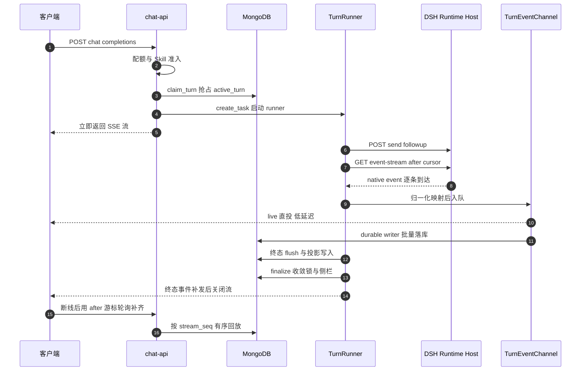
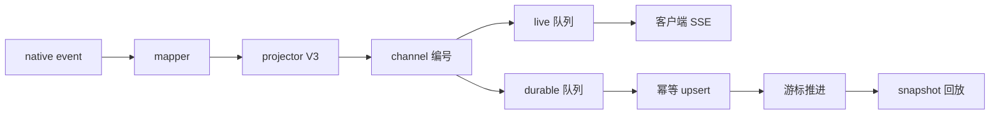

# MOVO 会话与 Turn 生命周期

> 解读基线：MOVO Community Edition v0.2.0（detached HEAD `c6f20f6`）。文中所有 `文件:行号` 引用均可回到 `/Users/morehao/Documents/study/ai-agent/movo` 逐行核对。

## 根因：内核负责跑完，平台负责对账

DSH 内核能漂亮地跑完一轮 Agent，但它产出的 native event 流是**即时**的：订阅者断线就不知道后面发生了什么，chat-api 进程重启就只剩内核自己记得。而企业平台必须回答另一组问题——这一轮是谁发起的？现在还能不能再发一轮？客户端断线重连后怎么补齐缺失事件？一轮跑到一半 chat-api 崩了，这轮算成功还是失败？审批、审计、用量归属挂在哪条记录上？

MOVO 的答案是**内核边界化**：不 fork、不改内核，而是把 DSH 装进独立 Node 进程，用一个语言无关的 `AgentKernelContract` Protocol 定义全部交互面，`DshAgentKernelGateway` 是它唯一的实现，并且自述只做生命周期与事件边界，不持有任何规划或模型逻辑。

- 契约与唯一实现（8 个方法，延伸到 `subscribe`）：[services/chat-api/app/dsh_runtime/contracts/protocol.py:19-34]()
<!-- anchor: class AgentKernelContract(Protocol): …     def subscribe(self, session_id: str, after_cursor: int = 0) -> AsyncIterator[KernelEventEnvelope]: ... -->
- 网关自述「thin」：[services/chat-api/app/dsh_runtime/gateway.py:55-56]()
<!-- anchor: class DshAgentKernelGateway(AgentKernelContract): … """Thin lifecycle/event boundary; it owns no planning or model logic.""" -->

**为什么值得这么做**：内核可以跟着上游升级（新增/替换 provider、执行器），MOVO 的业务逻辑（多租户、审批、证据、交付）写在内核之外，天然可独立演进。**代价**则是内核的内部状态（会话还在不在跑、事件流有没有断）对 MOVO 不可见，只能通过 HTTP 契约加自己的一本持久化账去**推断与收敛**。本文后面几乎所有的复杂度——双轨投递、双游标、崩溃恢复、取消的三段式——都是这一条代价的利息。

## 全景：一次 turn 的六个阶段

各阶段的落点（同一份代码里，职责被切成互相不认识的几个对象）：

| 阶段 | 载体 | 关键保证 |
| --- | --- | --- |
| 准入 | `DshChatService.prepare_turn` + `KernelBindingRepository.claim_turn` | 一个会话同时只有一轮，靠一次 Mongo 原子更新 |
| 发送与订阅 | `DshAgentKernelGateway.send` / `subscribe` | 只传白名单化 turnContext；从持久化 cursor 续读 |
| 映射与投递 | `DshEventMapper` → `KernelEventProjector` → `TurnEventChannel` | native payload 不越界；直投低延迟、落库有序可重放 |
| 收敛 | `TurnStateFinalizer` + `TurnTerminalRecovery` | 终态只有一个来源：持久化的事件日志 |

## 准入：把并发锁放进 Mongo 的一行文档

会话级的互斥没有用进程内锁，也没有用 Redis，而是**在 binding 文档的 `active_turn` 字段上做条件更新**：只有当前 `active_turn` 为空或已处于终态时，`claim_turn` 才写入新的 `{message_id, request_id, status: "running", turn_metadata}` 并返回文档；否则返回 `None`，上层抛 `ConversationBusyError`，端点层把它映射成可重试的 `409 session_already_running`：[services/chat-api/app/api/endpoints/dsh_chat.py:225-229]()
<!-- anchor: except ConversationBusyError as exc: … ) from exc -->

- 条件更新本身就是锁：[services/chat-api/app/dsh_runtime/bindings/repository.py:205-236]()
<!-- anchor: async def claim_turn( … return_document=ReturnDocument.AFTER, -->

这个选择的收益很直接：锁的状态和会话的业务状态在**同一个文档、同一次写入**里，不存在「锁释放了但侧栏还显示在跑」的双写不一致窗口；进程重启也不会留下内存孤儿锁（最坏是一行"看起来还在跑"的字段，下面会讲怎么收敛）。代价是锁的粒度 = 整个 binding 文档的更新竞争，且**准入路径必须自己处理"陈旧锁"**——因为崩溃时没人会帮你把 `running` 改回去。

于是一个 turn 开始前，代码会先尝试**修复**而不是直接拒绝：

- 先恢复、再判忙：[services/chat-api/app/dsh_runtime/chat_service.py:222-235]()
<!-- anchor: active_status = str((binding.get("active_turn") or {}).get("status") or "") … raise ConversationBusyError("another DSH turn is already running for this Conver -->

注意这里的 recover 只读 **chat-api 自己持久化的事件日志**，不访问 runtime host（`TurnTerminalRecovery.recover` 里只有 `finalize_persisted_terminal` 和一次 `bindings.current`）。这是一个明确的取舍：准入是热路径，不能为了一次判断去付一次跨进程 HTTP 往返；代价是**如果本地日志里根本没有终态事件**（例如 chat-api 在终态落库前就崩了），这个会话会一直保持 409，直到有客户端用 `snapshot`（走 host 的 `events_once`）或用户点取消把它治好。这条"代价"在源码里没有显式文档，但可以从调用图直接读出来。

- 准入只信本地日志：[services/chat-api/app/dsh_runtime/turn_recovery.py:135-150]()
<!-- anchor: async def recover(self, binding: dict[str, Any]) -> dict[str, Any]: … return binding -->

## 事件双轨：一条流，两种保证

native 事件到达 runner 之后，被投递到**两个目的地**：进程内的 `LiveTurnStream`（零数据库、最低延迟，喂给当前这条 SSE 连接）和后台批量写库的 `DurableKernelEventWriter`（有序、幂等、可重放）。

- runner 每一轮的骨架：[services/chat-api/app/dsh_runtime/turn_runner.py:134-154]()
<!-- anchor: async for event in self._gateway.subscribe( … writer.enqueue(KernelEventWrite(event=event, projected=projected)) -->
- 模块自述「immediate live delivery with ordered durable projection」：[services/chat-api/app/dsh_runtime/turn_runner.py:1-1]()
<!-- anchor: """One DSH turn: immediate live delivery with ordered durable projection.""" -->

图中 `mapper` 指 `DshEventMapper`（native → Kernel Event v1），`projector` 指 `KernelEventProjector`（v1 → V3 界面模型），`channel` 指 `TurnEventChannel`（分配 `stream_seq` 并分流），`durable 队列` 指 `DurableKernelEventWriter`。

### 映射边界：native payload 不过界

事件先过一张**静态映射表**（`assistant/chunk` → `agent.message.delta`、`tool/call` → `tool.call.started`、`turn/end` → `turn.completed` 等），未知类型降级为 `kernel.native.event` 而不是丢弃；随后把 `cursor / nativeType / time / data` 四个字段校验后装进带 `event_id = "{runtime}:{session}:{cursor}"` 的信封。

- 映射表：[services/chat-api/app/dsh_runtime/event_mapper.py:12-27]()
<!-- anchor: NATIVE_EVENT_TYPES: dict[str, str] = { … "agent/status": "session.status.changed", -->
- 信封构造与 cursor 校验：[services/chat-api/app/dsh_runtime/event_mapper.py:46-54]()
<!-- anchor: cursor = int(native["cursor"]) … raise DshProtocolError("malformed DSH event values") -->

再往里一层，`KernelEventProjector` 把 kernel 事件翻成**平台自己的 V3 界面模型**，文件首行就把纪律写在标题里：native payload 永不跨越这条边界。所有持久化内容都是确定性的——native cursor 被当作 item revision。

- 边界声明：[services/chat-api/app/dsh_runtime/events/projection.py:1-15]()
<!-- anchor: """Stable V3 UI projection; DSH-native payloads never cross this boundary.""" … persisted in V3 remains deterministic: native cursor is the item revision. -->
- V3 信封字段（`v: 3` / `revision` / `stream_seq`）：[services/chat-api/app/dsh_runtime/events/projection.py:170-185]()
<!-- anchor: result: dict[str, Any] = { … return result -->

**为什么要有这一层**：内核的事件结构随时可能演进，把 UI 与持久化直接绑在 native 结构上，等于把内核的每次小版本都变成一次全栈迁移。有了 projector，内核升级最多影响一个映射函数。**代价**是信息有损：例如 DSH 的 `tool.approval.requested/decided` 被显式投影为 `None`（丢弃），原因是 `decided` 事件里没有 callId，用它驱动 UI 状态会错；平台改用自己持久化的审批记录作为唯一 UI 权威。

- 丢弃内核审批事件的理由：[services/chat-api/app/dsh_runtime/events/projection.py:141-145]()
<!-- anchor: elif event_type in {"tool.approval.requested", "tool.approval.decided"}: … return None -->

### 直投轨：进程内的零数据库投递

`LiveTurnStream` 就是一个 `asyncio.Queue` 加一个 `_END` 哨兵，`publish` 在 `_accepting` 为真时入队，`detach()` 停止接收并清空队列。

- 实现只有二十来行：[services/chat-api/app/dsh_runtime/events/live_stream.py:13-24]()
<!-- anchor: class LiveTurnStream: … self._queue.put_nowait(_END) -->

它的注释直接写明了定位：进程内、零数据库。这带来两种宿命：直的收益是首 token 延迟不受 MongoDB 影响；代价是它**只对当前进程内的那条 SSE 连接有效**——多副本部署下 SSE 必须落在同一个实例上，否则只能靠下面的持久化轨补齐。源码里没有为跨实例转发 live 事件留接口（我在 `app/dsh_runtime` 内没有定位到任何跨进程广播机制）。

SSE 出口就是遍历这个队列，客户端断开时 `detach()` 并把它从进程内表里摘掉：[services/chat-api/app/dsh_runtime/chat_service.py:392-405]()
<!-- anchor: async def stream(self, turn: PreparedTurn, *, tenant_id: str, user_id: str) -> A … self._live_streams.pop(turn.message_id, None) -->

### 落库轨：有序、批量、幂等

落库不是逐条写，而是一个**单线程消费者**：队列 → 攒批（最大 256 条或 200ms 到点）→ `bulk_write`（`ordered=True`）→ 两集合（`kernel_event_inbox` 存 native 原文、`kernel_event_projections` 存 V3 投影）→ 再用 `$max` 推进 binding 上的 `event_cursor`。

- 「批量但不给 live 流施加背压」：[services/chat-api/app/dsh_runtime/events/durable_writer.py:23-24]()
<!-- anchor: class DurableKernelEventWriter: … """Persist ordered events in batches without backpressuring the live stream.""" -->
- 落库后推进游标：[services/chat-api/app/dsh_runtime/events/durable_writer.py:129-156]()
<!-- anchor: async def _persist(self, batch: list[KernelEventWrite]) -> None: … "batch_size": len(batch), -->
- cursor 用 `$max` 单调推进，重放不会回退：[services/chat-api/app/dsh_runtime/bindings/repository.py:199-203]()
<!-- anchor: async def advance_cursor(self, binding_id: str, cursor: int) -> None: … {"$max": {"event_cursor": int(cursor)}, "$set": {"updated_at": datetime.utcnow() -->

**为什么不背压**：live 流是"给用户看的"，Mongo 抖动不该让用户看到卡顿。**为什么仍然不会乱序**：单消费者 + FIFO 队列 + `ordered=True`，重试发生在消费者内部（阻塞队列而不是并行重发），因此顺序天然保持。

幂等靠两个约定：`event_id` 稳定（`runtime:session:cursor`），且所有写入都是 `$setOnInsert` + upsert 的 `UpdateOne`。所以一次重试即使发现"另一半已经落库了"，重放整批也只是补齐缺失的部分。

- 幂等写入与 `$setOnInsert` 注释：[services/chat-api/app/dsh_runtime/events/repository.py:116-137]()
<!-- anchor: async def persist() -> None: … "last_cursor": max(write.event.cursor for write in writes), -->
- inbox 的唯一索引 `(kernel_session_id, cursor)`：[services/chat-api/app/dsh_runtime/events/repository.py:33-39]()
<!-- anchor: async def ensure_indexes(self) -> None: … [("tenant_id", 1), ("user_id", 1), ("message_id", 1), ("stream_seq", 1)] -->

重试预算是有界的：4 次尝试、50ms 起、上限 400ms，只对"可重试写错误"（连接类异常、`RetryableWriteError` 标签、以及 11000 重复键——并发 upsert 竞争）重放，其余立即抛出。

- 重试预算：[services/chat-api/app/dsh_runtime/events/persistence_retry.py:27-33]()
<!-- anchor: @dataclass(frozen=True) … max_delay_seconds: float = 0.4 -->
- 把 11000 视为可重试的并发竞争：[services/chat-api/app/dsh_runtime/events/persistence_retry.py:72-81]()
<!-- anchor: if isinstance(error, BulkWriteError): … return _operation_details_are_retryable(details) -->

**取舍在这里非常清晰：宁可延迟，也不丢序。** 三种替代方案被放弃：① 直接 await 每条写入（延迟高、Mongo 抖动直接变成用户可感知的卡顿）；② fire-and-forget 不等待（丢事件，无法回放）；③ 多协程并发写（吞吐高但顺序不可保）。选中的方案把"顺序"写进了控制流本身。

而"宁可延迟"的边界是**有界重试 + 快速中毒**：写失败超过预算后 writer 进入 failed 状态，后续任何 `enqueue/flush` 都抛 `RuntimeError("DSH event batch persistence failed")`，把整个 turn 推入失败路径——而不是静默丢事件继续跑。

### 终态为什么不肯抢跑

先说一个容易读错的细节：**终态事件确实会走 live 流，但它被扣住了**。runner 在遇到 `turn.completed` / `runtime.failed` 时用 `publish_live=False` 投递（即只编号、不直投），然后 `writer.flush()` + `turn_events.flush()` 把整批事件连同终态一起落库、断掉订阅循环；等到 `update_assistant_projection`（助手正文与执行历史写进消息文档）和 `TurnStateFinalizer.finalize`（释放准入锁、清会话侧栏）都完成之后，才在 `finally` 里把终态补发到 live 流并 `finish()` 关闭流。

- 终态不直投：[services/chat-api/app/dsh_runtime/turn_runner.py:146-153]()
<!-- anchor: is_terminal = event.type in {"turn.completed", "runtime.failed"} … publish_live=not is_terminal, -->
- 收到终态先 flush 再跳出循环：[services/chat-api/app/dsh_runtime/turn_runner.py:177-188]()
<!-- anchor: if is_terminal: … await self._turn_events.flush(message_id) -->
- 收敛完成后才补发终态：[services/chat-api/app/dsh_runtime/turn_runner.py:285-297]()
<!-- anchor: finally: … live_stream.finish() -->

这不是"少发一条事件"，而是把**"客户端看到 run.completed"这个事实当作一份提交记录**：客户端看到它时，消息正文、执行事件、准入锁、侧栏状态都已经是一致的。如果先直投再落库，客户端一刷新就会看到"结束了但消息是空的"，然后要靠轮询自愈——那是一种比多等几百毫秒更糟的体验。

**代价**有三条，代码里也都能读出来：① 终态延迟 = 一次批量落库 + 一次消息更新 + 一次锁收敛的时间，性能日志专门统计 `terminal_commit_ms` 来盯这段；② 如果收敛段落自己抛错、来不及走到补发，终态就既不落库也不直投（例如更新助手投影时 Mongo 故障，或浏览器挂起路径里 `suspend_active_run` 抛错），客户端只能靠重连后的 `snapshot → restore → events_once` 从 host 重放恢复——注意单纯的落库失败**不会**阻断终态直投，`finally` 里只要 `terminal_projection` 非空就无条件补发；③ 流异常结束（没等到终态）时，终态是**伪造**的——用一个高位合成 cursor 生成 `runtime.failed` 事件再落库。性能日志里专门用 `terminal_commit_ms` 盯住这段提交耗时：[services/chat-api/app/dsh_runtime/turn_runner.py:393-430]()
<!-- anchor: @staticmethod … "total_ms": round((finished_at - started_at) * 1000), -->

- 合成失败事件用 9.0e15 / 9.05e15 / 9.1e15 三档高位 cursor：[services/chat-api/app/dsh_runtime/turn_runner.py:339-369]()
<!-- anchor: async def _best_effort_failure( … return projected -->

## 两个游标，各管一件事

这是本模块最容易被误读、也最值得迁移的设计：**同一个系统里同时维护两个单调游标，它们的用途完全不重叠。**

| 游标 | 归属 | 单调性来源 | 用途 |
| --- | --- | --- | --- |
| `cursor`（native） | kernel 会话 | DSH host 分配 | 断线后向 host 续订阅：`GET event-stream?after=` |
| `stream_seq` | 单轮 turn | `TurnEventChannel` 的进程内计数器 | 客户端按序回放、去重、计算 `next_cursor` |

native cursor 存在 binding 文档的 `event_cursor` 上，**只在该批事件成功落库之后**才用 `$max` 推进——所以它永远落后或等于已持久化的位置，天然是"安全重放点"。订阅时以它为起点，并且对每条映射后的事件再判一次 `event.cursor <= cursor` 才 yield，把 host 可能重复投递的事件过滤掉。

- 以 binding 的 cursor 为起点订阅并去重：[services/chat-api/app/dsh_runtime/gateway.py:274-292]()
<!-- anchor: async def subscribe(self, session_id: str, after_cursor: int = 0) -> AsyncIterat … yield event -->
- 一次性拉取（恢复路径用）：[services/chat-api/app/dsh_runtime/gateway.py:302-327]()
<!-- anchor: async def events_once(self, session_id: str, after_cursor: int = 0) -> list[Kern … return mapped -->

`stream_seq` 则是**每轮从 1 重新开始**的投递序号：`TurnEventChannel._sequence` 覆盖 projector 写下的 `stream_seq`，保证"直投的顺序"和"落库的顺序"是同一个数。

- 每轮独立编号：[services/chat-api/app/dsh_runtime/events/turn_channel.py:119-125]()
<!-- anchor: def _sequence(self, row: dict[str, Any]) -> dict[str, Any]: … "stream_seq_end": self._next_stream_seq, -->

**为什么不用一个游标省事**：native cursor 由内核分配，语义是"内核事件日志的偏移"，它既不对客户端可见（换个 kernel 版本可能完全变形），也不能表达"同一时刻有两条平台侧生成的事件"——而平台确实会**自己造事件**：证据包、审批卡片、子代理进度。这些行没有 native cursor，却必须插进同一条时间线里。所以平台层必须有自己的序号权威。

**代价**是双游标的换算关系必须写死在一处：客户端拿到的 `next_cursor` 是 `stream_seq_end` 的最大值，而向 host 续订用的是 `event_cursor`。两者的推进时机不同（一个在投递时，一个在落库后），如果哪天有人把 `stream_seq` 也改成"落库后才分配"，直投轨就会立刻阻塞在数据库上。

### 平台自造事件如何挤进同一条时间线

`TurnEventChannel` 是这道缝合线。它把三类来源统一编号：内核事件（`publish_kernel`）、挂在某个工具调用下的**子事件**（`publish_side`）、以及与任何工具调用无关的**独立事件**（`publish_standalone`）。后两类的存在理由写在注释里：DSH 的审批请求 ID 由内核审批协议生成，与模型产生的 tool-call ID **故意不同**，如果按工具进度去挂载审批卡片，那一行会永远排在队列里、永远不落库。

- 三类来源与审批卡片的排雷注释：[services/chat-api/app/dsh_runtime/events/turn_channel.py:53-77]()
<!-- anchor: async def publish_side(self, action_id: str, row: dict[str, Any]) -> None: … self._durable_side_event_ids.add(str(sequenced.get("event_id") or "")) -->

子事件的顺序还有一道额外的闸门：父工具行必须先落库，子行才允许落库，否则重连回放时会出现"先看到某个浏览器子步骤、之后才看到它所属的工具调用"。实现是 `mark_action_durable`——runner 在遇到 `browser_task` 的 `item.started` 时主动 `flush()` 整条落库轨，再放行子事件。

- 先父后子：[services/chat-api/app/dsh_runtime/turn_runner.py:155-162]()
<!-- anchor: side_band_action_id = self._side_band_action_id(projected) … message_id, side_band_action_id -->
- 闸门的开关与排队：[services/chat-api/app/dsh_runtime/events/turn_channel.py:79-97]()
<!-- anchor: async def mark_action_durable(self, action_id: str) -> None: … self._closed = True -->

**代价**是要在 runner 里为一个具体工具名（`browser_task`）开特例，属于典型的"用一点知识耦合换取回放一致性"。另一个代价在 `close()`：如果父工具行最终没出现，排队中的子事件会被**直接丢弃**（注释：宁可丢弃也不能让进度泄漏到另一个 item 下）。

## 重连与回放：snapshot 顺带做了三件事

客户端断线后不再重放 SSE，而是轮询 `GET /chat/messages/{message_id}/events?after=<cursor>`。这个 `snapshot` 不只是读库，它会做三件事：如果这轮**仍在跑**，先 `restore` 会话（把 binding 重新挂到 host 上并 `resume_session`）再从 host 一次性拉取缺失事件并投影落库；按 `stream_seq > after` 有序取回投影行；从最后一条终态行推断本轮状态。

- snapshot 的三个动作与响应字段：[services/chat-api/app/dsh_runtime/chat_service.py:407-453]()
<!-- anchor: async def snapshot( … "live": terminal is None, -->
- 按 `stream_seq` 升序读投影行：[services/chat-api/app/dsh_runtime/events/repository.py:184-207]()
<!-- anchor: async def list_for_message( … return result -->

回放读的是**投影表**而不是 native inbox 表，这是有意的：客户端只应该看到平台承诺过的稳定模型，native 原文仅作为审计与重投影的底稿保留。

一个细节能说明这套设计的成熟度：`list_for_message` 的检索条件里**没有 `user_id`**，注释解释了原因——事件在写入时归属于当轮的发起者，但会话里的任何成员都应该能读到（共享会话计划的决定）；`user_id` 只作为形参保留以维持调用形状兼容。

## 失败与恢复：宁可收敛，也不假装成功

runner 的状态机起手就是 `status = "interrupted"`，只有收到终态事件才改写它——这是把"没结论"作为默认值，而不是乐观地假设成功。

- 起手默认值：[services/chat-api/app/dsh_runtime/turn_runner.py:84-102]()
<!-- anchor: status = "interrupted" … conversation_id=str(binding["conversation_id"]), -->

三条异常路径各有明确落点：

1. **任务被取消**（进程关停，或取消协调器的 10 秒兜底）：停止凭证租约、abort 落库 writer、把侧带事件收尾、`finalize(status="cancelled")`。
2. **循环抛异常**：abort writer，标记本轮 `failed`，并用一个高位合成 cursor 造一条 `runtime.failed` 事件，落库（尽力而为，失败也吞掉）。
3. **事件流正常结束但没有终态事件**（host 挂掉、连接被截断）：同样转成 `failed`，错误文案直接点明原因——"DSH event stream ended before a terminal event"。

- 流提前结束的兜底：[services/chat-api/app/dsh_runtime/turn_runner.py:216-227]()
<!-- anchor: if status == "interrupted": … history_events.append(terminal_projection) -->

**这里有个容易被忽略的设计取舍**：异常路径会 `writer.abort()`，也就是**主动放弃尚未落库的那一批事件**。初看像是"丢数据"，但配合 native cursor 的推进语义就说得通——abort 之后 cursor 还停在最后一批成功落库的位置，所以 `TurnTerminalRecovery.ingest_once` 可以从 host 重新拉取这段区间，重新投影、重新落库。**就内核事件而言，权威源是 host 的事件日志，Mongo 只是投影**（本节第 211 行讲过的平台自造事件是例外：审批卡片、证据包与合成的 `runtime.failed` 在 host 日志里没有对应物，只存在于 Mongo）；abort 丢掉的只是"已经能从上游重新拿到的东西"。

- 从 host 重放缺失区间并重建助手正文：[services/chat-api/app/dsh_runtime/turn_recovery.py:42-86]()
<!-- anchor: async def ingest_once(self, *, binding: dict[str, Any], message_id: str) -> None … await self.finalize_persisted_terminal(binding=binding, message_id=message_id) -->
- 从持久化行里反推终态、重建消息投影：[services/chat-api/app/dsh_runtime/turn_recovery.py:88-133]()
<!-- anchor: async def finalize_persisted_terminal( … return True -->

恢复路径和正常路径用的是**同一批函数**：同一个 `KernelEventProjector.project`、同一个 `AuthoritativeDeliveryGuard.apply`、同一个 `TurnStateFinalizer.finalize`。这是有意的——如果恢复逻辑另写一套投影，两条路径迟早会产出不同的 UI 模型。两者共用的还有落库函数 `persist_batch`（inbox 与 projection 一起写），差别只在恢复路径不经过 live 流（此刻没有活跃订阅者）。

还有一个终态收敛的守卫值得单独说：`TurnStateFinalizer.finalize` 调 `finish_turn`（条件更新 `active_turn.status == "running"`），如果这次更新**没匹配到任何文档**，它会回读 binding 并判断——只有当"锁还挂在同一个 message_id 且仍未终态"时才抛错。也就是说：重复 finalize 是幂等的，而"锁被别人换了"是可检测的。

- 幂等的终态收敛：[services/chat-api/app/dsh_runtime/turn_finalization.py:22-54]()
<!-- anchor: async def finalize( … message_id=message_id, -->

## 取消：谁有权按停止键

取消的语义在这个项目里被拆成三层，缺一层都会漏权限。

**第一层是身份**：只有这一轮的发起者能取消。取消门读的是会话文档上的 `active_run.initiator_user_id`，它由 `mark_active_run` 用**调用者的认证身份**写入（注释写明"caller's user_id IS the run's initiator"），不是请求参数、也不是 turn metadata——那是审批盖章用的另一处记录（`active_turn.turn_metadata.initiator_user_id`）。没有任何发起者记录的旧数据行**失败关闭**——所有人都不能取消。

- 失败关闭的发起者校验：[services/chat-api/app/dsh_runtime/turn_cancellation.py:84-108]()
<!-- anchor: def assert_run_initiator( … reason="the caller did not initiate this run", -->

**第二层是可见性**：非成员、已移除成员、跨租户一律 404（不泄露会话存在性）；能看见会话但不是发起者的成员得 403 `session_cancel_initiator_required`。这里有个精细的区分：**被移除的成员对自己的在飞轮次也是 403**，因为"成员资格"这道门本身就把他挡住了。

- 成员资格与可见性门：[services/chat-api/app/dsh_runtime/turn_cancellation.py:45-81]()
<!-- anchor: async def member_conversation( … raise LookupError("conversation_not_found") -->
- 端点层的 guard-before-try：[services/chat-api/app/api/endpoints/dsh_chat.py:552-593]()
<!-- anchor: async def _require_cancel_initiator(*, tenant_id: str, user_id: str, conversatio … tenant_id=tenant_id, user_id=user_id, conversation_id=payload.session_id -->

端点层特意把权限检查放在第一个 `await` 之前，注释解释了原因：紧随其后的审批清理动作是**会话级**的（会取消该会话下所有在飞的执行，不分用户），所以任何非发起者都不允许触达它。这是一个"顺序即安全"的例子。

**第三层是状态收敛**：向 host 发 `cancel(cause="user_cancelled")` 之后，如果 host 回包说 `turnPending` 或 `jobsPending` 仍为真，MOVO 不假装取消成功，而是抛 `DshRuntimeError` → 503 `dsh_cancel_pending`，让客户端重试。

- 拒绝假成功：[services/chat-api/app/dsh_runtime/turn_cancellation.py:174-194]()
<!-- anchor: binding = await self._runtime_coordinator.restore(binding) … return True -->

真正取消成功之后，收敛分两条路：本地还有这一轮的 asyncio task，就 `shield` 它并等最多 10 秒——给它机会自己走完正常收尾（那样消息投影和锁都由原路径收敛，最干净）；超时则先从 host 拉一次事件落库、再 cancel 这个 task；本地没有 task（例如 chat-api 重启过），直接 `ingest_once`。**最后无论走哪条路，都要再检查一次锁是否还在跑，仍在跑就强制 `finalize("cancelled")`。**

- 10 秒宽限与兜底：[services/chat-api/app/dsh_runtime/turn_cancellation.py:196-225]()
<!-- anchor: async def _settle_local_runner( … binding=current, message_id=message_id, status="cancelled" -->

这套"先等、再拉、最后强推"的三段式，本质是在一个**没有分布式事务**的边界上做收敛：能等到一致性就等，等不到就从权威源重放，再不行就把状态改成确定的终态。它在会话被删除时也被复用（`cause="conversation_deleted"`，逐 binding 地 cancel + dispose，失败则标记 `disposal_pending` 而不是假装删干净）。

- 删除会话时的逐 binding 收敛：[services/chat-api/app/dsh_runtime/chat_service.py:460-480]()
<!-- anchor: async def dispose_conversation(self, conversation_id: str, *, tenant_id: str, us … await self._bindings.mark_disposed(str(binding["binding_id"])) -->

## 会话持久化：seq 是一份必须跨写入者成立的契约

`chat_messages` 的 `seq` 是会话内消息的单调序号，共享会话、定时任务、旧版写入路径都会往里写，所以"序号唯一"必须由数据库而不是某段代码来保证。MOVO 的做法是一套**部分唯一索引 + 双保险取号**：

- 唯一索引 `(main_id, session_id, seq)` 只在三字段类型都正确时生效，旧数据行留在索引之外，不被重写；
- 取号不靠 `count()`，而是在 `chat_sessions.next_message_seq` 上用一次原子更新里的 `$max` 表达式把计数器抬到 `max(seq)+1` 之上——注释解释了一个真实的踩坑：MongoDB 不允许在同一次 operator update 里对同一字段同时 `$inc` 和 `$max`（会报 ConflictingUpdateOperators），所以只能是 `$set` 包一个 `$max` 表达式；
- 插入撞唯一键时，先判是不是"同一个 message_id 的重复调用"（幂等返回），不是的话抛一个**带稳定错误码的领域异常** `MessageSequenceConflict`，端点层把它映射成可重试的 409，而不是未映射的 500。

- 原子取号与 `$max` 兜底：[services/chat-api/app/dsh_runtime/conversation/repository.py:243-272]()
<!-- anchor: session_oid = ObjectId(conversation_id) … return_document=ReturnDocument.AFTER, -->
- 幂等分支与领域异常：[services/chat-api/app/dsh_runtime/conversation/repository.py:290-301]()
<!-- anchor: await self._messages.insert_one(document) … ) from None -->
- 索引构建失败时宁可中止服务也不自动去重：[services/chat-api/app/dsh_runtime/conversation/repository.py:23-41]()
<!-- anchor: class MessageSequenceIndexConflict(RuntimeError): … " maintenance window, then ./movo up" -->

**这里体现的价值观很明确**：序号是客户会话的物理结构，自动重排或静默去重会篡改客户数据。所以索引建不起来时，启动流程直接带着冲突样本中止（`MessageSequenceIndexConflict` 的文案里写着"upgrade stopped before replacing the running service. Run ./movo fix…"），把决定权交给人。升级迁移本身则是**纯加索引、可重复、不改文档**的。

- 迁移只建索引：[services/chat-api/app/migrations/session_sharing.py:15-18]()
<!-- anchor: async def migrate(db) -> None: … await SessionParticipantsRepository(db).ensure_indexes() -->
- 运维视角下对"重复 seq 必须人工介入"的完整描述：[docs/session-sharing.md:158-167]()
<!-- anchor: `unique_main_session_seq` makes a valid message's sequence number unique within … startup does not replace that stronger index under the same name. -->

写到这里必须指出一个**源码里并存的两套取号实现**：DSH 路径走 binding/conversation repository 的 `next_message_seq` 计数器，而 `session_persistence_service._next_seq`（以及 `sessions.py` 里的同名函数）仍是"查该用户最后一条消息 +1"的老做法。两套都写 `seq` 字段，正是上面那个 `$max` 兜底存在的理由——注释里那句"a legacy writer that advanced seq without advancing next_message_seq cannot cause a collision on the next DSH turn"就是在为这个并存状态留出安全边距。

上下文压缩（compaction）则另起一行承担"长会话不进模型上下文"的职责：超过 40 条触发，保留最近 20 条，被压缩的行打标记，然后插入一条 `message_type="context_summary"` 的系统消息，用 `covers: {start_seq, end_seq}` 记录它覆盖的区间。

- 触发阈值与压缩范围：[services/chat-api/app/services/session_persistence_service.py:290-302]()
<!-- anchor: async def maybe_compact_session_messages(db: Any, *, session_id: ObjectId, user_ … to_compact = rows[:-COMPACTION_KEEP_RECENT] -->
- 摘要行的结构与覆盖区间：[services/chat-api/app/services/session_persistence_service.py:325-347]()
<!-- anchor: start_seq = int(to_compact[0].get("seq") or 0) … "covers": {"start_seq": start_seq, "end_seq": end_seq}, -->

注意这条摘要行的 `user_id` 是写入者的身份，历史检索（prior-turn evidence）的候选集也按 `user_id` 过滤——这在共享会话下会直接产生一条"已知限制"，见下文。

- 历史检索按用户过滤：[services/chat-api/app/services/conversation_evidence_service.py:126-142]()
<!-- anchor: async def _load_rows(self, *, session_id: str, user_id: str, main_id: str) -> Li … cursor = get_db().chat_messages.find(query).sort("seq", -1).limit(30) -->

## 会话共享：一份把代价写在明处的 ADR

这是全仓少见的、把"我们明知有风险但还是这么做"完整记录下来的地方。ADR 0001 的状态行本身就是一句宣言：这是一个刻意的产品决定，本范围不打算改任何代码。

- 决策状态：[docs/adr/0001-session-sharing-full-fidelity-history.md:5-5]()
<!-- anchor: Accepted. This records a deliberate product decision (plan decision Q5=a, dual-r -->

### 决策：共享一份**完整保真**的历史

参与者在 `GET /sessions/{session_id}` 里读到的是**和所有者完全相同的字节**：`execution_events`、`evidence_bundles`、`images`、`documents`，全都按所有者的授权产生，序列化路径**不做任何按观察者的过滤**。ADR 给出的理由是：共享会话就是一条线索，一条被删改或缺失的线索会误导参与者对"到底发生了什么"的判断。参与者因此可以直接审计，而不必找所有者要截图。

- 决策正文：[docs/adr/0001-session-sharing-full-fidelity-history.md:15-19]()
<!-- anchor: ## Decision … We accept the signed URL property that comes with it. A file URL is an HMAC over -->
- 服务端确实不按观察者过滤：[services/chat-api/app/api/endpoints/sessions.py:958-967]()
<!-- anchor: await attach_session_runtime_contexts( … # session's max seq (T2's set_read_cursor). Owners hold no participant -->

对应的权限模型是"共享的是**可见性**，不是**权限**"：每个成员在自己每一轮都用**自己的**模型、工具与 Skill 重新编译执行快照，参与者绝不在所有者的模型下运行；反过来，所有者也不会因此获得参与者的任何东西。运行中的轮次属于发起它的那个成员——只有他能停，只有他能审批。

- 权限不随共享转移：[docs/session-sharing.md:70-78]()
<!-- anchor: ## Everyone keeps their own permissions … that same member. -->

### 代价：一项被接受、但被写清楚的属性

ADR 花了整整一节（"We accept the signed URL property that comes with it"）讲清楚签名 URL 的性质：文件链接是对**路径 + 过期时间**做 HMAC，**签名里不含任何身份**；而服务文件的那个路由**没有任何鉴权依赖**，只校验签名与过期时间。

- 签名只覆盖路径与过期时间：[services/chat-api/app/services/local_file_signing.py:9-21]()
<!-- anchor: def sign_local_file_url( … return f"{base_url}{separator}{urlencode({'expires': expires_at, 'signature': si -->
- 取文件的端点没有鉴权依赖，只验签：[services/chat-api/app/api/endpoints/documents.py:282-311]()
<!-- anchor: @router.get("/files/{object_path:path}") … return FileResponse(file_path, media_type=media_type) -->

结论写得很直白：文件的访问权取决于**持有 URL**，而不是持有者是谁；因此**撤销共享不会追溯已签发的文件 URL**，只能等 TTL 过期。

- 接受签名 URL 的这条属性并逐点列出有效 TTL：[docs/adr/0001-session-sharing-full-fidelity-history.md:19-29]()
<!-- anchor: We accept the signed URL property that comes with it. A file URL is an HMAC over … `OSS_SIGN_EXPIRE_SECONDS` is defined at `app/core/config.py:152` with the value  -->

**这条权衡的可迁移价值 > 结论本身**：多数项目会把这种属性埋在代码里，靠 reviewer 的直觉去守；MOVO 把它写成了带表格、带调用点、带有效值推导的文档，还明确给出运维建议（需要更紧的控制就调小 `OSS_SIGN_EXPIRE_SECONDS`），并声明"租户成员身份是泄露链接能够到达的最外层边界"。ADR 里还有一组回归测试把这些边界冻结住——文档不只是解释，还是防回归的规格。

- 已知限制清单的开头与冻结声明：[docs/adr/0001-session-sharing-full-fidelity-history.md:31-35]()
<!-- anchor: ## Known limitations … (a) The owner's search, RAG and compaction do not return participant-authored ro -->
- 无脱敏与泄露链接的爆炸半径：[docs/adr/0001-session-sharing-full-fidelity-history.md:47-49]()
<!-- anchor: (e) No redaction. The serialization path applies no viewer-based filtering, mask … (f) A leaked link's blast radius is bounded only by tenant scoping, expiry and r -->

ADR 列了 (a)–(f) 六条限制，其中 (a) 自带三个子项，合计九处已知缺口：(a) 的三处是"参与者写的行对所有者不可见"这类**反向**问题（搜索、历史 RAG、压缩与 prior-turn evidence 都按 `user_id` 过滤）；(b) 参与者看不到自己的用量归集；(c) 定时任务以非所有者身份跑共享会话时会静默失败；(d) 待审批角标仍是观察者视角；(e) 序列化路径不做按观看者的脱敏；(f) 泄露链接的爆炸半径只由租户范围、过期与撤销兜底。这些都不是新引入的破洞，而是"共享是后来加上去的"这一事实的必然残留：所有早期按 `user_id` 收窄的读取路径都没有被逐条改写。

### 分享令牌本身的安全模型

分享令牌的生成与校验是标准的 bearer-credential 做法：`secrets.token_urlsafe(32)` 生成，**只存 SHA-256 哈希**，配合 `(main_id, share_token_hash)` 上的部分唯一索引；激活条件是哈希匹配、未过期、未被撤销三者同时成立：[services/chat-api/app/services/session_sharing/service.py:51-62]()
<!-- anchor: def is_active(session_doc: dict[str, object], token: str, now: datetime.datetime … return session_doc.get("share_revoked_at") is None -->

加入的失败码也是分层的：找不到/跨租户 404，已过期或已撤销 410。

- 令牌生成与哈希：[services/chat-api/app/services/session_sharing/service.py:21-44]()
<!-- anchor: def create_token() -> str: … return {"token": token, "fields": fields} -->
- 加入端点与 404/410 分层：[services/chat-api/app/api/endpoints/session_shares.py:128-157]()
<!-- anchor: @router.post("/session-shares/{token}/join") … return _response({"session_id": conversation_id}) -->

值得一提的是**谁能创建分享链接**：只有所有者，而且要求该会话当前有一个 `execution_location == "server"` 的 binding——桌面（本地工作区）会话与没有 binding 的旧会话都被 409 拒绝。理由是参与者永远在服务端跑，把一个绑定在别人电脑上的工作区共享出去没有意义。为了防止"参与者被搁浅"，把已共享的会话重新绑定到桌面 runtime 的接口也被显式 409 拒绝。

- 分享前置条件：[services/chat-api/app/api/endpoints/session_shares.py:86-125]()
<!-- anchor: @router.post("/sessions/{session_id}/share") … "participant_count": participant_count, -->

另外两条治理规则和前面的 turn 生命周期是同一套机制：会话内串行（并发发送得 409 `session_already_running`），取消与审批都是发起者专属：[docs/session-sharing.md:186-203]()
<!-- anchor: ### Serialized runs and initiator governance … initiator id, and only that initiator can list or decide them. -->

## 浏览器干预：suspend 释放锁，resume 起一轮新的

浏览器代理遇到需要人工介入的场景（验证码、登录、确认）时，这一轮**不是失败了**，而是"跑完了一个可恢复的暂停点"。事件链是这样闭合的：工具结果里带 `intervention_suspension`，projector 把它投影成 payload 上的 `browser_intervention`（补上 reason/category/url，状态标为 pending）。

- 干预信息的投影：[services/chat-api/app/dsh_runtime/events/projection.py:352-371]()
<!-- anchor: def _browser_intervention(name: str, value: Any) -> dict[str, Any] | None: … "status": "pending", -->

runner 在收尾时会**分开处理两件事**：准入锁照常释放（binding 的 `active_turn` 走向 `completed`），但会话侧栏**不清空**——`finalize` 被显式传了 `clear_conversation=False`，随后 `suspend_active_run` 用点号路径更新把 `active_run.status` 改成 `suspended`，并用**点号路径**保留 `initiator_user_id`（注释特意强调：被暂停的轮次仍然归属于它的发起者）。

- 已完成的轮次也可以不清侧栏：[services/chat-api/app/dsh_runtime/turn_runner.py:265-270]()
<!-- anchor: await self._finalizer.finalize( … clear_conversation=browser_intervention is None, -->
- 收尾时的挂起：[services/chat-api/app/dsh_runtime/turn_runner.py:285-294]()
<!-- anchor: finally: … intervention=browser_intervention, -->
- 用点号路径保住发起者归属：[services/chat-api/app/dsh_runtime/conversation/repository.py:399-427]()
<!-- anchor: async def suspend_active_run( … "updated_at": datetime.utcnow(), -->

**为什么锁和侧栏要分开**：锁是"能不能再发一轮"的准入判断，侧栏是"界面上还有什么没结束"的展示判断。如果干预时也把锁留着，用户点了"继续"就会被自己的上一轮挡住 409；如果侧栏也清了，界面就丢了"这里等人操作"的提示。这个切分让"暂停"成为一种**准入上已结束、展示上未结束**的中间态。

恢复走的是一条**全新的 turn**：`POST /tasks/{run_id}/resume` 认领暂停点后，构造一条固定的继续指令，通过内部入口 `_start_chat_completions` 把 `browser_resume` 上下文塞进 `trusted_turn_context`，再启动一轮新的 followup。

- 恢复时只发有限指令、绝不回放客户端历史：[services/chat-api/app/api/endpoints/tasks.py:148-163]()
<!-- anchor: # DSH owns the existing Session history. Never replay client-supplied … else "继续刚才暂停的浏览器任务。" -->

`trusted_turn_context` 这个参数值得单独注意：它**永远不从 `ChatRequest` 读取**，只能由服务端内部调用方传入，并且到达内核之前还会再过一遍白名单。白名单里恰好包含 `browser_resume`，而 `user_request` 这类服务端私有字段被刻意挡掉。

- 内核 turnContext 白名单：[services/chat-api/app/dsh_runtime/turn_runner.py:33-43]()
<!-- anchor: _KERNEL_TURN_CONTEXT_KEYS = frozenset({ … if key in _KERNEL_TURN_CONTEXT_KEYS -->

暂停点的最终归属由**那一轮 turn 的结局**决定：`schedule_browser_resume` 起一个 watcher 等 `wait_turn` 的结果，`completed` 才结算成功，否则把失败原因写成 `dsh_turn_<status>`。也就是说，浏览器任务的"恢复成功"不是由浏览器自己宣布的，而是由它所依附的 turn 的终态来裁决的。

- 用 turn 结局结算暂停点：[services/chat-api/app/enterprise_capabilities/browser/resume_lifecycle.py:15-26]()
<!-- anchor: def schedule_browser_resume(*, chat_service, message_id: str, suspension_id: str … _watchers.add(task) -->
- 与 SSE 订阅解耦地等待本轮结束：[services/chat-api/app/dsh_runtime/chat_service.py:370-381]()
<!-- anchor: async def wait_turn(self, message_id: str) -> str: … return self._turn_outcomes.pop(message_id, str(task.result() or "unknown")) -->

顺带一个必须点出的**进程内状态边界**：`_tasks`、`_live_streams`、`_turn_outcomes` 都是 chat-api 进程内的 dict。这让"等这一轮结束"变得极简，但也意味着**跨实例的订阅者拿不到 live 流**（只能退化为按 cursor 轮询），并且 chat-api 重启后 `wait_turn` 只能从 `_turn_outcomes` 里取到 `"unknown"`。

- 三个进程内表：[services/chat-api/app/dsh_runtime/chat_service.py:86-96]()
<!-- anchor: self._tasks: dict[str, asyncio.Task[str]] = {} … authoritative_deliveries=authoritative_deliveries, -->

## 与设计哲学对账

回到起点给出的五条论断，源码的裁决是：**五条都能站住，但其中两条需要加限定**——「内核边界化」要补一个保留（Protocol 并未真正倒置依赖），「事件双轨」的终态那一句措辞不准（终态会走直投，只是被扣到收敛之后）。

- **Kernel 边界化：成立，但有一处细节需要说清。** 不仅是"不 fork"：契约 `AgentKernelContract` 是一个只有 8 个方法的 Protocol（create/dispose runtime、create/resume/send/cancel/dispose session、subscribe），`DshAgentKernelGateway` 自述不持有规划与模型逻辑。不过要诚实指出：**运行时内部并不是面向 Protocol 编程的**——`turn_runner`、`turn_recovery`、`chat_service`、`runtime_coordinator` 的构造函数类型标注都直接写具体类 `DshAgentKernelGateway`。其中确有能力理由的是两处：`turn_recovery` 要用契约外的 `events_once`，`runtime_coordinator` 要用契约外的 `attach_session`；而 `turn_runner`（只用 `send`／`subscribe`）与 `chat_service`（只用 `cancel`／`dispose_session`）其实完全落在契约内，却仍旧标注具体类。所以这份 Protocol 的准确角色是"边界清单与可替换性声明"，而不是一层真正的依赖倒置；它保证的是**换内核时要实现哪些能力**，而不是"今天就能换"。

- 恢复路径绑定具体类而非契约：[services/chat-api/app/dsh_runtime/turn_recovery.py:21-32]()
<!-- anchor: class TurnTerminalRecovery: … authoritative_deliveries: DeliveryStore | None = None, -->

  同时注意 provider 凭证完全不进内核进程：host 只拿短期 token，`chat-api` 在每轮发送前刷新一次，之后由 `ActiveTurnCredentialLease` 每 240 秒续租，并在收到 `tool.approval.requested` 时立刻再刷一次（因为审批可能引出一次新的长工具调用）。

- 发送前刷新 + 每轮续租：[services/chat-api/app/dsh_runtime/turn_runner.py:105-133]()
<!-- anchor: credential_lease = ActiveTurnCredentialLease( … credential_lease.start() -->
- 租约每 240 秒续期、失败不致命：[services/chat-api/app/dsh_runtime/credential_lease.py:37-49]()
<!-- anchor: class ActiveTurnCredentialLease: … self._interval = max(0.05, float(interval_seconds)) -->
- token 是 900 秒 TTL 的 HMAC 自签声明：[services/chat-api/app/dsh_runtime/model_gateway/token.py:25-25]()
<!-- anchor: def __init__(self, secret: str, *, ttl_seconds: int = 900) -> None: -->

  值得补一句的是：**核准入这一层其实和内核算力无关**——`admit_skill_selection` 在 `prepare_turn` 之前就把 Skill 的可见性与类型（写作风格 skill 还是普通 skill）判完了，并写审计事件。也就是说"用户能不能用这个能力"的决策完全留在平台侧，内核只收到一个不透明的 ID。

- Skill 准入与审计：[services/chat-api/app/dsh_runtime/turn_admission.py:19-53]()
<!-- anchor: async def admit_skill_selection( … return TurnSkillSelection(selected_skill_id=selected) -->

- **凭据不下发 / 能力反向代理：成立。** 模型推理与工具执行都在 chat-api 侧，host 只持有短期 accessToken；`_refresh_model_credential` 同时下发 model 与 tool 两套凭证，并用 `KeyedAsyncLock` 按 runtime 串行化，避免多个会话共享同一 runtime 时互相覆盖。

- 双凭证下发与按 runtime 加锁：[services/chat-api/app/dsh_runtime/gateway.py:362-387]()
<!-- anchor: async def _refresh_model_credential(self, runtime_id: str) -> None: … json={"accessToken": tool_profile.get("accessToken")}, -->

- **事件双轨投递：成立，但需要修正一处措辞。** "终态事件不直投"是不准确的：终态**会**走 live 流，只是被扣到持久化与状态收敛之后才补发（`publish_live=False` 只作用于订阅循环内的那一刻）。准确的说法是"终态不抢跑"。这条修正很重要，因为它解释了为什么客户端能同时获得低延迟与强一致：延迟只发生在最后一次提交上。

- **企业能力外挂：成立，并且共享了同一条投递管线。** `TurnEventRegistry` 不只是 runner 在用——企业工具服务通过 `progress_sink(message_id, action_id)` 拿到一个回调，把子代理进度直接灌进同一个 channel；审批卡片则走 `publish_standalone`。企业能力因此不需要自己实现一套"如何进时间线"的逻辑。

- 工具服务复用同一 channel：[services/chat-api/app/enterprise_capabilities/tools/service.py:230-241]()
<!-- anchor: conversation_id=conversation_id, … if sink is not None: -->
- 证据包挂在轮次末尾、走 standalone 通道：[services/chat-api/app/dsh_runtime/turn_runner.py:231-253]()
<!-- anchor: evidence_bundles: list[dict[str, Any]] = [] … history_events.append(evidence_event) -->

- **租户级隔离与轮次治理内建：成立。**（「多租户与治理内建」这句口号在本文范围内指租户级隔离与轮次治理；同租户内**按人授权**是另一回事——社区版没有人员级资源 ACL，见 `skill-system.md` 的同一句口号及其限定。）tenant/user 贯穿 binding、事件投影、审批与取消；取消是发起者专属且失败关闭；准入锁在 binding 文档上，`(tenant_id, conversation_id)` 的部分唯一索引保证一个会话只有一条 `current` binding，参与者与所有者解析到同一条记录。

- 一会话一 current binding：[services/chat-api/app/dsh_runtime/bindings/repository.py:22-31]()
<!-- anchor: async def ensure_indexes(self) -> None: … await self._collection.create_index([("tenant_id", 1), ("user_id", 1), ("convers -->
- 成员解析同一条 binding：[services/chat-api/app/dsh_runtime/bindings/repository.py:132-140]()
<!-- anchor: async def current(self, conversation_id: str, *, tenant_id: str, user_id: str) - … return await self._collection.find_one( -->

## 可迁移的模式清单

- **把互斥锁放进业务文档的条件更新里**，而不是进程内锁或独立锁服务——锁状态与业务状态同生同灭，代价是必须自己设计陈旧锁的收敛路径。
- **给"权威源"和"投影"排座次**：host 是权威，Mongo 是投影。一旦这件事想清楚，abort 未落库批次、从上游重放、用合成事件补终态，全都有了一致的解释。
- **同一份数据流，两条投递轨**：一条为延迟优化（进程内、无持久化、可丢弃），一条为顺序与重放优化（批量、幂等、单消费者）。关键纪律是顺序由控制流保证（单消费者 FIFO），而不是由数据库的并发能力兜底。
- **平台自造事件必须有平台自己的序号权威**，否则无法与内核事件混排；代价是要维护两套游标的换算点。
- **终态当提交处理**：终态事件只在业务状态收敛之后才可见，把"多等一次写库"换成"客户端永远看不到不一致的中间态"。
- **取消做成三段式收敛**（等待 → 从权威源重放 → 强制写终态），在缺少分布式事务的边界上，这是比"尽力而为"更可验证的做法。
- **把明知的代价写成 ADR，并附上调用点与有效值推导**。共享会话的安全属性没有靠代码注释表达，而是靠一份能当运维手册读、又能防回归的文档。

## 未在源码中定位到的部分

- DSH Runtime Host（Node 侧）事件日志的保留策略与容量上限。chat-api 侧的 `events_once` / `event-stream` 契约在这份 Python 源码里可见，但 host 内部实现不在本仓库的 Python 包内，因此"重放窗口有多长"我无法用源码锚点坐实。
- 多副本部署下 live SSE 的实例亲和策略。`LiveTurnStream` 明确是进程内的，`app/dsh_runtime` 内没有跨实例广播实现；生产是否靠 gateway 会话亲和来回避，未在本仓库的应用代码中定位到。
- 取消协调器那 10 秒宽限窗口的取值依据（注释只说明了行为，没有给出量化理由）。
